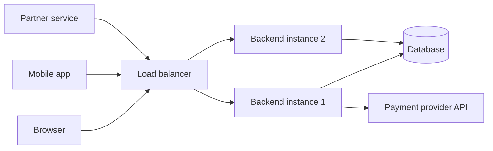
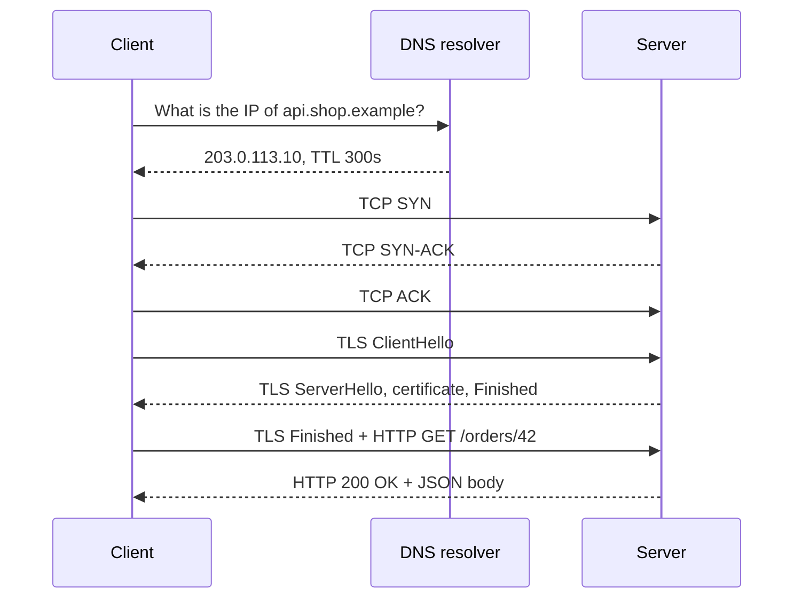
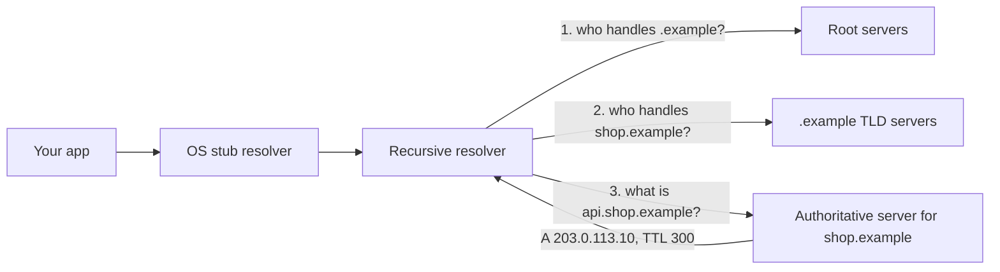
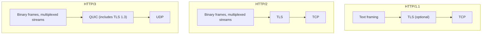
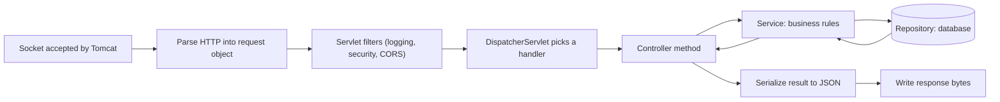

import Callout from '../../components/mdx/Callout.astro';

Every backend you will ever build, from a weekend side project to a payments platform handling thousands of requests per second, sits at the end of the same chain: a name gets resolved, a connection gets opened, the connection gets encrypted, a request gets sent, and a program somewhere decides what to send back. If you understand that chain, almost every production problem you meet later (slow first requests, certificate errors, timeouts, "works with curl but not from the browser") becomes something you can reason about instead of guess at.

This is Part 1 of **Backend Engineering: Zero to Principal**, a 13-part learning path. It is written for someone starting from zero: you can write a little code in some language, but you have never had to think about what happens on the wire.

<Callout variant="tip" title="What you'll learn">
- What a "backend" is, and where it sits relative to browsers, mobile apps and other services
- How DNS turns `api.example.com` into an IP address, and why DNS changes take time to spread
- What TCP gives you (and what it costs) and how TLS encrypts the connection
- The anatomy of an HTTP request and response, byte by byte
- How HTTP/1.1, HTTP/2 and HTTP/3 differ, and why it matters to you
- The full lifecycle of a request inside a Spring Boot service
- The latency numbers every backend engineer should carry in their head
</Callout>

**You should already know:** nothing beyond basic programming. This is where the series starts.

## What is a backend?

A **backend** is a program that runs on a machine you control, listens for requests over a network, and answers them. The thing sending the requests is the **client**: a browser, a mobile app, a command-line tool, or very often another backend.

The backend is where the things that must not be trusted to the client live:

- **Data** that outlives a single user session (accounts, orders, messages) lives in a database the backend owns.
- **Rules** ("you can only refund an order you paid for", "a username must be unique") are enforced on the server, because anything running on the client can be modified by the user.
- **Secrets** (database passwords, API keys for a payment provider) never leave the server.
- **Coordination** between many users (two people buying the last ticket) can only happen in one shared place.

A useful mental model: the frontend is a *view* of the system, and the backend is the system. If you deleted every frontend, the business would still have its data and its rules. If you deleted the backend, the frontend would be a picture of a website.



Notice the backend is usually *several identical copies* of the same program behind a load balancer. That detail will matter a lot in later parts (Part 8 is entirely about it), but for now just keep in mind that "the server" is rarely one machine.

## The journey of a single request

Let's follow one request end to end. A user's app calls:

```http
GET https://api.shop.example/orders/42
```

Before a single byte of that request reaches your code, four things must happen: the name must be resolved to an address (DNS), a reliable connection must be opened (TCP), that connection must be secured (TLS), and only then can the HTTP request be sent.



Each arrow that crosses the network costs time. The time for a packet to go to the server and back is called the **round-trip time (RTT)**. Inside one data centre an RTT is well under a millisecond; between Europe and the US east coast it is roughly 70-90 ms; to the other side of the planet it can be 200-300 ms. Counting round trips is the single most useful skill for understanding web latency, so we will count them as we go.


## DNS: turning names into addresses

Computers talk to IP addresses (`203.0.113.10` in IPv4, or something like `2001:db8::10` in IPv6). Humans and configuration files use names. The **Domain Name System** is a globally distributed, heavily cached database that maps one to the other.

### How a lookup works

When your app needs `api.shop.example`, it asks the operating system, which asks a **recursive resolver** (run by your ISP, your company, or a public service such as 1.1.1.1 or 8.8.8.8). If the resolver does not have the answer cached, it walks the hierarchy:



The **authoritative** server is the one you (or your DNS provider, such as Route 53 or Cloudflare) control. The others just point the way.

### Record types you will actually use

| Record | Meaning | Example |
|---|---|---|
| `A` | Name to IPv4 address | `api.shop.example. 300 IN A 203.0.113.10` |
| `AAAA` | Name to IPv6 address | `api.shop.example. 300 IN AAAA 2001:db8::10` |
| `CNAME` | Name is an alias of another name | `www.shop.example. CNAME shop-lb.cloudprovider.example.` |
| `MX` | Mail servers for the domain | `shop.example. MX 10 mail.shop.example.` |
| `TXT` | Free text, used for verification and email policies (SPF, DKIM, DMARC) | `"v=spf1 include:_spf.example ~all"` |
| `NS` | Which servers are authoritative for a zone | `shop.example. NS ns1.dnsprovider.example.` |

You can query any of these yourself:

```bash
dig api.shop.example A +short
dig api.shop.example +trace     # watch the full root -> TLD -> authoritative walk
```

### TTL: why "DNS propagation" takes time

Every record carries a **TTL** (time to live) in seconds. Resolvers are allowed to cache the answer for that long. If your record has a TTL of 3600 and you change the IP, some clients will keep using the old IP for up to an hour. There is no "propagation" in the sense of a push; there are just caches expiring.

<Callout variant="tip" title="Planning a migration">
If you know you are going to move a service to new IPs, lower the TTL (say to 60 seconds) a day or so *before* the move, wait at least one old-TTL period so every cache has the short TTL, then switch. After the move is stable, raise it again.
</Callout>

One more production reality: DNS is often the first thing to break and the last thing anyone suspects. A slow or failing resolver makes *every* outbound call from your service slow. Many runtimes also cache DNS themselves (the JVM, for example, has its own resolution cache controlled by the `networkaddress.cache.ttl` security property), which can make your service keep talking to an old IP long after the DNS record changed.

## TCP: a reliable pipe over an unreliable network

The internet itself (IP) only promises to *try* to deliver individual packets. Packets can be lost, duplicated, or arrive out of order. **TCP** (Transmission Control Protocol) builds a reliable, ordered byte stream on top of that:

- **Ordering and reliability:** every byte has a sequence number; the receiver acknowledges what it got; missing data is retransmitted.
- **Flow control:** the receiver advertises how much buffer space it has, so a fast sender cannot overwhelm a slow receiver.
- **Congestion control:** the sender starts slowly and speeds up while the network keeps up, backing off when packets are lost. This is why a brand-new connection cannot immediately use your full bandwidth ("slow start").

### The three-way handshake

Before any data flows, client and server exchange `SYN`, `SYN-ACK`, `ACK`. That costs **one full round trip** before the client can send its first byte of real data. A connection is identified by four values: source IP, source port, destination IP, destination port. Web servers usually listen on port 443 (HTTPS) or 80 (plain HTTP); the client picks a random high "ephemeral" port.

### Why connection reuse matters so much

Because every new connection costs a handshake (plus a TLS handshake, below, plus slow start), the most important performance trick in all of HTTP is: **don't open new connections if you can reuse an existing one.** HTTP/1.1 keeps connections open by default (keep-alive), and HTTP clients in your backend should use a **connection pool**. If you construct a new HTTP client per request in your service, you pay the handshake tax on every call and can run out of ephemeral ports under load.

```kotlin
// Good: one client, built once, reused for every call (it pools connections internally)
@Configuration
class HttpClients {
    @Bean
    fun paymentClient(builder: RestClient.Builder): RestClient =
        builder.baseUrl("https://payments.example").build()
}
```

## TLS: encryption and identity

Plain TCP is readable by anyone on the path: your coffee-shop Wi-Fi, an ISP, a compromised router. **TLS** (Transport Layer Security) wraps the TCP connection and gives you three properties:

1. **Confidentiality:** traffic is encrypted.
2. **Integrity:** tampering is detected.
3. **Authentication:** the client can verify it is really talking to `api.shop.example`, not an impostor.

HTTPS is simply HTTP sent over TLS.

### Certificates and the chain of trust

The server presents a **certificate**: a document that says "this public key belongs to `api.shop.example`", signed by a **Certificate Authority (CA)**. Your operating system and browser ship with a list of trusted root CAs. The server usually sends its own certificate plus one or more *intermediate* certificates; the client checks that the chain leads up to a root it trusts, that the name matches, and that the certificate has not expired.

Most certificates today are issued automatically by services like Let's Encrypt using the ACME protocol, and they are deliberately short-lived (90 days or less, and the industry is moving to shorter lifetimes). That is why **automated renewal** is not optional: expired certificates remain one of the most common causes of complete outages.

### The TLS 1.3 handshake

TLS 1.3 (RFC 8446) is the current version and should be the default. Its full handshake takes **one round trip**: the client sends its supported ciphers and a key share in the `ClientHello`, the server replies with its key share, certificate and `Finished`, and the client can send its encrypted HTTP request immediately after. (The older TLS 1.2 needed two round trips.) TLS 1.3 also supports **0-RTT resumption**, where a returning client sends data in its very first flight; that data can be replayed by an attacker, so servers should only accept it for safe, idempotent requests.

Adding it up for a brand-new HTTPS connection over TCP with TLS 1.3:

| Step | Round trips |
|---|---|
| DNS lookup (uncached) | 1 or more |
| TCP handshake | 1 |
| TLS 1.3 handshake | 1 |
| HTTP request and response | 1 |
| **Total** | **about 4** |

At 80 ms RTT that is roughly 320 ms before your server's code has even started to matter. On a reused connection, it is one round trip. That gap is why connection reuse, CDNs (which put servers closer to users, shrinking RTT) and HTTP/3 all exist.

<Callout variant="note" title="Where TLS ends">
In production, TLS is often **terminated** at a load balancer or reverse proxy: the client's encrypted connection ends there, and the proxy forwards the request to your service, either re-encrypted or over a private network. Your application then learns the original client IP and protocol from headers such as `X-Forwarded-For` / `X-Forwarded-Proto` or the standard `Forwarded` header (RFC 7239). Only trust those headers when they are set by your own proxy.
</Callout>

## HTTP: the language of the web

HTTP is a **request/response** protocol. The client sends a request; the server sends exactly one response. HTTP's *meaning* (methods, status codes, headers) is defined in RFC 9110, and that meaning is the same across HTTP/1.1, HTTP/2 and HTTP/3; only the way bytes are framed on the wire differs.

### Anatomy of a request

In HTTP/1.1 the request is plain text, which makes it easy to learn from:

```http
POST /orders HTTP/1.1
Host: api.shop.example
Content-Type: application/json
Accept: application/json
Authorization: Bearer eyJhbGciOi...
Content-Length: 45

{"productId": "p-123", "quantity": 2}
```

- **Request line:** method (`POST`), target (`/orders`), protocol version.
- **Headers:** `Name: value` metadata. `Host` is mandatory in HTTP/1.1 because one IP can serve many sites.
- **Blank line**, then an optional **body**.

### Anatomy of a response

```http
HTTP/1.1 201 Created
Content-Type: application/json
Location: /orders/9001
Cache-Control: no-store
Content-Length: 52

{"id": 9001, "status": "PENDING", "quantity": 2}
```

- **Status line:** version, **status code**, reason phrase.
- **Headers**, blank line, **body**.

### Methods and status codes, briefly

The method says what the client wants to do: `GET` (read), `POST` (create or process), `PUT` (replace), `PATCH` (partially modify), `DELETE` (remove), plus `HEAD` and `OPTIONS`. The status code says what happened, grouped by first digit:

| Class | Meaning | Examples |
|---|---|---|
| 1xx | Informational | `100 Continue`, `103 Early Hints` |
| 2xx | Success | `200 OK`, `201 Created`, `204 No Content` |
| 3xx | Redirection | `301 Moved Permanently`, `304 Not Modified` |
| 4xx | Client error: the request is wrong | `400`, `401`, `403`, `404`, `429` |
| 5xx | Server error: the server failed | `500`, `502`, `503`, `504` |

Part 2 is devoted to using these correctly. For now, the key distinction: **4xx means "you, the client, should change something"; 5xx means "we, the server, failed; retrying might help".**

### Headers that matter on day one

- `Content-Type`: the format of the body being sent (`application/json`).
- `Accept`: the formats the client can handle in the response.
- `Authorization`: credentials (covered in Part 4).
- `Cache-Control`: whether and how long a response can be cached (Part 5).
- `User-Agent`: what kind of client this is.
- Cookies: `Set-Cookie` in responses, `Cookie` in requests. This is how browsers keep sessions.

### HTTP is stateless

Each request carries everything the server needs to understand it. The server is not required to remember anything from the previous request on the same connection. "Logged-in sessions" are built *on top* of HTTP by sending a cookie or token on every request. Statelessness is a gift: it is what allows any of your ten backend instances to answer any request.

## HTTP/1.1 vs HTTP/2 vs HTTP/3

You will meet all three in production.



- **HTTP/1.1** (RFC 9112): one request at a time per connection. Browsers work around this by opening several connections per host (typically six). A slow response blocks everything behind it on that connection; this is called **head-of-line blocking**.
- **HTTP/2** (RFC 9113): a single TCP connection carries many concurrent **streams**, with binary framing and compressed headers (HPACK). No more need for six connections. But because it still runs on TCP, a single lost packet stalls *all* streams until it is retransmitted: head-of-line blocking moved down a layer.
- **HTTP/3** (RFC 9114) runs over **QUIC** (RFC 9000), a transport built on UDP with TLS 1.3 built in. Streams are independent at the transport level, so a lost packet only stalls its own stream. The transport and crypto handshakes are combined, so a new connection needs one round trip instead of two, and connections can survive a phone switching from Wi-Fi to mobile data.

As a backend engineer you rarely implement these; your load balancer, CDN or server does. What matters is knowing that public-facing traffic is usually HTTP/2 or HTTP/3 from the client to the edge, while service-to-service traffic inside your network is often HTTP/1.1 or HTTP/2 (gRPC, for example, requires HTTP/2).


## Inside the server: the request lifecycle

The request has arrived at your machine. What happens now? Using Spring Boot 4 with Spring MVC as an example (most frameworks have the same shape):



1. **The web server** (embedded Tomcat by default) accepts the TCP connection and parses the bytes into a request object.
2. **Filters** run in order: authentication, request logging, tracing, CORS checks. A filter can reject the request before your code sees it.
3. **Routing:** Spring's `DispatcherServlet` matches the method and path (`GET /orders/{id}`) to a controller method.
4. **Deserialization and validation:** path variables, query parameters and JSON bodies are converted into typed objects.
5. **Your code:** the controller calls a service, which applies business rules and talks to the database or other services.
6. **Serialization:** the return value is turned into JSON, a status code and headers are set.
7. **The response** is written back on the same connection.

A minimal endpoint looks like this:

```kotlin
@RestController
@RequestMapping("/orders")
class OrderController(private val orders: OrderService) {

    @GetMapping("/{id}")
    fun get(@PathVariable id: Long): ResponseEntity<OrderDto> =
        orders.find(id)
            ?.let { ResponseEntity.ok(it) }
            ?: ResponseEntity.notFound().build()
}
```

### Threads: how a server handles many requests at once

A classic servlet server uses a **thread per request**: Tomcat keeps a pool of worker threads (200 by default, configurable with `server.tomcat.threads.max`), and each in-flight request occupies one thread until its response is written. If every request takes 100 ms and you have 200 threads, one instance can serve roughly 2,000 requests per second; if a downstream dependency slows to 2 seconds, the same pool can only serve 100 per second and starts queueing. This is your first taste of capacity math (Part 8 goes deep). Java 21+ **virtual threads** (enabled in Spring Boot with `spring.threads.virtual.enabled=true`) and Kotlin coroutines (see [the Spring Boot + coroutines guide](/blog/spring-boot-kotlin-coroutines-guide)) make waiting much cheaper, but they do not make a slow database faster.

## Latency numbers to carry in your head

You do not need exact values, but you need the *orders of magnitude*. These are approximate and depend on hardware, but the ratios are stable:

| Operation | Rough time |
|---|---|
| Read from main memory | ~100 ns |
| Read 1 MB sequentially from memory | ~a few to tens of µs |
| Random read from an NVMe SSD | ~10-100 µs |
| Round trip within one data centre | ~0.1-0.5 ms |
| A simple indexed database query (including network) | ~0.5-5 ms |
| Round trip Europe to US east coast | ~70-90 ms |
| Round trip Europe to Australia | ~250-300 ms |
| New HTTPS connection across an ocean | ~300+ ms |

The lesson: **a network hop is thousands of times slower than memory**, and a cross-continent hop is hundreds of times slower than a hop inside a data centre. Backend performance work is mostly about removing round trips, moving data closer, and avoiding work, not about micro-optimising code.

## Seeing it for yourself

`curl` can show you every phase we discussed:

```bash
curl -s -o /dev/null https://example.com -w '\
dns:     %{time_namelookup}s\n\
connect: %{time_connect}s\n\
tls:     %{time_appconnect}s\n\
ttfb:    %{time_starttransfer}s\n\
total:   %{time_total}s\n'
```

Each value is cumulative from the start. `ttfb` (time to first byte) minus `tls` is roughly "network round trip plus server processing time". Run it twice: on many machines the second run's DNS time drops to near zero because the answer is cached. Add `-v` to see the TLS handshake and raw headers, or `--http2` / `--http3` (if your curl build supports it) to compare protocols.

## Common mistakes

- **Creating a new HTTP client (and connection) per request.** You pay DNS, TCP and TLS handshakes every time and can exhaust ephemeral ports. Build clients once and reuse them.
- **Ignoring DNS TTLs during migrations.** Changing a record with a 24-hour TTL and expecting traffic to move in minutes.
- **Forgetting certificate renewal.** Manual certificate processes eventually fail. Automate renewal and alert well before expiry.
- **Trusting `X-Forwarded-For` from anyone.** Any client can send that header. Only honour it when your own proxy sets it, and configure your framework to know which proxies are trusted.
- **Treating every error the same.** Retrying a `400 Bad Request` will never succeed; not retrying a `503` may give up too early.
- **Assuming the network is fast and reliable.** Every remote call needs a timeout. A call without a timeout can hang a thread forever.
- **Putting secrets or business rules in the client.** Anything in a browser bundle or mobile app can be read and modified.

## Interview questions

<details>
<summary>What happens when you type a URL into a browser and press Enter?</summary>

A strong junior answer walks the layers in order and names each step:

1. The browser parses the URL (scheme, host, port, path).
2. **DNS:** it checks its cache, then the OS, then a recursive resolver, which walks root, TLD and authoritative servers to get an IP address. Answers are cached for the record's TTL.
3. **TCP:** a three-way handshake (`SYN`, `SYN-ACK`, `ACK`) to port 443. One round trip.
4. **TLS:** the TLS 1.3 handshake exchanges keys and the server's certificate, which the browser validates against trusted CAs and the hostname. One more round trip.
5. **HTTP:** the browser sends a `GET` request with headers (`Host`, cookies, `Accept`...).
6. The server (often via a load balancer) routes it to an application, which may query a database and returns a response with a status code, headers and an HTML body.
7. The browser parses the HTML and makes further requests for CSS, JS and images, reusing the connection where possible.

Bonus points: mentioning HTTP/2 multiplexing or HTTP/3 over QUIC, or CDNs serving static assets close to the user.

</details>

<details>
<summary>What is the difference between TCP and UDP? Why does HTTP/3 use UDP?</summary>

TCP provides a reliable, ordered, connection-oriented byte stream with flow and congestion control; it costs a handshake and suffers head-of-line blocking (one lost packet delays everything after it). UDP just sends independent datagrams with no delivery or ordering guarantees and no handshake.

HTTP/3 uses QUIC, which is built on UDP but re-implements reliability, ordering *per stream*, and congestion control in user space, with TLS 1.3 integrated. Using UDP lets QUIC avoid TCP's cross-stream head-of-line blocking, combine the transport and crypto handshakes, and evolve without waiting for operating-system TCP stacks and middleboxes to change.

</details>

<details>
<summary>What does "HTTP is stateless" mean, and how do logins work then?</summary>

Each request is self-contained; the protocol does not require the server to remember earlier requests. Logins work by having the client send a credential with every request: a session cookie that the server looks up in a session store, or a self-contained token (such as a JWT) that the server verifies. Statelessness at the protocol level is what lets any instance behind a load balancer handle any request, as long as session data lives somewhere shared (or in the token itself).

</details>

<details>
<summary>What is DNS TTL and how would you safely move a service to a new IP address?</summary>

TTL is how many seconds resolvers may cache a record. Clients may keep using the old IP for up to the TTL after a change. To migrate safely: lower the TTL well in advance (and wait at least the old TTL so caches pick up the short one), keep the old servers running during the switch, change the record, monitor traffic draining from the old IPs, then raise the TTL again. Mention that some clients and runtimes cache longer than the TTL, so keeping the old endpoint alive for a while is wise.

</details>

<details>
<summary>What does TLS give you, and how does the client know the server is genuine?</summary>

Confidentiality (encryption), integrity (tamper detection) and server authentication. The server presents a certificate binding its public key to its hostname, signed by a Certificate Authority through a chain of intermediates. The client checks the chain leads to a trusted root in its store, the hostname matches, and the certificate is within its validity period. The handshake proves the server holds the private key matching the certificate.

</details>

<details>
<summary>Roughly how long does a first HTTPS request take to a server 80 ms away, and how could you make it faster?</summary>

Count round trips: DNS (if uncached, at least one), TCP (1), TLS 1.3 (1), HTTP request/response (1), so about 4 RTTs, roughly 320 ms plus server time. To improve: reuse connections (keep-alive, connection pools), use a CDN or edge location to reduce RTT, use HTTP/3 to combine handshakes, use TLS session resumption, keep DNS TTLs reasonable so lookups are cached, and reduce the number of sequential requests.

</details>

<details>
<summary>What is the difference between a 4xx and a 5xx status code? Give examples.</summary>

4xx: the client's request is the problem and repeating it unchanged will not help (`400` malformed, `401` not authenticated, `403` not allowed, `404` not found, `429` too many requests, where waiting and retrying later is the expected fix). 5xx: the server failed to handle a possibly valid request (`500` bug, `502` bad response from upstream, `503` temporarily unavailable, `504` upstream timeout); retrying with backoff may succeed. The distinction drives client retry logic and alerting: a spike in 5xx pages the on-call engineer, a spike in 4xx usually points at a client bug.

</details>

<details>
<summary>How does a thread-per-request server like Tomcat behave when a downstream dependency becomes slow?</summary>

Each request holds a worker thread for its whole duration. If a dependency goes from 50 ms to 5 s, threads stay busy 100 times longer, the pool (200 threads by default) fills up, new requests queue and then time out, and even endpoints that do not use that dependency become slow because they cannot get a thread. The fixes are timeouts on every outbound call, limiting concurrency per dependency, and (for efficiency, not as a cure) virtual threads or coroutines.

</details>

## Key takeaways

- A backend owns the data, rules, secrets and coordination; clients are untrusted views.
- A first HTTPS request costs DNS + TCP + TLS + HTTP: about four round trips. Reusing connections removes most of that.
- DNS is a cache hierarchy; TTL controls how fast changes take effect.
- TLS 1.3 gives encryption, integrity and identity in one round trip; automate certificate renewal.
- HTTP semantics (methods, status codes, headers) are the same across HTTP/1.1, /2 and /3; only the framing and transport differ.
- Inside the server, a request flows through filters, routing, your controller and service, and back out as serialized bytes, usually holding one thread the whole time.
- Think in round trips and orders of magnitude: network hops dominate latency.

Next: [Part 2: REST API Design](/blog/backend-02-rest-api-design)
