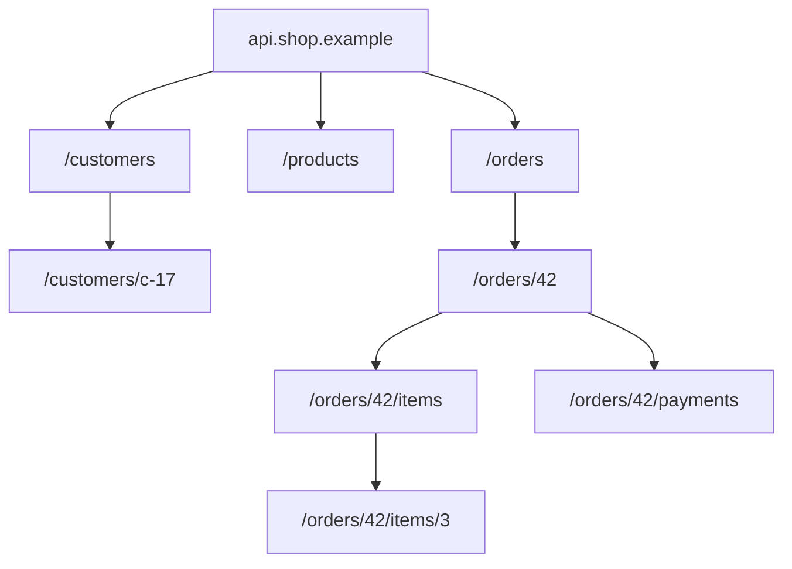
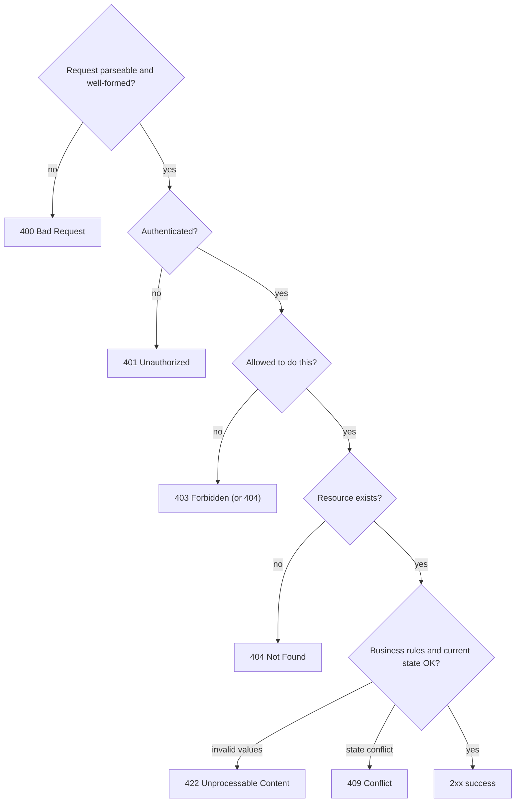
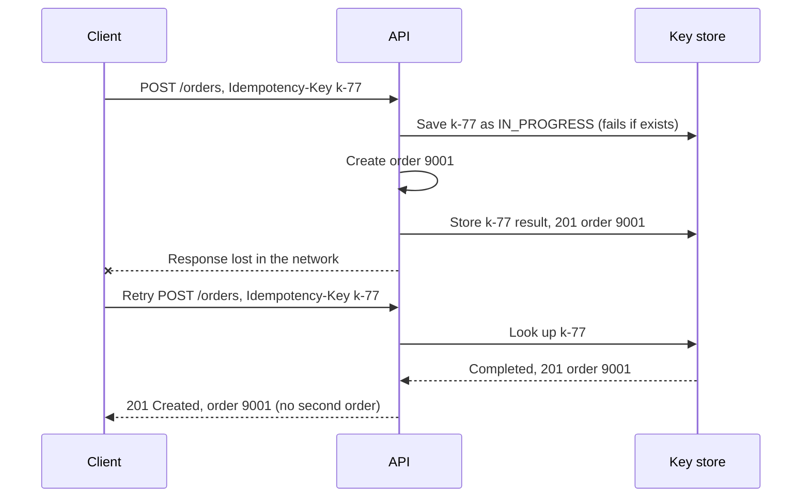
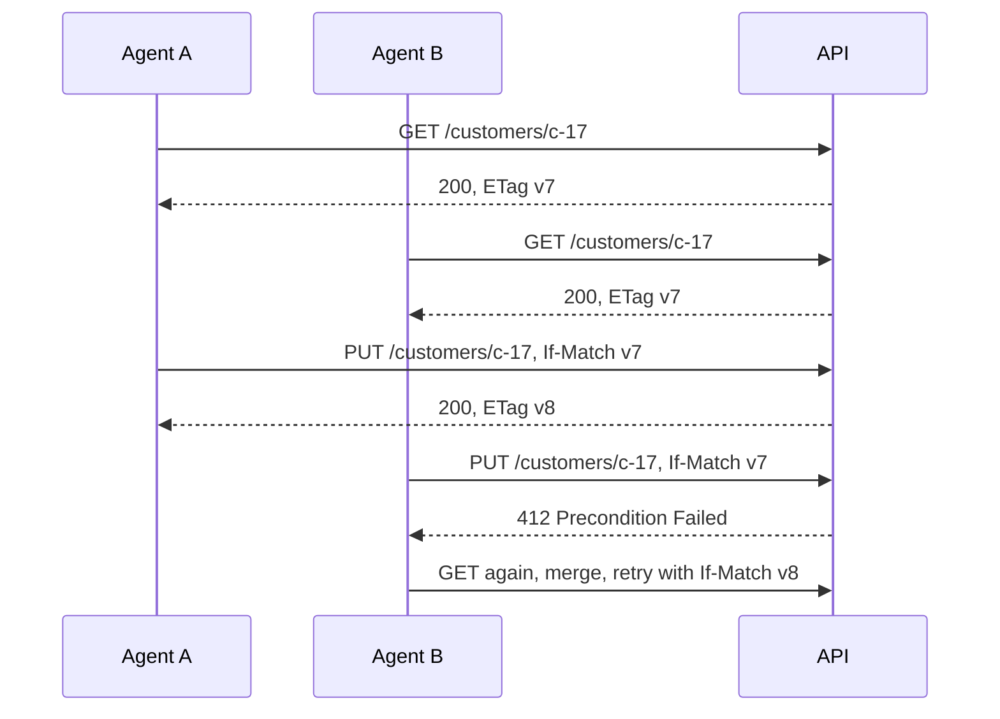
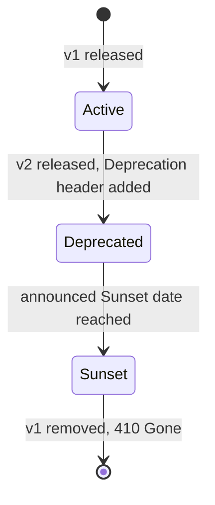

import Callout from '../../components/mdx/Callout.astro';

An API is a promise. The moment a mobile app ships that calls `GET /orders/42`, you can no longer change what that URL returns without breaking real users who have not updated their app. Good API design is mostly about making promises you can keep: predictable URLs, honest status codes, safe retries, and errors that tell the caller what to do next.

This is Part 2 of **Backend Engineering: Zero to Principal**. We will design a small but realistic API for an online shop, decision by decision, and implement the interesting parts in Kotlin with Spring Boot 4.

<Callout variant="tip" title="What you'll learn">
- What "REST" actually means in practice, and how to model resources and URLs
- Which HTTP method to use, and what *safe* and *idempotent* really mean
- How to choose status codes that clients can act on
- How to make `POST` safe to retry with idempotency keys
- Optimistic concurrency with `ETag` and `If-Match`
- Offset vs cursor pagination, filtering and sorting
- Versioning and evolving an API without breaking clients
- Standard error responses with RFC 9457 Problem Details
</Callout>

**You should already know:** how an HTTP request and response are structured, what status code classes mean, and that HTTP is stateless ([Part 1: How the Web Works](/blog/backend-01-how-the-web-works)).

## What REST means (and what it doesn't)

REST ("Representational State Transfer") comes from Roy Fielding's 2000 dissertation, where it describes the architectural style of the web itself: clients and servers, stateless requests, cacheable responses, and a *uniform interface* in which you manipulate **resources** through **representations** of them.

In day-to-day industry use, "REST API" means something more modest: an HTTP API where

- the URL identifies a **thing** (a resource), not an action,
- the HTTP **method** says what you want to do to it,
- the **status code** says what happened,
- the body is usually JSON,
- and each request stands on its own.

Fielding's full definition also includes *hypermedia* (responses containing links that tell the client what it can do next, often called HATEOAS). Few production JSON APIs go all the way there, and that is fine. What matters is using HTTP the way it was designed, because then every proxy, cache, client library and engineer already understands your API.

<Callout variant="note" title="REST is not the only option">
gRPC (binary, schema-first, great for internal service-to-service calls) and GraphQL (client chooses the shape of the response, great for varied UIs over one graph of data) are both legitimate choices. REST over HTTP+JSON remains the default for public APIs because it needs nothing but an HTTP client.
</Callout>

## Modeling resources and URLs

Start with the **nouns** of your domain. For a shop: customers, products, orders, the items in an order, payments.



Conventions that have become near-universal:

- **Plural nouns for collections**: `/orders`, and `/orders/42` for one member.
- **Nest only for true ownership**: an item cannot exist without its order, so `/orders/42/items` makes sense. A product exists independently, so it is `/products/p-123`, not `/orders/42/products/p-123`. Avoid nesting deeper than one or two levels.
- **Lowercase, hyphenated path segments**: `/gift-cards`, not `/giftCards` or `/Gift_Cards`.
- **No verbs in paths** for ordinary operations: `POST /orders`, not `POST /createOrder`.
- **Opaque, stable IDs**: clients should treat `42` or `ord_8f3k...` as a string they never parse. Exposing auto-increment integers leaks how many orders you have and invites people to guess other IDs, so many public APIs use random or prefixed IDs.

### When an action is not CRUD

Some operations really are actions: cancelling an order, refunding a payment, resending an email. Two common, acceptable patterns:

1. **Model the outcome as a resource**: `POST /orders/42/cancellation` creates a cancellation; `POST /payments/p-9/refunds` creates a refund. This often turns out to be good design, because refunds have their own IDs, amounts and statuses anyway.
2. **A sub-resource action** when there is no natural noun: `POST /orders/42/cancel`. Google's API design guide formalises this as "custom methods" with the syntax `POST /orders/42:cancel`.

Pick one style and use it consistently.

## Methods: safe, idempotent, and which to use

HTTP methods carry *guarantees* defined in RFC 9110. Two properties matter most:

- **Safe**: the request is read-only from the client's point of view. Caches, crawlers and prefetchers may send it freely.
- **Idempotent**: sending the same request once or ten times leaves the server in the same state. Clients and proxies may automatically retry it after a network failure.

| Method | Purpose | Safe | Idempotent | Typical success |
|---|---|---|---|---|
| `GET` | Read a resource or collection | Yes | Yes | `200` |
| `HEAD` | Like `GET`, headers only | Yes | Yes | `200` |
| `POST` | Create a member, or run a process | No | **No** | `201` or `200`/`202` |
| `PUT` | Replace the resource entirely (or create at a known URL) | No | Yes | `200` or `204`, `201` if created |
| `PATCH` | Partially modify | No | Not guaranteed | `200` or `204` |
| `DELETE` | Remove | No | Yes | `204` (or `200` with body) |
| `OPTIONS` | Ask what is allowed (used by CORS preflight) | Yes | Yes | `204` or `200` |

Idempotent describes the **server state**, not the response. Deleting an already-deleted order may return `404` the second time; the state ("order 42 does not exist") is the same, so `DELETE` is still idempotent.

### PUT vs PATCH

`PUT` sends the *complete* new representation. If the client omits a field, that field is cleared. `PATCH` sends only the changes. For JSON, there are two standard patch formats:

- **JSON Merge Patch** (RFC 7396, `Content-Type: application/merge-patch+json`): send a partial object; fields present are replaced, fields set to `null` are removed. Simple and covers most needs.
- **JSON Patch** (RFC 6902, `application/json-patch+json`): a list of operations (`add`, `remove`, `replace`, `move`, `copy`, `test`). More powerful, more complex.

```http
PATCH /customers/c-17 HTTP/1.1
Content-Type: application/merge-patch+json

{"phone": "+43 660 1234567", "nickname": null}
```

### The POST retry problem

`POST` is not idempotent. Imagine a client sends `POST /orders`, the server creates the order, and then the connection drops before the response arrives. The client does not know whether the order exists. If it retries, the customer may be charged twice. If it does not, the order may be lost. We will solve this properly with idempotency keys below.

## Status codes clients can act on

A status code is an instruction to the client's code, not just a label for humans. Use the most specific code that is true, and keep the set small and consistent.


The ones you will use constantly:

- **`200 OK`**: success with a body.
- **`201 Created`**: a resource was created. Include a `Location` header pointing to it, and usually the created representation in the body.
- **`202 Accepted`**: accepted for processing later (an export, a video encode). Return a URL where the client can check progress.
- **`204 No Content`**: success, nothing to return (common for `DELETE`).
- **`400 Bad Request`**: malformed request: invalid JSON, wrong types, missing required field.
- **`401 Unauthorized`**: you are *not authenticated* (no or invalid credentials). Despite the name, it is about identity. RFC 9110 requires a `WWW-Authenticate` header with it.
- **`403 Forbidden`**: we know who you are, and you are *not allowed*.
- **`404 Not Found`**: no such resource. Also a valid choice instead of `403` when you do not want to reveal that a resource exists.
- **`409 Conflict`**: the request conflicts with current state (username taken, order already shipped so it cannot be cancelled).
- **`412 Precondition Failed`**: an `If-Match` condition failed (see concurrency below).
- **`415 Unsupported Media Type`**: you sent XML to a JSON-only endpoint.
- **`422 Unprocessable Content`**: the request is well-formed but semantically invalid (quantity must be positive). Some teams use `400` for all validation errors; either is defensible if you are consistent.
- **`429 Too Many Requests`**: rate limited. Send `Retry-After`.
- **`500 Internal Server Error`**: a bug. Never intentionally return it.
- **`502 Bad Gateway` / `504 Gateway Timeout`**: an upstream behind a proxy failed or timed out.
- **`503 Service Unavailable`**: temporarily overloaded or in maintenance; `Retry-After` is welcome.



<Callout variant="warning" title="Never return 200 with an error inside">
`200 OK` with a body of `{"success": false, "error": "not found"}` breaks every generic tool: monitoring counts it as success, caches may store it, client libraries will not throw. Let the status code tell the truth.
</Callout>

## Designing request and response bodies

A few conventions that save pain later:

- **Pick one field naming style** (`camelCase` is most common in JSON APIs; `snake_case` is fine too) and never mix.
- **Dates and times in ISO 8601 / RFC 3339 with a timezone**: `"2026-10-23T09:30:00Z"`. Never a local time without offset.
- **Money as an integer of the smallest unit plus a currency** (`{"amount": 1999, "currency": "EUR"}`) or as a decimal string. Never as a binary floating-point number, which cannot represent `0.10` exactly.
- **Enums as strings** (`"status": "SHIPPED"`), and document that new values may appear, so clients must handle unknown ones.
- **Return the created or updated resource** so clients do not need a second request.
- **Wrap collections in an object** (`{"items": [...], "nextCursor": "..."}`) rather than returning a bare array, so you can add pagination metadata later without breaking clients.

Separate your API models (DTOs) from your database entities. If you serialise JPA entities directly you will leak internal fields, trigger lazy-loading surprises (see [Hibernate vs JPA](/blog/hibernate-vs-jpa-complete-guide)) and make it impossible to change your schema without changing your API.

```kotlin
data class CreateOrderRequest(
    @field:NotBlank val productId: String,
    @field:Positive val quantity: Int,
)

data class OrderResponse(
    val id: String,
    val status: OrderStatus,
    val quantity: Int,
    val totalAmount: Long,   // minor units, e.g. cents
    val currency: String,
    val createdAt: Instant,
)

@RestController
@RequestMapping("/orders")
class OrderController(private val orders: OrderService) {

    @PostMapping
    fun create(@Valid @RequestBody body: CreateOrderRequest): ResponseEntity<OrderResponse> {
        val order = orders.create(body)
        return ResponseEntity
            .created(URI.create("/orders/${order.id}"))
            .body(order)
    }
}
```

## Idempotency keys: making POST safe to retry

The standard fix for the `POST` retry problem, popularised by payment APIs such as Stripe, is the **idempotency key**. The client generates a unique value (a UUID) per *logical operation* and sends it in a header. If the server sees the same key again, it returns the stored result of the first attempt instead of doing the work twice. The `Idempotency-Key` header is being standardised by the IETF HTTP APIs working group (still an Internet-Draft at the time of writing), but the pattern is long established.



The details that make it actually work:

1. **Store the key atomically before doing the work**, with a unique constraint, so two concurrent retries cannot both proceed. If the key exists and is still in progress, return `409 Conflict` and let the client retry later.
2. **Store the response** (status and body) with the key, and replay it on repeats.
3. **Bind the key to the request**: store a hash of the request body; if the same key arrives with a *different* body, reject it with an error (typically `422`), because that is a client bug.
4. **Scope keys per client** (per API key or user) so one customer cannot collide with another.
5. **Expire keys** after a reasonable window (Stripe keeps them for 24 hours).
6. Ideally, create the business record and save the key result **in the same database transaction**, so you never end up with an order but no stored key.

```sql
CREATE TABLE idempotency_keys (
    client_id     TEXT        NOT NULL,
    key           TEXT        NOT NULL,
    request_hash  TEXT        NOT NULL,
    status        TEXT        NOT NULL,   -- IN_PROGRESS or COMPLETED
    response_code INT,
    response_body JSONB,
    created_at    TIMESTAMPTZ NOT NULL DEFAULT now(),
    PRIMARY KEY (client_id, key)
);
```

Part 6 revisits idempotency in the context of message queues, where it is just as essential.

## Optimistic concurrency with ETag and If-Match

Two support agents open customer `c-17` at the same time. Agent A changes the phone number and saves; agent B changes the address and saves a few seconds later, sending the whole old record with only the address changed. Agent A's change is silently lost. This is the **lost update** problem.

HTTP has a built-in solution. The server sends an **`ETag`** (an opaque version identifier) with every representation. The client sends it back in **`If-Match`** when modifying. If the resource changed in between, the server refuses with `412 Precondition Failed`.



In the database this is usually a `version` column that increments on each update (`@Version` in JPA does exactly this), and the ETag is derived from it. A server can also respond `428 Precondition Required` (RFC 6585) to force clients to send `If-Match` on updates. ETags also power cheap caching via `If-None-Match` and `304 Not Modified`, which Part 5 covers.

## Pagination, filtering and sorting

Never return an unbounded collection. A `GET /orders` that works with 50 rows in development will try to serialise 3 million rows in production.

### Offset pagination

```http
GET /orders?limit=20&offset=40
```

It is simple, maps directly to SQL `LIMIT 20 OFFSET 40`, and lets users jump to page 37. But it has two real problems:

- **Performance**: the database still has to walk past all skipped rows, so `OFFSET 1000000` gets slow.
- **Consistency**: if a new row is inserted while a user is paging, every row shifts by one, and the user sees a duplicate or misses one.

### Cursor (keyset) pagination

Instead of "skip N rows", the client says "give me rows after this one":

```http
GET /orders?limit=20&cursor=eyJjcmVhdGVkQXQiOiIyMDI2LTEwLTIzVDA5OjMwOjAwWiIsImlkIjo5MDAxfQ
```

The cursor is an opaque, usually base64-encoded value holding the sort key of the last row returned (here a timestamp and the id as a tie-breaker). The server turns it into a `WHERE` clause that an index can satisfy directly:

```sql
SELECT id, status, created_at
FROM orders
WHERE customer_id = $1
  AND (created_at, id) < ($2, $3)      -- values decoded from the cursor
ORDER BY created_at DESC, id DESC
LIMIT 21;                               -- one extra row tells us if there is a next page
```


Cursor pagination stays fast at any depth and is stable under inserts, but you cannot jump to an arbitrary page. Use **offset** for small admin tables where page numbers matter; use **cursors** for feeds, large lists and public APIs. The response should tell the client how to continue:

```json
{
  "items": [ { "id": "9001", "status": "PENDING" } ],
  "nextCursor": "eyJjcmVhdGVkQXQiOi...",
  "hasMore": true
}
```

You can also (or instead) send links in the standard `Link` header (RFC 8288): `Link: <https://api.shop.example/orders?cursor=...>; rel="next"`.

### Filtering and sorting

Keep it boring and predictable:

```http
GET /orders?status=SHIPPED&createdAfter=2026-10-01T00:00:00Z&sort=-createdAt&limit=50
```

- Filters are query parameters named after fields.
- `sort` takes a field name, with `-` for descending.
- **Allow-list** which fields can be filtered and sorted. Every sortable field needs an index (Part 3), and letting clients sort by anything is an easy way to let them take down your database.
- Enforce a maximum `limit` (say 100), regardless of what the client asks for.

## Versioning and evolving an API

The best versioning strategy is to **rarely need a new version**. Most changes can be made in a backward-compatible way.

**Non-breaking (safe) changes:**

- Adding a new endpoint.
- Adding an optional request field.
- Adding a field to a response (clients must ignore unknown fields; say so in your docs).
- Adding a new enum value, *if* you told clients to expect unknown values.

**Breaking changes:**

- Removing or renaming a field or endpoint.
- Changing a field's type or meaning.
- Making an optional field required.
- Changing error codes or status codes clients depend on.

When you truly need a breaking change, introduce a new version and run both for a while.



Common ways to carry the version:

| Approach | Example | Notes |
|---|---|---|
| URI path | `/v1/orders` | Most common; obvious in logs and easy to route |
| Header | `API-Version: 2` | Keeps URLs clean; less visible |
| Media type | `Accept: application/vnd.shop.v2+json` | Most "RESTful"; least convenient |
| Date-based | `Stripe-Version: 2026-09-30` | Fine-grained; needs strong tooling |

Spring Framework 7 (the basis of Spring Boot 4) added first-class API versioning: you configure *how* the version is resolved (path segment, header, query parameter or media type parameter) and declare it on mappings with the new `version` attribute.

```kotlin
@Configuration
class ApiVersioningConfig : WebMvcConfigurer {
    override fun configureApiVersioning(configurer: ApiVersionConfigurer) {
        configurer.useRequestHeader("API-Version")
    }
}

@RestController
@RequestMapping("/orders")
class OrderQueryController(private val orders: OrderService) {

    @GetMapping("/{id}", version = "1")
    fun getV1(@PathVariable id: String): OrderResponseV1 = orders.findV1(id)

    @GetMapping("/{id}", version = "2")
    fun getV2(@PathVariable id: String): OrderResponse = orders.find(id)
}
```

When retiring a version, tell clients in-band: the `Deprecation` header (RFC 9745) marks a resource as deprecated and the `Sunset` header (RFC 8594) announces the date it will stop working. Then watch your logs to see who is still calling the old version before you turn it off.

Write the contract down. An OpenAPI document gives clients generated SDKs and lets you catch breaking changes in CI; see [OpenAPI: spec-first vs code-first](/blog/openapi-spec-first-vs-code-first) for how to choose a workflow.

## Errors: RFC 9457 Problem Details

Every API needs errors, and every team used to invent its own JSON shape for them. **RFC 9457** ("Problem Details for HTTP APIs", which replaced RFC 7807 in 2023) standardises one, with the media type `application/problem+json`:

```http
HTTP/1.1 409 Conflict
Content-Type: application/problem+json

{
  "type": "https://api.shop.example/problems/order-not-cancellable",
  "title": "Order cannot be cancelled",
  "status": 409,
  "detail": "Order 42 has already shipped.",
  "instance": "/orders/42/cancellation",
  "orderStatus": "SHIPPED"
}
```

| Member | Meaning |
|---|---|
| `type` | A URI identifying the *kind* of problem. Clients switch on this. Ideally it resolves to human documentation. Defaults to `about:blank`. |
| `title` | Short, human-readable summary of the problem type. Should not change between occurrences. |
| `status` | The HTTP status code, repeated for convenience. |
| `detail` | Human-readable explanation of *this* occurrence. |
| `instance` | A URI identifying this specific occurrence. |
| extensions | Any extra members you define, such as `orderStatus` or a list of field errors. |

Spring has supported this natively since Spring Framework 6 with the `ProblemDetail` class. Setting `spring.mvc.problemdetails.enabled=true` makes Spring Boot register a handler that renders Spring MVC's built-in exceptions (bad JSON, missing parameters, validation failures) as Problem Details. Once you need your own mappings, write a `@RestControllerAdvice` that extends `ResponseEntityExceptionHandler` (Boot then backs off and uses yours) and map domain exceptions in one place:

```kotlin
class OrderNotCancellableException(val orderId: String, val status: OrderStatus) :
    RuntimeException("Order $orderId is $status")

@RestControllerAdvice
class ApiExceptionHandler : ResponseEntityExceptionHandler() {

    @ExceptionHandler(OrderNotCancellableException::class)
    fun notCancellable(ex: OrderNotCancellableException): ProblemDetail =
        ProblemDetail.forStatusAndDetail(
            HttpStatus.CONFLICT,
            "Order ${ex.orderId} has already ${ex.status.name.lowercase()}.",
        ).apply {
            type = URI.create("https://api.shop.example/problems/order-not-cancellable")
            title = "Order cannot be cancelled"
            setProperty("orderStatus", ex.status.name)
        }
}
```

For validation errors, add an extension member listing every invalid field at once, so the client can show all problems in a single round trip:

```json
{
  "type": "https://api.shop.example/problems/validation",
  "title": "Request validation failed",
  "status": 422,
  "errors": [
    { "field": "quantity", "message": "must be greater than 0" },
    { "field": "productId", "message": "must not be blank" }
  ]
}
```

<Callout variant="warning" title="Do not leak internals">
Never put stack traces, SQL, class names or internal hostnames in error bodies. Log them server-side with a correlation or trace ID, and return that ID to the client so support can find the log entry.
</Callout>

## A short design checklist

Before you ship an endpoint, ask:

1. Is the URL a noun, and is the method the right one?
2. Is it safe to retry? If it is a `POST` that creates or charges, does it accept an idempotency key?
3. Does every outcome have a specific, correct status code and a Problem Details body?
4. Is every collection paginated with an enforced maximum page size?
5. Can two clients updating the same resource lose each other's changes?
6. Can I add fields later without breaking anyone?
7. Is it documented in the OpenAPI spec, with examples?

## Common mistakes

- **Verbs in URLs** for plain CRUD (`/getOrder`, `/createUser`).
- **`200 OK` for errors**, or `500` for client mistakes like invalid input.
- **Confusing `401` and `403`.** `401` means "who are you?"; `403` means "I know who you are, and no".
- **Unbounded list endpoints** and arbitrary client-controlled sorting.
- **Retrying non-idempotent `POST` requests blindly**, causing duplicate orders or payments.
- **Exposing database entities directly** as API responses.
- **Floats for money** and timestamps without timezones.
- **Breaking changes without a new version**, such as renaming a field "because it's cleaner".
- **Inconsistent error formats** between endpoints, so clients need special cases everywhere.

## Interview questions

<details>
<summary>What is the difference between safe and idempotent methods? Give examples.</summary>

Safe methods do not change server state from the client's perspective (`GET`, `HEAD`, `OPTIONS`); they can be called freely, prefetched and cached. Idempotent methods may change state, but repeating the same request has the same effect as sending it once (`PUT`, `DELETE`, plus all safe methods). `POST` is neither, and `PATCH` is not guaranteed to be idempotent. A strong answer adds that idempotency is about server state, not the response: a second `DELETE` might return `404`, but the state is unchanged. It also explains why this matters: clients and proxies can safely retry idempotent requests after a network failure.

</details>

<details>
<summary>When would you use PUT versus PATCH versus POST?</summary>

`POST` to a collection when the server assigns the ID (`POST /orders`), or to trigger a process. `PUT` to replace a resource completely at a URL the client knows; omitted fields are cleared, and it is idempotent. `PATCH` for partial updates, typically with JSON Merge Patch (RFC 7396) where you send only the changed fields and `null` deletes. Mention that `PUT` can also create a resource at a client-chosen URL, returning `201`.

</details>

<details>
<summary>A client's POST /payments request times out. How do you design the API so the client can retry without charging twice?</summary>

Use an idempotency key: the client generates a UUID per logical payment and sends it in an `Idempotency-Key` header, reusing it on retries. The server atomically inserts the key (unique per client) before processing; on a repeat it returns the stored response instead of processing again; if the first attempt is still in progress it returns `409`; if the same key comes with a different body it rejects it. Store the result in the same transaction as the payment record and expire keys after a window such as 24 hours. A strong answer notes this is needed because timeouts make the outcome unknown, not failed.

</details>

<details>
<summary>What is the difference between 401 and 403? And when might you return 404 instead of 403?</summary>

`401 Unauthorized` means the request lacks valid authentication; the client should authenticate (and the server sends `WWW-Authenticate`). `403 Forbidden` means the client is authenticated but lacks permission. Returning `404` instead of `403` hides the existence of a resource from users who should not even know it exists, for example another customer's order, which prevents ID enumeration.

</details>

<details>
<summary>Compare offset and cursor pagination. Which would you choose for an infinite-scroll feed?</summary>

Offset (`limit`/`offset`) is simple and supports jumping to page N, but the database must scan and discard skipped rows (slow at deep offsets) and results shift when rows are inserted or deleted, causing duplicates or gaps. Cursor (keyset) pagination encodes the last seen sort key and queries `WHERE (created_at, id) < (...)`, which uses an index, stays fast at any depth and is stable under inserts, but cannot jump to arbitrary pages. For an infinite-scroll feed, cursor pagination is the right choice. Mention the tie-breaker column for non-unique sort keys and fetching `limit + 1` rows to know whether there is a next page.

</details>

<details>
<summary>How do you prevent two clients from overwriting each other's changes to the same resource?</summary>

Optimistic concurrency: return an `ETag` (derived from a version column or content hash) with each representation; require clients to send it in `If-Match` on `PUT`/`PATCH`/`DELETE`; if it no longer matches, return `412 Precondition Failed`, and the client re-reads and retries. Optionally return `428 Precondition Required` when `If-Match` is missing. In the database, implement it with a version column checked in the `UPDATE ... WHERE id = ? AND version = ?` statement (JPA's `@Version` does this).

</details>

<details>
<summary>Which API changes are backward compatible, and how would you roll out a breaking one?</summary>

Compatible: adding endpoints, optional request fields, response fields (if clients ignore unknown fields) and, with prior warning, enum values. Breaking: removing or renaming fields, changing types or semantics, making fields required, changing status codes. For a breaking change: ship a new version (path, header or media type) alongside the old one, mark the old one with `Deprecation` and `Sunset` headers, communicate the timeline, monitor usage of the old version, and remove it only when traffic is gone or the sunset date passes.

</details>

<details>
<summary>What is RFC 9457 and why use it?</summary>

It defines "Problem Details", a standard JSON (or XML) error format with media type `application/problem+json` and members `type` (a URI identifying the error kind, which clients switch on), `title`, `status`, `detail` and `instance`, plus custom extension members. It replaces RFC 7807. Using it gives every endpoint one consistent, documented error shape that generic tooling understands, instead of each team inventing its own. In Spring, return `ProblemDetail` from `@ExceptionHandler` methods.

</details>

## Key takeaways

- URLs name resources (nouns); methods say what to do; status codes say what happened.
- Know which methods are safe and idempotent; it determines what can be retried and cached.
- Use specific status codes: `201` with `Location`, `401` vs `403`, `409` for state conflicts, `429` with `Retry-After`. Never `200` for errors.
- Make non-idempotent operations retry-safe with idempotency keys stored atomically.
- Prevent lost updates with `ETag` + `If-Match` and `412`.
- Paginate everything; prefer cursor pagination for large or changing collections.
- Evolve additively; version only for breaking changes, and announce retirement with `Deprecation` and `Sunset`.
- Return errors as RFC 9457 Problem Details, without leaking internals.

Previous: [Part 1: How the Web Works](/blog/backend-01-how-the-web-works)
