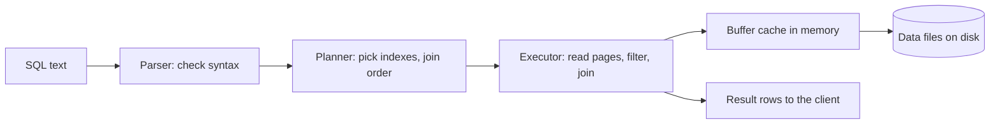
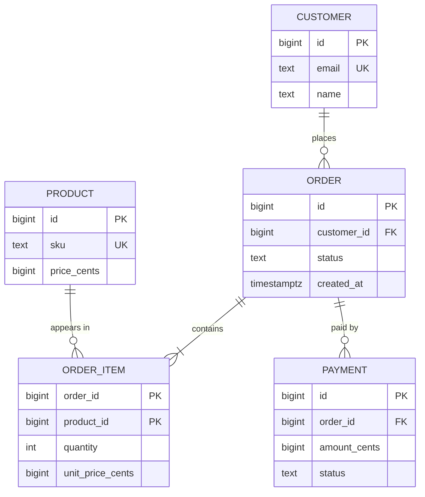
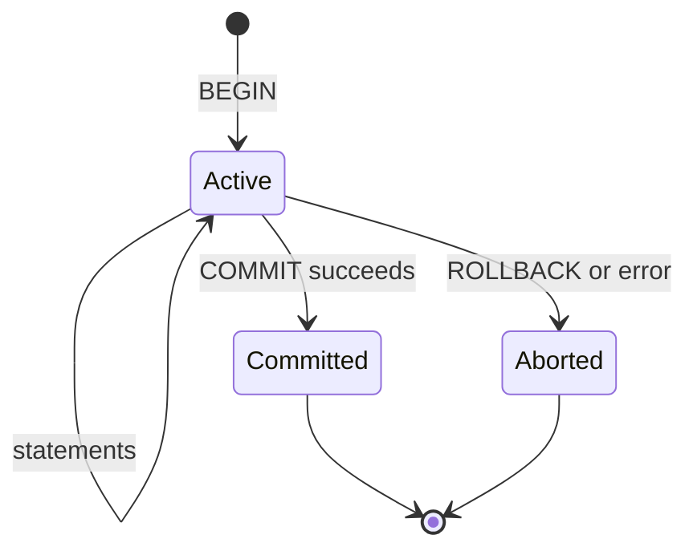
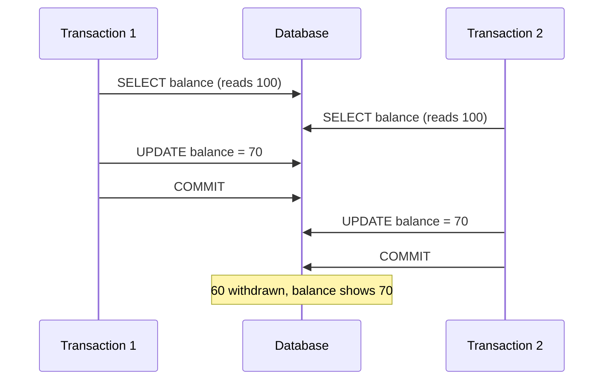
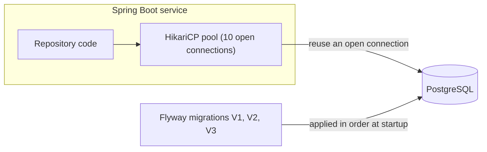

import Callout from '../../components/mdx/Callout.astro';

Most backends are, at heart, a careful wrapper around a database. The HTTP layer from Parts 1 and 2 receives requests and shapes responses, but the data, the thing your company would actually lose sleep over, lives in tables. Get the database right and a lot of other problems become easy; get it wrong and no amount of clever application code will save you from duplicated rows, slow pages and money that disappears between two accounts.

This is Part 3 of **Backend Engineering: Zero to Principal**. We will use **PostgreSQL** throughout, because it is free, standards-compliant and the most common choice for new backends, but nearly everything here applies to MySQL, SQL Server and other relational databases.

<Callout variant="tip" title="What you'll learn">
- Why backends use a database instead of files, and what "relational" means
- Enough SQL to create tables, insert, query, join and aggregate data
- How to model entities and relationships (one-to-many, many-to-many)
- Normalization (1NF, 2NF, 3NF) and when to deliberately break it
- What an index is, how a B-tree index speeds up queries, and what it costs
- Transactions and ACID, with a real lost-update bug and how to fix it
- How a Spring Boot application talks to the database safely
</Callout>

**You should already know:** how an HTTP request reaches your code ([Part 1](/blog/backend-01-how-the-web-works)) and how to design the API in front of it ([Part 2](/blog/backend-02-rest-api-design)).

## Why a database?

You could store orders in a JSON file. It would work for one user on one machine. Then reality arrives:

- **Two requests write at the same time** and one overwrites the other.
- **The server crashes halfway through a write** and the file is corrupted.
- **You need "all orders for customer 17 from last week"** and have to read the entire file to find them.
- **Someone inserts an order for a customer that does not exist**, and nothing stops them.

A database management system solves exactly these: **concurrency** (many clients safely at once), **durability** (committed data survives crashes), **querying** (find data without reading everything), and **integrity** (rules the data must always obey). Those four words are a good answer to "why not just use files?" in an interview.

## The relational model

A relational database stores data in **tables** (formally, *relations*). Each table has **columns** with a fixed type, and **rows**, each one a record.

| id | email | name | created_at |
|---|---|---|---|
| 1 | ada@example.com | Ada | 2026-10-01 09:12:00+00 |
| 2 | linus@example.com | Linus | 2026-10-02 14:40:00+00 |

Key ideas:

- **Primary key (PK):** a column (or set of columns) that uniquely identifies each row. Never null, never duplicated.
- **Foreign key (FK):** a column that references another table's primary key, so the database guarantees the relationship is valid.
- **Constraints:** rules enforced by the database itself: `NOT NULL`, `UNIQUE`, `CHECK (quantity > 0)`, foreign keys. Constraints are your last line of defence; application code has bugs, but a constraint holds no matter which code path, script or engineer writes the data.
- **SQL:** the declarative language you use to talk to it. You describe *what* you want; the database's **query planner** decides *how* to get it.



## SQL in 15 minutes

### Creating tables

```sql
CREATE TABLE customers (
    id          BIGINT GENERATED ALWAYS AS IDENTITY PRIMARY KEY,
    email       TEXT        NOT NULL UNIQUE,
    name        TEXT        NOT NULL,
    created_at  TIMESTAMPTZ NOT NULL DEFAULT now()
);

CREATE TABLE products (
    id           BIGINT GENERATED ALWAYS AS IDENTITY PRIMARY KEY,
    sku          TEXT    NOT NULL UNIQUE,
    name         TEXT    NOT NULL,
    price_cents  BIGINT  NOT NULL CHECK (price_cents >= 0)
);

CREATE TABLE orders (
    id           BIGINT GENERATED ALWAYS AS IDENTITY PRIMARY KEY,
    customer_id  BIGINT      NOT NULL REFERENCES customers (id),
    status       TEXT        NOT NULL DEFAULT 'PENDING',
    created_at   TIMESTAMPTZ NOT NULL DEFAULT now()
);

CREATE TABLE order_items (
    order_id          BIGINT NOT NULL REFERENCES orders (id) ON DELETE CASCADE,
    product_id        BIGINT NOT NULL REFERENCES products (id),
    quantity          INT    NOT NULL CHECK (quantity > 0),
    unit_price_cents  BIGINT NOT NULL,
    PRIMARY KEY (order_id, product_id)
);
```

Type choices that matter:

- **`TIMESTAMPTZ`**, not `TIMESTAMP`, for moments in time. PostgreSQL stores it in UTC and converts on display; plain `TIMESTAMP` has no timezone and invites bugs.
- **Integers of cents (or `NUMERIC`) for money**, never `REAL`/`DOUBLE PRECISION`.
- **`TEXT`** is fine for strings in PostgreSQL; `VARCHAR(n)` only adds a length check.
- **`GENERATED ALWAYS AS IDENTITY`** is the modern standard-SQL way to auto-generate IDs (replacing PostgreSQL's older `SERIAL`).

<Callout variant="note" title="Surrogate keys and UUIDs">
The `id` columns above are **surrogate keys**: meaningless numbers generated by the database. The alternative is a **natural key**, like `email` or `sku`. Natural keys change (people change emails), so most schemas use surrogate keys and put a `UNIQUE` constraint on the natural one. If you need IDs that can be generated outside the database or that do not reveal row counts, use UUIDs. Prefer time-ordered **UUIDv7** (PostgreSQL 18 ships a built-in `uuidv7()` function) over random UUIDv4, because ordered values keep B-tree indexes compact and inserts fast.
</Callout>

### Inserting, reading, updating, deleting

```sql
INSERT INTO customers (email, name) VALUES ('ada@example.com', 'Ada')
RETURNING id;

SELECT id, email, name
FROM customers
WHERE created_at >= '2026-10-01'
ORDER BY created_at DESC
LIMIT 20;

UPDATE orders SET status = 'SHIPPED' WHERE id = 42;

DELETE FROM orders WHERE id = 42;
```

Always write the `WHERE` clause of an `UPDATE` or `DELETE` first. An `UPDATE orders SET status = 'SHIPPED'` without one ships every order you have ever had.

### Joins

Data is split across tables, so you combine it with **joins**:

```sql
-- Every order with its customer's email (only orders that have a customer)
SELECT o.id, o.status, c.email
FROM orders o
JOIN customers c ON c.id = o.customer_id;

-- Every customer, with their orders if they have any
SELECT c.email, o.id AS order_id
FROM customers c
LEFT JOIN orders o ON o.customer_id = c.id;
```

- **`INNER JOIN`** (`JOIN`): only rows that match on both sides.
- **`LEFT JOIN`**: all rows from the left table; columns from the right are `NULL` where nothing matches. This is how you find "customers with no orders" (`WHERE o.id IS NULL`).

### Aggregation

```sql
-- Revenue per customer for October, biggest first
SELECT c.email,
       COUNT(DISTINCT o.id)                       AS orders,
       SUM(oi.quantity * oi.unit_price_cents)     AS revenue_cents
FROM customers c
JOIN orders o       ON o.customer_id = c.id
JOIN order_items oi ON oi.order_id = o.id
WHERE o.created_at >= '2026-10-01' AND o.created_at < '2026-11-01'
GROUP BY c.email
HAVING SUM(oi.quantity * oi.unit_price_cents) > 10000
ORDER BY revenue_cents DESC;
```

`WHERE` filters rows *before* grouping; `HAVING` filters groups *after*. Note the half-open date range (`>=` start, `<` end): it is correct for timestamps and plays well with indexes, unlike `BETWEEN '2026-10-01' AND '2026-10-31'`, which silently drops everything after midnight on the 31st.

## Data modeling: entities and relationships

Before writing `CREATE TABLE`, sketch the **entities** (the nouns) and the **relationships** between them. The three relationship shapes:

- **One-to-many:** a customer has many orders; an order has exactly one customer. Put the foreign key on the "many" side (`orders.customer_id`).
- **Many-to-many:** an order contains many products; a product appears in many orders. You need a **join table** (`order_items`) with a foreign key to each side. Often the join table carries its own data (quantity, price at time of purchase), which is a hint that it is a real entity.
- **One-to-one:** a customer has one loyalty profile. Either put the columns in the same table or use a separate table whose primary key is also a foreign key.



Notice `order_items.unit_price_cents`. The product's price will change next month, but an order must remember what the customer actually paid. Modelling **facts at a point in time** separately from **current state** is one of the most important habits in data modeling.

## Normalization: one fact in one place

**Normalization** is the process of structuring tables so that each fact is stored exactly once. Duplication is not just wasted space: it creates **update anomalies**, where one copy is changed and another is not, and now your data disagrees with itself.

Start with a naive "everything in one table" design:

| order_id | customer_email | customer_name | products | total |
|---|---|---|---|---|
| 42 | ada@example.com | Ada | "Keyboard x1, Mouse x2" | 12000 |
| 43 | ada@example.com | Ada Lovelace | "Mouse x1" | 2500 |

Already the customer's name disagrees between rows, and you cannot query "how many mice did we sell?" without parsing strings.

**First normal form (1NF): atomic values, no repeating groups.** Each cell holds one value. The `products` list becomes one row per order line.

**Second normal form (2NF): no partial dependencies.** In a table whose key is `(order_id, product_id)`, every non-key column must depend on the *whole* key. `product_name` depends only on `product_id`, so it moves to a `products` table. `quantity` depends on both, so it stays.

**Third normal form (3NF): no transitive dependencies.** Non-key columns depend on the key and nothing else. If `orders` contains `customer_id` *and* `customer_email`, the email depends on the customer, not on the order; it moves to `customers`.

The schema we created earlier is in 3NF. A memorable summary attributed to Bill Kent: every non-key attribute must provide a fact about *the key, the whole key, and nothing but the key*.


### When to denormalize

Normalization optimises for correctness of writes. Sometimes you deliberately duplicate data to make reads cheaper:

- Storing `orders.total_cents` instead of summing order items on every read.
- Keeping a `comment_count` on a post.
- Building a separate reporting table or search index.

That is fine, **as long as you know which copy is the source of truth and how the others are kept in sync** (in the same transaction, by a trigger, or by an asynchronous process that tolerates lag). Denormalize because you measured a read problem, not by default. Later parts (caching in Part 5, CQRS in Part 9) are, in a sense, organised denormalization.

## Indexes: how queries get fast

Without an index, finding `WHERE email = 'ada@example.com'` means reading every row in the table: a **sequential scan**. With 10 rows that is instant; with 50 million it is seconds of disk I/O, on every request.

An **index** is a separate data structure that keeps a sorted copy of one or more columns with pointers to the matching rows. The default in PostgreSQL (and almost every relational database) is the **B-tree**: a balanced, shallow tree where each node holds many keys. Because each node fans out to hundreds of children, even a table with hundreds of millions of rows needs only about three to five levels, so a lookup touches a handful of pages instead of millions.


### Creating and using indexes

```sql
-- Primary keys and UNIQUE constraints already create indexes automatically.
-- Foreign keys do NOT: index the referencing column yourself.
CREATE INDEX orders_customer_id_idx ON orders (customer_id);

-- A composite index for "this customer's recent orders"
CREATE INDEX orders_customer_created_idx ON orders (customer_id, created_at DESC);
```

A composite index is sorted by the first column, then by the second within each value of the first, like a phone book sorted by last name then first name. That gives the **leftmost prefix rule**:

| Query | Can use `(customer_id, created_at)` well? |
|---|---|
| `WHERE customer_id = 17` | Yes |
| `WHERE customer_id = 17 ORDER BY created_at DESC LIMIT 20` | Yes, and no sort needed |
| `WHERE customer_id = 17 AND created_at >= '2026-10-01'` | Yes |
| `WHERE created_at >= '2026-10-01'` | Generally no: like searching a phone book by first name |

(PostgreSQL 18 added *skip scan*, which can use a multicolumn B-tree even without a condition on the leading column when that column has few distinct values. Design for the leftmost prefix anyway; treat skip scan as a bonus.)

### Checking with EXPLAIN

Never guess whether an index is used; ask the database. `EXPLAIN` shows the plan; `EXPLAIN ANALYZE` actually runs the query and shows real timings (so be careful with it on `UPDATE`/`DELETE`).

```sql
EXPLAIN ANALYZE
SELECT id, status FROM orders
WHERE customer_id = 17
ORDER BY created_at DESC
LIMIT 20;
```

Before the index you would see something like `Seq Scan on orders` followed by a `Sort` node; afterwards, `Index Scan using orders_customer_created_idx on orders` and a much smaller `actual time`. Part 7 teaches you to read plans in depth.

### What indexes cost

Indexes are not free:

- **Every write updates every index** on the table. Ten indexes means an `INSERT` does roughly eleven writes.
- They use disk and memory (buffer cache).
- The planner may ignore an index if the query matches a large fraction of the table, because reading the table sequentially is then cheaper. An index on a boolean `is_active` column where 95% of rows are `true` rarely helps.

Rule of thumb: index columns you **filter, join and sort on** in frequent queries, check with `EXPLAIN`, and drop indexes nothing uses (PostgreSQL's `pg_stat_user_indexes` view shows how often each index is scanned).

## Transactions and ACID

A **transaction** groups several statements into one all-or-nothing unit. The classic example: moving 100 euros between accounts is two updates, and you must never perform only one of them.

```sql
BEGIN;
UPDATE accounts SET balance_cents = balance_cents - 10000 WHERE id = 1;
UPDATE accounts SET balance_cents = balance_cents + 10000 WHERE id = 2;
COMMIT;   -- or ROLLBACK; to undo everything since BEGIN
```



Transactions provide the **ACID** guarantees:

- **Atomicity:** all statements take effect, or none do. If the server crashes after the first `UPDATE`, the money is not lost; the half-finished transaction is rolled back.
- **Consistency:** a transaction moves the database from one valid state to another; every constraint (`CHECK (balance_cents >= 0)`, foreign keys, `UNIQUE`) holds at commit. If one would be violated, the transaction fails.
- **Isolation:** concurrent transactions do not see each other's half-finished work. *How* isolated is configurable (isolation levels), and that is where most real bugs live.
- **Durability:** once `COMMIT` returns, the data survives a crash. PostgreSQL achieves this by writing changes to its **write-ahead log (WAL)** and flushing it to disk before acknowledging the commit.

### A real concurrency bug: the lost update

Here is code that looks correct and is not:

```kotlin
// BUG: read-modify-write in application code
@Transactional
fun withdraw(accountId: Long, amountCents: Long) {
    val balance = jdbc.sql("SELECT balance_cents FROM accounts WHERE id = :id")
        .param("id", accountId)
        .query(Long::class.javaObjectType)
        .single()
    require(balance >= amountCents) { "Insufficient funds" }
    jdbc.sql("UPDATE accounts SET balance_cents = :b WHERE id = :id")
        .param("b", balance - amountCents)
        .param("id", accountId)
        .update()
}
```

Two withdrawals of 30 euros arrive at the same moment on an account holding 100 euros:



Both transactions read 100, both write 70. Thirty euros vanished. Wrapping it in a transaction did not help, because PostgreSQL's default isolation level, **Read Committed**, only guarantees you never see *uncommitted* data; it does not stop two transactions from reading the same committed value and both acting on it.

Three standard fixes, from simplest to most general:

```sql
-- 1. Let the database do the arithmetic atomically, with the rule in the WHERE clause.
UPDATE accounts
SET balance_cents = balance_cents - 3000
WHERE id = 1 AND balance_cents >= 3000;
-- Check the affected row count: 0 means insufficient funds.

-- 2. Lock the row while you decide (pessimistic locking).
BEGIN;
SELECT balance_cents FROM accounts WHERE id = 1 FOR UPDATE;  -- other writers now wait
UPDATE accounts SET balance_cents = 7000 WHERE id = 1;
COMMIT;

-- 3. Optimistic locking with a version column.
UPDATE accounts
SET balance_cents = 7000, version = version + 1
WHERE id = 1 AND version = 5;
-- 0 rows affected means someone else changed it first: re-read and retry.
```

Option 1 is best when the logic fits in one statement. Option 2 is simple but makes other transactions wait. Option 3 (exactly what JPA's `@Version` does, and what the `ETag`/`If-Match` pattern in Part 2 maps onto) works well when conflicts are rare. Part 7 covers isolation levels, MVCC and locking in depth, including the stricter `REPEATABLE READ` and `SERIALIZABLE` levels.

### Transactions in Spring

```kotlin
@Service
class TransferService(private val jdbc: JdbcClient) {

    @Transactional
    fun transfer(from: Long, to: Long, amountCents: Long) {
        val debited = jdbc.sql(
            """
            UPDATE accounts SET balance_cents = balance_cents - :amount
            WHERE id = :id AND balance_cents >= :amount
            """
        ).param("amount", amountCents).param("id", from).update()

        if (debited == 0) throw InsufficientFundsException(from)

        jdbc.sql("UPDATE accounts SET balance_cents = balance_cents + :amount WHERE id = :id")
            .param("amount", amountCents).param("id", to)
            .update()
    }
}
```

`@Transactional` opens a transaction before the method and commits after it, or rolls back if it throws. Two traps that catch every beginner:

- **Self-invocation:** Spring implements `@Transactional` with a proxy, so calling a `@Transactional` method from another method *in the same class* bypasses the proxy and starts no transaction.
- **Checked exceptions:** by default Spring rolls back only on unchecked exceptions (`RuntimeException` and `Error`). Kotlin has no checked exceptions, but if you throw a subclass of `java.lang.Exception` that is not a `RuntimeException`, the transaction *commits*. Extend `RuntimeException` for domain errors, or set `rollbackFor`.

And keep transactions **short**: never call a slow external HTTP API while holding a transaction open, because you are holding database locks and a pooled connection the whole time.

## Talking to the database from a backend

A few production realities you meet on day one:

**Use parameterised queries, always.** Building SQL by concatenating user input is how **SQL injection** happens:

```kotlin
// NEVER: an email of  x' OR '1'='1  returns every customer
jdbc.sql("SELECT * FROM customers WHERE email = '$email'")

// ALWAYS: the value is sent separately and can never be parsed as SQL
jdbc.sql("SELECT * FROM customers WHERE email = :email").param("email", email)
```

**Use a connection pool.** Opening a database connection costs a TCP handshake, often TLS, authentication, and (in PostgreSQL) a new server process. Spring Boot uses **HikariCP** by default and keeps a pool of open connections (10 by default, `spring.datasource.hikari.maximum-pool-size`). Bigger is not better: the database can only do so much work in parallel, and Part 8 shows how to size pools.

**Version your schema with migrations.** Never change production schemas by hand. Tools like **Flyway** or **Liquibase** keep numbered migration files in your repository (`V1__create_customers.sql`, `V2__add_orders.sql`) and apply them in order at startup or in CI, so every environment has the same schema and every change is reviewed.

**Watch for the N+1 query problem.** Loading 50 orders and then, in a loop, loading each order's customer is 1 + 50 queries, each paying a network round trip. Use a join, or fetch all needed customers with one `WHERE id = ANY(...)` query. ORMs make N+1 especially easy to write by accident; see [Hibernate vs JPA](/blog/hibernate-vs-jpa-complete-guide) for how fetching works there.



## SQL or NoSQL?

You will be asked. A balanced junior answer: relational databases give you a flexible query language, joins, constraints and multi-row transactions, and they scale much further than most people assume (a single well-tuned PostgreSQL server comfortably handles many thousands of transactions per second). **Document stores** (MongoDB), **key-value stores** (Redis, DynamoDB) and **wide-column stores** (Cassandra) trade some of that for a specific strength: flexible schemas, very simple access patterns at huge scale, or very high write throughput across many machines. Start relational unless you can name the access pattern that a relational database cannot serve. Parts 7 and 10 go deeper.

## Common mistakes

- **No foreign keys or constraints**, trusting the application to keep data valid.
- **Floating-point money** and `TIMESTAMP` without timezone.
- **Missing indexes on foreign key columns** and frequently filtered columns, discovered only when the table grows.
- **Indexing everything**, slowing every write for indexes no query uses.
- **Read-modify-write in application code** without locking or an atomic update, causing lost updates.
- **Long transactions** that wrap slow HTTP calls and hold locks and connections.
- **String-concatenated SQL**, the root of SQL injection.
- **N+1 queries** hidden inside loops or ORM lazy loading.
- **Storing current values where you needed historical facts**, such as referencing a product's current price from an old order.
- **Hand-editing production schemas** instead of using migrations.

## Interview questions

<details>
<summary>What is the difference between a primary key and a foreign key?</summary>

A primary key uniquely identifies each row in its own table; it is unique and not null, and the database automatically indexes it. A foreign key is a column in one table that references the primary key (or a unique key) of another, and the database guarantees every value points to an existing row, preventing orphans. A strong answer adds that foreign keys are not automatically indexed in PostgreSQL, and that `ON DELETE` actions (`CASCADE`, `RESTRICT`, `SET NULL`) control what happens when the referenced row is deleted.

</details>

<details>
<summary>Explain the difference between INNER JOIN and LEFT JOIN, with an example.</summary>

`INNER JOIN` returns only rows that have a match in both tables: orders with their customers. `LEFT JOIN` returns every row from the left table and the matching right rows, filling the right side with `NULL` where there is no match: every customer, including those without orders. Adding `WHERE o.id IS NULL` to the left join finds customers who never ordered.

</details>

<details>
<summary>What is normalization? Explain 1NF, 2NF and 3NF briefly. When would you denormalize?</summary>

Normalization structures data so each fact is stored once, preventing update anomalies. 1NF: atomic values, no lists in a column. 2NF: in tables with composite keys, non-key columns depend on the whole key, not part of it. 3NF: non-key columns depend only on the key, not on other non-key columns. You denormalize deliberately for read performance, such as a cached total or a reporting table, when measurements show a need, and you must define the source of truth and how copies stay in sync.

</details>

<details>
<summary>What is an index, how does it make queries faster, and what does it cost?</summary>

An index is a separate sorted structure (usually a B-tree) on one or more columns, pointing to table rows. Instead of scanning every row, the database descends a shallow tree (a few levels even for huge tables) to the matching entries. Costs: every insert, update and delete must also update each index; indexes use disk and memory; and the planner skips them when a query matches a large fraction of rows. Mention composite indexes and the leftmost-prefix rule, and verifying with `EXPLAIN`.

</details>

<details>
<summary>You have an index on (customer_id, created_at). Which of these queries can use it efficiently: filter by customer_id, filter by created_at, filter by both?</summary>

Filtering by `customer_id` alone: yes. Both: yes, and an `ORDER BY created_at` for one customer needs no separate sort. `created_at` alone: generally not efficiently, because the index is sorted by `customer_id` first, like a phone book sorted by last name. A strong answer may note that PostgreSQL 18's skip scan can sometimes use it when `customer_id` has few distinct values, but you should not rely on it.

</details>

<details>
<summary>What does ACID stand for? Explain each with an example.</summary>

Atomicity: a transfer's debit and credit both happen or neither does. Consistency: constraints such as non-negative balances and valid foreign keys hold after every committed transaction. Isolation: concurrent transactions do not see each other's uncommitted changes, with the level of isolation configurable. Durability: once committed, data survives a crash, typically via a write-ahead log flushed to disk before commit returns.

</details>

<details>
<summary>Two requests withdraw money from the same account at the same time and the final balance is wrong. Why, and how do you fix it?</summary>

It is a lost update: both transactions read the same balance, compute new values in the application, and the second write overwrites the first. Under PostgreSQL's default Read Committed isolation, wrapping it in a transaction does not prevent this. Fixes: do it atomically in one statement (`UPDATE ... SET balance = balance - x WHERE id = ? AND balance >= x` and check the row count); lock the row with `SELECT ... FOR UPDATE`; or use optimistic locking with a version column and retry on conflict. Optionally mention a stricter isolation level with retries.

</details>

<details>
<summary>What is the N+1 query problem and how do you fix it?</summary>

Loading a list with one query, then issuing one extra query per item to load related data, so 50 items cost 51 round trips. It often hides in ORM lazy loading. Fix it by fetching related data in one go: a join, a fetch join or entity graph in JPA, or a single batched query with `WHERE id = ANY(...)` or `IN (...)`. Detect it by logging SQL or counting queries per request in tests.

</details>

<details>
<summary>What is SQL injection and how do you prevent it?</summary>

When user input is concatenated into SQL text, an attacker can craft input that changes the query's structure, such as `' OR '1'='1` to bypass a filter, or worse, to read or delete data. Prevent it with parameterised queries (prepared statements), where values are sent separately from the SQL and can never be interpreted as code. ORMs and `JdbcClient` parameters do this for you; still never build SQL strings from input, and allow-list anything that must be dynamic, such as sort column names.

</details>

## Key takeaways

- Databases give you concurrency, durability, querying and integrity; files give you none of these.
- Model entities and relationships first; use foreign keys and constraints so the database enforces the rules.
- Normalize to 3NF by default so each fact lives in one place; denormalize deliberately, with a clear source of truth.
- Store historical facts (price at purchase) separately from current state.
- B-tree indexes turn full scans into a few page reads; index what you filter, join and sort on, respect the leftmost prefix, and verify with `EXPLAIN`.
- Transactions give ACID, but the default isolation level does not stop lost updates: use atomic updates, `FOR UPDATE`, or optimistic version checks.
- Parameterise every query, pool connections, version schemas with migrations, and watch for N+1.

Previous: [Part 2: REST API Design](/blog/backend-02-rest-api-design)
