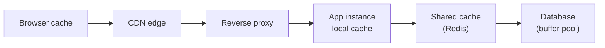
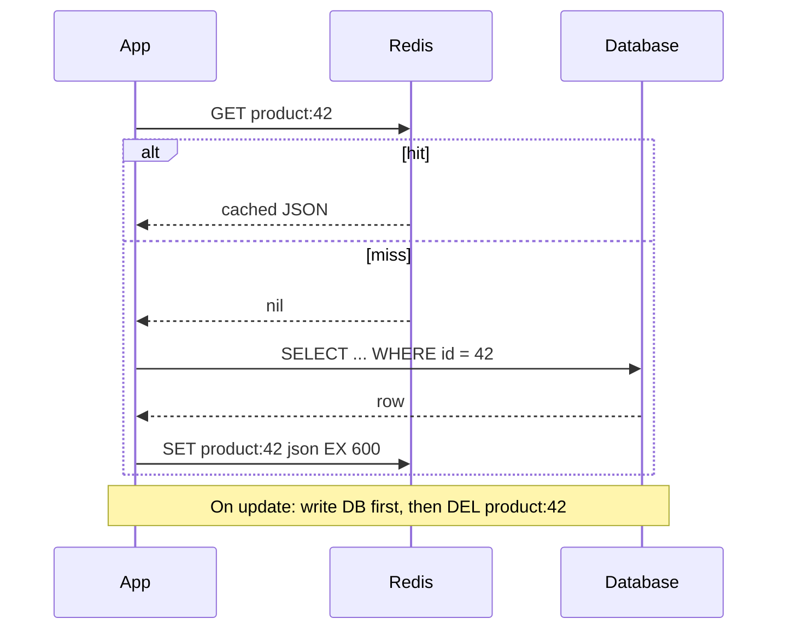
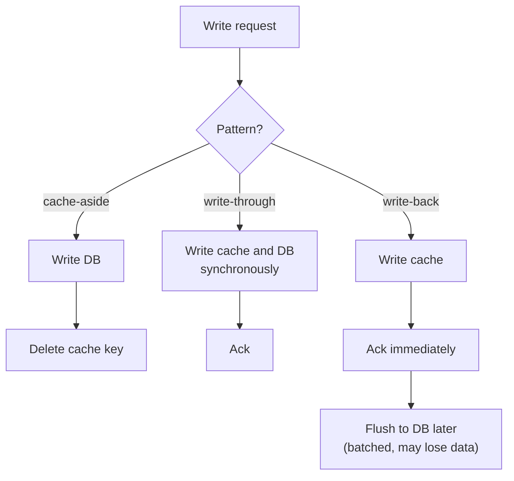
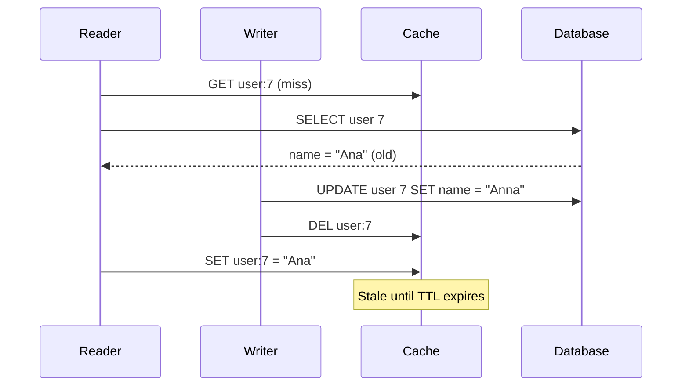
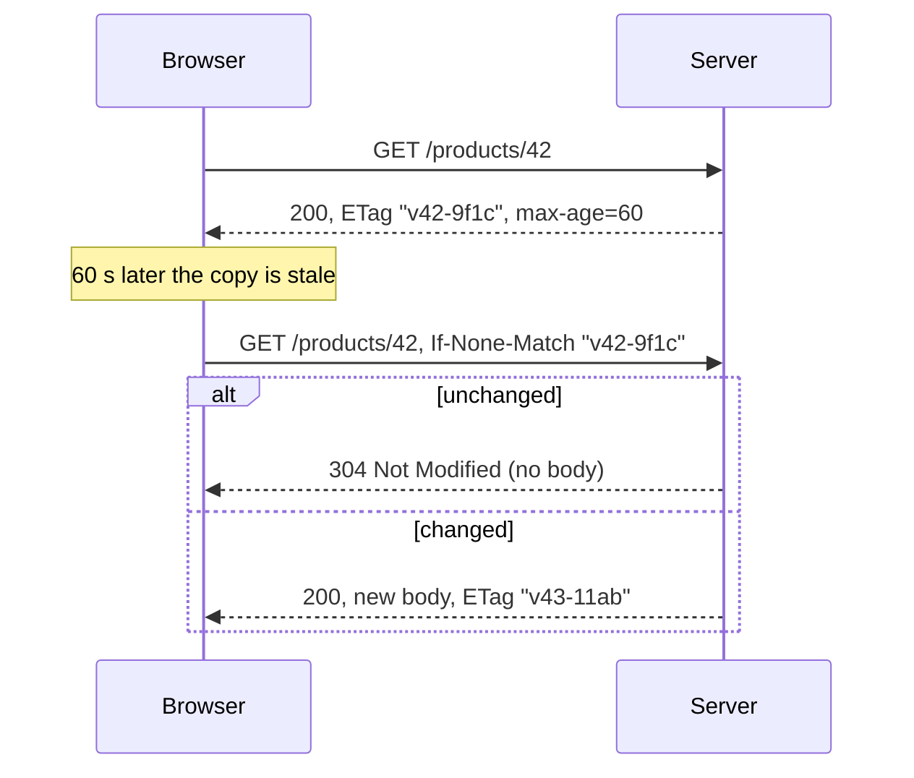

import Callout from '../../components/mdx/Callout.astro';

A cache is a copy of data kept somewhere faster than the original. That's the whole idea, and it's why caching is the first tool people reach for when a backend gets slow. It's also why the famous joke says the two hard problems in computer science are naming things and cache invalidation: the moment you have a copy, you have two versions of the truth, and you have to decide how wrong the copy is allowed to be.

This post teaches caching from the request path outwards: why it works, the standard patterns, how to run Redis, how invalidation goes wrong, and how HTTP and CDN caching let you avoid hitting your servers at all.

<Callout variant="tip" title="What you'll learn">
- Why caches work, with real latency numbers and hit-ratio math
- Cache-aside, read-through, write-through, write-back and refresh-ahead, and when to use each
- Practical Redis: data structures, TTLs, eviction policies, memory limits
- Invalidation strategies and the race conditions that serve stale data
- Cache stampedes, penetration and avalanches, and how to prevent them
- HTTP caching headers, ETags and CDNs
- Spring Boot 4 caching with Caffeine and Redis in Kotlin
</Callout>

**You should already know:** HTTP headers and the request lifecycle ([Part 1](/blog/backend-01-how-the-web-works)), safe and idempotent methods ([Part 2](/blog/backend-02-rest-api-design)), and how indexes and queries work ([Part 3](/blog/backend-03-databases-fundamentals)).

## Why caching works

Two facts make caching effective.

**1. Storage tiers differ by orders of magnitude.** Reading from your own process memory is roughly a thousand times faster than a network round trip to Redis, which is in turn several times faster than a database query that has to parse, plan and maybe touch disk.


These are rough orders of magnitude, not benchmarks; measure your own system. But the shape is always the same, and it's why "keep a copy one tier up" pays off.

**2. Access is skewed.** Real traffic is rarely uniform. A small fraction of products, users or articles receive most of the reads (often described as a power-law or Zipf distribution). Caching the hot 1% of keys can absorb a large majority of requests.

### Hit-ratio math

The **hit ratio** is the fraction of lookups served from the cache. Suppose a cache lookup costs 0.5 ms and a database query costs 20 ms. On a miss you pay both.

```text
average latency = cache_time + (1 - hit_ratio) * db_time

hit ratio 90%:  0.5 + 0.10 * 20 = 2.5 ms     DB sees 10% of reads
hit ratio 95%:  0.5 + 0.05 * 20 = 1.5 ms     DB sees 5% of reads
hit ratio 99%:  0.5 + 0.01 * 20 = 0.7 ms     DB sees 1% of reads
```

Notice the database load column. Going from 95% to 99% hit ratio looks like a small improvement, but it cuts database reads **five times**. That's the real reason caches matter at scale: they protect the expensive tier. It's also the reason a cache failure is dangerous. If the cache disappears, your database suddenly sees 100% of reads, perhaps 20 to 100 times its normal load.

<Callout variant="warning" title="A cache is load-bearing">
Once a cache holds a high hit ratio, your database has been sized for the cache being there. Treat the cache as critical infrastructure: monitor hit ratio, plan what happens when it's cold (after a deploy or restart), and don't assume you can "just turn it off" during an incident.
</Callout>

## Where caches live

Caches exist at every layer between the user and the database. Each layer you can serve from is a layer you don't have to touch below it.



- **Browser and CDN** caches are controlled by HTTP headers (covered later) and serve responses without your servers seeing the request.
- **Local (in-process) caches** like Caffeine live in each app instance's heap. Nanosecond-to-microsecond lookups, no network, but each instance has its own copy, so instances can disagree, and memory is limited by the heap.
- **Shared (distributed) caches** like Redis, Valkey or Memcached are one copy that all instances share. A network hop per lookup, but consistent across instances and much larger.
- **The database itself** caches pages in memory (PostgreSQL's shared buffers, InnoDB's buffer pool). This is why the second run of a query is often faster.

A common production setup is a **two-level cache**: a small local cache with a short TTL in front of Redis, for the very hottest keys. The local tier removes network hops; the short TTL bounds how long instances can disagree.

## Caching patterns

### Cache-aside (lazy loading)

The application owns the logic. On a read, check the cache; on a miss, load from the database and populate the cache. On a write, update the database and **delete** the cache entry.



Cache-aside is the default pattern for most systems because:

- Only data that's actually read gets cached.
- If the cache is down, the app can still serve from the database (slower, but alive).
- The cache can use a different data shape than the database (for example, a pre-joined DTO).

Its downsides: the first read of each key is slow (a cold miss), and the window between "DB updated" and "cache entry deleted" can serve stale data, which we'll look at closely below.

### Read-through

Same behaviour as cache-aside, but the *cache library* loads the value on a miss using a loader function you provide. Caffeine's `LoadingCache` and Spring's `@Cacheable` work this way. The code is cleaner; the semantics are the same.

### Write-through

Every write goes to the cache and the database synchronously, as one operation, before the write is acknowledged. Reads always find fresh data in the cache.

The costs: every write pays both latencies, and you cache data that may never be read. Write-through is often combined with read-through when reads of recently written data are very common.

### Write-back (write-behind)

Writes go to the cache only and are acknowledged immediately; the cache flushes them to the database later, often in batches. Writes are very fast and the database sees far fewer, larger writes.

The cost is **durability**: if the cache node dies before flushing, those writes are gone. Write-back is the right call for data where losing a few seconds is acceptable (view counters, analytics, "last seen" timestamps) and the wrong call for orders or payments. CPUs and disk controllers use write-back caches internally for exactly this speed trade.

### Refresh-ahead

The cache refreshes popular entries *before* they expire, so readers almost never see a miss. Caffeine supports this with `refreshAfterWrite`: after the refresh interval, the next read returns the current value immediately and triggers an asynchronous reload.



| Pattern | Read latency | Write latency | Staleness risk | Data loss risk |
|---|---|---|---|---|
| Cache-aside | Miss is slow | DB only | Small window | None |
| Read-through | Miss is slow | DB only | Small window | None |
| Write-through | Fast | Cache + DB | Low | None |
| Write-back | Fast | Very fast | Low | **Yes** |
| Refresh-ahead | Fast | DB only | Bounded by refresh | None |

## Redis in practice

Redis is the default shared cache in most stacks. (After the 2024 license change, the Linux Foundation's **Valkey** fork became a common drop-in alternative, and Redis 8 added the AGPLv3 as a license option again in 2025. The commands below work on both.) A few things make Redis much more than a key-value store:

- **Data structures**: strings, hashes, lists, sets, sorted sets, streams, bitmaps and HyperLogLog. A leaderboard is a sorted set; a rate limiter can be a counter with an expiry.
- **Single-threaded command execution**: each command runs atomically, so `INCR` is a safe counter with no locks. Long-running commands like `KEYS *` block every other client, so never run them in production (use `SCAN`).
- **Sub-millisecond latency** within a datacenter for simple commands.

The commands you'll use most for caching:

```bash
SET product:42 '{"id":42,"name":"Desk lamp","price":3900}' EX 600   # value with 10 min TTL
GET product:42
DEL product:42                          # invalidate
SET lock:product:42 owner-7 NX PX 5000  # set only if absent, 5 s expiry (a simple lock)
TTL product:42                          # seconds left, -1 = no expiry, -2 = missing
MGET product:1 product:2 product:3      # batch read in one round trip
```

### Keys and values

- **Name keys predictably**: `service:entity:id:version`, like `catalog:product:42:v3`. Including a schema version lets you change the cached format by bumping `v3` to `v4` instead of flushing everything.
- **Keep values small.** Large values (hundreds of KB or more) slow down every command that touches them and the network. Cache the DTO the endpoint needs, not the entire aggregate.
- **Batch.** One `MGET` of 50 keys is one round trip; 50 `GET` calls are 50. Pipelining also helps.

### Memory limits and eviction

Set `maxmemory` explicitly and choose an eviction policy. The default policy is **`noeviction`**: when memory is full, writes fail with an error. That's right for Redis used as a database or queue, and wrong for a pure cache.

```text
maxmemory 4gb
maxmemory-policy allkeys-lfu
```

| Policy | Evicts | Typical use |
|---|---|---|
| `noeviction` | Nothing; writes fail when full | Redis as a primary store |
| `allkeys-lru` | Least recently used, any key | General-purpose cache |
| `allkeys-lfu` | Least frequently used, any key | Cache with stable hot keys |
| `volatile-lru` / `volatile-lfu` | Only keys that have a TTL | Mixed cache and persistent data |
| `volatile-ttl` | Keys closest to expiring | When TTL reflects importance |

Redis's LRU and LFU are **approximations**: it samples a few keys (`maxmemory-samples`, default 5) and evicts the best candidate among them, which is much cheaper than tracking exact order.

### TTLs

Every cached key should have a TTL, even if you also invalidate explicitly. The TTL is your safety net: if an invalidation is ever missed (a bug, a crashed process, a write path someone forgot), the stale value disappears on its own.

How long? Ask: *how stale can this data be before a user or the business notices?* A product description might tolerate an hour; a price shown at checkout probably shouldn't be cached at all (or should be re-validated at checkout); a user's own profile right after they edit it needs read-your-own-writes behaviour.

**Add jitter.** If you warm 100,000 keys at the same moment with a 600 second TTL, they all expire together and hit the database at once. Use `600 + random(0..60)` instead.

## Invalidation: the hard part

There are three broad ways to keep a cache acceptably fresh:

1. **TTL only.** Accept staleness up to the TTL. Simplest; fine for lots of data.
2. **Explicit invalidation on write.** When data changes, delete (or update) the affected keys.
3. **Event-driven invalidation.** Changes are published (from the application, or captured from the database's change log with change data capture) and a consumer invalidates keys. This catches writes from every service and every script, not just the one code path you remembered. [Part 9](/blog/backend-09-event-driven-architecture) covers CDC.

### Delete, don't update

On a write, prefer **deleting** the cache key over **writing the new value** into it. If two writers update the database in one order but their cache writes land in the opposite order, the cache keeps the older value indefinitely. Deleting is idempotent and order-insensitive: the next read loads whatever is now in the database.

### The stale-set race

Even with delete-on-write, cache-aside has a well-known race between a slow reader and a writer:



The reader loaded the old value, the writer deleted the key (which wasn't there yet), and then the reader wrote the old value back. It needs unlucky timing, but at thousands of requests per second, unlikely things happen every day.

Mitigations, from simplest to most robust:

- **Short TTLs** bound how long the stale value survives. Often this is enough.
- **Delayed double delete:** delete the key on write, then delete it again a short time later (say, one second) to catch any reader that was in flight. Crude but effective.
- **Leases or version checks:** the cache hands out a token on a miss, and a `SET` is only accepted if no invalidation happened since the token was issued. Facebook described this "lease" mechanism in *Scaling Memcache at Facebook* (NSDI 2013). In Redis you can approximate it by storing a version number and using a small Lua script to only set newer versions.
- **CDC-driven invalidation:** invalidate from the database's committed change stream, which also catches writes that bypass your service.

### Consistency expectations

Be explicit about what your cache guarantees. Most caches give **eventual consistency** with a bounded staleness window. If a requirement is "a user must see their own change immediately," you can satisfy it narrowly: skip the cache for that user's own reads for a few seconds after they write, or write their new value into a per-user key. Don't make the whole cache strongly consistent to solve one screen.

## Stampedes, penetration and avalanches

These three failure modes come up in every caching interview.

### Cache stampede (thundering herd)

A single very hot key expires. In the next few milliseconds, hundreds of requests miss at once and *all* of them query the database for the same row and recompute the same value. If that computation is expensive, the database falls over, and nothing repopulates the cache.


Defences:

- **Request coalescing (single flight):** only one caller recomputes a given key; others wait for its result. Within one JVM, Caffeine's `LoadingCache` and Spring's `@Cacheable(sync = true)` do this per key. Across instances, take a short Redis lock with `SET lock:key token NX PX 5000`; the winner recomputes, losers briefly wait and re-read (or serve stale).
- **Serve stale while revalidating:** keep the old value slightly past its logical expiry and return it while one caller refreshes in the background. Users get a fast, slightly old answer instead of a slow or failed one.
- **Probabilistic early expiration:** each reader, as expiry approaches, has a small and increasing chance of refreshing the value early. Recomputations spread out instead of all happening at the expiry instant. The "XFetch" algorithm (Vattani et al., 2015) is the standard formulation: refresh if `now - delta * beta * ln(random()) >= expiry`, where `delta` is how long recomputation takes and `beta` defaults to 1.
- **Refresh-ahead** for keys you know are hot.

### Cache penetration

Requests for keys that **don't exist** always miss the cache and always hit the database. This can be accidental (a client polling a deleted ID) or an attack (random IDs). Defences:

- **Negative caching:** cache "not found" with a short TTL (say 30 to 60 seconds).
- **Bloom filter** in front of the cache: a compact probabilistic set that can say "definitely not present" with no false negatives, so lookups for IDs that never existed can be rejected without touching the database.
- Validate input and rate-limit clients.

### Cache avalanche

Many keys expire at the same time, or the cache cluster restarts and comes back empty. The database sees a sudden flood. Defences: TTL jitter, replicated cache clusters so a node failure isn't a full flush, **warming** the cache before shifting traffic to a new cluster, and rate-limiting or load-shedding at the database layer (covered in [Part 11](/blog/backend-11-reliability-observability)).

## HTTP caching and CDNs

The fastest request is one your server never receives. HTTP has a complete caching model (RFC 9111) that browsers, proxies and CDNs all understand. It's controlled by response headers.

### Cache-Control

```http
HTTP/1.1 200 OK
Content-Type: application/json
Cache-Control: public, max-age=60, s-maxage=300, stale-while-revalidate=30
ETag: "v42-9f1c"
Vary: Accept-Encoding
```

| Directive | Meaning |
|---|---|
| `max-age=N` | Fresh for N seconds in any cache (browser included) |
| `s-maxage=N` | Overrides `max-age` for **shared** caches (CDNs, proxies) |
| `public` | Shared caches may store it, even for authenticated requests |
| `private` | Only the user's browser may store it, never a CDN |
| `no-cache` | May be stored, but must be **revalidated** with the origin before each use |
| `no-store` | Must not be stored anywhere. Use for sensitive data. |
| `immutable` | The content will never change at this URL; don't revalidate (RFC 8246) |
| `stale-while-revalidate=N` | May serve stale for N seconds while refreshing in the background (RFC 5861) |
| `stale-if-error=N` | May serve stale for N seconds if the origin is failing (RFC 5861) |

`no-cache` is the most misunderstood directive in HTTP: it does **not** mean "don't cache." It means "always check first." If you mean don't cache, write `no-store`.

### Validation with ETags

When a cached response is stale, the cache doesn't have to download it again. It asks the origin whether it changed:



A `304` still costs a round trip, but no body and often no expensive rendering. `Last-Modified` / `If-Modified-Since` works the same way using timestamps. Spring's `ShallowEtagHeaderFilter` can generate ETags by hashing the response body, which saves bandwidth but not server work; for that, compute the ETag from a version column and short-circuit before loading data.

### Vary

`Vary` tells caches which request headers change the response. `Vary: Accept-Encoding` means gzip and brotli versions are cached separately. Be careful with `Vary: Authorization` or `Vary: Cookie` on a CDN: it effectively creates one cache entry per user, which destroys the hit ratio.

### CDNs

A CDN is a globally distributed shared cache. A user in Sydney gets your response from a nearby edge server instead of crossing the planet to your origin. The rules for using one well:

- **Static assets** (JS, CSS, images) should have content-hashed filenames like `app.3f9a1c.js` and `Cache-Control: public, max-age=31536000, immutable`. A new deploy produces new filenames, so you never need to purge them.
- **HTML and API responses** get short `s-maxage` values plus `stale-while-revalidate`. Even a 5 second CDN TTL on a hot public endpoint collapses thousands of requests per second into one origin request per edge location every 5 seconds.
- **Personalised responses** use `private` or `no-store` so a CDN never serves one user's data to another. Caching a response that contains a session-specific value under a public key is a classic, serious data leak.
- **Purging:** CDNs support purge by URL, and many support tag-based purging, where responses are labelled with tags (like `product-42`) and you purge everything carrying a tag when the product changes.

## Caching in Spring Boot 4

Spring's cache abstraction lets you annotate methods and plug in a provider.

```kotlin
// build.gradle.kts
dependencies {
    implementation("org.springframework.boot:spring-boot-starter-cache")
    implementation("org.springframework.boot:spring-boot-starter-data-redis")
}
```

```yaml
# application.yaml
spring:
  cache:
    type: redis
    redis:
      time-to-live: 10m
      key-prefix: "catalog:"
  data:
    redis:
      host: redis.internal
      port: 6379
```

```kotlin
@Configuration
@EnableCaching
class CacheConfig

@Service
class ProductService(private val repo: ProductRepository) {

    // sync = true: concurrent misses for the same key in this JVM wait for one load
    @Cacheable(cacheNames = ["products"], key = "#id", sync = true)
    fun find(id: Long): ProductDto =
        repo.findById(id).orElseThrow { NotFoundException(id) }.toDto()

    @CacheEvict(cacheNames = ["products"], key = "#id")
    @Transactional
    fun rename(id: Long, name: String) {
        repo.findById(id).orElseThrow { NotFoundException(id) }.name = name
    }
}
```

For a local cache instead, add `com.github.ben-manes.caffeine:caffeine`, set `spring.cache.type: caffeine` and configure `spring.cache.caffeine.spec: maximumSize=10000,expireAfterWrite=5m`.

Things to know about the annotations:

- **They work through proxies.** Calling `find()` from another method *in the same class* bypasses the cache, because the call never goes through the proxy.
- **Eviction timing vs transactions.** `@CacheEvict` runs when the method returns, which can be before the surrounding transaction commits; a reader in between can repopulate the old value. Wrapping the Redis cache manager with `TransactionAwareCacheManagerProxy` (or calling `RedisCacheManager.builder(...).transactionAware()`) defers cache writes and evictions until after commit.
- **Serialization.** The default Redis serializer is JDK serialization, which is brittle across class changes and not readable from other languages. Configure a JSON serializer through a `RedisCacheConfiguration` bean, and version your keys when the DTO shape changes.

## Common mistakes

- **Caching without a TTL**, so any missed invalidation is stale forever.
- **Leaving Redis on `noeviction`** for a pure cache, so writes start failing when memory fills.
- **Updating the cache on write instead of deleting**, creating ordering bugs.
- **No stampede protection** on hot, expensive keys.
- **Caching personalised responses as `public`** on a CDN, leaking one user's data to others.
- **Using `no-cache` when you meant `no-store`.**
- **Caching everything.** Low-hit-ratio caches add latency (every miss pays for the cache lookup too), memory and staleness bugs for no benefit. Measure hit ratio per cache.
- **Treating the cache as the source of truth** without write-back's durability trade-off being an explicit decision.
- **Running `KEYS *` or storing multi-megabyte values** in Redis.
- **Not planning for a cold cache** after deploys, failovers or flushes.

## Interview questions

<details>
<summary>Explain cache-aside. Why is it the most common pattern?</summary>

On read, the application checks the cache; on a miss it loads from the database and populates the cache with a TTL. On write, it updates the database and then deletes the cache key. It's common because only requested data is cached, the cache can be down without taking the system down (reads fall back to the database), and the cached format can differ from the stored one. A strong answer mentions its two weaknesses: cold misses and a small staleness window during concurrent read/write.

</details>

<details>
<summary>Compare write-through and write-back caching. When would you use each?</summary>

Write-through writes to the cache and the database synchronously before acknowledging, so the cache is always fresh but writes are slower and you may cache data nobody reads. Write-back acknowledges after writing only to the cache and flushes to the database asynchronously, giving very fast writes and batching, at the risk of losing unflushed writes if the cache node fails. Use write-through when reads of fresh writes are common and losing data is unacceptable; use write-back for high-volume data where small losses are fine (counters, analytics, presence).

</details>

<details>
<summary>On a write, should you update the cache or delete the key? Why?</summary>

Delete. If two concurrent writers update the database in order A then B, but their cache updates land B then A, the cache permanently holds A's stale value. Deletion is idempotent and order-independent: the next reader loads the current database state. Mention that even delete-on-write has a race with a slow reader that sets an old value after the delete, mitigated with TTLs, delayed double delete, leases/versioning or CDC-based invalidation.

</details>

<details>
<summary>What is a cache stampede and how do you prevent it?</summary>

When a hot key expires, many concurrent requests miss simultaneously and all recompute the value against the database, potentially overloading it. Prevention: request coalescing so one caller recomputes while others wait (per-JVM via `@Cacheable(sync = true)` or Caffeine; cross-instance via a short Redis `SET NX PX` lock), serving stale data while one request revalidates, probabilistic early expiration (XFetch) to spread refreshes, refresh-ahead for known hot keys, and TTL jitter so many keys don't expire together.

</details>

<details>
<summary>Your cache hit ratio is 95%. A colleague says raising it to 99% isn't worth the effort. What do you say?</summary>

The latency gain is modest, but the database load drops from 5% of reads to 1%, a five-fold reduction. Caches mainly protect the expensive backing tier, so hit ratio should be judged by miss rate. The flip side is also important: at 99%, the database is sized for 1% of read traffic, so a cache outage means a 100-fold load spike. You'd want cold-start planning, replication and load shedding.

</details>

<details>
<summary>How do you choose a TTL for a cached item?</summary>

Start from the business tolerance for staleness, not from performance: how long can this be wrong before a user or the business is affected? Product descriptions can tolerate minutes or hours; prices at checkout or permissions often shouldn't be cached, or should be re-validated at the critical moment. Then consider hit ratio (longer TTL, more hits), memory, and whether explicit invalidation exists (then the TTL is just a safety net). Always add jitter to avoid synchronized expiry.

</details>

<details>
<summary>What's the difference between Cache-Control no-cache and no-store? What do s-maxage and stale-while-revalidate do?</summary>

`no-cache` allows storing but requires revalidation with the origin (for example via `If-None-Match`) before each reuse; `no-store` forbids storing at all and is what you use for sensitive data. `s-maxage` sets freshness for shared caches like CDNs, overriding `max-age` there, so you can cache briefly in the browser and longer at the edge. `stale-while-revalidate` lets a cache serve a stale response for a window while it fetches a fresh one in the background, hiding origin latency.

</details>

<details>
<summary>What's cache penetration, and how is it different from a stampede?</summary>

Penetration is repeated lookups for keys that don't exist anywhere, so they always miss and always hit the database, often from bad clients or attackers using random IDs. A stampede is many concurrent misses for a key that does exist, at expiry time. Fix penetration with negative caching (cache "not found" with a short TTL), a Bloom filter of valid keys, and input validation and rate limiting.

</details>

<details>
<summary>When would you use a local in-process cache instead of Redis, or both?</summary>

Local caches (Caffeine) are far faster with no network hop or serialization, but each instance has its own copy, so instances can disagree and memory is limited to the heap; they suit small, hot, rarely changing data like configuration or reference data. Redis is shared, larger and consistent across instances, at the cost of a network round trip. A two-level setup puts a small local cache with a short TTL in front of Redis for the hottest keys, bounding inconsistency by the local TTL.

</details>

## Key takeaways

- Caches work because storage tiers differ by orders of magnitude and access is skewed toward hot keys.
- Judge a cache by its **miss rate**: it determines load on the backing store. A warm cache is load-bearing.
- Cache-aside with delete-on-write and a TTL is the right default. Write-back trades durability for write speed.
- Every key needs a TTL with jitter. Set `maxmemory` and an eviction policy like `allkeys-lfu` on cache-only Redis.
- Invalidation races are real: bound them with TTLs, then use leases, versioning or CDC where it matters.
- Protect hot keys from stampedes with request coalescing, serve-stale and early refresh.
- Use HTTP caching and CDNs for public content: hashed static assets with `immutable`, short `s-maxage` with `stale-while-revalidate` for APIs, and `private`/`no-store` for anything personal.

Previous: [Part 4: Authentication & Authorization](/blog/backend-04-authentication-authorization)

Next: [Part 6: Async Processing & Queues](/blog/backend-06-async-processing-queues)
