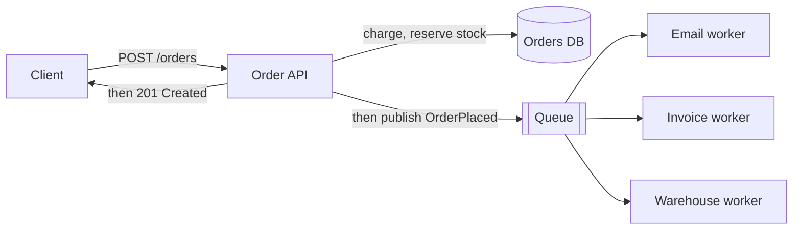
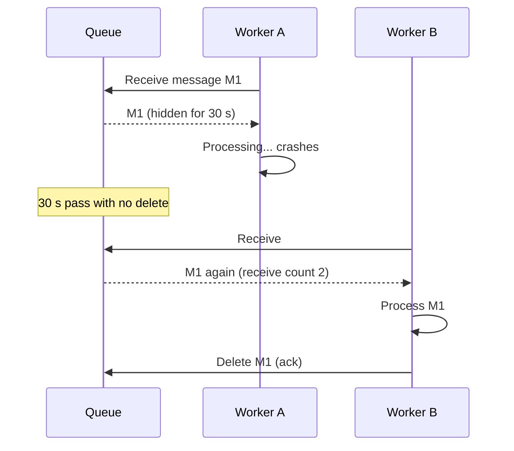
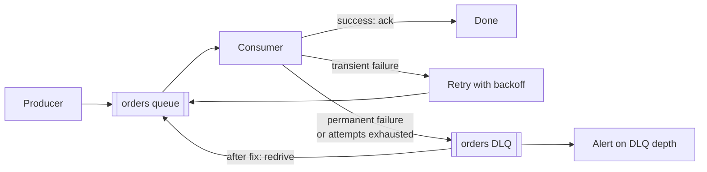
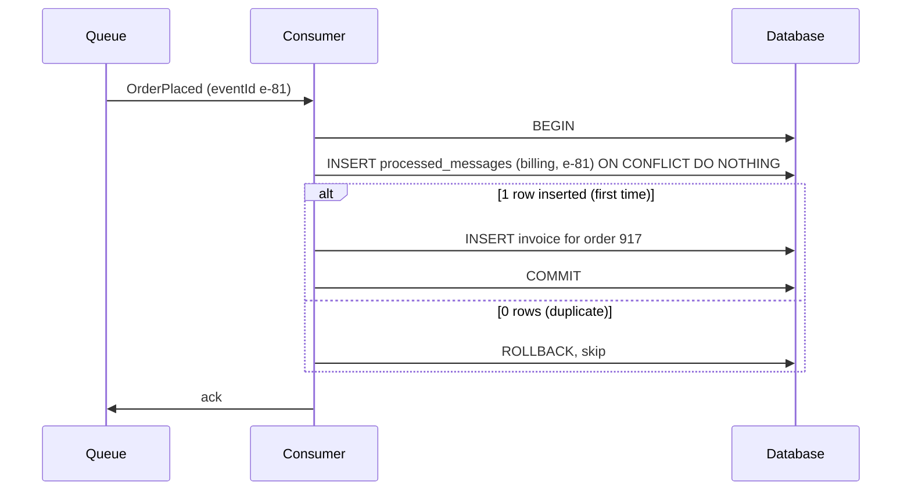
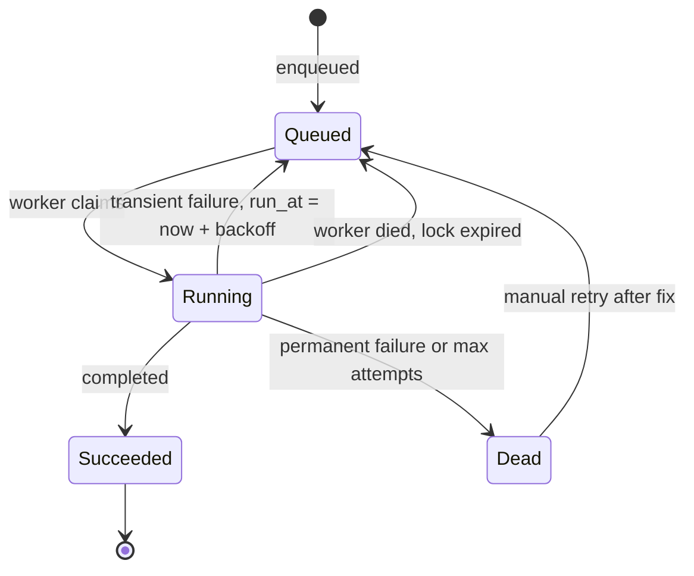

import Callout from '../../components/mdx/Callout.astro';

When a user clicks "Place order," a lot has to happen: charge the card, reserve stock, send a confirmation email, generate an invoice PDF, notify the warehouse, update analytics. If your API does all of that before responding, the user waits several seconds, and any one slow or failing dependency fails the whole request.

Most of that work doesn't need to happen *before* the response. It needs to happen *reliably, soon after*. That's what queues and background jobs are for. They're also where a new category of bugs appears: work that silently disappears, work that runs twice, and messages that crash your workers forever.

<Callout variant="tip" title="What you'll learn">
- When to make work asynchronous, and what you give up
- Queues vs pub/sub vs logs, and the common brokers (RabbitMQ, SQS, Kafka)
- Acknowledgements, visibility timeouts and delivery guarantees
- Why "at-least-once" is the practical default, and why duplicates are your problem
- Retries with exponential backoff and jitter, poison messages and dead-letter queues
- Idempotent consumers and idempotency keys for APIs
- Job queues in PostgreSQL, ordering, back-pressure and what to monitor
</Callout>

**You should already know:** idempotency of HTTP methods ([Part 2](/blog/backend-02-rest-api-design)), transactions and unique constraints ([Part 3](/blog/backend-03-databases-fundamentals)), and ideally Redis basics from [Part 5](/blog/backend-05-caching).

## Why go async

Split the order flow into what the user must wait for and what they don't:



The API does the essential, fast part, publishes a message describing what happened, and responds. Workers pick up the rest. You get:

- **Lower latency:** the response returns after the critical work, not after the slowest side effect.
- **Fault isolation:** if the email provider is down, orders still succeed. Emails catch up when it recovers.
- **Load levelling:** a traffic spike fills the queue instead of overwhelming downstream systems. Workers drain it at a rate they can sustain.
- **Independent scaling:** add invoice workers without touching the API.
- **Retries:** failed work can be retried automatically, minutes later if needed.

What you give up:

- **Immediate results.** The client can't get the invoice PDF in the same response. You need a way to report progress: return `202 Accepted` with a status URL, push a notification, or let the UI poll.
- **Simple error handling.** A failure no longer shows up as a 500 the user sees. It shows up as a growing queue or a dead-letter queue someone has to watch.
- **Simple reasoning.** Work now happens later, maybe out of order, maybe more than once.

Good candidates for async: sending emails and notifications, generating files, calling slow or flaky third parties, fan-out to other systems, video and image processing, search indexing and anything scheduled. Bad candidates: anything the user's next action depends on immediately (checking a password, validating a coupon at checkout).

### The 202 pattern

For a long-running operation a client explicitly asked for, return `202 Accepted` with a link to poll:

```http
POST /reports HTTP/1.1
Content-Type: application/json

{"type": "sales", "month": "2026-09"}
```

```http
HTTP/1.1 202 Accepted
Location: /reports/jobs/7f3a
Retry-After: 5

{"jobId": "7f3a", "status": "queued"}
```

`GET /reports/jobs/7f3a` then returns `queued`, `running`, `succeeded` (with a link to the result) or `failed`.

## Queues, pub/sub and logs

"Message queue" is used loosely for three different models.

**Point-to-point queue.** Each message is delivered to **one** of the consumers reading the queue (the *competing consumers* pattern). Once a consumer acknowledges it, it's deleted. Use it to distribute work: a thousand thumbnail jobs spread across ten workers.

**Publish/subscribe.** Each message is delivered to **every subscriber**. The email service, the invoice service and the warehouse service each get their own copy of `OrderPlaced`. In RabbitMQ this is an exchange bound to one queue per subscriber; on AWS, an SNS topic fanning out to SQS queues.

**Log (stream).** Messages are appended to a durable, ordered log and **not deleted on consumption**. Each consumer group tracks its own position (offset) and can replay history. Kafka, Redpanda, Amazon Kinesis and Redis Streams work this way. [Part 9](/blog/backend-09-event-driven-architecture) covers Kafka's model properly.

| | RabbitMQ | Amazon SQS | Apache Kafka |
|---|---|---|---|
| Model | Queues with flexible routing via exchanges | Managed point-to-point queues | Partitioned, replayable log |
| Consumption | Broker pushes, consumer acks each message | Consumer polls, deletes each message | Consumer polls, commits offsets |
| Replay | No (once acked, gone) | No | Yes, within retention |
| Ordering | Per queue, single consumer | FIFO queues per message group | Per partition |
| Typical fit | Task distribution, routing, RPC-style workflows | Simple, zero-ops queues on AWS | Event streams, high throughput, many independent consumers |

For "do this job in the background," a queue (RabbitMQ, SQS, or a database-backed job queue) is usually the right tool. Reach for a log when multiple systems need the same stream of events, or when replay matters.

## Acknowledgements and delivery guarantees

The core question in messaging: **when is a message considered done?** The answer is an acknowledgement (ack). Until a consumer acks a message, the broker keeps it and will redeliver it if the consumer disappears.

### How redelivery works

In RabbitMQ, an unacknowledged message is redelivered if the consumer's connection or channel closes. In SQS, receiving a message makes it invisible for the **visibility timeout** (default 30 seconds, up to 12 hours). If the consumer doesn't delete it in that window, it becomes visible again and another consumer receives it.



This means the visibility timeout must be longer than your worst-case processing time. If a job takes 45 seconds and the timeout is 30, a second worker gets the message while the first is still working on it, and the job runs twice. For long jobs, extend the timeout while working (SQS `ChangeMessageVisibility`) or split the job.

### The three guarantees

Where you put the ack relative to the work decides what happens when a consumer crashes.


- **At-most-once:** ack first, then process. A crash after the ack loses the message. Acceptable for metrics or telemetry where loss is fine.
- **At-least-once:** process first, then ack. A crash after processing but before the ack means the message is redelivered and processed again. **Nothing is lost, but duplicates happen.**
- **Exactly-once:** every message's effect happens exactly one time. Across a network boundary with independent failures, a broker alone can't guarantee this for arbitrary side effects (emails, HTTP calls, writes to another database). What systems market as "exactly-once" is at-least-once delivery combined with deduplication or transactional processing inside a specific boundary. [Part 10](/blog/backend-10-distributed-systems) digs into why.

**At-least-once plus idempotent consumers is the practical default.** Assume every message can arrive twice, and make processing it twice harmless. The rest of this post builds on that.

<Callout variant="note" title="Duplicates come from more than crashes">
Publishers retry too. If a producer sends a message and the broker's confirmation is lost to a network blip, the producer resends, and the queue now holds two copies. Timeouts, rebalances and visibility expiry all create duplicates. Design for them rather than hoping they're rare.
</Callout>

### Publisher side

Reliability starts when you publish. A producer should wait for the broker to confirm the message was stored (RabbitMQ *publisher confirms*, Kafka `acks=all`, or a successful SQS `SendMessage` response) before treating it as sent.

There's a subtler problem: the **dual write**. Your API commits the order to the database and then publishes `OrderPlaced`. If the process crashes between the two, you have an order with no event. If you publish first and the commit fails, you have an event for an order that doesn't exist. The standard fix is the **transactional outbox**: write the event to an `outbox` table in the same database transaction as the order, and have a separate relay publish rows from that table. [Part 9](/blog/backend-09-event-driven-architecture) covers it in detail; for now, know that "commit then publish" is not atomic.

## Retries, backoff and dead-letter queues

Failures in consumers fall into two buckets, and they need different handling:

- **Transient failures:** a timeout, a 503 from a dependency, a deadlock, a rate limit. Retrying later will probably work.
- **Permanent failures:** malformed JSON, a reference to an order that doesn't exist, a validation error, a bug. Retrying will never work.

### Exponential backoff with jitter

Retrying immediately in a tight loop hammers a dependency that's already struggling. Instead, wait longer after each failure (**exponential backoff**) and randomise the wait (**jitter**) so that a thousand consumers that failed at the same moment don't all retry at the same moment.

```text
delay(attempt) = random(0, min(max_delay, base * 2^attempt))      # "full jitter"

base = 1 s, max_delay = 5 min
attempt 1: 0-2 s     attempt 2: 0-4 s     attempt 3: 0-8 s
attempt 4: 0-16 s    attempt 5: 0-32 s    ...capped at 5 min
```

This "full jitter" variant was popularised by an AWS Architecture Blog analysis, which found it spreads load far better than fixed or un-jittered exponential delays.


### Poison messages and DLQs

A **poison message** is one that fails every time: bad data or a code bug. Without a limit, it's redelivered forever, wasting capacity, and in strictly ordered queues it blocks every message behind it.

The fix is a **dead-letter queue (DLQ)**: after N failed attempts, move the message aside so the main queue keeps flowing, and alert a human.



How brokers implement it:

- **SQS:** a *redrive policy* on the source queue names the DLQ and a `maxReceiveCount`. After that many receives without a delete, SQS moves the message. SQS also has a built-in redrive action to move messages back once you've fixed the bug.
- **RabbitMQ:** configure a *dead-letter exchange* (`x-dead-letter-exchange`) on the queue. Messages that are rejected without requeue, expire, or (for quorum queues) exceed the delivery limit are routed there. Since RabbitMQ 4.0, quorum queues have a default delivery limit of 20.
- **Kafka:** there's no built-in DLQ; consumers publish failed records to a separate topic. Spring for Apache Kafka's `DeadLetterPublishingRecoverer` does this, by default to a topic named after the original with a `.DLT` suffix.

A DLQ is only useful if someone looks at it. Alert on **DLQ depth greater than zero** (or above a small threshold), include enough context in the dead-lettered message to debug it (original headers, exception, attempt count), and have a tested process for replaying messages after a fix.

### Where to retry

- **In-process retries** (catch, sleep, try again) are fine for a couple of quick attempts at a transient error. They hold the message and the consumer thread while waiting, so don't use them for long delays.
- **Broker-level redelivery** (nack, or let the visibility timeout expire) frees the consumer, but most brokers redeliver immediately or after a fixed delay, not with exponential backoff.
- **Delayed retry queues** give you real backoff: on failure, publish the message to a retry queue whose messages become available after a delay (SQS `DelaySeconds`, RabbitMQ per-queue TTL with dead-lettering back to the main queue, or Spring Kafka's `@RetryableTopic`, which creates retry topics with increasing delays).

## Idempotent consumers

Since at-least-once delivery means duplicates *will* arrive, the consumer must make duplicates harmless. An operation is **idempotent** if doing it twice has the same effect as doing it once.

Some operations are naturally idempotent: "set order 917's status to SHIPPED," or an upsert keyed by a natural ID. Others aren't: "add 10 EUR to balance," "insert a new invoice," "send an email." For those you need deduplication.

### Deduplicate with a processed-messages table

Give every message a unique, stable ID set by the producer (an event ID, not something generated on each send attempt). The consumer records the IDs it has processed in the **same database transaction** as its business change:

```sql
CREATE TABLE processed_messages (
    consumer     text        NOT NULL,
    message_id   text        NOT NULL,
    processed_at timestamptz NOT NULL DEFAULT now(),
    PRIMARY KEY (consumer, message_id)
);
```



Because the dedup record and the invoice commit atomically, there's no window where one exists without the other. If the consumer crashes before the commit, neither exists and the redelivered message is processed normally. If it crashes after the commit but before the ack, the redelivered message hits the primary key and is skipped.

In Kotlin with Spring AMQP:

```kotlin
data class OrderPlaced(val eventId: String, val orderId: Long, val totalCents: Long)

@Repository
class ProcessedMessages(private val jdbc: JdbcClient) {
    /** Returns true the first time this consumer sees messageId. */
    fun markProcessed(consumer: String, messageId: String): Boolean =
        jdbc.sql(
            """
            INSERT INTO processed_messages (consumer, message_id)
            VALUES (:consumer, :messageId)
            ON CONFLICT DO NOTHING
            """
        )
            .param("consumer", consumer)
            .param("messageId", messageId)
            .update() == 1
}

@Component
class BillingListener(
    private val processed: ProcessedMessages,
    private val invoices: InvoiceService,
) {
    @RabbitListener(queues = ["billing.order-placed"])
    @Transactional
    fun onOrderPlaced(event: OrderPlaced) {
        if (!processed.markProcessed("billing", event.eventId)) return // duplicate
        invoices.createFor(event.orderId, event.totalCents)
    }
}
```

Clean up old rows on a schedule (keep them longer than the longest possible redelivery window, typically days).

### Side effects outside your database

You can't put "send an email" in a database transaction. Options, in order of preference:

1. **Pass an idempotency key to the external system** if it supports one. Many payment APIs, including Stripe, accept an `Idempotency-Key` header and return the original result for a repeated key.
2. **Record intent, then act, then record completion**, and on redelivery check the state. This narrows the duplicate window but doesn't remove it.
3. **Accept rare duplicates** where the harm is small (a duplicate "your order shipped" email is annoying, not catastrophic).

### Idempotency keys on your own APIs

The same idea protects your HTTP API from client retries. A client generates a unique key per logical operation and sends it with the request:

```http
POST /payments HTTP/1.1
Idempotency-Key: 3f1c2a9e-7b44-4c1e-9d0a-5a7e6f2b8c11
Content-Type: application/json

{"orderId": 917, "amountCents": 4999}
```

The server stores the key with the request's outcome. If the same key arrives again (because the client timed out and retried), it returns the stored response instead of charging twice. Implementation details that matter:

- Store the key with a hash of the request body, and reject a reuse of the key with a *different* body (`422 Unprocessable Content`, or similar).
- Handle concurrency: a second request with the same key while the first is still running should wait or get `409 Conflict`, not run in parallel. A unique constraint on the key does this.
- Expire keys after a reasonable window (Stripe documents that keys can be pruned after 24 hours).

An IETF HTTP API working group draft standardises the `Idempotency-Key` header; the pattern is widely used already.

## Background jobs without a broker

You don't always need RabbitMQ or Kafka. If you already run PostgreSQL, a **jobs table** can be a perfectly good queue for moderate volumes (hundreds to low thousands of jobs per second, depending on hardware), and it gets transactional enqueueing for free: the job is inserted in the same transaction as the business change, so there's no dual-write problem.

The key feature is `FOR UPDATE SKIP LOCKED`, which lets many workers claim different rows concurrently without blocking on each other:

```sql
WITH next AS (
    SELECT id
    FROM jobs
    WHERE status = 'queued' AND run_at <= now()
    ORDER BY run_at
    LIMIT 10
    FOR UPDATE SKIP LOCKED
)
UPDATE jobs
SET status = 'running',
    attempts = attempts + 1,
    locked_until = now() + interval '5 minutes'
FROM next
WHERE jobs.id = next.id
RETURNING jobs.id, jobs.type, jobs.payload;
```

`locked_until` plays the role of a visibility timeout: a sweeper resets jobs whose worker died. On failure, set `status = 'queued'` and `run_at = now() + backoff`; after max attempts, set `status = 'dead'`.

Each job moves through a small state machine. Whether you use a broker or a table, it's worth drawing:



In the JVM world, libraries like JobRunr and db-scheduler implement this pattern for you. For *scheduled* tasks (a nightly report) running on several instances, use a lock so only one instance runs each execution; ShedLock is the common choice with Spring's `@Scheduled`.

What about `@Async`? Spring's `@Async` runs a method on another thread in the same JVM. It's useful for fire-and-forget work that can be lost, but it is **not a queue**: if the instance restarts or crashes, queued and in-flight tasks are gone, and there's no retry or DLQ. Don't use it for anything that must happen.

## Configuring a RabbitMQ consumer in Spring Boot 4

Declaring a durable quorum queue with a dead-letter exchange:

```kotlin
@Configuration
class BillingQueues {
    @Bean
    fun orderPlacedQueue(): Queue =
        QueueBuilder.durable("billing.order-placed")
            .quorum()
            .deadLetterExchange("billing.dlx")
            .deadLetterRoutingKey("billing.order-placed.dlq")
            .build()

    @Bean
    fun deadLetterExchange(): DirectExchange = DirectExchange("billing.dlx")

    @Bean
    fun deadLetterQueue(): Queue = QueueBuilder.durable("billing.order-placed.dlq").quorum().build()

    @Bean
    fun dlqBinding(): Binding =
        BindingBuilder.bind(deadLetterQueue()).to(deadLetterExchange()).with("billing.order-placed.dlq")
}
```

And listener behaviour:

```yaml
spring:
  rabbitmq:
    listener:
      simple:
        acknowledge-mode: auto     # ack on success, reject on exception
        prefetch: 20               # max unacked messages per consumer
        concurrency: 4
        retry:
          enabled: true
          max-retries: 4           # 4 retries = 5 attempts in total
          initial-interval: 1s
          multiplier: 2.0
          max-interval: 30s
```

With `auto` acknowledgement, the container acks after your listener returns and rejects if it throws. With `retry.enabled`, Spring retries in-process with backoff; once attempts are exhausted, the default recoverer rejects the message **without requeue**, so RabbitMQ routes it to the dead-letter exchange. Because these retries happen in the consumer thread, keep the total retry time short; for long backoffs use delayed retry queues.

**Prefetch** limits how many unacknowledged messages the broker pushes to each consumer. Too high and one slow consumer hoards messages others could process (and loses all of them back to the queue if it crashes); too low and consumers sit idle waiting for the next message. Tens is a reasonable starting point for jobs that take milliseconds; use 1 for jobs that take minutes.

## Ordering and back-pressure

### Ordering

With competing consumers, **global ordering is gone**: worker A takes message 1, worker B takes message 2, and B finishes first. Retries reorder further: message 1 fails, message 2 succeeds, message 1 succeeds on retry.

Usually you don't need global order, only **per-entity order** (all events for order 917 in sequence). Ways to get it:

- **Partition by key**: SQS FIFO queues deliver messages with the same `MessageGroupId` in order, one at a time per group, while different groups proceed in parallel. Kafka does the same per partition, with the key choosing the partition.
- **Make consumers order-tolerant**: carry a version number or timestamp on each event and ignore events older than what you've already applied. This is often simpler and more robust than enforcing delivery order.

SQS FIFO queues also deduplicate messages with the same deduplication ID within a 5 minute window, which helps with producer retries but doesn't replace idempotent consumers.

### Back-pressure and monitoring

A queue absorbs spikes, but it can't fix a consumer that's permanently slower than the producer. In that case, the queue grows without bound and latency grows with it. Watch these metrics:

| Metric | Why it matters |
|---|---|
| **Queue depth** | Messages waiting. Growth means consumers can't keep up. |
| **Age of oldest message** | The real user-facing delay. A queue of 10,000 fast jobs can be fine; a 30 minute old message usually isn't. (SQS: `ApproximateAgeOfOldestMessage`.) |
| **Processing rate and error rate** | Throughput and health of consumers. |
| **Redelivery / retry count** | Rising retries signal a failing dependency. |
| **DLQ depth** | Anything above zero needs a human. |

Scale consumers on queue depth or message age (Kubernetes users often use KEDA for this). And remember that adding consumers just moves pressure downstream: twenty workers hitting a database that can handle five will make everything slower. Limit concurrency to what the slowest dependency can sustain.

## Common mistakes

- **Acking before processing** and silently losing messages on crashes.
- **Assuming exactly-once** and writing non-idempotent consumers.
- **Generating the message ID at send time** instead of per logical event, so retries produce "different" messages that dedup can't catch.
- **No DLQ, or a DLQ nobody alerts on.**
- **Retrying permanent errors** (validation failures, missing records) as if they were transient.
- **Retrying without backoff and jitter**, turning a dependency blip into a self-inflicted outage.
- **A visibility timeout shorter than the job**, causing concurrent duplicate processing.
- **Publishing after commit without an outbox**, losing events when the process dies between the two.
- **Using `@Async` or an in-memory executor for work that must not be lost.**
- **Huge messages.** Put large payloads in object storage and send a reference.
- **Assuming queue order survives competing consumers and retries.**

## Interview questions

<details>
<summary>When would you move work from the request path into a background job? What changes for the client?</summary>

When the work is slow, depends on flaky third parties, or isn't needed for the immediate response: emails, PDFs, notifications, fan-out to other services, media processing. Benefits are lower latency, isolation from downstream failures, load levelling and independent scaling. The client no longer gets the result synchronously, so you return `202 Accepted` with a status resource, or notify on completion, and the UI must handle "pending." Errors surface in queue metrics and DLQs rather than as a 500.

</details>

<details>
<summary>Explain at-most-once, at-least-once and exactly-once delivery. Which do you use in practice?</summary>

At-most-once acks before processing: crashes lose messages, no duplicates. At-least-once acks after processing: nothing is lost, but crashes between processing and ack (and producer retries) cause redelivery and duplicates. Exactly-once effects across independent systems can't be guaranteed by a broker alone; "exactly-once" features are at-least-once delivery plus deduplication or transactions within a boundary (for example Kafka's transactions for read-process-write within Kafka). In practice: at-least-once with idempotent consumers.

</details>

<details>
<summary>How do you make a consumer idempotent?</summary>

Prefer naturally idempotent operations (set state, upsert by natural key). Otherwise give each message a stable producer-assigned ID and record processed IDs in a table with a unique constraint, inserted in the same database transaction as the business change; a duplicate hits the constraint and is skipped. For external side effects, pass an idempotency key to the provider if supported. A strong answer explains why the dedup insert and business write must be atomic and why the ID must be per logical event, not per send attempt.

</details>

<details>
<summary>What is a dead-letter queue and how should it be operated?</summary>

A separate queue where messages go after exceeding a retry or receive limit (SQS `maxReceiveCount` redrive policy, RabbitMQ dead-letter exchange, a Kafka DLT topic), so poison messages don't block or waste the main queue. Operating it well means alerting when it's non-empty, preserving context (headers, error, attempt count), investigating and fixing the root cause, and replaying messages back with a tested redrive process. A DLQ nobody watches is just a slower way to lose data.

</details>

<details>
<summary>Why use exponential backoff with jitter for retries?</summary>

Immediate or fixed-interval retries hammer an already struggling dependency and can turn a brief outage into a sustained one. Exponential backoff increases the wait after each failure, giving the dependency time to recover. Jitter randomises the delay so many clients that failed together don't retry in synchronized waves. "Full jitter" picks a random delay between zero and the capped exponential value. You also need a maximum attempt count, a delay cap, and to distinguish transient from permanent errors so you don't retry validation failures.

</details>

<details>
<summary>An SQS consumer occasionally processes the same message twice at the same time. What's going on?</summary>

Most likely the visibility timeout is shorter than the processing time for some messages: the message becomes visible again while the first worker is still processing it, and a second worker receives it. Fixes: set the visibility timeout above worst-case processing time, extend it with `ChangeMessageVisibility` for long jobs (heartbeating), and keep the consumer idempotent anyway. Also check for producer-side duplicates if the IDs differ.

</details>

<details>
<summary>How would you preserve ordering for events about the same entity while still processing in parallel?</summary>

Partition by entity key: SQS FIFO with `MessageGroupId` set to the entity ID, or Kafka with the entity ID as the record key, so events for one entity go through one ordered lane while different entities run in parallel. Watch for head-of-line blocking: a failing message stalls its group, so you need a retry and DLQ strategy that doesn't reorder silently. Alternatively, make consumers order-tolerant by versioning events and ignoring stale versions.

</details>

<details>
<summary>Could you use PostgreSQL as a job queue? What are the trade-offs?</summary>

Yes: a jobs table claimed with `SELECT ... FOR UPDATE SKIP LOCKED`, with `run_at` for delays, an attempts column for retries, and a lock expiry acting like a visibility timeout. Advantages: no extra infrastructure, transactional enqueueing with business data (no dual write), and easy inspection with SQL. Downsides: polling load, table bloat from high churn needing vacuum tuning, and lower throughput ceilings than a dedicated broker. It's a good fit for moderate volumes; move to a broker when throughput, fan-out or replay needs grow.

</details>

## Key takeaways

- Move work off the request path when it's slow, flaky or not needed for the response. Use `202 Accepted` with a status URL for client-visible jobs.
- Queues distribute work to one consumer; pub/sub fans out to every subscriber; logs keep history for replay.
- Ack after processing. That gives at-least-once delivery, so **duplicates are normal** and consumers must be idempotent.
- Dedup with a stable event ID and a unique constraint written in the same transaction as the business change.
- Retry transient errors with exponential backoff and jitter; send permanent failures and exhausted retries to a DLQ, and alert on it.
- Set visibility timeouts and prefetch to match job duration. Get per-entity ordering by partitioning on a key.
- Monitor queue depth, age of the oldest message and DLQ depth. "Commit then publish" isn't atomic; the outbox pattern in Part 9 fixes it.

Previous: [Part 5: Caching](/blog/backend-05-caching)

Next: [Part 7: Database Internals and Scaling](/blog/backend-07-database-internals-scaling)
