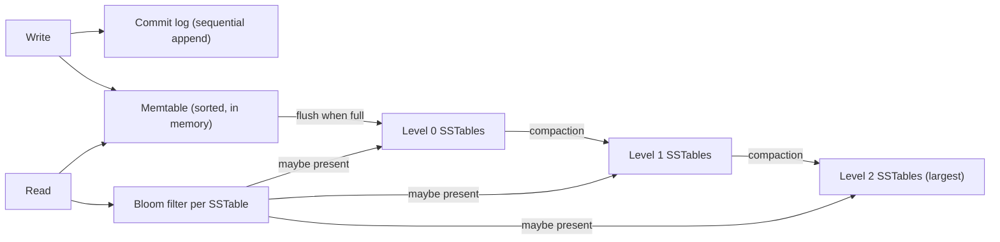
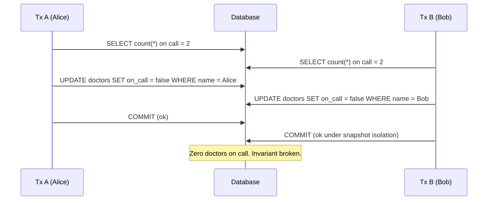
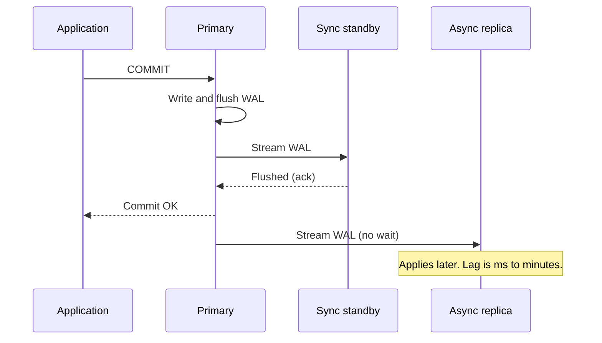
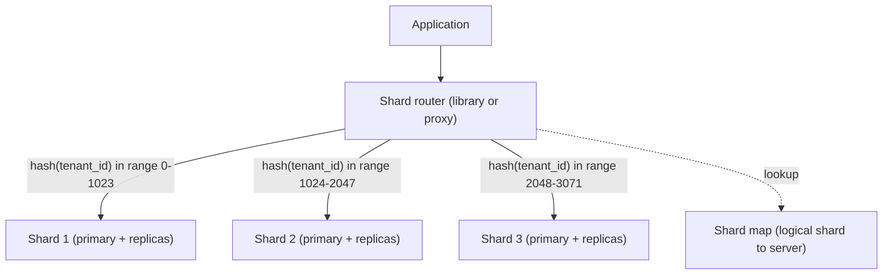
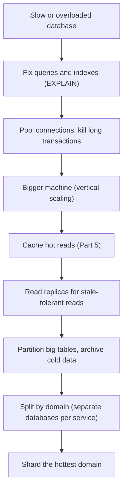

import Callout from '../../components/mdx/Callout.astro';

In Part 3 you treated the database as a box that stores rows and keeps them safe. That model carries you a long way, right up until a query that took 4 ms in staging takes 9 seconds in production, two payments both succeed against a balance that only covered one, or a read replica tells a user their freshly saved profile does not exist.

Every one of those incidents is explained by internals: how data is laid out on disk, how the planner chooses a path to it, how concurrent transactions are isolated from each other, and how copies of the data are kept in sync. Senior engineers are expected to reason about these mechanisms, not just about SQL syntax.

<Callout variant="tip" title="What you'll learn">
- How B-tree and LSM-tree storage engines work, and the trade-offs between them
- How to read `EXPLAIN ANALYZE` output and design indexes that the planner will actually use
- The four isolation levels, the anomalies each allows, and what PostgreSQL and MySQL really do
- How MVCC gives readers a snapshot without blocking writers, and what it costs
- Row locks, `SELECT ... FOR UPDATE`, `SKIP LOCKED`, deadlocks, and optimistic locking
- Physical and logical replication, replication lag, and read-your-writes
- Partitioning vs sharding, choosing a shard key, and the ladder of things to try first
</Callout>

**Level:** senior. **You should already know:** SQL, normalization, basic indexes and ACID transactions ([Part 3](/blog/backend-03-databases-fundamentals)), caching ([Part 5](/blog/backend-05-caching)) and job queues ([Part 6](/blog/backend-06-async-processing-queues)).

Examples use PostgreSQL (version 18 is current) because it is the most common default for new backends; MySQL/InnoDB differences are called out where they matter.

## Storage engines: pages, B-trees and LSM trees

### Everything is a page

Databases do not read rows from disk; they read **pages** (also called blocks). PostgreSQL uses 8 KB pages, InnoDB uses 16 KB pages by default. A page holds many rows plus a header and a slot array. The unit of I/O, caching (PostgreSQL's `shared_buffers`, InnoDB's buffer pool) and locking at the storage level is the page.

This one fact explains a lot of performance behaviour:

- Reading one 100-byte row costs one page read, the same as reading the 70 other rows on that page.
- A query that touches 10,000 rows scattered over 10,000 pages is far slower than one that touches 10,000 rows packed into 150 pages.
- Index design is mostly about minimising the number of pages you have to visit.

Durability comes from the **write-ahead log (WAL)**, InnoDB calls it the redo log. A commit appends a record describing the change to the log and flushes (`fsync`) it; the modified data page itself can be written lazily later, because after a crash the database replays the log. Sequential log appends are cheap; random page writes are expensive. The same WAL stream is what powers replication later in this post.

### B-trees: the default index

Almost every relational index is a **B+tree**: a balanced tree where internal pages hold separator keys and child pointers, and leaf pages hold the sorted keys with pointers to the rows (in PostgreSQL, a tuple id into the table heap; in InnoDB, the primary key, because InnoDB stores the table itself clustered in a B+tree on the primary key).


The key property is **fan-out**. With 8 KB pages and small keys, an internal page holds a few hundred child pointers. With a fan-out of 300:

| Levels | Leaf entries reachable |
|---|---|
| 2 | about 90,000 |
| 3 | about 27 million |
| 4 | about 8 billion |

So a point lookup on a billion-row table reads about four pages, and the upper levels are almost always already in memory. Leaves are linked to their siblings, which makes range scans (`WHERE created_at BETWEEN ...`, `ORDER BY ... LIMIT`) a matter of finding the first leaf and walking right.

The cost is on writes. Inserting into a full leaf **splits** it into two half-full pages, and every index on the table must be updated for every insert. Key choice matters here: monotonically increasing keys (identity columns, UUIDv7, which PostgreSQL 18 can generate with `uuidv7()`) always append to the rightmost leaf, which stays hot in cache. Random keys (UUIDv4) insert all over the tree, touch far more pages, cause more splits and bloat, and hurt cache hit rates once the index outgrows memory.

### LSM trees: optimised for writes

A **log-structured merge tree** (RocksDB, Cassandra, ScyllaDB, and the storage layer of CockroachDB and TiKV) takes the opposite trade-off: never update in place.



Writes go to an in-memory sorted structure (the memtable) and a sequential log. When the memtable fills, it is flushed as an immutable sorted file (an SSTable). Background **compaction** merges SSTables, discarding overwritten values and deletion markers (tombstones). A read checks the memtable, then SSTables from newest to oldest, using per-file **Bloom filters** to skip files that definitely do not contain the key.

The trade-off is usually framed as three kinds of amplification:

| | B-tree | LSM tree |
|---|---|---|
| Write amplification | Higher: random page writes, full pages rewritten | Lower at write time, but compaction rewrites data repeatedly |
| Read amplification | Low: one path down the tree | Higher: may check several levels |
| Space amplification | Fragmentation, half-full pages | Obsolete versions until compaction runs |
| Sweet spot | Read-heavy OLTP, range scans, transactions | Write-heavy ingestion, time series, key-value at scale |

You can not minimise all three at once. Interviewers like this question because the right answer is a trade-off, not a winner.

## Query plans: reading EXPLAIN

SQL is declarative: you say *what*, the **planner** decides *how*. It estimates the cost of alternative plans using table statistics (row counts, value distributions, most-common values, collected by `ANALYZE` and autovacuum) and picks the cheapest. Most slow queries are either a missing index or a planner working from bad estimates.

```sql
EXPLAIN (ANALYZE, BUFFERS)
SELECT id, total
FROM orders
WHERE customer_id = 42
ORDER BY created_at DESC
LIMIT 20;
```

`EXPLAIN` shows the estimated plan; `ANALYZE` actually runs the query and adds real timings and row counts; `BUFFERS` reports how many pages came from cache (`shared hit`) versus storage (`read`). In PostgreSQL 18, `BUFFERS` is included automatically with `ANALYZE`. Remember that `EXPLAIN ANALYZE` executes the statement: wrap an `UPDATE` or `DELETE` in a transaction you roll back.

A plan without a useful index (output trimmed):

```text
Limit  (cost=48211.10..48211.15 rows=20) (actual time=412.8..412.8 rows=20 loops=1)
  ->  Sort  (cost=48211.10..48213.60 rows=1001) (actual time=412.8..412.8 rows=20 loops=1)
        Sort Key: created_at DESC
        ->  Seq Scan on orders  (cost=0.00..48184.46 rows=1001) (actual time=0.9..411.9 rows=987 loops=1)
              Filter: (customer_id = 42)
              Rows Removed by Filter: 2399013
        Buffers: shared hit=2112 read=22072
Execution Time: 413.1 ms
```

Read plans from the innermost node outwards. The story here: scan all 2.4 million rows (`Seq Scan`), throw away all but 987, sort them, keep 20. Twenty-two thousand pages read from storage to return twenty rows.

After `CREATE INDEX ON orders (customer_id, created_at DESC);`:

```text
Limit  (actual time=0.04..0.09 rows=20 loops=1)
  ->  Index Scan using orders_customer_id_created_at_idx on orders  (actual time=0.04..0.08 rows=20 loops=1)
        Index Cond: (customer_id = 42)
        Buffers: shared hit=24
Execution Time: 0.11 ms
```

The index delivers rows already in the requested order, so the sort disappears and the `LIMIT` stops after 20 rows. That is a 3,700x improvement from one index, and it is typical.

### The plan nodes you need to recognise

- **Seq Scan**: reads the whole table. Correct for small tables or when you need a large fraction of rows; a red flag on a large table with a selective filter.
- **Index Scan**: walks the index, then fetches each matching row from the heap.
- **Index Only Scan**: all needed columns are in the index, so the heap is skipped (as long as the visibility map says pages are all-visible, which depends on vacuum).
- **Bitmap Index Scan + Bitmap Heap Scan**: collects matching row locations first, sorts them by page, then reads each page once. Used for medium selectivity and for combining several indexes.
- **Nested Loop**: for each outer row, look up inner rows. Great when the outer side is small and the inner side is indexed.
- **Hash Join**: build a hash table from one side, probe with the other. Good for large unsorted inputs.
- **Merge Join**: both inputs sorted on the join key, walk them together.

The single most useful habit: **compare estimated `rows` with actual `rows`**. If the planner expected 5 rows and got 500,000, it chose a plan for a different query. Fix the estimates first: run `ANALYZE`, raise the statistics target for skewed columns, or add extended statistics (`CREATE STATISTICS`) for correlated columns like `city` and `zip_code`.

### Index design rules that survive production

1. **Composite index column order matters.** An index on `(customer_id, created_at)` serves `WHERE customer_id = ?` and `WHERE customer_id = ? AND created_at > ?`, and can deliver `ORDER BY created_at` within one customer. It is far less useful for `WHERE created_at > ?` alone. Put equality columns first, then the range or sort column. (PostgreSQL 18 and MySQL 8 can sometimes use a *skip scan* when the leading column has few distinct values, but do not design around it.)
2. **Covering indexes** avoid heap fetches: `CREATE INDEX ON orders (customer_id) INCLUDE (total, status);`
3. **Partial indexes** index only the rows you query: `CREATE INDEX ON jobs (run_at) WHERE status = 'PENDING';` stays tiny even if the table has a billion completed jobs.
4. **Expressions defeat plain indexes.** `WHERE lower(email) = ?` needs an index on `lower(email)`; `WHERE created_at::date = ?` needs a range rewrite instead.
5. **Every index is a write tax.** Each insert updates every index, and in PostgreSQL an update that changes an indexed column can not use a HOT (heap-only tuple) update. Drop indexes that `pg_stat_user_indexes` shows are never scanned.
6. **Build indexes on live tables with `CREATE INDEX CONCURRENTLY`.** A plain `CREATE INDEX` blocks writes for the whole build.

## Isolation levels and their anomalies

ACID's "I" is not one thing. The SQL standard defines four isolation levels by the anomalies they forbid, and real databases implement them differently. First the anomalies:

- **Dirty read**: you see another transaction's uncommitted change.
- **Non-repeatable read**: you read a row twice and get different values because someone committed in between.
- **Phantom read**: you run the same range query twice and new rows appear.
- **Lost update**: two transactions read a value, both compute a new value, both write; one write silently disappears.
- **Write skew**: two transactions read overlapping data, make decisions based on it, and write *different* rows, producing a state neither would have allowed alone.

| Level | Dirty read | Non-repeatable read | Phantom | Write skew |
|---|---|---|---|---|
| Read Uncommitted | allowed by standard | possible | possible | possible |
| Read Committed | prevented | possible | possible | possible |
| Repeatable Read | prevented | prevented | allowed by standard | possible |
| Serializable | prevented | prevented | prevented | prevented |

What the engines actually do:

- **PostgreSQL** defaults to **Read Committed**: each *statement* sees a fresh snapshot. Read Uncommitted behaves like Read Committed (PostgreSQL never shows dirty data). **Repeatable Read** is snapshot isolation: the whole transaction sees one snapshot, which also prevents phantoms, and a concurrent update to a row you are updating aborts you with `could not serialize access due to concurrent update`. **Serializable** uses Serializable Snapshot Isolation (SSI), which detects dangerous read/write dependency patterns and aborts one transaction with SQLSTATE `40001`.
- **MySQL/InnoDB** defaults to **Repeatable Read**. Plain `SELECT`s read a consistent snapshot, but locking reads and `UPDATE`s operate on the latest committed rows and use next-key (gap) locks to block phantoms in ranges. A read-then-update pattern can still lose updates, because the update applies to the latest version rather than failing.

### Write skew, concretely

The classic example: a hospital requires at least one doctor on call. Alice and Bob are both on call and both feel ill at the same moment.



Neither transaction modified a row the other modified, so snapshot isolation sees no conflict. Under Serializable (SSI), PostgreSQL detects that each read a set the other wrote and aborts one. Alternatives at lower isolation: lock the rows you base the decision on (`SELECT ... FOR UPDATE`), or materialise the conflict into a single row both must update (an `on_call_count` row or a constraint).

The same shape shows up everywhere: double-booking a meeting room, overspending across two accounts in a shared budget, issuing two usernames that differ only in case.

<Callout variant="warning" title="Serializable means retries">
Serializable and Repeatable Read in PostgreSQL abort transactions instead of blocking forever. That is correct behaviour, and it means your application **must retry the whole transaction** on SQLSTATE `40001` (and on deadlock, `40P01`). Without a retry loop, raising the isolation level just converts silent corruption into user-facing errors.
</Callout>

A retry must wrap the transaction, not run inside it:

```kotlin
@Service
class TransferService(
    private val tx: TransactionTemplate,
    private val accounts: AccountRepository,
) {
    fun transfer(from: Long, to: Long, amount: BigDecimal) {
        repeat(MAX_ATTEMPTS) { attempt ->
            try {
                tx.execute {
                    accounts.debit(from, amount)
                    accounts.credit(to, amount)
                }
                return
            } catch (e: PessimisticLockingFailureException) { // 40001 serialization, 40P01 deadlock
                if (attempt == MAX_ATTEMPTS - 1) throw e
            }
            Thread.sleep(Random.nextLong(10, 50L * (attempt + 1))) // jittered backoff
        }
    }
    private companion object { const val MAX_ATTEMPTS = 4 }
}
```

Spring translates SQLSTATE class `40` errors into `PessimisticLockingFailureException` and its subclasses such as `CannotAcquireLockException` (the exact subclass depends on the translator, so catching the parent is the robust choice). The `TransactionTemplate` would be configured with `isolationLevel = ISOLATION_SERIALIZABLE` where needed.

## MVCC: how readers and writers avoid each other

Both PostgreSQL and InnoDB use **multi-version concurrency control**: instead of locking a row while someone reads it, the database keeps multiple versions and shows each transaction the version that was committed as of its snapshot. Readers never block writers and writers never block readers. Writers still block writers on the same row.


The implementations differ in where the old versions live:

- **PostgreSQL** stores every version in the table heap. Each tuple has `xmin` (the transaction that created it) and `xmax` (the transaction that deleted or replaced it). An `UPDATE` is effectively insert-new plus mark-old. A snapshot is essentially "which transaction ids had committed when I started", and visibility is checked per tuple.
- **InnoDB** updates the row in place in the clustered index and keeps the previous version in the **undo log**. Readers needing an older version follow the undo chain backwards.

The costs of MVCC are where production incidents come from:

1. **Dead tuples and bloat (PostgreSQL).** Old versions stay in the heap until **VACUUM** (usually autovacuum) removes them. A hot `UPDATE`-heavy table with lagging autovacuum grows on disk and its scans slow down. Tune autovacuum per table for those (`ALTER TABLE ... SET (autovacuum_vacuum_scale_factor = 0.02)`) rather than disabling it.
2. **Long-running transactions block cleanup.** VACUUM can not remove a version that any open snapshot might still need. One forgotten transaction left `idle in transaction` for six hours (a debugging session, a leaked connection, an app that opened a transaction and then called a slow HTTP API) holds back cleanup for the entire database. In InnoDB the symptom is a growing undo history list. Set `idle_in_transaction_session_timeout` and alert on transaction age.
3. **Transaction id wraparound (PostgreSQL).** Transaction ids are 32-bit; VACUUM must periodically "freeze" old tuples. If it can not, PostgreSQL eventually refuses writes to protect data. Monitor `age(datfrozenxid)`.

Practical rule: **never hold a database transaction open across a network call.** It holds locks, pins snapshots, and occupies a pool connection while you wait on someone else's latency.

## Locking

MVCC removes read/write contention, but writes to the same row still serialise through row-level locks, and you sometimes need to lock explicitly.

### Pessimistic locking

```sql
BEGIN;
SELECT balance FROM accounts WHERE id = 1 FOR UPDATE;  -- row locked until COMMIT
UPDATE accounts SET balance = balance - 30 WHERE id = 1;
COMMIT;
```

Variants worth knowing: `FOR SHARE` (others may read-lock but not modify), `FOR NO KEY UPDATE` (PostgreSQL's weaker lock that does not block foreign-key checks; plain `UPDATE`s take it when no key columns change), `NOWAIT` (fail immediately instead of waiting) and `SKIP LOCKED` (ignore locked rows).

`SKIP LOCKED` is what makes a table a safe multi-worker job queue, building on [Part 6](/blog/backend-06-async-processing-queues):

```sql
UPDATE jobs SET status = 'RUNNING', locked_at = now()
WHERE id IN (
  SELECT id FROM jobs
  WHERE status = 'PENDING' AND run_at <= now()
  ORDER BY run_at
  LIMIT 10
  FOR UPDATE SKIP LOCKED
)
RETURNING id, payload;
```

Ten workers can run this concurrently and each gets a disjoint batch, with no thundering herd on the first row.

Note that a single statement such as `UPDATE accounts SET balance = balance - 30 WHERE id = 1 AND balance >= 30` is already atomic and safe at Read Committed; the lost-update problem only appears when you read into application memory, compute, and write back.

### Optimistic locking

When conflicts are rare, avoid holding locks at all: keep a version column and make the write conditional on it.

```kotlin
@Entity
class Account(
    @Id val id: Long,
    var balance: BigDecimal,
    @Version var version: Long = 0,
)
```

Hibernate issues `UPDATE account SET balance = ?, version = version + 1 WHERE id = ? AND version = ?`; if zero rows match, someone else won and it throws `OptimisticLockException` (surfaced by Spring as `ObjectOptimisticLockingFailureException`). This fits user-facing edit flows (two admins editing the same product) and HTTP `If-Match`/ETag semantics from [Part 2](/blog/backend-02-rest-api-design). Under heavy contention on one row, optimistic locking degrades into a retry storm, so switch to pessimistic locks or redesign the hot row. For more on JPA's locking modes, see [Hibernate vs JPA](/blog/hibernate-vs-jpa-complete-guide).

### Deadlocks and DDL locks

A deadlock is a cycle: transaction A holds row 1 and wants row 2, B holds row 2 and wants row 1. PostgreSQL checks for cycles after a lock wait exceeds `deadlock_timeout` (default 1 s) and aborts one victim with SQLSTATE `40P01`; InnoDB detects them immediately by default. Prevention: **acquire locks in a consistent order** (for a transfer, lock the lower account id first), keep transactions short, and retry victims.

The lock that causes the most outages, though, is a schema change. `ALTER TABLE` often needs an `ACCESS EXCLUSIVE` lock. It queues behind a long-running query, and *every subsequent query queues behind it*, so a two-millisecond migration can take a table offline for minutes. Always set `SET lock_timeout = '3s'` in migrations and retry, and prefer online patterns: add nullable columns, backfill in batches, `CREATE INDEX CONCURRENTLY`, add constraints as `NOT VALID` and `VALIDATE` them separately.

## Replication

Replication keeps copies of the data on other machines, for high availability (fail over if the primary dies) and for read scaling (send reads to replicas).



### Physical vs logical

- **Physical (streaming) replication** ships the WAL byte stream; the standby is a block-for-block copy of the whole cluster, same major version, read-only. This is the standard HA setup, usually managed by Patroni or a cloud provider.
- **Logical replication** decodes WAL into row-level changes (`CREATE PUBLICATION` / `CREATE SUBSCRIPTION`). It can replicate selected tables, across major versions, into a writable database. It is how you do near-zero-downtime major upgrades and it is the foundation of change data capture, which [Part 9](/blog/backend-09-event-driven-architecture) builds on. MySQL's equivalent foundation is the binlog (row-based format).

### Synchronous vs asynchronous

With asynchronous replication (the default), the primary acknowledges the commit as soon as its own WAL is flushed. Fast, but if the primary dies, the last few hundred milliseconds of commits may never have reached the replica, and failover loses them.

PostgreSQL lets you choose per cluster or even per transaction with `synchronous_standby_names` plus `synchronous_commit`:

- `on`: wait until a synchronous standby has flushed the WAL. No data loss on failover.
- `remote_apply`: wait until the standby has *applied* it, so a read on that standby immediately sees the commit.
- `local` / `off`: do not wait for standbys (and with `off`, not even for the local flush; you may lose the last few transactions on crash but never corrupt data).

Synchronous replication adds a network round trip to every commit, and if the only synchronous standby is down, commits block. Production setups typically list several candidates (`synchronous_standby_names = 'ANY 1 (s1, s2)'`) so one healthy standby is enough.

### Replication lag and its anomalies

Reads from async replicas are **eventually consistent**. Usually lag is milliseconds; under a bulk backfill, a long query on the replica or a network blip, it can be minutes. Lag produces two user-visible bugs:

- **Read-your-writes violation**: the user saves, gets redirected, and the page (served from a replica) shows the old value.
- **Monotonic reads violation**: two consecutive requests hit different replicas and the user sees data go backwards in time.

Mitigations, from simplest to most precise:

1. Route the user's reads to the primary for a short window after they write (sticky-to-primary by session).
2. Pin a user to one replica (fixes monotonic reads only).
3. Track the log position: after a write, record the primary's `pg_current_wal_lsn()`; route a read to a replica only if its `pg_last_wal_replay_lsn()` has passed it.
4. Read critical paths (balances, permissions, anything you will act on) from the primary, always.

In Spring, a common split is to route `@Transactional(readOnly = true)` methods to a replica with an `AbstractRoutingDataSource` wrapped in a `LazyConnectionDataSourceProxy` (so the routing decision is made after the transaction's read-only flag is set). Treat it as an optimisation for queries that tolerate staleness, not a blanket rule.

Monitor lag on the primary via `pg_stat_replication` (`write_lag`, `flush_lag`, `replay_lag`) and alert on it.

<Callout variant="note" title="Failover is the hard part">
Promoting a replica is easy. Making sure the old primary can not keep accepting writes (split brain), that clients reconnect to the new one, and that you understand what async commits were lost, is where HA tooling earns its keep. Consensus-based managers such as Patroni use a distributed store (etcd, Consul) to elect a single leader. [Part 10](/blog/backend-10-distributed-systems) covers why that needs consensus.
</Callout>

## Partitioning and sharding

Replicas scale reads. Eventually one table, or the write volume, outgrows a single primary. There are two different tools here, and people mix up the names:

- **Partitioning**: splitting one logical table into several physical tables *inside one database server*.
- **Sharding**: splitting data across *multiple database servers*, each owning a subset.

### Partitioning inside one server

PostgreSQL's declarative partitioning supports range, list and hash partitioning:

```sql
CREATE TABLE events (
    id          bigint GENERATED ALWAYS AS IDENTITY,
    tenant_id   bigint      NOT NULL,
    created_at  timestamptz NOT NULL,
    payload     jsonb       NOT NULL,
    PRIMARY KEY (id, created_at)          -- must include the partition key
) PARTITION BY RANGE (created_at);

CREATE TABLE events_2026_10 PARTITION OF events
    FOR VALUES FROM ('2026-10-01') TO ('2026-11-01');
CREATE TABLE events_2026_11 PARTITION OF events
    FOR VALUES FROM ('2026-11-01') TO ('2026-12-01');
```

The wins:

- **Partition pruning**: `WHERE created_at >= '2026-11-01'` only scans the November partition.
- **Cheap retention**: `DROP TABLE events_2025_10` (or `DETACH PARTITION`) is instant; `DELETE FROM events WHERE created_at < ...` on 500 million rows generates enormous WAL and bloat.
- **Smaller indexes and vacuum units** per partition.

The costs: primary keys and unique constraints must include the partition key, queries that do not filter on the partition key touch every partition, and you need automation (for example the `pg_partman` extension or a scheduled job) to create future partitions before they are needed. Partitioning is a good fit for time-series and append-mostly data; it does not add write capacity beyond one machine.

### Sharding across servers



The decision that dominates everything is the **shard key**. A good key:

- **Spreads load evenly**, both data volume and request rate. `country` is a terrible key when 60 % of traffic is one country.
- **Keeps related data together** so that the common queries and transactions hit one shard. For a B2B SaaS, `tenant_id` usually wins: almost every query is scoped to one tenant, and one tenant's data can be joined and transacted locally.
- **Is present in almost every query.** A query without the shard key is a scatter-gather to every shard, which is as slow as the slowest shard.

Strategies:

- **Range sharding** (`user_id` 1 to 10M on shard 1, and so on) keeps range scans local, but new keys all land on the last shard and hot ranges are common.
- **Hash sharding** spreads evenly but kills range queries across keys.
- **Directory-based** keeps an explicit map from key to shard, which lets you move individual big tenants, at the cost of a lookup service.

A widely used technique is to hash into many **logical shards** (say 1,024) and map logical shards to a small number of physical servers. Resharding then means moving whole logical shards between servers rather than rehashing every row. Consistent hashing, covered in [Part 8](/blog/backend-08-scalability-performance), solves a similar problem for caches and stateless routing.

What you give up when you shard:

- Cross-shard joins and foreign keys.
- Cross-shard transactions (you now need sagas or two-phase commit; see Part 9).
- Globally unique constraints (an email must be unique across all users) need a separate lookup table or service.
- Global secondary indexes, or "find all orders with status X" across tenants, need a separate index store or an analytics copy.
- Operational simplicity: every migration, backup and failover now happens N times.

Off-the-shelf options exist so you do not hand-roll a router: **Vitess** for MySQL, **Citus** as a PostgreSQL extension, and distributed SQL databases (**CockroachDB**, **YugabyteDB**, **Google Spanner**) that shard and replicate automatically and offer distributed transactions, with higher per-transaction latency as the price.

### The ladder before you shard

Sharding is a one-way door with a permanent complexity tax. Before reaching for it, climb this ladder, roughly in order of cost:



A single modern PostgreSQL server with plenty of RAM and fast NVMe handles tens of thousands of simple transactions per second and multi-terabyte datasets. Many companies that sharded early did it to fix a missing index.

## Common mistakes

- **Trusting a fast query in staging.** Plans depend on data volume and distribution. Test with production-shaped data, and check `pg_stat_statements` in production for the queries that actually consume time.
- **Indexing every column individually.** Three single-column indexes rarely beat one well-ordered composite index, and each slows every write.
- **Random UUIDv4 primary keys on hot, large tables.** Use identity columns or time-ordered UUIDv7 instead.
- **Assuming the default isolation level prevents lost updates or write skew.** Read Committed prevents neither; know which invariants need `FOR UPDATE`, a constraint, or Serializable.
- **Raising isolation without a retry loop.** You exchanged anomalies for `40001` errors.
- **Holding transactions open across HTTP calls or user think time.** It blocks vacuum, holds locks and exhausts the pool.
- **Running `ALTER TABLE` in production without `lock_timeout`.**
- **Reading your own writes from an async replica.**
- **Using `DELETE` for retention on huge tables** instead of dropping partitions.
- **Sharding before exhausting the ladder,** or choosing a shard key your main queries do not include.

## Interview questions

<details>
<summary>When would you choose an LSM-tree-based database over a B-tree-based one?</summary>

When the workload is write-heavy and mostly key-based: event ingestion, time series, messaging, high-volume key-value lookups. LSM trees turn random writes into sequential appends and compaction, so they sustain much higher write throughput and compress well.

A strong senior answer names the costs: reads may consult several levels (mitigated by Bloom filters and caching), compaction consumes I/O and CPU in the background and can cause latency spikes if it falls behind, and deletes leave tombstones that linger. B-trees give predictable reads and efficient range scans and are the natural fit for transactional OLTP. The trade-off the interviewer wants is read vs write vs space amplification: you pick which one to pay.

</details>

<details>
<summary>A query got slow after a data migration even though nothing in the code changed. How do you investigate?</summary>

Get the real plan with `EXPLAIN (ANALYZE, BUFFERS)` on production-like data and compare estimated with actual row counts at each node. A large mismatch means stale or insufficient statistics: the migration changed the data distribution but `ANALYZE` has not caught up, so the planner chose, say, a nested loop expecting 10 rows and got a million. Run `ANALYZE`, consider a higher statistics target or extended statistics for correlated columns.

Also check for bloat from the migration's updates (vacuum may be behind), an index that was dropped or became invalid (a failed `CREATE INDEX CONCURRENTLY` leaves an `INVALID` index), and whether parameter types changed in a way that prevents index use. Confirm the fix with a before/after plan, not just timing.

</details>

<details>
<summary>Explain write skew and how you would prevent it.</summary>

Two transactions read an overlapping set of rows, each checks an invariant that holds, and each writes a *different* row. Neither saw the other's write, and because they did not modify the same row, snapshot isolation sees no conflict. Example: two doctors both go off call when the rule is "at least one on call".

Prevention options: run at Serializable (PostgreSQL's SSI detects it and aborts one, so retry), explicitly lock the rows the decision depends on with `SELECT ... FOR UPDATE`, materialise the conflict into one row both must update, or enforce it with a constraint (unique index, exclusion constraint for time ranges). The trade-off is that Serializable is general but requires retries and adds some overhead, while explicit locks are cheaper but rely on every code path remembering to take them.

</details>

<details>
<summary>How does MVCC work in PostgreSQL, and what operational problems does it create?</summary>

Every row version carries `xmin` and `xmax`. An update writes a new version and marks the old one with the updater's transaction id. Each transaction (or statement, at Read Committed) gets a snapshot and sees only versions committed as of that snapshot, so readers do not block writers.

The costs: dead versions accumulate until VACUUM removes them, causing bloat; a long-running or idle-in-transaction session prevents cleanup across the whole database; and 32-bit transaction ids require freezing to avoid wraparound. A strong answer mentions monitoring transaction age and dead tuples, per-table autovacuum tuning, `idle_in_transaction_session_timeout`, and contrasts InnoDB's undo-log approach.

</details>

<details>
<summary>Optimistic or pessimistic locking: how do you decide?</summary>

Optimistic (a version column, conditional update, retry or report on conflict) when conflicts are rare and the gap between read and write may be long, such as a user editing a form; it holds no locks and maps cleanly onto HTTP ETags. Pessimistic (`SELECT ... FOR UPDATE`) when conflicts are frequent or retries are expensive, such as decrementing inventory on a hot product, and when the critical section is short.

The trade-off: optimistic locking under high contention wastes work and can starve; pessimistic locking reduces concurrency and risks deadlocks, so you need consistent lock ordering and timeouts. Often the best answer is neither: a single atomic `UPDATE ... SET stock = stock - 1 WHERE id = ? AND stock > 0` avoids the read-modify-write race entirely.

</details>

<details>
<summary>Users report that after saving their profile, the page sometimes shows old data. What is happening and how do you fix it?</summary>

The write went to the primary and the subsequent read was served by an asynchronous replica that had not replayed the change yet: a read-your-writes violation caused by replication lag.

Fixes, in increasing precision: route that user's reads to the primary for a few seconds after a write; track the primary's WAL LSN after the write and only read from a replica that has replayed past it; use `synchronous_commit = remote_apply` for a standby that serves these reads (at the cost of commit latency); or just read this particular page from the primary. Also measure and alert on replica lag, because the bug frequency tracks it. A strong answer notes that "send all reads to replicas" is a policy decision about consistency, not a free optimisation.

</details>

<details>
<summary>Your main table is 3 TB and growing 100 GB per month. Walk me through your scaling options.</summary>

First understand the pressure: is it storage, write throughput, read throughput, or maintenance (vacuum, index builds, backups)? Then climb the ladder: fix the top queries from `pg_stat_statements`, add or remove indexes, scale up hardware, cache hot reads, add read replicas.

For a large append-mostly table, partition by time: pruning keeps queries on recent partitions, retention becomes `DROP PARTITION`, and maintenance runs per partition. Archive cold data to cheaper storage or an analytics system. Only if a single primary can not take the write rate or working set, shard, and spend most of the discussion on the shard key: it must spread load, keep transactions local and appear in nearly every query. Mention logical shards for easier rebalancing and the loss of cross-shard joins, transactions and unique constraints. Considering a distributed SQL database or Citus/Vitess before hand-rolling is a sign of maturity.

</details>

<details>
<summary>How would you choose a shard key for a multi-tenant SaaS, and what goes wrong?</summary>

`tenant_id` is usually right: almost all queries are tenant-scoped, a tenant's data can be joined and transacted on one shard, and it is easy to route. The failure mode is skew: one enterprise tenant can be larger than the rest combined. Handle that with a directory-based map that can place a whale tenant on its own shard, and with logical shards so you can move tenants without rehashing everything.

Cross-tenant features (admin dashboards, global search, billing reports) become scatter-gather queries or move to a separate analytics store fed by CDC. Globally unique values such as login emails need a global lookup table. The interviewer is fishing for an awareness that the shard key encodes your access patterns, and changing it later is a full data migration.

</details>

## Key takeaways

- Databases read and write **pages**; performance is mostly about how many pages a query touches.
- **B-trees** favour reads and range scans; **LSM trees** favour write throughput. You choose which amplification to pay.
- Read plans with `EXPLAIN (ANALYZE, BUFFERS)` and compare **estimated vs actual rows**. Composite index order is equality columns first, then range or sort.
- Know your engine's real isolation semantics. Read Committed allows lost updates and write skew; Serializable requires a **retry loop**.
- **MVCC** lets readers and writers coexist, at the cost of dead versions; long transactions are the enemy.
- Use `FOR UPDATE`, `SKIP LOCKED`, version columns or atomic single-statement updates deliberately, and always set `lock_timeout` for migrations.
- Async replicas are **eventually consistent**; design for read-your-writes explicitly.
- **Partition** for retention and pruning within one server; **shard** only after exhausting the cheaper ladder, and treat the shard key as an architectural decision.

Previous: [Part 6: Async Processing & Queues](/blog/backend-06-async-processing-queues)

Next: [Part 8: Scalability and Performance](/blog/backend-08-scalability-performance)
