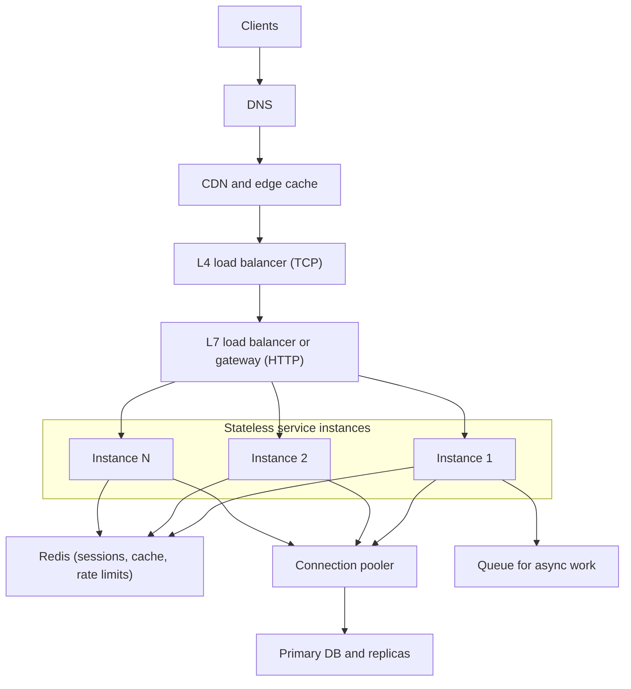
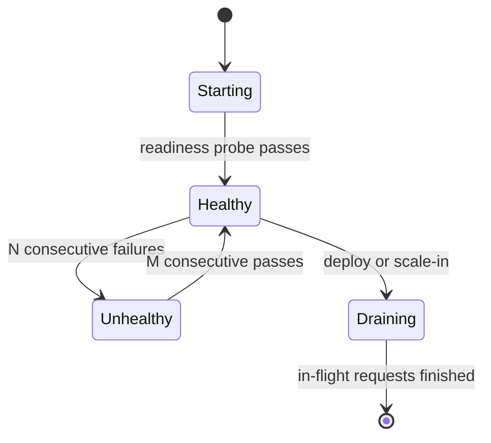
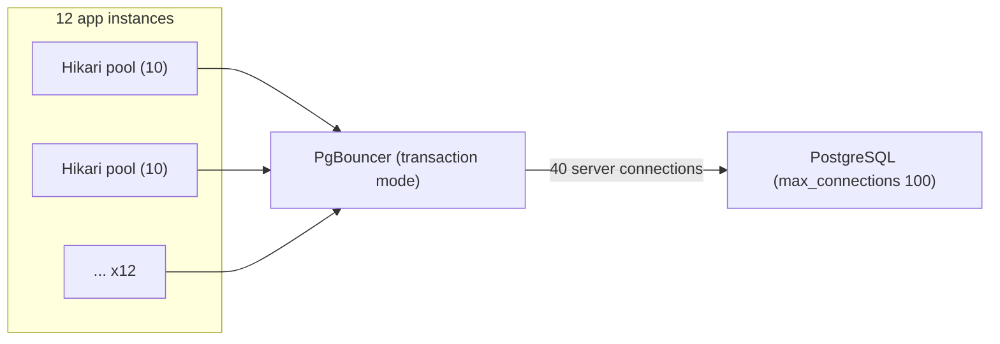
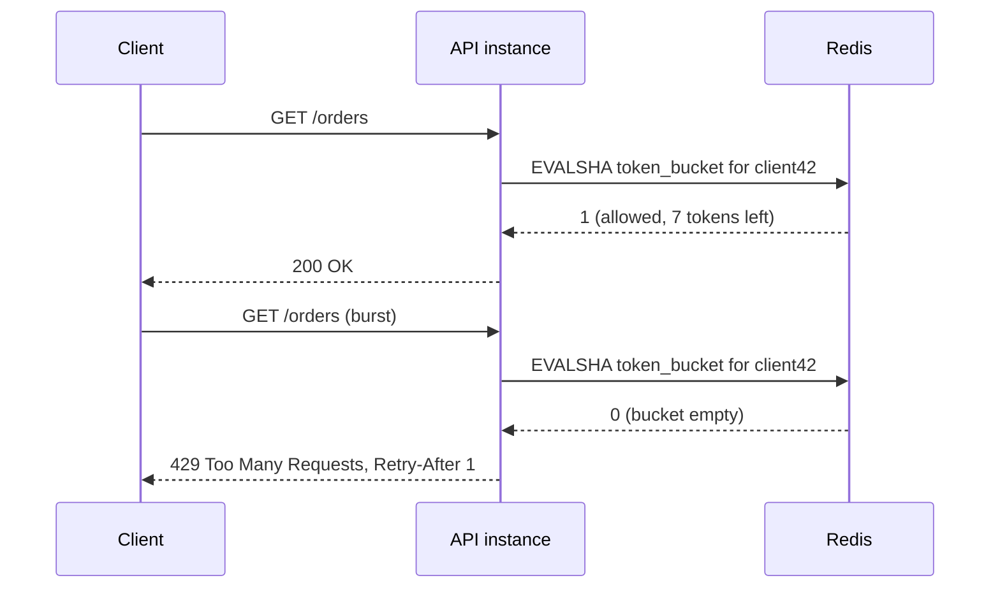
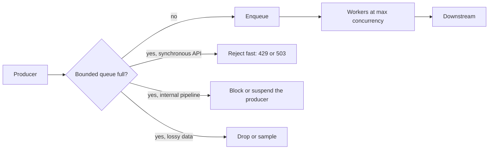

import Callout from '../../components/mdx/Callout.astro';

"Make it scale" is one of the vaguest requirements in software. Scale *what*: requests per second, data volume, number of tenants, number of engineers? And at what cost and latency? Senior engineers turn that vague request into numbers, find the component that will saturate first, and pick the cheapest change that moves the bottleneck.

This post gives you the mental models and the arithmetic. It starts with the two laws that govern every queueing system, then walks through the layers of a horizontally scaled backend: load balancers, stateless services, connection pools, rate limiters and back-pressure. It ends with the capacity estimation method you will use in every system design interview (and in every real capacity review).

<Callout variant="tip" title="What you'll learn">
- Latency, throughput, utilisation and percentiles, and why averages lie
- Little's Law and why queues explode near 100 % utilisation
- L4 vs L7 load balancing and the algorithms behind them (including power of two choices)
- What "stateless" really requires, and the state that sneaks back in
- Sizing connection pools across a fleet without exhausting the database
- Rate limiting algorithms: fixed window, sliding window, token bucket, leaky bucket, with a Redis implementation
- Back-pressure: bounded queues, rejecting early, and pull-based flow control
- Back-of-the-envelope capacity estimation, worked end to end
</Callout>

**Level:** senior. **You should already know:** HTTP and the request lifecycle ([Part 1](/blog/backend-01-how-the-web-works)), caching ([Part 5](/blog/backend-05-caching)), queues ([Part 6](/blog/backend-06-async-processing-queues)) and how the database behaves under load ([Part 7](/blog/backend-07-database-internals-scaling)).

## Latency, throughput and the laws of queues

### Vocabulary that has to be precise

- **Latency**: time to serve one request, measured from the client's point of view if possible.
- **Throughput**: requests completed per unit time (RPS, QPS, messages per second).
- **Utilisation**: fraction of time a resource is busy.
- **Saturation**: work that is waiting because the resource is fully busy (queue length).

Always talk about latency in **percentiles**. A service with a 40 ms average can have a p99 of 2 seconds, meaning one request in a hundred takes two seconds. A web page that makes 30 backend calls will hit that p99 on most page loads. Averages hide exactly the tail your users feel.

Tail latency compounds with fan-out. If a request fans out to 100 backends in parallel and each has a 1 % chance of being slow, the probability that *at least one* is slow is `1 - 0.99^100`, about **63 %**. This is the core observation of Google's "The Tail at Scale" paper, and why large fan-out systems use techniques such as hedged requests (send a duplicate to another replica if the first has not answered by the p95) and aggressive timeouts.


Internalise the ladder above. It tells you that the network round trip, not your Kotlin code, usually dominates a request; that ten sequential database calls cost more than one well-written query; and that a cross-region call in the hot path is a design decision, not an implementation detail.

### Little's Law

For any stable system:

```text
L = λ × W
concurrency (requests in flight) = arrival rate × time in system
```

It holds regardless of distribution, which makes it the most useful formula in capacity planning:

- A service receives 2,000 RPS and each request takes 50 ms. In-flight requests: `2,000 × 0.05 = 100`. With 200 Tomcat threads you have headroom.
- A downstream dependency slows from 50 ms to 500 ms. In-flight requests become `2,000 × 0.5 = 1,000`. Your 200 threads are exhausted, new requests queue, and latency for *every* endpoint climbs, including the ones that never call that dependency. This is how one slow dependency takes down a whole service.
- Rearranged, `λ = L / W`: with a pool of 10 database connections and 5 ms queries, the pool can sustain at most `10 / 0.005 = 2,000` queries per second.

### Why queues explode near 100 %

For a simple queue with random arrivals, the average waiting time grows roughly with `ρ / (1 - ρ)`, where ρ is utilisation. At 50 % utilisation, waiting adds about one service time; at 80 %, about four; at 90 %, nine; at 99 %, ninety-nine. Latency is flat for a long time and then becomes a cliff.

That is why production systems target **60 to 70 % utilisation** at expected peak on the bottleneck resource, not 95 %. The headroom absorbs bursts, garbage collection, a lost instance, and a cache that went cold.

### The limits of adding machines

**Amdahl's Law** says the serial fraction of work caps speed-up: if 5 % of the work can not be parallelised, no number of machines gets you beyond 20x. Neil Gunther's **Universal Scalability Law** adds a coherency term: coordination between nodes (locks, cache invalidation, consensus, cross-shard queries) means throughput can actually *decrease* after some point as you add nodes. In practice this shows up as a shared database, a global lock or a hot partition that every instance contends for. Horizontal scaling works when the work is independent.

## The shape of a horizontally scaled backend



Each layer exists to either remove work (CDN, cache), spread work (load balancers), or protect a scarce resource (pooler, rate limits, queue). We will go through them in order.

## Load balancing

### L4 vs L7

- **Layer 4** balancers route TCP or UDP connections by IP and port without understanding HTTP. They are extremely fast and cheap (AWS Network Load Balancer, Google's Maglev, Linux IPVS) but balance *connections*, not requests. With HTTP/2 or gRPC, one long-lived connection carries thousands of requests, so L4 balancing can pin a heavy client to one backend.
- **Layer 7** balancers terminate HTTP (and usually TLS) and route each *request*: by path, host, header, or cookie. They enable retries, header injection, canary routing, and per-request balancing of multiplexed connections (AWS Application Load Balancer, Envoy, NGINX, HAProxy, cloud API gateways). The price is more CPU per request and another hop that must itself be scaled and made highly available.

A common layout is L4 at the edge for raw throughput and DDoS absorption, then L7 for routing and policy.

### Algorithms

- **Round robin**: each backend in turn. Fine when requests and instances are uniform.
- **Weighted round robin**: for heterogeneous instance sizes or gradual canary shifts.
- **Least connections / least outstanding requests**: send to the backend with the fewest in-flight requests. Much better when request cost varies (one report endpoint takes 2 seconds, everything else 10 ms). AWS ALB offers "least outstanding requests"; NGINX offers `least_conn`.
- **Power of two choices**: pick two backends at random and send to the less loaded one. It gets most of the benefit of least-loaded without every balancer needing a perfect global view, and avoids the herd effect where all balancers pile onto the same "least loaded" instance. Envoy's `LEAST_REQUEST` uses it by default, and NGINX supports it as `random two least_conn`.
- **Hash-based** (client IP, user id, or consistent hashing on a key): the same key reaches the same backend, useful for local caches or sharded in-memory state. Consistent hashing limits how many keys move when a backend joins or leaves to roughly `1/N`.

### Health checks and draining



Distinguish **liveness** (is the process wedged and should be restarted?) from **readiness** (should it receive traffic right now?). A readiness check should be cheap and reflect the instance's ability to serve, but should *not* fail just because a shared dependency is down: if the database blips and every instance fails readiness, the load balancer removes the whole fleet and turns a partial outage into a total one.

Spring Boot exposes both via Actuator (`/actuator/health/liveness` and `/actuator/health/readiness`, automatically enabled on Kubernetes). On shutdown, stop receiving traffic first, then finish in-flight work; see [Graceful Shutdown in Microservices](/blog/graceful-shutdown-microservices) for the full sequence.

## Stateless services

Horizontal scaling assumes any instance can serve any request. That is only true if instances hold no state that matters between requests. "Stateless" means the state lives somewhere shared, not that there is no state. The usual suspects:

| State | Where it should live |
|---|---|
| HTTP sessions | Redis (Spring Session) or signed tokens ([Part 4](/blog/backend-04-authentication-authorization)) |
| Uploaded files | Object storage (S3, GCS), with pre-signed URLs |
| Caches | A shared cache, or local caches with short TTLs that tolerate inconsistency |
| Scheduled jobs | A single elected runner, a distributed lock (for example ShedLock) or a queue |
| WebSocket connections | Inherently stateful: route by connection, fan out through a pub/sub layer |
| Rate limit counters | Shared store such as Redis, or approximate per-instance limits |

**Sticky sessions** (the load balancer pins a user to an instance) are a way to postpone this work. They break even balancing, lose state when the instance dies or is redeployed, and make scale-in painful. Use them only for genuinely connection-bound workloads.

A subtle source of statefulness is **in-process scheduled jobs**: `@Scheduled` methods run on *every* instance. Scale from one to six instances and your nightly invoice job sends six emails per customer.

### Vertical vs horizontal

Scaling up (a bigger machine) is underrated: no code changes, no distributed-systems problems, and cloud instances now offer hundreds of vCPUs. Its limits are a hard ceiling, a single point of failure, and cost growing faster than linearly at the top end. Scaling out gives redundancy and elasticity but requires statelessness and moves the bottleneck to shared dependencies, typically the database. Most systems do both: scale the stateless tier out, and the database up until the [Part 7](/blog/backend-07-database-internals-scaling) ladder says otherwise.

### Autoscaling

Autoscalers (Kubernetes HPA, cloud instance groups) add instances when a metric crosses a threshold. Pitfalls:

- **CPU is the wrong signal for I/O-bound services.** A service waiting on a slow database shows low CPU while its request queue grows. Scale on concurrency, request rate per instance, or queue depth.
- **Scale-out is slow.** Provisioning, JVM start-up and cache warm-up can take one to several minutes. Autoscaling handles daily curves, not a 10x spike in 30 seconds; for that you need headroom, queues and load shedding.
- **Scaling out can make it worse.** If the bottleneck is the database, more instances mean more connections and more contention.

## Threads, concurrency and connection pools

### Server concurrency

A Spring MVC app on Tomcat uses a thread per request: by default `server.tomcat.threads.max=200`, up to `server.tomcat.max-connections=8192` open connections, and an accept queue of `server.tomcat.accept-count=100` beyond that. By Little's Law, 200 threads at 100 ms per request caps you at about 2,000 RPS per instance, regardless of CPU.

Virtual threads (`spring.threads.virtual.enabled=true`, available since Spring Boot 3.2 on Java 21+) remove the thread count as the limit for blocking I/O. Since JDK 24 (JEP 491), `synchronized` blocks no longer pin virtual threads to carrier threads, which removed the biggest early pitfall. Coroutines achieve the same for Kotlin code ([Spring Boot + Kotlin Coroutines](/blog/spring-boot-kotlin-coroutines-guide)). But neither creates database capacity: with virtual threads, 10,000 concurrent requests can now all try to get one of 10 database connections. The limit moved, it did not disappear.

### Connection pools

Opening a database connection costs a TCP handshake, TLS, authentication and, in PostgreSQL, forking a backend process with its own memory. Pools (HikariCP is Spring Boot's default) keep connections open and lend them out.



Sizing rules that hold up:

1. **Small pools beat big pools.** A database with 8 cores can only execute a handful of queries truly in parallel. HikariCP's pool-sizing guidance offers `connections = (core_count × 2) + effective_spindle_count` as a starting point for the *database's* total. Beyond that, extra connections add context switching and lock contention, so throughput falls and latency rises.
2. **Multiply by the fleet.** 12 instances × a pool of 20 = 240 connections, against PostgreSQL's default `max_connections` of 100. Autoscaling to 30 instances makes it 600. Do this multiplication every time you change replicas or pool size.
3. **Use a pooler in front of PostgreSQL** at scale: PgBouncer in **transaction mode** lets thousands of client connections share a few dozen server connections, because a server connection is only held for the duration of a transaction. Session-level features (`SET` without `LOCAL`, advisory session locks, `LISTEN`) do not work across transactions in this mode; protocol-level prepared statements are supported since PgBouncer 1.21 via `max_prepared_statements`.
4. **Set a connection timeout and fail fast.** If no connection is available within, say, 1 to 2 seconds, error out instead of queueing indefinitely.

```yaml
spring:
  datasource:
    hikari:
      maximum-pool-size: 10        # HikariCP's default is also 10
      minimum-idle: 10             # fixed-size pool, Hikari's recommendation
      connection-timeout: 2000     # ms to wait for a free connection
      max-lifetime: 1800000        # recycle before any proxy or DB idle cutoff
```

And keep transactions short: a connection held during a 300 ms HTTP call to another service is a connection nobody else can use (Little's Law again).

## Rate limiting

A rate limiter caps how much work a client (user, API key, IP, tenant) can make you do. It protects capacity, enforces fairness between tenants, implements pricing tiers, and blunts abuse such as credential stuffing. When a client is over its limit, respond with **`429 Too Many Requests`** and a `Retry-After` header. Many APIs also return remaining-quota headers (commonly `X-RateLimit-Limit` / `X-RateLimit-Remaining`; an IETF draft is standardising `RateLimit` and `RateLimit-Policy` fields).

### The algorithms

**Fixed window counter.** Count requests per key per calendar window (`INCR rl:user42:202611041530` with a 60 s expiry). Simple and cheap, but allows double bursts at boundaries: 100 requests at 12:00:59 and 100 more at 12:01:00 means 200 in two seconds against a "100 per minute" limit.

**Sliding window log.** Store a timestamp per request (a Redis sorted set), drop entries older than the window, count the rest. Exact, but memory grows with the limit: a limit of 10,000 per hour stores 10,000 entries per client.

**Sliding window counter.** Keep counters for the current and previous fixed windows and weight the previous one by how much of it still overlaps the sliding window: `estimate = current + previous × (1 - elapsed_fraction)`. Two integers per key, smooth enough for most APIs. This is the approach Cloudflare described for its rate limiting.

**Token bucket.** A bucket holds up to `capacity` tokens and refills at `rate` tokens per second. Each request takes a token; if none are available, reject. Capacity sets the allowed **burst**, rate sets the **sustained** throughput. You only need to store two numbers per key (tokens, last refill time) and compute the refill lazily on each request. This is the most common choice for API limits, and the model used by AWS API Gateway throttling and many libraries (Bucket4j, for example, is a token bucket library for the JVM).


**Leaky bucket.** Requests enter a queue that drains at a constant rate; overflow is rejected. It *smooths* output to a fixed rate, which suits protecting a downstream that can not take bursts (a payment provider with a strict limit). As a pure limiter without the queue it is equivalent to the Generic Cell Rate Algorithm (GCRA), which needs only one timestamp per key.

| Algorithm | Memory per key | Bursts | Accuracy | Typical use |
|---|---|---|---|---|
| Fixed window | 1 counter | 2x at boundaries | Low | Coarse quotas |
| Sliding log | One entry per request | None beyond limit | Exact | Low limits, audit-grade |
| Sliding counter | 2 counters | Smoothed | Approximate | General API limits |
| Token bucket | 2 numbers | Up to capacity | Exact for its model | API limits with bursts |
| Leaky bucket | Queue or 1 timestamp | Smoothed out | Exact for its model | Protecting a fixed-rate downstream |

### Distributed rate limiting

With 20 instances, a per-instance in-memory limiter of 100 RPS lets a client through at up to 2,000 RPS if the balancer spreads them. Options:

- **Central store**: keep the bucket in Redis and update it atomically. A Lua script makes read-refill-decide-write a single atomic step, which a plain `GET` then `SET` would not be.
- **Local limits divided by fleet size**: cheap, no network hop, approximate, and wrong while the fleet is scaling.
- **Edge enforcement**: API gateways and CDNs can enforce coarse limits before traffic reaches you.



The script (`src/main/resources/token_bucket.lua`):

```lua
-- KEYS[1] = bucket key
-- ARGV[1] = capacity, ARGV[2] = refill rate in tokens per ms, ARGV[3] = now in ms
local capacity = tonumber(ARGV[1])
local rate     = tonumber(ARGV[2])
local now      = tonumber(ARGV[3])

local state  = redis.call('HMGET', KEYS[1], 'tokens', 'ts')
local tokens = tonumber(state[1]) or capacity
local ts     = tonumber(state[2]) or now

tokens = math.min(capacity, tokens + math.max(0, now - ts) * rate)

local allowed = 0
if tokens >= 1 then
  tokens = tokens - 1
  allowed = 1
end

redis.call('HSET', KEYS[1], 'tokens', tokens, 'ts', now)
redis.call('PEXPIRE', KEYS[1], math.ceil(capacity / rate))
return allowed
```

Calling it from Spring:

```kotlin
@Component
class TokenBucketLimiter(private val redis: StringRedisTemplate) {
    private val script: RedisScript<Long> =
        RedisScript.of(ClassPathResource("token_bucket.lua"), Long::class.javaObjectType)

    /** 20-request burst, 10 requests/second sustained. */
    fun tryAcquire(clientId: String): Boolean =
        redis.execute(
            script,
            listOf("rl:$clientId"),
            "20", "0.01", System.currentTimeMillis().toString(),
        ) == 1L
}
```

Two production details. First, passing the clock from app instances means skewed clocks skew the limiter slightly; that is usually acceptable, and the alternative is calling Redis `TIME` inside the script. Second, decide what happens when Redis is unavailable: most APIs **fail open** (allow the request, log, alert) for rate limiting, because the limiter going down should not take the product down. Login and other abuse-sensitive endpoints may justify failing closed.

<Callout variant="note" title="Rate limiting is not load protection">
Per-client limits stop one client from hogging capacity. They do not stop the *sum* of well-behaved clients from exceeding capacity, for example on a launch day. That needs global concurrency limits and load shedding, covered in [Part 11](/blog/backend-11-reliability-observability).
</Callout>

## Back-pressure

Back-pressure is how a slow consumer tells a fast producer to slow down. Without it, the gap between arrival rate and service rate accumulates somewhere: in a thread pool queue, a message buffer, a socket, the heap. Unbounded queues do not prevent overload; they convert it into ever-increasing latency followed by an out-of-memory crash, and every request in that queue will probably time out at the client anyway, so you are doing work nobody is waiting for.



The rules:

1. **Bound every queue**, including executor queues. `Executors.newFixedThreadPool` uses an *unbounded* queue; build a `ThreadPoolExecutor` with an `ArrayBlockingQueue` and an explicit rejection policy instead.
2. **Choose the overflow behaviour deliberately.** At the edge of a synchronous API, reject quickly with `503` or `429` and `Retry-After`; inside a pipeline, block or suspend the producer; for metrics or logs, drop or sample.
3. **Prefer pull over push where you can.** Kafka consumers poll at their own pace; Reactive Streams has explicit `request(n)` demand; a Kotlin `Channel` with a fixed capacity suspends the sender when full, and `Flow` is sequential by default so a slow collector naturally slows the emitter.
4. **Limit concurrency to dependencies**, not just to yourself: a bulkhead of 20 concurrent calls to a slow partner API keeps it from consuming all 200 request threads.
5. **Propagate deadlines.** If the client gave up after 2 seconds, a request still waiting in your queue at 3 seconds should be dropped, not processed.

```kotlin
// A producer that suspends when workers fall behind, instead of buffering without limit
val work = Channel<Order>(capacity = 500)

suspend fun ingest(orders: Flow<Order>) = orders.collect { work.send(it) } // suspends when full

fun CoroutineScope.startWorkers(n: Int) = repeat(n) {
    launch { for (order in work) process(order) }
}
```

## Finding the bottleneck

Performance work without measurement is guesswork. A short, effective loop:

1. **Define the target**: "p99 under 300 ms at 5,000 RPS", not "faster".
2. **Load test realistically**: production-shaped data, realistic request mix, ramped load, run long enough to see GC and cache effects. Tools include k6, Gatling and wrk2. Watch for **coordinated omission**: a load generator that waits for slow responses before sending the next request under-reports tail latency.
3. **Find the saturated resource** with the USE method (Utilisation, Saturation, Errors) for every resource: CPU, memory, connection pools, thread pools, disk, network, and downstream rate limits.
4. **Profile the hot path**: Java Flight Recorder and async-profiler show where CPU and allocation go. Database time shows up in `pg_stat_statements`.
5. **Fix the biggest contributor, re-measure.** The usual culprits, in rough order of frequency: N+1 queries, missing indexes, chatty sequential remote calls that could be batched or parallelised, oversized payloads and serialisation, lock contention, and GC pressure from excess allocation.

## Capacity estimation

Back-of-the-envelope estimation is about getting within a factor of two quickly so you can tell whether a design needs one server or a thousand. Memorise a few constants:

- One day is about **86,400 s**, so roughly **100,000 s** for quick math. One million requests per day is about **12 RPS**.
- Peak is usually **2 to 5x** the daily average for consumer traffic.
- Powers of two: 2^10 is about a thousand (KB), 2^20 a million (MB), 2^30 a billion (GB), 2^40 a trillion (TB).

### Worked example

A social app has **10 million daily active users**, each making about **30 API requests per day**, with a read:write ratio of 10:1. Each write stores about **1 KB**; the average response is **5 KB**. Estimate compute, database and storage.

**Request rate**

```text
requests/day  = 10M × 30          = 300M
average RPS   = 300M / 86,400     ≈ 3,500
peak RPS (×3) ≈ 10,500
writes        ≈ 1/11 of traffic   ≈ 950 RPS at peak
reads         ≈ 9,550 RPS at peak
```

**Application instances.** Load testing shows one instance sustains 1,200 RPS within the latency target. Plan for 65 % utilisation at peak: `10,500 / (1,200 × 0.65) ≈ 13.5`, so **14 instances**. Spread over 3 zones and allow losing one zone: each zone must carry half the load, so `ceil(14 / 2) = 7` per zone, **21 instances**.

**Database.** 9,550 reads per second, minus what the cache absorbs. With a 90 % cache hit rate, about **955 reads/s plus 950 writes/s** reach the database, comfortable for one well-indexed PostgreSQL primary, with replicas for HA and stale-tolerant reads.

**Connections.** 21 instances × a pool of 10 = **210 connections**. With `max_connections` at its default of 100 that fails on day one: add PgBouncer or shrink pools. Little's Law check: 1,905 queries/s × 3 ms average ≈ **6 connections busy on average**, so a few dozen server connections is plenty.

**Storage**

```text
writes/day    = 300M / 11         ≈ 27M
new data/day  = 27M × 1 KB        ≈ 27 GB
per year      ≈ 10 TB
with indexes (×1.5) and 3 copies (primary + 2 replicas) ≈ 45 TB/year of disk
```

That number says: this table needs time-based partitioning and a retention or archival policy from the start (Part 7).

**Bandwidth**

```text
egress at peak = 10,500 RPS × 5 KB ≈ 52 MB/s ≈ 420 Mbit/s
```

Fine for a load balancer, but worth putting compressible responses through gzip or Brotli and cacheable ones through a CDN.

In an interview, say your assumptions out loud, round aggressively, and use the result to drive a design decision ("so we need partitioning", "so a single Redis node is enough", "so this has to be async"). The number itself matters less than what you conclude from it.

## Common mistakes

- **Reporting averages instead of p95/p99**, and load testing with coordinated omission.
- **Running hot.** Targeting 90 %+ utilisation leaves no room for a lost instance or a burst; queueing delay explodes past about 80 %.
- **Autoscaling on CPU for I/O-bound services,** and expecting autoscaling to absorb sudden spikes.
- **Big connection pools,** and never multiplying pool size by instance count.
- **Assuming virtual threads or coroutines add capacity downstream.** They remove the thread limit; the database limit remains.
- **Hidden state** in instances: in-memory sessions, local files, `@Scheduled` jobs running on every replica.
- **Readiness checks that fail on shared dependencies,** removing the entire fleet from the balancer during a database blip.
- **Per-instance rate limiting described as a global limit,** or a non-atomic `GET`/`SET` limiter in Redis.
- **Unbounded queues** (including the default `newFixedThreadPool`) presented as resilience.
- **Optimising before profiling.**

## Interview questions

<details>
<summary>State Little's Law and use it to explain a real failure.</summary>

`L = λW`: average concurrency equals arrival rate times average time in the system. A service at 1,000 RPS with 50 ms latency has 50 requests in flight. If a dependency slows to 1 second, in-flight work rises to 1,000, exceeding a 200-thread pool; requests queue, every endpoint slows, and the whole service appears down even though only one dependency degraded.

A strong answer goes from formula to remedy: timeouts cap `W`, bulkheads cap the concurrency one dependency can consume, and load shedding caps `λ` you accept. It also uses the law in reverse to size pools: 10 connections at 5 ms each sustain at most 2,000 queries per second.

</details>

<details>
<summary>Compare L4 and L7 load balancing. When does L4 balance badly?</summary>

L4 routes connections using IP and port; it is fast, cheap and protocol-agnostic but can not see requests. L7 terminates HTTP and routes per request by path, header or cookie, enabling retries, canaries and per-request balancing, at the cost of more CPU and another component to scale.

L4 balances badly with long-lived multiplexed connections such as HTTP/2 and gRPC: a client with one connection sending thousands of requests lands entirely on one backend, and new backends receive no traffic from existing connections. Fixes are L7 balancing (Envoy, a service mesh) or client-side balancing across multiple connections. The interviewer wants you to notice that "balanced connections" is not "balanced load".

</details>

<details>
<summary>What is the power of two choices, and why is it better than "always pick the least loaded"?</summary>

Pick two backends uniformly at random and send the request to the less loaded one. Theory and practice both show it cuts the maximum load dramatically compared to random choice, nearly matching least-loaded.

It beats strict least-loaded in a distributed setting because each balancer's view of load is stale. If every balancer sends to "the least loaded" instance, they all pick the same one at once and overload it (herding). Randomising between two keeps the benefit while spreading the decisions. Envoy's least-request balancer uses this approach.

</details>

<details>
<summary>How would you size the database connection pool for a service running on 30 pods?</summary>

Start from the database, not the app. Estimate the concurrency the database can actually execute productively, a small multiple of its cores, and the total connections it can accept (`max_connections`, memory per connection). Divide across the fleet including autoscaling maximum and deploy surge: 30 pods, up to 45 during a rolling deploy.

If that gives each pod only a handful of connections, that is often fine: use Little's Law with real query latency to check (2,000 queries/s at 5 ms needs about 10 busy connections in total). If many pods need bursts, put PgBouncer in transaction mode in front so client connections are cheap and server connections are few. Mention connection timeouts so callers fail fast, and keeping transactions free of remote calls. The trade-off: too small a pool queues requests in the app; too large overloads the database and makes latency worse for everyone.

</details>

<details>
<summary>Design a rate limiter for a public API with 100 requests per minute per API key, across 50 instances.</summary>

Clarify: hard or soft limit, burst allowance, per key or also per IP, behaviour when the limiter's store is down. Choose a token bucket (capacity for bursts, refill of 100 per minute) or a sliding window counter. State lives in Redis keyed by API key, updated atomically with a Lua script; the instance calls it per request, adding well under a millisecond in the same zone. Respond `429` with `Retry-After` and quota headers.

Scale and failure: shard Redis by key with Redis Cluster if needed; for very high volume, keep a small local token allowance per instance that syncs to Redis to reduce round trips at the cost of slight overshoot. Fail open on Redis errors for normal endpoints, fail closed for login. Enforce coarse IP limits at the edge first. The trade-off the interviewer is fishing for is accuracy vs latency and availability: exact global limits require a shared round trip; approximate local limits are cheaper and more available.

</details>

<details>
<summary>What is back-pressure, and how would you add it to a system that is running out of memory under load?</summary>

Back-pressure is a mechanism by which a slow stage limits how fast upstream stages send it work. Running out of memory under load almost always means an unbounded buffer is absorbing the difference between arrival and service rate: an executor queue, an in-memory list of pending events, an HTTP client queue.

Fix: bound every queue, then choose what happens when it is full. At the API edge, reject quickly with `503`/`429` so clients back off; inside pipelines, block or suspend producers (bounded `Channel`, Reactive Streams demand, Kafka's pull model); for telemetry, drop. Add concurrency limits per dependency and drop work whose deadline has passed. A strong answer notes that a bounded system under overload stays fast for the requests it accepts, whereas an unbounded one becomes slow for everyone and then crashes.

</details>

<details>
<summary>Estimate the servers needed for 50 million daily active users making 20 requests each.</summary>

`50M × 20 = 1 billion requests/day`, divided by about 100,000 seconds ≈ **10,000 RPS average**, assume 3x for peak ≈ **30,000 RPS**. If one instance handles 1,000 RPS at target latency and we run at about 60 % utilisation, we need `30,000 / 600 = 50` instances, plus zone redundancy: across 3 zones, surviving the loss of one, roughly 75.

Then go one level deeper on the scarce resource: with 90 % of reads cached, how many queries per second reach the database, does that fit one primary, how many connections do 75 instances open, and how much storage per day do writes create. The interviewer is checking that you state assumptions, round sensibly, and use the result to make a design decision rather than to produce a precise number.

</details>

<details>
<summary>You switched a Spring Boot service to virtual threads and p99 latency got worse. Why might that be?</summary>

Virtual threads removed the 200-thread ceiling that was implicitly limiting concurrency. Now far more requests run at once and all contend for the same downstream resources: the Hikari pool (requests wait in `connection-timeout`), the database itself (more concurrent queries, more lock contention), or a rate-limited partner API. The old thread pool was accidental back-pressure.

Fix by making the limit explicit where the scarce resource is: right-size the connection pool, add a concurrency limit (semaphore or bulkhead) around expensive dependencies, and shed load at the edge. Also check for pinning on older JDKs (`synchronized` around blocking I/O before JDK 24, or native frames) using JFR's virtual thread pinning events.

</details>

## Key takeaways

- Measure **percentiles**, and remember that fan-out turns rare slowness into common slowness.
- **Little's Law** (`L = λW`) sizes thread pools and connection pools and explains cascading slowdowns.
- Queueing delay explodes near saturation; plan for **60 to 70 % utilisation** at peak.
- L4 balances connections, L7 balances requests; **least outstanding requests** and **power of two choices** beat round robin when request cost varies.
- Stateless means state lives in shared stores; watch for sessions, files and `@Scheduled` jobs.
- **Small connection pools**, multiplied by the fleet size, with a pooler in front of PostgreSQL at scale.
- Token bucket for bursts plus sustained rate; implement distributed limits atomically and decide fail-open vs fail-closed.
- **Bound every queue** and choose the overflow behaviour; back-pressure keeps overload from becoming an outage.
- Capacity estimation: state assumptions, round, and use the numbers to make a design decision.

Previous: [Part 7: Database Internals and Scaling](/blog/backend-07-database-internals-scaling)
