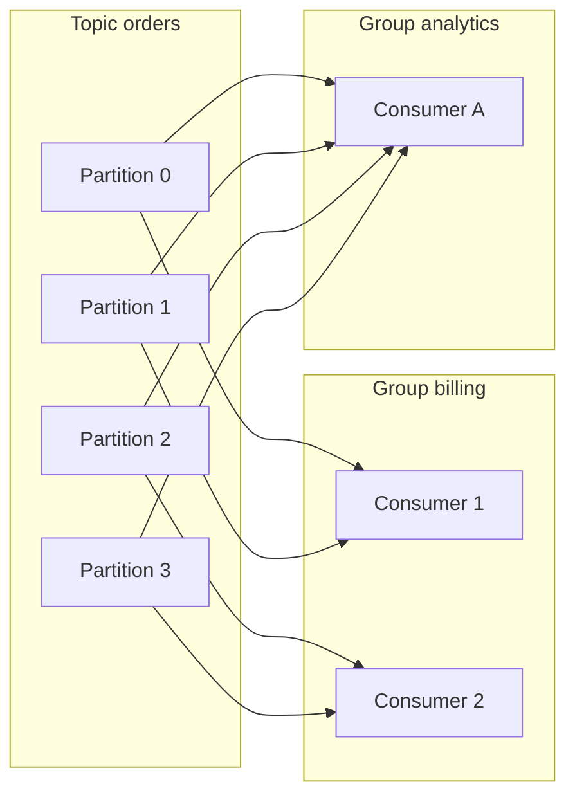
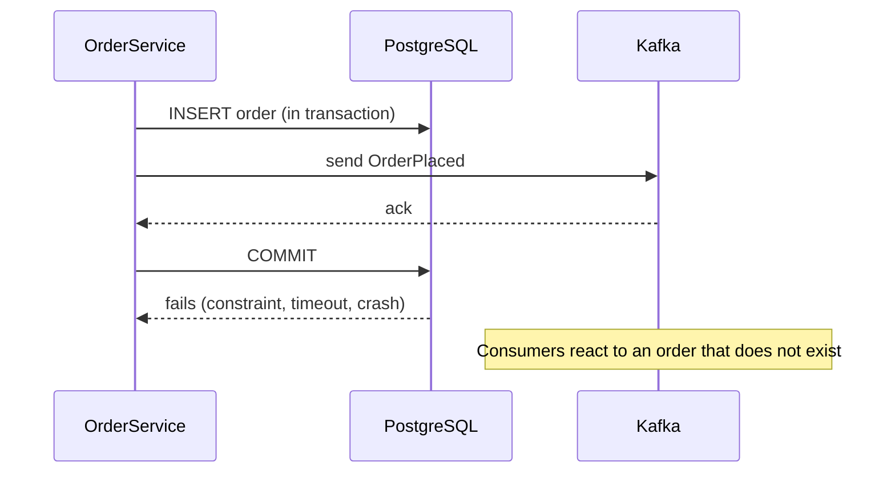
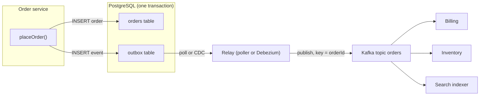
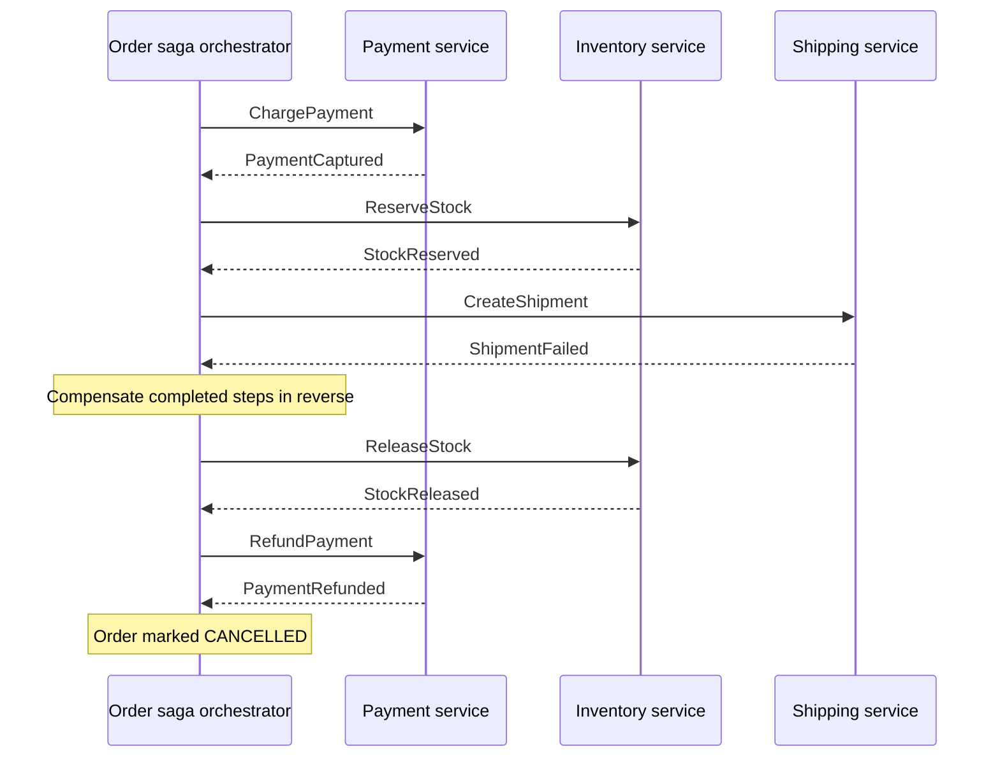
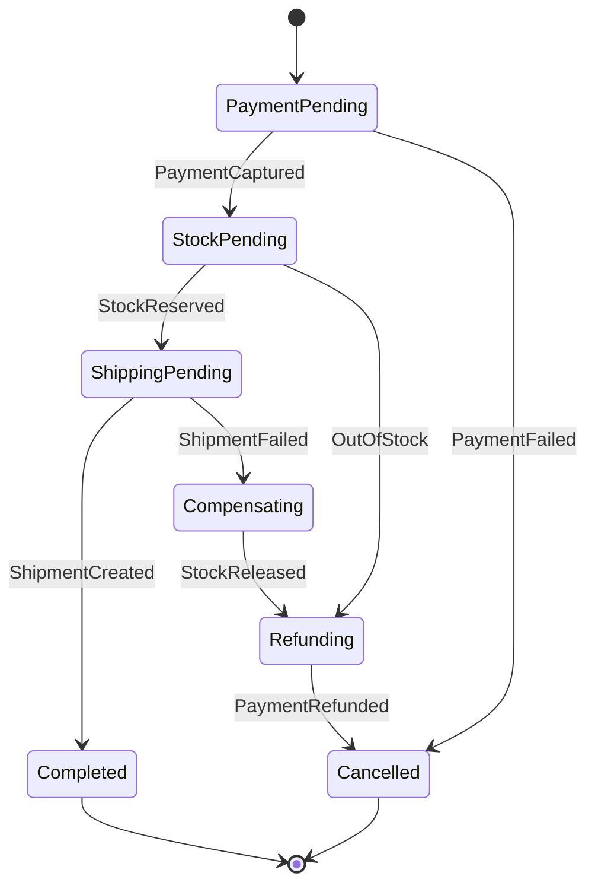
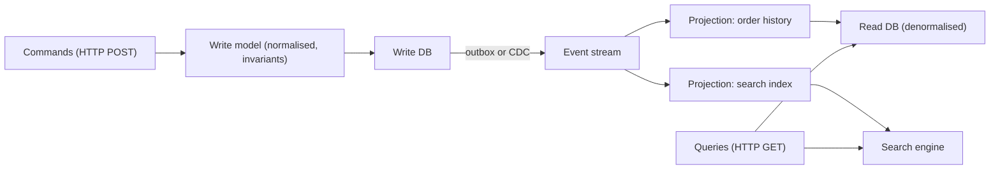

import Callout from '../../components/mdx/Callout.astro';

In [Part 6](/blog/backend-06-async-processing-queues) you used queues to move slow work out of the request path: one producer, one kind of worker, a task to perform. Event-driven architecture takes the idea further. Instead of service A telling service B what to do, A announces what *happened* ("OrderPlaced") and any number of services react: billing charges the card, inventory reserves stock, search reindexes, analytics counts, and A does not know or care who is listening.

That decoupling is powerful and expensive. You trade synchronous call chains for eventual consistency, duplicates, ordering questions and distributed workflows that no single stack trace can show you. This post covers the model and the patterns senior engineers use to keep event-driven systems correct.

<Callout variant="tip" title="What you'll learn">
- Events vs commands, and the four flavours of "event-driven"
- Kafka's log model: topics, partitions, offsets, replication, consumer groups and rebalancing
- Delivery semantics: at-most-once, at-least-once, and what "exactly-once" really covers
- Ordering guarantees and how to keep them (and how retries break them)
- The dual-write problem, the transactional outbox, and change data capture with Debezium
- Idempotent consumers and the inbox pattern
- Sagas (choreography vs orchestration) for multi-service workflows
- CQRS and how it relates to event sourcing
- Schema evolution for events
</Callout>

**Level:** senior. **You should already know:** queues, retries, dead-letter queues and idempotency keys ([Part 6](/blog/backend-06-async-processing-queues)), transactions and replication ([Part 7](/blog/backend-07-database-internals-scaling)), and back-pressure ([Part 8](/blog/backend-08-scalability-performance)).

## Events, commands and messages

All three are messages; the difference is intent and ownership.

- A **command** asks a specific recipient to do something: `ChargeCard`, `SendEmail`. It can be rejected. There is one logical handler. Name it in the imperative.
- An **event** states a fact that has already happened: `OrderPlaced`, `PaymentFailed`. It can not be rejected, only reacted to. There can be zero or many consumers. Name it in the past tense.
- A **query** asks for data and expects an answer, which is usually better served by a synchronous API.

The distinction matters for coupling. If OrderService publishes `ChargeCard`, it still knows billing exists and what billing should do; you have built RPC over a queue. If it publishes `OrderPlaced`, billing decides for itself to charge, and a new fraud-check service can subscribe tomorrow without OrderService changing.

Martin Fowler's well-known breakdown separates four things people mean by "event-driven", and it is worth being precise in design reviews:

1. **Event notification**: a thin event ("order 123 changed") and consumers call back for details. Low coupling on schema, but creates callback load and race conditions.
2. **Event-carried state transfer**: the event carries the data consumers need ("order 123 placed, items, totals, address"). Consumers keep local copies and stop calling you. More data in flight, more schema to evolve.
3. **Event sourcing**: the sequence of events *is* the system of record; current state is derived by replaying it.
4. **CQRS**: separate models for writing and reading, often fed by events.

They combine, but none implies the others. You can have event notification without event sourcing, and CQRS without either.

## Kafka's model: a replicated, partitioned log

Traditional brokers (RabbitMQ, SQS, ActiveMQ) are **queues**: a message is delivered to a consumer and, once acknowledged, removed. **Apache Kafka** (and compatible systems such as Redpanda, and similar log-based systems such as Apache Pulsar and AWS Kinesis) are **logs**: records are appended, kept for a retention period, and consumers track their own position. Reading does not delete anything. This one difference enables replay, multiple independent consumers, and rebuilding state from history.


### Topics, partitions and offsets

- A **topic** is a named stream, such as `orders`.
- Each topic is split into **partitions**. A partition is an ordered, append-only log; each record gets a monotonically increasing **offset** within its partition.
- A producer chooses the partition, normally by hashing the record **key** (the default partitioner uses murmur2 on the key bytes). All records with the same key go to the same partition, so they stay in order relative to each other. Records without a key are spread across partitions.
- Retention is by time or size (`retention.ms`, default 7 days) or by key with **log compaction** (`cleanup.policy=compact`), which keeps at least the latest record for each key. Compacted topics act like a changelog table: a new consumer can rebuild the current state of every entity.

Partitions are the unit of parallelism, ordering and scaling. More partitions allow more consumers in parallel, but each partition costs broker resources, and **increasing the partition count changes which partition a key hashes to**, so ordering for existing keys breaks across the change. Choose the count with growth in mind; you can add partitions later but not remove them.

### Replication and durability

Each partition has one **leader** replica and some followers (a replication factor of 3 is standard). Producers write to the leader; followers that are caught up form the **in-sync replica set (ISR)**. Durability depends on three settings working together:

- Topic `replication.factor=3`.
- Topic or broker `min.insync.replicas=2`: a write must reach at least two in-sync replicas to be accepted.
- Producer `acks=all` (the default since Kafka 3.0): the leader acknowledges only once all current in-sync replicas have the record.

With these, the loss of any one broker loses no acknowledged data, and if two replicas are unavailable producers get errors instead of silently writing to a single copy. Kafka 4.0 removed ZooKeeper entirely; cluster metadata is managed by Kafka's own Raft-based controller quorum (**KRaft**).

The producer is **idempotent** by default since Kafka 3.0 (`enable.idempotence=true`): the broker deduplicates retried sends using a producer id and per-partition sequence numbers, so a network retry does not create duplicates in the log, and ordering is preserved with up to 5 in-flight requests per connection.

### Consumer groups

Consumers that share a `group.id` form a **consumer group**. Kafka assigns each partition to exactly one consumer in the group, so the group processes the topic in parallel while each partition is processed sequentially. Different groups are completely independent: billing and analytics both read every record, at their own pace.



Consequences:

- **Maximum useful parallelism per group equals the partition count.** With 4 partitions, a fifth consumer sits idle.
- Each group commits its **offset** per partition (stored in the internal `__consumer_offsets` topic). The offset is "the next record I will read", and it is the only thing that makes resuming after a restart possible.
- **Consumer lag**, the distance between the latest offset and the committed offset, is the key health metric. Lag growing steadily means consumers can not keep up; alert on it, and on its rate of change.

### Rebalancing

When consumers join, leave, crash or are considered dead, the group **rebalances**: partitions are reassigned. A consumer is considered dead if it misses heartbeats for `session.timeout.ms` (45 s default) or does not call `poll()` within `max.poll.interval.ms` (5 minutes default). The second one bites people: a batch whose processing takes longer than the poll interval gets the consumer kicked out, its partitions handed to someone else, and its in-flight records processed twice.

The original rebalance protocol stopped the whole group during a rebalance. The cooperative-sticky assignor reduced that by moving only the partitions that need to move, and Kafka 4.0 made the new consumer group protocol from KIP-848 generally available (`group.protocol=consumer`), which moves assignment to the broker and makes rebalances incremental and much less disruptive. Either way, design consumers to tolerate having a partition taken away mid-batch.

<Callout variant="note" title="Kafka is not the only answer">
If you need per-message acknowledgements, priorities, delayed delivery or work queues with competing consumers that are not bound by partition count, a traditional broker (RabbitMQ, SQS) is often simpler. Kafka also added share groups (KIP-932, "queues for Kafka") during the 4.x releases for queue-style consumption. Choose by the semantics you need: replayable shared history, or tasks to be worked off.
</Callout>

## Delivery semantics

Delivery guarantees are determined by **when the consumer commits its offset relative to doing the work**, and by whether the producer retries.


- **At-most-once**: commit, then process. A crash after the commit loses the message. Acceptable only for data you can afford to lose (some metrics).
- **At-least-once**: process, then commit. A crash after processing but before the commit replays the message. No loss, but **duplicates are guaranteed to happen eventually**: on crashes, rebalances, deploys and timeouts. This is the practical default.
- **Exactly-once**: every message affects the outcome exactly once.

### What Kafka's exactly-once actually covers

Kafka's exactly-once semantics (EOS) combine the idempotent producer with **transactions**: a producer with a `transactional.id` can write to several partitions and commit the consumer's offsets (`sendOffsetsToTransaction`) atomically. Consumers reading with `isolation.level=read_committed` see only committed transactional writes. This gives exactly-once for **read from Kafka, process, write to Kafka** pipelines, which is what Kafka Streams uses (`processing.guarantee=exactly_once_v2`).

It does **not** extend to side effects outside Kafka. If your consumer charges a card via an HTTP API, inserts into PostgreSQL or sends an email, a crash between that side effect and the offset commit will replay it. No broker can make an external system's effect atomic with its own log. The robust formulation, which is what interviewers want to hear:

**Effectively-once processing = at-least-once delivery + idempotent consumers.**

### Idempotent consumers and the inbox pattern

Make every handler safe to run twice. Two techniques:

1. **Naturally idempotent operations**: upserts keyed by entity id, `UPDATE ... SET status = 'PAID' WHERE id = ? AND status = 'PENDING'`, setting a value instead of incrementing it, passing an idempotency key to the payment provider ([Part 2](/blog/backend-02-rest-api-design)).
2. **Deduplication with an inbox table**: record each processed message id in the *same database transaction* as the side effect.

```sql
CREATE TABLE inbox (
    consumer    text        NOT NULL,
    message_id  uuid        NOT NULL,
    processed_at timestamptz NOT NULL DEFAULT now(),
    PRIMARY KEY (consumer, message_id)
);
```

```kotlin
@Component
class PaymentEventsListener(
    private val inbox: InboxRepository,
    private val ledger: LedgerService,
) {
    @KafkaListener(topics = ["payments"], groupId = "ledger")
    @Transactional
    fun onPaymentCaptured(event: PaymentCaptured) {
        // INSERT ... ON CONFLICT DO NOTHING returns 0 rows for a duplicate
        if (!inbox.tryRecord(consumer = "ledger", messageId = event.eventId)) return
        ledger.credit(event.merchantId, event.amount)
    }
}
```

If the transaction commits, both the ledger entry and the inbox row exist; a redelivery finds the row and skips. If it rolls back, neither exists and the redelivery processes normally. This requires a stable **event id** generated by the producer, not by the broker.

### Retries and dead letters in Spring Kafka

Spring Kafka's listener container commits offsets for you after the listener returns (Spring sets Kafka's own `enable.auto.commit` to false unless you override it), which gives at-least-once by default. For failures, configure a `DefaultErrorHandler` with a back-off and a `DeadLetterPublishingRecoverer` so a poison message is moved aside instead of blocking its partition forever:

```kotlin
@Configuration
class KafkaErrorHandling {
    @Bean
    fun errorHandler(template: KafkaTemplate<Any, Any>): DefaultErrorHandler =
        DefaultErrorHandler(
            DeadLetterPublishingRecoverer(template),
            ExponentialBackOff(500L, 2.0).apply { maxElapsedTime = 10_000L },
        ).apply {
            addNotRetryableExceptions(DeserializationException::class.java, ValidationException::class.java)
        }
}
```

Spring Boot wires a single `DefaultErrorHandler` bean into the auto-configured listener container factory. Treat validation and deserialization failures as non-retryable: retrying malformed data only delays the dead letter. As in Part 6, a dead-letter topic is useless without an alert and a replay procedure.

## Ordering

Kafka guarantees order **within a partition** only. There is no global order across a topic, and you almost never need one. What you usually need is order **per entity**: all events for order 123 in sequence, so `OrderCancelled` is never applied before `OrderPlaced`.

So:

- **Key by the entity whose events must be ordered** (the aggregate id: `orderId`, `accountId`). Every event for that key lands in one partition and is consumed sequentially by one consumer.
- **Do not parallelise within a partition naively.** Handing records from one partition to a thread pool destroys ordering. If you need more throughput than one consumer per partition, add partitions, or use a library that parallelises by key while preserving per-key order.
- **Retries can reorder.** Non-blocking retry topics (such as Spring Kafka's `@RetryableTopic`) move a failed record to a retry topic and keep consuming, so the next event for the same key may be processed *before* the retried one. That is fine for independent events and wrong for state transitions. Either use blocking retries for ordered streams or make handlers tolerate out-of-order arrival.
- **Make consumers order-tolerant where possible**: carry a version or sequence number per entity in each event and ignore anything older than what you have already applied.
- **Watch for hot keys.** Keying by `tenantId` when one tenant produces half the traffic creates one overloaded partition and one overloaded consumer while the others idle.

## The dual-write problem

Here is the most common correctness bug in event-driven systems:

```kotlin
@Transactional
fun placeOrder(cmd: PlaceOrder): Order {
    val order = orders.save(Order.from(cmd))
    kafkaTemplate.send("orders", order.id.toString(), OrderPlaced.from(order)) // BUG
    return order
}
```

Two systems, two writes, no shared transaction. Every interleaving of failures produces an inconsistency:



Flip the order (commit, then send) and a crash between the two leaves an order that no other service ever hears about. Wrapping both in a "distributed transaction" (XA two-phase commit) is rarely available for Kafka and couples the availability of both systems. Making the send synchronous does not help either.

The fix is to have **one** write that is the source of truth and derive the other from it.

### The transactional outbox

Write the event into an **outbox table in the same database transaction** as the business change. A separate relay publishes outbox rows to the broker.



```sql
CREATE TABLE outbox (
    id             uuid        PRIMARY KEY,
    aggregatetype  text        NOT NULL,   -- routes to a topic, e.g. 'order'
    aggregateid    text        NOT NULL,   -- becomes the Kafka key
    type           text        NOT NULL,   -- e.g. 'OrderPlaced'
    payload        jsonb       NOT NULL,
    created_at     timestamptz NOT NULL DEFAULT now()
);
```

```kotlin
@Transactional
fun placeOrder(cmd: PlaceOrder): Order {
    val order = orders.save(Order.from(cmd))
    outbox.save(
        OutboxEvent(
            id = UUID.randomUUID(),            // stable event id for consumer dedup
            aggregateType = "order",
            aggregateId = order.id.toString(),
            type = "OrderPlaced",
            payload = jsonMapper.writeValueAsString(OrderPlaced.from(order)),
        )
    )
    return order
}
```

Either both rows commit or neither does. The relay publishes **at least once** (it may crash after publishing and before marking the row sent), which is fine because consumers are idempotent and the event id is stable.

Two ways to build the relay:

1. **Polling publisher**: a scheduled job selects unsent rows (`ORDER BY created_at LIMIT 100 FOR UPDATE SKIP LOCKED`), publishes them, marks or deletes them. Simple, no extra infrastructure, adds polling latency and load. With several relay instances, per-key ordering needs care; a single active relay or partitioning outbox rows by key avoids reordering.
2. **Change data capture** (next section): tail the database's log and publish outbox inserts as they commit. Lower latency, no polling queries, and order follows commit order.

## Change data capture

**CDC** turns a database's own replication log into a stream of change events. Instead of the application emitting events, a connector reads the log that the database already writes for durability and replication ([Part 7](/blog/backend-07-database-internals-scaling)): PostgreSQL's WAL via logical decoding (the built-in `pgoutput` plugin and a replication slot), MySQL's row-based binlog, and equivalent logs for other databases.

**Debezium** is the standard open-source implementation, usually run on Kafka Connect. It emits one event per row change (with before and after images), and its **outbox event router** transformation (`io.debezium.transforms.outbox.EventRouter`) is designed for exactly the table above: it reads inserts into `outbox`, routes them to a topic derived from `aggregatetype`, uses `aggregateid` as the key and `payload` as the value.

CDC is also useful without an outbox, for feeding search indexes, caches and data warehouses from a database you do not want to modify. But be aware of the trade-off between the two styles:

| | Raw table CDC | Outbox (with CDC or polling) |
|---|---|---|
| Event shape | Your internal table schema | A deliberate, versioned public contract |
| Coupling | Consumers break when you rename a column | Internal schema can change freely |
| Semantics | "Row changed" | "OrderPlaced", with business meaning |
| Effort | No code changes | Write outbox rows in the service |

For integration *between* teams, publish domain events through an outbox. Raw CDC leaks your schema as an API.

Operational notes for PostgreSQL CDC: a replication slot retains WAL until the connector confirms it, so **a stopped connector makes WAL grow until the disk fills**. Monitor slot lag, and set `max_slot_wal_keep_size` to cap the damage. Also plan how to handle the initial snapshot of existing data and schema changes.

## Sagas: transactions across services

Once each service owns its database, a business operation that spans services (place order, charge payment, reserve stock, book shipping) can not be a single ACID transaction. A **saga** is a sequence of local transactions where each step publishes an event or command that triggers the next, and every step that can be undone has a **compensating action** that semantically reverses it (refund the payment, release the stock). Compensations are new forward actions, not rollbacks: the customer may have seen the charge.

### Choreography

Each service listens for events and reacts, with no central coordinator. OrderService emits `OrderPlaced`; PaymentService charges and emits `PaymentCaptured` or `PaymentFailed`; InventoryService reserves on `PaymentCaptured`; OrderService cancels on `PaymentFailed`.

Good for short flows with few participants. As flows grow, the workflow exists only implicitly across many services' listeners; answering "what state is order 123 in and what happens next?" means reading five codebases, and cyclic event dependencies creep in.

### Orchestration

A single orchestrator owns the workflow as explicit state and sends commands to participants, reacting to their replies.



The orchestrator is a state machine persisted in a database (or in a workflow engine), so it survives crashes and can be inspected:



Orchestration makes the flow explicit, testable and observable, and puts timeouts ("no reply from payment in 30 s") in one place. The costs are a central component to own and the temptation to put business logic in the orchestrator that belongs in the participants. Durable workflow engines such as **Temporal** (or Camunda, AWS Step Functions) implement the persistence, timers and retries for you, so a saga becomes ordinary-looking code.

### What sagas do not give you

- **Isolation.** Other transactions can see intermediate states: an order that is paid but not yet reserved. Countermeasures include explicit pending states (`PAYMENT_PENDING`) that the UI and other flows respect, semantic locks (a reservation flag), and ordering steps so the ones most likely to fail or hardest to compensate run first.
- **Automatic idempotency.** Every step and every compensation is a message handler and will be delivered at least once. They must all be idempotent.
- **Guaranteed compensation.** A refund can fail too. Compensations need retries and, eventually, a human escalation path.

## CQRS

**Command Query Responsibility Segregation** separates the model that handles writes from the model(s) that serve reads. The write side enforces invariants on a normalised model; it emits events. Projections consume those events and maintain read models shaped exactly for each query: a denormalised table for the order history page, an Elasticsearch index for search, a Redis hash for a dashboard counter.



What you gain: read and write sides scale and evolve independently, each read model is fast because it is precomputed for its query, and new views can be built by replaying the event history.

What you pay:

- **Eventual consistency on reads.** A user who just placed an order may not see it in their history for a few hundred milliseconds. Handle it in the UI (show the result of the command directly), or by having the client wait until the projection has caught up to the version the command returned.
- **More moving parts**: projections to deploy, monitor (projection lag is the CQRS equivalent of replica lag) and rebuild.
- **Rebuilds need history**: from a log with long retention, a compacted topic, or the event store.

CQRS is worth it when read and write shapes differ greatly or scale very differently. For a typical CRUD service it is overhead; a read replica and a few well-chosen indexes do the job.

### Event sourcing in one paragraph

With **event sourcing**, the write side stores the events themselves as the source of truth (`AccountOpened`, `MoneyDeposited`, `MoneyWithdrawn`); current state is computed by folding over them, usually with periodic snapshots for speed. You get a perfect audit trail and the ability to answer "what was the state at time T", and it pairs naturally with CQRS. You also take on event schema versioning forever, harder ad-hoc queries, and a programming model most teams are unfamiliar with. Use it where the history *is* the domain (ledgers, audit-heavy workflows), not as a default.

## Event design and schema evolution

Events are a public API with many unknown consumers, and they live in a log long after the producing code has changed. Design them deliberately:

- **Include an envelope**: a unique `eventId`, `type`, `occurredAt`, the producing service, the aggregate id and a per-aggregate version or sequence. The CloudEvents specification is a ready-made, widely supported envelope format.
- **Choose fat or thin per use case.** Event-carried state transfer saves consumers callbacks; thin notifications avoid leaking data and schema. Avoid putting personal data in long-retention topics unless you have a deletion strategy.
- **Use a schema and a registry.** Avro, Protobuf or JSON Schema with a schema registry lets producers and consumers agree on structure and lets the registry reject incompatible changes. Confluent Schema Registry's default compatibility mode is `BACKWARD`: consumers using the new schema can read data written with the previous one.
- **Evolve additively**: add optional fields with defaults; never change a field's meaning or type in place; to make a breaking change, publish a new event type or a new topic version and run both during migration.
- **Consumers ignore unknown fields** (the tolerant reader pattern), so producers can add fields without coordinating deploys.

## Common mistakes

- **Dual writes**: saving to the database and publishing to Kafka in the same method without an outbox.
- **Believing in end-to-end exactly-once.** Kafka's EOS covers Kafka-to-Kafka; every external side effect needs idempotency.
- **No stable event id**, making consumer deduplication impossible.
- **Keying by the wrong thing** (or not at all) and then relying on order; or keying by a hot tenant id.
- **Parallelising within a partition** or using non-blocking retry topics for ordered state transitions.
- **Long processing inside the poll loop**, exceeding `max.poll.interval.ms` and causing rebalance storms with duplicate processing.
- **Using CDC of internal tables as the integration contract** between teams.
- **Forgetting the replication slot** when a CDC connector is down, until the database disk fills.
- **Commands disguised as events** (`SendWelcomeEmailEvent`), recreating tight coupling over a broker.
- **Choreographed sagas with ten participants** that nobody can trace, with no timeouts for steps that never reply.
- **Adopting CQRS or event sourcing for plain CRUD.**
- **Breaking schema changes** pushed without a registry or compatibility check.

## Interview questions

<details>
<summary>How does Kafka guarantee ordering, and how would you preserve order for all events of one customer?</summary>

Kafka only guarantees order within a partition. Producers choose the partition by hashing the key, so use `customerId` as the key: all that customer's events land in one partition and are read sequentially by the single consumer in the group that owns it. The idempotent producer (default since Kafka 3.0) preserves order across retries with up to 5 in-flight requests.

A strong answer lists what breaks it: increasing the partition count remaps keys; processing a partition's records on a thread pool; non-blocking retry topics that let later events overtake a failed one; and consumers on multiple partitions for one key after a key change. It also mentions defence in depth: per-entity version numbers so consumers can discard stale events, and watching for hot keys that create a hot partition.

</details>

<details>
<summary>Does Kafka give you exactly-once delivery?</summary>

Within Kafka, yes, for a specific pattern: idempotent producers plus transactions let a read-process-write job consume, produce and commit offsets atomically, and `read_committed` consumers see only committed results. Kafka Streams uses this.

It does not cover side effects outside Kafka: database writes, HTTP calls, emails. A crash between the side effect and the offset commit causes redelivery. So in practice you design for at-least-once delivery with idempotent consumers: deduplicate by a stable event id in the same transaction as the side effect (inbox table), or make the operation naturally idempotent. The interviewer is checking whether you know the boundary of the guarantee.

</details>

<details>
<summary>What is the dual-write problem and how does the transactional outbox solve it?</summary>

When a service writes to its database and publishes to a broker as two separate operations, a failure between them leaves the two out of sync: an event for a change that rolled back, or a committed change no one hears about. There is no shared transaction between PostgreSQL and Kafka, and reordering the writes only changes which inconsistency you get.

The outbox makes the event part of the database transaction: insert the business row and an outbox row atomically. A relay, either a poller using `FOR UPDATE SKIP LOCKED` or CDC such as Debezium's outbox router reading the WAL, publishes outbox rows to the broker. Publishing is at-least-once, so consumers deduplicate by the event id. Trade-offs to mention: extra table and relay to operate, some publishing latency (lower with CDC), and outbox cleanup.

</details>

<details>
<summary>A consumer group keeps rebalancing and processing duplicates. What is likely going on?</summary>

Most often a consumer exceeds `max.poll.interval.ms` (5 minutes by default) because processing a batch is slow: maybe a slow downstream call, or `max.poll.records` too high. The broker considers it dead, revokes its partitions, gives them to another consumer which reprocesses uncommitted records, and the original consumer rejoins, triggering another rebalance. Other causes: missed heartbeats from long GC pauses, pods being restarted by failing liveness probes, frequent deploys or autoscaling churn.

Fixes: reduce `max.poll.records` or make processing faster, move slow work off the poll thread carefully (keeping commit order), bound downstream calls with timeouts, use the cooperative or KIP-848 protocol to make rebalances incremental, and use static membership (`group.instance.id`) to avoid rebalances on quick restarts. And make processing idempotent, because some duplicates are unavoidable.

</details>

<details>
<summary>Choreography or orchestration for a saga? Defend a choice.</summary>

For a short flow with two or three participants that rarely changes, choreography is fine: low coupling, no central component. For a flow with several steps, compensations, timeouts and a need to answer "where is order 123 stuck?", orchestration wins: the state machine is explicit, persisted and observable, timeouts live in one place, and changing the flow means changing one component.

The trade-off: orchestration introduces a coordinator that can become a dumping ground for logic and a dependency for every participant; choreography spreads the workflow implicitly across services and is hard to reason about as it grows. A senior answer adds that either way every step and compensation must be idempotent, sagas give no isolation (so you need pending states or semantic locks), and a durable workflow engine such as Temporal is often cheaper than building a persistent orchestrator yourself.

</details>

<details>
<summary>When would you use CQRS, and what does it cost?</summary>

When read and write workloads differ sharply in shape or scale: complex invariants on the write side but many differently-shaped, high-volume reads (search, dashboards, feeds). Projections build read models optimised per query from the event stream, and you can create new views by replaying history.

Costs: eventual consistency between write and read sides (handle read-your-writes in the UI or by waiting for the projection version), more infrastructure to operate and monitor (projection lag), rebuild procedures, and more code. It is not the same as event sourcing; you can feed projections from an outbox. For ordinary CRUD, a single model with good indexes and maybe a read replica is the better answer, and saying so is a senior signal.

</details>

<details>
<summary>What is change data capture, and when would you not use it as the integration mechanism?</summary>

CDC reads the database's replication log (PostgreSQL WAL via logical decoding, MySQL binlog) and emits an event for each committed row change, typically with Debezium on Kafka Connect. It captures every change, including ones made outside the application, with commit ordering and without polling.

Using raw table CDC as the contract between teams couples consumers to your internal schema: renaming a column becomes a breaking API change, and row-level changes lack business meaning. Prefer publishing deliberate domain events via an outbox (Debezium's outbox router uses CDC under the hood, so you keep the delivery benefits). Also mention operational risk: an inactive replication slot retains WAL and can fill the disk, so monitor slot lag and cap it.

</details>

<details>
<summary>How do you evolve an event schema without breaking consumers?</summary>

Treat events as a public API. Use a schema format with a registry (Avro, Protobuf or JSON Schema) and enforce a compatibility mode, typically backward compatibility so new consumers can read old data. Make additive changes only: new optional fields with defaults; consumers ignore unknown fields. Never repurpose or retype a field.

For breaking changes, introduce a new event type or versioned topic, have the producer publish both during a migration window, move consumers over, then retire the old one. Remember that logs retain old events, so consumers that replay history must still understand old versions, sometimes via upcasting old events to the new shape on read.

</details>

## Key takeaways

- Events state facts in the past tense with many possible consumers; commands ask one recipient to act. Do not disguise commands as events.
- Kafka is a **replicated, partitioned log**: order is per partition, parallelism per group is bounded by partition count, and each group tracks its own offsets.
- Durability needs `replication.factor=3`, `min.insync.replicas=2` and `acks=all` together.
- Delivery semantics come from **when you commit**. Practical systems are at-least-once with **idempotent consumers**; Kafka's exactly-once covers Kafka-to-Kafka pipelines only.
- Key by the entity whose order matters, and know what breaks ordering: partition changes, intra-partition parallelism, retry topics.
- Never dual-write. Use a **transactional outbox**, relayed by polling or **CDC** (Debezium), and publish domain events rather than raw table changes.
- **Sagas** coordinate multi-service workflows with compensations; orchestrate once flows get non-trivial, and remember sagas provide no isolation.
- **CQRS** buys independent, query-shaped read models at the cost of eventual consistency and moving parts; event sourcing is a separate, bigger commitment.
- Version event schemas with a registry and evolve additively.

Previous: [Part 8: Scalability and Performance](/blog/backend-08-scalability-performance)
