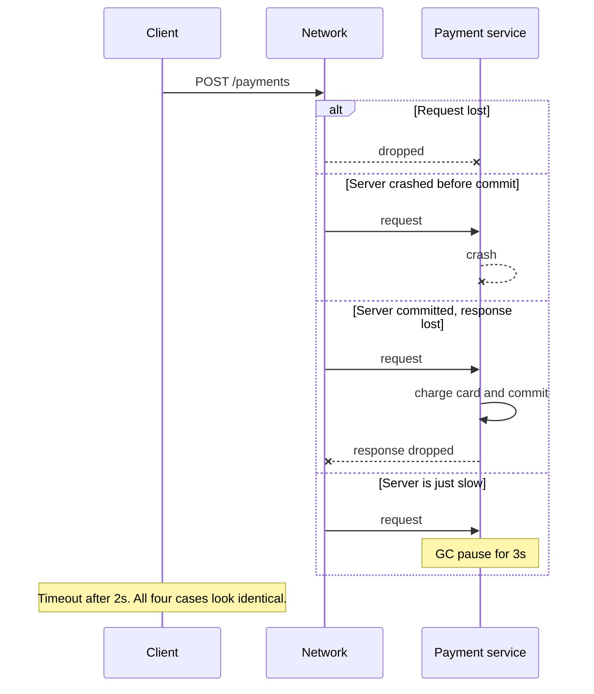
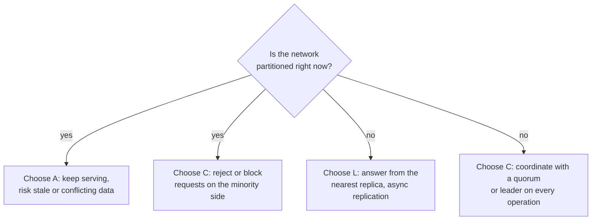
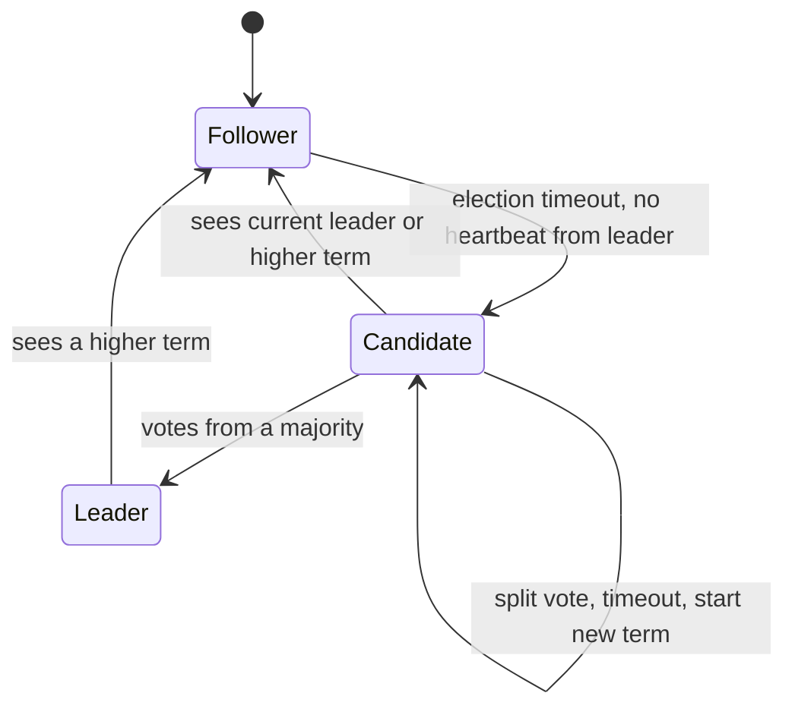
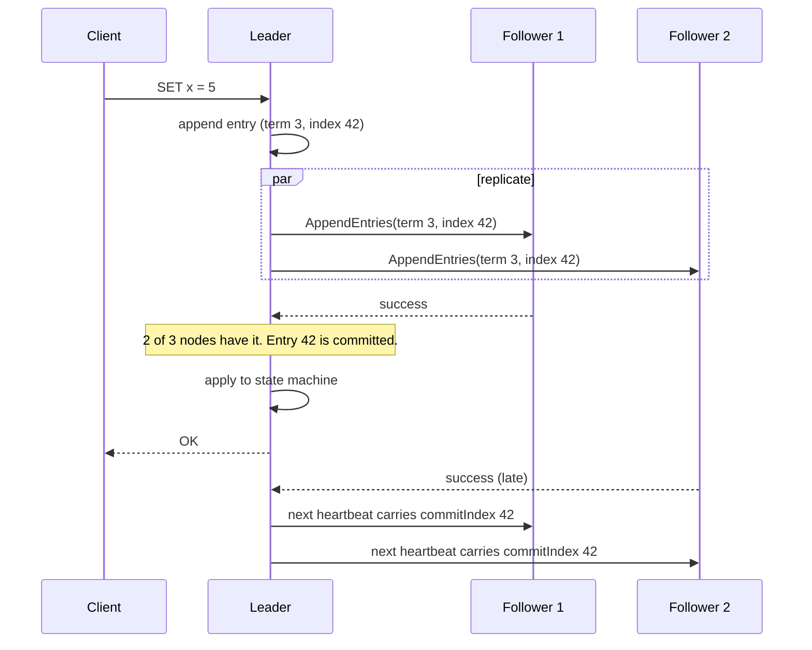
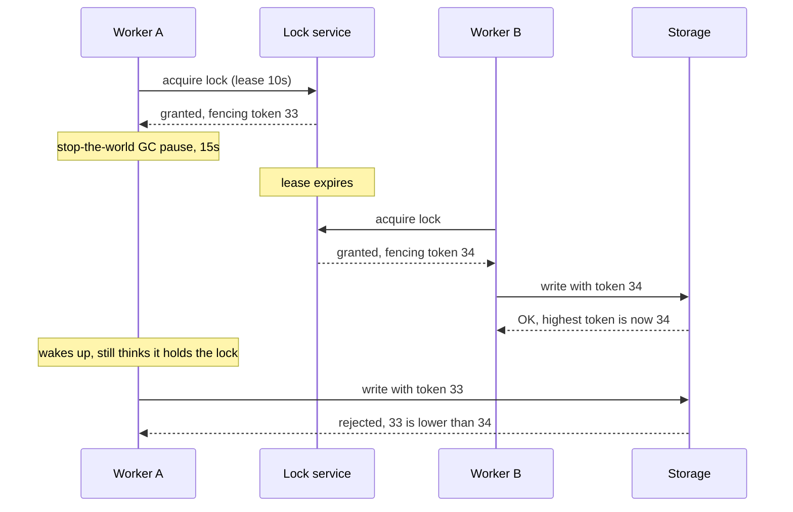
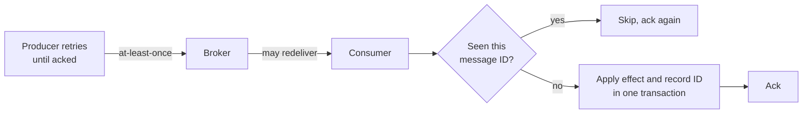

import Callout from '../../components/mdx/Callout.astro';

Up to now, most of this series could pretend there was one computer. One database, one queue, one service talking to another over a network that "usually works". Part 9 already broke that illusion a little: Kafka partitions, consumer groups, outboxes and sagas all exist because a single machine is not enough.

This part removes the illusion completely. A distributed system is any system where **a computer you didn't know existed can make your request fail**. Once you accept that, a handful of hard results from the last 40 years of research start to explain almost every production incident you'll ever debug: requests that "succeeded" twice, reads that went back in time, two leaders writing at once, locks that weren't locks.

<Callout variant="tip" title="What you'll learn">
- The failure modes you actually see (partial failure, gray failure, partitions) and why "slow" and "dead" are indistinguishable
- CAP stated precisely, why it is mostly misused, and why PACELC is the more useful model
- The consistency model ladder: linearizable, sequential, causal, session guarantees, eventual
- Quorums (N, W, R), what they guarantee and what they don't
- Consensus and Raft: elections, terms, log replication, and why you need 2f+1 nodes
- Leases and fencing tokens, and why most distributed locks are unsafe
- Physical clocks, Lamport clocks, vector clocks, hybrid logical clocks and TrueTime
- Why exactly-once delivery is impossible, and how "effectively once" is built in practice
</Callout>

**Level: staff.** You should already know: replication and isolation levels (Part 7), horizontal scaling and back-pressure (Part 8), and Kafka's delivery semantics, the outbox and sagas ([Part 9](/blog/backend-09-event-driven-architecture)).

---

## Why distributed systems are different

On a single machine, failure is mostly binary. The process is running or it crashed. A function call returns or throws. Memory you wrote is memory you can read.

Across a network, every one of those assumptions breaks. In 1994 Peter Deutsch (with later additions by James Gosling) listed the **eight fallacies of distributed computing**, and they are still the best checklist of wrong assumptions:

1. The network is reliable.
2. Latency is zero.
3. Bandwidth is infinite.
4. The network is secure.
5. Topology doesn't change.
6. There is one administrator.
7. Transport cost is zero.
8. The network is homogeneous.

The first two do the most damage. Every remote call has **three** outcomes, not two: success, failure, and *unknown*. The unknown case is the whole subject of this post.

### The fundamental ambiguity

You send `POST /payments` to a service. 2 seconds later your timeout fires. What happened?



From the client's point of view these four cases are **indistinguishable**. If you retry, you might charge the card twice. If you don't, you might lose a payment. No amount of cleverness in the client fixes this; it has to be solved by protocol design (idempotency, which we'll get to at the end).

This is also why a timeout can never tell you that a remote node is **dead**, only that it is **late**. The theoretical version of this is the result that motivates the rest of the post.

### The failure models

Distributed systems papers classify how nodes can fail. You should know the vocabulary because interviewers and design docs use it:

| Model | What can happen | Real-world example |
|---|---|---|
| Crash-stop | A node halts and never comes back | Instance terminated, disk destroyed |
| Crash-recovery | A node halts, later restarts with its durable state | Process OOM-killed and restarted by Kubernetes |
| Omission | Messages are lost (send or receive) | Packet loss, full queues, dropped connections |
| Timing / performance | Responses arrive, but too late | GC pause, noisy neighbour, swap, saturated NIC |
| Byzantine | A node behaves arbitrarily, including lying | Corrupted memory, buggy firmware, malicious actors |

Almost every backend you'll build assumes **crash-recovery with omission and timing faults**, and explicitly *not* Byzantine faults. Byzantine fault tolerance needs 3f+1 nodes to tolerate f liars and is mostly used in blockchains and some aerospace systems. Inside your own datacenter you trust your own nodes and protect against corruption with checksums instead.

### Partial failure and gray failure

The defining property of distributed systems is **partial failure**: some parts work while others don't, and the parts that work may not know which parts don't.

The nastiest variant is **gray failure** (named in a 2017 Microsoft paper by Huang et al.): a component is degraded in a way that its *health checks don't see* but its *clients do*. Classic examples:

- A node's health endpoint returns 200, but its disk is so slow that real requests time out.
- A network link drops 2% of packets. TCP retransmits, so nothing "fails", but p99 latency triples.
- One replica in a load-balancer pool returns errors for one specific tenant because of a bad cache entry.

The lesson: **health is a property observed by clients, not reported by the node itself.** Good failure detection uses client-side signals (error rates, latency outliers) in addition to heartbeats.

### Network partitions are not rare

A partition is when the network splits nodes into groups that can't talk to each other. It's tempting to think this is a once-a-decade event. It isn't. Misconfigured firewall rules, a switch reboot, a BGP change, an overloaded node that stops answering heartbeats, a long GC pause: from the perspective of the protocol, all of these are partitions. If your system has more than one node, **you will experience partitions**, and the only question is what your system does during them.

### Failure detection

Since you can't know a node is dead, you **suspect** it. Common techniques:

- **Heartbeats with a fixed timeout**: simple, but the timeout is a trade-off. Too short and you get false positives (and unnecessary failovers, which are themselves risky). Too long and you wait during real outages.
- **Phi accrual failure detector** (Hayashibara et al., 2004): instead of a yes/no answer, it outputs a suspicion level φ based on the observed distribution of heartbeat inter-arrival times. Cassandra and Akka use it. Cassandra's `phi_convict_threshold` defaults to 8.
- **Leases**: a node holds a time-bounded grant and must renew it. If it can't renew, it must stop acting as the holder. More on this below, because leases interact dangerously with clocks.

---

## CAP: what it actually says

CAP is the most quoted and most misunderstood result in the field. Eric Brewer proposed it as a conjecture in 2000. Seth Gilbert and Nancy Lynch proved a precise version in 2002. The precise version is:

> In an asynchronous network where messages can be lost (a partition), a read/write register cannot be both **linearizable** (C) and **available** (A, meaning every request to a non-failing node eventually gets a non-error response).

Three things in that statement matter and are usually lost in the retelling:

1. **C means linearizability**, a very specific and very strong guarantee (defined below). It does *not* mean the C in ACID, and it does not mean "the data is correct".
2. **A means every non-failing node answers**, not "the system has high uptime". A system that returns errors from the minority side of a partition but keeps working on the majority side is *not* "available" in the CAP sense, yet it may have 99.99% availability in the SLO sense.
3. **P is not a choice.** You don't get to pick "CA". Partitions happen whether you design for them or not, so the real choice is: **during a partition, do you give up linearizability or availability?**

So "CP" systems (etcd, ZooKeeper, Consul, a single-leader PostgreSQL with synchronous replication) refuse some requests during a partition to stay consistent. "AP" systems (Cassandra and Dynamo-style stores at low consistency levels, DNS, most caches) keep answering but may return stale or conflicting data.

<Callout variant="warning" title="Don't say 'we chose CA'">
In an interview, claiming a distributed database is "CA" is a red flag. A single-node database is "CA" only in the trivial sense that it has no network between replicas. The moment you have two nodes and a network, you have to decide what happens when they can't talk.
</Callout>

### PACELC: the more useful question

CAP only describes behaviour *during* a partition, which is a small fraction of the time. Daniel Abadi's **PACELC** (2010, published 2012) extends it:

> If there is a **P**artition, choose between **A**vailability and **C**onsistency. **E**lse (normal operation), choose between **L**atency and **C**onsistency.

The "else" half is the part you live with every day. Strong consistency across replicas requires coordination, and coordination costs round trips. If your replicas are in different regions, a linearizable write costs at least one cross-region round trip (60-150 ms between continents). That's a latency cost you pay on **every** request, partition or not.



Abadi's own classifications, roughly:

- **PA/EL**: Dynamo, Cassandra, Riak at default settings. Available under partition, low latency normally, consistency is the price.
- **PC/EC**: systems built for strong consistency always, such as VoltDB and Google's Megastore, and in practice Spanner-style databases.
- **PA/EC**: Abadi classified MongoDB (of that era) here.
- **PC/EL**: Yahoo's PNUTS: low latency normally, but consistent under partition.

Many modern databases are **tunable per operation**. DynamoDB reads are eventually consistent by default and strongly consistent if you set `ConsistentRead`. Cassandra lets you pick a consistency level per query. That means the useful design question is not "which database is CP?" but "**for this operation, what anomaly can the business tolerate, and how much latency will it pay to avoid it?**"

---

## Consistency models

"Consistency" in distributed systems means: **what values is a read allowed to return, given the writes that happened?** Different models allow different anomalies. Stronger models allow fewer anomalies and cost more coordination.


### Linearizability (strong consistency)

The system behaves **as if there were a single copy of the data**, and every operation takes effect atomically at some instant between its start and its completion. Consequence: once any client has seen a write, every client that starts a read afterwards (in real time) must see that write or a later one.

That real-time ordering is what makes linearizability expensive and useful. It's what you need for:

- **Leader election and locks**: "exactly one node believes it is leader" requires that everyone agrees on who won.
- **Uniqueness constraints**: two users registering the same username at the same time.
- **Cross-channel causality**: you upload a photo, then send a message pointing to it through a *different* system. The receiver must be able to read the photo.

### Linearizability vs serializability

These two get confused constantly, so be precise:

- **Serializability** (Part 7) is about **transactions**: the result is as if transactions ran one at a time in *some* order. That order doesn't have to match real time.
- **Linearizability** is about **single operations on single objects**: each operation appears instantaneous and respects real time.
- **Strict serializability** is both: transactions appear to run one at a time, in an order consistent with real time. Google calls this "external consistency" for Spanner.

A serializable database can legally return a stale snapshot to a read-only transaction. A linearizable register can't, but it says nothing about multi-object transactions.

### Sequential and causal consistency

**Sequential consistency** keeps a single total order that respects each client's own program order, but that order doesn't have to match wall-clock time across clients.

**Causal consistency** is weaker and much cheaper: operations that are *causally related* must be seen in the same order by everyone; concurrent operations may be seen in different orders. If Alice posts a question and Bob replies, nobody may see Bob's reply without Alice's question. But two unrelated posts can appear in different orders to different readers.

Causal consistency is notable because a variant of it is the **strongest model that can remain available during a partition**: Mahajan, Alvisi and Dahlin showed in 2011 that nothing stronger than real-time causal consistency can be both always-available and convergent. For many user-facing features it's exactly what you want.

### Session guarantees

In practice, most product bugs come from four specific anomalies, and you can fix each one cheaply without global strong consistency. These were defined by Terry et al. in the Bayou project (1994):

| Guarantee | Anomaly it prevents | Typical implementation |
|---|---|---|
| Read-your-writes | You update your profile, refresh, and see the old value | Route the user's reads to the leader for N seconds after a write, or carry the write's log position and wait for a replica to catch up |
| Monotonic reads | You refresh and a comment disappears, then reappears | Pin a session to one replica, or track the highest version seen |
| Monotonic writes | Your two writes are applied in the wrong order | Single leader per key, or version-ordered writes |
| Writes-follow-reads | You reply to a comment that a replica hasn't received yet | Carry causal metadata (the version you read) with the write |

PostgreSQL replicas expose their replay position via `pg_last_wal_replay_lsn()`, and the primary reports `pg_current_wal_lsn()`. A common read-your-writes implementation stores the LSN returned after a write in the user's session and only reads from a replica whose replay LSN has passed it.

### Eventual consistency

If no new writes happen, all replicas **eventually** converge to the same value. That's all it promises: no bound on how long, and no guarantee about what you read in the meantime. It's a liveness property, not a safety property.

Eventual consistency is only safe when you also have a **conflict resolution strategy** for concurrent writes:

- **Last-write-wins (LWW)** by timestamp: simple, and silently loses data when clocks are skewed or writes are truly concurrent. Cassandra uses LWW per cell.
- **Application-level merge**: return all conflicting versions ("siblings") and let the application merge them. Amazon's Dynamo paper famously did this for shopping carts.
- **CRDTs** (Conflict-free Replicated Data Types): data structures designed so concurrent updates always merge deterministically, like grow-only counters, observed-remove sets, and sequence CRDTs for collaborative text editing.

---

## Quorums

Leaderless (Dynamo-style) replication stores each key on **N** replicas. A write is acknowledged once **W** replicas confirm it, and a read queries **R** replicas and takes the newest version.

If **W + R > N**, every read set overlaps every write set in at least one replica, so a read will see at least one copy of the latest acknowledged write.


Common configurations, with N = 3:

| W | R | Behaviour |
|---|---|---|
| 2 | 2 | Balanced. Tolerates one unavailable replica for both reads and writes. Cassandra's `QUORUM` |
| 3 | 1 | Fast reads, but any single replica down blocks writes |
| 1 | 3 | Fast writes, but any single replica down blocks reads |
| 1 | 1 | Fastest and most available, no overlap guarantee at all. Cassandra's `ONE` |

Cassandra also offers `LOCAL_QUORUM` (a quorum within the local datacenter, avoiding cross-region latency) and `EACH_QUORUM` (a quorum in every datacenter, for writes).

### What quorums do *not* give you

This is where staff-level answers differ from mid-level ones. **W + R > N does not make the system linearizable.** Several things break the overlap guarantee or the ordering:

- **Concurrent writes**: two clients write different values at the same time. Which one wins depends on the conflict resolution strategy, often LWW with clock skew.
- **A write that fails partway**: if a write reaches 1 replica and then fails (W wasn't met), it isn't rolled back. A later read may or may not see it, so two consecutive reads can return new-then-old.
- **Sloppy quorums and hinted handoff**: when the home replicas are unreachable, Dynamo-style systems may accept writes on *other* nodes and hand them back later. That improves availability but means W + R > N no longer guarantees overlap with the home replicas.
- **Read repair timing**: a reader that sees divergent versions may repair the stale replica, but another reader running at the same time may still read the stale one.

Getting linearizable reads from a quorum system requires extra work (for example, readers performing synchronous read repair before returning, as in the ABD algorithm), and even then only for single-key reads and writes, not compare-and-set. For compare-and-set you need consensus.

---

## Consensus

**Consensus** means getting a group of nodes to agree on a value (or a sequence of values) such that:

- **Agreement**: no two nodes decide differently.
- **Validity**: the decided value was proposed by some node.
- **Termination**: every non-failed node eventually decides.

Consensus is the building block for leader election, distributed locks, atomic commit, membership changes, and replicated state machines. If you have a replicated log that all nodes agree on, you can build anything on top by applying the log in order.

### The impossibility result

**FLP** (Fischer, Lynch and Paterson, 1985) proved that in a fully asynchronous system, **no deterministic consensus algorithm can guarantee termination if even one process may crash**. Since you can't tell a crashed process from a slow one, the algorithm can be stuck forever waiting.

Real systems get around FLP by assuming **partial synchrony**: the network is asynchronous sometimes, but eventually behaves well enough for timeouts to work. Paxos and Raft are always *safe* (they never decide two different values), and they make *progress* whenever the network is well-behaved for long enough. That's the trade-off you're making: correctness always, liveness usually.

### Majorities and fault tolerance

Consensus algorithms use **majority quorums**. With **2f + 1** nodes you can tolerate **f** failures, because any two majorities overlap in at least one node, and that node prevents two conflicting decisions.

| Cluster size | Majority | Failures tolerated |
|---|---|---|
| 3 | 2 | 1 |
| 4 | 3 | 1 |
| 5 | 3 | 2 |
| 7 | 4 | 3 |

Note that **4 nodes tolerate no more failures than 3**, and every write now waits for 3 acknowledgements instead of 2. That's why consensus clusters are almost always odd-sized. Clusters beyond 5-7 voting members are rare because every write must reach a majority, so latency and load grow with size. Systems that need to scale reads add non-voting members (etcd's learners, ZooKeeper's observers).

### Raft

Raft (Ongaro and Ousterhout, 2014) was explicitly designed to be easier to understand than Paxos, and it's what you'll most likely meet: etcd (and so Kubernetes), Consul, CockroachDB, TiKV, and Kafka's KRaft controller quorum (ZooKeeper was removed entirely in Kafka 4.0) all use Raft or a close variant.

Raft splits the problem into three parts: **leader election**, **log replication**, and **safety**.

#### Roles and terms

Each node is a **follower**, a **candidate** or the **leader**. Time is divided into numbered **terms**. Each term has at most one leader. Terms act as a logical clock: any message carrying a higher term than a node's current term makes that node update its term and step down to follower.



#### Leader election

1. A follower that hears nothing from a leader for its **election timeout** increments its term, becomes a candidate, votes for itself, and sends `RequestVote` to everyone.
2. Each node grants **at most one vote per term**, first-come first-served, and only if the candidate's log is **at least as up-to-date** as its own (compared by the term of the last entry, then by its index).
3. A candidate that collects votes from a majority becomes leader and immediately sends heartbeats (empty `AppendEntries`) to suppress other elections.

Election timeouts are **randomized** (the paper uses 150-300 ms) so that usually only one node times out first and wins before others start competing. Production systems tune these much higher for cross-zone networks. etcd defaults to a 100 ms heartbeat and a 1000 ms election timeout.

The "up-to-date log" rule is the **election restriction**, and it's the key safety trick: a node missing committed entries can't win, because any majority it could gather includes at least one node that has those entries and will refuse to vote.

#### Log replication



An entry is **committed** once the leader has stored it on a majority of nodes. Committed entries are durable: the election restriction guarantees every future leader has them. One subtle rule: a leader only counts replicas to commit entries from **its own current term**. Entries from earlier terms are committed indirectly when a current-term entry after them commits. (The Raft paper's Figure 8 shows the scenario that breaks without this rule. It's a favourite deep-dive question.)

Each `AppendEntries` includes the index and term of the entry immediately before the new ones. A follower rejects the request if it doesn't have a matching entry, and the leader backs up and retries. This **log matching** check forces followers' logs to converge to the leader's.

#### Reads in Raft

Writes go through the log. Reads are trickier: a leader that has been partitioned away may not *know* it's been replaced, and would serve stale data. Options:

- **Read through the log**: correct and slow.
- **ReadIndex**: the leader records its commit index, confirms it is still leader with a round of heartbeats to a majority, then serves the read once that index is applied. etcd uses this for its default linearizable reads.
- **Leader leases**: skip the heartbeat round by assuming no new leader can be elected within a lease period. Faster, but now correctness depends on bounded clock drift.

etcd also offers *serializable* reads (`etcdctl get --consistency=s`) that any member answers locally, possibly stale. Same database, two consistency models, chosen per request.

<Callout variant="note" title="Don't implement Raft for production">
Implementing Raft is a great learning exercise and a terrible production plan. Real implementations need log compaction and snapshots, membership changes, pre-vote (to stop a flapping node from disrupting the cluster with ever-higher terms), and years of testing with tools like Jepsen. Use etcd, ZooKeeper, Consul, or a database that embeds consensus.
</Callout>

---

## Leases, locks and fencing tokens

A very common design: "we'll take a lock in Redis/ZooKeeper/the database so only one worker processes this job". This is where distributed systems bite hardest, because a **lock held by a process that is paused is still a lock it believes it holds**.



Without the token check in the last step, worker A would overwrite B's work. Process pauses aren't hypothetical: GC pauses, VM live migration, a laptop lid closing, a container being CPU-throttled, page faults under memory pressure, or a slow synchronous disk write can all stop a thread for seconds without it noticing.

The fix, as Martin Kleppmann described in his 2016 critique of Redis's Redlock algorithm, is the **fencing token**:

1. The lock service returns a **monotonically increasing** number with every grant. ZooKeeper's `zxid` or a znode version, or etcd's revision, work well.
2. Every write to the protected resource carries the token.
3. The **resource itself** rejects any write with a token lower than the highest it has seen.

The important insight is in step 3: **the lock service cannot protect you on its own; the storage must participate.** If your storage can't check tokens, your lock is advisory and you should design for the case where two holders run at once (for example, by making the work idempotent).

In a SQL database, a version column is a fencing token you already have:

```sql
-- Optimistic concurrency: the version acts as the fencing token
UPDATE jobs
SET    status = 'done', result = :result, version = version + 1
WHERE  id = :id AND version = :expected_version;
-- 0 rows updated means someone else won; do not retry blindly
```

<Callout variant="warning" title="Redlock and wall clocks">
Redlock acquires locks on a majority of independent Redis nodes with expiry times. Its safety depends on bounded clock drift and bounded process pauses, and it doesn't produce fencing tokens. It's fine as an efficiency optimisation (avoid doing the same work twice, usually). It's not safe for correctness (never do the work twice). Know which one you need.
</Callout>

---

## Time, clocks and ordering

"Just use timestamps" is the root of an entire category of distributed bugs. Machines have two kinds of clocks:

- **Wall-clock (time-of-day)**: `System.currentTimeMillis()`, `Instant.now()`. Synchronized by NTP, which typically keeps servers within a few milliseconds of each other in a well-run datacenter, and can be off by far more when misconfigured. It can **jump backwards** when NTP steps the clock, and leap seconds have historically caused outages.
- **Monotonic**: `System.nanoTime()`. Guaranteed never to go backwards on one machine, meaningless across machines.

Rules of thumb:

- **Measure durations with the monotonic clock**, always. A timeout measured with wall-clock time can fire early or never.
- **Never use wall-clock timestamps to order events across machines** if correctness depends on the order. Two writes 1 ms apart on machines with 5 ms skew can be ordered backwards, and LWW will silently discard the newer one.

### Lamport clocks

Leslie Lamport's 1978 paper, "Time, Clocks, and the Ordering of Events in a Distributed System", defined the **happened-before** relation (→): a → b if a and b are on the same process and a came first, or a is the sending of a message and b is its receipt, or by transitivity.

A **Lamport clock** is a counter that respects happened-before:

```kotlin
class LamportClock {
    private var counter = 0L

    @Synchronized
    fun tick(): Long = ++counter                    // local event or before sending

    @Synchronized
    fun onReceive(remote: Long): Long {
        counter = maxOf(counter, remote) + 1        // merge, then tick
        return counter
    }
}
```

If a → b then `L(a) < L(b)`. The reverse isn't true: a smaller Lamport timestamp doesn't mean the event happened first; the two events might be concurrent. Lamport clocks plus a tie-breaker (the node ID) give you a **total order** consistent with causality, which is enough to build things like a distributed mutex or to order log entries. They can't tell you whether two events were concurrent.

### Vector clocks

A **vector clock** keeps one counter per node. Comparing two vectors tells you whether one event happened before the other or whether they are **concurrent**:

- V1 ≤ V2 in every position (and not equal): V1 happened before V2.
- Neither dominates: the events are concurrent, which means a conflict that needs resolution.

Dynamo used vector clocks to detect conflicting shopping-cart versions; Riak later moved to dotted version vectors. The cost is size: one entry per writer, which needs pruning when many clients write.

### Hybrid logical clocks

**Hybrid logical clocks** (HLC, Kulkarni et al., 2014) combine a physical timestamp with a logical counter. They stay close to wall-clock time (useful for humans and for "read as of time T" queries) while still guaranteeing that causally related events get increasing timestamps even if clocks are skewed. CockroachDB and YugabyteDB use HLCs. CockroachDB also requires that clock offsets stay below a configured maximum and has nodes shut themselves down if they detect they're too far out, because its correctness depends on it.

### TrueTime

Google Spanner takes a different approach: make clock uncertainty explicit. The **TrueTime** API returns an interval `[earliest, latest]` that is guaranteed to contain the real time, backed by GPS receivers and atomic clocks in each datacenter. The 2012 Spanner paper reports uncertainty (ε) typically between 1 and 7 ms.

To commit a transaction at timestamp `s`, Spanner performs **commit wait**: it waits until TrueTime guarantees `s` is in the past on every clock before making the commit visible. That wait (a few milliseconds) is the price of **external consistency** (strict serializability) across the globe. It's PACELC's "else, latency vs consistency" in its purest form: Spanner pays latency, deliberately, on every write.

---

## Idempotency and the exactly-once myth

Back to the payment that may or may not have happened. The **Two Generals' Problem** shows that two parties communicating over a lossy channel can never be certain they agree. Applied to messaging:

- **At-most-once**: send once, never retry. Messages can be lost.
- **At-least-once**: retry until acknowledged. Messages can be duplicated.
- **Exactly-once delivery** over an unreliable network: **impossible**. The acknowledgement itself can be lost, and then the sender can't know whether to resend.

What *is* possible is **exactly-once processing** (better called **effectively-once**): at-least-once delivery combined with **idempotent** handling, so that processing a message twice has the same effect as processing it once.



The critical detail is **"in one transaction"**. Recording "I processed message X" and applying the effect must be atomic, or you're back to square one: crash between the two and you either lose the effect or apply it twice.

```kotlin
@Service
class PaymentConsumer(
    private val jdbc: JdbcClient,
    private val ledger: LedgerRepository,
) {
    @Transactional
    fun handle(event: PaymentRequested) {
        val inserted = jdbc.sql(
            """
            INSERT INTO processed_messages (message_id, processed_at)
            VALUES (:id, now())
            ON CONFLICT (message_id) DO NOTHING
            """.trimIndent()
        )
            .param("id", event.messageId)
            .update()

        if (inserted == 0) return          // duplicate delivery, effect already applied

        ledger.debit(event.accountId, event.amount)   // same transaction as the insert
    }
}
```

### What Kafka's exactly-once really covers

Kafka's "exactly-once semantics" is real but scoped, and interviewers love to probe it:

- The **idempotent producer** (`enable.idempotence=true`, the default since Kafka 3.0) attaches a producer ID and sequence numbers so the broker drops duplicate retries. This removes duplicates caused by producer retries to one partition.
- **Transactions** (`transactional.id` on the producer, `isolation.level=read_committed` on consumers) let a read-process-write job atomically write output records *and* commit its input offsets. This gives exactly-once for **Kafka-to-Kafka** pipelines such as Kafka Streams with `processing.guarantee=exactly_once_v2`.

The moment your consumer has a side effect **outside** Kafka (calling a payment provider, sending an email, writing to another database), Kafka's transaction can't cover it. You're back to at-least-once delivery plus idempotency at the destination: an idempotency key the payment provider honours, a dedupe table as above, or an outbox (Part 9).

### Idempotency keys at API boundaries

The same idea applies to synchronous APIs. The client generates a unique key per logical operation and sends it with every retry. The server stores the key with the result and replays the stored result for repeats:

```http
POST /payments HTTP/1.1
Host: api.example.com
Idempotency-Key: 6f1c9a4e-2b7d-4a8e-9c35-0d2f7e1b8a90
Content-Type: application/json

{"amount": 4200, "currency": "EUR", "source": "card_123"}
```

Stripe popularised this pattern, and the IETF HTTPAPI working group has an Internet-Draft standardising the `Idempotency-Key` header. Implementation details that matter:

- The key must be scoped (per account or API client) and stored with a **fingerprint of the request body**, so reusing a key with a different payload is rejected rather than silently replayed.
- Concurrent requests with the same key must be serialised (a unique constraint plus an "in progress" state), or two of them will both execute.
- Keys need a retention period long enough to cover all realistic client retries (Stripe documents 24 hours).

---

## Putting it together: choosing guarantees per operation

Staff engineers rarely pick "a consistent database" for a whole system. They pick guarantees **per operation**, based on the cost of the anomaly:

| Operation | Anomaly if weak | Guarantee to pick |
|---|---|---|
| Debit an account balance | Money created or lost | Serializable transaction on a single leader, or consensus |
| Reserve the last seat | Double booking | Linearizable compare-and-set or a unique constraint |
| Show a user their own profile edit | Confusing UX, support tickets | Read-your-writes (session) |
| Comment thread display | Reply visible before question | Causal consistency |
| Like counter | Off by a few for a few seconds | Eventual consistency, CRDT counter |
| Product catalogue page | Slightly stale price for seconds | Eventual, with a cache TTL, and re-validate price at checkout |

The last row shows a pattern worth naming: **read weakly, validate strongly at the decision point.** Show a cached price, but compute the charge from the source of truth inside the checkout transaction.

---

## Common mistakes

- **Treating a timeout as a failure.** A timeout means "unknown". Retrying a non-idempotent operation after a timeout is how double charges happen.
- **Saying "we're CA" or "we chose AP" for the whole system.** Different operations need different guarantees, and the interesting trade-off is usually latency vs consistency in normal operation (PACELC), not partition behaviour.
- **Assuming W + R > N means strong consistency.** Concurrent writes, partial writes and sloppy quorums all break it.
- **Running a 2-node or 4-node consensus cluster.** Two nodes tolerate zero failures; four tolerate the same one failure as three while making writes slower.
- **Using a distributed lock for correctness without fencing.** Process pauses and lease expiry will eventually let two holders run concurrently.
- **Ordering events by wall-clock timestamps across machines.** Clock skew plus last-write-wins silently drops data.
- **Measuring timeouts with `System.currentTimeMillis()`.** Use `System.nanoTime()` or a monotonic `TimeSource` (Kotlin's `TimeSource.Monotonic`).
- **Believing "exactly-once" from a vendor page applies to your side effects.** It almost always covers only the vendor's own boundary.
- **Health checks that only check the process.** Gray failures pass self-reported health checks; watch client-observed errors and latency too.

---

## Interview questions

<details>
<summary>Explain CAP precisely. Why is "we chose CA" a wrong answer?</summary>

CAP (proved by Gilbert and Lynch in 2002) says that in an asynchronous network that can lose messages, a system can't provide both **linearizability** and **availability** (every non-failing node answers every request) during a partition. Since partitions are something that happens to you, not something you opt out of, the choice is only between C and A **while partitioned**. "CA" only describes a system with no network between replicas, which is a single node.

A strong staff answer goes further: CAP is narrow (single register, linearizability only, says nothing about latency), so the more practical framing is **PACELC**: during a partition choose A or C, else choose latency or consistency. And the real decision is per operation: which anomalies can each operation tolerate.

</details>

<details>
<summary>What's the difference between linearizability and serializability?</summary>

**Serializability** is a transaction isolation property: concurrent transactions produce the same result as *some* serial order, which need not match real time. **Linearizability** is a recency guarantee on individual operations on a single object: each operation appears to take effect instantaneously between its invocation and response, consistent with real time. **Strict serializability** combines both (Spanner's "external consistency").

The trade-off the interviewer is fishing for: a serializable database can return stale reads (for example a snapshot read from a lagging replica), so "our database is serializable" does not answer "will the user see their own write?".

</details>

<details>
<summary>You have N=3, W=2, R=2. Is the system strongly consistent?</summary>

Not necessarily. W + R > N guarantees that read and write quorums overlap, so a read sees at least one replica with the latest *successful* write. But it doesn't guarantee linearizability:

- **Concurrent writes** are resolved by a conflict strategy, often last-write-wins with skewed clocks.
- A **failed write** that reached only one replica isn't rolled back and may appear in later reads, so reads can flip between new and old values.
- **Sloppy quorums** with hinted handoff accept writes on non-home nodes, breaking the overlap.
- Without synchronous read repair, two concurrent readers can see different values.

For compare-and-set or uniqueness you need consensus or a single leader, not just quorum overlap.

</details>

<details>
<summary>Walk me through how Raft elects a leader and why two leaders can't be elected in the same term.</summary>

A follower that doesn't hear from a leader within a randomized election timeout increments its term, votes for itself, and requests votes. Each node votes **at most once per term**, and only for a candidate whose log is at least as up-to-date as its own (last entry term, then index). A candidate with votes from a majority becomes leader and sends heartbeats.

Two leaders in the same term would need two majorities, and any two majorities of the same cluster share at least one node, which can only have voted once. Randomized timeouts make split votes rare; when they happen, a new term starts. Old leaders from earlier terms can still exist briefly (a partitioned leader that doesn't know it's been replaced), which is why writes need a majority of acknowledgements and why linearizable reads use ReadIndex or leases.

</details>

<details>
<summary>Why do consensus clusters have an odd number of nodes, and how would you size one across availability zones?</summary>

With 2f+1 nodes you tolerate f failures. Adding a fourth node to a three-node cluster raises the majority from 2 to 3 without tolerating any extra failures, and makes every write wait for one more acknowledgement.

Across zones: 3 nodes in 3 zones tolerates a full zone loss. 5 nodes spread 2-2-1 across 3 zones also tolerates a zone loss plus one more node elsewhere. Putting 3 nodes in 2 zones is a trap: losing the zone with 2 nodes loses the majority. The latency of every write is roughly the round trip to the nearest majority, so placement is a direct latency trade-off.

</details>

<details>
<summary>Design a lock so that only one worker runs a nightly billing job. What can go wrong?</summary>

Take a lease-based lock from a consensus-backed store (etcd lease, ZooKeeper ephemeral node, or a row lock in the primary database). What goes wrong: the holder pauses (GC, VM migration, throttling) past its lease, a second worker acquires the lock, and the first wakes up still believing it holds it.

The fix is a **fencing token**: a monotonically increasing number issued with each grant, passed with every write, and checked by the storage, which rejects lower tokens. If the storage can't check tokens, make the job's effects idempotent (for example, a unique constraint on `(customer_id, billing_period)`), so a second concurrent run can't double-bill. A strong answer notes that Redlock lacks fencing tokens and relies on timing assumptions, so it's for efficiency, not correctness.

</details>

<details>
<summary>Two services each record events with timestamps. How do you order them correctly?</summary>

Wall-clock timestamps are unsafe for ordering across machines because of skew and NTP jumps. Options depend on what you need:

- **Lamport clocks** give a total order consistent with causality, but can't detect concurrency.
- **Vector clocks** detect whether events are causally ordered or concurrent, at the cost of per-node metadata.
- **Hybrid logical clocks** stay close to physical time while respecting causality, used by CockroachDB.
- **A single sequencer** (a Kafka partition, a database sequence, a Raft log) gives a total order by construction, at the cost of a coordination point.
- **TrueTime-style bounded uncertainty** with commit wait, if you have the hardware.

Often the best answer is to avoid needing a global order: order per entity (per Kafka partition key) and design merges for the rest.

</details>

<details>
<summary>A vendor claims "exactly-once delivery". How do you evaluate that?</summary>

Exactly-once *delivery* over an unreliable network is impossible (the acknowledgement can always be lost, per the Two Generals' Problem). What systems provide is at-least-once delivery plus deduplication inside a boundary. Ask: **what is the boundary?** Kafka's idempotent producer and transactions give exactly-once for Kafka-to-Kafka read-process-write, not for an HTTP call or a database write in your consumer.

For external side effects, build effectively-once processing yourself: idempotency keys, a dedupe table updated in the same transaction as the effect, or an outbox. The staff-level point is that idempotency is a property of the **receiver**, so you design it at every boundary that can see a retry.

</details>

<details>
<summary>Your read replicas lag by up to 2 seconds and users complain their edits "disappear". Fix it without making every read hit the primary.</summary>

That's a read-your-writes violation. Options, cheapest first:

- After a write, route **that user's** reads to the primary for a short window (a few seconds, or longer than the observed replication lag p99).
- Return the write's log position (PostgreSQL `pg_current_wal_lsn()`) to the client or store it in the session. Read from a replica only once its `pg_last_wal_replay_lsn()` has passed that position, otherwise fall back to the primary.
- For monotonic reads, pin the session to one replica.

Mention the trade-off: these guarantees are per session, so another user may still see stale data for a moment, which is usually acceptable. Monitor replication lag and alert on it, because these techniques degrade into "everything hits the primary" when lag spikes.

</details>

---

## Key takeaways

- Every remote call has three outcomes: success, failure and **unknown**. A timeout tells you a node is late, never that it's dead.
- CAP is about linearizability vs availability **during partitions**. PACELC adds the everyday trade-off: latency vs consistency.
- Consistency is a ladder. Pick the weakest model each operation can tolerate: linearizable for locks and uniqueness, session guarantees for user-facing reads, eventual with merge rules for counters and feeds.
- Quorum overlap (W + R > N) is not linearizability.
- Consensus needs a majority of 2f+1 nodes to tolerate f failures. Use a proven implementation (etcd, ZooKeeper, a consensus-backed database), don't write your own.
- Locks without fencing tokens are advisory. The protected resource must reject stale holders.
- Don't order cross-machine events by wall clock. Use logical clocks, a sequencer, or bounded-uncertainty time.
- Exactly-once delivery is impossible. Build effectively-once processing with at-least-once delivery and idempotent, transactional handling.

Previous: [Part 9: Event-Driven Architecture](/blog/backend-09-event-driven-architecture)
