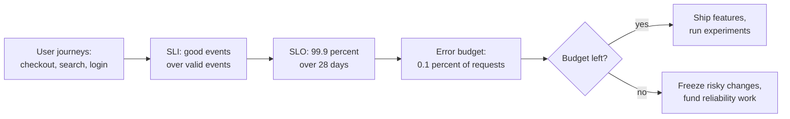
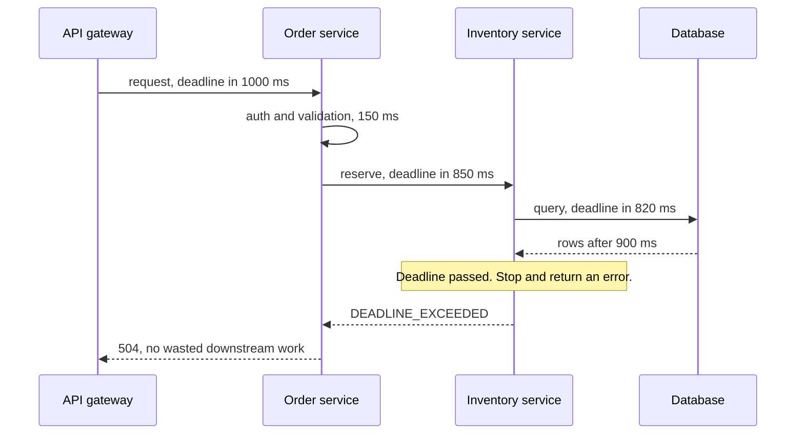
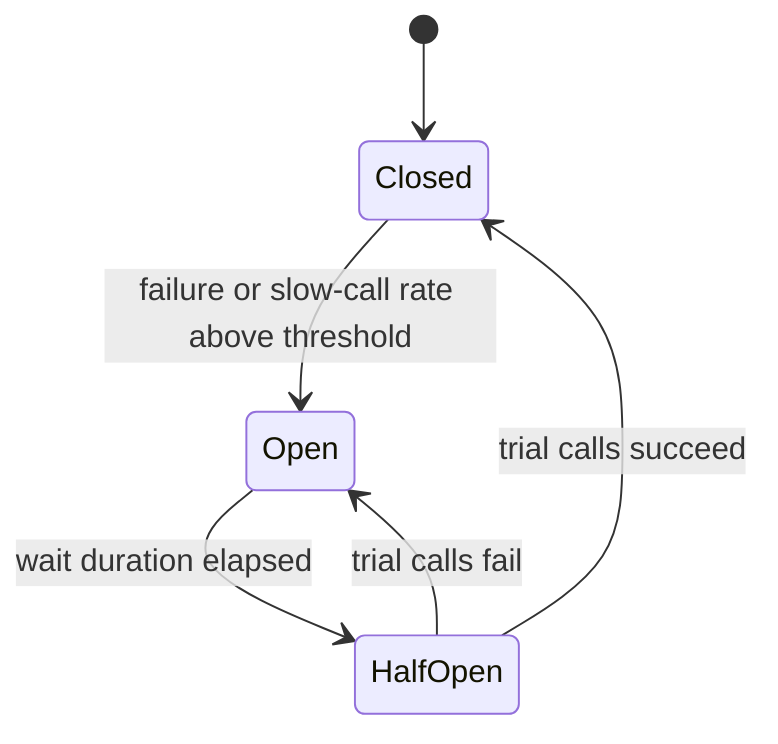
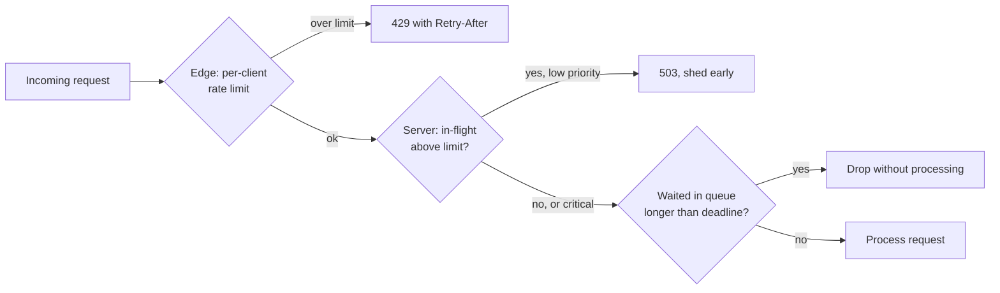
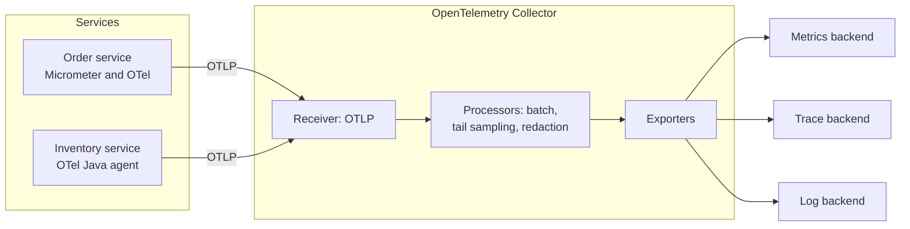
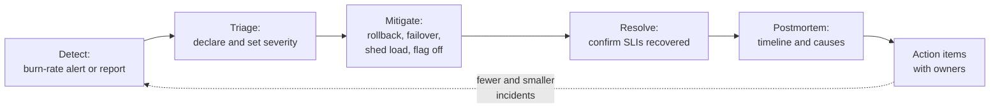

import Callout from '../../components/mdx/Callout.astro';

[Part 10](/blog/backend-10-distributed-systems) ended on an uncomfortable truth: in a distributed system, things fail all the time, partially, and ambiguously. This part is about what you do with that truth on a Tuesday afternoon.

Reliability engineering has two halves. The first is **design**: deciding how reliable a service needs to be, then building it so that failures stay small (timeouts, retries, circuit breakers, bulkheads, load shedding). The second is **operations**: seeing what the system is doing (logs, metrics, traces), noticing when it's going wrong before users do, and recovering and learning when it does.

At staff level you're expected to own both, and to explain the trade-offs to people who don't care about either: "why can't we just make it 100% available?", "why did a 10-second database blip take the site down for an hour?", "why didn't the dashboards show anything?".

<Callout variant="tip" title="What you'll learn">
- How to define SLIs and SLOs that reflect user experience, and use error budgets to make decisions
- Multi-window, multi-burn-rate alerting, with the math behind it
- Timeouts, deadline propagation and how to choose values
- Retries done right: idempotency, exponential backoff, full jitter, retry budgets
- Circuit breakers, bulkheads, load shedding and graceful degradation, and the metastable failures they prevent
- Logs, metrics and traces with OpenTelemetry and Micrometer, and the cardinality and percentile traps
- How to run an incident and write a blameless postmortem that actually changes things
</Callout>

**Level: staff.** You should already know: failure modes, timeouts-as-ambiguity and idempotency ([Part 10](/blog/backend-10-distributed-systems)), connection pools, rate limiting and back-pressure (Part 8), and async processing with retries and DLQs (Part 6).

---

## Reliability is a product decision

"Make it reliable" isn't a requirement. Reliability has a cost curve that gets steep fast: each extra nine is roughly ten times less allowed downtime, and usually much more than ten times the engineering, infrastructure and process cost.

Over a 30-day window (43,200 minutes):

| Availability | Allowed "bad" time per 30 days | What it usually takes |
|---|---|---|
| 99% | 7.2 hours | One region, manual recovery is fine |
| 99.5% | 3.6 hours | Automated restarts, basic redundancy |
| 99.9% | 43.2 minutes | Redundancy across zones, automated failover, on-call |
| 99.95% | 21.6 minutes | Fast detection, safe deploys with automatic rollback |
| 99.99% | 4.32 minutes | No human in the recovery loop, multi-region or cell architecture |

At 99.99%, you can't wait for a human to wake up, open a laptop and log in. Recovery has to be automatic. That's the kind of consequence this table should make obvious in a design review.

### Availability composes, and usually not in your favour

If a request needs **all** of several dependencies, their availabilities multiply (assuming independent failures):

- 5 serial dependencies at 99.9% each: 0.999⁵ ≈ **99.5%**. Your service can't be 99.9% on top of that.
- Two redundant replicas at 99% each, where either one is enough: 1 − (0.01)² = **99.99%**, *if* they fail independently. They usually don't fully, because they share a deploy pipeline, a config system, a region and a DNS provider.

This is why critical paths should have as few hard dependencies as possible, and why "soft" dependencies (recommendations, personalisation, analytics) must be able to fail without failing the request.

---

## SLIs, SLOs and error budgets

These terms come from Google's SRE books and have become the industry vocabulary:

- **SLI (service level indicator)**: a measurement of user-visible behaviour, best expressed as **good events / valid events**. For example: the proportion of `GET /checkout` requests that return a non-5xx response in under 400 ms.
- **SLO (service level objective)**: a target for an SLI over a window. For example: 99.9% of checkout requests are good, measured over a rolling 28 days.
- **SLA (service level agreement)**: a contract with consequences (credits, penalties) if you miss it. SLAs should be looser than SLOs, so that you notice and react before you owe anyone money.
- **Error budget**: 1 − SLO. With a 99.9% SLO and 10 million requests a month, you may serve 10,000 bad requests. That's the budget.



### Choosing good SLIs

- **Measure as close to the user as you can.** Load-balancer or edge logs beat application metrics, because they include the cases where your application never got the request. Synthetic probes catch total outages; real traffic catches partial ones.
- **Pick a few, per critical user journey.** "Login", "search", "checkout" each get an availability SLI and a latency SLI. Five well-chosen SLIs beat fifty.
- **Express latency as a threshold, not an average.** "99% of requests under 300 ms" is a ratio of good events, so it fits the same budget math. Averages hide the tail.
- **Exclude what isn't your fault, carefully.** Client 4xx errors usually don't count as bad events. But a spike in 429s from your own rate limiter is very much your users' problem.

### The error budget as a decision tool

The point of an SLO isn't the number; it's the **policy** attached to it. A typical error budget policy, agreed in advance between product and engineering:

- Budget remaining: teams ship at normal speed. Spending budget on experiments and fast rollouts is fine; that's what it's for.
- Budget exhausted: freeze non-critical releases for the service, and redirect engineering to the top items from recent postmortems until the service is back within SLO.
- A single incident consumed a large share of the budget (say 20% or more): it gets a postmortem with tracked action items.

This turns reliability arguments from opinion ("we're shipping too fast") into data ("we've used 140% of our budget this window").

<Callout variant="note" title="100% is the wrong target">
Users can't tell 99.999% from 100%, because their phone network, Wi-Fi and laptop are far less reliable than that. A 100% target also means zero risk tolerance, which means you can never deploy. A good SLO is the level at which users stop noticing, not the highest number you can reach.
</Callout>

### Alerting on burn rate

**Burn rate** is how fast you're consuming the error budget relative to the rate that would exactly exhaust it by the end of the window. A burn rate of 1 uses 100% of the budget in 30 days; a burn rate of 14.4 uses it in about 2 days.

Alerting on "error rate above 0.1% for 5 minutes" is noisy and doesn't say anything about impact. The Google SRE Workbook recommends **multi-window, multi-burn-rate** alerts instead. For a 30-day SLO:

| Severity | Budget consumed | Long window | Short window | Burn rate |
|---|---|---|---|---|
| Page | 2% | 1 hour | 5 minutes | 14.4 |
| Page | 5% | 6 hours | 30 minutes | 6 |
| Ticket | 10% | 3 days | 6 hours | 1 |

The burn rate follows from the window: consuming 2% of a 30-day (720-hour) budget in 1 hour means burning at 0.02 × 720 = **14.4×** the sustainable rate. The **short window** must also be over the threshold, so that the alert resolves quickly once the problem is fixed instead of firing for another hour while the long window drains.


A Prometheus rule for the first row, for a 99.9% availability SLO on a Spring Boot service (Micrometer exposes `http_server_requests_seconds_count` with an `outcome` label):

```yaml
groups:
  - name: checkout-slo
    rules:
      - alert: CheckoutErrorBudgetFastBurn
        expr: |
          (
            sum(rate(http_server_requests_seconds_count{job="checkout", outcome="SERVER_ERROR"}[1h]))
            /
            sum(rate(http_server_requests_seconds_count{job="checkout"}[1h]))
          ) > (14.4 * 0.001)
          and
          (
            sum(rate(http_server_requests_seconds_count{job="checkout", outcome="SERVER_ERROR"}[5m]))
            /
            sum(rate(http_server_requests_seconds_count{job="checkout"}[5m]))
          ) > (14.4 * 0.001)
        labels:
          severity: page
        annotations:
          summary: "Checkout is burning its 30-day error budget at more than 14.4x"
```

Page on **symptoms** (users are affected, budget is burning), not on **causes** (CPU at 85%, one pod restarted). Causes belong on dashboards and in tickets. Every page should be urgent, actionable and real; if an alert regularly fires and nobody needs to do anything, delete it or downgrade it.

---

## Timeouts and deadlines

Part 10 established that a remote call without a timeout can wait forever. In practice, a missing timeout is one of the most common causes of cascading failure: a slow dependency holds threads or connections, the pool runs dry, and now *every* endpoint is down, including the ones that never touched the slow dependency.

### Every remote call needs one

Set at least these, explicitly, on every client. Defaults are often "infinite" or very long:

- **Connect timeout**: how long to wait for a TCP (and TLS) connection. Short, typically 100 ms to 1 s inside a datacenter.
- **Read / response timeout**: how long to wait for the response once connected.
- **Pool acquisition timeout**: how long to wait for a free connection from the pool. HikariCP's `connectionTimeout` defaults to 30 seconds, which is far too long for a request path.

```kotlin
@Configuration
class InventoryClientConfig {
    @Bean
    fun inventoryRestClient(builder: RestClient.Builder): RestClient {
        val factory = JdkClientHttpRequestFactory(
            HttpClient.newBuilder()
                .connectTimeout(Duration.ofMillis(500))
                .build()
        ).apply { setReadTimeout(Duration.ofMillis(800)) }

        return builder
            .baseUrl("http://inventory")
            .requestFactory(factory)
            .build()
    }
}
```

### Choosing the value

A timeout should be derived from data, not guessed:

1. Look at the dependency's latency distribution under normal load. Start from its p99 or p99.9.
2. Add headroom, but stay well below your own SLO. If your endpoint promises 400 ms, a 2-second timeout on a dependency is meaningless.
3. Remember the **caller's** timeout. If the caller gives up at 1 s, any work you do after 1 s is wasted.

### Deadline propagation

With multiple hops, fixed per-hop timeouts stop making sense. If the edge gives a request 1 second and the first service spends 700 ms, the next hop shouldn't start a fresh 800 ms timeout. The better model is a **deadline**: an absolute point in time, carried with the request, that every hop respects.



gRPC does this natively: the client sets a deadline, it travels as the `grpc-timeout` header, and servers can check whether the deadline has expired before doing expensive work. Over HTTP you implement it yourself with a header carrying the remaining budget, and use it to cap your client timeouts. In Kotlin coroutines, `withTimeout` cancels child work when the budget runs out, which is exactly the semantics you want (see [Kotlin coroutines in production](/blog/kotlin-coroutines-production)).

---

## Retries done right

Retries are the most useful and the most dangerous reliability tool. They turn transient blips into invisible non-events, and they turn a struggling dependency into a dead one.

### When to retry

Retry only if **all** of these hold:

- The operation is **idempotent**, or you send an idempotency key (Part 10). Retrying a non-idempotent POST after a timeout can double-charge.
- The error is **transient**: connection reset, 503, 429 (respect `Retry-After`), timeouts *if* the operation is idempotent. Don't retry 400, 401, 403, 404 or 422; they'll fail the same way every time.
- There is **time left** in the deadline.

### Backoff and jitter

Retrying immediately just hits the dependency again while it's still struggling. **Exponential backoff** waits longer each time: 100 ms, 200 ms, 400 ms, capped at some maximum.

But if a thousand clients all failed at the same moment and all use the same backoff schedule, they all retry at the same moments too: synchronized waves of load at exactly 100 ms, 300 ms, 700 ms. The fix is **jitter**: randomize the wait. Marc Brooker's 2015 AWS Architecture Blog post "Exponential Backoff and Jitter" compared strategies and found **full jitter** performs very well:

```text
sleep = random(0, min(cap, base * 2^attempt))
```


A small, dependency-free implementation for coroutines:

```kotlin
suspend fun <T> retryWithFullJitter(
    maxAttempts: Int = 3,
    base: Duration = 100.milliseconds,
    cap: Duration = 2.seconds,
    isRetryable: (Throwable) -> Boolean,
    block: suspend () -> T,
): T {
    var attempt = 0
    while (true) {
        try {
            return block()
        } catch (e: CancellationException) {
            throw e                                   // never swallow cancellation
        } catch (e: Exception) {
            attempt++
            if (attempt >= maxAttempts || !isRetryable(e)) throw e
            val ceiling = minOf(cap, base * (1 shl (attempt - 1)))
            delay(Random.nextLong(0, ceiling.inWholeMilliseconds + 1))
        }
    }
}
```

Wrap the whole thing in `withTimeout(remainingBudget)` so retries never outlive the caller's deadline.

Spring Framework 7 (the base of Spring Boot 4) added retry support to the core framework: `@Retryable` with backoff and jitter settings and `@ConcurrencyLimit`, enabled with `@EnableResilientMethods`, plus a programmatic `RetryTemplate`. For circuit breakers, bulkheads and rate limiters you still reach for Resilience4j.

### Retry amplification

This is the failure mode interviewers want you to know. If every layer retries, attempts **multiply**:

- Gateway: 3 attempts → Order service: 3 attempts each → Inventory: 3 attempts each.
- One user request becomes **27** requests to inventory, precisely when inventory is already struggling.

Rules that prevent this:

1. **Retry at one layer**, usually the one closest to the failure or the client edge, not at every hop.
2. Use a **retry budget**: retries may add at most a fixed fraction of traffic (commonly 10-20%) on top of first attempts. Once the budget is spent, fail fast. Envoy and Linkerd both support retry budgets.
3. Signal **"don't retry"** downstream. If a dependency is overloaded, it should say so (503 with `Retry-After`, or a gRPC status your clients treat as non-retryable), and upstream callers shouldn't pile on.

---

## Circuit breakers

A **circuit breaker** wraps calls to a dependency and stops calling it when it's clearly failing. That protects the dependency (no load while it recovers) and protects you (fail in microseconds instead of waiting for a timeout).



- **Closed**: calls go through, outcomes are recorded in a sliding window.
- **Open**: calls fail immediately (or go to a fallback) without touching the dependency.
- **Half-open**: after a wait, a few trial calls are allowed. If they succeed the breaker closes; if not, it opens again.

Resilience4j is the standard choice on the JVM. Configured through Spring Boot properties:

```yaml
resilience4j:
  circuitbreaker:
    instances:
      inventory:
        slidingWindowType: COUNT_BASED
        slidingWindowSize: 50
        minimumNumberOfCalls: 20
        failureRateThreshold: 50
        slowCallDurationThreshold: 800ms
        slowCallRateThreshold: 80
        waitDurationInOpenState: 10s
        permittedNumberOfCallsInHalfOpenState: 5
  bulkhead:
    instances:
      inventory:
        maxConcurrentCalls: 25
        maxWaitDuration: 0ms
```

Things that separate a good breaker from a useless one:

- **Count slow calls, not just errors.** A dependency that answers in 5 seconds is worse than one that fails fast. `slowCallRateThreshold` catches this.
- **Set `minimumNumberOfCalls`** so that 2 failures out of 3 calls at 3 a.m. don't open the breaker.
- **Decide the fallback explicitly**: cached data, a default ("recommendations unavailable"), a degraded response, or a fast error. A fallback that calls another overloaded service just moves the problem.
- **Breakers are per dependency (and sometimes per endpoint)**, never one global breaker for "the network".

---

## Bulkheads

Ships have watertight compartments so that one hull breach doesn't sink the ship. A **bulkhead** in software limits how many resources one dependency or workload can consume, so a problem in one can't exhaust the shared pool.

Concretely:

- **Concurrency limits per dependency**: at most 25 in-flight calls to inventory. The 26th fails fast instead of taking a thread. (Resilience4j's semaphore bulkhead above, or Spring Framework 7's `@ConcurrencyLimit`.)
- **Separate connection pools** per downstream and per database, sized so their sum fits your threads and the database's `max_connections`.
- **Separate thread pools or executors** for batch and interactive work, so a heavy export can't starve API requests.
- **Cells and shards at the infrastructure level**: split customers across independent stacks so that one bad deploy or one noisy tenant affects only one cell.

Why this matters becomes clear with **Little's Law**: concurrency = throughput × latency. At 500 requests/s to a dependency that normally responds in 20 ms, you need about 10 in-flight calls. If that dependency slows to 2 seconds, the same traffic needs **1,000** in-flight calls. Without a bulkhead, those calls take every thread you have (Tomcat's `server.tomcat.threads.max` defaults to 200).

---

## Load shedding and graceful degradation

Timeouts, retries and breakers protect you from **your dependencies**. Load shedding protects you from **your callers**: when more work arrives than you can handle, reject some of it early and cheaply, so that the rest still succeeds.

### Why overload collapses throughput

An overloaded server doesn't just slow down. Requests queue up, queued requests time out at the client, and the server keeps processing requests whose callers have already given up. Goodput (useful completed work) falls towards zero while utilization stays at 100%. Clients then retry, adding more load.

This is a **metastable failure** (named by Bronson et al. at HotOS 2021): a trigger (a deploy, a cache flush, a brief network blip) pushes the system into a bad state that **sustains itself** through retries and queueing even after the trigger is gone. The famous signature is an outage that started with a 30-second blip and lasted an hour, and only ended when someone drastically cut incoming traffic.

### Shedding strategies



- **Reject early and cheaply.** A rejection should cost microseconds: before parsing the body, before authentication calls, before touching the database.
- **Bound every queue**, in time as well as size. Tomcat's `server.tomcat.accept-count` (default 100) and thread pool are queues; so are your executors. Facebook's "Fail at Scale" (Ben Maurer, ACM Queue, 2015) describes using CoDel-style controlled-delay queues and switching to **adaptive LIFO** under overload, so fresh requests (whose clients are still waiting) get served instead of stale ones.
- **Drop requests whose deadline has passed** instead of processing them.
- **Shed by priority.** Health checks, payment confirmations and logged-in users first; prefetches, analytics beacons and batch traffic last.
- **Use adaptive concurrency limits** rather than static ones. Netflix's open-source `concurrency-limits` library and Envoy's adaptive concurrency filter adjust the limit based on observed latency, in the spirit of TCP congestion control.

### Graceful degradation

Decide in advance what the product looks like when parts are down, and build switches for it:

- Home page without personalised recommendations (show bestsellers from a static cache).
- Search with fewer facets, or without spelling correction.
- Checkout that accepts orders and processes payment asynchronously (with honest messaging) when the payment provider is slow.

**Feature flags as kill switches** let on-call disable expensive, non-critical features in seconds without a deploy.

<Callout variant="warning" title="Test the failure path">
Fallbacks, breakers and kill switches that have never run in production are hopes, not mechanisms. Exercise them: fault injection in staging, game days, and chaos experiments in production with a small blast radius. The first time a fallback runs shouldn't be during a real outage. For the shutdown side of this, see [graceful shutdown for microservices](/blog/graceful-shutdown-microservices).
</Callout>

---

## Observability

**Monitoring** tells you whether known things are wrong (is the error rate above the threshold?). **Observability** is the ability to answer questions you didn't anticipate (why are only Android users in Brazil seeing slow checkouts since 14:05?) from the telemetry the system already emits.

The three main signals each answer different questions:

| Signal | Answers | Cost profile | Watch out for |
|---|---|---|---|
| Metrics | Is something wrong, and how much? | Cheap: numeric time series, aggregated | Cardinality explosion |
| Traces | Where in the request path is the time or error? | Medium: usually sampled | Broken context propagation, sampling bias |
| Logs | What exactly happened in this case? | Expensive at volume | Unstructured text, PII, noise |

### Metrics

Three well-known checklists help decide *what* to measure:

- **RED** (Tom Wilkie), for request-driven services: **R**ate, **E**rrors, **D**uration.
- **USE** (Brendan Gregg), for resources (CPU, disks, pools, queues): **U**tilization, **S**aturation, **E**rrors.
- **The four golden signals** (Google SRE book): latency, traffic, errors, saturation.

For a JVM service, saturation signals that matter most are usually **pool saturation** (HikariCP's `hikaricp_connections_pending`, executor queue depth), not CPU.

Two traps catch almost everyone:

**Percentiles can't be averaged.** The average of ten instances' p99s isn't the fleet's p99. To aggregate, export **histograms** (bucket counts), sum the buckets across instances, then compute the quantile:

```yaml
# application.yaml: publish histogram buckets for HTTP server metrics
management:
  metrics:
    distribution:
      percentiles-histogram:
        http.server.requests: true
```

```text
histogram_quantile(0.99,
  sum by (le) (rate(http_server_requests_seconds_bucket{job="checkout"}[5m])))
```

**Cardinality kills metrics systems.** Every unique combination of label values is a separate time series. A `userId` or `orderId` label on a metric creates millions of series and can take down your Prometheus. Keep labels bounded (endpoint template, status class, region). Put high-cardinality detail in traces and logs instead.

### Distributed tracing

A **trace** represents one request's path through the system as a tree of **spans** (one per operation: an HTTP handler, a database query, an outgoing call). Each span has a start, a duration, attributes and a status, and points at its parent.

Tracing only works if every hop **propagates context**. The standard is **W3C Trace Context**, carried in the `traceparent` header (version, 16-byte trace ID, 8-byte parent span ID, flags):

```http
GET /inventory/reserve HTTP/1.1
Host: inventory
traceparent: 00-4bf92f3577b34da6a3ce929d0e0e4736-00f067aa0ba902b7-01
```

The common way to lose traces is a hop that doesn't forward the header: a hand-rolled HTTP client, a message published to Kafka without trace headers, or a thread pool that doesn't carry context. Asynchronous boundaries need explicit propagation; most instrumentation libraries add trace headers to Kafka records for you.

### OpenTelemetry

**OpenTelemetry (OTel)** is the CNCF standard for generating and exporting telemetry: one set of APIs and SDKs, one wire protocol (**OTLP**), and semantic conventions for attribute names (`http.request.method`, `db.system`, and so on), so that any backend can understand the data. Traces, metrics and logs are stable signals.



The **Collector** decouples your services from vendors: services send OTLP to the Collector, and switching backends becomes a Collector config change, not a redeploy of every service.

On the JVM you have two good options:

- **Zero-code**: the OpenTelemetry Java agent instruments common libraries (Spring MVC, JDBC, Kafka clients, HTTP clients) at startup, configured with standard environment variables:

```bash
export OTEL_SERVICE_NAME=inventory
export OTEL_EXPORTER_OTLP_ENDPOINT=http://otel-collector:4318
export OTEL_TRACES_SAMPLER=parentbased_traceidratio
export OTEL_TRACES_SAMPLER_ARG=0.1
java -javaagent:opentelemetry-javaagent.jar -jar inventory.jar
```

- **Spring-native**: Spring Boot instruments itself through the **Micrometer Observation API**, with Micrometer Tracing bridging to OpenTelemetry and exporting over OTLP. One `Observation` produces both a timer metric and a span. Spring Boot 4 also ships a dedicated OpenTelemetry starter that wires this up.

Custom business operations deserve their own observations:

```kotlin
@Service
class ReservationService(
    private val registry: ObservationRegistry,
    private val inventory: InventoryClient,
) {
    fun reserve(order: Order): Reservation =
        Observation.createNotStarted("inventory.reserve", registry)
            .lowCardinalityKeyValue("warehouse.region", order.region)  // bounded: becomes a metric tag
            .highCardinalityKeyValue("order.id", order.id.toString())  // unbounded: span attribute only
            .observe(Supplier { inventory.reserve(order) })!!
}
```

The `lowCardinalityKeyValue` vs `highCardinalityKeyValue` split is Micrometer's way of enforcing the cardinality rule: low-cardinality values become metric tags *and* span attributes; high-cardinality values only go on the span.

### Sampling

Tracing every request at high traffic is expensive. Two approaches:

- **Head sampling**: decide at the start of the trace (for example, keep 10%), and propagate the decision so the whole trace is kept or dropped together. Cheap and simple, but it drops 90% of your rare errors too.
- **Tail sampling**: buffer whole traces in the Collector and decide after they finish: keep every trace with an error, every trace slower than 2 s, and 1% of the rest. Much more useful, but the Collector must see all spans of a trace (route by trace ID) and hold them in memory for the decision window.

### Logs

- **Structured, not prose.** JSON with consistent fields is searchable and aggregatable. Spring Boot (since 3.4) supports structured logging out of the box, for example `logging.structured.format.console: ecs` (Elastic Common Schema) or `logstash`.
- **Always include trace and span IDs.** With Micrometer Tracing, they're put into the MDC, so every log line can link to its trace. This is the single biggest productivity win in debugging.
- **Log events, not every step.** One rich "request completed" or "payment failed" event with context beats twenty "entering method X" lines.
- **Never log secrets or personal data** (tokens, passwords, full card numbers, and in Europe, much of what GDPR calls personal data). Redact at the source, and again in the Collector as defence in depth.

**Exemplars** tie the signals together: a histogram bucket can carry a sample trace ID, so on a latency graph you click the spike and land on an actual slow trace, whose spans link to their logs. That's the debugging loop you want: metric (something is wrong) → trace (where) → log (exactly what).

---

## Incidents

Everything above reduces how often things go wrong and how bad they are. It doesn't get you to zero. When an incident happens, the goal is to **restore service first** and **understand later**.



### Running the incident

- **Declare early.** A declared incident that turns out minor costs a few minutes. An undeclared major one costs hours of uncoordinated debugging in a dozen chat threads.
- **Assign roles.** An **incident commander** coordinates and makes decisions (and usually doesn't debug). An **operations lead** or subject matter experts work the problem. A **communications lead** updates stakeholders and the status page on a fixed cadence. Someone keeps a **timeline**.
- **Mitigate before you understand.** If the incident started with a deploy, roll back now and find out why later. Failover, shed load, disable a feature flag, scale up. Root cause analysis while users are down is a luxury.
- **Make changes deliberately.** Announce each action in the incident channel before taking it, so two people don't restart the same database.

### Blameless postmortems

A **postmortem** (or incident review) documents what happened and what will change. **Blameless** doesn't mean nobody is accountable; it means you assume people acted reasonably given what they knew at the time, and you look for the system conditions that made the failure possible. If an engineer could take production down with one command, the problem is that the command could do that.

A useful postmortem contains:

1. **Impact**: who was affected, how badly, for how long, and how much error budget it consumed.
2. **Timeline**: detection, key decisions, mitigation, resolution, in UTC.
3. **Contributing factors**: plural. Complex systems rarely have a single root cause; "the deploy had a bug" is usually accompanied by "the canary didn't cover that path", "the alert fired 20 minutes late", and "rollback took 15 minutes because it needed a manual step".
4. **What went well**: so you keep doing it.
5. **Action items**: specific, owned, with dates and a priority. "Be more careful" isn't an action item. "Make rollback a single command, owned by platform team, due in two weeks" is.

Track action items to completion and review postmortems across teams. The patterns across many incidents (the same missing timeout class, the same deploy process gap) are more valuable than any single report.

<Callout variant="tip" title="Measure what improves">
Mean time to recovery (MTTR) is a popular metric but a noisy one: incidents vary too much in kind for an average to mean much. More actionable: time to detect, time to mitigate, the share of incidents detected by alerts rather than by customers, and the share of postmortem action items completed on time.
</Callout>

---

## Common mistakes

- **SLOs nobody uses.** An SLO without an error budget policy and burn-rate alerts is a dashboard decoration.
- **Alerting on causes instead of symptoms.** Paging on CPU and pod restarts burns out on-call; page on user impact.
- **No timeouts, or default timeouts.** Infinite or 30-second defaults on HTTP clients and pools are behind a large share of cascading failures.
- **Retrying at every layer**, retrying non-idempotent operations, or retrying without jitter.
- **Circuit breakers that only count errors**, so slow-but-successful dependencies never trip them.
- **Unbounded queues.** A queue with no size or age limit converts overload into latency and then into a metastable failure.
- **Averaging percentiles** across instances, or alerting on average latency.
- **User IDs in metric labels.** Use traces and logs for high-cardinality data.
- **Head sampling only**, then wondering why the one failing request has no trace.
- **Postmortems that end with "human error"** and action items like "be more careful".

---

## Interview questions

<details>
<summary>How would you define SLOs for a new checkout service?</summary>

Start from user journeys, not from components: "add to cart", "place order", "see order confirmation". For each, define an availability SLI (non-5xx responses / valid requests, measured at the load balancer) and a latency SLI (proportion of requests under a threshold such as 500 ms, chosen from how users experience the flow). Set targets from current performance and business need, for example 99.9% over 28 days, not from aspiration.

A strong staff answer adds the **error budget policy** (what happens when it's exhausted, agreed with product), **multi-window burn-rate alerts** to page on, an SLA looser than the SLO if there's a contract, and the dependency math: if checkout synchronously needs five 99.9% services, it can't promise 99.9% itself without removing or softening dependencies.

</details>

<details>
<summary>Explain burn rate. Why is 14.4 a common page threshold?</summary>

Burn rate is the rate of error budget consumption relative to the rate that would use up exactly the whole budget over the SLO window. Burn rate 1 empties a 30-day budget in 30 days. A 14.4× burn sustained for 1 hour consumes 14.4 / 720 = 2% of a 30-day budget, which the SRE Workbook proposes as the threshold for an urgent page. Pairing a 1-hour long window with a 5-minute short window means the alert fires only for significant, still-ongoing burns and resolves quickly after mitigation. A slower 6× over 6 hours (5% of budget) catches sustained moderate problems, and 1× over 3 days becomes a ticket.

</details>

<details>
<summary>A downstream service had a 30-second outage, but your system stayed down for 45 minutes. What happened and how do you prevent it?</summary>

Likely a **metastable failure**: the blip caused timeouts, clients and intermediate services retried (possibly at several layers, multiplying load), queues filled with requests whose callers had already given up, and the system spent its capacity on wasted work. Once the trigger ended, the retry load alone kept it overloaded.

Prevention: retry at one layer with exponential backoff, full jitter and a retry budget; bounded queues with deadline-aware dropping (don't process requests whose caller is gone); load shedding and adaptive concurrency limits; circuit breakers so callers fail fast; and the operational lever of being able to cut traffic sharply (rate limits at the edge) to let the system drain. The interviewer wants you to see that **the recovery mechanism (retries) was the cause of the long outage**.

</details>

<details>
<summary>How do you choose a timeout for a call to a dependency?</summary>

From the dependency's measured latency distribution (start near its p99 or p99.9 under normal load), bounded by your own latency SLO and the remaining deadline of the incoming request. Set separate connect, read and pool-acquisition timeouts. Prefer propagating a **deadline** across hops (gRPC does it natively via `grpc-timeout`) so downstream services don't start fresh timeouts on work whose caller has already given up. Revisit the values when latency distributions shift, and alert on timeout rates, because a timeout firing often is itself a signal.

</details>

<details>
<summary>What's the difference between a circuit breaker, a bulkhead and a rate limiter?</summary>

- A **rate limiter** caps how much traffic a caller may send per unit of time (protects a service from its callers, often per client).
- A **bulkhead** caps how many resources (concurrent calls, threads, connections) one dependency or workload may consume, so one failure can't exhaust shared pools.
- A **circuit breaker** watches outcomes of calls to a dependency and stops calling it when the failure or slow-call rate is too high, then probes for recovery via half-open.

They compose: a bulkhead limits damage while a dependency is slow, the breaker then opens so you stop paying even the bulkhead's cost, and the rate limiter at the edge keeps overall load within capacity. Strong answers mention that breakers should count slow calls and that fallbacks must not call another overloaded service.

</details>

<details>
<summary>Why can't you average p99 latency across instances, and what do you do instead?</summary>

Percentiles aren't linear: the p99 of the combined distribution depends on the full shape of each instance's distribution, not on their individual p99s. One slow instance with low traffic can be hidden or exaggerated by averaging. Instead, export **histograms** (bucket counts, in Spring Boot via `management.metrics.distribution.percentiles-histogram`), sum the bucket rates across instances, and compute the quantile with `histogram_quantile`. Better still, define latency SLIs as ratios ("proportion under 300 ms"), which aggregate correctly by simple addition.

</details>

<details>
<summary>Traces are missing spans after requests pass through Kafka. How do you debug and fix that?</summary>

Trace context has to be propagated explicitly across asynchronous boundaries. Check that the producer injects W3C `traceparent` into record headers and the consumer extracts it and starts its span as a child (or, for batch consumers, as a span with **links** to the producing spans). Instrumented Kafka clients (the OTel Java agent, or Spring Kafka with observation enabled) do this; hand-rolled producers, custom executors and thread hand-offs often break it. Also check sampling: with head sampling, the consumer should respect the parent's sampled flag; with tail sampling, all spans of a trace must reach the same Collector instance.

</details>

<details>
<summary>How do you run a postmortem so that it actually reduces future incidents?</summary>

Blameless format focused on system conditions; a timeline from data, not memory; multiple contributing factors instead of one root cause; explicit impact including error budget consumed; and action items that are specific, owned, dated and prioritized, with completion tracked. Then look **across** postmortems for recurring themes (missing timeouts, slow rollback, alerts from customers instead of monitoring) and fund fixes for the theme, not just the instance. At staff level, the expectation is that you shape this process, not just attend it.

</details>

<details>
<summary>Your team wants to move from 99.9% to 99.99% availability. What do you ask?</summary>

First: **do users need it?** What is the business cost of the current 43 minutes per month, and how do users experience it? Then the cost side: 99.99% allows about 4 minutes a month, which rules out human-driven recovery. You'd need automated detection and rollback, progressive delivery, redundancy without shared failure domains (multi-zone at minimum, likely multi-region or cells), every hard dependency at 99.99% or better (or made soft), and a mature on-call and testing practice. Often the right answer is to raise the SLO only for the most critical journey, such as placing an order, rather than for the whole product.

</details>

---

## Key takeaways

- Reliability targets are product decisions with steep costs per nine. Define SLIs from user journeys, set SLOs, and attach an error budget policy.
- Page on symptoms with multi-window, multi-burn-rate alerts (14.4× over 1 h, 6× over 6 h), not on causes.
- Every remote call needs connect, read and pool timeouts derived from data. Propagate deadlines across hops.
- Retry only idempotent, transient failures, at one layer, with exponential backoff, full jitter and a retry budget.
- Circuit breakers (counting slow calls), bulkheads and load shedding keep partial failures partial and prevent metastable collapse.
- Metrics say something is wrong, traces say where, logs say exactly what. Use histograms, bounded labels, propagated trace context, tail sampling and trace IDs in logs.
- Incidents: declare early, assign roles, mitigate first. Postmortems: blameless, multiple contributing factors, owned action items, cross-incident patterns.

Previous: [Part 10: Distributed Systems Fundamentals](/blog/backend-10-distributed-systems)

Next: [Part 12: System Design Interviews](/blog/backend-12-system-design-interviews)
