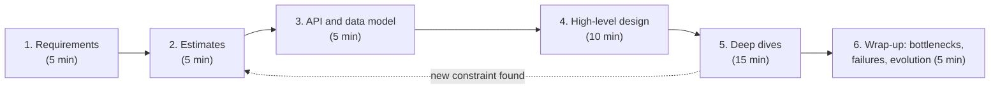
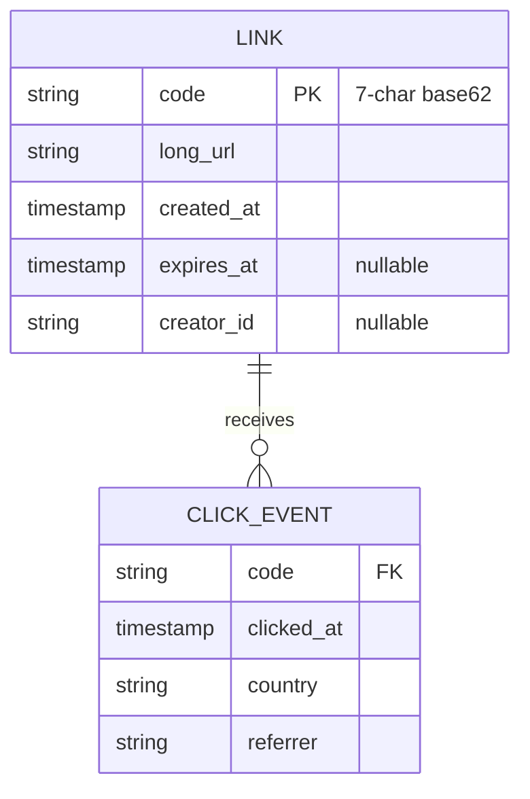
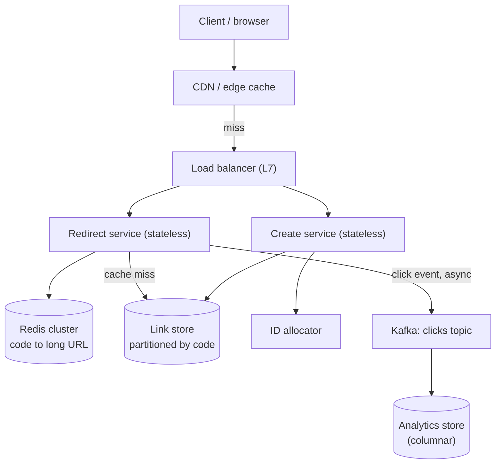
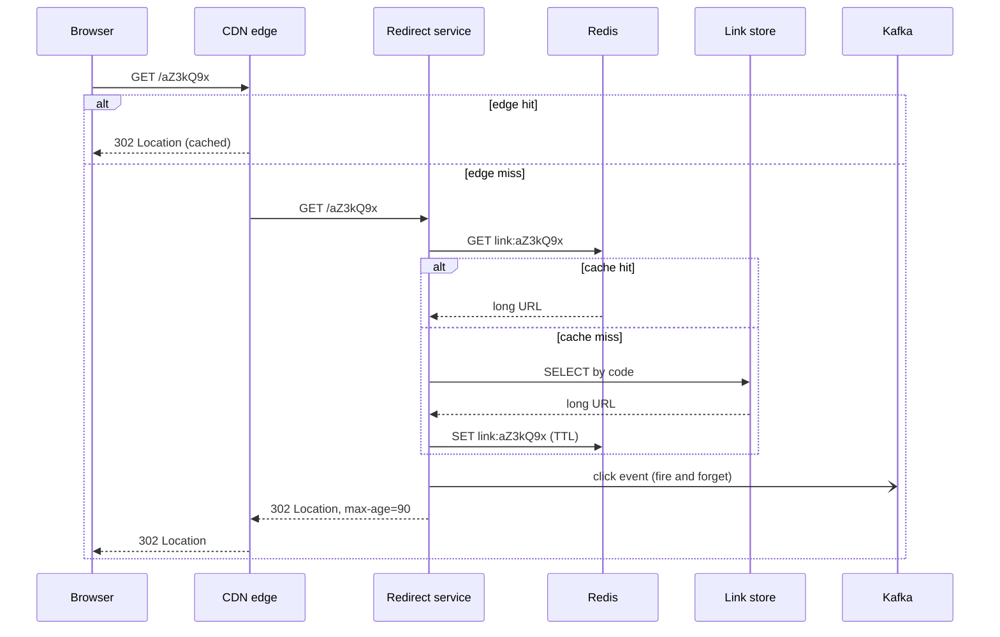
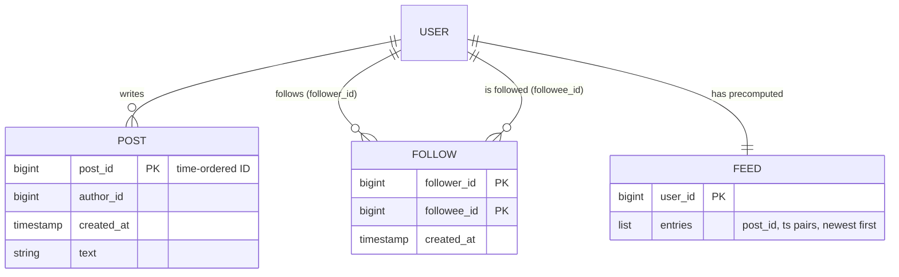
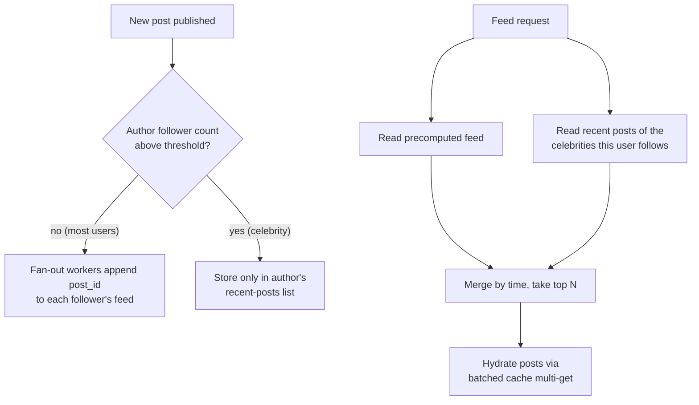
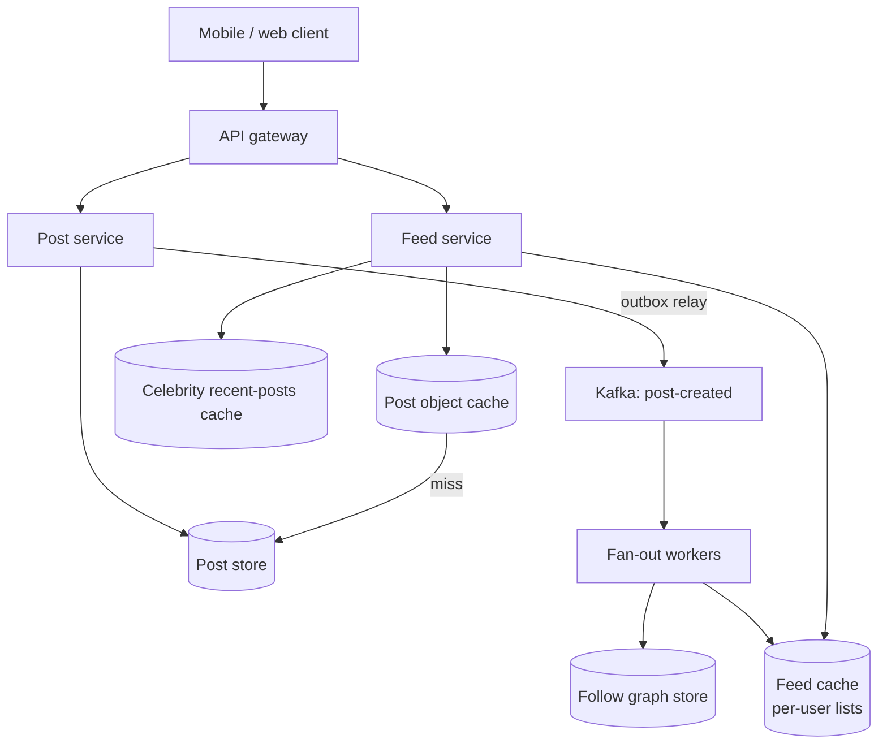
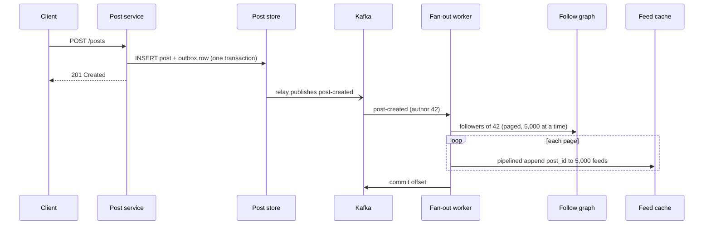

import Callout from '../../components/mdx/Callout.astro';

Every part of this series so far has been a component: HTTP, databases, caches, queues, Kafka, consensus, SLOs. A system design interview asks you to assemble those components, out loud, in 45 to 60 minutes, for a problem you have not seen before, while someone watches you think. That is a different skill from knowing the components, and it can be practised.

This part gives you a framework you can run every time, and then runs it twice, end to end: a **URL shortener** (the classic warm-up, which hides more depth than people expect) and a **social news feed** (the classic "now handle a celebrity with 50 million followers" problem). Every number is worked out in the open so you can check it, because a back-of-envelope estimate that is off by 100x is worse than none.

<Callout variant="note" title="Who this is for">
This is a principal-level part. You should already know: everything in Parts 1 to 11, especially caching (Part 5), queues (Part 6), database scaling and sharding (Part 7), capacity math and rate limiting (Part 8), Kafka and the outbox pattern (Part 9), consistency models (Part 10) and SLOs (Part 11). Here we do not re-teach those; we use them.
</Callout>

## What the interviewer is actually grading

The common misconception is that system design interviews have a right answer. They do not. There are many acceptable designs for a URL shortener. What is being graded is a set of behaviours, and they shift with the level you are interviewing for:

| Signal | Mid / senior | Staff / principal |
|---|---|---|
| Requirements | Asks clarifying questions | Pushes back on requirements, proposes cutting scope, names what is explicitly out of scope |
| Estimates | Can compute QPS and storage | Uses estimates to *make decisions* ("this fits in RAM, so no sharding of the cache tier") |
| Design | Produces a working box diagram | Produces a design whose every box is justified, and knows which box will break first |
| Trade-offs | Can name pros and cons | Picks one, says what it costs, and says what evidence would make them switch |
| Depth | Goes deep where asked | Chooses where to go deep, steering to the genuinely hard part |
| Operations | Mentions monitoring | Talks about failure modes, rollout, migration, on-call burden, cost |

The jump from senior to principal is mostly the last three rows. A senior candidate designs a system. A principal candidate designs a system *and* tells you why the alternative was rejected, what it would cost to change their mind later, and how the system fails at 3 a.m.

## The framework: six steps, one clock

Run the same six steps every time. Spend roughly the time shown for a 45-minute slot; scale up for 60.



The dotted edge matters. Good candidates revise. If a deep dive reveals that your write path needs 10x more throughput than you estimated, say so and go back. Silently sticking with a broken estimate is a red flag; visibly correcting it is a green one.

### Step 1: Requirements

Split them into three buckets and write them on the board:

- **Functional:** what the system does. Keep it to three to five verbs. "Create short link. Redirect. Optional custom alias. Optional expiry." Anything more is scope you will not have time for.
- **Non-functional:** latency, availability, durability, consistency, and scale. Make each one a number. "Redirect p99 under 50 ms at the edge, 99.99% availability for redirects, links never lost once acknowledged."
- **Out of scope:** say it explicitly. "No user accounts, no billing, no admin UI." This is a principal-level move: you are managing the interviewer's expectations and your own clock.

The most valuable question at this stage is usually about the **read/write ratio** and the **consistency requirement**, because those two answers decide most of the architecture.

### Step 2: Estimates

You need four numbers: **write QPS, read QPS, storage, and bandwidth**, each as an average and a peak. You also need a few constants memorised.


The single most useful constant: **a day has 86,400 seconds**, which is close enough to 10^5 for mental math. So:

- 1 million requests/day is about **11.6/s** (1,000,000 / 86,400 = 11.57).
- 100 million/day is about **1,160/s**.
- 1 billion/day is about **11,600/s**.

Rounding 86,400 up to 100,000 makes your QPS figures about 14% low. That is fine for picking an architecture, but say out loud that you rounded, and which direction.

**Peak** is not average. Consumer traffic typically shows a daily peak of 2x to 3x the average, and launches or news events go higher. Pick a multiplier, say it, and design for peak, not average.

<Callout variant="tip" title="Estimates exist to make decisions">
Never compute a number and then ignore it. After each estimate, say what it implies: "115k reads per second average is far more than one Postgres primary should serve, but the working set is about 100 GB, which fits in a modest Redis cluster. So reads go through a cache, and the database only sees misses." That sentence is worth more than the arithmetic.
</Callout>

### Step 3: API and data model

Write the two or three most important endpoints, in HTTP form, with request and response shapes. Then sketch the core entities. You are not designing every column; you are identifying the **access patterns**, because access patterns pick the database (Part 7).

### Step 4: High-level design

Draw the boxes for the happy path: client, edge/CDN, load balancer, stateless services, cache, primary datastore, async pipeline. Walk one read and one write through it. Stop there. Resist the urge to add Kafka, Kubernetes and a service mesh before anything needs them.

### Step 5: Deep dives

This is where the interview is won. Pick the two or three hardest problems in *this* system and go deep: the ID generation scheme, the hot-key problem, the fan-out strategy, the consistency boundary. If the interviewer steers you, follow; if they do not, steer yourself and say why ("The interesting part of this problem is the celebrity fan-out, so let me spend time there").

### Step 6: Wrap-up

Name the first bottleneck at 10x scale, the top two failure modes and what happens to users during each, and what you would build next. Mention observability in terms of SLIs (Part 11), not "we would add Grafana."

Now let us run the framework.

## Worked design 1: URL shortener

### Requirements

Functional:

1. `POST` a long URL, receive a short URL like `https://sho.rt/aZ3kQ9x`.
2. `GET` the short URL, receive a redirect to the long URL.
3. Optional custom alias (`sho.rt/launch-2026`).
4. Optional expiry.

Non-functional:

- **Reads dominate.** Assume a 100:1 read-to-write ratio.
- Redirect latency: p99 under 50 ms server-side; most of the user-perceived latency is network.
- Availability: redirects are the product. 99.99% for redirects; creation can tolerate 99.9%.
- Durability: once we return a short URL, it must never disappear or point somewhere else.
- Short codes should not be trivially enumerable (people paste private document links into shorteners).

Out of scope: user accounts, link editing, a dashboard, billing. We will keep click analytics as an asynchronous side effect.

### Estimates

Assume **100 million new links per day** and a **100:1** read ratio, retained for **5 years**, at about **500 bytes per record** (the long URL averages a few hundred bytes; the rest is the code, timestamps, owner and index overhead).

**Writes**

- 100,000,000 / 86,400 = **1,157 writes/s** average.
- At a 3x peak: about **3,500 writes/s**.

**Reads**

- 100 x 100,000,000 = **10 billion redirects/day**.
- 10,000,000,000 / 86,400 = **115,741 reads/s** average.
- At a 3x peak: about **347,000 reads/s**.

**Storage**

- Records over 5 years: 100,000,000 x 365 x 5 = **182.5 billion** links.
- Raw size: 182.5 x 10^9 x 500 bytes = 91.25 x 10^12 bytes = **91.25 TB**.
- With a replication factor of 3: **273.75 TB**, roughly 69 nodes at 4 TB usable each.

**Bandwidth**

- Redirect responses are small (headers plus a `Location`), say 500 bytes on the wire: 115,741 x 500 = about **58 MB/s** average egress, about **174 MB/s** at peak. Not a concern.

**Cache size.** Here is where many published solutions go wrong. They take "20% of daily requests" (20% of 10 billion = 2 billion) and multiply by 500 bytes to get 1 TB of cache. That counts *requests*, not *distinct URLs*. Caches hold keys. If, say, 1 billion distinct links are clicked on a given day and we cache the hottest 20% of those, that is 200,000,000 x 500 bytes = **100 GB**. That fits comfortably in a small Redis cluster, and with the usual heavy skew in link popularity, it would serve far more than 20% of the traffic.

**Key space.** We use base62 (`[0-9a-zA-Z]`):

- 6 characters: 62^6 = **56.8 billion** codes. Not enough for 182.5 billion links.
- 7 characters: 62^7 = **3.52 trillion** codes. After 5 years we have used 182.5 billion / 3.52 trillion = **about 5.2%** of the space.

So 7 characters it is, with lots of headroom.

What the estimates decide:

1. The write rate (about 3,500/s peak) is modest. A sharded store handles it easily; even the ID generator is not stressed.
2. The read rate (about 347,000/s peak) is the real load, and it is extremely cacheable: a mapping that never changes. **Reads are a caching problem, not a database problem.**
3. 91 TB of data does not fit on one machine, so the store is partitioned from day one. The access pattern is a pure key lookup, which partitions perfectly.

### API

```http
POST /api/v1/links HTTP/1.1
Content-Type: application/json
Idempotency-Key: 7f9c2d1e-4b8a-4c6e-9d2f-1a3b5c7d9e0f

{ "url": "https://example.com/a/very/long/path?with=params", "alias": null, "expiresAt": null }
```

```http
HTTP/1.1 201 Created
Location: https://sho.rt/aZ3kQ9x
Content-Type: application/json

{ "code": "aZ3kQ9x", "shortUrl": "https://sho.rt/aZ3kQ9x", "url": "https://example.com/a/very/long/path?with=params" }
```

```http
GET /aZ3kQ9x HTTP/1.1
Host: sho.rt
```

```http
HTTP/1.1 302 Found
Location: https://example.com/a/very/long/path?with=params
Cache-Control: private, max-age=90
```

The `Idempotency-Key` header (Part 2, Part 6) makes client retries of the create call safe: a retry returns the same code instead of minting a second one.

**301 or 302?** This is a favourite probe. A `301 Moved Permanently` may be cached by browsers indefinitely, so repeat clicks never reach you: cheaper, but you lose click analytics and you can never change or expire that link for that browser. A `302 Found` (or `307 Temporary Redirect`, which also preserves the method) keeps you in the path. Most commercial shorteners use 301 or 302 depending on whether analytics is the product. State the trade-off and pick: here, 302 with a short `max-age`, because expiry and analytics are requirements.

### Data model



`LINK` is a pure key-value access pattern: get by `code`, put if absent. Any store that does fast point lookups and a conditional insert works: a sharded Postgres or MySQL, DynamoDB, Cassandra (with lightweight transactions for the conditional insert), or similar. Do not burn interview time on the brand. Do say that the partition key is `code`, and that the hash of a random code spreads load evenly, so there are no hot partitions on the write side.

`CLICK_EVENT` is a different beast: append-only, enormous (10 billion rows a day), and read only in aggregate. It goes to a log (Kafka) and then to a columnar analytics store, never to the same database as `LINK`.

### High-level design



Walk the read: the CDN answers most hot redirects directly (they are tiny, cacheable responses). On an edge miss, the redirect service checks Redis; on a cache miss it reads the link store, populates Redis (cache-aside, Part 5) and returns the 302. It emits a click event to Kafka **without waiting for it** on the response path; if Kafka is slow, we drop or buffer analytics, never redirects.

Walk the write: the create service validates the URL, gets a code, does a conditional insert, and returns. Custom aliases go through the same conditional insert, so a taken alias simply fails with `409 Conflict`.

### Deep dive: generating the short code

This is the core of the problem, and there are three serious options.


**Option A: hash and truncate.** Take `base62(sha256(longUrl))` and keep 7 characters. Deterministic, so the same URL always maps to the same code, which gives deduplication for free. But truncation means collisions: two different URLs can share a 7-character prefix, so you still need a check-and-retry (append a salt, rehash). Deduplication is also a privacy leak: anyone can test whether a given URL has been shortened. And if two users shorten the same URL with different expiries, a shared code is wrong.

**Option B: random with retry.** Draw 7 random base62 characters from a cryptographically secure generator, attempt `INSERT ... IF NOT EXISTS`, retry on conflict. Simple, stateless, not enumerable. The collision rate rises with fill: a new random code collides with probability (used codes / total codes), which after 5 years is about 5.2% per attempt. So late in life, roughly 1 in 19 creates needs a second round trip, and about 1 in 370 needs a third (0.052 squared is about 0.0027). Perfectly acceptable at 3,500 writes/s, but it requires a store with an atomic conditional insert.

**Option C: counter plus base62.** Give each link a unique integer and encode it. No collisions by construction. The catch is generating unique integers at scale without a single bottleneck:

- A single database sequence is a single point of contention and failure.
- A **range allocator** solves it: each create-service instance leases a block (say 10,000 IDs) from a small coordination store (a table with a row lock, or etcd/ZooKeeper), then hands out IDs from memory. At 3,500 writes/s spread over the fleet, the coordinator sees roughly one lease every 3 seconds. If an instance crashes, the rest of its block is skipped; gaps are fine.
- A **Snowflake-style** ID (timestamp, machine ID, sequence packed into 64 bits) needs no coordinator at all, but a positive 63-bit value needs 11 base62 characters (62^10 is about 8.4 x 10^17, below 2^63, which is about 9.2 x 10^18). That breaks our 7-character goal.

Sequential counters are **enumerable**: `aZ3kQ9x` is followed by `aZ3kQ9y`. That violates our requirement. The fix is to pass the counter through a keyed bijective permutation before encoding (a small-block cipher or a Feistel network over the 62^7 domain, sometimes called format-preserving encryption). It keeps uniqueness and hides the order. This is a nice principal-level detail, but say it is a detail.

**The decision.** For this design: **Option B (random with conditional insert)** for its simplicity and non-enumerability, with the explicit note that if the store lacked cheap conditional writes, or if we moved to a much higher write rate, we would switch to Option C with ranges and a permutation. That "what would change my mind" sentence is the thing being graded.

```kotlin
@Service
class LinkService(
    private val repo: LinkRepository,
    private val random: SecureRandom = SecureRandom(),
) {
    private val alphabet = "0123456789abcdefghijklmnopqrstuvwxyzABCDEFGHIJKLMNOPQRSTUVWXYZ"

    fun create(longUrl: String, expiresAt: Instant?): Link {
        repeat(MAX_ATTEMPTS) {
            val code = CharArray(CODE_LENGTH) { alphabet[random.nextInt(alphabet.length)] }.concatToString()
            // Conditional insert: true only if the code was free.
            if (repo.insertIfAbsent(code, longUrl, expiresAt)) {
                return Link(code, longUrl, expiresAt)
            }
        }
        // At ~5% occupancy, five straight collisions has probability ~4e-7: alert, do not loop forever.
        throw IllegalStateException("Could not allocate a short code after $MAX_ATTEMPTS attempts")
    }

    private companion object {
        const val CODE_LENGTH = 7
        const val MAX_ATTEMPTS = 5
    }
}
```

The `insertIfAbsent` maps to `INSERT ... ON CONFLICT (code) DO NOTHING` in Postgres (checking the affected row count), a conditional `PutItem` with `attribute_not_exists(code)` in DynamoDB, or `INSERT ... IF NOT EXISTS` in Cassandra.

### Deep dive: the read path at 347,000 requests per second



Layered caching turns a frightening number into a boring one:

- If the CDN absorbs, say, 60% of redirects, origin peak drops from 347,000/s to about 139,000/s.
- If Redis hits 95% of what remains, the link store sees about 6,900 reads/s at peak, spread over dozens of partitions. Trivial.

Things to raise unprompted:

- **Negative caching.** Scanners hammer random codes. Cache "not found" for a short TTL, or every miss reaches the database.
- **Hot keys.** A link in a viral post may take 50,000 requests a second on a single Redis key, which lands on a single shard. The CDN is the first defence; a small in-process cache (a few seconds TTL, e.g. Caffeine) in each redirect instance is the second, since the mapping is immutable.
- **Expiry.** Check `expires_at` on read and return `410 Gone`. Set the CDN and Redis TTLs to no longer than the time remaining before expiry. Purge physically later with a background job.
- **Analytics losing events is acceptable; analytics slowing redirects is not.** Fire and forget to a local buffer, with a bounded queue that drops on overflow and a metric that counts drops.

### Deep dive: abuse and safety

A public shortener is a phishing tool unless you defend it. Rate-limit creation per IP and per API key (token bucket, Part 8). Check new URLs against a malicious-URL list asynchronously and disable flagged codes (the redirect path then returns a warning page). Never redirect to `javascript:` or `data:` schemes. These are short sentences in the interview, but leaving them out entirely is noticed.

### Wrap-up for the shortener

- **First bottleneck at 10x:** hot keys on the cache tier and CDN cost, not the database.
- **Failure modes:** if Redis is down, the link store takes the full origin read load, so we need either enough database headroom or load shedding with a circuit breaker on the cache client (Part 11). If the link store is down, cached links still redirect; creation fails, which our availability targets allow.
- **SLIs:** redirect success ratio and p99 latency measured at the edge, creation success ratio, collision-retry rate (a rising rate is your early warning that the key space is filling).

## Worked design 2: social news feed

The second problem is harder because the core decision has no free answer. It is the interview where "it depends" is correct and insufficient: you have to say what it depends on, and then decide.

### Requirements

Functional:

1. A user publishes a post (text plus media references).
2. A user follows other users (asymmetric, like Twitter/X or Instagram).
3. A user opens their home feed and sees recent posts from accounts they follow, newest first, paginated.

Non-functional:

- Feed load p99 under 200 ms server-side.
- High availability; **eventual consistency is acceptable**: a post can take several seconds to appear in followers' feeds. (Ask! This single answer licenses the whole design.) But a user must see their own post immediately (read-your-writes, Part 10).
- Skewed follower distribution: most users have a few hundred followers; a few have tens of millions.

Out of scope: ranking by ML model (we will do reverse-chronological, and mention where ranking plugs in), ads, notifications, search, direct messages.

### Estimates

Assume **200 million daily active users**, each opening the feed **10 times a day**, posting **0.5 times a day** on average, with an **average of 200 followers** per poster.

**Feed reads**

- 200,000,000 x 10 = **2 billion feed loads/day**.
- 2,000,000,000 / 86,400 = **23,148 loads/s** average; at a 2x peak, about **46,300/s**.
- Each load returns a page of 20 posts, so hydration needs 46,300 x 20 = about **926,000 post lookups/s** at peak. That is why post objects live in a cache and are fetched with batched multi-gets, never one at a time.

**Posts**

- 200,000,000 x 0.5 = **100 million posts/day**.
- 100,000,000 / 86,400 = **1,157 posts/s** average.

**Fan-out if we push every post to every follower**

- 100,000,000 posts x 200 followers = **20 billion feed inserts/day**.
- 20,000,000,000 / 86,400 = **231,481 inserts/s** average.

**Feed cache size** (if we precompute feeds)

- Keep the most recent 500 entries per user, each a post ID (8 bytes) plus a timestamp (8 bytes) = 16 bytes.
- 500 x 16 = 8,000 bytes per user. For 200 million active users: 200,000,000 x 8,000 = **1.6 TB** of raw payload.
- Data-structure overhead is real: a Redis sorted set costs several times the raw 16 bytes per entry. Either budget for that multiple, or store feeds as compact packed lists (a list of fixed-width IDs), which is what large deployments tend to do.

**Post storage**

- 100 million posts/day at about 1 KB of metadata and text each = 100 GB/day, about 36.5 TB/year before replication. Media lives in object storage behind a CDN and is out of our critical path.

What the estimates decide: writes of posts are cheap (1,157/s); **the expensive thing is the fan-out**, 200 times the post rate. Reads are moderately heavy and latency-sensitive. Everything hinges on whether we pay the fan-out at write time or at read time.

### API

```http
POST /api/v1/posts HTTP/1.1
Content-Type: application/json
Idempotency-Key: 3a1f6c2e-8d9b-4e7a-b5c4-2f1e0d9c8b7a

{ "text": "Shipping Part 12 today", "mediaIds": [] }
```

```http
GET /api/v1/feed?limit=20&cursor=eyJ0cyI6MTc2MjA0ODAwMCwiaWQiOjkxMn0 HTTP/1.1
Authorization: Bearer <token>
```

Cursor pagination (Part 2), never offset: the feed changes between requests, and `OFFSET 40` both skips and duplicates posts as new ones arrive. The cursor encodes the `(timestamp, postId)` of the last item seen.

### Data model



Post IDs are **time-ordered** (Snowflake-style), so sorting by ID is sorting by time, and a cursor needs only the ID. The `FOLLOW` table needs two access patterns, "whom do I follow" and "who follows me," so keep it stored or indexed both ways, each partitioned by its leading column.

### The core decision: fan-out on write vs fan-out on read

**Fan-out on read (pull).** On feed load, fetch the list of people I follow, fetch each one's recent posts, merge by time, return the top 20. Writes are trivial. Reads are expensive: following 500 accounts means 500 partition reads per load (scatter-gather), at 46,300 loads/s. Latency is dominated by the slowest of those reads (tail at scale, Part 11).

**Fan-out on write (push).** On publish, look up the author's followers and append the post ID to each follower's precomputed feed. Reads become a single key fetch plus hydration: fast and predictable. Writes multiply by the follower count: 231,481 inserts/s average, which is a lot but horizontally scalable. The problem is the tail of the distribution.

**The celebrity problem.** An account with 50 million followers publishes. Push means 50 million feed inserts for one post. At a dedicated 100,000 inserts/s, that single post takes 500 seconds to finish fanning out, and the last followers see it more than eight minutes late. If the account posts several times an hour, the fan-out workers never catch up. Meanwhile most of those 50 million followers will not open the app before the post is buried; we did work nobody reads.

**The hybrid.** Push for normal accounts, pull for celebrities, merge at read time. Twitter described essentially this model publicly around 2012 to 2013 in its "timelines at scale" talks, and it remains the standard answer.



Choosing the threshold is an engineering judgement, not a constant: pick it so that the pull side stays cheap (a typical user follows only a handful of celebrities, so the read-time merge adds a few cache reads, not hundreds) and the push side stays within the fan-out workers' capacity. Make it a config value and measure.

Other refinements worth mentioning:

- **Skip inactive users.** Do not fan out to accounts that have not logged in for 30 days. Build their feed by pull when they return (a "cold start" path you need anyway for new users and cache loss).
- **Bound the feed.** Trim each precomputed feed to the most recent 500 to 800 entries. Deep scrolling past that falls back to the pull path.
- **Deletes and unfollows** are cheap in the hybrid model if hydration filters out deleted posts and the read path filters out unfollowed authors, instead of trying to rewrite millions of feeds synchronously.

### High-level design



The post service writes the post and an outbox row in one transaction, and a relay publishes `post-created` to Kafka (Part 9's transactional outbox), so we never publish an event for a post that was rolled back or lose one for a post that was committed. Fan-out workers consume, partitioned by author ID so a single author's posts are fanned out in order.

### Deep dive: the fan-out pipeline



Points to make:

- **At-least-once delivery means duplicates** (Part 6, Part 9). Appending the same post ID twice must be harmless, so the feed is keyed or deduplicated by post ID (a sorted set keyed by post ID is naturally idempotent; a packed list needs a dedupe on read).
- **Page the follower list.** Never load 2 million follower IDs into one worker's memory. Process in pages, pipeline the writes per cache shard, and checkpoint progress so a crash resumes instead of restarting.
- **Back-pressure.** If fan-out lag grows, feeds get staler but nothing breaks. Monitor consumer lag (in seconds, not messages) as the SLI for feed freshness, with an SLO such as "99% of posts reach followers' feeds within 10 seconds."
- **Read-your-writes for the author.** The author's own client should see the post instantly. Either write the author's own feed synchronously in the post service, or have the client insert the post locally. Do not make the author wait for the fan-out pipeline.

### Deep dive: the read path

```kotlin
@Service
class FeedService(
    private val feedCache: FeedCache,
    private val celebrityPosts: CelebrityPostCache,
    private val follows: FollowService,
    private val posts: PostCache,
) {
    suspend fun feed(userId: Long, cursor: FeedCursor?, limit: Int): FeedPage = coroutineScope {
        // Two independent reads in parallel; structured concurrency cancels both if one fails.
        val pushed = async { feedCache.entriesBefore(userId, cursor, limit) }
        val pulled = async {
            follows.celebritiesFollowedBy(userId)
                .flatMap { celebrityPosts.recent(it, before = cursor, limit = limit) }
        }

        val merged = (pushed.await() + pulled.await())
            .distinctBy { it.postId }
            .sortedByDescending { it.postId }   // time-ordered IDs: ID order is time order
            .take(limit)

        val hydrated = posts.multiGet(merged.map { it.postId })   // one batched round trip
            .filterNot { it.deleted }

        FeedPage(items = hydrated, next = merged.lastOrNull()?.let { FeedCursor(it.postId) })
    }
}
```

(The coroutine structure follows [the Spring Boot + Kotlin coroutines guide](/blog/spring-boot-kotlin-coroutines-guide).) The two reads run in parallel, the merge is in memory over at most a few hundred entries, and hydration is one batched round trip. That is how you hit 200 ms p99 at 46,000 loads per second.

**Where ranking plugs in.** A ranked feed replaces "sort by ID, take 20" with "take the top few hundred candidates from both sources, score them with a model, take 20." The candidate-generation architecture above stays the same, which is a good point to make if the interviewer asks "what if we want an algorithmic feed?"

### Wrap-up for the feed

- **First bottleneck at 10x:** fan-out write throughput and feed cache memory. Levers: lower the celebrity threshold, stop fanning out to inactive users, shorten the stored feed.
- **Failure modes:** feed cache loss (a whole shard) forces those users onto the pull path; rebuild lazily on read and protect the post store with request coalescing (Part 5's stampede protection). Kafka lag makes feeds stale but keeps the read path available, which is the right way for this system to degrade.
- **Consistency summary:** eventually consistent for followers, read-your-writes for the author, and monotonic reads if the client remembers its last cursor. Naming the three precisely is a strong signal.

## A note on the third classic: payments

If the interviewer picks a payments system instead of a feed, the same framework applies, but the dominant non-functional requirement flips from availability to **correctness**. The decisions change accordingly: a strongly consistent ledger (double-entry, append-only), idempotency keys on every external call, a state machine for each payment, the outbox pattern for every side effect, reconciliation jobs against the payment provider's records, and **no** caching of balances on the write path. The estimates are usually tiny (thousands of transactions per second is a very large payments system) and the depth is all in failure handling: "the provider timed out; did we charge the customer or not?" The answer is always "we do not know yet, the payment goes to `PENDING`, and we resolve it by querying the provider with the idempotency key," never "retry and hope."

## Common mistakes

1. **Jumping to boxes.** Drawing Kafka in the first two minutes, before you know the write rate. The architecture must follow the requirements.
2. **Estimates that decide nothing.** Computing 91 TB and then never mentioning sharding. Every number should end in "so we...".
3. **Order-of-magnitude arithmetic errors.** Confusing requests with distinct keys (the 1 TB cache that should be 100 GB), or forgetting that peak is not average. Say your rounding direction out loud.
4. **Designing for the median user only.** The feed design that works for 200 followers and collapses for 50 million. Ask about the distribution, not just the mean.
5. **Naming technologies instead of properties.** "Use Cassandra" is weaker than "we need partitioned point lookups and an atomic conditional insert; Cassandra, DynamoDB or sharded Postgres all provide that, and I would pick based on what the team already operates."
6. **Ignoring the failure path.** Every design has a moment where a dependency is down. Saying what users experience during that moment is required at senior and above.
7. **Refusing to decide.** "It depends" with no conclusion. Principal candidates say "it depends on X; given what you told me about X, I choose A, and I would revisit if X changes."
8. **Monologuing.** Interviews are collaborative. Check in at the end of each step: "Does this level of detail work, or would you like me to go deeper here?"

## Interview questions

These are the follow-ups interviewers actually ask after the main design. At principal level, each answer should end in a decision and the condition under which you would change it.

<details>
<summary>Your URL shortener uses random codes. The business now wants 6-character codes "because they look nicer." What do you say?</summary>

Do the arithmetic first: 62^6 is about 56.8 billion codes, and the 5-year projection is 182.5 billion links, so 6 characters cannot hold the projected data at all, regardless of generation scheme. Even at the current write rate, after about 1.5 years (100 million x 365 x 1.5 = 54.75 billion) the space would be essentially full and random generation would degrade into endless retries.

A strong answer offers options instead of a flat no: 6 characters for a premium or custom tier with lower volume, a longer alphabet (but URL-safe characters beyond base62 are few and some are confusing), or 6 characters now with automatic growth to 7 when occupancy crosses a threshold such as 10%, since codes are opaque and nothing requires a fixed length. The trade-off being probed: you can translate a product wish into a capacity constraint and negotiate with data.

</details>

<details>
<summary>Why is a 7-character counter-based code a security problem, and how do you fix it without giving up the counter?</summary>

Sequential codes are enumerable: given one link, an attacker can walk neighbouring codes and harvest every link created around the same time, including private documents people did not expect to be discoverable. A counter also leaks business metrics (creation volume).

Fix it by applying a keyed, bijective permutation to the counter before encoding, for example a Feistel network or a format-preserving encryption scheme over the integer range 0 to 62^7 minus 1. A bijection preserves uniqueness (no collisions, no retries), and without the key the output order looks random. Keep the key secret and stable; rotating it would not break existing codes (they are stored), only change the mapping for new ones. Also note the limit: obscurity of codes is not access control. Truly private links need authentication.

</details>

<details>
<summary>The redirect service's Redis cluster goes down at peak. Walk me through what happens and what you would have built in advance.</summary>

Without preparation: every origin request becomes a link-store read. In our numbers that is about 139,000 reads/s at peak after the CDN, against a store sized for about 6,900/s of cache misses. The store saturates, latency climbs, timeouts trigger retries (making it worse), and redirects fail globally.

With preparation: (1) the CDN keeps serving its share, so 60% of traffic is unaffected; (2) a small in-process cache in each redirect instance absorbs the hottest keys, since mappings are immutable; (3) a circuit breaker on the Redis client fails fast instead of waiting on timeouts; (4) the link store is protected by a concurrency limit and load shedding, so it serves what it can at normal latency and rejects the rest quickly rather than collapsing; (5) retries are budgeted, not unbounded. The principal-level point is choosing graceful degradation in advance (some redirects fail fast) over congestive collapse (all redirects fail slowly), and testing it with a game day.

</details>

<details>
<summary>In the news feed, how do you choose the celebrity threshold, and what happens to an account that crosses it?</summary>

The threshold balances two costs. Raising it puts more accounts on the push path, increasing fan-out write load and feed-delivery lag for large accounts. Lowering it puts more accounts on the pull path, increasing per-read work for users who follow many of them. You choose it empirically: look at the follower-count distribution and at how many above-threshold accounts the typical user follows, then pick the value that keeps fan-out lag within the freshness SLO and keeps the read-time merge to a handful of extra reads. Make it configurable.

When an account crosses the threshold, new posts simply stop being pushed; old posts already in followers' feeds stay there. Because the read path merges both sources and deduplicates by post ID, there is no migration and no window of missing posts. Crossing back down is equally harmless. Calling out that the design makes the transition free is the signal.

</details>

<details>
<summary>A user unfollows someone. With fan-out on write, their precomputed feed still contains that person's posts. How do you handle it?</summary>

Options: (1) rewrite the feed synchronously by removing that author's entries, which is expensive if entries are not indexed by author and slows the unfollow call; (2) filter at read time, removing entries whose author is not in the user's current follow set, which is cheap if the follow set is cached; (3) rebuild the feed asynchronously. The standard answer combines (2) and (3): filter immediately on read so the user never sees the posts again, and let natural trimming push the stale entries out over time, or schedule an async cleanup.

The trade-off being probed: you avoid write amplification by moving cheap correctness checks to the read path, accepting a little read-time work. The same reasoning applies to deleted posts and blocked users.

</details>

<details>
<summary>How would you make the feed survive the loss of a whole region?</summary>

First ask what "survive" means: keep serving reads, keep accepting posts, or both, and what staleness is acceptable during failover. Feeds are a good fit for multi-region active-active because the data is eventually consistent anyway. Each region holds its own feed caches built by local fan-out workers consuming a replicated stream of post events (for example Kafka with cross-region replication). If a region fails, users are routed to another region whose feed caches are already warm for most users. The post store needs multi-region replication. Post IDs that embed a region or machine component avoid ID collisions without cross-region coordination.

The hard parts are the follow graph (a follow written in one region must reach the others; a duplicated or out-of-order follow event must be idempotent) and read-your-writes during failover (a user who just posted may briefly not see it in the new region). Saying explicitly that you accept those brief anomalies, and why, is the principal-level answer. Part 13 covers multi-region strategy in more depth.

</details>

<details>
<summary>Your estimate said 231,481 fan-out inserts per second. Is that a lot? How do you size the feed cache tier for it?</summary>

It is a lot for one node and modest for a cluster. Sizing: a single Redis node commonly sustains on the order of 100,000 simple operations per second, more with pipelining. Feed appends from the fan-out workers are pipelined in batches per shard, so throughput per node is higher than for single round trips. Plan for peak (say 2x, about 463,000 inserts/s) plus reads, keep each node well below saturation (for example 50% headroom), and benchmark with your real payload instead of trusting the rule of thumb.

Memory usually decides the shard count before throughput does: 1.6 TB of raw payload, multiplied by the data-structure overhead and a replica, spread over nodes with, say, 64 to 128 GB usable each, gives a cluster in the tens to low hundreds of nodes. The strong answer computes both constraints (throughput and memory), names the binding one, and then lists the levers that reduce it: shorter stored feeds, no fan-out to inactive users, compact encodings.

</details>

<details>
<summary>The interviewer says: "Forget the hybrid. Just use fan-out on read with a really fast database." Defend or concede.</summary>

Engage with the numbers rather than defending by reflex. Pure pull at 46,300 loads/s with an average of, say, 300 followed accounts is about 13.9 million partition reads per second at peak, each load bounded by the slowest of 300 parallel reads. Even if every read were fast, tail latency at that fan-in is brutal: if each read has a 1% chance of being slow, a 300-way scatter almost always hits at least one slow read (the probability of avoiding all 300 is 0.99^300, about 5%).

But concede where it is right: pull is simpler, has no write amplification, handles celebrities naturally and makes deletes trivial. For a smaller product (say 1 million DAU), or one where users follow few accounts, pure pull with a per-author recent-posts cache is the correct choice, and building the hybrid would be over-engineering. The principal answer names the scale at which the decision flips.

</details>

<details>
<summary>How do you know the system you designed is healthy in production? Give me the SLIs.</summary>

For the shortener: redirect availability (fraction of valid codes answered with a redirect, measured at the edge), redirect p99 latency, creation success rate, and the collision-retry rate as a leading indicator of key-space exhaustion. For the feed: feed load availability and p99 latency, **feed freshness** (time from post commit to presence in followers' feeds, measured by sampling or via consumer lag in seconds), and the share of feed requests served by the cold-start pull path (a spike means cache loss).

The signal at this level: SLIs are user-centred and tied to the requirements you wrote in step 1, each has an SLO and an error budget (Part 11), and you can say which alert would wake someone up versus which goes to a dashboard.

</details>

## Key takeaways

- Interviews grade behaviour, not a correct diagram: clarify, estimate, design, go deep on the hard part, decide, and say what would change your mind.
- Run the same six steps every time and keep the clock in mind; revising an estimate mid-interview is a strength.
- Memorise a few constants (86,400 s/day, powers of two, latency ladder) and make every estimate end in a decision.
- Count distinct keys, not requests, when sizing caches; design for peak, not average; check that the key space actually fits the data.
- In the shortener, reads are a caching problem; code generation is the real design decision, and enumerability is a security requirement.
- In the feed, the fan-out strategy is the decision; the hybrid push/pull model handles the celebrity tail, and moving cheap checks to the read path avoids write amplification.
- Principal-level answers name failure modes, degradation behaviour, SLIs and the scale at which the decision flips.

Previous: [Part 11: Reliability and Observability](/blog/backend-11-reliability-observability)

Next: [Part 13: Architecture Strategy](/blog/backend-13-architecture-strategy)
