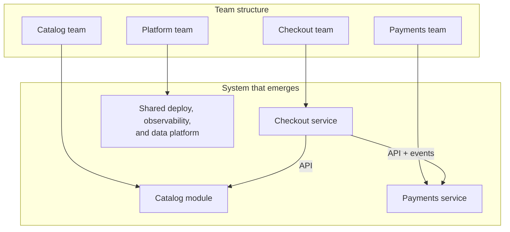
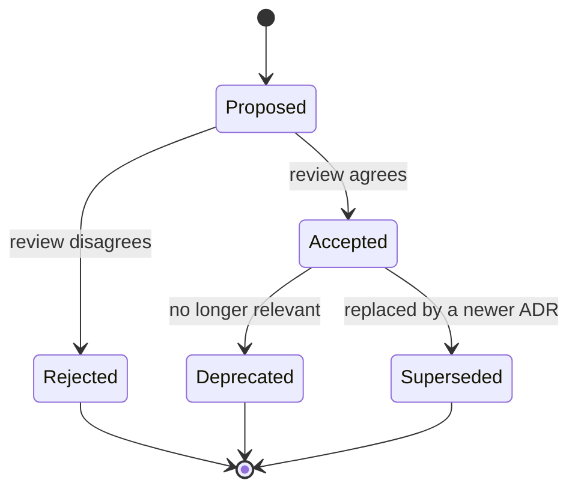
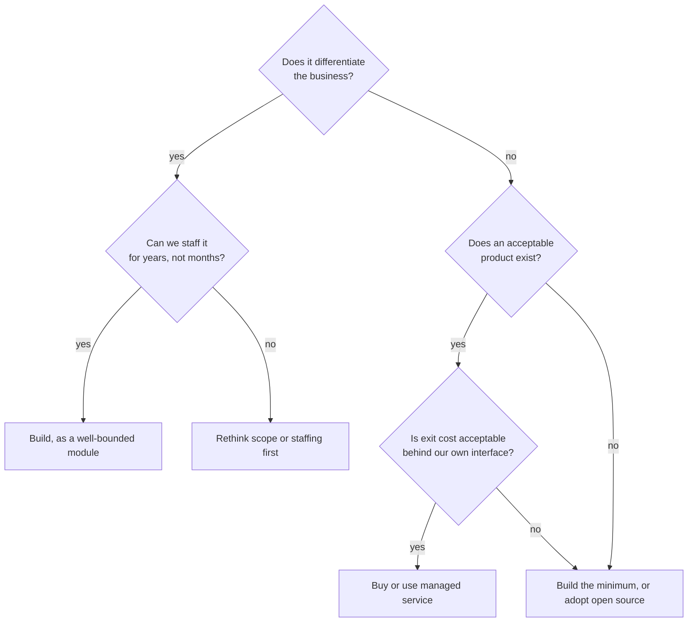
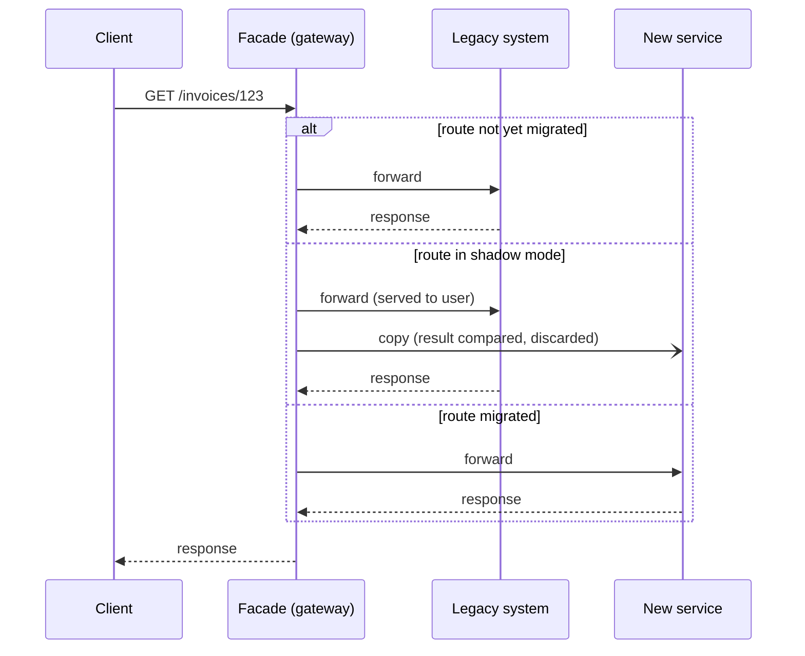
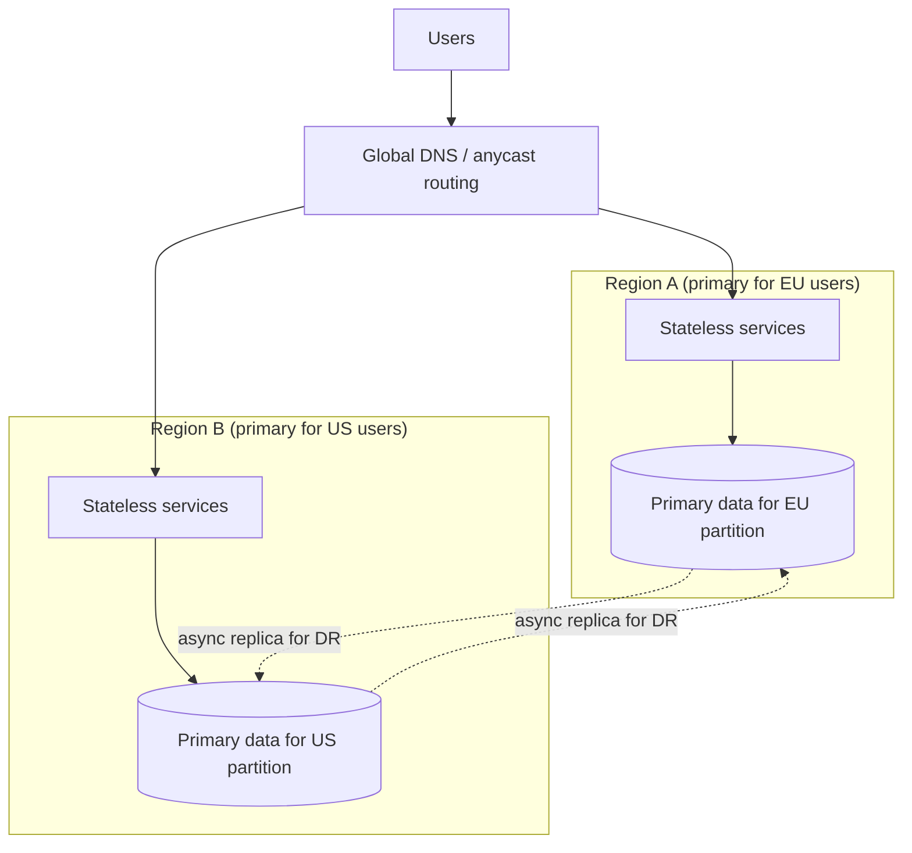

import Callout from '../../components/mdx/Callout.astro';

Up to Part 12, the questions had answers you could compute: how many replicas, which isolation level, what the p99 is. At the principal level, the hardest questions are different. Should we split this service? Should we build our own workflow engine or buy one? Do we need a second region, and if so, active-active or active-passive? Should the team that owns checkout also own payments? None of these have a formula, all of them are expensive to reverse, and the person expected to have a defensible answer is you.

This final part is about making those decisions well, writing them down, and getting an organisation to follow them. It is the least code-heavy part of the series, but every section is grounded in the mechanics from earlier parts, because good architecture strategy is just distributed systems knowledge (Part 10) and reliability knowledge (Part 11) applied to organisations and time.

<Callout variant="note" title="Who this is for">
Principal level. You should already know: everything up to Part 12, especially event-driven architecture and the outbox pattern (Part 9), consistency and failure modes (Part 10), SLOs and failure isolation (Part 11), and how to structure a system design discussion (Part 12).
</Callout>

## What "architecture" means at this level

A useful working definition: **architecture is the set of decisions that are expensive to change later.** Choosing a JSON library is not architecture; you can swap it in a week. Choosing to put every service on its own database, or to commit to a single cloud provider's proprietary queue, or to split one team into five, is architecture: reversing it takes quarters, not days.

Jeff Bezos's 2015 shareholder letter popularised a related framing: **one-way doors** (consequential, hard to reverse; decide slowly and carefully) and **two-way doors** (reversible; decide quickly, by small groups, and fix if wrong). A large part of a principal engineer's value is classifying decisions correctly:

- Treating a two-way door as a one-way door produces architecture review boards, months of design docs for a caching library, and teams that stop proposing anything.
- Treating a one-way door as a two-way door produces the "we split into 40 microservices in a quarter" story, which usually ends in a distributed monolith.

A practical test: *if we are wrong, what does it cost to undo, and who pays?* If the answer is "one team, one sprint," let that team decide. If the answer is "every team, a year, and a data migration," it deserves an ADR, a review, and your attention.

## The architecture spectrum

The monolith vs microservices debate is usually framed as two options. There are at least three, and the middle one is the right default for more organisations than either end.


### The monolith

One deployable unit, one process (replicated horizontally), usually one database. A monolith is not a mistake; it is the cheapest architecture to build, test, deploy, debug and operate. Function calls do not time out. Transactions span the whole domain. A stack trace shows you the entire request. Refactoring across module boundaries is an IDE operation.

What goes wrong is not the deployment unit; it is the **lack of internal boundaries**. Over years, any class can call any class, the "user" table grows 80 columns used by 12 features, and a change in billing breaks search. That is a "big ball of mud," and splitting it into services does not fix it: it turns in-process spaghetti into network spaghetti.

### Microservices

Independently deployable services, each owning its data, communicating over the network. The benefits are real but specific:

- **Independent deployability** for many teams: team A ships without coordinating with teams B through Z.
- **Independent scaling and technology choices** when components genuinely have different profiles (a CPU-heavy image pipeline vs a latency-sensitive API).
- **Fault and blast-radius isolation**, if you do the work (bulkheads, timeouts, Part 11).

The costs are equally specific, and they are the costs of distribution you studied in Part 10:

- Every call can fail partially, time out, or be retried. You need timeouts, retries with jitter, circuit breakers and idempotency everywhere.
- Cross-service consistency becomes eventual. A single `@Transactional` becomes a saga with compensations (Part 9).
- Debugging needs distributed tracing; testing needs contract tests; deployment needs a platform.
- Latency adds up: a request that crosses six services pays six network hops and inherits the tail latency of all of them.

### The distributed monolith

The worst quadrant: services that are deployed separately but must be **changed and released together**. Symptoms: a feature touches five repositories; services share a database schema; a synchronous call chain of eight services where any one being down takes the feature down; a "release train" that coordinates service versions. You pay the full operational cost of distribution and get none of the independence.

### The modular monolith

One deployable unit with **enforced internal module boundaries**: each module owns its data (its own schema or tables, never touched by other modules), exposes a narrow API, and communicates with other modules through that API or through in-process events. You keep the operational simplicity of a monolith and gain most of the design benefits of services. Crucially, a well-bounded module can later be extracted into a service with modest effort, because the boundary already exists.

Public case studies are worth knowing, as evidence rather than as fashion:

- **Segment** wrote in 2018 ("Goodbye Microservices") about consolidating well over a hundred per-destination services back into one service, because the operational overhead had overwhelmed a small team.
- **Amazon Prime Video**'s video-quality monitoring team wrote in 2023 about moving one monitoring tool from a distributed serverless design to a single process and cutting that tool's infrastructure cost by about 90%. Note the scope: one tool, not Prime Video as a whole. It is an argument for matching architecture to workload, not a verdict on microservices.
- **Shopify** has written publicly about running a large Rails modular monolith and built Packwerk, a tool that enforces module boundaries statically.

<Callout variant="tip" title="A default that is rarely wrong">
Start with a modular monolith. Extract a service when you can name the specific force that justifies it: a team that needs to deploy independently, a component with a radically different scaling or reliability profile, a hard isolation requirement (security, compliance), or a technology the main runtime cannot host. "Microservices are best practice" is not a force.
</Callout>

### Enforcing boundaries in a Spring Boot modular monolith

Boundaries that are not enforced erode within months. In the Spring ecosystem, **Spring Modulith** (the 2.x line targets Spring Boot 4) treats each direct sub-package of your main application package as an application module, and can verify that modules only depend on each other's public API.

```text
com.example.shop
├── ShopApplication.kt
├── catalog/            ← module: public API in the package root
│   ├── CatalogApi.kt
│   └── internal/       ← implementation, invisible to other modules
├── orders/
│   ├── OrderService.kt
│   ├── OrderPlaced.kt  ← event published to other modules
│   └── internal/
└── billing/
    ├── BillingListener.kt
    └── internal/
```

A test that fails the build when someone reaches into another module's internals, or introduces a dependency cycle between modules:

```kotlin
class ModularityTests {
    private val modules = ApplicationModules.of(ShopApplication::class.java)

    @Test
    fun `module boundaries are respected`() {
        modules.verify()
    }

    @Test
    fun `write module documentation`() {
        Documenter(modules).writeDocumentation()   // C4/PlantUML diagrams of the real structure
    }
}
```

Cross-module communication through events keeps modules decoupled in time as well as in code:

```kotlin
// orders module: publish, do not call billing directly
@Service
class OrderService(
    private val orders: OrderRepository,
    private val events: ApplicationEventPublisher,
) {
    @Transactional
    fun place(command: PlaceOrder): OrderId {
        val order = orders.save(Order.from(command))
        events.publishEvent(OrderPlaced(order.id, order.total))
        return order.id
    }
}

// billing module: react after the orders transaction commits
@Component
class BillingListener(private val invoices: InvoiceService) {
    @ApplicationModuleListener
    fun on(event: OrderPlaced) {
        invoices.createFor(event.orderId, event.total)
    }
}
```

`@ApplicationModuleListener` makes the listener asynchronous and transactional, and runs it after the publishing transaction commits. With Spring Modulith's event publication registry enabled (for example via its JPA or JDBC starter), published events are recorded in the same transaction as the business data and marked complete when the listener succeeds, so an event is not lost if the process dies between commit and delivery. If that sounds familiar, it is: it is the transactional outbox from Part 9, inside one process. When you later extract billing into its own service, the same event becomes a Kafka message and the listener moves across the network, with the boundary already designed.

## Conway's law and team design

In 1968, Melvin Conway observed that organisations which design systems produce designs that copy their own communication structures. Two teams that rarely talk will build two components with a thin, awkward interface between them. One team that owns everything will build one tightly integrated thing.

This is not a curiosity; it is a force you can use. The **inverse Conway manoeuvre** is to design the team structure you want the architecture to have, and let the architecture follow.



The book *Team Topologies* (Matthew Skelton and Manuel Pais, 2019) gives a practical vocabulary:

- **Stream-aligned teams** own a slice of the business end to end (checkout, search). Most teams should be this type.
- **Platform teams** provide internal products (deployment, observability, data infrastructure) that reduce the cognitive load of stream-aligned teams.
- **Enabling teams** help other teams adopt new capabilities, then step away.
- **Complicated-subsystem teams** own something requiring deep specialist knowledge (a pricing engine, a video codec pipeline).

The central constraint in that model is **cognitive load**: a team can only own as much as it can understand. When a team owns more than it can hold in its head, quality and speed drop, and the architecture starts to rot along that team's overloaded surface. Service boundaries should therefore be drawn so that each one fits within a single team's ownership, and each team owns a coherent set of them.

Practical consequences:

- Do not split a service into more pieces than you have teams to own them. Five services owned by one team is usually a modular monolith deployed five times, with five times the on-call surface.
- If two teams must coordinate on every change to a boundary, the boundary is in the wrong place, or the two teams should be one.
- Reorganisations are architecture changes. If leadership is planning a reorg, a principal engineer should be in the room, because the system will reshape itself to match.

### Finding the boundaries

Boundaries should follow the domain, not the technical layers. Domain-driven design's **bounded context** is the best tool here: a part of the domain where a term has one precise meaning. "Order" in checkout (a cart being paid for) is not "order" in fulfilment (a set of parcels being shipped), and forcing them into one shared `Order` model couples the two teams forever.

Signs a boundary is good: the data it owns is rarely needed synchronously by others; the language inside it is consistent; changes to it rarely ripple outward. Signs it is bad: chatty synchronous calls across it, shared tables, and a "common" library that every service must update in lockstep.

## Architecture Decision Records

Decisions that are expensive to reverse deserve to be written down, briefly, at the time they are made. An **Architecture Decision Record (ADR)** is the lightest durable format for that, popularised by Michael Nygard in a 2011 post. It records *context, decision and consequences* so that, two years later, someone can tell whether the decision still holds or whether its reasons have expired.



ADRs are immutable once accepted. You do not edit an old decision when circumstances change; you write a new ADR that supersedes it and link both ways. The history of *why* is the whole point.

A good ADR fits on one screen:

```markdown
# ADR-0042: Use a modular monolith for the order platform

Status: Accepted (2026-09-14). Supersedes ADR-0017.

## Context
Three teams (checkout, catalog, billing) share one Spring Boot service.
Release coordination costs ~2 days per release; incidents in catalog
batch jobs have degraded checkout twice this quarter. We have one
platform engineer and no service mesh or contract-testing setup.

## Decision
Keep one deployable. Split the code into Spring Modulith modules with
verified boundaries, a schema per module, and in-process events between
modules. Move catalog batch jobs to a separate worker deployment of the
same artifact, with its own connection pool.

## Consequences
+ Teams own modules; boundary violations fail the build.
+ Batch load no longer shares a pool with checkout traffic (bulkhead).
- Still one release pipeline; a broken build blocks all three teams.
- Revisit if: a fourth team joins, or billing needs a separate
  compliance boundary (PCI scope reduction would justify extraction).
```

Notice the last line. **An ADR that says when it should be revisited is far more valuable than one that does not.** It turns "we decided this two years ago" into "the condition we set has now been met, so we revisit."

Keep ADRs next to the code (`docs/adr/` in the repository), number them sequentially, and review them like code. Templates such as MADR exist if you want more structure, but the format matters less than the habit.

## Build vs buy

Every principal engineer will be asked whether to build something in-house or adopt a product, open-source project or managed service. The decision is rarely about the first version; it is about the next five years.

Ask these questions in order:

1. **Is this core or context?** Core capabilities differentiate the business (a marketplace's matching engine, a bank's risk model). Context capabilities are necessary but not differentiating (authentication, email delivery, feature flags, a job scheduler). Build core; buy context, unless no acceptable product exists.
2. **What is the total cost of ownership?** For building: the initial build, plus on-call, security patching, upgrades, documentation, onboarding, and the opportunity cost of the engineers who maintain it instead of working on core. Teams routinely estimate the first quarter and forget the next twenty. For buying: licence or usage fees (projected at your growth rate, not today's volume), integration work, and the cost of the vendor's limits.
3. **What is the exit cost?** How hard is it to leave? Data export formats, proprietary APIs woven through your code, contractual lock-in. You can reduce exit cost deliberately: wrap the vendor behind your own narrow interface (an anti-corruption layer) so that only one module knows the vendor exists.
4. **What are the risks?** Vendor viability, pricing changes, compliance and data residency, open-source licence changes and maintainer health, and operational dependence on someone else's SLA. Your SLO cannot exceed the product of your critical dependencies' availabilities unless you design around them (Part 11).
5. **Does the team have the expertise to operate it?** Self-hosting a distributed database "because it is free" with no one who has run it in production is not free.



The decision also has a time dimension. "Buy now, possibly build later when we understand the domain and the scale" is often the best path: the vendor teaches you the problem cheaply, and the anti-corruption layer keeps the later switch contained.

## Migrating without a rewrite: the strangler fig

The big-bang rewrite is one of the most reliably failing projects in software. The old system keeps changing while the new one is built, the new one must reach full feature parity before it delivers any value, and the cutover is a single high-risk event. Martin Fowler named the alternative in 2004 after the strangler fig, a plant that grows around a host tree until it can stand on its own: **put a routing layer in front of the old system, and move functionality to the new system one slice at a time, until the old one has nothing left to do.**


The mechanics:

1. **Introduce a facade.** An API gateway, reverse proxy or routing layer in front of the legacy system. At first, it routes everything to legacy. This step alone is valuable: it gives you a seam, metrics per route, and a place to switch traffic.
2. **Pick a slice.** Choose a capability that is valuable, reasonably self-contained, and not the scariest part. Read-only endpoints are often a good first slice.
3. **Build it in the new system**, with its own data.
4. **Shadow, then shift.** Send copies of real traffic to the new implementation and compare responses without returning them to users (a "parallel run"). When discrepancies are understood, shift a percentage of live traffic, then all of it.
5. **Retire the legacy code path.** Actually delete it. A migration that never deletes anything just adds a system.
6. Repeat until the legacy system is empty.



### The hard part is data

Moving code is the easy half. The hard half is that the legacy database is usually shared by everything, and the new service needs to own its data.

- **Avoid naive dual writes** from application code ("write to the old database and the new one"). Without a distributed transaction, one write will eventually succeed while the other fails, and the two stores silently drift. This is exactly the problem the outbox pattern solves (Part 9).
- **Use change data capture (CDC)** to stream changes from the legacy database to the new store (for example Debezium reading the database's replication log into Kafka). The legacy system stays the source of truth until cutover; the new store is a continuously updated replica you can verify against.
- **Flip the direction at cutover.** Once the new service is the writer for that slice, stream its changes back to the legacy store for whatever legacy features still read that data, until they too have migrated.
- **Reconcile continuously.** Run a job that compares the two stores and reports differences. You cannot fix drift you cannot see.

Inside a single codebase, the equivalent technique is **branch by abstraction**: introduce an interface in front of the component being replaced, move all callers to the interface, build the new implementation behind it, switch with a feature flag, then delete the old implementation. Same idea, smaller scale.

<Callout variant="warning" title="Migrations die in the middle">
The most common failure is not a bad cutover; it is a migration that stalls at 70% because the remaining slices are the hardest and the business has moved on. You are left running both systems indefinitely. Mitigate it up front: sequence slices so value arrives early (which keeps funding), track "legacy surface remaining" as a visible metric, and get explicit commitment for the long tail before you start.
</Callout>

## Multi-region strategy

"Should we go multi-region?" is a classic one-way-door question, and the honest first answer is often "not yet." Running in multiple regions at least doubles infrastructure cost, multiplies operational complexity, and forces every stateful component to confront the consistency trade-offs from Part 10 across links with tens to hundreds of milliseconds of latency.

There are three legitimate reasons to do it:

1. **Availability beyond what one region offers.** Most outages are smaller than a region; multi-AZ deployment within one region handles the majority of infrastructure failures. Multi-region is for surviving regional events or regional control-plane failures, and is justified when your SLO and the cost of downtime demand it.
2. **Latency for a global user base.** Physics: a round trip between Europe and the US west coast is on the order of 150 ms. If users across continents need fast writes, data must live near them.
3. **Data residency and regulation.** Some data must stay in a jurisdiction (GDPR-driven requirements in the EU, and similar laws elsewhere). This often forces partitioning users by region regardless of availability goals.

Two numbers frame every multi-region discussion:

- **RPO (recovery point objective):** how much data you can afford to lose, measured in time. Asynchronous replication with 2 seconds of lag means an RPO of at least 2 seconds.
- **RTO (recovery time objective):** how long until service is restored. A manual failover runbook might give an RTO of 30 to 60 minutes; an automated, regularly exercised one can be minutes.

### The main patterns



- **Active-passive (warm standby).** One region serves; the other has replicated data and scaled-down capacity, ready to take over. Simplest to reason about: one writer, no conflicts. Costs: idle capacity, RPO equal to replication lag, and failovers that are rare and therefore risky. The failover path must be exercised regularly, or it will not work when needed.
- **Active-active with partitioned ownership.** Every region serves traffic, but each piece of data has one home region that accepts its writes (users are homed by geography, or tenants by contract). This is the diagram above. You get local latency for most users and no write conflicts, because there is still one writer per record. Cross-partition operations (a user interacting with a user homed elsewhere) need care.
- **Active-active, multi-writer.** Any region accepts writes for any record. This requires either conflict resolution (last-writer-wins, which silently loses updates; CRDTs, which suit only certain data types; or application-level merge) or a globally consistent database that runs consensus across regions and pays cross-region latency on every write (Part 10's PACELC: you trade latency for consistency even when nothing is failing). Choose this only for data that truly needs it.

Most real systems mix patterns by data type: user profiles partitioned by home region, a product catalog replicated read-only everywhere, a payments ledger with a single writer region and strict consistency, and analytics eventually consistent everywhere.

### Cells and static stability

Two ideas from large-scale operations are worth knowing by name:

- **Cell-based architecture:** split the system into many independent, identical copies (cells), each serving a fixed subset of customers, with a thin routing layer in front. A bad deployment or a poison request takes down one cell's customers, not everyone. Cells limit blast radius within a region as well as across regions.
- **Static stability:** a system should keep working in its current configuration when a dependency it relies on for *changes* fails. For example, if the control plane that launches new instances is down, already-running capacity should be sufficient to serve the load, which means pre-provisioning enough headroom in each region to absorb a failover *before* you need it, rather than planning to scale up during the incident.

A principal-level multi-region answer always includes cost and operations: "active-active doubles our compute bill and requires every team to design for cross-region replication, so we will go active-passive for the ledger with a quarterly failover drill, and partitioned active-active only for the read-heavy, latency-sensitive catalog."

## Technical vision and influence

The technical work of a principal engineer is necessary but not sufficient. The job is to change what many teams do, and you usually have no authority over them. Influence is the mechanism.

### Strategy, not a wish list

A technical vision document that lists 20 good ideas is not a strategy. Richard Rumelt's *Good Strategy Bad Strategy* gives a useful kernel with three parts:

1. **Diagnosis:** what is actually going on, and what is the crux? ("Our lead time for changes has grown from 2 days to 3 weeks because 14 teams release through one monolith pipeline with a 4-hour test suite.")
2. **Guiding policy:** the overall approach that addresses the crux, which also rules things out. ("We will invest in module boundaries and pipeline parallelism, not in splitting services. No new services this year without an ADR naming the force that requires it.")
3. **Coherent actions:** specific, coordinated steps. ("Q1: Spring Modulith verification in CI and per-module test selection. Q2: split the pipeline by module. Q3: extract billing, the only module with a compliance reason to be separate.")

The guiding policy is the part most vision documents lack, because it requires saying no.

### Writing it down and building consensus

- **Write.** Design docs, RFCs and ADRs scale your judgement beyond the meetings you can attend. Clear writing is the highest-leverage skill at this level.
- **Socialise before you publish.** Walk the key stakeholders through the draft one-on-one. Objections raised privately are cheap to address; objections raised for the first time in a large review are expensive and public.
- **Separate the decision from the decider.** Make the evidence and trade-offs so clear that the decision feels obvious to the people who must live with it. If the only reason a decision holds is that you made it, it will not survive you leaving the room.
- **Disagree and commit,** and make it easy for others to do the same. When you lose an argument, support the decision fully and record the revisit conditions in the ADR.
- **Pave the road rather than police it.** A platform that makes the good path the easy path (a service template with tracing, health checks and graceful shutdown already wired in, as in [this post on graceful shutdown](/blog/graceful-shutdown-microservices)) changes behaviour more than any standard document.

### Measuring whether the strategy works

Architecture strategy should change outcomes you can measure. The DORA research programme's four key metrics are the common starting point: **deployment frequency**, **lead time for changes**, **change failure rate**, and the time to recover from a failed deployment (historically "time to restore service"). Add the system's SLO attainment (Part 11) and a few strategy-specific measures, such as "percentage of traffic served by the new platform" during a migration or "cross-module boundary violations" in a modular monolith. Report them on a schedule; a strategy that cannot show movement after two quarters should be revisited, using the same honesty you expect from an ADR.

Will Larson's *Staff Engineer* describes several archetypes for this level (Tech Lead, Architect, Solver, Right Hand). Which one you are matters less than recognising that each delivers value mainly through other people's work.

## Common mistakes

1. **Microservices as a starting architecture** for a small team, before boundaries are understood. You get a distributed monolith and an operations burden that consumes the team.
2. **Splitting by technical layer** (a "database service," a "validation service") instead of by business capability. Every feature then crosses every service.
3. **Shared databases between services.** It is the fastest path to a distributed monolith: any schema change now needs coordinated releases.
4. **Big-bang rewrites.** Months of work with no delivered value, chasing a moving target, ending in a risky cutover.
5. **Naive dual writes during migrations**, producing silent drift between stores.
6. **Multi-region because it sounds resilient**, without an RPO/RTO target, without cost analysis, and without failover drills. An unexercised failover is a hypothesis, not a capability.
7. **Building context, buying core.** Writing an in-house feature-flag system while outsourcing the matching engine that differentiates the business.
8. **Decisions with no record.** Two years later nobody knows why the system looks like this, so nobody dares to change it, or someone changes it without knowing what it was protecting.
9. **Vision documents without a guiding policy.** A list of good intentions that rules nothing out changes nothing.
10. **Ignoring Conway's law.** Designing a service architecture that contradicts the team structure, then being surprised when it bends back toward the org chart.

## Interview questions

At principal level, interviewers rarely want a textbook answer. They want to see you frame the decision, weigh real trade-offs, name what you would measure, and say what would change your mind.

<details>
<summary>A CTO tells you: "We have one Spring Boot monolith, 25 engineers, and releases are slow. Let's move to microservices." How do you respond?</summary>

Start with diagnosis, not architecture: why are releases slow? Measure lead time and find where it goes. Common causes are a long test suite, a manual QA gate, merge conflicts from unclear ownership, or fear caused by low test coverage. Microservices fix only some of these, and add network failure modes, distributed data, and a platform investment that 25 engineers will feel heavily.

A strong recommendation is usually staged: introduce enforced module boundaries (a modular monolith with Spring Modulith or ArchUnit checks), give each team ownership of modules and their data, speed up the pipeline (parallel, per-module test selection), and extract a service only where a specific force justifies it, such as a compliance boundary or a radically different scaling profile. State what evidence would change the plan (for example, teams still blocked on each other after boundaries are in place). The interviewer is fishing for whether you treat microservices as a means with costs, not a goal.

</details>

<details>
<summary>How do you tell a well-designed microservice architecture from a distributed monolith?</summary>

Look at change and failure coupling, not at the number of repositories. Questions: Can a typical feature be delivered by one team changing one service? Can each service be deployed independently, without coordinated version bumps? Does each service own its data, or do several share tables? If a downstream service is down, does the upstream degrade gracefully or fail? How long are the synchronous call chains on critical paths?

Measurable signals: the share of changes that touch more than one service, the number of coordinated releases, and incident reports where one service's failure cascaded. A distributed monolith shows high cross-service change coupling and cascading failures. The fix is usually to merge services that always change together and to replace synchronous chains with events where eventual consistency is acceptable.

</details>

<details>
<summary>Explain Conway's law and give an example of using it deliberately.</summary>

Conway's law (1968): systems mirror the communication structure of the organisation that builds them. Deliberate use is the inverse Conway manoeuvre: shape teams to match the architecture you want. Example: if checkout and payments are tangled because one team owns both and implements payments logic inside checkout, and you want payments isolated for PCI scope reduction, create a dedicated payments team with a clear API contract and ownership of the payment data. The boundary will tend to form along the team line.

The principal-level nuance: reorganisations are architecture decisions with long consequences, team cognitive load limits how much each team should own, and changing teams without changing ownership of code and data achieves nothing. Mention that you would partner with engineering management rather than treat this as a purely technical call.

</details>

<details>
<summary>What goes into a good ADR, and how do you stop ADRs from becoming bureaucracy?</summary>

Context (the forces and constraints at the time), the decision, and the consequences, both positive and negative, plus a status and links to the ADRs it supersedes. The most valuable addition is explicit revisit conditions, so future readers know when the decision's premises have expired. Keep it to a page and store it in the repository next to the code.

To avoid bureaucracy: write ADRs only for one-way-door decisions (expensive to reverse, cross-team impact); let two-way-door decisions be made by the team without ceremony; review asynchronously in pull requests instead of in committee meetings; and time-box decisions. The signal is that you calibrate process to reversibility.

</details>

<details>
<summary>Your company wants to replace a 12-year-old billing system. Walk me through the migration plan.</summary>

Rule out the big-bang rewrite first, and say why: the legacy system keeps changing, parity takes years, and a single cutover of billing is an unacceptable risk. Use a strangler fig: put a facade in front of the legacy billing APIs; inventory capabilities and order them by value and risk (often starting with read paths such as invoice retrieval); build each slice in the new system with its own data; stream legacy data via CDC; run in shadow mode and compare outputs, which for billing means reconciling amounts to the cent; shift traffic gradually with instant rollback at the facade; then delete the legacy path.

Address the hard parts explicitly: data ownership and the direction of synchronisation at each stage, avoiding application-level dual writes, continuous reconciliation, the long-tail risk of stalling at 70%, and how you keep stakeholders funding it (early slices that deliver visible value). For billing, also mention audit and compliance sign-off at each cutover and a parallel-run period across at least one full billing cycle.

</details>

<details>
<summary>We are thinking about going multi-region. What questions do you ask before recommending anything?</summary>

Why: availability, latency, or data residency? Each leads to a different design. What are the RPO and RTO targets, and what does an hour of downtime actually cost? Which data is involved, and what consistency does each data type need? What is the budget, given that multi-region at least doubles infrastructure for the replicated parts? Does the team have the operational maturity to run and drill failovers?

Then propose a design per data type rather than one pattern for everything: for example, active-passive with async replication and quarterly failover drills for the strongly consistent ledger; partitioned active-active by user home region for profiles; read replicas everywhere for the catalog. Mention static stability (pre-provisioned capacity so failover does not depend on scaling up during the incident) and cells to limit blast radius. The trade-off being probed is consistency vs latency vs cost, and whether you can avoid multi-writer conflict resolution unless it is truly required.

</details>

<details>
<summary>Build or buy: the team wants to build an in-house workflow orchestration engine. How do you evaluate it?</summary>

Ask whether orchestration is core (does it differentiate the product?) or context. For most companies it is context. Compare total cost of ownership over several years: building includes durable state handling, retries, timers, versioning of running workflows, visibility tooling, on-call and upgrades, which is a large, ongoing investment. Existing options include open-source and managed workflow engines (Temporal is a widely used example) and cloud-provider workflow services.

Then check fit and exit cost: do existing products meet the latency, scale and compliance needs? Can you wrap the chosen engine behind your own interface to contain lock-in? Recommend buying or adopting unless there is a demonstrated requirement no product meets, and if building, scope the minimum and staff it as a product with an owner. The signal: you price in maintenance and opportunity cost, not just the first version.

</details>

<details>
<summary>You believe the organisation's technical direction is wrong, but you have no authority over the teams involved. What do you do?</summary>

Build the case with evidence: quantify the problem (incident data, lead time, cost), and write a short document with diagnosis, a guiding policy and concrete actions, including what you are explicitly proposing to stop doing. Socialise it one-on-one with the most affected engineers and leaders before any broad review, incorporate their objections, and find a sponsor with the authority to fund the change. Offer to prove the approach on a small, visible slice with one willing team.

If the decision goes against you, disagree and commit: support it, and record the conditions under which it should be revisited. The interviewer wants to see influence through clarity, evidence and relationships rather than escalation or going it alone, and the maturity to accept being overruled.

</details>

<details>
<summary>How do you measure whether an architecture change was worth it?</summary>

Define the expected outcome before the change, tied to the diagnosis: for example, "lead time for changes from 3 weeks to under 3 days" or "checkout availability unaffected by catalog incidents." Measure the DORA metrics (deployment frequency, lead time, change failure rate, recovery time from failed deployments), SLO attainment for affected user journeys, and cost. Add change-specific measures such as cross-boundary change coupling or migration progress.

Be honest about confounders (team growth, other initiatives) and compare against a baseline period. If the metrics do not move after an agreed time, revisit the strategy instead of defending it. The signal is treating architecture as a hypothesis with measurable predictions.

</details>

## Key takeaways

- Architecture is the set of decisions that are expensive to reverse. Classify decisions as one-way or two-way doors and spend your rigour accordingly.
- Monolith, modular monolith and microservices are points on a spectrum; the modular monolith with enforced boundaries is the right default for most organisations, and extraction should follow a named force.
- The distributed monolith, with separate deployments but coupled changes, is the worst of both worlds. Watch change coupling and shared data.
- Conway's law is a design tool: team structure and cognitive load shape the architecture, so shape them deliberately.
- Record one-way-door decisions as short ADRs with consequences and revisit conditions; supersede, never edit.
- Build what differentiates you, buy context, and always price in maintenance and exit cost.
- Migrate with the strangler fig: a facade, slice by slice, shadow traffic, CDC instead of dual writes, and actually delete the old code.
- Go multi-region for a concrete reason, with RPO/RTO targets, per-data-type patterns, static stability and exercised failovers.
- A technical strategy needs a diagnosis, a guiding policy that rules things out, and coherent actions, and it succeeds through writing, consensus and paved roads rather than authority.

Previous: [Part 12: System Design Interviews](/blog/backend-12-system-design-interviews)

This is the final part of the series. Start again from the beginning: [Part 1: How the Web Works](/blog/backend-01-how-the-web-works)
