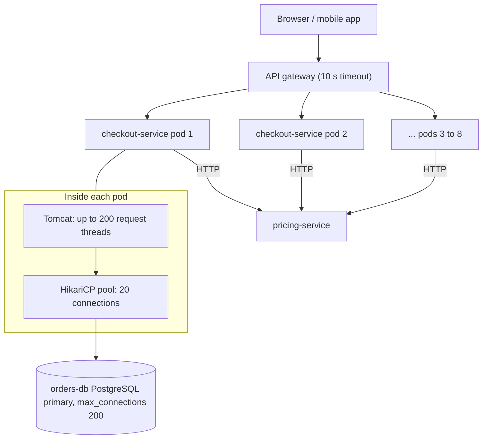
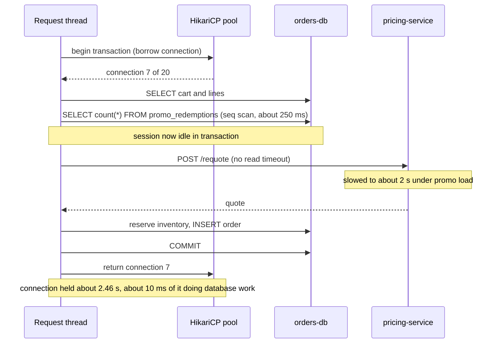
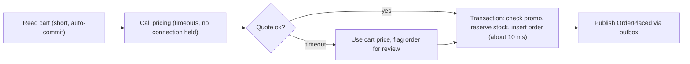

import Callout from '../../components/mdx/Callout.astro';

Connection pool exhaustion is the most common way a perfectly healthy database takes a service down. The database has spare CPU, there are no deadlocks, the slow query log is quiet, and yet every request times out with an error that says, in effect, "I could not get a connection". The database is fine. The problem is how long the application holds on to what it borrowed.

This post walks through one such incident from the first page to the postmortem: what the dashboards showed, which hypothesis was wrong, the exact queries and commands that found the cause, and both the five-minute mitigation and the real fix. It is the first post in **Backend in Production: Case Studies**, a series that takes the concepts from [Backend Engineering: Zero to Principal](/blog/backend-01-how-the-web-works) and puts them under incident pressure.

<Callout variant="note" title="Composite scenario">
This is a composite scenario; the service names and numbers are illustrative. It is assembled from failure patterns that show up again and again in Spring and JDBC services, not from any one company's outage.
</Callout>

<Callout variant="tip" title="What you'll learn">
- What a connection pool actually limits, and why "the pool is exhausted" is almost never a pool-size problem
- How to read HikariCP's metrics: active, idle, pending, acquire time and usage time
- How to use `pg_stat_activity`, `pg_stat_statements` and a JVM thread dump to see who holds connections and what they are doing
- Why a blocking HTTP call inside `@Transactional` is so dangerous, and how to restructure the code
- How to size a pool with Little's law, and how to budget connections across pods
- Which timeouts, alerts and tests stop this from happening again
</Callout>

**Level:** mid. **You should already know:** HTTP request lifecycles ([Part 1](/blog/backend-01-how-the-web-works)), transactions and indexes ([Part 3](/blog/backend-03-databases-fundamentals)), MVCC and query plans ([Part 7](/blog/backend-07-database-internals-scaling)), capacity math and Little's law ([Part 8](/blog/backend-08-scalability-performance)), and SLOs and burn-rate alerts ([Part 11](/blog/backend-11-reliability-observability)).

## The system

The company runs an online shop. The service at the centre of this story is `checkout-service`, a Kotlin + Spring Boot 4 application that turns a cart into an order. It runs as 8 Kubernetes pods behind an API gateway, and every pod has its own HikariCP pool of 20 connections to a single PostgreSQL primary (`orders-db`) whose `max_connections` is 200.

To place an order the service validates the cart, checks whether a promo code still has redemptions left, reserves inventory, and writes the order. All of that runs inside one `@Transactional` method. It also calls `pricing-service` over HTTP for prices and taxes.



Three facts about this setup matter later:

1. **Connections are a fixed, shared budget.** 8 pods × 20 connections = 160, comfortably below 200, leaving room for migrations, admin sessions and the replica's tooling. HikariCP's `minimum-idle` defaults to `maximum-pool-size`, so every pod opens all 20 connections at startup and keeps them open.
2. **Tomcat has more threads than the pool has connections.** Spring Boot's default `server.tomcat.threads.max` is 200. Up to 200 requests can be in flight per pod, but only 20 of them can hold a connection at once. The other 180 wait in HikariCP for up to `connection-timeout`, which defaults to **30 seconds**.
3. **The gateway gives up first.** The gateway times requests out after 10 seconds. A request that waits 30 seconds for a connection has already been answered with a 504 long before it either gets one or fails.

The relevant part of the code, as of version 2.41, looked like this:

```kotlin
@Service
class CheckoutService(
    private val carts: CartRepository,
    private val promos: PromoRedemptionRepository,
    private val pricing: PricingClient,
    private val inventory: InventoryRepository,
    private val orders: OrderRepository,
) {
    @Transactional
    fun placeOrder(cmd: PlaceOrder): Order {
        val cart = carts.findForCheckout(cmd.cartId)

        cmd.promoCode?.let { code ->
            val used = promos.countByPromoCode(code)
            require(used < promoCap(code)) { "Promo $code is exhausted" }
        }

        // New in v2.41: re-quote prices so the customer never pays a stale price.
        val quote = pricing.requote(cart)

        inventory.reserve(cart.lines)
        return orders.save(Order.from(cart, quote, cmd.promoCode))
    }
}
```

Version 2.41 added the `pricing.requote(cart)` line. It passed code review: it is one line, it has a test, and it fixes a real business bug. It is also the line that took checkout down.

## Timeline


- **T−2 h.** v2.41 rolls out. Normal traffic, latency unchanged. Nothing alerts, because on a normal day the pricing call takes about 40 ms.
- **T+0.** Marketing launches a promotion. Order placements go from about 480 per second to about 1,200 per second across the fleet (60 to 150 per pod). `pricing-service`, also under more load, slows from a p50 of 40 ms to roughly 2 seconds.
- **T+3 min.** The checkout availability SLO's fast-burn alert pages on-call: the 5-minute and 1-hour error ratios are both burning budget at more than 14× the sustainable rate. Gateway 5xx (mostly 504) is at 9% of checkout requests.
- **T+7 min.** First hypothesis: the database is overloaded. Ruled out (details below).
- **T+11 min.** Second move: the Horizontal Pod Autoscaler has already added pods and on-call raises the maximum from 8 to 14 to "add capacity". New pods fail to start cleanly and the error rate climbs.
- **T+16 min.** A thread dump and `pg_stat_activity` show the actual cause: connections are checked out while threads wait on HTTP.
- **T+20 min.** The `checkout.requote` feature flag is switched off and pods are scaled back to 8. Pending connection requests start to drain within a minute.
- **T+24 min.** Error rate back to baseline, `hikaricp.connections.pending` at 0. Incident downgraded to monitoring.
- **Next day.** A missing index is built with `CREATE INDEX CONCURRENTLY`. **v2.43**, a few days later, moves the HTTP call out of the transaction and adds timeouts and guardrails.

## Investigation

This is the part interviewers care about most, and the part most write-ups skip: not what the cause was, but how you got there, including the wrong turns.

### Step 1: what is the error, exactly?

The gateway dashboard said "504s from checkout". That only tells you who gave up. The service's own logs are more specific. Grouping errors by exception class gave one overwhelming winner:

```text
java.sql.SQLTransientConnectionException: HikariPool-1 - Connection is not available,
request timed out after 30000ms (total=20, active=20, idle=0, waiting=176)
```

Read every field of that message; it is a free dashboard:

- `total=20, active=20, idle=0`: the pool is at its maximum and every connection is checked out.
- `waiting=176`: 176 threads in this pod are queued for a connection.
- `timed out after 30000ms`: the default `connection-timeout`. Every one of these requests sat for 30 seconds before failing, long after the gateway had already returned a 504 and the client had possibly retried.

"Connection is not available" means the pool ran out. It does **not** tell you why. There are only two ways a fixed pool runs out: requests arrive faster than usual, or each request holds its connection for longer than usual. Little's law makes this exact, and it is worth stating before you look at any more graphs:

```text
L = λ × W
connections busy = (requests per second that need a connection) × (seconds each one holds it)
```

Traffic had gone up 2.5×. That alone would take a pod from 0.6 busy connections to 1.5, nowhere near 20. So the hold time, W, had to have grown by orders of magnitude. The question became: **what are the connections doing while they are checked out?**

### Step 2: the pool's own metrics

Spring Boot auto-registers HikariCP's Micrometer metrics when Actuator is on the classpath. The ones that matter, as they appear in Prometheus:

| Metric | What it tells you |
|---|---|
| `hikaricp_connections_active` | Connections currently checked out |
| `hikaricp_connections_idle` | Connections open and available |
| `hikaricp_connections_pending` | Threads waiting for a connection right now |
| `hikaricp_connections_max` | Configured `maximum-pool-size` |
| `hikaricp_connections_timeout_total` | Counter of acquisitions that hit `connection-timeout` |
| `hikaricp_connections_acquire_seconds` | Timer: how long threads waited to get a connection |
| `hikaricp_connections_usage_seconds` | Timer: how long connections were held before being returned |

The dashboard showed `active` pinned at `max` on every pod from about T+1 minute, `pending` in the hundreds, and the timeout counter climbing steeply. The most useful graph was `usage_seconds`, the hold time. Its mean, computed from the timer's sum and count, moved from around 10 ms the previous day to roughly 2.5 seconds:

```promql
sum by (pod) (rate(hikaricp_connections_usage_seconds_sum{app="checkout-service"}[1m]))
/
sum by (pod) (rate(hikaricp_connections_usage_seconds_count{app="checkout-service"}[1m]))
```

That one ratio confirmed the Little's law reasoning: 150 orders per second × 2.5 s ≈ 375 connections needed per pod, against 20 available. The pool was not too small by 2×. It was too small by nearly 20×, which means **no pool size fixes this**.

### Step 3: wrong hypothesis, "the database is overloaded"

The instinctive reading of "requests waiting on the database" is that the database is slow. On-call checked the `orders-db` dashboard:

- CPU around 61%, up from about 35%. Busy, not saturated.
- No lock waits of note, no deadlocks in the log.
- Disk latency and IOPS normal; buffer cache hit ratio unchanged.
- **Connections: 160, the full fleet budget, but most of them idle.**

That last point is the giveaway. A saturated database has many *active* sessions competing for CPU or locks. This one had connections open but doing nothing. The hypothesis was dropped at T+7.

### Step 4: wrong move, "add more pods"

While that was happening, the HPA had been scaling on CPU and request latency, and on-call raised its ceiling to 14 pods. It made things worse, and the reason is worth memorising:

- 14 pods × 20 connections = 280, but `max_connections` is 200. New pods tried to open 20 connections each at startup (because `minimum-idle` defaults to the max) and got `FATAL: sorry, too many clients already` for a share of them.
- The new pods that did get connections had exactly the same problem as the old ones: each connection sat idle for 2.5 s per order.
- Admin sessions now competed for the remaining slots, so the DBA briefly could not connect. (`superuser_reserved_connections`, 3 by default, is what saved them.)

Scaling out multiplies the number of connections; it does nothing to how long each is held. When the bottleneck is W in Little's law, adding more λ capacity just adds more waiters. The pods were scaled back down as part of the mitigation.

### Step 5: what are the sessions doing? `pg_stat_activity`

PostgreSQL tells you, per connection, what each session is doing right now. Because the JDBC URL set `ApplicationName=checkout-service`, it was easy to filter:

```sql
SELECT state,
       count(*)                     AS sessions,
       max(now() - xact_start)      AS oldest_tx,
       max(now() - state_change)    AS longest_in_state
FROM pg_stat_activity
WHERE datname = 'orders'
  AND application_name = 'checkout-service'
GROUP BY state
ORDER BY sessions DESC;
```

```text
        state        | sessions |    oldest_tx    | longest_in_state
---------------------+----------+-----------------+------------------
 idle in transaction |      127 | 00:00:03.214    | 00:00:02.981
 active              |       27 | 00:14:52.118    | 00:00:00.402
 idle                |        6 |                 | 00:00:00.011
```

`idle in transaction` is the key state. It means the session has opened a transaction, run some statements, and is now waiting for the **client** (the application) to send the next one. The database is not working on it; the application is. Over 120 of the 160 connections were in that state at any moment.

Looking at individual sessions adds two more clues:

```sql
SELECT pid,
       now() - xact_start  AS tx_age,
       state,
       wait_event_type,
       wait_event,
       left(query, 70)     AS last_query
FROM pg_stat_activity
WHERE application_name = 'checkout-service'
  AND state <> 'idle'
ORDER BY xact_start
LIMIT 8;
```

For `idle in transaction` sessions the `query` column holds the **last** statement the session ran, and `wait_event_type` / `wait_event` show `Client` / `ClientRead`: PostgreSQL is waiting to read the next command from the client. The last statement was almost always the promo count query. So the application ran the promo check, then went off to do something that was not database work, while holding the transaction open.

The `active` row with a 14-minute-old transaction was a separate surprise: an hourly `settlement-export` job inside the same service, annotated `@Transactional`, streaming a large result set and holding 4 connections on one pod for the whole run. It was not the main cause, but it shrank that pod's effective pool from 20 to 16, and a transaction that old also stops `VACUUM` from cleaning up dead row versions newer than its snapshot ([Part 7](/blog/backend-07-database-internals-scaling) covers why).

### Step 6: which query got slower? `pg_stat_statements`

The promo count showed up as the last query so often that it deserved a look. `pg_stat_statements` aggregates statistics per normalised statement:

```sql
SELECT left(query, 60)                          AS query,
       calls,
       round(mean_exec_time::numeric, 1)        AS mean_ms,
       round(total_exec_time::numeric / 1000)   AS total_s
FROM pg_stat_statements
ORDER BY total_exec_time DESC
LIMIT 5;
```

The top entry was `SELECT count(*) FROM promo_redemptions WHERE promo_code = $1` at a mean of roughly 250 ms. `EXPLAIN (ANALYZE, BUFFERS)` showed a sequential scan: `promo_redemptions` had grown to a few million rows and had an index on `order_id` and `customer_id`, but not on `promo_code`. On a normal day few orders carry a code, so nobody noticed. During a promotion nearly every order did.

That explained about 10% of the hold time and most of the extra database CPU. It did not explain the other 2.2 seconds.

### Step 7: what are the threads doing? A thread dump

The database could only say "the client is not sending anything". To see why, look at the client. A thread dump shows every JVM thread and its stack:

```bash
kubectl exec checkout-service-7d9f-abcde -- jcmd 1 Thread.print > threads-pod1.txt

# How many threads are waiting for a pool connection?
grep -c 'HikariPool.getConnection' threads-pod1.txt

# How many are inside the pricing client?
grep -c 'PricingClient.requote' threads-pod1.txt
```

(If the service runs on virtual threads, use `jcmd 1 Thread.dump_to_file -format=json threads.json` instead; `Thread.print` does not list virtual threads.)

The dump split cleanly into two groups. About 176 threads looked like this (abbreviated; the exact JDK frames vary by version):

```text
"http-nio-8080-exec-143" #201 daemon prio=5
   java.lang.Thread.State: TIMED_WAITING (parking)
        at jdk.internal.misc.Unsafe.park(Native Method)
        ...
        at com.zaxxer.hikari.util.ConcurrentBag.borrow(ConcurrentBag.java)
        at com.zaxxer.hikari.pool.HikariPool.getConnection(HikariPool.java)
        ...
        at org.springframework.orm.jpa.JpaTransactionManager.doBegin(JpaTransactionManager.java)
        ...
        at com.shop.checkout.CheckoutService.placeOrder(CheckoutService.kt)
```

These are waiting to **begin** a transaction. And about 18 or so looked like this:

```text
"http-nio-8080-exec-12" #70 daemon prio=5
   java.lang.Thread.State: WAITING (parking)
        at jdk.internal.misc.Unsafe.park(Native Method)
        ...
        at java.util.concurrent.CompletableFuture.get(CompletableFuture.java)
        at jdk.internal.net.http.HttpClientImpl.send(HttpClientImpl.java)
        ...
        at org.springframework.web.client.DefaultRestClient$DefaultResponseSpec.body(...)
        at com.shop.checkout.PricingClient.requote(PricingClient.kt:41)
        at com.shop.checkout.CheckoutService.placeOrder(CheckoutService.kt:58)
        ...
        at org.springframework.transaction.interceptor.TransactionInterceptor.invoke(TransactionInterceptor.java)
```

There it is. `TransactionInterceptor.invoke` is lower in the stack than `PricingClient.requote`, which means the HTTP call is happening **inside** the transaction. With `JpaTransactionManager`, the JDBC connection is bound to the thread when the transaction begins and returned when it commits. Every thread in this group held one of the 20 connections while it waited about 2 seconds for `pricing-service`. The pricing client had no read timeout configured, so a slower pricing service meant a longer wait, without limit.

Turning on HikariCP's leak detection would have pointed straight at this line. With `leak-detection-threshold` set, Hikari logs `Connection leak detection triggered for ... on thread ..., stack trace follows`, with the stack trace of where the connection was **acquired**, for any connection held longer than the threshold. It is not only for true leaks; it is a cheap way to find long holders.

## Root cause

Put the pieces together and the chain is short:




- **Trigger:** a promotion raised order volume 2.5× and slowed `pricing-service`.
- **Root cause:** v2.41 put a blocking HTTP call, with no timeout, inside a database transaction. The connection's hold time became a function of another team's latency.
- **Contributing factors:**
  - A missing index on `promo_redemptions(promo_code)` added about 250 ms per order with a code, inside the same transaction.
  - A long-running `@Transactional` export job consumed 4 connections on one pod for 15+ minutes.
  - `connection-timeout` at the 30-second default, three times the gateway timeout, so failing requests occupied a Tomcat thread for 30 seconds after the caller had already given up.
  - No alert on pool saturation or hold time; the first signal was the user-facing SLO.
  - Scaling out was the default reflex, and nothing linked the HPA's maximum to the database's connection budget.

The same chain applies to anything slow inside a transaction: a call to S3, a Kafka `send().get()`, a synchronous email, a `Thread.sleep` in a retry loop. The database connection is the scarcest resource in most services, and a transaction pins it to a thread for its entire duration.

## The fix

### Mitigation (minutes)

The goal during the incident is to stop the bleeding, not to write the right code:

1. **Turn off the re-quote** with the `checkout.requote` feature flag. The transaction went back to about 10 ms plus the promo query. Within about a minute `pending` dropped to zero. The business risk (occasionally charging a price that is a few minutes stale) was explicitly accepted by the product owner on the incident call.
2. **Scale back to 8 pods** to get under `max_connections` and give admin sessions room.
3. **Stop the export job** for the rest of the day.

Rolling back v2.41 would also have worked. The flag was faster because it did not need a deploy and a rolling restart while the cluster was unhealthy. If the change had not been behind a flag, rollback would have been the right call; do not try to hot-fix code during an incident when a revert exists.

### The index (next day)

The promo index was built online so it would not block writes to a hot table:

```sql
SET lock_timeout = '5s';
CREATE INDEX CONCURRENTLY IF NOT EXISTS idx_promo_redemptions_promo_code
    ON promo_redemptions (promo_code);
```

`CREATE INDEX CONCURRENTLY` cannot run inside a transaction block, takes longer than a plain `CREATE INDEX`, and if it fails it leaves an `INVALID` index behind that you must drop (`DROP INDEX CONCURRENTLY`) and retry. The next post in this series, [A Zero-Downtime Schema Migration](/blog/case-02-zero-downtime-schema-migration), covers how to ship this kind of change through Flyway safely. With the index, the count became an index-only scan in the low milliseconds for typical promos.

A team member suggested replacing the count with a counter row (`UPDATE promos SET used = used + 1 WHERE code = ? AND used < cap`). That is atomic and fixes the race where two concurrent orders both see `used < cap`, but it turns the busiest promo into a single hot row that every promo order must lock, which caps throughput during exactly the event you are building for. The team kept the count, accepted a small, bounded overshoot, and recorded the trade-off.

### Moving I/O out of the transaction (v2.43)

The real fix is structural: **do the slow, non-database work before or after the transaction, and keep the transaction to database statements only.**

```kotlin
@Service
class CheckoutService(
    private val carts: CartRepository,
    private val pricing: PricingClient,
    private val writer: OrderWriter,
) {
    // No @Transactional here: no connection is held during the HTTP call.
    fun placeOrder(cmd: PlaceOrder): Order {
        val cart = carts.findForCheckout(cmd.cartId)   // short read, auto-commit
        val quote = pricing.requote(cart)              // bounded by timeouts, no connection held
        return writer.persist(cart, quote, cmd.promoCode)
    }
}

@Component
class OrderWriter(
    private val promos: PromoRedemptionRepository,
    private val inventory: InventoryRepository,
    private val orders: OrderRepository,
) {
    @Transactional(timeout = 3)
    fun persist(cart: Cart, quote: Quote, promoCode: String?): Order {
        promoCode?.let { code ->
            require(promos.countByPromoCode(code) < promoCap(code)) { "Promo $code is exhausted" }
        }
        inventory.reserve(cart.lines)
        return orders.save(Order.from(cart, quote, promoCode))
    }
}
```

Two details make this correct rather than just tidier:

- **The transactional method lives in a different bean.** Spring's `@Transactional` works through a proxy, so calling an annotated method on `this` from inside the same class bypasses the proxy and starts no transaction. Splitting into `OrderWriter` (or using a `TransactionTemplate`) avoids that trap.
- **Reading outside the transaction changes semantics.** The cart could change between the read and the write. The `persist` step re-validates what matters (stock, promo cap) inside the transaction, and the order stores the quote it was priced with. If you need the cart to be immutable during checkout, lock it at the application level (a `status = 'CHECKING_OUT'` transition) rather than with a long database transaction.

### Timeouts on every hop

A slow dependency must never be able to hold a scarce resource indefinitely. The pricing client got explicit connect and read timeouts:

```kotlin
@Configuration
class PricingClientConfig {
    @Bean
    fun pricingRestClient(builder: RestClient.Builder): RestClient {
        val http = HttpClient.newBuilder()
            .connectTimeout(Duration.ofMillis(300))
            .build()
        val factory = JdkClientHttpRequestFactory(http).apply {
            setReadTimeout(Duration.ofMillis(800))
        }
        return builder
            .baseUrl("http://pricing-service")
            .requestFactory(factory)
            .build()
    }
}
```

With an 800 ms read timeout the service fails the re-quote quickly and falls back to the cart's price (with a flag on the order for later review) instead of hanging. How to combine timeouts with retries and circuit breakers without causing a retry storm is the subject of [A Retry Storm and a Cascading Failure](/blog/case-05-retry-storm-cascading-failure).

The pool itself was tuned to fail fast and to report long holders:

```yaml
spring:
  datasource:
    url: jdbc:postgresql://orders-db:5432/orders?ApplicationName=checkout-service
    hikari:
      maximum-pool-size: 20
      minimum-idle: 20
      connection-timeout: 2000          # ms; was the 30 s default, now well under the gateway's 10 s
      leak-detection-threshold: 5000    # ms; log the acquiring stack of any connection held > 5 s
      max-lifetime: 1800000             # ms; keep below any proxy or firewall idle cutoff
  jpa:
    open-in-view: false
  threads:
    virtual:
      enabled: false                    # see the note below before turning this on

management:
  metrics:
    distribution:
      percentiles-histogram:
        hikaricp.connections.usage: true
        hikaricp.connections.acquire: true
```

A few notes on those choices:

- **`connection-timeout` below the upstream timeout.** If the gateway gives up at 10 s, waiting 30 s for a connection wastes a thread for 20 s on a request nobody is listening to. Two seconds means the service sheds load quickly and visibly. (HikariCP's minimum is 250 ms.)
- **`open-in-view: false`.** Spring Boot enables Open Session in View by default and logs a warning at startup about it. With it on, the persistence context stays open for the entire web request so lazy loading works in controllers and serializers, and once the request has touched the database the connection can stay attached far longer than the transaction. Turning it off forces you to load what you need inside the transaction, which is where it belongs.
- **Database-side limits as a backstop.** The application role got server-side timeouts, so a mistake in code cannot hold a connection forever:

```sql
ALTER ROLE checkout_app SET statement_timeout = '5s';
ALTER ROLE checkout_app SET idle_in_transaction_session_timeout = '10s';
-- PostgreSQL 17+ also has transaction_timeout, a cap on total transaction duration.
```

`idle_in_transaction_session_timeout` terminates the session if it sits idle inside a transaction longer than the limit. That is blunt: the application sees a broken connection, and Hikari replaces it. It is meant as a last line of defence, not a control mechanism.

### The export job

The `settlement-export` job was rewritten to page through rows with keyset pagination (`WHERE id > :lastId ORDER BY id LIMIT 5000`), one short read per page, and moved to read from a replica. No transaction now lives longer than a second, and the job no longer competes with checkout for the primary's pool.



## Sizing the pool, properly

After an incident like this, someone always proposes "just make the pool 100". It is worth doing the arithmetic in the postmortem so the team understands why that is wrong.

**From the application side, Little's law gives the connections you need:**

```text
needed per pod = peak orders/s per pod × mean hold time
before:  60/s  × 0.010 s = 0.6
promo:  150/s  × 0.012 s = 1.8   (after the fix: index + no HTTP in the transaction)
```

Add headroom for variance (p99 hold time, other queries, bursts) and 20 per pod is generous. Even at 10× today's traffic, 1,500 orders/s per pod × 0.012 s = 18 connections. With the bug, the same pod needed 369. The pool size was never the problem.

**From the database side, more connections are not free.** Each PostgreSQL connection is a separate backend process with its own memory, and throughput on a database server peaks at a number of concurrently *active* connections close to its core count; beyond that, they contend for CPU, locks and I/O. HikariCP's "About Pool Sizing" wiki page suggests `connections = (core_count × 2) + effective_spindle_count` as a starting point for the database's total active connections. Treat it as a starting point for a load test, not a law.

**Across the fleet, connections are a budget:**

```text
pods × pool size + jobs + migrations + admin ≤ max_connections − reserved
8 × 20 = 160, + 10 for jobs, + 10 for migrations and admin = 180 ≤ 200 − 3
```

That arithmetic sets the HPA's maximum replicas. If you need more pods than the budget allows, put a connection pooler in front of the database. PgBouncer in **transaction** pooling mode lets thousands of client connections share a small number of server connections, because a server connection is only assigned while a transaction is running. It has trade-offs (session-level features such as `SET` without `LOCAL`, advisory session locks and `LISTEN` do not work as you expect across transactions), and it does nothing for long transactions: a transaction that holds a server connection for 2.5 s still holds it for 2.5 s.

<Callout variant="warning" title="Virtual threads move the queue, they do not remove it">
With `spring.threads.virtual.enabled=true`, Tomcat is no longer capped at 200 platform threads per pod, so thousands of requests can be in flight at once. In this incident that would have meant thousands of virtual threads parked in `HikariPool.getConnection` instead of 176, more memory, and the same 20 connections. With virtual threads, the pool becomes your concurrency limit (a bulkhead), and a short `connection-timeout` matters even more. Virtual threads are a good fit for I/O-heavy services; they make holding a connection across I/O no less harmful.
</Callout>

## Prevention

The postmortem produced actions in four buckets: detect earlier, fail safer, test for it, and make the wrong code hard to write.

### Alerts

Page on symptoms, ticket on causes ([Part 11](/blog/backend-11-reliability-observability) covers the reasoning):

- **Page:** the existing multi-window burn-rate alert on the checkout availability SLO. It worked; it fired at T+3.
- **Ticket / warn:** pool saturation and hold time, which would have been visible minutes earlier and pointed directly at the cause.

```yaml
groups:
  - name: checkout-db-pool
    rules:
      - alert: CheckoutPoolSaturated
        expr: |
          max by (pod) (hikaricp_connections_pending{app="checkout-service"}) > 5
        for: 2m
        labels:
          severity: warning
        annotations:
          summary: "Threads waiting for DB connections on {{ $labels.pod }}"
          runbook: "runbooks/checkout/pool-exhaustion.md"
      - alert: CheckoutConnectionHoldTimeHigh
        expr: |
          histogram_quantile(0.99,
            sum by (le) (rate(hikaricp_connections_usage_seconds_bucket{app="checkout-service"}[5m]))
          ) > 0.5
        for: 5m
        labels:
          severity: warning
```

The second rule depends on the `percentiles-histogram` setting shown earlier; without it the timer only exports a sum, count and max.

On the database side, the team added an exporter query for the count of `idle in transaction` sessions per application and the age of the oldest transaction, with a warning at 60 seconds.

### Tests

**A guardrail that fails tests when HTTP happens inside a transaction.** This catches the exact bug at build time:

```kotlin
class NoHttpInsideTransaction : ClientHttpRequestInterceptor {
    override fun intercept(
        request: HttpRequest,
        body: ByteArray,
        execution: ClientHttpRequestExecution,
    ): ClientHttpResponse {
        check(!TransactionSynchronizationManager.isActualTransactionActive()) {
            "Outbound HTTP to ${request.uri} while a database transaction is open"
        }
        return execution.execute(request, body)
    }
}
```

Register it on the `RestClient.Builder` in the test profile so integration tests throw. In production, log a warning and increment a counter instead of throwing.

Two more tests went into the suite:

- **A slow-dependency load test.** Run checkout against PostgreSQL in Testcontainers and put Toxiproxy (which has a Testcontainers module) between the service and a stubbed pricing service, adding 2 seconds of latency. Assert that p99 order latency stays bounded and that `hikaricp.connections.pending` stays near zero. This is the test that would have failed on v2.41.
- **A query-plan check in CI** for the handful of hot queries, against a database seeded with production-like volumes, so a missing index shows up as a sequential scan before a promotion finds it.

### Runbook

The new runbook for "checkout pool exhausted" is short and ordered:

1. Check `hikaricp_connections_usage_seconds` (hold time). If it rose, the cause is a long holder, not traffic. **Do not scale out.**
2. Run the `pg_stat_activity` group-by-state query. Many `idle in transaction`: the application is doing non-database work inside transactions. Many `active` with `wait_event_type = 'Lock'`: lock contention, look at `pg_blocking_pids()`.
3. Take a thread dump from one pod and count threads in `HikariPool.getConnection` versus whatever the holders are doing.
4. Use feature flags or a rollback to remove the long holder. Check for long-running jobs.

### Guardrails

- The HPA maximum is derived from the connection budget and checked in review.
- `connection-timeout` must be below the upstream timeout; a config test asserts it.
- Code review checklist item: "Does this `@Transactional` method call anything that is not the database?" Better still, the interceptor above makes the build answer it.

## Interview angle

This incident is a strong behavioural story for a mid or senior backend role because it shows debugging under pressure, a wrong turn you learned from, and a fix that went beyond the immediate bug.

**A two-minute STAR version:**

- **Situation.** "I was on call for our checkout service, a Spring Boot service with 8 pods sharing one PostgreSQL primary. During a marketing promotion, checkout started returning 504s to about 9% of users and our SLO burn-rate alert paged me."
- **Task.** "I needed to restore checkout quickly, because every minute was lost orders, and then find out why a database that looked healthy was causing timeouts."
- **Action.** "The logs showed Hikari connection timeouts with all 20 connections active and nearly 200 waiting. The database's CPU was fine, which ruled out overload. We tried scaling out, which made it worse because we hit `max_connections`; I learned to check hold time before adding capacity. `pg_stat_activity` showed most sessions idle in transaction, and a thread dump showed threads holding a connection while waiting on an HTTP call to the pricing service, which had been added inside a `@Transactional` method two hours earlier. We turned that call off with its feature flag and the pool drained within a minute."
- **Result.** "We recovered 24 minutes after the page. Afterwards I led the fix: moved the HTTP call out of the transaction, added timeouts, built the missing index concurrently, and added pool hold-time alerts and a test interceptor that fails the build if HTTP happens inside a transaction. We have not had a pool exhaustion incident since, and the HPA limit is now derived from the connection budget."

Keep the wrong turn in the story. Interviewers trust a story with a mistake you learned from more than a flawless one.

**Technical follow-ups you should expect:**

<details>
<summary>The pool is exhausted. Why not just increase maximum-pool-size?</summary>

Because exhaustion is a ratio: by Little's law, connections in use equal throughput times hold time. If hold time grew from 10 ms to 2.5 s, you need 250× more connections, which the database cannot give you: `max_connections` is finite and PostgreSQL throughput degrades well before that, since each connection is a backend process competing for cores and locks. A bigger pool also makes the database the victim of whatever is slow upstream. Increase the pool only when hold time is already short and throughput legitimately grew; otherwise fix the hold time.

</details>

<details>
<summary>How do you tell "the database is slow" apart from "the application holds connections too long"?</summary>

Look at both sides. In the application, HikariCP's usage time (hold time) versus the actual query latencies from tracing or `pg_stat_statements`: if hold time is far above the sum of query times, the gap is non-database work inside the transaction. In the database, `pg_stat_activity`: many `active` sessions with high CPU or `Lock`/`IO` wait events mean the database is the bottleneck; many `idle in transaction` sessions with `Client`/`ClientRead` waits mean the database is waiting on the application. A thread dump then shows what the holding threads are doing.

</details>

<details>
<summary>What does "idle in transaction" mean, and why is it harmful even if the database has spare CPU?</summary>

The session has an open transaction and is waiting for the client to send its next statement. It still occupies a connection slot and a pool connection, it holds any row locks it has taken (so other transactions can block on it), and its snapshot prevents `VACUUM` from removing row versions that became dead after it started, which causes bloat on busy tables. `idle_in_transaction_session_timeout` bounds the damage by terminating such sessions; the real fix is to not do slow work inside transactions.

</details>

<details>
<summary>Why did scaling out make the incident worse?</summary>

Each new pod brought its own pool of 20, opened eagerly because `minimum-idle` defaults to the maximum. The fleet tried to open 280 connections against a `max_connections` of 200, so some failed with "too many clients", admin access was squeezed, and the pods that did get connections had the same 2.5 s hold time. Scaling adds arrival capacity; it does nothing for hold time. The HPA maximum should be derived from the connection budget, or a pooler like PgBouncer should sit in front of the database.

</details>

<details>
<summary>Why does @Transactional on a method in the same class sometimes not start a transaction?</summary>

Spring implements declarative transactions with a proxy around the bean. A call from outside goes through the proxy, which begins and commits the transaction. A call from one method of the bean to another (`this.persist()`) is a plain method call on the target object and skips the proxy, so the annotation on the inner method is ignored. Put the transactional method on a different bean, inject the bean's own proxy, or use `TransactionTemplate` explicitly.

</details>

<details>
<summary>How would you choose HikariCP's connection-timeout?</summary>

Start from the caller's deadline. If the gateway or client gives up after 10 s, waiting longer than that for a connection only wastes threads on abandoned requests. Pick a value well below the remaining budget (often 1 to 3 seconds) so overload turns into fast, visible failures and load shedding rather than a growing queue. Combine it with an alert on `pending` and on the timeout counter, so the failures are noticed as a pool problem, not only as generic 5xx.

</details>

<details>
<summary>How do virtual threads change this failure mode?</summary>

They remove the platform-thread cap, so instead of 200 threads per pod there can be thousands of concurrent requests. They do not add database connections. If code holds a connection across a slow HTTP call, you get thousands of virtual threads parked waiting for the pool instead of hundreds of platform threads. The pool becomes the service's real concurrency limit, so hold time, a short `connection-timeout` and load shedding matter more, not less. Older JDKs also pinned virtual threads inside `synchronized` blocks during blocking calls; JDK 24 removed that limitation (JEP 491).

</details>

<details>
<summary>You fixed the HTTP call. What else in a codebase would you audit for the same pattern?</summary>

Anything slow or unbounded inside a transaction: other HTTP or gRPC clients, synchronous message publishing (`kafkaTemplate.send(...).get()`), object storage uploads, sending email, retry loops with sleeps, and lazy loading that triggers many queries in a serializer (enabled by Open Session in View). Also long transactions from batch jobs or `@Transactional` on scheduled methods, and reporting queries running on the primary. For messages, use the transactional outbox ([Part 9](/blog/backend-09-event-driven-architecture)) so publishing happens after commit without holding the transaction open.

</details>

## Common mistakes

- **Treating "connection not available" as a pool-size problem.** It is almost always a hold-time problem. Look at usage time first.
- **Scaling out during pool exhaustion.** More pods means more connections against a fixed `max_connections`, and the same slow holders.
- **Leaving `connection-timeout` at 30 seconds** behind a gateway with a 10-second timeout.
- **Putting I/O inside `@Transactional`**: HTTP, messaging, files, sleeps. A transaction should contain database statements and as little else as possible.
- **No timeouts on HTTP clients.** A dependency's worst latency becomes yours, and it holds your scarcest resource while it happens.
- **Leaving Open Session in View on** in an API service, which widens connection hold time to the whole request.
- **Running long jobs in one transaction on the primary**, which ties up connections and blocks vacuum.
- **Alerting only on the database's CPU**, which stays green while the pool is starved.

## Key takeaways

- A connection pool is a fixed budget; by **Little's law**, connections in use = throughput × hold time. Watch hold time.
- `pg_stat_activity` showing many **`idle in transaction`** sessions means the database is waiting on your application.
- A **thread dump** tells you what the holders are doing; look for transaction frames below I/O frames.
- Keep transactions to **database work only**. Do HTTP and other I/O before or after, and re-validate inside the transaction.
- Put **timeouts** on every hop, set `connection-timeout` below the caller's deadline, and add server-side `statement_timeout` and `idle_in_transaction_session_timeout` as backstops.
- Size pools from measured hold times, budget connections across **all pods**, and derive autoscaling limits from that budget.
- Alert on **pending connections and hold time**, and add a test guardrail that fails the build when HTTP runs inside a transaction.

Next: [A Zero-Downtime Schema Migration](/blog/case-02-zero-downtime-schema-migration)
