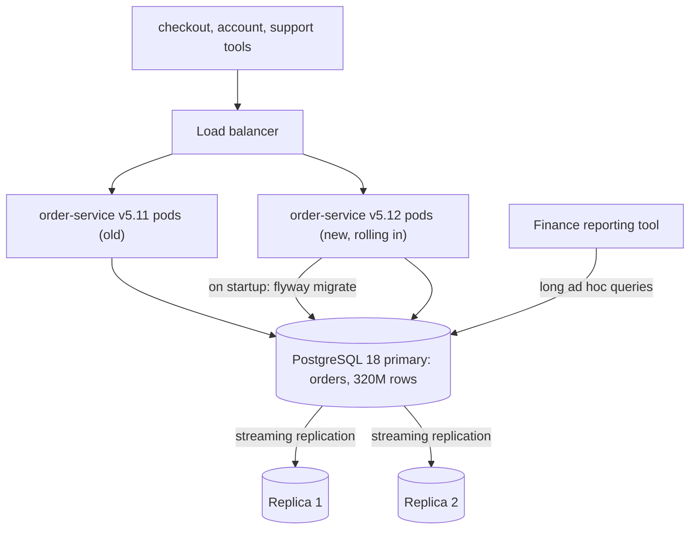
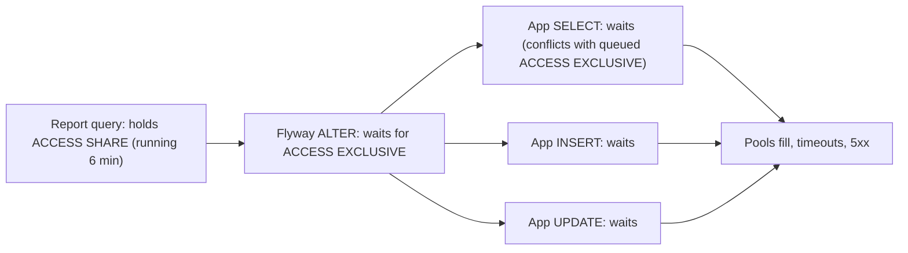
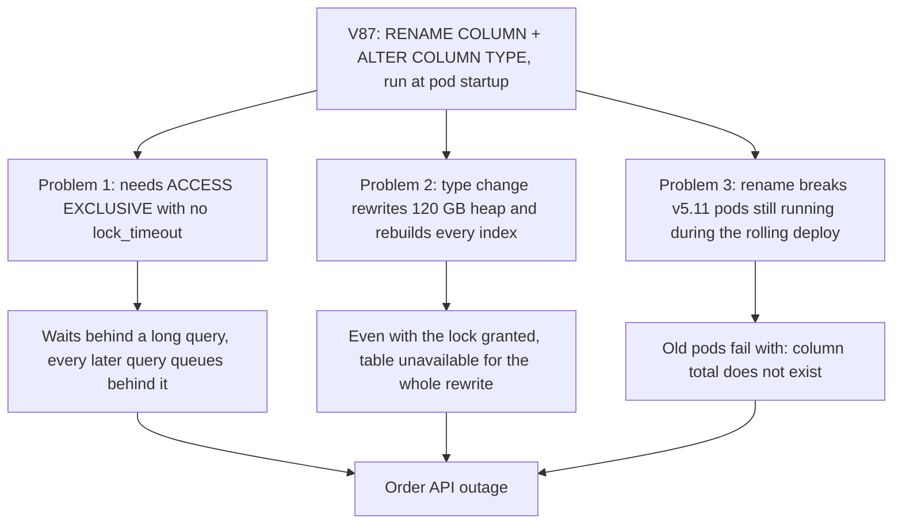
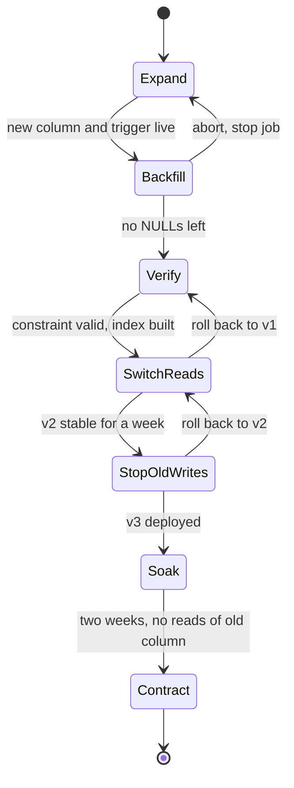
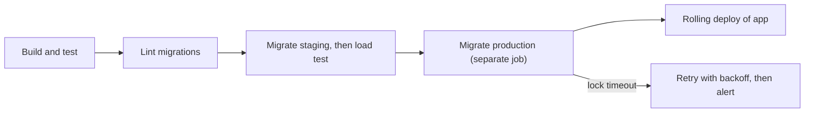

import Callout from '../../components/mdx/Callout.astro';

Most production outages caused by schema changes are not caused by the change being wrong. The SQL is fine. It ran in a few seconds on staging. What staging did not have was 320 million rows, a few thousand queries per second, a reporting query that had been running for six minutes, and two versions of the application running side by side in the middle of a rolling deploy.

This post follows one migration that went wrong, why it went wrong at the level of PostgreSQL's lock manager, and how the same change was then shipped with no downtime over three weeks. The technique, **expand, migrate, contract**, is the standard answer to "how do you rename or change a column on a large, hot table?", and senior interviews expect you to know not just its name but every step and where each one can fail.

<Callout variant="note" title="Composite scenario">
This is a composite scenario; the service names and numbers are illustrative. It combines failure patterns that are common with PostgreSQL migrations run from application deploys, not one specific company's incident.
</Callout>

<Callout variant="tip" title="What you'll learn">
- Which `ALTER TABLE` operations are metadata-only and which rewrite the table, and what lock each one takes
- How PostgreSQL's lock queue turns one waiting DDL statement into a full outage, and how `lock_timeout` prevents it
- How to diagnose a blocked table with `pg_locks`, `pg_stat_activity` and `pg_blocking_pids()`, and which session to cancel
- The expand, migrate, contract pattern step by step, with a rollback target at every step
- How to backfill hundreds of millions of rows in batches without hurting replicas or vacuum
- How to add `NOT NULL` and indexes online, and how to run Flyway or Liquibase safely in a deploy pipeline
</Callout>

**Level:** senior. **You should already know:** schema design and indexes ([Part 3](/blog/backend-03-databases-fundamentals)), MVCC, locking and replication ([Part 7](/blog/backend-07-database-internals-scaling)), and deployment and reliability basics ([Part 11](/blog/backend-11-reliability-observability)). The previous case study, [Connection Pool Exhaustion](/blog/case-01-connection-pool-exhaustion), explains what happens to the application side once the database stops answering.

## The system

`order-service` is a Kotlin + Spring Boot 4 service that owns the `orders` table in a PostgreSQL 18 primary with two streaming replicas. It runs 12 pods behind a load balancer and is deployed with a Kubernetes rolling update: new pods come up one at a time while old pods keep serving, so for several minutes **two versions of the application share the same schema**.

Database migrations were managed with Flyway, using Spring Boot's integration: on startup, each pod ran `flyway migrate` before the application context finished starting. Flyway takes a PostgreSQL advisory lock so only one pod applies migrations at a time; the others wait and then find nothing to do.



The `orders` table: about 320 million rows, roughly 120 GB of heap and 60 GB of indexes, a few thousand writes per second at peak and many more reads. It had a column `total NUMERIC(12,2)` storing order totals in currency units (12.50 means €12.50). The payments team wanted totals as **integer minor units** (1250), the standard representation for money that [Design a Payment System](/blog/sd-07-payment-system-ledger) relies on, in a column called `total_minor BIGINT`. That is both a rename and a type change. Splitting one column into two (say, `full_name` into `given_name` and `family_name`) is the same problem with one more column, and the same technique applies.

All orders here are in EUR, GBP or USD, each with two decimal places, so the conversion is `total * 100`. A real system with JPY (zero decimals) or KWD (three) would multiply by `10 ^ exponent` per currency, which is a good reason to store the currency next to the amount.

## Timeline

The first attempt was a single Flyway migration shipped with application version 5.12, whose entity now mapped `total_minor`:

```sql
-- V87__orders_total_minor.sql  (the version that caused the incident)
ALTER TABLE orders RENAME COLUMN total TO total_minor;
ALTER TABLE orders ALTER COLUMN total_minor TYPE bigint
    USING (total_minor * 100)::bigint;
```

On staging, with 2 million rows, it ran in 9 seconds. Here is what happened in production.


- **T+0.** Rolling deploy of v5.12 starts. The first new pod starts Flyway.
- **T+30 s.** Flyway's `ALTER TABLE` requests an `ACCESS EXCLUSIVE` lock on `orders`. A finance analyst's ad hoc query, started six minutes earlier through the reporting tool, holds an `ACCESS SHARE` lock on `orders`. The `ALTER` waits.
- **T+1 min.** Every new query on `orders`, including plain `SELECT`s, queues behind the waiting `ALTER`. Order-service connection pools fill with sessions waiting on locks; checkout, order history and the support tool all start timing out.
- **T+3 min.** The order API availability alert pages on-call. About 40% of requests are failing, and climbing.
- **T+6 min.** `pg_locks` shows the lock queue with the migration's session at its head (queries below).
- **T+8 min.** The rollout is paused and the migration's backend is cancelled with `pg_cancel_backend`. The queued queries are granted their locks and drain within seconds.
- **T+10 min.** The paused new pod's startup had failed, so Kubernetes restarted it, and Flyway **ran the same migration again**. The queue started to form a second time; the migration was cancelled again and the deployment rolled back to v5.11 with `kubectl rollout undo`.
- **T+13 min.** Error rate back to baseline. Because PostgreSQL DDL is transactional, the cancelled migration rolled back completely: the schema was unchanged and nothing was recorded in `flyway_schema_history`.

## Investigation

### First signal: every query on one table is slow, nothing else is

The order API's latency graph went vertical, but the database's CPU dropped. Disk I/O dropped. Queries on other tables (`customers`, `carts`) were fast. That pattern, **a busy table that suddenly does no work**, points at locks, not load.

`pg_stat_activity` confirmed it. Almost every session from `order-service` showed `wait_event_type = 'Lock'` and `wait_event = 'relation'`, meaning it was waiting for a table-level lock:

```sql
SELECT wait_event_type, wait_event, count(*)
FROM pg_stat_activity
WHERE datname = 'shop' AND state = 'active'
GROUP BY 1, 2
ORDER BY 3 DESC;
```

```text
 wait_event_type | wait_event | count
-----------------+------------+-------
 Lock            | relation   |   183
                 |            |     4
```

### Who is blocking whom: `pg_blocking_pids()`

`pg_blocking_pids(pid)` returns the sessions that a given session is waiting on. Asking it for every waiting session shows the shape of the queue:

```sql
SELECT pid,
       pg_blocking_pids(pid)      AS blocked_by,
       application_name,
       now() - query_start        AS waiting_for,
       left(query, 60)            AS query
FROM pg_stat_activity
WHERE cardinality(pg_blocking_pids(pid)) > 0
ORDER BY query_start
LIMIT 6;
```

```text
  pid   | blocked_by |   application_name   | waiting_for  | query
--------+------------+----------------------+--------------+------------------------------------------
 418822 | {417301}   | order-service        | 00:05:41.2   | ALTER TABLE orders RENAME COLUMN total TO
 418840 | {418822}   | order-service        | 00:05:39.8   | SELECT o.id, o.status, o.total FROM order
 418843 | {418822}   | order-service        | 00:05:39.5   | INSERT INTO orders (id, customer_id, stat
 418851 | {418822}   | order-service        | 00:05:38.9   | UPDATE orders SET status = $1 WHERE id = $
 ...
```

Two things stand out. Hundreds of application queries are blocked by **418822**, whose query is the `ALTER TABLE`: that is Flyway, running on the new pod through the application's own data source (hence the same `application_name`). And Flyway is blocked by **417301**. One more query shows what that is, and the lock modes involved:

```sql
SELECT l.pid, l.mode, l.granted, a.application_name,
       now() - a.query_start AS running_for
FROM pg_locks l
JOIN pg_stat_activity a USING (pid)
WHERE l.locktype = 'relation'
  AND l.relation = 'orders'::regclass
ORDER BY l.granted DESC, a.query_start
LIMIT 5;
```

```text
  pid   |        mode         | granted | application_name | running_for
--------+---------------------+---------+------------------+-------------
 417301 | AccessShareLock     | t       | finance-reports  | 00:11:52.0
 418822 | AccessExclusiveLock | f       | order-service    | 00:05:41.2
 418840 | AccessShareLock     | f       | order-service    | 00:05:39.8
 418843 | RowExclusiveLock    | f       | order-service    | 00:05:39.5
 ...
```

The reporting session holds `ACCESS SHARE` (every `SELECT` takes it). Flyway wants `ACCESS EXCLUSIVE` and is not granted. And then the surprising part: the application's `SELECT`, which only needs `ACCESS SHARE`, the same mode the report already holds, is **also not granted**.

### Why a SELECT waits for a lock nobody holds

PostgreSQL grants table locks from a queue. A new request is granted only if it conflicts with no lock that is held **and** with no request that is already waiting ahead of it. This prevents a steady stream of readers from starving a writer forever, and it has a sharp edge:



`ACCESS EXCLUSIVE` conflicts with every other lock mode, including `ACCESS SHARE`. Once it is waiting in the queue, every later request on the table waits behind it. The migration did not need to start running to cause an outage; it only needed to **wait**. The longer the blocker ran, the longer the outage lasted. Without a timeout, that is unbounded.

### The decision: cancel the migration, not the report

There were two sessions to choose from. Cancelling the report (`417301`) would have let Flyway take its lock immediately. That would have been far worse: the second statement, `ALTER COLUMN ... TYPE bigint`, rewrites the whole table and rebuilds every index, while holding `ACCESS EXCLUSIVE` for the entire time. On a 120 GB heap with 60 GB of indexes, that is not seconds. Nobody had measured it, but a reasonable estimate is tens of minutes to hours, with the table fully unavailable throughout.

Cancelling the migration's backend releases its place in the queue:

```sql
SELECT pg_cancel_backend(418822);
```

`pg_cancel_backend` cancels the current query and leaves the connection open; `pg_terminate_backend` closes the session entirely and is the next step if a cancel does not take effect. Because DDL in PostgreSQL runs inside the migration's transaction, cancelling rolled back the rename as well. No half-applied schema.

### Why it came back

The pod whose Flyway run was cancelled failed its startup, and Kubernetes did what it is designed to do: restarted it. Spring Boot ran Flyway again on startup, the migration was still pending, and the `ALTER` went back into the lock queue. Pausing the rollout (`kubectl rollout pause`) does not stop a pod that already exists from restarting. Rolling the Deployment back to the previous image did.

## Root cause

Three independent problems were packed into two lines of SQL. Any one of them would have caused an incident on its own:



1. **No `lock_timeout`.** PostgreSQL's default `lock_timeout` is 0 (wait forever). A DDL statement that waits indefinitely for `ACCESS EXCLUSIVE` blocks the table indefinitely.
2. **A table-rewriting operation on a hot table.** `ALTER COLUMN ... TYPE` rewrites the table unless the old and new types are binary-coercible (for example, `varchar(50)` to `varchar(100)` or `text` is not rewritten). `numeric` to `bigint` is a full rewrite plus a rebuild of every index on the table, all under `ACCESS EXCLUSIVE`.
3. **A change incompatible with the running code.** A rolling deploy means the old version keeps serving after the schema changes. The old version reads and writes `total`; the moment the rename commits, every old pod fails. Any migration that runs before or during a deploy must work with **both** the old and the new application.

Contributing factors: migrations ran on application startup, coupling schema changes to pod restarts; a reporting tool ran long ad hoc queries against the primary; staging had 0.6% of production's data and no concurrent load, so it could not show either the lock queue or the rewrite cost.

### What locks common DDL takes

Knowing this table is most of the job. All of it is from the PostgreSQL documentation for `ALTER TABLE` and explicit locking:

| Operation | Lock | Rewrites or scans? |
|---|---|---|
| `ADD COLUMN` (nullable, or with a non-volatile default, PG 11+) | `ACCESS EXCLUSIVE` (brief) | No, metadata only |
| `ADD COLUMN ... DEFAULT random()` (volatile default) | `ACCESS EXCLUSIVE` | Rewrite |
| `RENAME COLUMN` | `ACCESS EXCLUSIVE` (brief) | No, but breaks old code |
| `ALTER COLUMN TYPE` (not binary-coercible) | `ACCESS EXCLUSIVE` | Rewrite and index rebuild |
| `ALTER COLUMN SET NOT NULL` | `ACCESS EXCLUSIVE` | Full scan, unless a valid `CHECK (col IS NOT NULL)` exists (PG 12+) |
| `ADD CONSTRAINT ... CHECK ... NOT VALID` | `ACCESS EXCLUSIVE` (brief) | No |
| `VALIDATE CONSTRAINT` | `SHARE UPDATE EXCLUSIVE` | Scan, but reads and writes continue |
| `CREATE INDEX` | `SHARE` | Blocks writes for the whole build |
| `CREATE INDEX CONCURRENTLY` | `SHARE UPDATE EXCLUSIVE` | Two scans; reads and writes continue |
| `DROP COLUMN` | `ACCESS EXCLUSIVE` (brief) | No, column is hidden, space reclaimed on later rewrites |
| `CREATE TRIGGER` | `SHARE ROW EXCLUSIVE` (brief) | No |

Note that even the "instant" operations take `ACCESS EXCLUSIVE`. They are only safe if they get the lock quickly, which is what `lock_timeout` guarantees.

## The fix

### Mitigation (minutes)

1. Cancel the migration's backend, not the blocker.
2. Roll the Deployment back to the previous image so restarts stop re-running the migration.
3. Ask the reporting tool's owners to point it at a replica (done the same day).

### The long-term fix: expand, migrate, contract

The principle is that you never change a column in place. You add the new shape alongside the old one, move data and code over in small steps that each work with the previous version, and remove the old shape only when nothing uses it. Each step is a separate deploy with its own rollback target.




Every DDL migration in this sequence starts with the same two lines:

```sql
SET LOCAL lock_timeout = '2s';
SET LOCAL statement_timeout = '15s';
```

Flyway runs each PostgreSQL migration in a transaction by default, so `SET LOCAL` scopes the settings to that migration. If the lock is not granted within 2 seconds, the statement fails, the migration rolls back, the waiting queue it created is released, and the pipeline retries a few minutes later. A failed migration that retries is a non-event; a migration that waits is an outage.

### Phase 1: Expand

```sql
-- V88__orders_add_total_minor.sql
SET LOCAL lock_timeout = '2s';

ALTER TABLE orders ADD COLUMN total_minor bigint;

CREATE FUNCTION orders_sync_total_minor() RETURNS trigger
LANGUAGE plpgsql AS $$
BEGIN
    IF NEW.total IS NOT NULL THEN
        NEW.total_minor := round(NEW.total * 100)::bigint;
    END IF;
    RETURN NEW;
END;
$$;

CREATE TRIGGER orders_sync_total_minor
    BEFORE INSERT OR UPDATE OF total ON orders
    FOR EACH ROW EXECUTE FUNCTION orders_sync_total_minor();
```

Adding a nullable column with no default is metadata-only, so the `ACCESS EXCLUSIVE` lock is held for milliseconds once granted. The trigger keeps `total_minor` correct for every new or changed row, whoever writes it: old pods, the support tool, ad hoc fixes. It fires on `INSERT` and on any `UPDATE` whose `SET` list includes `total`.

**Why a trigger rather than application dual writes?** Application dual writes are explicit and easy to test, but they only cover writers you have redeployed. While v5.11 is still running, it writes only `total`. The trigger covers every writer from the moment the migration commits. The cost is hidden logic in the database, so it gets removed in the contract phase. Both approaches are valid; what is not valid is having neither and backfilling a column that new writes leave empty.

**Rollback:** nothing to do. The application ignores the new column. If needed, drop the trigger and the column with `lock_timeout` set.

### Phase 2: Backfill in batches

The backfill is **not** a Flyway migration. A single `UPDATE orders SET total_minor = ...` over 320 million rows would run for hours in one transaction, hold row locks on everything it touched, generate a burst of WAL that replicas must replay, and keep a snapshot open that stops vacuum. Instead, a resumable job walks the primary key in small ranges, one short transaction per batch:

```kotlin
@Component
class TotalMinorBackfill(
    private val jdbc: JdbcClient,
    private val lag: ReplicationLagProbe,
) {
    private val log = LoggerFactory.getLogger(javaClass)

    fun run(startId: Long, maxId: Long, batchSize: Long = 10_000) {
        var from = startId
        while (from <= maxId) {
            val to = from + batchSize
            val updated = jdbc.sql(
                """
                UPDATE orders
                   SET total_minor = round(total * 100)::bigint
                 WHERE id >= :from AND id < :to
                   AND total_minor IS NULL
                   AND total IS NOT NULL
                """.trimIndent()
            ).param("from", from).param("to", to).update()

            saveCheckpoint(to)                       // resume here after a restart
            log.info("backfilled ids [{}, {}): {} rows", from, to, updated)

            while (lag.maxReplayLag() > Duration.ofSeconds(5)) {
                Thread.sleep(5_000)                  // let replicas catch up
            }
            Thread.sleep(100)                        // leave headroom for live traffic
            from = to
        }
    }
}
```

Design points that matter more than the code:

- **Each batch is its own transaction**, committed in well under a second, so locks and snapshots are short. `JdbcClient` without `@Transactional` runs each statement in auto-commit mode.
- **It is idempotent and resumable.** The `total_minor IS NULL` predicate makes re-running a range harmless, and the checkpoint lets the job resume after a deploy or a crash.
- **Ranges by primary key, not `OFFSET`.** `WHERE id >= :from AND id < :to` uses the primary key index; `OFFSET` gets slower with every page.
- **It throttles on replication lag**, read from `pg_stat_replication.replay_lag` on the primary. A backfill that makes replicas fall minutes behind breaks every read-your-writes path that reads from them.
- **It does not fire the trigger**, because the `UPDATE` does not set `total`. That is intentional; the trigger is for live writes.

The arithmetic, as an estimate to plan around rather than a measurement:

```text
batches   = 320,000,000 rows / 10,000 per batch     = 32,000 batches
per batch ≈ 250 ms update + 100 ms pause            = 0.35 s
total     ≈ 32,000 × 0.35 s = 11,200 s               ≈ 3.1 hours (plus lag pauses)
```

Run a few thousand batches first and replace the 250 ms with what you observe. In this case the job was run during two quiet overnight windows.

**Watch vacuum.** Under MVCC every updated row becomes a new row version and leaves a dead one behind ([Part 7](/blog/backend-07-database-internals-scaling)). Rewriting every row of a 120 GB table creates hundreds of millions of dead tuples. Autovacuum cleans them up as long as no long-running transaction holds back the cleanup horizon, which is another reason to keep batches short. Watch `n_dead_tup` in `pg_stat_user_tables` and run a manual `VACUUM (VERBOSE) orders` between windows if autovacuum is behind. Not indexing `total_minor` until the backfill finishes also helps: updates that do not touch an indexed column can be HOT updates when the page has free space, which avoids index writes.

**Rollback:** stop the job. Nothing reads `total_minor` yet.

### Phase 3: Verify, constrain and index

First, prove the data is right. Run the check on a replica so the full scan does not compete with production traffic:

```sql
SELECT count(*) FILTER (WHERE total_minor IS NULL AND total IS NOT NULL)            AS missing,
       count(*) FILTER (WHERE total_minor <> round(total * 100)::bigint)            AS mismatched
FROM orders;
```

Both must be zero. Then make `total_minor` `NOT NULL` without a long exclusive lock. A direct `SET NOT NULL` would scan all 320 million rows under `ACCESS EXCLUSIVE`. The online path is a `CHECK` constraint added as `NOT VALID` (instant), validated separately (scans under a weaker lock that allows reads and writes), and then used by PostgreSQL 12+ to skip the scan for `SET NOT NULL`:

```sql
-- V89__orders_total_minor_not_null.sql
SET LOCAL lock_timeout = '2s';
ALTER TABLE orders
    ADD CONSTRAINT orders_total_minor_not_null
    CHECK (total_minor IS NOT NULL) NOT VALID;
```

```sql
-- V90__orders_validate_total_minor.sql
ALTER TABLE orders VALIDATE CONSTRAINT orders_total_minor_not_null;
```

```sql
-- V91__orders_total_minor_set_not_null.sql
SET LOCAL lock_timeout = '2s';
ALTER TABLE orders ALTER COLUMN total_minor SET NOT NULL;
ALTER TABLE orders DROP CONSTRAINT orders_total_minor_not_null;
```

The validation and the `SET NOT NULL` are in separate migrations on purpose: the validation takes a long time under a weak lock, and the `SET NOT NULL` needs a strong lock briefly. Putting them in one transaction would hold the strong lock for the whole validation.

The fraud team's queue queried `WHERE status = 'PENDING_REVIEW' ORDER BY total DESC`, served by an index on `(status, total)`. The equivalent index on the new column is built online:

```sql
-- V92__orders_idx_status_total_minor.sql
SET lock_timeout = '2s';
CREATE INDEX CONCURRENTLY IF NOT EXISTS idx_orders_status_total_minor
    ON orders (status, total_minor);
```

`CREATE INDEX CONCURRENTLY` cannot run inside a transaction block. Flyway's PostgreSQL support recognises it and runs that migration outside a transaction, which is why it uses plain `SET` rather than `SET LOCAL` and why it is alone in its own file: Flyway refuses to mix transactional and non-transactional statements in one migration unless you explicitly enable mixed mode. With Liquibase, mark the changeset `runInTransaction="false"`.

If a concurrent build fails (a deadlock, a uniqueness violation, a cancelled statement), it leaves an `INVALID` index that slows writes and is never used for reads. Check for it and clean up before retrying:

```sql
SELECT indexrelid::regclass AS index_name
FROM pg_index
WHERE indrelid = 'orders'::regclass AND NOT indisvalid;

DROP INDEX CONCURRENTLY IF EXISTS idx_orders_status_total_minor;
```

**Rollback:** drop the constraint or the index. The application has not changed.

### Phase 4: Switch reads (app v2)

Now the application changes. Version 2 maps both columns, **reads** `total_minor`, and **writes both**, so a rollback to v1 still finds `total` correct:

```kotlin
@Entity
@Table(name = "orders")
class OrderEntity(
    @Id val id: UUID,
    @Column(name = "customer_id", nullable = false) val customerId: UUID,
    @Column(name = "currency", nullable = false, length = 3) val currency: String,
    totalMinor: Long,
) {
    @Column(name = "total_minor", nullable = false)
    var totalMinor: Long = totalMinor
        set(value) {
            field = value
            legacyTotal = BigDecimal.valueOf(value, 2)   // 1250 -> 12.50
        }

    // Written for rollback safety only. Removed in v3.
    @Column(name = "total", precision = 12, scale = 2)
    private var legacyTotal: BigDecimal? = BigDecimal.valueOf(totalMinor, 2)
}
```

`BigDecimal.valueOf(1250, 2)` is exact (unscaled value 1250, scale 2), so there is no floating-point rounding anywhere. The trigger is still in place and computes the same value from `total`, so it is harmless.

Ship v2 behind normal canary checks. The thing to watch is any difference between what v1 and v2 return for the same order; a shadow comparison (v2 computes from both columns and logs mismatches for a few days) is cheap insurance.

**Rollback:** v1. It reads and writes `total`, which v2 has kept correct, and the trigger keeps `total_minor` correct behind it.

### Phase 5: Stop writing the old column (app v3)

Before v3 can stop writing `total`, the column must allow nulls, or new inserts fail:

```sql
-- V93__orders_total_nullable.sql
SET LOCAL lock_timeout = '2s';
ALTER TABLE orders ALTER COLUMN total DROP NOT NULL;
```

That is metadata-only. Then v3 ships with `legacyTotal` removed from the entity. New rows have `total = NULL`; the trigger's `IF NEW.total IS NOT NULL` guard means it no longer touches them.

**Rollback:** v2 only. V2 reads `total_minor`, so it works with rows v3 wrote. **V1 is no longer a safe target**, because it reads `total`, which is null for every order written since v3. This is written down in the deploy ticket so nobody discovers it during an incident.

### Phase 6: Soak

Wait. Two weeks in this case, long enough to cover a release cycle and a month-end finance run. During the soak, find every remaining reader of `total` that is not the application:

- `pg_stat_statements` for any query text mentioning `total` (filter out `total_minor`).
- Views, functions and materialized views that depend on the column. `DROP COLUMN` will refuse to drop a column a view depends on unless you use `CASCADE`, which you should not.
- Downstream consumers: CDC pipelines (Debezium) and the data warehouse see the column disappear from change events, and their schemas must be updated first.
- Other teams' read-only database users, which is how the finance reporting tool was found in the first place.

### Phase 7: Contract

```sql
-- V94__orders_drop_total.sql
SET LOCAL lock_timeout = '2s';
DROP TRIGGER IF EXISTS orders_sync_total_minor ON orders;
DROP FUNCTION IF EXISTS orders_sync_total_minor();
ALTER TABLE orders DROP COLUMN total;
```

`DROP COLUMN` is metadata-only in PostgreSQL: the column becomes invisible immediately and its space is reclaimed as rows are later rewritten. It also drops the old `(status, total)` index, since that index involves the column. With `lock_timeout` set, the brief `ACCESS EXCLUSIVE` either succeeds in milliseconds or fails and retries.

**Rollback:** there is none short of restoring the column from a backup or a replica snapshot. That is why the soak exists and why contract is a separate, deliberate step weeks after the switch.

### Flyway and Liquibase in the deploy pipeline

The incident's second wave happened because migrations ran inside pod startup. The team moved them into the pipeline as a separate, explicit stage that runs **before** the rollout:



```yaml
# Part of the deploy workflow, before the rollout step
- name: Migrate production database
  env:
    FLYWAY_URL: ${{ secrets.ORDERS_DB_URL }}
    FLYWAY_USER: ${{ secrets.ORDERS_DB_MIGRATOR_USER }}
    FLYWAY_PASSWORD: ${{ secrets.ORDERS_DB_MIGRATOR_PASSWORD }}
  run: |
    for attempt in 1 2 3 4 5; do
      flyway -locations=filesystem:db/migration migrate && exit 0
      echo "migrate failed (attempt $attempt), retrying in 60 s"
      sleep 60
    done
    exit 1
```

```yaml
# application.yaml in the service
spring:
  flyway:
    enabled: false          # migrations run in the pipeline, not at pod startup
  jpa:
    hibernate:
      ddl-auto: validate    # fail fast if the entity and schema disagree
```

This decoupling has three effects. A pod restart can never re-run a migration. Migration failures stop the pipeline before any new code is deployed, rather than producing crash-looping pods. And the migration runs with a dedicated database user that owns the schema, while the application's user can only read and write rows. Liquibase works the same way: run `liquibase update` as a pipeline step and disable the Spring Boot integration with `spring.liquibase.enabled: false`.

Spring Boot's ability to run migrations at startup is not wrong; for small services with small tables it is convenient. It is a poor fit once a migration can take longer than a pod's startup probe, or once a table is big enough that the order of schema and code changes matters.

### The rule that ties it together

Every schema change must be compatible with the application version currently running **and** the one being deployed. In practice:

| Change you want | Safe sequence |
|---|---|
| Add a column | Add nullable (or with a constant default), deploy code that uses it |
| Remove a column | Deploy code that stops using it, soak, then drop |
| Rename a column | Add new, dual write or trigger, backfill, switch reads, stop old writes, drop old |
| Change a type | Same as rename, with a conversion in the trigger and backfill |
| Split one column into two | Same as rename, with two new columns and a parsing step in the backfill |
| Add `NOT NULL` | `CHECK ... NOT VALID`, `VALIDATE`, `SET NOT NULL`, drop the check |
| Add an index | `CREATE INDEX CONCURRENTLY`, in its own non-transactional migration |
| Add a foreign key | `ADD CONSTRAINT ... FOREIGN KEY ... NOT VALID`, then `VALIDATE CONSTRAINT` |

## Prevention

### Guardrails in code review and CI

- **A migration linter in CI.** Squawk is an open source linter for PostgreSQL migrations that flags operations such as non-concurrent index creation, column type changes and adding `NOT NULL` columns. Run it on every new migration file and require an explicit, reviewed override for anything it flags.
- **A team rule, enforced by a CI check:** every migration that takes `ACCESS EXCLUSIVE` starts with `lock_timeout`. A simple grep-based check is enough to start.
- **A migration review checklist:** Does this lock? Does it rewrite or scan? Does it work with the previous app version? What is the rollback? Is it a backfill that belongs in a job instead?

### Testing at production scale

Staging could not reveal this incident because it had neither the data nor the concurrency. The team added a pre-production step that restores a recent, anonymised snapshot of `orders` and runs the migration while a load generator replays read and write traffic. It does not need to be perfect; it needs to be big enough that a rewrite takes visibly long and busy enough that a lock wait shows up in `pg_locks`.

### Alerts

- **Page on the SLO**, as before; it caught this incident in 3 minutes.
- **Warn on lock waits**: sessions with `wait_event_type = 'Lock'` for more than 5 seconds, exported by a custom query in the Postgres exporter. This would have fired at T+35 s with the blocking PID in the alert.
- **Warn on long-running queries on the primary** (over 5 minutes), which is how the reporting tool should have been found before it blocked anything.
- **Track replication lag and dead tuples** during any backfill, with the job itself pausing on lag.

### Runbook: "a table is blocked during a migration"

1. Find the head of the queue with `pg_blocking_pids()` and `pg_locks` (queries above).
2. If the waiting session is a migration, **cancel the migration**, not the blocker, unless you know exactly how long the migration will hold its lock once granted.
3. Stop anything that will re-run the migration: pause the pipeline, roll back the Deployment if migrations run at startup.
4. Confirm the queue drained (`wait_event_type = 'Lock'` count back to near zero) and the error rate recovered.
5. Re-plan the change as expand, migrate, contract.

## Interview angle

Schema migrations are a favourite senior and staff topic because they test databases, deployment and risk management at once. The story works well for "tell me about a time something you shipped caused an outage" or "tell me about a complex change you led".

**A two-minute STAR version:**

- **Situation.** "We needed to change order totals from a decimal column to integer minor units on our `orders` table: about 320 million rows, thousands of queries a second. The first attempt was a two-line Flyway migration that renamed and retyped the column, run at application startup."
- **Task.** "That migration caused a 13-minute outage of the order API. I was the on-call engineer, and afterwards I owned both the recovery and redoing the change safely."
- **Action.** "During the incident, `pg_locks` showed the migration waiting for an exclusive lock behind a long reporting query, with every other query queued behind the migration. I cancelled the migration rather than the report, because the type change would have rewritten the whole table under that lock, and we rolled back the deploy so restarts stopped re-running it. Then I redesigned the change as expand, migrate, contract: add a nullable column with a sync trigger, backfill in 10,000-row batches throttled on replica lag, add `NOT NULL` through a `NOT VALID` check, build the index concurrently, switch reads in one release, stop old writes in the next, and drop the old column after a two-week soak. Every DDL step used a 2-second `lock_timeout` and had a written rollback target. We also moved migrations out of pod startup into a pipeline step."
- **Result.** "The second attempt took three weeks of calendar time and caused zero user-visible errors; no lock wait exceeded 2 seconds. We added a migration linter and a lock-wait alert, and the expand, migrate, contract checklist became the team's standard for any change to a large table."

Be ready to defend why three weeks was the right trade-off: each step was small and reversible, and most of the elapsed time was waiting, not engineering effort.

**Technical follow-ups you should expect:**

<details>
<summary>Renaming a column is metadata-only in PostgreSQL. Why is it still unsafe?</summary>

Two reasons. It needs an `ACCESS EXCLUSIVE` lock, so without `lock_timeout` it can wait behind a long query and block every other query on the table while it waits. And it breaks every application instance still using the old name, which during a rolling deploy is most of them. The safe version is expand, migrate, contract: add the new column, keep both in sync, move readers and writers over in separate releases, then drop the old one. If you only need a new name in code, consider not renaming the column at all and mapping it in the ORM.

</details>

<details>
<summary>What does lock_timeout do, and how is it different from statement_timeout?</summary>

`lock_timeout` limits how long a statement waits to **acquire** a lock; if it is exceeded the statement fails with a lock timeout error. `statement_timeout` limits the total run time of a statement, including any lock wait. For migrations you want a short `lock_timeout` (a few seconds) so a DDL statement never sits in the lock queue blocking others, plus a retry loop. A `statement_timeout` alone is not enough, because a statement can block the whole table for the full timeout while waiting.

</details>

<details>
<summary>How would you backfill a new column on a 300-million-row table without hurting production?</summary>

Not in one statement and not in a schema migration. Run a resumable job that updates small primary-key ranges (thousands of rows), each in its own short transaction, with an idempotent predicate like `WHERE new_col IS NULL` so ranges can be retried. Throttle on replication lag and leave pauses for live traffic. Watch dead tuples and autovacuum, since every updated row leaves a dead version under MVCC, and avoid long transactions that hold back vacuum. Build indexes on the new column after the backfill so updates are cheaper. Verify with a full comparison query on a replica before relying on the column.

</details>

<details>
<summary>How do you add a NOT NULL constraint to a large existing column online?</summary>

Add `CHECK (col IS NOT NULL) NOT VALID`, which is instant because it only applies to new writes. Then `VALIDATE CONSTRAINT`, which scans the table under `SHARE UPDATE EXCLUSIVE`, so reads and writes continue. On PostgreSQL 12 and later, `ALTER COLUMN ... SET NOT NULL` then uses the valid check to skip its own scan, so its `ACCESS EXCLUSIVE` lock is brief. Finally drop the now-redundant check. Run the validation and the `SET NOT NULL` in separate transactions.

</details>

<details>
<summary>What are the risks of CREATE INDEX CONCURRENTLY?</summary>

It is slower than a normal build (two table scans and waits for existing transactions), it cannot run inside a transaction block, so migration tools must run it non-transactionally, and only one can run per table at a time. If it fails partway, it leaves an `INVALID` index that adds write overhead without serving reads; you must find it in `pg_index` (`indisvalid = false`) and drop it, ideally with `DROP INDEX CONCURRENTLY`, before retrying. It also waits for long-running transactions to finish at certain phases, so a long transaction can make it appear stuck.

</details>

<details>
<summary>Trigger or application dual writes: which would you choose to keep old and new columns in sync?</summary>

A trigger covers every writer as soon as it is created, including old application versions, scripts and other services, so it is the safer choice while old code is still running. Its downsides are logic hidden in the database, extra write cost, and that it must be removed later. Application dual writes are explicit, visible in code review and easy to test, but they only cover writers you have redeployed. A common combination is a trigger during the transition and application dual writes once all writers are on the new version, with the trigger dropped in the contract phase.

</details>

<details>
<summary>Should migrations run at application startup or in the pipeline?</summary>

For small tables and simple services, startup is convenient and the migration tool's lock prevents concurrent runs. For large or hot tables, run them as a separate pipeline step before the rollout. That decouples schema changes from pod restarts (so a crash loop never re-runs a migration), fails the deploy before new code ships, lets migrations use a privileged user the application does not have, and lets you retry lock timeouts with backoff. In both cases every migration must be compatible with the currently running application version.

</details>

<details>
<summary>What is your rollback plan if the new column turns out to be wrong after reads have switched?</summary>

Decide it before you start, per phase. Until the application stops writing the old column, rollback is redeploying the previous version: the old column is still complete and correct. After the old column stops being written, the rollback target is the version that reads the new column; rolling back further would read stale or null data. After the contract phase the only rollback is restoring from backup, which is why dropping the old column waits for a soak period and a check for remaining readers. Write the rollback target into each deploy ticket.

</details>

## Common mistakes

- **Testing migrations on small, idle staging databases** and concluding they are fast. Lock waits and rewrites only show up at production size and concurrency.
- **Running DDL without `lock_timeout`.** The default is to wait forever, and waiting is what blocks everyone else.
- **Cancelling the blocker instead of the migration**, which lets a table-rewriting statement start holding its exclusive lock.
- **Changing a column in place** (rename or type change) while old application versions are still running.
- **Backfilling in one giant `UPDATE`**, or inside a schema migration, creating a long transaction, replica lag and vacuum pressure.
- **Using `CREATE INDEX` instead of `CREATE INDEX CONCURRENTLY`** on a table that takes writes, or leaving a failed concurrent build's `INVALID` index behind.
- **Dropping the old column in the same release that stops using it**, which removes your only rollback.
- **Running migrations at pod startup** for tables where a migration can take longer than a restart cycle.
- **Forgetting non-application readers**: reports, views, CDC pipelines and warehouse jobs.

## Key takeaways

- In PostgreSQL, the danger of DDL is often the **lock queue**, not the statement: a waiting `ACCESS EXCLUSIVE` request blocks every later query on the table.
- Always set a short **`lock_timeout`** on migrations and retry; a failed migration is cheap, a waiting one is an outage.
- Know which operations are **metadata-only** and which **rewrite or scan**; type changes rewrite the table and rebuild indexes.
- Use **expand, migrate, contract** for renames, type changes and splits. Every step must work with both the running and the next application version.
- **Backfill** in small, idempotent, resumable batches, throttled on replication lag, outside schema migrations.
- Add constraints online with **`NOT VALID` then `VALIDATE`**, and indexes with **`CREATE INDEX CONCURRENTLY`** in their own non-transactional migration.
- Give every phase a written **rollback target**, and make dropping the old column a separate step after a soak.
- Run migrations as a **pipeline step**, not at pod startup, once tables are large enough for it to matter.

Previous: [Connection Pool Exhaustion](/blog/case-01-connection-pool-exhaustion) · Next: [Duplicate Payments from Retries](/blog/case-03-duplicate-payments-retries)
