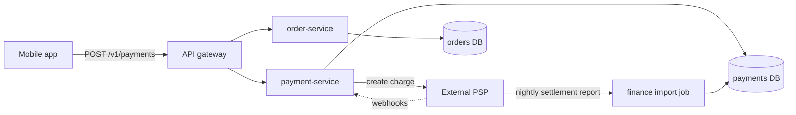
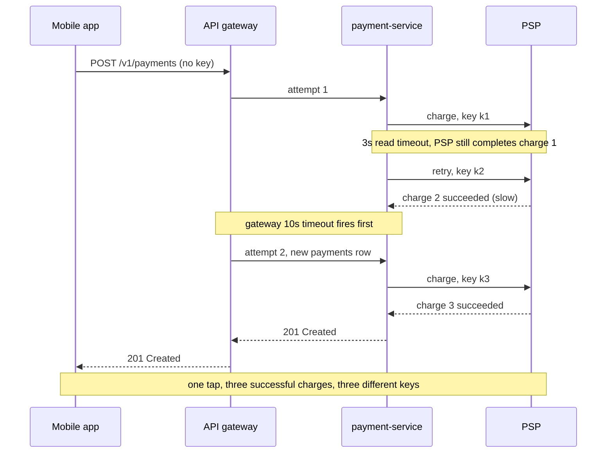
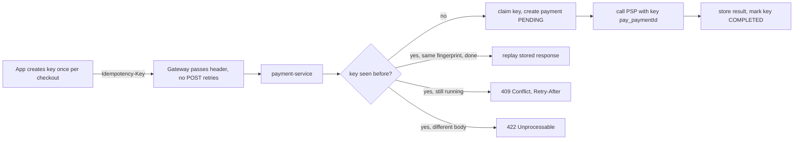
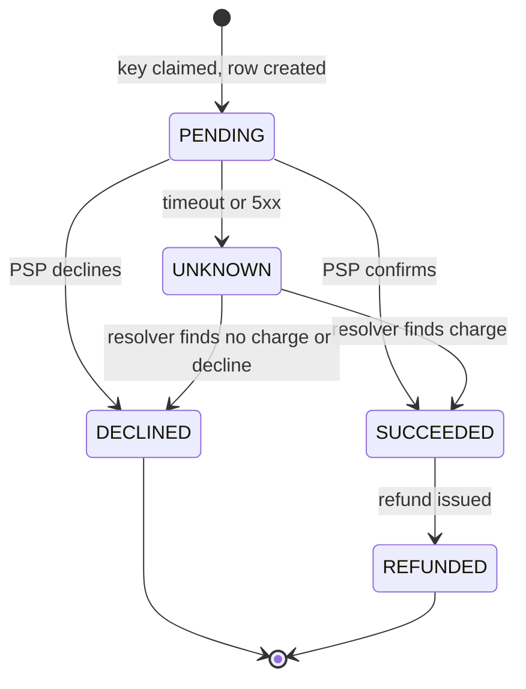

import Callout from '../../components/mdx/Callout.astro';

Every engineer knows that retries are good and that payments must not be charged twice. This incident is about what happens when those two pieces of common sense meet in a system where nobody owns the whole request path. A payment service provider (PSP) slows down, timeouts fire at three different layers, each layer retries on its own, and for about an hour a share of customers who tapped "Pay" once get charged two, three or more times.

Nothing in the system was obviously wrong. The mobile app retried on timeout, which the platform guidelines recommended. The API gateway retried on upstream errors, which had been added months earlier to paper over flaky pods. The payment service retried the PSP call, and even sent an `Idempotency-Key`. Each decision was locally reasonable. Together they were a machine for creating duplicate charges.

<Callout variant="note">
This is a composite scenario; the service names and numbers are illustrative. It is assembled from failure patterns that are common in payment integrations, not from a specific company's incident.
</Callout>

<Callout variant="tip" title="What you'll learn">
- Why a timeout is an *unknown* outcome, not a failure, and what that means for retries
- How retries at several layers multiply instead of add
- How to investigate "charged twice" reports: tickets, ledger queries, PSP data, traces and gateway logs
- End-to-end idempotency: client-generated keys, request fingerprinting, a dedupe table with a unique constraint, and deterministic PSP keys
- Reconciliation as the safety net, and how to remediate customers without making things worse
- How to tell this story in a behavioral interview
</Callout>

**Level:** senior. **You should already know:** idempotency keys and retry semantics ([Part 6: Async Processing and Queues](/blog/backend-06-async-processing-queues)), HTTP method semantics ([Part 2: REST API Design](/blog/backend-02-rest-api-design)), retries with backoff and jitter and SLO-based alerting ([Part 11: Reliability and Observability](/blog/backend-11-reliability-observability)), and why you should not hold a database transaction open across a network call ([Connection Pool Exhaustion](/blog/case-01-connection-pool-exhaustion)). The design-interview version of this problem is [Design a Payment System](/blog/sd-07-payment-system-ledger).

## The system

The checkout path looked like most mobile commerce backends. A native app talks to an API gateway (Spring Cloud Gateway), which routes to an `order-service` and a `payment-service`, both Kotlin on Spring Boot 4 backed by PostgreSQL. The payment service calls an external PSP over HTTPS to create and capture card charges. A nightly job imports the PSP's settlement report into a `psp_settlements` table for finance.



The relevant behavior at each hop, as it was configured before the incident:

| Layer | Timeout | Retry behavior |
|---|---|---|
| Mobile app | 15 s | 1 automatic retry on timeout or 5xx, for all requests |
| API gateway | 10 s response timeout | Retry filter: 2 retries on 5xx and `TimeoutException`, methods `GET,POST` |
| payment-service to PSP | 3 s read timeout | Resilience4j retry, `max-attempts: 3`, on `ResourceAccessException` |

The payment service created a `payments` row for every incoming `POST /v1/payments` and then called the PSP. There was a unique constraint on `payments.id` and nothing else. The order ID was stored, but more than one payment per order was allowed because the product supported retrying a *declined* card with a different card.

The PSP call looked like this:

```kotlin
@Component
class PspClient(private val restClient: RestClient) {

    @Retry(name = "psp")
    fun createCharge(payment: Payment): PspCharge =
        restClient.post()
            .uri("/v1/charges")
            .header("Idempotency-Key", UUID.randomUUID().toString()) // the bug, see below
            .body(ChargeBody(payment.amountMinor, payment.currency, payment.paymentMethodId,
                metadata = mapOf("order_id" to payment.orderId.toString())))
            .retrieve()
            .body<PspCharge>()!!
}
```

Someone had read the PSP's documentation, which recommends idempotency keys, and added one. Because it was generated inside the method that Resilience4j retried, every attempt got a new key, which is the same as having no key at all.

## Timeline


- **T+0.** The PSP has a partial degradation in one of its regions. Its p99 latency for charge creation, as seen from our service, goes from about 0.8 s to about 9 s. Most requests still succeed, slowly.
- **T+4 min.** Requests slower than 3 s hit the payment service's read timeout and are retried. Requests slower than 10 s at the gateway are retried there. Some clients hit their 15 s timeout and retry too. The checkout error rate dashboard shows a modest bump, because many retries eventually succeed. Nobody is paged: the checkout availability SLO burn rate stays under the paging threshold.
- **T+18 min.** Customer support gets the first "I was charged twice" ticket. It is treated as a one-off.
- **T+35 min.** Support has a dozen similar tickets and escalates to the payments team channel.
- **T+41 min.** The on-call engineer confirms multiple successful charges for the same order in the database and declares an incident.
- **T+52 min.** The gateway's retry filter is removed for `POST` routes via a config change.
- **T+63 min.** The Resilience4j retry on the charge path is disabled with a config override and a rolling restart. New duplicate charges stop. PSP latency is still elevated, so some checkouts now fail cleanly instead.
- **T+3 h.** The full list of duplicate charges is produced. Uncaptured authorizations are voided; captured duplicates are refunded. Support gets a macro and a list of affected customers.
- **T+2 days.** End-to-end idempotency ships (described in [The fix](#the-fix)).

The striking number in the timeline is 41 minutes from the first duplicate to a declared incident, and that detection came from customers. Every dashboard the team watched measured whether checkouts *succeeded*. None measured whether a checkout succeeded *more than once*.

## Investigation

### Step 1: confirm the symptom in your own data

Support tickets are anecdotes. The first job was to turn them into a query. Duplicate charges show up as more than one successful payment per order:

```sql
SELECT order_id,
       count(*)                                  AS successful_payments,
       array_agg(psp_charge_id ORDER BY created_at) AS charges,
       max(created_at) - min(created_at)         AS spread
FROM payments
WHERE status = 'SUCCEEDED'
  AND created_at >= now() - interval '2 hours'
GROUP BY order_id
HAVING count(*) > 1
ORDER BY successful_payments DESC
LIMIT 50;
```

The result had hundreds of rows. The `spread` column was telling: duplicates for the same order were typically 3 to 30 seconds apart, which is the signature of automated retries, not of a customer deciding to buy again an hour later.

### Step 2: rule out the obvious wrong hypotheses

Several plausible explanations were checked and discarded:

- **"Users double-tapped the Pay button."** The app disabled the button after the first tap, and the duplicates often came in threes or more, at intervals matching configured timeouts (around 3 s and 10 s), not human reaction time.
- **"The PSP is duplicating charges on its side."** The PSP dashboard showed each duplicate as a separate charge object, created by a separate API request, each with a *different* idempotency key. The PSP was doing exactly what it was asked to do.
- **"Webhook handling created extra payments."** The webhook consumer only updated existing rows by `psp_charge_id`; it never inserted. The row counts matched the number of `POST` requests we had made, not the number of webhooks.
- **"A deploy introduced this."** No deploy had touched the payment path in the previous week. The trigger was external: PSP latency.

### Step 3: follow one order through the logs and traces

The team picked one order with three charges and traced it. Distributed tracing (OpenTelemetry, propagated through the gateway) showed one trace with:

- one gateway span that had **two** upstream attempts to `payment-service`,
- in each, a `createCharge` span with **three** child HTTP spans to the PSP, the first two ending in `SocketTimeoutException` at 3 s, the third succeeding.

That already explained more than one PSP request per tap. It did not explain why the PSP *charged* more than once: a timeout on our side does not mean the PSP failed. In fact the PSP had received each timed-out request and completed it, just after our client had stopped waiting. This is the core of the whole incident:

<Callout variant="warning" title="A timeout is an unknown outcome">
When a call times out, you do not know whether the other side did nothing, did the work and failed to answer in time, or is still doing it. For reads that does not matter. For a non-idempotent write like "charge this card", retrying an unknown outcome without an idempotency key is how you charge twice.
</Callout>

There was a second trace for the same order a few seconds later with a different trace ID. That was the mobile app's retry: the app's own retry starts a new request, and the app did not propagate a trace context, so it showed up as an unrelated trace. The correlation was made via the order ID in the request body and the device ID in the gateway access log.

### Step 4: read the configuration, not just the code

With the traces in hand, the team read the config at each layer. The gateway route explained the gateway retries:

```yaml
spring:
  cloud:
    gateway:
      server:
        webflux:
          routes:
            - id: payments
              uri: lb://payment-service
              predicates:
                - Path=/v1/payments/**
              filters:
                - name: Retry
                  args:
                    retries: 2
                    methods: GET,POST          # POST was added "temporarily" months ago
                    series: SERVER_ERROR
                    exceptions: java.io.IOException, java.util.concurrent.TimeoutException
```

Spring Cloud Gateway's `Retry` filter only retries `GET` by default, which is a safe default. Someone had added `POST` to work around connection resets during pod restarts, and the change was copied to every route, including payments.

The Resilience4j retry config explained the service retries:

```yaml
resilience4j:
  retry:
    instances:
      psp:
        max-attempts: 3
        wait-duration: 200ms
        retry-exceptions:
          - org.springframework.web.client.ResourceAccessException
```

`ResourceAccessException` is what Spring's `RestClient` throws for I/O errors, including read timeouts. Combined with the per-attempt `UUID.randomUUID()` key in `PspClient`, every retried attempt was a brand-new charge request from the PSP's point of view.

### Step 5: quantify the blast radius

Finance needed a number and support needed a list. The query from step 1, run over the incident window, gave the list of orders with more than one successful payment. It had to be refined before anyone could act on it:

- Some customers genuinely buy the same thing twice. Filtering on a `spread` of under two minutes and identical amount and payment method separated retry duplicates from real repeat purchases with high confidence; the handful of borderline cases went to manual review.
- Some duplicates were only **authorized**, not captured, because capture ran asynchronously after fraud checks. Those could be voided rather than refunded, which releases the hold without a refund appearing on the statement.
- Some duplicates existed at the PSP but had **no row in our database at all**: the request that created them timed out *before* our service recorded the PSP charge ID. Those only appeared when comparing against the PSP's own list of charges, using the `order_id` we had sent as metadata.

That third category is why you cannot investigate payment incidents from your own database alone. The authoritative record of what money moved is the PSP's.

## Root cause


The root cause was the absence of **end-to-end idempotency** on a non-idempotent operation, exposed by a slow dependency and amplified by retries at three independent layers:

1. **Retries multiply.** Worst case per tap: 2 client attempts × 3 gateway attempts × 3 service attempts = **18** PSP requests. In practice most requests stopped earlier, but even the common case of "one gateway retry, two service attempts each" produced 4 PSP requests.
2. **No layer above the PSP could recognize a retry.** The client sent no key, so the gateway and the service could not tell a retry from a new purchase. The service created a new `payments` row per request.
3. **The one key that existed was per attempt.** The PSP idempotency key was generated inside the retried method.
4. **Timeouts were treated as failures.** Every layer assumed "no answer" meant "nothing happened".
5. **Detection relied on customers.** No metric tracked charges per order or PSP calls per checkout.



The contributing factor that turned an annoyance into an incident was **detection**. Duplicates started at T+4 and the incident was declared at T+41. With a metric on charges per order the page would have come within minutes.

## The fix

### Short-term mitigation

The goal during the incident was to stop creating duplicates, even at the cost of more failed checkouts, because a failed checkout is recoverable (the customer taps again) and a duplicate charge costs money, support time and trust.

1. **Remove gateway retries on non-idempotent methods** (`methods: GET` only). This was a config push, effective in minutes.
2. **Disable the service-level PSP retry for charge creation** with a property override and a rolling restart. Reads (fetching a charge's status) kept their retry.
3. **Do not touch the mobile app.** App releases take days to reach users; the server-side changes reduced the client's retries to at most two PSP calls per tap, and the app retry was covered by the permanent fix.

### Remediation for customers

Remediation was treated as part of the incident, not an afterthought:

- **Void uncaptured duplicates first.** Cancelling an authorization that has not been captured releases the hold. With card payments, customers may still see a pending hold on their statement for a few days depending on their bank; support was told to say so instead of promising instant disappearance.
- **Refund captured duplicates** via the PSP API, each with its own idempotency key derived from the duplicate charge ID (`refund_<charge_id>`), so the refund script itself could be re-run safely after it crashed halfway through. It did.
- **Keep the original charge, refund the later ones**, so that the charge linked to the fulfilled order stays intact.
- **Notify affected customers proactively** with a plain-language email, before they found the duplicate themselves. Proactive refunds are far cheaper than chargebacks, which carry fees and count against your dispute ratio with the card networks.
- **Record every remediation action** in the ledger as a proper refund entry, so finance reconciliation still balances.

### Long-term fix: end-to-end idempotency

The permanent fix makes the whole path idempotent with one key that is created once, by the party that knows the user's intent, and carried through every layer.



#### 1. The client creates the key, once per intent

The mobile app generates a UUID when the user starts the payment step for a given cart, stores it with the cart state, and sends it as `Idempotency-Key` on every attempt of that payment, including automatic retries, app restarts and a user tapping again after a spinner. If the cart or amount changes, it is a new intent and gets a new key.

```http
POST /v1/payments HTTP/1.1
Host: api.example.com
Content-Type: application/json
Idempotency-Key: 4f9d2c1e-8a7b-4c3d-9e2f-1a6b5c4d3e2f

{"orderId":"ord_81723","amountMinor":4999,"currency":"EUR","paymentMethodId":"pm_23ab"}
```

This header name and its semantics are being standardized in the IETF HTTPAPI working group's *Idempotency-Key HTTP Header Field* draft. It is still a draft, but its recommended responses are sensible and widely used: `400` when a required key is missing, `409 Conflict` when a request with the same key is still being processed, and `422 Unprocessable Content` when a key is reused with a different payload.

#### 2. A dedupe table with a unique constraint

The server records each key before doing any work. The primary key is the atomic claim: two concurrent requests with the same key cannot both insert.

```sql
CREATE TABLE idempotency_keys (
    client_id        text        NOT NULL,       -- the authenticated principal or merchant
    idempotency_key  text        NOT NULL,
    request_hash     bytea       NOT NULL,       -- SHA-256 of the canonical request
    status           text        NOT NULL CHECK (status IN ('IN_PROGRESS', 'COMPLETED')),
    payment_id       uuid,
    response_status  int,
    response_body    jsonb,
    locked_until     timestamptz,
    created_at       timestamptz NOT NULL DEFAULT now(),
    PRIMARY KEY (client_id, idempotency_key)
);

CREATE INDEX idempotency_keys_created_at ON idempotency_keys (created_at);  -- for TTL cleanup
```

Scope the key to the caller (`client_id`), never globally: a key is only meaningful within one client's namespace, and a global namespace lets one client collide with, or probe, another's keys.

#### 3. Request fingerprinting

A key alone is not enough. A buggy client can reuse a key for a different request, and replaying the stored response for "pay €49.99" when the new body says "pay €499.90" is a silent, serious bug. Store a hash of the request and compare it on every reuse. Hash a canonical form of the fields that define the operation (order, amount, currency, payment method), not raw bytes, so harmless differences such as JSON key order or whitespace do not cause false mismatches.

```kotlin
fun fingerprint(req: ChargeRequest): ByteArray {
    val canonical = listOf(req.orderId, req.amountMinor.toString(), req.currency, req.paymentMethodId)
        .joinToString("|")
    return MessageDigest.getInstance("SHA-256").digest(canonical.toByteArray(Charsets.UTF_8))
}
```

#### 4. The service: claim, call outside the transaction, record

The service follows a strict sequence. The PSP call happens **outside** any database transaction, for the same reason as in [Connection Pool Exhaustion](/blog/case-01-connection-pool-exhaustion): a 9-second PSP call inside a transaction holds a connection and row locks for 9 seconds.

```kotlin
@Service
class ChargeService(
    private val jdbc: JdbcClient,
    private val tx: TransactionTemplate,
    private val psp: PspClient,
    private val payments: PaymentRepository,
) {
    fun charge(clientId: String, key: String, req: ChargeRequest): StoredResponse {
        val hash = fingerprint(req)

        // 1. Claim the key and create the payment in one short transaction.
        val payment: Payment = tx.execute {
            val claimed = jdbc.sql(
                """
                INSERT INTO idempotency_keys (client_id, idempotency_key, request_hash, status, locked_until)
                VALUES (:client, :key, :hash, 'IN_PROGRESS', now() + interval '60 seconds')
                ON CONFLICT (client_id, idempotency_key) DO NOTHING
                """
            ).param("client", clientId).param("key", key).param("hash", hash).update() == 1

            if (!claimed) return@execute null
            payments.createPending(req).also { p ->
                jdbc.sql("UPDATE idempotency_keys SET payment_id = :pid WHERE client_id = :client AND idempotency_key = :key")
                    .param("pid", p.id).param("client", clientId).param("key", key).update()
            }
        } ?: return replayOrReject(clientId, key, hash)

        // 2. Call the PSP with a key derived from our payment ID: stable across any retry.
        val response = when (val result = psp.createCharge(payment, pspKey = "pay_${payment.id}")) {
            is PspResult.Succeeded -> { payments.markSucceeded(payment.id, result.chargeId); StoredResponse.created(payment.id) }
            is PspResult.Declined  -> { payments.markDeclined(payment.id, result.reason); StoredResponse.declined(payment.id, result.reason) }
            is PspResult.Unknown   -> { payments.markUnknown(payment.id); StoredResponse.accepted(payment.id) } // 202, resolved later
        }

        // 3. Record the response so retries replay it.
        jdbc.sql(
            """
            UPDATE idempotency_keys
               SET status = 'COMPLETED', response_status = :status, response_body = :body::jsonb, locked_until = NULL
             WHERE client_id = :client AND idempotency_key = :key
            """
        ).param("status", response.status).param("body", response.json)
            .param("client", clientId).param("key", key).update()

        return response
    }

    private fun replayOrReject(clientId: String, key: String, hash: ByteArray): StoredResponse {
        val row = jdbc.sql("SELECT request_hash, status, response_status, response_body FROM idempotency_keys WHERE client_id = :client AND idempotency_key = :key")
            .param("client", clientId).param("key", key)
            .query(IdempotencyRow::class.java).single()
        return when {
            !row.requestHash.contentEquals(hash) -> StoredResponse.unprocessable("Idempotency-Key reused with a different request")
            row.status == "COMPLETED"            -> StoredResponse(row.responseStatus!!, row.responseBody!!)
            else                                 -> StoredResponse.conflict(retryAfterSeconds = 2)
        }
    }
}
```

A few details matter more than they look:

- **The PSP key is derived from our payment ID**, which is created exactly once per client key. Retries at any layer, including a retry by a background job days later, reuse `pay_<id>`, so the PSP deduplicates them. Most major PSPs, including Stripe and Adyen, accept an idempotency key header on create requests. Stripe, for example, stores the status code and body of the first request for a key, including server errors, returns that same result for later requests with the key, returns an error if the key is reused with different parameters, and may prune keys once they are at least 24 hours old. Retention windows and conflict behavior differ by provider, so read yours and design around its window.
- **Unknown outcomes become a state, not an exception.** If the PSP call times out, the payment is marked `UNKNOWN`, the client gets `202 Accepted` with the payment ID to poll, and a resolver job asks the PSP what happened, either by retrieving the charge by our metadata or by repeating the create with the same PSP key, which is safe precisely because of that key. The customer-facing UI shows "processing" instead of "failed", which also stops the human from tapping again.
- **The `IN_PROGRESS` lease.** If the process crashes between the claim and the final update, the key stays `IN_PROGRESS`. `locked_until` lets the resolver find and finish these. Clients retrying meanwhile get `409` with `Retry-After`, never a second charge.
- **Retry at one layer only.** With the server idempotent, the client is the right place to retry, because it holds the key and the user's intent. The gateway does not retry `POST`. The service retries the PSP call only with the same PSP key and only within the request deadline.

#### 5. A database constraint as the last line of defense

Application logic has bugs. A partial unique index makes it impossible to have two live charges for the same order, whatever the code does:

```sql
CREATE UNIQUE INDEX CONCURRENTLY payments_one_live_charge_per_order
    ON payments (order_id)
    WHERE status IN ('PENDING', 'UNKNOWN', 'SUCCEEDED');
```

Declined and failed payments are excluded, so retrying with a different card still works. If your domain allows several payments per order (split tender, partial payments), scope the constraint to whatever uniquely identifies one *intended* charge instead. Building the index `CONCURRENTLY` avoids blocking writes on a hot table; see [A Zero-Downtime Schema Migration](/blog/case-02-zero-downtime-schema-migration) for the caveats, including that it cannot run inside a transaction and leaves an invalid index behind if it fails.



#### 6. Reconciliation as the safety net

Idempotency prevents duplicates you anticipated. Reconciliation catches the ones you did not. The team moved from a nightly finance-only import to an hourly automated comparison between the PSP's list of charges and the `payments` table:

```sql
-- PSP charges we cannot match to a payment row (created by a request we lost track of)
SELECT s.psp_charge_id, s.amount_minor, s.order_id_metadata
FROM psp_charges s
LEFT JOIN payments p ON p.psp_charge_id = s.psp_charge_id
WHERE s.created_at >= now() - interval '2 hours'
  AND p.id IS NULL;

-- Orders with more than one successful charge at the PSP
SELECT order_id_metadata, count(*) AS charges
FROM psp_charges
WHERE status = 'succeeded' AND created_at >= now() - interval '2 hours'
GROUP BY order_id_metadata
HAVING count(*) > 1;
```

Both queries feed a metric and an alert, not just a report. Sending the order ID as PSP metadata on every charge is what makes the first query possible: without it, an orphan charge at the PSP is just an amount and a card.

## Prevention

### Tests

- **Concurrency test for the idempotency layer.** Fire 20 identical requests with the same key in parallel against the service (Testcontainers PostgreSQL, WireMock for the PSP) and assert exactly one `payments` row and exactly one PSP request (`verify(1, postRequestedFor(urlEqualTo("/v1/charges")))`).
- **Unknown-outcome test.** Configure the PSP stub with a fixed delay longer than the client read timeout, but have it record the request. Assert the payment ends `UNKNOWN`, the resolver later marks it `SUCCEEDED`, and the PSP saw the same idempotency key every time.
- **Fingerprint test.** Same key, different amount: assert `422` and no PSP call.
- **Fault injection in staging.** Add latency to the PSP sandbox path (via a proxy such as Toxiproxy) above every timeout in the chain and run a load test. The assertion that matters is "successful charges per order ≤ 1", not "error rate".

### Alerts

The checkout availability SLO stayed green during the incident because retries made requests *succeed*. Add signals that measure correctness, not just availability:

- **Duplicate charges per order** from the hourly reconciliation, alerting on any non-zero value outside known exceptions. This is a correctness SLI; its objective is effectively zero.
- **PSP calls per checkout** (amplification ratio). In steady state it is close to 1.0. A sustained ratio above, say, 1.2 means retries are happening somewhere, which is worth a ticket even when nothing has gone wrong yet.
- **Payments in `UNKNOWN` older than N minutes**, so the resolver falling behind pages someone.
- **PSP latency against your timeout**: alert when PSP p99 approaches the read timeout, because that is precisely when the retry path starts to run.

### Guardrails

- **A platform rule: gateways and service meshes never retry non-idempotent methods** unless the route is explicitly marked as idempotent-key-protected. Enforce it in config review or with a policy check in CI on gateway route files.
- **Retry budgets** instead of per-call attempt counts, so that retries cannot exceed a fixed fraction of traffic. The general version of this incident, where retries amplify load until the dependency falls over, is [A Retry Storm and a Cascading Failure](/blog/case-05-retry-storm-cascading-failure).
- **A shared payment-client library** that requires an idempotency key parameter on every create call, so generating a key per attempt is not possible by accident.
- **Deadline propagation**: the client's remaining time budget travels with the request, and inner layers do not start a retry they cannot finish before the outer caller gives up.

### Runbook

The incident runbook for "customers report duplicate charges" now has concrete steps: run the duplicate-per-order query, check the amplification ratio, disable gateway and service retries on the charge path via the documented flags, page the payments on-call and finance, freeze any automated refund jobs until the duplicate list is reviewed, then run the void/refund script with deterministic refund keys.

## Interview angle

### The STAR story (about two minutes)

**Situation.** "I was on the payments team for a mobile checkout. Our PSP had a partial degradation and its latency went from under a second to around nine seconds at p99."

**Task.** "Customers started reporting double charges. As on-call I had to stop the duplicates, work out how many customers were affected and fix the cause so it could not happen again."

**Action.** "I confirmed it with a query for orders with more than one successful payment, then followed one order through the traces. One tap had produced several PSP requests because three layers retried independently: the app, the gateway and our service. Our service did send an idempotency key to the PSP, but it was generated per attempt. I stopped the bleeding by turning off gateway retries for POST and our service-level retry, accepting more failed checkouts in exchange for no duplicates. With finance we voided or refunded about a thousand duplicate charges and emailed customers proactively. Then I led the permanent fix: a client-generated idempotency key carried end to end, a dedupe table with a unique constraint and request fingerprint, PSP keys derived from our payment ID, an explicit unknown state for timeouts, and hourly reconciliation with an alert on duplicates."

**Result.** "New duplicates stopped about an hour after they started, and none recurred in later PSP slowdowns. We also made 'no POST retries at the gateway' a platform rule and added a correctness alert, which cut detection from 40 minutes to a few minutes in a later drill."

Mention the trade-off you made under pressure (more failures, no duplicates) and what you changed about detection. Interviewers listen for whether you understood why a timeout is not a failure.

### Technical follow-ups

<details>
<summary>Why not just make the PSP call idempotent and skip the dedupe table?</summary>

The PSP key protects only the PSP call. Without a server-side key table, each client or gateway retry still creates a new `payments` row, a new payment ID and therefore a new PSP key, so you are back to duplicates. You also need the table to replay the *same response* to the client, to detect key reuse with a different body, and to keep working past the PSP's key retention window. The two layers solve different problems: the client key deduplicates intents, the PSP key deduplicates our own retries to the PSP.

</details>

<details>
<summary>What if two requests with the same key arrive at the same time?</summary>

Both try to insert the key row; the primary key constraint lets exactly one succeed. The loser reads the row, sees `IN_PROGRESS`, and returns `409 Conflict` with `Retry-After`. It must not wait while holding a connection, and it must not proceed. When the client retries after the first request completed, it gets the stored response. This is the same pattern as any unique-constraint claim: the database is the arbiter, not an in-memory lock or a check-then-insert.

</details>

<details>
<summary>How long do you keep idempotency keys?</summary>

At least as long as any layer might retry, which in practice means the client's maximum retry horizon plus background resolution time. A common choice is 24 hours to a few days, cleaned up by a batch delete on `created_at`. Keep the server's retention at least as long as the PSP's if you rely on replaying through the PSP, and note that for long-running unknown outcomes your own payment row, not the key table, is the durable record. The partial unique index on orders keeps protecting you after keys expire.

</details>

<details>
<summary>The PSP call timed out. Should the service retry it?</summary>

Only with the same PSP idempotency key, and only if there is time left in the caller's deadline. Otherwise mark the payment `UNKNOWN`, return `202` and let a resolver finish it asynchronously by retrieving the charge or repeating the create with the same key. Never retry a create with a new key after a timeout. The question an interviewer is testing is whether you treat a timeout as "unknown", not "failed".

</details>

<details>
<summary>Why hash the request body instead of comparing it directly?</summary>

You could store the whole body, but a hash is fixed-size and enough to detect a mismatch. The important part is canonicalization: hash the fields that define the operation in a fixed order, so that JSON key order, whitespace or an added optional field like a client-side analytics ID do not cause false `422`s. If you do store the body for debugging, be careful with personal data and card details; never store raw card data outside your PCI scope.

</details>

<details>
<summary>Is exactly-once payment possible?</summary>

Not as a property of the network. You get at-least-once delivery of requests plus idempotent processing at every side-effecting step, which gives an effectively-once outcome as long as every layer honors the key. Reconciliation then verifies it after the fact, because some failure modes (a bug, a PSP-side issue, a manual action) bypass idempotency. Saying "exactly-once" in an interview without that nuance is a red flag; see [Part 9](/blog/backend-09-event-driven-architecture) for the messaging version of the same argument.

</details>

<details>
<summary>How would you remediate if you could not tell retries from real repeat purchases?</summary>

Do not auto-refund on ambiguity. Use the strong signals (same amount, same payment method, seconds apart, one fulfilled order) to auto-remediate the clear cases, put the rest in a manual review queue, and contact customers for the ambiguous ones. Refund keys must be deterministic per duplicate charge, so the script can be re-run safely, and every refund goes through the ledger so reconciliation still balances.

</details>

<details>
<summary>Which layer should own retries for a payment request?</summary>

The client, because it holds the idempotency key and the user's intent, and it can show a "processing" state. Inside the system, retries happen at most at one layer and only with the same key. Gateways and meshes should not retry non-idempotent methods. Everywhere, retries need backoff with jitter and a budget so they cannot multiply load during a dependency slowdown.

</details>

## Common mistakes

- **Generating the idempotency key inside the retried code**, per attempt. It must be generated once per intent, before any retry loop, and ideally by the client.
- **Treating timeouts as failures** and retrying non-idempotent writes with a new request.
- **Retrying at every layer.** Attempts multiply: 2 × 3 × 3 is 18, not 8.
- **Check-then-insert dedupe** (`SELECT` then `INSERT` if absent) without a unique constraint. Two concurrent requests both see "absent".
- **Holding a database transaction open across the PSP call**, which turns a PSP slowdown into connection pool exhaustion.
- **Replaying a stored response without comparing fingerprints**, so a reused key with a different amount returns the wrong result.
- **Measuring only availability.** Retries make availability look better while correctness gets worse.
- **Reconciling only from your own database.** Orphan charges exist only at the PSP.
- **Refunding without idempotency.** A refund script that crashes and is re-run can refund twice.

## Key takeaways

- A timeout means the outcome is **unknown**. Non-idempotent operations must not be retried with a new request after an unknown outcome.
- Retries at multiple layers **multiply**. Retry at one layer, ideally the one that holds the user's intent, with backoff, jitter and a budget.
- End-to-end idempotency needs **one key per intent**, created by the client, stored server-side under a **unique constraint**, checked against a **request fingerprint**, and translated into a **deterministic PSP key**.
- Model **`UNKNOWN`** as a real payment state with a resolver, and keep PSP calls outside database transactions.
- Add a **database constraint** that makes duplicate live charges impossible, as the last line of defense.
- **Reconcile against the PSP**, frequently, and alert on duplicates per order and PSP calls per checkout. Correctness needs its own SLI.
- Remediate customers proactively, with deterministic refund keys, before they file chargebacks.

Previous: [A Zero-Downtime Schema Migration](/blog/case-02-zero-downtime-schema-migration) · Next: [Kafka Consumer Lag After a Deploy](/blog/case-04-kafka-consumer-lag)
