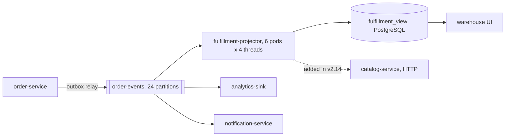
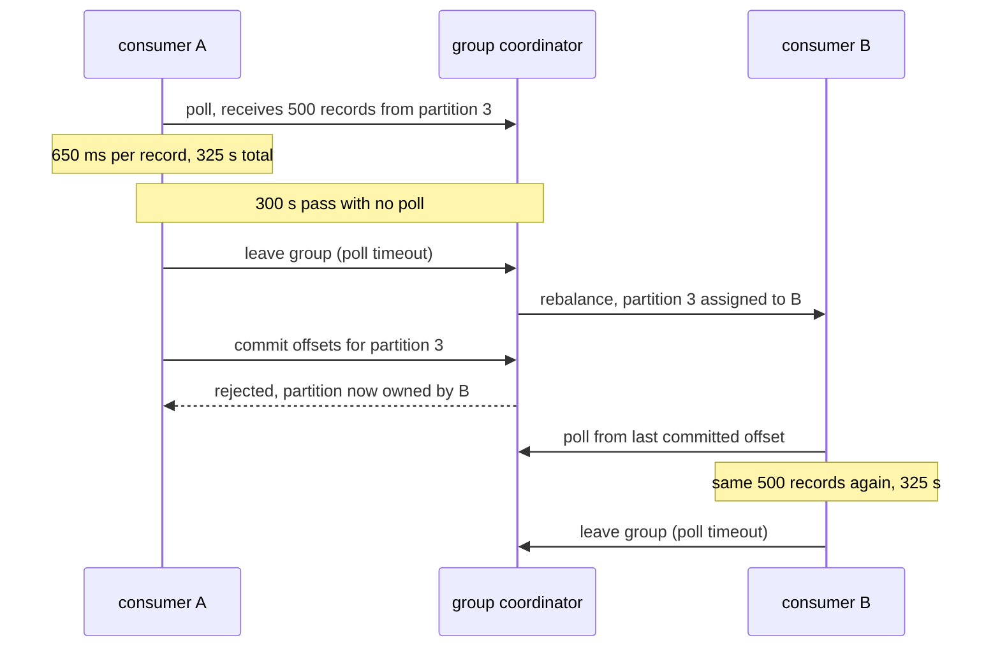
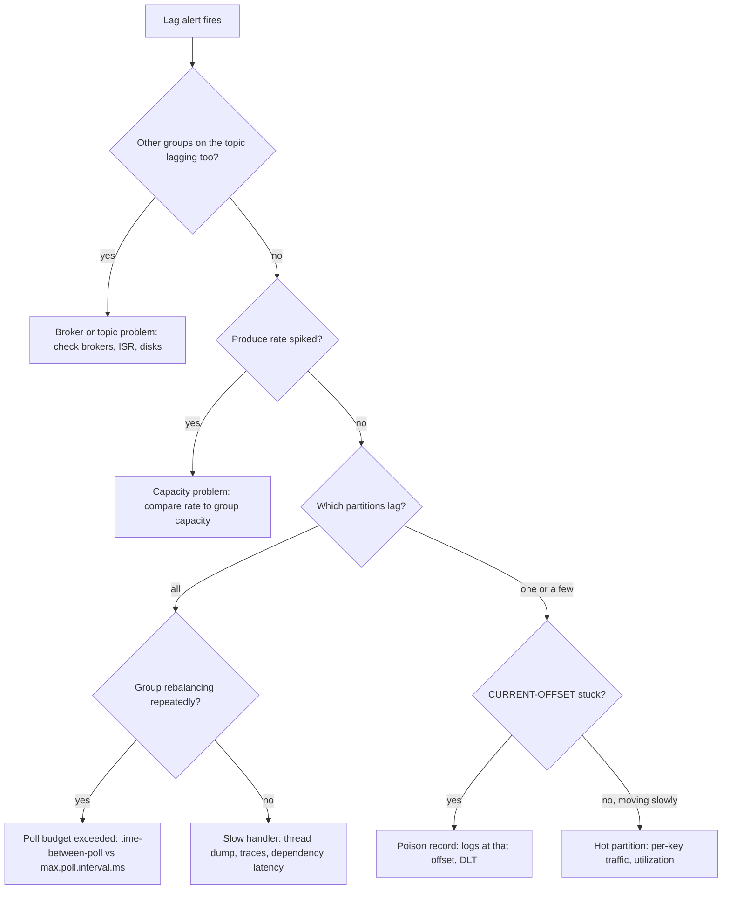

import Callout from '../../components/mdx/Callout.astro';

Consumer lag is the most common Kafka alert and one of the least understood. "Lag is growing" can mean the brokers are sick, the producers spiked, a single record is poisoning a partition, one key is hogging a partition, or the consumers are simply too slow. Each has a different fix, and the obvious reaction, "add more consumers", fixes almost none of them.

This case study follows a lag incident that started with a deploy. A new version of a projection service added one synchronous HTTP call per record. Per-record time went from milliseconds to hundreds of milliseconds, poll loops exceeded `max.poll.interval.ms`, and the consumer group entered a rebalance loop in which it did a lot of work and committed almost none of it. The rollback fixed most partitions in minutes. One partition stayed behind for another hour, for a completely different reason.

<Callout variant="note">
This is a composite scenario; the service names and numbers are illustrative. The failure modes, configuration keys and tools are real, and the arithmetic is shown so you can redo it with your own numbers.
</Callout>

<Callout variant="tip" title="What you'll learn">
- How to read consumer lag: offset lag vs time lag, and what the per-partition pattern tells you
- How `max.poll.records`, `max.poll.interval.ms` and commit timing interact to cause rebalance storms
- A debugging path with `kafka-consumer-groups.sh`, client metrics, logs and thread dumps
- Why consumer parallelism is capped by partition count, and why more partitions do not fix a hot key
- Fixes: timeouts, batching, bulk enrichment, pausing, dead-letter topics, static membership and the KIP-848 consumer protocol
- How to tell this story in a behavioral interview
</Callout>

**Level:** senior. **You should already know:** Kafka's log model, consumer groups, offsets, rebalancing and delivery semantics ([Part 9: Event-Driven Architecture](/blog/backend-09-event-driven-architecture)), queues, retries and dead-letter queues ([Part 6: Async Processing and Queues](/blog/backend-06-async-processing-queues)), throughput and Little's law ([Part 8: Scalability and Performance](/blog/backend-08-scalability-performance)), and SLO-based alerting ([Part 11: Reliability and Observability](/blog/backend-11-reliability-observability)).

## The system

An `order-service` publishes domain events (`OrderPlaced`, `OrderPaid`, `OrderShipped`, ...) to the `order-events` topic through a transactional outbox. The topic has **24 partitions**, replication factor 3, and is keyed by **merchant ID**, because an early consumer needed per-merchant ordering. Several consumer groups read it. The one in this story is `fulfillment-projector`: a Kotlin, Spring Boot 4 and Spring Kafka service that builds a denormalized `fulfillment_view` table in PostgreSQL, which warehouse staff use to see what to pick and pack.



The numbers that matter, at the time of the incident:

| Quantity | Value |
|---|---|
| Produce rate on `order-events` | about 2,000 records/s (afternoon peak) |
| Consumers in the group | 6 pods × `concurrency: 4` = 24 threads, one per partition |
| Per-record processing time (v2.13) | about 4 ms (one upsert) |
| `max.poll.records` | 500 (the default) |
| `max.poll.interval.ms` | 300,000 (the default, 5 minutes) |
| Spring Kafka ack mode | `BATCH` (the default: commit after all records from a poll are processed) |
| Largest merchant's share of traffic | about 12%, all on partition 7 |

The freshness SLO for the warehouse view: 99% of events reflected within 60 seconds.

Capacity before the deploy, using throughput = 1 / per-record time:

- per thread: 1 / 0.004 s = **250 records/s**
- group: 24 × 250 = **6,000 records/s**, against 2,000 records/s incoming: 3× headroom overall.
- partition 7: 12% × 2,000 = **240 records/s** incoming, against 250 records/s capacity for the one thread that owns it: **96% utilized**.

Nobody had done that last calculation before the incident. It matters later.

## Timeline


- **T+0.** v2.14 of `fulfillment-projector` rolls out (rolling restart, one pod at a time). The change enriches each projection row with product dimensions from `catalog-service` so the warehouse UI can suggest box sizes.
- **T+6 min.** First `poll timeout has expired` warnings in the consumer logs.
- **T+15 min.** The time-lag alert fires: oldest unprocessed event older than 5 minutes for 10 minutes. Warehouse staff report that new orders are not appearing.
- **T+22 min.** On-call checks broker health: all normal.
- **T+31 min.** `kafka-consumer-groups.sh` shows the group rebalancing over and over, long after the rollout finished.
- **T+38 min.** A thread dump shows every listener thread waiting on the catalog HTTP call.
- **T+44 min.** Rollback to v2.13 starts.
- **T+52 min.** Rollback complete, group `Stable`, lag starts to drain.
- **T+76 min.** 23 of 24 partitions are caught up. Partition 7 is still hundreds of thousands of records behind and barely moving.
- **T+1 h 35 min.** A hotfix that batches the upserts ships.
- **T+1 h 50 min.** Partition 7 caught up. Incident resolved.

## Investigation

### Step 1: is it the brokers or the producers?

Lag is the difference between the log-end offset and the group's committed offset. It grows when production outpaces consumption, so the first question is which side changed.

- **Brokers.** Under-replicated partitions 0, no ISR shrinks, request latency and network-handler idle ratio normal, no disk alerts. Other consumer groups on the same topic (`analytics-sink`, `notification-service`) had near-zero lag. If the brokers were the problem, every group would suffer. **Ruled out.**
- **Producers.** `BytesInPerSec` on the topic was flat at its usual afternoon level. No traffic spike. **Ruled out.**

That leaves this one group's consumers, which, given a deploy 15 minutes earlier, is where most engineers would look first. Checking the other two is still worth the two minutes: it is the cheapest way to avoid rolling back an innocent service during a broker incident.

### Step 2: describe the group

The consumer-group tool that ships with Kafka shows per-partition lag and ownership:

```bash
kafka-consumer-groups.sh --bootstrap-server kafka-1:9092 \
  --describe --group fulfillment-projector
```

```text
GROUP                  TOPIC         PARTITION  CURRENT-OFFSET  LOG-END-OFFSET  LAG      CONSUMER-ID                         HOST         CLIENT-ID
fulfillment-projector  order-events  0          18822104        19011873        189769   consumer-fulfillment-projector-3-…  /10.2.4.17   consumer-fulfillment-projector-3
fulfillment-projector  order-events  1          18790233        18981455        191222   -                                   -            -
fulfillment-projector  order-events  7          51002871        51429904        427033   consumer-fulfillment-projector-1-…  /10.2.4.21   consumer-fulfillment-projector-1
...
```

Running it a few times a minute apart showed three things:

1. **Every partition was lagging**, not one or two. That points away from a poison record or a hot key and toward a group-wide throughput problem.
2. **`CURRENT-OFFSET` barely moved** between runs, while `LOG-END-OFFSET` grew steadily. The group was not just slow; it was committing almost nothing.
3. **Ownership kept changing.** Some runs printed `Warning: Consumer group 'fulfillment-projector' is rebalancing.` instead of the table, and others showed partitions with no owner (`-`).

The group state confirmed it:

```bash
kafka-consumer-groups.sh --bootstrap-server kafka-1:9092 \
  --describe --group fulfillment-projector --state
```

It flipped between `PreparingRebalance`, `CompletingRebalance` and `Stable` every few minutes. A rolling deploy causes rebalances, but they stop when the rollout ends. These kept going.

### Step 3: the wrong hypotheses worth ruling out

- **"A poison record is blocking us."** A poison record shows a specific pattern: *one* partition's `CURRENT-OFFSET` stuck at the same value while others advance, and the same exception repeated in the logs for the same offset. Here all partitions lagged and the logs had no repeating deserialization or handler exception. **Ruled out.**
- **"The pods are starved for CPU or stuck in GC."** CPU was around 5% per pod and GC pauses were short. That is a classic sign of an **I/O-bound** consumer: it is waiting, not working.
- **"We need more consumers."** Someone proposed scaling to 12 pods. With 24 partitions and already 24 consumer threads, extra consumers in the group get no partitions and sit idle. Worse, every pod added triggers another rebalance. **Rejected**, correctly.

### Step 4: read the logs and the metrics

The consumer logs had the line that explains most of the incident. The Kafka client logs it when the application has not called `poll()` within `max.poll.interval.ms`:

```text
WARN  o.a.k.c.c.i.ConsumerCoordinator - [Consumer clientId=consumer-fulfillment-projector-1, groupId=fulfillment-projector]
consumer poll timeout has expired. This means the time between subsequent calls to poll() was longer than
the configured max.poll.interval.ms, which typically implies that the poll loop is spending too much time
processing messages. You can address this either by increasing max.poll.interval.ms or by reducing the
maximum size of batches returned in poll() with max.poll.records.
```

Shortly after, the same thread failed to commit, because by then the partitions had been given to another member (`CommitFailedException`, surfaced by Spring Kafka in the container logs).

The Kafka consumer's built-in metrics, exported through Micrometer, told the same story with numbers:

- `time-between-poll-max` (consumer metrics): around 320,000 ms, just past the 300,000 ms limit.
- `rebalance-rate-per-hour` (consumer coordinator metrics): around 12, roughly one rebalance every 5 minutes. **The rebalance cadence matched `max.poll.interval.ms`**, which is the giveaway.
- `records-lag-max` (fetch manager metrics): climbing on every client.
- `commit-rate`: near zero.

### Step 5: where is the time going?

A thread dump answers "what are my threads doing right now" without any guesswork. Inside one pod:

```bash
jcmd 1 Thread.print > /tmp/threads.txt
grep -A 12 'KafkaListenerEndpointContainer' /tmp/threads.txt | head -40
```

All four listener threads looked like this (abridged):

```text
"org.springframework.kafka.KafkaListenerEndpointContainer#0-2-C-1" ... WAITING (parking)
    at jdk.internal.misc.Unsafe.park(java.base)
    at java.util.concurrent.CompletableFuture.get(java.base)
    at jdk.internal.net.http.HttpClientImpl.send(java.net.http)
    at org.springframework.http.client.JdkClientHttpRequest.executeInternal(...)
    ...
    at com.example.fulfillment.CatalogClient.dimensions(CatalogClient.kt:31)
    at com.example.fulfillment.ProjectionListener.onEvent(ProjectionListener.kt:44)
```

Distributed traces agreed: each record's processing span now contained a `GET /products/{sku}/dimensions` child span averaging about 650 ms, versus about 40 ms in staging. In production, 24 threads making one call per line item hit `catalog-service` endpoints that had never been sized or cached for that traffic, and the client had **no read timeout**, so slow responses were waited out in full.

## Root cause


The deploy changed the per-record cost by two orders of magnitude, and two consequences compounded.

**1. Throughput collapsed below the produce rate.**

- per thread: 1 / 0.65 s ≈ **1.5 records/s**
- group: 24 × 1.54 ≈ **37 records/s**, against 2,000 records/s incoming.

Even with zero rebalances, lag would grow at about 1,963 records/s, roughly 7 million records per hour.

**2. The poll loop exceeded `max.poll.interval.ms`, so even that throughput was not committed.**

With a backlog, every `poll()` returns a full `max.poll.records` batch:

- 500 records × 0.65 s = **325 s** between polls, against a 300 s limit.

After 300 s the client's background thread notices the overdue `poll()`, the member leaves the group, and its partitions are reassigned. The listener thread is still processing record 460 or so. With ack mode `BATCH`, offsets are committed only after the whole batch, so the commit fails. The new owner starts from the last committed offset and re-reads the same 500 records, which also take 325 s. The group did a lot of work and made almost no progress. Every record that was processed was processed again, which is safe only because the projection upserts are idempotent.



With the classic protocol's eager rebalancing, every rebalance also stops *every* member, not just the slow one, which makes a storm worse. The group used the client default assignor list (`RangeAssignor, CooperativeStickyAssignor`), and because `RangeAssignor` is first in that list, the group stayed on eager rebalancing.

### The second root cause: a hot partition with no headroom

After the rollback, the throughput math reverted to 6,000 records/s for the group. The expected catch-up time per ordinary partition:

- backlog per ordinary partition after 52 minutes: (88% × 2,000) / 23 ≈ 76.5 records/s × 3,120 s ≈ **239,000 records**
- spare capacity: 250 − 76.5 = 173.5 records/s
- catch-up: 239,000 / 173.5 ≈ **1,380 s, about 23 minutes**, which matched T+76.

Partition 7 is different:

- backlog: 240 records/s × 3,120 s ≈ **749,000 records**
- spare capacity: 250 − 240 = **10 records/s**
- catch-up: 749,000 / 10 ≈ 74,900 s, **about 21 hours**.

A partition is consumed by at most one consumer in a group, so no amount of scaling helps partition 7. And adding partitions would not help either: all of the large merchant's events hash to the same partition because they share a key. The hot partition had been running at 96% utilization for months, invisible because a 4% margin is enough as long as you never fall behind. The incident simply exposed that it could never catch up.

## The fix

### Short-term mitigation

1. **Roll back** to v2.13. The fastest way to restore the per-record cost. Raising `max.poll.interval.ms` or lowering `max.poll.records` would have stopped the rebalances but not fixed throughput: 37 records/s against 2,000 is still a losing race.
2. **Freeze deploys** of the consumer until the group was stable, since every pod restart is a rebalance.
3. **Hotfix the hot partition** with batched writes (below), the quickest change that raises per-thread throughput on partition 7 without touching keys or partition counts. In the load test it brought the amortized cost to about 1 ms per record, so the thread's capacity became about 1,000 records/s, spare capacity about 760 records/s, and the remaining ~720,000 records drained in about 950 s, roughly 16 minutes.

### Long-term fix

#### 1. Put a timeout on every call in a consumer, and budget the poll loop

A consumer thread blocked on an HTTP call with no timeout is a consumer that can be held hostage by any dependency. Set connect and read timeouts explicitly:

```kotlin
@Configuration
class CatalogClientConfig {
    @Bean
    fun catalogRestClient(builder: RestClient.Builder): RestClient {
        val http = HttpClient.newBuilder().connectTimeout(Duration.ofMillis(300)).build()
        val factory = JdkClientHttpRequestFactory(http).apply { setReadTimeout(Duration.ofMillis(500)) }
        return builder.baseUrl("http://catalog-service").requestFactory(factory).build()
    }
}
```

Then make the poll-loop budget an explicit rule rather than a default you inherit:

> `max.poll.records` × worst-case per-record time must stay well under `max.poll.interval.ms`.

With a 500 ms read timeout and a bulk enrichment call per batch (next section), the worst case is bounded. The team lowered `max.poll.records` to 200 and kept `max.poll.interval.ms` at 5 minutes: 200 records × 4 ms is under a second in the normal case, and even a pathological 1 s per record is 200 s, still inside the limit. Raising `max.poll.interval.ms` is legitimate, but it also delays detection of a genuinely stuck consumer, so prefer shrinking the batch first.

#### 2. Batch the work: one bulk enrichment, one bulk write

Per-record remote calls are the root of the throughput problem. A batch listener receives the whole poll result, deduplicates the lookups, makes one bulk call (with a short-lived cache in front of it), and writes all rows in one JDBC batch:

```kotlin
@Component
class ProjectionListener(
    private val catalog: CatalogClient,
    private val projections: ProjectionRepository,
) {
    @KafkaListener(id = "projector", topics = ["order-events"], groupId = "fulfillment-projector", batch = "true")
    fun onBatch(records: List<ConsumerRecord<String, OrderEvent>>) {
        val skus = records.flatMap { it.value().lineItems.map(LineItem::sku) }.toSet()
        val dimensions = catalog.dimensionsFor(skus)          // one bulk call, cached, with a timeout

        records.forEachIndexed { index, record ->
            if (record.value().lineItems.any { it.sku !in dimensions }) {
                throw BatchListenerFailedException("missing catalog data", index)
            }
        }
        projections.upsertAll(records.map { toProjection(it.value(), dimensions) })
    }
}
```

```kotlin
fun upsertAll(rows: List<FulfillmentRow>) {
    jdbcTemplate.batchUpdate(
        """
        INSERT INTO fulfillment_view (order_id, merchant_id, status, box_hint, event_version)
        VALUES (?, ?, ?, ?, ?)
        ON CONFLICT (order_id) DO UPDATE
           SET status = EXCLUDED.status, box_hint = EXCLUDED.box_hint, event_version = EXCLUDED.event_version
         WHERE fulfillment_view.event_version < EXCLUDED.event_version
        """,
        rows, rows.size,
    ) { ps, r ->
        ps.setObject(1, r.orderId); ps.setString(2, r.merchantId); ps.setString(3, r.status)
        ps.setString(4, r.boxHint); ps.setLong(5, r.eventVersion)
    }
}
```

The `WHERE ... event_version <` guard keeps the upsert idempotent and order-safe under redelivery, which this incident proved will happen. With the PostgreSQL JDBC driver, the `reWriteBatchedInserts=true` connection property can additionally rewrite the batch into multi-row inserts; measure it with your statement before relying on it.

Throwing `BatchListenerFailedException` with the index tells Spring Kafka's `DefaultErrorHandler` which record failed: it commits the offsets before that record, retries from there and, once retries are exhausted, hands only the failed record to the recoverer.

#### 3. Bounded retries and a dead-letter topic

A poison record was not the cause this time, but the investigation exposed that the service would have handled one badly: its error handler retried with an unlimited back-off, which would have blocked a partition forever. Retries are now bounded, non-retryable exceptions skip straight to the dead-letter topic, and deserialization failures are caught before they reach the listener:

```kotlin
@Bean
fun kafkaErrorHandler(template: KafkaTemplate<Any, Any>): DefaultErrorHandler {
    val recoverer = DeadLetterPublishingRecoverer(template) { record, _ ->
        TopicPartition("order-events.fulfillment-dlq", -1)   // negative partition: let the producer choose
    }
    return DefaultErrorHandler(recoverer, FixedBackOff(500L, 3L)).apply {
        addNotRetryableExceptions(DeserializationException::class.java, IllegalArgumentException::class.java)
    }
}
```

Spring Boot wires a single `CommonErrorHandler` bean into the auto-configured listener container factory. The value deserializer is wrapped in `ErrorHandlingDeserializer`, so a record that cannot be deserialized becomes a `DeserializationException` handled by the error handler instead of an exception thrown inside `poll()` on every attempt:

```yaml
spring:
  kafka:
    consumer:
      group-id: fulfillment-projector
      max-poll-records: 200
      value-deserializer: org.springframework.kafka.support.serializer.ErrorHandlingDeserializer
      properties:
        spring.deserializer.value.delegate.class: io.confluent.kafka.serializers.KafkaAvroDeserializer
        schema.registry.url: http://schema-registry:8081
        specific.avro.reader: true
        max.poll.interval.ms: 300000
    listener:
      concurrency: 4
```

Dead-lettered records need an owner, an alert on the DLT's message rate, and a replay tool. A DLT nobody looks at is just a slower way to lose data.

#### 4. Pause instead of blocking when a dependency is down

If `catalog-service` is unavailable, the right behavior is to stop consuming, not to burn the poll budget waiting on timeouts. The listener container can be paused; a paused Spring Kafka container keeps calling `poll()` (which returns no records), so the consumer stays in the group and keeps its partitions:

```kotlin
@Component
class CatalogBackpressure(private val registry: KafkaListenerEndpointRegistry) {
    fun onCircuitOpened() { registry.getListenerContainer("projector")?.pause() }
    fun onCircuitClosed() { registry.getListenerContainer("projector")?.resume() }
}
```

Wire these to the circuit breaker's state transitions. Lag grows while paused, which is correct: the alert tells a human that a dependency is down, and nothing is reprocessed or dead-lettered for a temporary outage.

#### 5. Fewer, cheaper rebalances

Two changes reduce how much a rebalance costs and how often one happens:

- **Static membership.** Setting `group.instance.id` per pod (from the pod name in a StatefulSet) means a restart within `session.timeout.ms` (45 s by default) does not trigger a rebalance at all; the member rejoins with its old assignment. Spring Kafka appends a suffix per child consumer when `concurrency` is above 1.
- **The KIP-848 consumer rebalance protocol.** Apache Kafka 4.0 made the new consumer group protocol generally available. Clients opt in with `group.protocol=consumer`. Assignment moves to the group coordinator on the broker, rebalances are incremental and per member, and there is no group-wide synchronization barrier: members whose assignment does not change keep processing. With this protocol, the client-side `partition.assignment.strategy`, `session.timeout.ms` and `heartbeat.interval.ms` settings are not used; session and heartbeat timeouts are configured on the broker (`group.consumer.session.timeout.ms`, `group.consumer.heartbeat.interval.ms`), and you can pick a server-side assignor with `group.remote.assignor`.

```yaml
spring:
  kafka:
    consumer:
      properties:
        group.protocol: consumer
        group.instance.id: ${POD_NAME}
```

Be clear about what KIP-848 does **not** fix: `max.poll.interval.ms` is still enforced by the client, and a member that exceeds it still leaves the group and loses its partitions. A faster rebalance protocol makes each rebalance cheaper; it does not make a slow handler fast. Check that your brokers, client library and Spring Kafka version all support the new protocol before switching, and roll it out one consumer group at a time.

#### 6. Fix the hot key at the source

Partition 7's problem is structural. The options, in order of preference for this system:

- **Key by what actually needs ordering.** The projection needs per-*order* ordering, not per-*merchant*. Keying by order ID spreads the large merchant across all partitions. Changing keys changes partitioning, so the migration is a new topic (`order-events.v2`, keyed by order ID) that the outbox relay writes in parallel, with consumers moving over one by one and the old topic retired afterwards. Consumers that do need per-merchant ordering keep reading the old topic or keep their own per-merchant state.
- **Parallelize within a partition while preserving key order**, for example with the open-source Confluent Parallel Consumer library in key-ordering mode. It processes different keys from one partition concurrently. It does not help when one single key is the hot spot.
- **Add partitions.** Partitions can only be increased, and doing so remaps keys for new records, which breaks per-key ordering across the change. It raises the parallelism ceiling for the group, but on its own it does not split a hot key.

Kafka's share groups (KIP-932, "Queues for Kafka") remove the one-consumer-per-partition limit for workloads that do not need ordering. This projection does need per-order ordering, so they were not an option here; check the feature's status in your Kafka version before relying on it for anything else.

## Prevention

### A diagnostic tree for the runbook

The most useful artifact from the postmortem was a one-page decision tree for "consumer lag is growing", so the next on-call does not have to rediscover the investigation:



### Alerts

- **Time lag, not offset lag.** "500,000 records behind" means nothing without the rate. Alert on the age of the oldest unprocessed event, which maps directly to the freshness SLO (99% within 60 s) and supports burn-rate alerting. The consumer can publish this as a gauge (`now − timestamp of the last processed record`, per partition); external tools such as Burrow or kafka-exporter compute offset lag from the broker side, which still works when the consumer is down.
- **Rebalance rate.** `rebalance-rate-per-hour` above a small number outside deploy windows is a page-worthy anomaly on its own.
- **Poll budget.** Alert when `time-between-poll-max` exceeds 50% of `max.poll.interval.ms`. That would have fired minutes into this incident, before any member was kicked out.
- **Per-partition utilization.** For each partition, incoming rate divided by the measured per-thread capacity. Anything above about 70% sustained is a ticket. Partition 7 sat at 96% for months.
- **DLT rate**, non-zero for more than a few minutes.

### Tests and deploy guardrails

- **Load test consumers with production-like dependency latency.** The enrichment call was 40 ms in staging and 650 ms in production. Run consumer load tests against a stub that injects realistic and degraded latency, and assert sustained throughput above the peak produce rate with margin, not just correctness.
- **A per-record cost check in review.** Any change that adds a network call inside a listener needs a stated latency budget and a capacity calculation like the one above, in the pull request.
- **Canary the consumer.** Consumer groups do not split traffic by percentage, but you can deploy the new version to one pod first and compare its per-record processing time (Spring Kafka's listener observation timer, or a custom timer) against the old pods for 15 minutes before continuing the rollout. Here the canary would have shown a 150× regression within a minute.
- **Consumer deploys pause on lag.** The deployment pipeline checks time lag and rebalance rate between pod restarts and halts the rollout if either degrades.

## Interview angle

### The STAR story (about two minutes)

**Situation.** "I owned a Kafka consumer that built the warehouse's fulfillment view from order events, 24 partitions, about 2,000 events a second at peak. After a deploy, the warehouse UI stopped showing new orders and our time-lag alert fired."

**Task.** "As on-call I had to restore freshness and find out why, without making things worse."

**Action.** "I first ruled out the brokers and producers: other groups on the topic were fine and the produce rate was flat. `kafka-consumer-groups.sh` showed every partition lagging, committed offsets barely moving, and the group rebalancing every five minutes, which matched `max.poll.interval.ms`. A thread dump showed all listener threads waiting on a new HTTP call to the catalog service that the deploy had added per record, at about 650 milliseconds each with no timeout. 500 records per poll at that cost is over five minutes, so consumers were kicked out before committing and the next owner redid the same batch. I rolled back. Most partitions recovered in about 20 minutes, but one stayed behind; the math showed it carried one big merchant's traffic at 96% of a single thread's capacity, so it would have taken a day. We shipped a hotfix that batched the database writes and it caught up in about 15 minutes."

**Result.** "Total impact was under two hours of stale data and no data loss, because the projection was idempotent. Afterwards we moved enrichment to one bulk cached call per batch with timeouts, added alerts on poll-loop time and per-partition utilization, a canary step for consumer deploys, and planned re-keying the topic by order ID."

Interviewers listen for whether you knew *why* adding consumers would not help, and whether you found the second problem instead of declaring victory after the rollback.

### Technical follow-ups

<details>
<summary>Why didn't you just scale out the consumers?</summary>

Within a consumer group, each partition is assigned to at most one consumer. With 24 partitions and 24 consumer threads, extra pods would receive no partitions and sit idle, and every pod added triggers a rebalance, which during this incident was the thing destroying progress. Scaling out only helps when there are more partitions than consumers. For a hot partition it never helps, because one partition is always processed by one consumer.

</details>

<details>
<summary>Why not just increase max.poll.interval.ms to 30 minutes?</summary>

It would have stopped the rebalance loop, so committed progress would resume, but at 37 records/s against 2,000 incoming the lag would still grow by millions per hour. It also hides real problems: a consumer that is genuinely stuck would take 30 minutes to be detected and have its partitions moved. Fix the per-record cost first, then size `max.poll.records` so a batch comfortably fits the interval. Raise the interval deliberately, for workloads that are known to be slow per batch.

</details>

<details>
<summary>What is the difference between session.timeout.ms and max.poll.interval.ms?</summary>

They detect different failures. Heartbeats are sent from a background thread, and `session.timeout.ms` detects a consumer process that is dead or partitioned from the coordinator. `max.poll.interval.ms` detects a consumer process that is alive but whose processing thread has not called `poll()` in time, meaning it is stuck or too slow. This incident was the second kind: heartbeats were fine, the poll loop was not. With the KIP-848 protocol, session and heartbeat timeouts move to broker-side group configuration, while `max.poll.interval.ms` remains a client setting.

</details>

<details>
<summary>How do you tell a poison record from a slow consumer from a hot partition?</summary>

Look at the per-partition pattern over a few minutes. A poison record: one partition's committed offset is stuck at the same value while the rest advance, with the same exception repeating in the logs. A slow consumer: all partitions lag, offsets move slowly or, with a rebalance storm, barely at all. A hot partition: one partition lags and its offset moves, just slower than its log-end offset, and its incoming rate is far above the others. Each has a different fix: DLT and bounded retries, throughput work, and re-keying or intra-partition parallelism.

</details>

<details>
<summary>Records were processed more than once. Was that a problem?</summary>

Not here, because the projection is an idempotent, version-guarded upsert, which is exactly why at-least-once delivery is acceptable. Every Kafka consumer that commits after processing is at-least-once and will reprocess records after a rebalance or crash. If the handler had side effects such as sending emails or charging cards, the rebalance storm would have duplicated them; those handlers need an inbox or dedupe table keyed by event ID (see [Duplicate Payments from Retries](/blog/case-03-duplicate-payments-retries) and [Part 9](/blog/backend-09-event-driven-architecture)).

</details>

<details>
<summary>What does the KIP-848 consumer protocol change, and would it have prevented this incident?</summary>

It moves assignment to the broker-side group coordinator and makes rebalances incremental per member, with no global barrier where every consumer stops. Unaffected members keep processing, and rolling deploys become much cheaper. It would have reduced the collateral damage of each rebalance, but not prevented the incident: members exceeding `max.poll.interval.ms` still leave the group and lose uncommitted work. The fix was the per-record cost and the poll budget.

</details>

<details>
<summary>How would you size partitions for this topic going forward?</summary>

Work backwards from the consumer, which is usually the bottleneck. Required partitions ≥ peak produce rate / per-consumer throughput, with headroom for catch-up: to drain a backlog you need spare capacity, not just enough to keep up. At 2,000 records/s peak, 250 records/s per thread and a target of 50% utilization at peak, that is 2,000 / 125 = 16 partitions minimum, so 24 is fine on average. The real constraint was key skew, which you check separately: the largest key's rate must fit comfortably in one thread.

</details>

<details>
<summary>When should a consumer pause rather than retry or dead-letter?</summary>

Pause when the failure is about a dependency, not the record: the downstream database or service is unavailable and every record would fail the same way. Retrying burns the poll budget and dead-lettering would fill the DLT with good records. Retry briefly for transient, per-record errors. Dead-letter records that will never succeed, such as deserialization failures or validation errors, so they do not block the partition.

</details>

## Common mistakes

- **Scaling consumers beyond the partition count**, then wondering why lag does not move.
- **Raising `max.poll.interval.ms` as the fix** instead of reducing per-batch processing time.
- **Synchronous per-record remote calls in a listener**, especially without timeouts.
- **Alerting on offset lag only.** It has no unit of time and no connection to the SLO.
- **Unbounded retries in the error handler**, which turn one bad record into a stuck partition.
- **Non-idempotent handlers.** Rebalances and crashes cause redelivery; plan for it.
- **Declaring victory after the rollback** without checking every partition's catch-up rate.
- **Ignoring key skew.** Per-partition utilization matters more than group-wide headroom.
- **Treating KIP-848 or cooperative rebalancing as a cure for slow processing.** They make rebalances cheaper, not handlers faster.

## Key takeaways

- Read lag per partition. **All partitions** lagging points to consumer throughput; **one stuck** partition points to a poison record; **one slow** partition points to a hot key.
- The poll budget is a hard constraint: `max.poll.records` × per-record time must fit well inside `max.poll.interval.ms`, or the group can rebalance itself into zero committed progress.
- Consumer parallelism in a group is **capped by partition count**, and a hot key is capped by **one thread**.
- Do the capacity arithmetic: throughput per thread, group capacity, per-partition utilization, and catch-up time = backlog / spare capacity.
- Keep listeners cheap: timeouts on every call, bulk enrichment, batched idempotent writes, bounded retries with a DLT, and pausing when a dependency is down.
- Static membership and the **KIP-848** protocol make rebalances cheaper; they do not fix slow handlers.
- Alert on **time lag** against the freshness SLO, rebalance rate, poll-loop time and per-partition utilization, and canary consumer deploys.

Previous: [Duplicate Payments from Retries](/blog/case-03-duplicate-payments-retries) · Next: [A Retry Storm and a Cascading Failure](/blog/case-05-retry-storm-cascading-failure)
