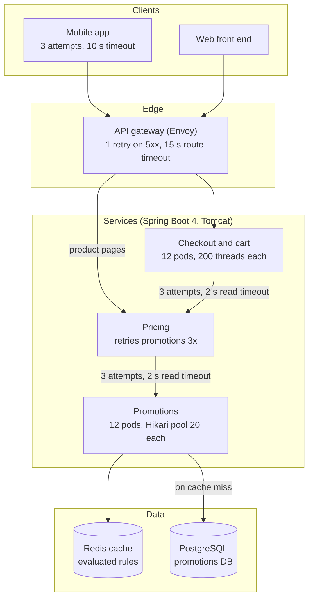
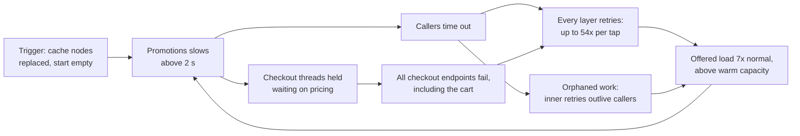
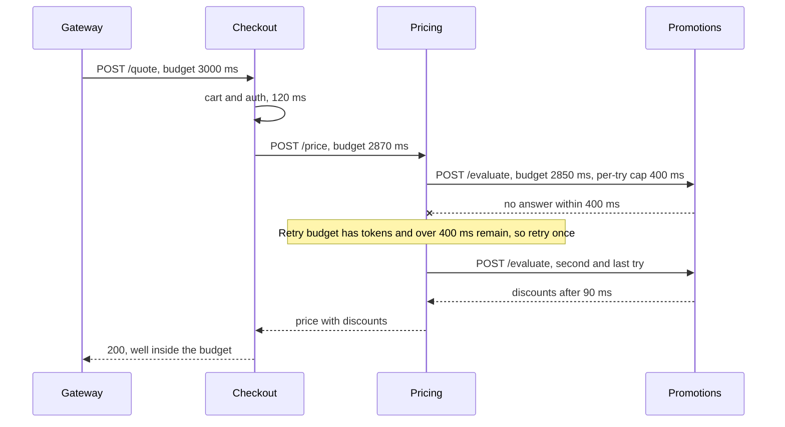

import Callout from '../../components/mdx/Callout.astro';

Most outages that take a whole product down do not start with something big. They start with one dependency getting a bit slower, and then every well-meaning layer above it doing exactly what it was configured to do: wait, time out, and try again. Each layer is locally reasonable. Together they multiply load on the one component that can least afford it, and the failure spreads upward until services that never touched the slow dependency are down too.

This case study follows one of those incidents from the first page to the postmortem. The trigger lasted about nine minutes. The outage lasted 52, because the system had found a second stable state, overloaded by its own retries, and stayed there after the trigger was gone.

<Callout variant="note" title="Composite scenario">
This is a composite scenario; the service names and numbers are illustrative. It is built from failure patterns that show up again and again in public postmortems and in production systems, not from any single company's incident.
</Callout>

**Level: staff.** You should already know: timeouts, deadline propagation, retries with backoff and jitter, circuit breakers, bulkheads, load shedding and burn-rate alerting ([Part 11: Reliability and Observability](/blog/backend-11-reliability-observability)); failure modes and idempotency ([Part 10](/blog/backend-10-distributed-systems)); cache stampedes and warm-up ([Part 5](/blog/backend-05-caching)); thread pools, Little's law and back-pressure ([Part 8](/blog/backend-08-scalability-performance)). [Connection Pool Exhaustion](/blog/case-01-connection-pool-exhaustion) earlier in this series is the single-service version of the same physics.

<Callout variant="tip" title="What you'll learn">
- How retries at several layers multiply into a retry storm, with the arithmetic
- Why the outage outlived its trigger: metastable failure and orphaned work
- An investigation path using RED metrics, Resilience4j and Envoy stats, traces, thread dumps and `pg_stat_activity`
- Short-term mitigation (kill switches, shedding at the edge) versus the long-term fix
- Retry budgets, deadline propagation, circuit breakers with fallbacks, and load shedding in Kotlin and Spring Boot 4
- How to tell this story in a behavioural interview, and the technical follow-ups to expect
</Callout>

---

## The system

An online shop with a mobile app and a web front end. The relevant path is anything that shows a price: product pages, the cart and checkout. Prices come from a **pricing** service, which asks a **promotions** service which discounts apply (campaign rules, coupon codes, loyalty tiers). Promotions evaluates rules against data in its own PostgreSQL database and keeps the evaluated results in a Redis cache, because rule evaluation is expensive and the inputs change slowly.



Some numbers from a normal Friday evening, which matter later:

| Quantity | Normal value |
|---|---|
| Requests to promotions | about 2,400 per second |
| Promotions cache hit rate | about 95% |
| Promotions capacity, warm cache (last load test) | about 6,000 per second |
| Promotions capacity, cold cache (estimated from DB throughput) | about 1,500 per second |
| Checkout p99 latency | 180 ms |
| Busy Tomcat threads across checkout | about 50 of 2,400 |

And the retry configuration, which nobody had looked at as a whole:

| Layer | Attempts | Timeout per attempt |
|---|---|---|
| Mobile app | 3 (on any error or timeout) | 10 s for the whole request |
| Gateway | 2 (`num_retries: 1` on 5xx) | none per try; 15 s route timeout (Envoy's default) |
| Checkout to pricing | 3 (Resilience4j retry) | 2 s read timeout |
| Pricing to promotions | 3 (Resilience4j retry) | 2 s read timeout |

Each row was added by a different team, in response to a different past incident, and each is defensible on its own. That is the normal way a system ends up like this.

---

## Timeline


All times are relative to 19:02, when the trigger happened.

- **T+0.** As part of planned maintenance, the promotions Redis nodes were replaced with a larger instance type. The new nodes started empty. The runbook said "the cache warms naturally in a few minutes", which was true at 03:00 and not on a Friday evening.
- **T+1 to T+3.** Promotions cache hit rate drops to near zero. Every request hits PostgreSQL. Promotions p99 goes from 40 ms to over 2 seconds.
- **T+3.** The checkout availability SLO fast-burn alert pages the checkout on-call (burn rate above 14.4× over both the 1-hour and 5-minute windows).
- **T+6.** Incident declared. An incident commander (IC) is assigned and a channel opened. Product pages are slow, cart and checkout are returning 503s.
- **T+10.** First hypothesis: a checkout deploy went out at 18:40. It is rolled back. No change.
- **T+14.** Promotions cache hit rate is back above 90%. Nobody notices yet, because error rates have not moved.
- **T+16.** A trace from a failed checkout shows three pricing spans, each containing three promotions spans, each ending in a timeout. The retry hypothesis takes shape.
- **T+19.** Promotions is scaled from 12 to 24 pods to "add capacity". PostgreSQL connections go from 240 to 480 (against `max_connections = 500`), DB CPU climbs further and promotions latency gets worse. Scale-out reverted at T+21.
- **T+22.** The IC, with the commerce product owner on the call, flips the `promotions.enabled` kill switch in pricing. Pricing returns base prices and checkout shows a banner that discounts are temporarily unavailable, with coupon entry disabled. Calls to promotions drop to zero.
- **T+25.** Gateway retries for the pricing and checkout routes are switched off through a config push. A temporary edge rate limit sheds product-page traffic above 80% of normal.
- **T+26 to T+31.** Checkout thread usage falls. 5xx rate falls below 5%. Promotions, now idle, is healthy. A warm-up job pre-populates the cache for active campaigns.
- **T+38.** Promotions re-enabled for 10% of traffic, then 50% at T+43, then 100% at T+47, watching promotions latency and DB CPU at each step.
- **T+52.** Burn rate back to normal for 5 minutes. Edge rate limit removed. Incident resolved. Total customer impact: about 50 minutes of failed or degraded checkouts.

The single most important line is T+14. The trigger had gone away and the outage carried on. That is the signature of a metastable failure, and it changes what "mitigation" means: fixing the trigger is not enough, you have to remove the load that sustains the bad state.

---

## Investigation

This is the path the responders actually took, including the detours. In an interview, the detours are as valuable as the answer: they show how you reason under pressure.

### Step 1: what is broken, from the user's side

The page came from the checkout SLO, so the first dashboard was the checkout RED view (rate, errors, duration). Two things stood out: the 5xx rate was rising on **all** checkout endpoints, including `GET /cart`, which never calls pricing; and request rate at checkout was **higher** than normal, not lower, despite users clearly having a bad time.

```promql
# 5xx rate per service
sum by (service) (rate(http_server_requests_seconds_count{status=~"5.."}[1m]))

# request rate per service, compared with the same time last week
sum by (service) (rate(http_server_requests_seconds_count[1m]))
  / sum by (service) (rate(http_server_requests_seconds_count[1m] offset 1w))
```

Rate going **up** during an outage is a strong hint. Users don't suddenly shop more when the site is broken; clients and intermediaries are re-sending requests.

### Step 2: the wrong hypothesis, a deploy

A checkout deploy had gone out 22 minutes earlier, so it was rolled back at T+10. That's not a bad move: rolling back a recent change is cheap, reversible, and the most common fix for incidents. It was the right first action and the wrong cause. The useful discipline is to **set an expectation before acting** ("if it's the deploy, errors should drop within 2 minutes of rollback") and to move on decisively when the expectation fails.

### Step 3: why is checkout failing endpoints that don't use pricing?

Thread saturation is the usual answer. Spring Boot only publishes Tomcat thread metrics when the MBean registry is enabled (`server.tomcat.mbeanregistry.enabled: true`), which this team had done after an earlier incident:

```promql
max by (pod) (tomcat_threads_busy_threads{service="checkout"})
  / max by (pod) (tomcat_threads_config_max_threads{service="checkout"})
```

Every checkout pod was at 200 of 200 busy threads. A thread dump from one pod confirmed where they were:

```bash
kubectl exec checkout-7c9f8-xk2lp -- jcmd 1 Thread.print > checkout-threads.txt

# how many request threads are waiting inside an outbound HTTP call
grep -A 20 '"http-nio-8080-exec' checkout-threads.txt \
  | grep -c 'jdk.internal.net.http.HttpClientImpl.send'
```

Almost all request threads were parked inside `HttpClientImpl.send`, called from the pricing client, or sleeping in Resilience4j's retry wait between attempts. `GET /cart` failed because it could not get a thread at all: Tomcat's 200 workers were busy and its accept queue (`server.tomcat.accept-count`, default 100) was full, so new connections waited and then timed out at the gateway.

Little's law makes the mechanism precise. Concurrency equals arrival rate times time in system:

- Normal: about 400 checkout requests/s × 0.12 s ≈ **48** busy threads across the fleet.
- During the incident, a checkout request that hit pricing waited for up to 3 attempts × 2 s read timeout, plus backoff of 100 ms and 200 ms, so about **6.3 s**.
- 400 requests/s × 6.3 s ≈ **2,520** threads needed, against 12 × 200 = **2,400** available. And that is before counting the extra arrivals caused by gateway and app retries.

Checkout did not need to be broken to fail. It only needed one dependency to be slow, and no limit on how many threads that dependency could hold.

### Step 4: follow a single failed request

Metrics show that something is wrong; a trace shows where. The on-call picked a failed checkout trace from the tracing backend by filtering on `http.response.status_code = 503` and `service.name = checkout`. The span tree, simplified:

```text
gateway  POST /checkout/quote           try 1   timeout (app gave up at 10 s)
└─ checkout  POST /quote                        503 after 6.4 s
   ├─ pricing  POST /price  (attempt 1)          client timeout at 2.0 s
   │  ├─ promotions  POST /evaluate (1)          client timeout at 2.0 s
   │  ├─ promotions  POST /evaluate (2)          still running when parent gave up
   │  └─ promotions  POST /evaluate (3)          started after parent gave up
   ├─ pricing  POST /price  (attempt 2)          client timeout at 2.0 s
   │  └─ ... 3 more promotions calls
   └─ pricing  POST /price  (attempt 3)          client timeout at 2.0 s
      └─ ... 3 more promotions calls
gateway  POST /checkout/quote           try 2   (same shape again)
```

Two problems are visible in that one picture:

1. **Amplification.** One user action fanned out into nine promotions calls per checkout attempt, times two gateway tries, times up to three app attempts.
2. **Orphaned work.** Pricing's internal retry sequence takes up to about 6.3 s, but checkout gives up on pricing after 2 s. So pricing keeps calling promotions for a caller that has already left, and checkout's retry starts a **second** copy of the same sequence in parallel. Spring MVC does not cancel a handler when the client disconnects, so the abandoned work runs to completion.

### Step 5: quantify the amplification

The retry metrics confirmed the shape at each layer. Resilience4j publishes `resilience4j_retry_calls_total` with a `kind` label (`successful_without_retry`, `successful_with_retry`, `failed_with_retry`, `failed_without_retry`), and Envoy exposes per-cluster retry counters:

```promql
# pricing's calls to promotions, split by outcome
sum by (kind) (rate(resilience4j_retry_calls_total{service="pricing", name="promotions"}[1m]))

# gateway retries and upstream timeouts on the checkout cluster
sum(rate(envoy_cluster_upstream_rq_retry{envoy_cluster_name="checkout"}[1m]))
sum(rate(envoy_cluster_upstream_rq_timeout{envoy_cluster_name="checkout"}[1m]))

# the ratio that matters: requests promotions receives per request users send
sum(rate(http_server_requests_seconds_count{service="promotions"}[1m]))
  / sum(rate(envoy_http_downstream_rq_total{envoy_http_conn_manager_prefix="ingress"}[1m]))
```

Promotions was receiving about **16,800 requests/s**, roughly seven times its normal 2,400. The theoretical worst case was much higher:


The arithmetic: 3 (app) × 2 (gateway) × 3 (checkout to pricing) × 3 (pricing to promotions) = **54** promotions calls for a single tap, if every attempt fails. The observed multiplier was lower, around 7×, because not every attempt failed, the app's 10-second timeout cut many chains short, and thread exhaustion in checkout capped how many pricing calls could even be made. A cap imposed by your own outage is not a safety mechanism.

### Step 6: why didn't it recover when the cache did?

At T+14 the cache hit rate was back above 90%. Warm, promotions can serve about 6,000 requests/s. It was being offered about 16,800. So it stayed overloaded, its latency stayed above the 2 s client timeouts, most of its responses arrived after the caller had given up, every timeout produced another retry, and the retries kept the offered load high. The trigger was gone and the loop was self-sustaining.

The database view showed the same thing from below:

```sql
-- what are promotions' connections doing right now?
SELECT state, wait_event_type, wait_event, count(*)
FROM pg_stat_activity
WHERE datname = 'promotions'
GROUP BY state, wait_event_type, wait_event
ORDER BY count(*) DESC;

-- the longest-running statements
SELECT pid, now() - query_start AS running_for, left(query, 60) AS query
FROM pg_stat_activity
WHERE datname = 'promotions' AND state = 'active'
ORDER BY running_for DESC
LIMIT 10;
```

All 240 connections were active, most waiting on CPU or I/O, with statements running for several seconds. Hikari's `hikaricp_connections_pending` on promotions pods was in the hundreds. The database was doing useful-looking work whose results nobody was waiting for any more.

### Step 7: the second wrong move, scaling out

Doubling promotions pods sounds like adding capacity, but promotions was not the bottleneck; its database was. More pods meant more Hikari pools, so connections went from 12 × 20 = 240 to 24 × 20 = 480, close to `max_connections = 500`. More concurrent queries on a saturated database means more contention and context switching and lower throughput per query. The rule: **before scaling a tier, find the tier that is actually saturated**, and remember that stateless pods in front of a fixed-size database multiply load on it.

### What finally pointed at the cure

By T+20 the IC had a clear picture: the system needed **less load on promotions, now**, more than it needed a root cause. There were two levers that removed load immediately without a deploy: the promotions kill switch in pricing (built a year earlier for a different reason) and gateway retry configuration. Both were pulled within three minutes, and the system recovered within ten.

<Callout variant="warning" title="Mitigate first, explain later">
The investigation above reads cleanly in hindsight. During the incident, the right question at T+16 was not "what is the root cause?" but "what is the fastest reversible action that removes load from the saturated component?". Kill switches, shedding at the edge and disabling retries are all reversible in seconds. Root cause can wait for the postmortem.
</Callout>

---

## Root cause

There was no single root cause, and the postmortem said so. The trigger, a cache that came back empty at peak, was ordinary. What turned it into an outage was a set of design properties that combined into a positive feedback loop.



The contributing factors, as the postmortem listed them:

1. **Retries at every layer, with no budget.** Four layers retried independently. Attempts multiplied. Nothing bounded the total extra load retries could add.
2. **Inverted timeouts.** Inner retry sequences (pricing's 3 × 2 s) were longer than the outer timeout waiting for them (checkout's 2 s). Callers gave up and retried while the previous attempt was still running, so work duplicated instead of being replaced.
3. **No deadline propagation.** Promotions had no way to know that the request it was evaluating had already been abandoned two hops up.
4. **No bulkhead for a soft dependency.** Pricing calls could occupy every checkout thread, so a problem in discounts took out the cart.
5. **No circuit breaker on promotions**, and no fallback. Pricing kept sending traffic to a dependency with a 90% timeout rate.
6. **No load shedding.** Promotions accepted every request and queued it, so latency rose for everyone instead of a fraction being rejected quickly.
7. **A maintenance procedure that assumed low traffic.** Cache replacement had no warm-up step and was not tied to a traffic window.

Remove any one of factors 1, 2 or 5 and the trigger would most likely have produced a few minutes of slow product pages, not a checkout outage.

---

## The fix

### Short-term: what stopped the bleeding

During the incident, three reversible actions:

1. **Kill switch on the soft dependency.** Pricing read `promotions.enabled` from the feature-flag service. Turning it off made pricing return base prices immediately. Whether that is acceptable is a **product** decision (charging base price, or showing a banner and disabling coupons), which is why the product owner was on the call.
2. **Gateway retries off** for the affected routes, through the gateway's dynamic config.
3. **Temporary edge rate limit** on product-page traffic, to give the system headroom while it drained.

Within 48 hours, before the full redesign, the team shipped a small config change: remove Resilience4j retries from checkout to pricing, cut pricing to promotions to 2 attempts, and lower the gateway route timeout to below the app's timeout. That alone removed most of the amplification.

### Long-term: designing the storm out

The long-term fix follows one principle: **every layer must know how much time is left, retries must be rare and bounded, and a slow soft dependency must make the response worse, not make it fail.**

#### 1. Retry at one layer, with a budget

Retries now happen in one place on the server side: pricing to promotions, closest to the failure. Gateway and checkout do not retry server errors. The one remaining retry is gated by a **retry budget** modelled on gRPC's retry throttling (gRFC A6): each failure removes a token, each success adds a fraction of one, and retries are allowed only while the bucket is more than half full. Under sustained failure the budget empties within a few dozen calls and retries stop; under occasional blips it stays full and retries help.

```kotlin
/**
 * Token-bucket retry throttle, same rule as gRPC's retryThrottling:
 * failures cost 1 token, successes earn tokenRatio, retry only while tokens > max / 2.
 * With tokenRatio = 0.1, retries settle at roughly one per ten successful calls.
 */
class RetryBudget(
    private val maxTokens: Double = 100.0,
    private val tokenRatio: Double = 0.1,
) {
    private var tokens = maxTokens

    @Synchronized fun recordSuccess() { tokens = minOf(maxTokens, tokens + tokenRatio) }
    @Synchronized fun recordFailure() { tokens = maxOf(0.0, tokens - 1.0) }
    @Synchronized fun canRetry(): Boolean = tokens > maxTokens / 2
}
```

At the gateway, Envoy supports the same idea natively. Its retry budget limits **concurrent** retries to a percentage of active requests to the cluster, rather than a fixed count:

```yaml
# Envoy route: retry only failures where the request never reached the upstream
retry_policy:
  retry_on: "connect-failure,refused-stream"
  num_retries: 1
  per_try_timeout: 0.8s

# Envoy cluster: retries in flight may not exceed 10% of active requests
circuit_breakers:
  thresholds:
    - priority: DEFAULT
      retry_budget:
        budget_percent:
          value: 10.0
        min_retry_concurrency: 3
```

The app team changed the mobile client to retry only on connection failures and on 503 or 429 responses with `Retry-After`, using full jitter and honouring the header. Old app versions stay in the wild for months, which is one more reason the server side must protect itself instead of trusting clients to behave.

#### 2. Timeouts that shrink inward, and deadlines that travel

Timeouts are now set from the outside in. The gateway gives a checkout request a 3 s budget. Each service reads the remaining budget from a header, subtracts its own expected work, and passes what is left downstream. A service that receives a request with too little budget left fails it immediately instead of starting work that cannot finish in time.



gRPC carries this natively in the `grpc-timeout` header. Over HTTP there is no standard header, so the team defined one, `X-Request-Budget-Ms`, carrying remaining milliseconds rather than an absolute timestamp, to avoid clock skew between hosts.

```kotlin
object Deadline {
    private val current = ThreadLocal<Long?>()   // absolute deadline, System.nanoTime() based

    fun set(budgetMs: Long) = current.set(System.nanoTime() + budgetMs * 1_000_000)
    fun clear() = current.remove()
    fun remainingMs(): Long? = current.get()?.let { (it - System.nanoTime()) / 1_000_000 }
}

@Component
class DeadlineFilter : OncePerRequestFilter() {
    override fun doFilterInternal(req: HttpServletRequest, res: HttpServletResponse, chain: FilterChain) {
        val budget = req.getHeader("X-Request-Budget-Ms")?.toLongOrNull() ?: 3_000
        if (budget < 50) {                       // not enough time to do anything useful
            res.status = 504
            return
        }
        Deadline.set(budget)
        try { chain.doFilter(req, res) } finally { Deadline.clear() }
    }
}

/** Forwards the remaining budget and refuses to start calls that cannot finish in time. */
class DeadlineInterceptor : ClientHttpRequestInterceptor {
    override fun intercept(
        request: HttpRequest, body: ByteArray, execution: ClientHttpRequestExecution,
    ): ClientHttpResponse {
        val remaining = Deadline.remainingMs() ?: return execution.execute(request, body)
        if (remaining < 50) throw DeadlineExceededException("budget exhausted before calling ${request.uri.host}")
        request.headers.set("X-Request-Budget-Ms", (remaining - 10).toString())  // small allowance for network
        return execution.execute(request, body)
    }
}
```

The per-client read timeouts stay as a hard ceiling (a dependency that ignores the header must not hold a thread forever), but they are now strictly smaller than the caller's timeout at every hop: app 10 s, gateway 3 s, checkout to pricing 1 s, pricing to promotions 400 ms per try. A ThreadLocal is fine on Tomcat's thread-per-request model; if you move to coroutines, carry the deadline in the coroutine context and use `withTimeout` instead.

#### 3. A circuit breaker with an explicit fallback

Promotions is a **soft** dependency on product pages (show the base price and no "20% off" badge) but closer to **hard** at checkout (you must not charge a different price from the one the customer accepted). The fallback differs accordingly, and the breaker counts slow calls, not just errors:

```yaml
resilience4j:
  circuitbreaker:
    instances:
      promotions:
        slidingWindowType: TIME_BASED
        slidingWindowSize: 10            # seconds
        minimumNumberOfCalls: 50
        failureRateThreshold: 50
        slowCallDurationThreshold: 300ms
        slowCallRateThreshold: 60
        waitDurationInOpenState: 5s
        permittedNumberOfCallsInHalfOpenState: 10
  bulkhead:
    instances:
      promotions:
        maxConcurrentCalls: 40           # per pricing pod
        maxWaitDuration: 0ms             # fail fast, never queue
```

```kotlin
@Component
class PromotionsGateway(
    private val promotionsClient: RestClient,
    breakers: CircuitBreakerRegistry,
    bulkheads: BulkheadRegistry,
    private val budget: RetryBudget,
) {
    private val breaker = breakers.circuitBreaker("promotions")
    private val bulkhead = bulkheads.bulkhead("promotions")

    fun discountsFor(cart: CartSnapshot, mode: PricingMode): DiscountResult {
        val call = Bulkhead.decorateSupplier(bulkhead,
            CircuitBreaker.decorateSupplier(breaker) { evaluateWithBudgetedRetry(cart) })
        return try {
            DiscountResult.Applied(call.get())
        } catch (e: CallNotPermittedException) {      // breaker open
            fallback(mode)
        } catch (e: BulkheadFullException) {          // too many in flight already
            fallback(mode)
        } catch (e: RestClientException) {
            fallback(mode)
        }
    }

    private fun evaluateWithBudgetedRetry(cart: CartSnapshot): Discounts {
        try {
            return evaluate(cart).also { budget.recordSuccess() }
        } catch (e: ResourceAccessException) {        // timeouts and connection errors
            budget.recordFailure()
            if (!budget.canRetry() || (Deadline.remainingMs() ?: 0) < 400) throw e
        }
        return try {                                  // the single retry
            evaluate(cart).also { budget.recordSuccess() }
        } catch (e: ResourceAccessException) {
            budget.recordFailure()
            throw e
        }
    }

    private fun evaluate(cart: CartSnapshot): Discounts =
        promotionsClient.post().uri("/evaluate").body(cart).retrieve().body<Discounts>()!!

    private fun fallback(mode: PricingMode) = when (mode) {
        PricingMode.BROWSE -> DiscountResult.Unavailable          // show base price, hide badges
        PricingMode.CHECKOUT -> throw PromotionsUnavailableException()  // 503 with Retry-After, clear message
    }
}
```

Evaluation is a read (it computes discounts, it does not redeem a coupon), so retrying it is safe. Coupon **redemption** at order placement is a separate, idempotency-keyed call that is never retried blindly; see [Duplicate Payments from Retries](/blog/case-03-duplicate-payments-retries) for why.

#### 4. Bulkheads and load shedding

The bulkhead above limits how many pricing threads promotions can hold. Checkout got the equivalent for pricing, so a slow pricing service can occupy at most a fixed share of checkout's threads and `GET /cart` keeps working. And every service got a cheap, early load-shedding filter, so that under overload it rejects a fraction of requests in microseconds instead of queueing all of them into timeouts:

```kotlin
@Component
@Order(Ordered.HIGHEST_PRECEDENCE)
class InFlightLimitFilter(
    @Value("\${shedding.max-in-flight:150}") maxInFlight: Int,
) : OncePerRequestFilter() {
    private val permits = Semaphore(maxInFlight)

    override fun doFilterInternal(req: HttpServletRequest, res: HttpServletResponse, chain: FilterChain) {
        if (req.requestURI.startsWith("/actuator/health")) return chain.doFilter(req, res)
        if (!permits.tryAcquire()) {
            res.status = 503
            res.setHeader("Retry-After", "1")
            return
        }
        try { chain.doFilter(req, res) } finally { permits.release() }
    }
}
```

The limit (150) is deliberately below Tomcat's 200 threads, so the service sheds before it saturates and keeps threads for health checks. A static limit is a reasonable start; adaptive limits (Netflix's open-source `concurrency-limits` library, or Envoy's adaptive concurrency filter) adjust it from observed latency and are the next step once the static version is in place. Note the interaction with the retry rules: a 503 with `Retry-After` from a shedding service must **not** trigger immediate retries upstream, which is exactly what the single-layer, budgeted retry policy ensures.

<Callout variant="note" title="What about virtual threads?">
Spring Boot 4 can run Tomcat request handling on virtual threads (`spring.threads.virtual.enabled: true`). That would have removed the 2,400-thread ceiling in checkout, but not the outage: checkout would have accepted even more concurrent requests, each holding a pricing call open, and pushed even more load into promotions. Virtual threads make threads cheap; they do not make your dependencies faster. You still need concurrency limits, which become more important, not less.
</Callout>

#### 5. Fix the trigger too

Cache replacement now has a warm-up step: the new nodes are populated for active campaigns before traffic is switched, and the change is only allowed in a low-traffic window. Promotions also gained request coalescing for cache misses (one in-flight evaluation per rule set, others wait for its result), which caps database load during any future cold start. See [Part 5](/blog/backend-05-caching) for the stampede patterns.

---

## Prevention

### Tests that exercise the failure path

- **Fault injection in staging.** Toxiproxy (an open-source TCP proxy for simulating network conditions) sits between pricing and promotions in a dedicated environment and adds 2 s of latency to 50% of connections. The test asserts that checkout's `GET /cart` stays under its latency SLO, that product pages render with base prices, and that promotions' request rate does not exceed 1.2× the incoming rate.
- **A load test that includes a slow dependency.** Most load tests measure the happy path. This one ran at peak traffic with promotions artificially slowed, then removed the slowdown and checked that the system **returned to normal by itself** within two minutes. A system that stays broken after the fault is removed is metastable, and that is the property you most want to catch before production does.
- **A config test for retry policy.** A unit test loads every service's resilience configuration and fails the build if a service has retries configured on a client to a dependency that already retries, or if a client's timeout × attempts exceeds the caller's timeout. Crude, but it catches the inverted-timeout mistake at review time.

### Alerts that would have shortened the incident

Paging stays on symptoms: SLO burn rate, as in [Part 11](/blog/backend-11-reliability-observability). The incident added **diagnostic** signals to the checkout and pricing dashboards and as low-urgency alerts:

```yaml
groups:
  - name: retry-storm
    rules:
      - alert: DependencyAmplificationHigh
        # requests promotions receives per user request at the edge
        expr: |
          sum(rate(http_server_requests_seconds_count{service="promotions"}[5m]))
            / sum(rate(envoy_http_downstream_rq_total{envoy_http_conn_manager_prefix="ingress"}[5m]))
            > 2 * (
          sum(rate(http_server_requests_seconds_count{service="promotions"}[5m] offset 1d))
            / sum(rate(envoy_http_downstream_rq_total{envoy_http_conn_manager_prefix="ingress"}[5m] offset 1d))
          )
        for: 3m
        labels:
          severity: ticket
        annotations:
          summary: "Promotions is receiving more than twice its usual requests per user request: likely retry amplification"
      - alert: GatewayRetryRateHigh
        expr: |
          sum by (envoy_cluster_name) (rate(envoy_cluster_upstream_rq_retry[5m]))
            / sum by (envoy_cluster_name) (rate(envoy_cluster_upstream_rq_total[5m])) > 0.1
        for: 5m
        labels:
          severity: ticket
```

The amplification ratio would have told responders "this is a retry problem" at T+5 instead of T+16. Circuit breaker state (`resilience4j_circuitbreaker_state`) and shed counts are on the same dashboard row, so an open breaker or active shedding is visible at a glance.

### Runbooks and guardrails

- **"Dependency overloaded" runbook**, first three steps: (1) check the amplification ratio, (2) if high, disable retries at the gateway and flip the dependency's kill switch if it has one, (3) only then investigate the dependency. Scaling out a tier in front of a saturated database is explicitly listed as "check first".
- **Every soft dependency has a kill switch**, tested monthly in production at low traffic. The promotions switch existed by luck; now it's a checklist item in the service template.
- **Retry policy is a platform default**, not a per-team choice: no retries in service-to-service clients by default, one budgeted retry where a team justifies it in review.
- **Maintenance on stateful components** (caches, databases, brokers) requires a stated traffic window and a warm-up or capacity plan.

### What the postmortem changed

The postmortem was blameless and listed the seven contributing factors above, not "the maintenance engineer replaced the cache". Its action items each had an owner and a date:

| Action | Type | Owner |
|---|---|---|
| Remove checkout and gateway retries, budgeted retry in pricing | Remove amplification | Pricing team |
| Outside-in timeouts and `X-Request-Budget-Ms` propagation | Remove orphaned work | Platform team |
| Circuit breaker, bulkhead and fallback for promotions | Contain | Pricing team |
| In-flight shedding filter in the service template | Contain | Platform team |
| Cache warm-up and request coalescing in promotions | Remove trigger | Promotions team |
| Amplification-ratio dashboard and ticket alert | Detect | SRE |
| Metastability load test in the release checklist for tier-1 services | Verify | SRE |

The most important item was not technical: the platform team took ownership of resilience defaults. Retry amplification is a property of the **whole call graph**, and no single service team can see it from inside its own service.

---

## Interview angle

This is a strong story for staff-level behavioural rounds ("tell me about a major incident", "tell me about a time you changed how several teams work") because it has a technical core and an organisational outcome.

### The two-minute STAR version

> **Situation.** On a Friday evening our checkout went down for about 50 minutes. The trigger was small: the cache in front of our promotions service was replaced during maintenance and came back empty, so promotions got slow for a few minutes.
>
> **Task.** I was incident commander. My job was to restore checkout first, and afterwards to make sure a slow dependency could never take checkout down again.
>
> **Action.** We first rolled back a recent checkout deploy, which didn't help, and scaling promotions out made its database worse, so I stopped chasing the trigger. A trace showed every layer retrying: the app, the gateway, checkout and pricing, so one tap could become 54 promotions calls, and inner retries outlived outer timeouts. The cache had already recovered, but promotions was getting seven times its normal traffic, so the outage was keeping itself alive. With the product owner, I flipped the promotions kill switch so pricing served base prices, turned off gateway retries and shed some edge traffic. The system recovered within ten minutes. In the postmortem I argued that retries are a property of the whole call graph, so the platform team should own them. We moved to retries at one layer with a budget, timeouts that shrink inward with deadline propagation, circuit breakers with fallbacks, and load shedding in the service template.
>
> **Result.** Server-side amplification went from up to 18× to about 1.1×. In a game day three months later we slowed promotions the same way: product pages showed base prices, checkout stayed within SLO, and the system recovered by itself as soon as we removed the fault.

What interviewers listen for: you **mitigated before you explained**, you can describe **why** the outage outlived its trigger, you name **wrong turns** honestly, and the fix changed **ownership**, not just config.

### Technical follow-ups

<details>
<summary>Why did the outage continue after the cache recovered?</summary>

Because the system was in a metastable state. Retries had raised offered load to about seven times normal, above promotions' capacity even with a warm cache. Latency stayed above callers' timeouts, so most responses arrived after callers gave up, every timeout created another retry, and the load stayed high. The trigger started the loop; retries and orphaned work sustained it. The only way out of a metastable state is to cut load well below capacity (kill switch, shedding, disabling retries) and let queues drain, then restore traffic gradually.

</details>

<details>
<summary>If retries are so dangerous, why not remove them entirely?</summary>

Because most failures in a healthy system are transient (a connection reset, a pod being replaced during a deploy, a single slow GC pause), and one retry makes them invisible to users. The goal is to keep that benefit while bounding the cost: retry at one layer, only idempotent operations and transient errors, with backoff and jitter, within the remaining deadline, and under a budget that caps retries as a fraction of first attempts. A budget means retries help during blips and switch themselves off during real outages, which is exactly the behaviour you want.

</details>

<details>
<summary>Which layer should own the retry, and why?</summary>

Usually the layer closest to the failing dependency, because it has the most information (it sees the actual error, knows whether the operation is idempotent, and knows the dependency's normal latency) and the shortest path to retry. Retrying at the edge as well multiplies attempts. An exception is connection-level failures where the request never reached any server (connection refused, refused stream): those are safe and cheap to retry anywhere, which is why the gateway kept only `connect-failure` and `refused-stream`. The point is that one team, usually the platform team, must look at the whole call graph and decide, because no single service can see the product of all layers.

</details>

<details>
<summary>How does a circuit breaker differ from a retry budget? Do you need both?</summary>

A retry budget limits **extra** load: it stops retries when too many calls are failing, but first attempts still go through. A circuit breaker limits **all** load to a dependency that is clearly unhealthy: when it opens, even first attempts fail fast (or take a fallback) without touching the dependency, which gives it room to recover and frees the caller's threads in microseconds instead of after a timeout. They protect different things, so yes, use both. Also make the breaker count slow calls (`slowCallRateThreshold`), because in this incident the dependency was mostly slow, not erroring.

</details>

<details>
<summary>How do you propagate deadlines over HTTP, and what can go wrong?</summary>

Carry the **remaining** budget in a header (gRPC does this with `grpc-timeout`; over HTTP you define your own), subtract time spent locally at each hop, and use it to cap downstream timeouts and to refuse work that cannot finish. Pitfalls: absolute timestamps break with clock skew between hosts, so send durations. A missing header must fall back to a sane default, not to "infinite". Asynchronous work (queues, background jobs) usually should not inherit the request deadline. And the deadline only saves resources if servers check it before expensive steps and stop when it has passed; by default Spring MVC will keep running a handler after the client has disconnected.

</details>

<details>
<summary>The kill switch served base prices. Is that acceptable?</summary>

It depends on the product, and it is not an engineering decision alone, which is why the product owner was on the incident call. Showing base prices on product pages is a graceful degradation most businesses accept. Charging a customer more at checkout than the price they were shown is not acceptable, so the long-term design treats promotions as soft for browsing and fails checkout clearly (503 with a message and `Retry-After`) rather than silently dropping discounts. The broader lesson: decide degradation modes in advance, with product, and build and test the switches before you need them.

</details>

<details>
<summary>How would you size the bulkhead and the shedding limit?</summary>

From Little's law and data. If pricing handles 300 requests/s per pod to promotions at a normal p99 of 60 ms, it needs about 300 × 0.06 = 18 concurrent calls; a limit of 40 leaves headroom for normal variance while preventing a slow promotions from taking every thread. For the shedding limit, measure the concurrency at which the service's latency starts to climb sharply in a load test, and set the limit below it and below the thread pool size. Static limits drift as the code changes, which is why adaptive concurrency limits are the next step, but a static limit that exists beats an adaptive one that doesn't.

</details>

<details>
<summary>How would you detect retry amplification before it becomes an outage?</summary>

Measure the ratio of requests a dependency receives to requests users send at the edge, and compare it with its normal value. A doubling is a strong sign of retries or fan-out changes. Also track retry rates per client (Envoy's `upstream_rq_retry` against `upstream_rq_total`, or a custom attempt counter), circuit breaker state and shed counts. And test for it: run a load test with a slowed dependency, remove the slowdown, and check that the system recovers by itself. If it doesn't, you have a metastable failure mode waiting for a trigger.

</details>

---

## Common mistakes

- **Treating the trigger as the root cause.** "The cache was flushed" is what started it. Retries, inverted timeouts and missing limits are why it became an outage. A postmortem that only fixes the trigger leaves the loop in place for the next trigger.
- **Retrying at every layer.** Each team adds "3 retries" in isolation. Attempts multiply across layers, and the product is only visible from the call graph.
- **Inner timeouts longer than outer ones.** If a callee's whole retry sequence takes longer than its caller is willing to wait, every caller retry duplicates work instead of replacing it.
- **Retrying non-transient or non-idempotent calls.** Retrying a 400 wastes capacity; retrying a non-idempotent POST can charge twice.
- **Scaling out the tier in front of a saturated database.** More pods means more connections and more contention on the actual bottleneck.
- **Circuit breakers that only count errors.** A dependency that answers in 3 seconds never trips an error-rate breaker but still holds every thread.
- **Fallbacks and kill switches that were never exercised.** The first time a fallback runs should not be during the outage.
- **Unbounded queues.** A queue without a size and time limit turns overload into latency for everyone, and then into timeouts and more retries.
- **Assuming virtual threads or autoscaling remove the need for limits.** Both let you accept more concurrent work; neither makes the bottleneck faster.

---

## Key takeaways

- A cascading failure is usually a small, ordinary trigger plus a feedback loop. The loop, not the trigger, is the thing to fix.
- Retries multiply across layers. 3 × 2 × 3 × 3 = 54 calls per user action in the worst case. Retry at one layer, only idempotent and transient failures, with jittered backoff, inside the deadline, and under a retry budget.
- Timeouts must shrink inward, and deadlines must travel with the request, so no layer works for a caller that has already left.
- Circuit breakers that count slow calls, bulkheads around soft dependencies, and cheap early load shedding keep a partial failure partial.
- If the outage outlives its trigger, it is metastable: mitigate by cutting load (kill switches, shedding, disabling retries), let it drain, then restore traffic gradually.
- During the incident, prefer the fastest reversible action that removes load from the saturated component. Root cause can wait.
- Retry policy is a property of the whole call graph. Give it an owner, usually the platform team, and test the failure path with load tests that check the system recovers by itself.
