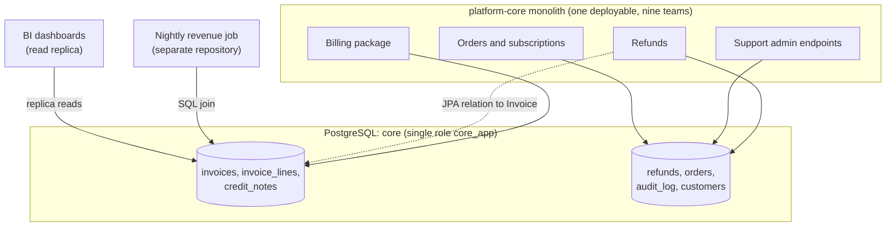
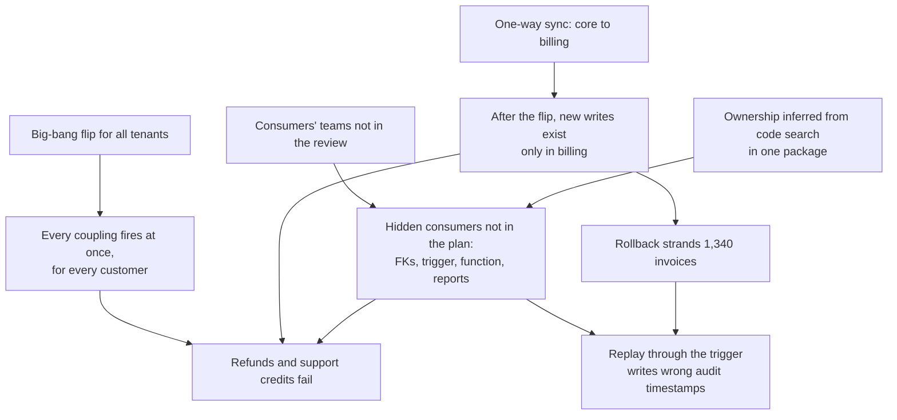
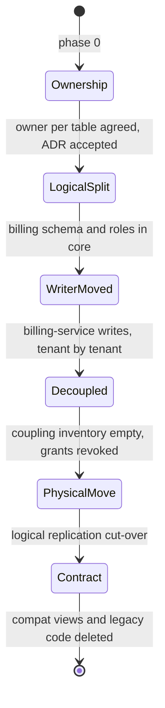
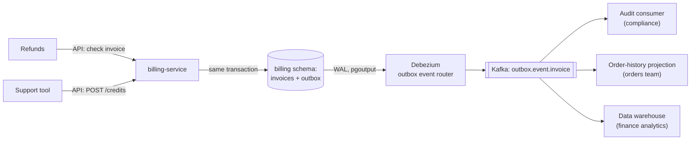

import Callout from '../../components/mdx/Callout.astro';

Extracting a service from a monolith is mostly a data problem wearing a code problem's clothes. Moving the code is weeks of work that a good team can do well. Moving the data is where the plan meets everything the database has quietly accumulated over ten years: foreign keys to tables owned by other teams, triggers that encode business rules, stored functions called by tools nobody remembers, and reporting queries written by people who were never in your architecture review.

This case study follows an extraction that failed on its cut-over night, the systematic hunt for the coupling that caused it, and the second plan, which succeeded because it changed the order of operations: **ownership first, code second, data last**. It ends with the organisational side and the decision record, because at principal level those are the parts that decide whether the next extraction goes better.

<Callout variant="note" title="Composite scenario">
This is a composite scenario; the service names and numbers are illustrative. It combines patterns that recur in monolith decompositions rather than describing any one company's migration.
</Callout>

**Level: principal.** You should already know: the strangler fig, Conway's law, Team Topologies and ADRs ([Part 13: Architecture and Technical Strategy](/blog/backend-13-architecture-strategy)); the outbox pattern and change data capture ([Part 9: Event-Driven Architecture](/blog/backend-09-event-driven-architecture)); replication and the WAL ([Part 7](/blog/backend-07-database-internals-scaling)); consistency models ([Part 10](/blog/backend-10-distributed-systems)); and expand–migrate–contract on a live PostgreSQL table ([A Zero-Downtime Schema Migration](/blog/case-02-zero-downtime-schema-migration)).

<Callout variant="tip" title="What you'll learn">
- Why "the database is an API" and how to inventory its consumers
- PostgreSQL catalog queries that find cross-boundary foreign keys, triggers, functions and views, plus `pg_stat_statements` and pgaudit for runtime readers
- Why a one-way sync plus a big-bang flip has no real rollback
- A safer sequence: logical split in place, move the writer per tenant, break coupling, then physically move the data
- Outbox and CDC with Debezium for the consumers that remain, and PostgreSQL logical replication for the final move
- The organisational side: ownership maps, consumers in the room, and a decision record with revisit conditions
</Callout>

---

## The system

A B2B subscription platform. The monolith, `platform-core`, is a Spring Boot application that nine teams commit to. It has one PostgreSQL 16 database, `core`: about 380 tables, about 2 TB, one primary and two streaming replicas, one of which serves the finance team's BI dashboards. All application code connects as one database role, `core_app`.

A billing team was formed six months earlier to own invoicing: invoice generation, invoice lines, tax, credit notes and dunning. The goal was to extract a `billing-service` with its own database, for three reasons that held up under scrutiny:

1. **Release coupling.** Billing changes around month-end were blocked by unrelated monolith releases, and month-end is exactly when billing needs to ship fixes.
2. **Audit scope.** Finance auditors wanted a clear boundary around the systems that produce invoices, with controlled access.
3. **Load isolation.** Invoice generation runs at the start of every month and competes with interactive traffic for the same database.



### The first plan

The billing team's first plan was a textbook strangler fig with CDC, and on paper it was reasonable:

1. Build `billing-service` with its own PostgreSQL database, `billing`.
2. Stream the billing tables from `core` into `billing` with Debezium (CDC), so the new database stays a continuously updated copy. The monolith remains the writer.
3. Move read traffic to the new service behind a gateway route, comparing responses in shadow mode first.
4. On a cut-over night, flip **all** invoice writes to `billing-service`, stop CDC, and have the monolith call the billing API from then on.
5. Later, drop the billing tables from `core`.

The plan's inventory of "what uses the billing tables" was built by searching the monolith's billing package for repository and entity classes. Steps 1 to 3 went well over eight weeks. Shadow reads matched at over 99.99%, the remaining differences were rounding in a legacy tax path, and confidence was high.

---

## Timeline


All times are relative to 22:00 on the cut-over night, chosen because invoice writes are lowest then (about 1.1 per second).

- **T+0.** The write flag flips for all tenants. The monolith's invoice-creating code paths now call `billing-service`, which writes to the `billing` database. CDC from `core` is stopped, as planned, because `core` should no longer receive invoice writes.
- **T+4.** Refund creation starts failing. The monolith log shows PostgreSQL rejecting inserts into `refunds`:

```text
ERROR:  insert or update on table "refunds" violates foreign key constraint "refunds_invoice_id_fkey"
DETAIL:  Key (invoice_id)=(5000000412) is not present in table "invoices".
```

- **T+9.** The support team reports that issuing goodwill credits fails in their admin tool with "invoice not found". The tool calls a stored function, `apply_credit(invoice_id, amount)`, that lives in the `core` database and reads `core.invoices`.
- **T+12.** The migration lead calls the rollback: flip writes back to the monolith. The question that takes the next eight minutes is what to do about invoices created in the last twelve minutes, which exist **only** in the `billing` database. Nobody had planned a reverse sync, because the plan had no step in which `billing` was the source of truth and `core` still mattered.
- **T+20.** The monolith is writing invoices again. About 1,340 invoices (12 minutes at roughly 1.1 per second, plus the eight minutes it took to roll back) are stranded in `billing`.
- **T+20 to T+55.** The team writes and runs a replay script that copies the stranded invoices and their lines into `core`. One planned detail saves the night: `billing`'s ID sequence started at 5,000,000,000, far above `core`'s maximum of about 180 million, so the replayed IDs cannot collide. Failed refunds were queued with idempotency keys and are retried successfully once their invoices exist.
- **T+95.** A reconciliation query comparing counts and sums per tenant between the two databases comes back clean. The incident is closed.
- **T+11 hours.** Finance's daily audit-trail check flags 1,340 `audit_log` entries whose timestamps are between 22:41 and 22:55, up to 55 minutes after the invoices' issue times. A trigger on `core.invoices` writes the audit row with `now()`, so the replay recorded the replay time, not the issue time. Nobody on the migration team had known the trigger existed.

Nothing was lost and no customer was charged incorrectly, but the migration was frozen and the billing team spent a week on cleanup and explanations. More importantly, the night showed that the team did not know what depended on the data it was about to move.

---

## Investigation

### During the night: reading the error

The foreign key error at T+4 is unambiguous once you read it carefully: `refunds` lives in `core`, it has a foreign key to `core.invoices`, and the invoice being refunded was created after the flip, so it only exists in `billing`. A foreign key is a synchronous, transactional dependency **inside the database**; it cannot span two databases. The plan had moved the writer of `invoices` without moving, or removing, the constraint that made another team's table depend on it.

Why didn't the code search find it? Because the search was limited to the billing package. The `Refund` entity in the refunds package had a `@ManyToOne` relation to `Invoice`, and the database had the matching constraint. Shadow reads never exercised it, because they only compared billing reads. Only a write in a different module could hit it.

### After the night: the database is an API

The post-incident review reframed the problem. A shared database is an API with no documentation, no versioning and no list of clients. Before the next attempt, the team needed that list. They built it from four sources, because each one finds things the others miss.


#### Source 1: the catalog (constraints, triggers, views, functions)

PostgreSQL's system catalogs know about every structural dependency. Start with foreign keys that **cross** the boundary in either direction:

```sql
-- foreign keys where exactly one side is a billing table
WITH billing(rel) AS (
  SELECT unnest(ARRAY['public.invoices', 'public.invoice_lines', 'public.credit_notes']::regclass[])
)
SELECT c.conname,
       c.conrelid::regclass  AS referencing_table,
       c.confrelid::regclass AS referenced_table
FROM pg_constraint c
WHERE c.contype = 'f'
  AND (c.conrelid IN (SELECT rel FROM billing)) <> (c.confrelid IN (SELECT rel FROM billing));
```

Then triggers on billing tables, and what they call:

```sql
SELECT tgrelid::regclass AS on_table,
       tgname,
       tgfoid::regproc  AS trigger_function
FROM pg_trigger
WHERE NOT tgisinternal
  AND tgrelid = ANY (ARRAY['public.invoices', 'public.invoice_lines', 'public.credit_notes']::regclass[]);
```

Views that read the billing tables (this view only lists views owned by roles you belong to, so run it as the database owner or a superuser):

```sql
SELECT view_schema, view_name, table_name
FROM information_schema.view_table_usage
WHERE table_name IN ('invoices', 'invoice_lines', 'credit_notes');
```

Functions are harder. PL/pgSQL function bodies are stored as text and are not dependency-tracked, so a crude text search is the practical option (functions written with a SQL-standard `BEGIN ATOMIC` body are tracked in `pg_depend`, but this database had none):

```sql
SELECT p.oid::regprocedure AS function_signature
FROM pg_proc p
JOIN pg_namespace n ON n.oid = p.pronamespace
WHERE n.nspname NOT IN ('pg_catalog', 'information_schema')
  AND p.prosrc ~* '\m(invoices|invoice_lines|credit_notes)\M';
```

This found the refunds foreign key, a second foreign key from `credit_notes` to `orders` (the other direction, equally important), the audit trigger, `apply_credit()` and two older functions, and three views used by an internal reporting page.

#### Source 2: runtime queries (`pg_stat_statements`, replicas)

The catalog shows structure, not usage. `pg_stat_statements` shows which normalised statements actually run and how often. It is per server, so it has to be checked on the primary **and** on each replica:

```sql
SELECT r.rolname,
       s.calls,
       left(regexp_replace(s.query, '\s+', ' ', 'g'), 100) AS query
FROM pg_stat_statements s
JOIN pg_roles r ON r.oid = s.userid
WHERE s.query ~* '\m(invoices|invoice_lines|credit_notes)\M'
ORDER BY s.calls DESC
LIMIT 50;
```

On the replica, this surfaced the BI tool's queries (it used its own role, `bi_reader`) and a monthly query nobody recognised. On the primary, it found the nightly revenue job's query, a join of `invoices` with `orders` and `subscriptions`, but it was attributed to `core_app` like everything else, because the job shared the monolith's credentials. With one role for everyone, `pg_stat_statements` can tell you **what** runs but not **who** runs it.

#### Source 3: attribution (roles and `application_name`)

To fix attribution, every consumer got its own database role and set `application_name`, which shows up in `pg_stat_activity` and can be added to the server log line prefix. With PgJDBC and Hikari in Spring Boot that is a data source property:

```yaml
spring:
  datasource:
    username: refunds_svc            # its own role, its own grants
    hikari:
      data-source-properties:
        ApplicationName: platform-core-refunds
```

```sql
-- sampled every minute for two weeks into a small table
SELECT now(), usename, application_name, client_addr, left(query, 100)
FROM pg_stat_activity
WHERE state = 'active'
  AND query ~* '\m(invoices|invoice_lines|credit_notes)\M';
```

Splitting one shared role into per-module roles inside the monolith is real work (separate data sources per module, or at least `SET ROLE` per module), but it pays for itself here and in every later extraction.

#### Source 4: audit logging, for the long tail

Sampling misses rare readers: the quarterly export, the tax report that runs once a year. For two weeks the team enabled **pgaudit** object-level auditing on the billing tables, which logs every statement that touches them, with the role and session:

```sql
-- postgresql.conf: shared_preload_libraries includes 'pgaudit', and pgaudit.role = 'billing_auditor'
CREATE ROLE billing_auditor NOLOGIN;
GRANT SELECT, INSERT, UPDATE, DELETE
  ON public.invoices, public.invoice_lines, public.credit_notes
  TO billing_auditor;
```

Object-level audit logs statements on objects for which the audit role holds the matching privilege. Log volume is significant on hot tables, so it was enabled on one replica for reads and on the primary for writes, for a bounded window.

#### What the inventory found

| Coupling | Kind | Owner | What it needs |
|---|---|---|---|
| `refunds.invoice_id` foreign key and JPA relation | Constraint | Payments team | Invoice exists and belongs to the customer |
| `credit_notes.order_id` foreign key to `orders` | Constraint | Billing (reverse direction) | Order exists |
| `invoices_audit` trigger writing `audit_log` | Database logic | Nobody (written 2017) | An audit record per invoice state change |
| `apply_credit()` stored function | Database logic | Support tooling team | Atomically issue a credit against an invoice |
| Nightly revenue job joining invoices, orders, subscriptions | Reader, other repository | Finance analytics | Daily revenue by product and region |
| BI dashboards on the replica | Reader | Finance analytics | Ad hoc analysis of invoice data |
| Three views for an internal reporting page | Reader | Billing | Invoice aging |
| Monolith order-history page reading invoice status | Reader, in code | Orders team | Invoice status per order |

Eight couplings. The first plan had accounted for none of them except the billing team's own code.

---

## Root cause

The failure was not the foreign key. The foreign key was the first of eight couplings to fire. The root cause was a plan whose order of operations assumed that **owning the code meant owning the data**, and that a one-way copy plus a single flip was reversible.



Four contributing factors, in the order the postmortem listed them:

1. **No inventory of database consumers.** The plan treated the schema as private to the billing package. In a shared database, nothing is private unless permissions make it so.
2. **No reverse path.** Once `billing` became the writer, `core` stopped receiving invoices, but other parts of `core` still needed them. A rollback had to deal with writes that only existed on the new side, and there was no mechanism for it.
3. **All-or-nothing cut-over.** Flipping all tenants at once meant the first problem hit every customer, and the only lever was a full rollback.
4. **The organisation mirrored the plan's blind spot.** The payments, support tooling and finance analytics teams owned consumers of the billing tables but were not in the migration review. This is Conway's law in its least flattering form: the plan covered exactly the system that the billing team communicated about, and nothing else.

---

## The fix

### Short-term: the night and the week after

- **Rollback and replay**, described in the timeline. The ID-range separation made the replay safe; without it, the team would have had to renumber invoices that had already been emailed to customers.
- **Audit correction.** The 1,340 audit rows were corrected from `billing-service`'s own event records, which carried the real issue times, in a reviewed one-off script. Finance signed off on the corrected records.
- **Freeze.** The migration was paused, the write flag was removed from the deploy so nobody could flip it again by accident, and CDC from `core` to `billing` was restarted so the new database stayed current while the plan was redone.

### Long-term: a different order of operations

The second plan kept the strangler fig, but changed what moves when. The key insight: **if you move the writer while the data stays in one database, there is nothing to sync and rollback is a flag.** Move the data only after the coupling is gone, and then use the database's own replication to do it.



#### Phase 0: agree ownership, in writing

Before any code changed, the principal engineer ran a short series of sessions with every team on the inventory list and produced an ownership map: each table has exactly one owning team, and every other team's access is either an API, an event stream, or a documented, temporary read path with an end date. The decision was recorded as an ADR (shown below). This phase took three weeks and was the most valuable part of the whole project.

#### Phase 1: logical split in place

Move the billing tables into their own schema in the **same** database, behind their own role, and leave compatibility views where the old names were, so nothing breaks:

```sql
SET lock_timeout = '3s';     -- SET SCHEMA takes an ACCESS EXCLUSIVE lock briefly; fail fast instead of queueing

BEGIN;
CREATE SCHEMA IF NOT EXISTS billing AUTHORIZATION billing_owner;
ALTER TABLE public.invoices      SET SCHEMA billing;
ALTER TABLE public.invoice_lines SET SCHEMA billing;
ALTER TABLE public.credit_notes  SET SCHEMA billing;

-- transitional compatibility views under the old names
CREATE VIEW public.invoices      AS SELECT * FROM billing.invoices;
CREATE VIEW public.invoice_lines AS SELECT * FROM billing.invoice_lines;
CREATE VIEW public.credit_notes  AS SELECT * FROM billing.credit_notes;
COMMIT;

-- only billing roles touch the tables directly; others go through the views, for now
REVOKE ALL ON ALL TABLES IN SCHEMA billing FROM core_app;
GRANT USAGE ON SCHEMA billing TO billing_svc;
GRANT SELECT, INSERT, UPDATE, DELETE ON ALL TABLES IN SCHEMA billing TO billing_svc;
GRANT SELECT, INSERT, UPDATE ON public.invoices, public.invoice_lines, public.credit_notes TO core_app;
```

Points that matter:

- `ALTER TABLE ... SET SCHEMA` is a catalog change, not a data rewrite, so it is fast even on a large table, but it needs a brief `ACCESS EXCLUSIVE` lock. The `lock_timeout` makes it give up rather than queue behind a long transaction and block everything behind it (the same reasoning as in [A Zero-Downtime Schema Migration](/blog/case-02-zero-downtime-schema-migration)).
- Foreign keys and triggers follow the table, because they reference it by OID, not by name. The refunds constraint keeps working.
- A simple `SELECT *` view over one table is **automatically updatable** in PostgreSQL, so legacy code that inserts through `public.invoices` keeps working. Views run with the view owner's privileges by default, which is what lets `core_app` write through the view without direct grants on the tables.
- `SELECT *` in a view is expanded when the view is created. A column added to `billing.invoices` later does not appear in the view until it is recreated. That is a feature here: the compatibility view is a frozen contract, not a live mirror.

#### Phase 2: move the writer, one tenant cohort at a time

Because `billing-service` connects to the same database (as `billing_svc`), it can take over writes **without any data sync**. Both writers operate on the same rows, with the same sequence, so they cannot diverge. The flip is per tenant cohort, behind a flag:

```kotlin
@Component
class InvoiceWriteRouter(
    private val flags: FeatureFlags,
    private val legacy: LegacyInvoiceWriter,     // the monolith's existing code path
    private val billing: BillingClient,          // HTTP client for billing-service
) {
    fun issue(command: IssueInvoice): InvoiceId =
        if (flags.isEnabledFor("billing.writes.via-service", command.tenantId)) {
            billing.issue(command)                // idempotency key = command.requestId
        } else {
            legacy.issue(command)
        }
}
```

The rollout went 1% of tenants (internal and friendly customers), 10%, 50%, 100%, over three weeks, including one month-end. Rollback at any point is turning the flag off for a cohort; the data is already where both code paths expect it. This is the step the first plan was missing: it coupled "who writes" with "where the data lives" and changed both in one night.

#### Phase 3: break the coupling, one item at a time

Each coupling from the inventory got its own small migration, owned by the team that owned the consumer, with the billing team providing the replacement:

**The refunds foreign key** became an application-level check plus reconciliation. Refund creation now asks `billing-service` whether the invoice exists and belongs to the customer, and stores `invoice_id` as a plain column. A nightly reconciliation job reports any refund whose invoice cannot be found. The trade: a constraint the database enforced atomically is now enforced by code and verified after the fact. That is a real loss of guarantee, and the payments team accepted it explicitly in the ADR rather than discovering it later.

```sql
-- after the application check has been live for two weeks with zero reconciliation findings
ALTER TABLE refunds DROP CONSTRAINT refunds_invoice_id_fkey;
```

**The audit trigger** became events. `billing-service` writes an event to an outbox table in the **same transaction** as the invoice change, so an event exists if and only if the change committed. Debezium reads the outbox from the WAL and publishes to Kafka, and an audit consumer (owned by the compliance team) writes the audit records, using the event's timestamp rather than `now()`:

```kotlin
@Service
class InvoiceService(
    private val jdbc: JdbcClient,
    private val json: JsonMapper,
) {
    @Transactional
    fun issue(command: IssueInvoice): Long {
        val invoiceId = jdbc.sql(
            """
            INSERT INTO billing.invoices (tenant_id, customer_id, currency, total_minor, status, issued_at)
            VALUES (:tenant, :customer, :currency, :total, 'ISSUED', now())
            RETURNING id
            """.trimIndent()
        )
            .param("tenant", command.tenantId)
            .param("customer", command.customerId)
            .param("currency", command.currency)
            .param("total", command.totalMinor)
            .query(Long::class.java)
            .single()

        val event = InvoiceIssued(invoiceId, command.tenantId, command.customerId, command.totalMinor, command.currency)
        jdbc.sql(
            """
            INSERT INTO billing.outbox (id, aggregatetype, aggregateid, type, payload)
            VALUES (:id, 'invoice', :aggregateId, 'InvoiceIssued', CAST(:payload AS jsonb))
            """.trimIndent()
        )
            .param("id", UUID.randomUUID())
            .param("aggregateId", invoiceId.toString())
            .param("payload", json.writeValueAsString(event))
            .update()

        return invoiceId
    }
}
```

The Debezium PostgreSQL connector, registered through the Kafka Connect REST API, captures only the outbox table and uses the outbox event router to publish each row to a topic per aggregate type, keyed by aggregate ID so all events for one invoice stay ordered within a partition:

```json
{
  "name": "billing-outbox",
  "config": {
    "connector.class": "io.debezium.connector.postgresql.PostgresConnector",
    "plugin.name": "pgoutput",
    "database.hostname": "core-primary",
    "database.port": "5432",
    "database.user": "billing_cdc",
    "database.password": "${file:/opt/kafka/secrets/billing.properties:password}",
    "database.dbname": "core",
    "topic.prefix": "billing",
    "slot.name": "billing_outbox",
    "publication.name": "billing_outbox",
    "publication.autocreate.mode": "filtered",
    "table.include.list": "billing.outbox",
    "transforms": "outbox",
    "transforms.outbox.type": "io.debezium.transforms.outbox.EventRouter",
    "heartbeat.interval.ms": "10000"
  }
}
```

With the default router settings, rows with `aggregatetype = 'invoice'` go to the topic `outbox.event.invoice`, keyed by `aggregateid`. The trigger and the event consumer ran in parallel for a month, with a comparison job checking that every trigger-written audit row had a matching event-written one; then the trigger was dropped.

<Callout variant="warning" title="Replication slots hold WAL">
A logical replication slot keeps the WAL its consumer has not confirmed. If Debezium stops for a weekend, the primary's disk fills with WAL. Set `max_slot_wal_keep_size` (PostgreSQL 13 and later) so a stuck slot is invalidated instead of taking the primary down, alert on slot lag, and have a runbook for re-snapshotting if a slot is lost. A CDC pipeline is a production system with an on-call, not a migration script.
</Callout>

**`apply_credit()`** became a `POST /credits` endpoint on `billing-service`, with an idempotency key, and the support tooling team moved their admin tool to it. The function was then revoked (`REVOKE EXECUTE ... FROM core_app`) for two weeks before being dropped, to catch any caller the inventory had missed.

**The nightly revenue job and BI dashboards** moved to the data warehouse, fed by the billing event stream and by CDC of the billing tables. The finance analytics team owns the warehouse model. This was the slowest item (two months), because the job encoded years of revenue-recognition rules that had to be rewritten and validated against the old output for three month-ends.

**The order-history page** stopped joining invoices and instead keeps a small local projection, `order_invoice_status`, updated by consuming `InvoiceIssued`, `InvoicePaid` and `InvoiceVoided` events. It is eventually consistent, typically within a second, and the orders team decided that was fine for a history page.



#### The scream test: revoke before you remove

When the inventory said "done", the team did not trust it. They revoked every non-billing role's access to the compatibility views and billing schema for two weeks, with a one-line re-grant ready:

```sql
REVOKE ALL ON public.invoices, public.invoice_lines, public.credit_notes FROM core_app, bi_reader;
```

Any remaining consumer would fail with `permission denied for view invoices` (SQLSTATE 42501), visible in the server log with its role and `application_name`. One did: a quarterly tax export that ran in the second week. Finding it during a planned window with a ready re-grant cost an hour. Finding it after the physical move would have meant a cross-database emergency.

#### Phase 4: the physical move, with the database's own tools

Only now, with `billing-service` the sole client of the billing schema, did the data move to its own PostgreSQL instance. PostgreSQL's built-in logical replication does this well:

```sql
-- on core (source)
CREATE PUBLICATION billing_move FOR TABLES IN SCHEMA billing;   -- PostgreSQL 15+

-- on the new billing instance (target), after restoring the schema with pg_dump --schema-only --schema=billing
CREATE SUBSCRIPTION billing_move
  CONNECTION 'host=core-primary dbname=core user=billing_repl'
  PUBLICATION billing_move;
```

The initial copy took about nine hours for the billing tables (about 400 GB); after that, the subscription streamed changes continuously. The cut-over itself, with one writer, took about two minutes of paused writes:

1. Pause invoice writes in `billing-service` (requests queue briefly in the service, and month-end was avoided).
2. Wait for the subscriber to catch up: on the source, compare `pg_current_wal_lsn()` with the slot's `confirmed_flush_lsn` in `pg_replication_slots` until the difference is zero.
3. Set sequences on the target. Logical replication in PostgreSQL 16 does not replicate sequence values, so each one is set explicitly with `setval()` from the source's current value plus a safety margin.
4. Disable the forward subscription, then create the **reverse** publication on the target and a subscription on the source with `copy_data = false`, so `core` keeps receiving changes and a rollback is a connection-string change, not a replay script.
5. Switch `billing-service`'s data source to the new instance and resume writes. Re-point the Debezium outbox connector at the new instance with a new slot; consumers deduplicate by event ID, so a few events seen twice around the switch are harmless.

The reverse subscription was kept for two weeks and then removed. It was never used, which is the point: the first plan had no way back, and the second plan had one at every step.

#### Phase 5: contract

The billing schema in `core` was renamed (not dropped) for a month, then dropped. The compatibility views, the monolith's legacy billing code path and the write-routing flag were deleted. Deletion is a phase with an owner and a date; a migration that never deletes anything has only added a system.

---

## The organisational side

The technical failure on the cut-over night had an organisational cause, and the second plan fixed that first.

**Conway's law cuts both ways.** The first plan covered exactly the people the billing team talked to every week. The payments, support tooling, compliance and finance analytics teams owned consumers of billing data but had no channel into the migration. The second plan made that channel explicit: a migration working group with one engineer from every team on the inventory, a fortnightly 30-minute sync, and a shared tracker with one row per coupling and an owner per row.

**Data ownership is a team assignment, not a schema property.** "Billing owns `invoices`" means the billing team decides its shape, is paged when it is wrong, and provides the supported ways for others to use it (API, events, warehouse). It also means other teams lose the ability to just write a join. That loss is real, and it is felt by people who did not ask for the migration. Acknowledging it, and providing a replacement **before** removing access, is what makes the change acceptable.

**The principal engineer's role** in the second plan was mostly not code. It was: running the ownership sessions, writing the ADR, getting the consumers' teams to commit time (which meant agreeing priorities with their managers), sequencing work so value arrived early (load isolation for month-end came with Phase 2, months before the physical move), and keeping "legacy coupling remaining" visible as a metric so the long tail did not stall. Part 13's warning applies: **migrations die in the middle.** This one survived because the remaining work was visible and owned.

### The decision record

```markdown
# ADR-0057: Extract billing data by moving ownership before moving data

Status: Accepted (2026-03-02). Supersedes ADR-0049 (big-bang CDC cut-over).

## Context
The first billing cut-over (2026-01-20) was rolled back after a foreign key from
refunds, a trigger, a stored function and two reporting consumers failed. An
inventory found 8 couplings to billing tables across 5 teams. Billing still needs
independent releases at month-end, a clear audit boundary and load isolation.

## Options considered
A. Retry the big-bang flip with a reverse CDC stream. Rejected: still all tenants
   at once, and every coupling must be fixed before the flip anyway.
B. Keep one database permanently, billing as a schema with its own role
   (modular monolith for data). Viable, but does not give load isolation at
   month-end or the separate audit boundary finance asked for.
C. Logical split in place, writer moved per tenant cohort, coupling removed item
   by item, then a physical move with logical replication.

## Decision
Option C. Every billing table is owned by the billing team. Other teams use the
billing API, the invoice event stream, or the data warehouse. Compatibility views
exist until 2026-09-30.

## Consequences
+ Rollback is a flag until the physical move, and reverse replication after it.
+ Each coupling migrates independently, owned by the consumer's team.
- Refunds lose a database-enforced foreign key. Mitigated by an API check and a
  nightly reconciliation with an alert on any finding.
- Order history becomes eventually consistent (typically under a second).
- Five teams commit roughly two engineer-weeks each; agreed with their managers.
- Revisit if: the physical move is not done by 2026-10-31 (then accept option B
  formally), or a second domain is extracted (reuse this sequence as the template).
```

The "revisit if" clause includes an explicit fallback to option B. That matters: it means stopping halfway is a **decision**, not a failure, and the organisation knows in advance what "stopping" looks like.

---

## Prevention

### Guardrails in CI

- **No new cross-schema foreign keys.** A test in the monolith's migration pipeline runs the cross-boundary foreign key query above (generalised to all schemas) against a freshly migrated database and fails if the result is not in a short, reviewed allowlist. The allowlist only shrinks.
- **No new direct grants on another team's schema.** The same test checks `information_schema.role_table_grants` against the ownership map.
- **Module boundaries in code.** Spring Modulith's verification test (`ApplicationModules.of(...).verify()`) fails the build if a module reaches into another module's internals, so the `Refund`-to-`Invoice` JPA relation could not be reintroduced. See [Part 13](/blog/backend-13-architecture-strategy) for the setup.
- **New triggers and functions on owned tables require the owning team's review** through `CODEOWNERS` on the migration files that touch that schema.

### Alerts

- **Reconciliation findings above zero** (refunds without invoices, invoices without audit records, warehouse revenue versus billing revenue per day). These are tickets, not pages, but they have a response-time target.
- **Replication slot lag** on every logical slot, from the source:

```sql
SELECT slot_name,
       pg_size_pretty(pg_wal_lsn_diff(pg_current_wal_lsn(), confirmed_flush_lsn)) AS lag,
       wal_status
FROM pg_replication_slots
WHERE slot_type = 'logical';
```

- **CDC freshness**: Debezium's streaming metric `MilliSecondsBehindSource`, exported through JMX, alerting when it stays above a few minutes. Combine it with the slot lag alert: one tells you the connector is behind, the other tells you the primary's disk is at risk.
- **Permission-denied errors** (SQLSTATE 42501) on billing objects in the server log, as a signal of an unknown consumer.

### Runbooks

The extraction produced a reusable runbook for the next domain, with a go/no-go checklist for every cut-over step:

1. Coupling inventory complete from all four sources (catalog, `pg_stat_statements` on every server, sampled `pg_stat_activity`, pgaudit window), every item owned.
2. Writer move behind a per-tenant flag; rollback is the flag.
3. Scream test passed: two weeks with access revoked and no unplanned errors.
4. Before a physical move: subscriber caught up, sequences set, **reverse replication in place**, rollback rehearsed in staging.
5. A named person can call the rollback without asking anyone.

---

## Interview angle

This is a principal-level story because the interesting decisions are about sequence, risk and people, not about a clever algorithm. Interviewers will want to hear that you can own a failure and turn it into a better system for the whole organisation.

### The two-minute STAR version

> **Situation.** We were extracting billing from a monolith that shared one PostgreSQL database across nine teams. The first cut-over flipped all invoice writes to the new service in one night, and within minutes refunds and support credits failed on a foreign key and a stored function we hadn't known about. We rolled back, but about 1,300 invoices existed only in the new database, and a trigger we didn't know about recorded wrong audit timestamps when we replayed them.
>
> **Task.** I was asked to lead the second attempt: get billing its own database without another incident, and make the approach reusable for the next extractions.
>
> **Action.** First I treated the database as an API and built an inventory of its consumers from four sources: catalog queries for foreign keys, triggers and functions; `pg_stat_statements` on the primary and replicas; per-consumer roles with `application_name`; and a two-week pgaudit window. We found eight couplings across five teams. I ran ownership sessions with those teams and wrote an ADR that changed the order of operations: split the schema logically inside the same database, move the writer tenant by tenant behind a flag so rollback was trivial, have each consumer's team migrate to the API, events or the warehouse, run a two-week revoke-access test, and only then move the data with logical replication, with reverse replication as the rollback.
>
> **Result.** The physical cut-over took two minutes of paused writes and we never used the rollback. Month-end load isolation shipped months before the move. The inventory queries and runbook became the template for the next two extractions, and CI now blocks new cross-schema foreign keys.

What interviewers listen for: you **own the first failure** without blaming the team, you can explain **why** the first plan had no real rollback, your fix changes **sequence and ownership**, not just tooling, and you know what the organisation **gave up** (a database-enforced constraint, strong consistency for order history) and made that explicit.

### Technical follow-ups

<details>
<summary>Why not just use dual writes from the application to both databases during the transition?</summary>

Because without a distributed transaction, one write will eventually succeed while the other fails (a timeout, a deploy, a constraint violation on one side), and the stores drift silently. You then need reconciliation to find and fix the drift, and you still don't know which side is right. The outbox pattern or CDC gives you one source of truth with a reliable, ordered change stream derived from it. In the second plan we avoided synchronisation entirely during the riskiest phase by moving the writer while both writers still used the same database.

</details>

<details>
<summary>How do you replace a foreign key that crosses a service boundary?</summary>

You can't keep the guarantee exactly; you choose a weaker one deliberately. Options: validate synchronously through the owning service's API at write time (what refunds did), keep a local projection of the referenced IDs fed by events and validate against that, or accept the reference and reconcile afterwards. In each case add a reconciliation job that finds orphans and alerts on them. Also decide what happens when the referenced entity is deleted: usually the owning service should not hard-delete things others reference, and should emit an event so consumers can react. Make the trade-off explicit in the ADR, because the team losing the constraint needs to agree.

</details>

<details>
<summary>Why move the writer before moving the data? Isn't that backwards?</summary>

It separates two risky changes. Moving the writer changes code paths and behaviour; moving the data changes where state lives and requires synchronisation. If you do both at once, a problem in either forces you to roll back both, and the data rollback is the hard part. With the writer moved first inside the same database, rollback is a flag and there is nothing to sync. By the time you move the data, there is one writer and no other consumers, so the physical move is an infrastructure operation with the database's own replication and a short write pause.

</details>

<details>
<summary>What are the risks of CDC with Debezium on a busy primary?</summary>

The logical replication slot retains WAL until the connector confirms it, so a stopped connector can fill the primary's disk; set `max_slot_wal_keep_size` and alert on slot lag. Initial snapshots of large tables are slow and add load; snapshot from a quiet period or use incremental snapshots. Schema changes on captured tables need coordination with consumers. CDC of raw tables exposes your internal schema as a de facto contract to every consumer, which is why we published domain events through an outbox for other teams and kept raw-table CDC only for the warehouse, with an agreed schema.

</details>

<details>
<summary>How did you find consumers that weren't in any code repository?</summary>

From the database side, because every consumer ends up there. `pg_stat_statements` on every server, including replicas, shows what runs. Per-consumer roles and `application_name` show who runs it. A bounded pgaudit window catches rare jobs. And finally a scream test: revoke access for a planned window with the re-grant ready, and watch for permission-denied errors. We found a quarterly tax export that way, which no sampling would have caught in two weeks.

</details>

<details>
<summary>When would you not split the database at all?</summary>

When the reasons don't justify the cost. If the goal is code ownership and independent releases, a schema per module with its own role inside one database (a modular monolith for data) gives most of the benefit, keeps transactions and joins where you need them, and avoids distributed consistency problems. Split physically when you need independent scaling or load isolation, a hard security or compliance boundary, independent availability, or a different storage technology. The ADR listed that as option B and made it the explicit fallback if the move stalled.

</details>

<details>
<summary>How do you keep a migration like this from stalling at 80%?</summary>

Sequence it so value arrives early (we got month-end load isolation with the writer move, long before the physical split), make the remaining work visible as a metric everyone can see (couplings remaining, legacy readers remaining), give each remaining item an owner on the consumer's team with time agreed by their manager, and set a date in the ADR at which you either finish or formally accept the intermediate state. Stopping is fine; drifting is not.

</details>

---

## Common mistakes

- **Building the consumer inventory from your own code.** The database has consumers in other modules, other repositories, replicas, BI tools and the database itself (foreign keys, triggers, functions, views).
- **One shared database role for everything.** You can't attribute queries, can't revoke access selectively, and can't run a scream test.
- **Moving the writer and the data in the same step.** Two risky changes with one rollback lever, and the data half is the hard one to undo.
- **A big-bang flip for all tenants.** The first problem hits every customer, and the only option is a full rollback.
- **No reverse path.** Once the new side is the source of truth, rollback must include the writes made since. Plan the reverse sync before the forward flip.
- **Naive dual writes.** Without a transaction across both stores they drift; use an outbox or CDC from a single source of truth.
- **Ignoring logic in the database.** Triggers and stored functions are business logic with no owner and no tests; they must be inventoried and migrated like code.
- **Removing access without providing a replacement.** Other teams lose joins and direct reads. Give them an API, events or a warehouse first, and negotiate the time it costs them.
- **Treating CDC as a migration script.** Replication slots, snapshots, schema changes and lag need monitoring and an on-call.
- **Never deleting the old path.** Compatibility views and legacy code without an end date become permanent, and the organisation runs both systems forever.

---

## Key takeaways

- A shared database is an API with unknown clients. Inventory them from the catalog, runtime statistics on every server, per-consumer roles and audit logs before planning anything else.
- Order of operations is the strategy: ownership first, code second, data last. Moving the writer inside the same database makes rollback a flag; moving the data afterwards, with one writer left, makes it an infrastructure operation.
- Every cross-boundary foreign key, trigger and stored function is a coupling that must be replaced with an API, an event, or an explicit weaker guarantee plus reconciliation.
- Use the outbox pattern and CDC for the consumers that remain, and the database's own logical replication, with reverse replication as rollback, for the physical move.
- Revoke before you remove: a planned scream test finds the consumers no inventory did.
- The organisation has to change with the system. Put every consuming team in the room, give each coupling an owner, and write an ADR that records what was given up and when to revisit.

Previous: [A Retry Storm and a Cascading Failure](/blog/case-05-retry-storm-cascading-failure)
