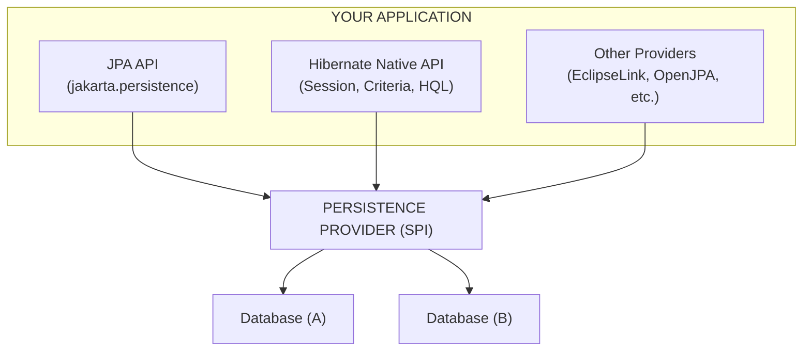

import Callout from '../../components/mdx/Callout.astro';

If you've worked with Java persistence, you've encountered **JPA** (Java Persistence API) and **Hibernate**. They're often used interchangeably in conversation, but they're fundamentally different things. Understanding the distinction isn't academic — it affects your architecture, testability, vendor lock-in, and migration path.

This guide covers:
- What each actually is (spec vs implementation)
- Differences across every dimension: API, architecture, performance, tooling, ecosystem
- Implementation patterns and code comparisons
- Clear recommendations for different scenarios

---

## The One-Sentence Summary

**JPA is a specification (interface); Hibernate is an implementation (class).** JPA defines *what* you can do; Hibernate defines *how* it's done — plus a lot of extra features JPA doesn't standardize.

---

## What Is JPA?

JPA (Java Persistence API) is a **specification** — a set of interfaces and annotations in `jakarta.persistence` (formerly `javax.persistence`). It defines:

- Entity mapping annotations (`@Entity`, `@Table`, `@Column`, `@Id`, `@OneToMany`, etc.)
- The `EntityManager` API for CRUD operations
- JPQL (Java Persistence Query Language) — a query language
- Criteria API for type-safe queries
- Transaction semantics and lifecycle callbacks

**JPA does not contain any implementation code.** It's a contract. You cannot "run JPA" — you run a JPA *provider*.

<Callout variant="note">
Since Jakarta EE 9 (2020), the package is `jakarta.persistence.*`. If you're on Spring Boot 3+, you're already using Jakarta. Spring Boot 2.x used `javax.persistence.*`.
</Callout>

---

## What Is Hibernate?

Hibernate is the **most popular JPA provider** — a concrete library that implements the JPA specification *and* extends it significantly.



Hibernate provides:
- Full JPA implementation (`Hibernate EntityManager` wraps `Session`)
- **Native API**: `Session`, `SessionFactory`, `Transaction` — more powerful than `EntityManager`
- **HQL** (Hibernate Query Language) — superset of JPQL
- **Criteria API** (both JPA and native Hibernate variants)
- **Hibernate-specific features**: custom types, filters, `@NaturalId`, `@Formula`, `@Where`, `@BatchSize`, multi-tenancy, bytecode enhancement, second-level cache integrations, etc.
- **Tools**: `hbm2ddl` (schema generation), reverse engineering, Hibernate Tools for IDEs

---

## Differences: Every Perspective

### 1. API Surface

| Aspect | JPA (Standard) | Hibernate (Native) |
|--------|----------------|-------------------|
| **Core interface** | `EntityManager` | `Session` |
| **Factory** | `EntityManagerFactory` | `SessionFactory` |
| **Query language** | JPQL | HQL (superset) |
| **Criteria API** | `jakarta.persistence.criteria` | `org.hibernate.query.criteria` (legacy) + JPA Criteria |
| **Type mapping** | Standard annotations only | `@Type`, `@TypeDef`, custom `UserType`, `CompositeUserType` |
| **Fetching** | `FetchType.LAZY/EAGER`, `EntityGraph` | `@BatchSize`, `@Fetch(FetchMode.SUBSELECT/JOIN)`, `@LazyToOne` |
| **Caching** | `shared-cache-mode` in `persistence.xml` | Rich second-level cache SPI (Ehcache, Infinispan, Redis, Caffeine) |
| **Schema gen** | Standard `jakarta.persistence.schema-generation` | `hibernate.hbm2ddl.auto`, `hbm2ddl.import_files` |
| **Multi-tenancy** | Not standardized | `MultiTenancyStrategy` (DATABASE, SCHEMA, DISCRIMINATOR) |

**Key insight**: `EntityManager` is a thin wrapper around `Session`. You can always unwrap:

```java
Session session = entityManager.unwrap(Session.class);
```

### 2. Architecture & Internals

| Dimension | JPA Spec | Hibernate Implementation |
|-----------|----------|-------------------------|
| **Proxy mechanism** | Not specified | Bytecode enhancement (build-time) or runtime proxies (ByteBuddy) |
| **Dirty checking** | Not specified | Snapshot-based (default) or bytecode-enhanced (faster) |
| **Connection handling** | `EntityManager` lifecycle | `Session` lifecycle + `ConnectionProvider` SPI |
| **Batch processing** | `jakarta.persistence.batch` (hint) | `hibernate.jdbc.batch_size`, `hibernate.order_inserts/updates`, `@BatchSize` |
| **Statement inspection** | Not available | `StatementInspector` SPI |
| **Custom SQL** | `@NamedNativeQuery` | `@SQLInsert`, `@SQLUpdate`, `@SQLDelete`, `@Loader`, `@LoaderNamedQuery` |
| **Identity generation** | `GenerationType` enum | `SequenceStyleGenerator`, `IdentifierGenerator` SPI, custom generators |

### 3. Query Languages: JPQL vs HQL

**JPQL** (standard):
```java
// Entity-based, portable across providers
SELECT u FROM User u WHERE u.email = :email
SELECT u FROM User u JOIN FETCH u.roles WHERE u.active = true
```

**HQL** (Hibernate-specific, more powerful):
```java
// Same as JPQL but also supports:
SELECT u FROM User u WHERE u.email = :email
// 1. Components/embeddables in SELECT
SELECT u.name FROM User u
// 2. Polymorphic queries (implicit)
FROM User  -- returns User + all subclasses
// 3. Collection expressions
SELECT u FROM User u WHERE size(u.roles) > 0
// 4. Indexed collections
SELECT u FROM User u JOIN u.roles r WITH r.name = 'ADMIN' INDEX r
// 5. Entity joins without association
SELECT u, p FROM User u, Profile p WHERE u.id = p.userId
// 6. DML-style bulk operations
UPDATE User u SET u.active = false WHERE u.lastLogin < :date
DELETE FROM User u WHERE u.active = false
```

**When HQL matters**: complex reporting queries, bulk updates/deletes, polymorphic fetches, collection filtering.

### 4. Type System & Custom Mapping

**JPA**: Limited to standard mappings (`@Basic`, `@Embedded`, `@ElementCollection`, enums via `@Enumerated`, LOBs via `@Lob`).

**Hibernate**: Full type system extensibility.

```java
// Custom type mapping JSON to a PostgreSQL jsonb column
@Type(JsonBinaryType.class)
@Column(columnDefinition = "jsonb")
private UserPreferences preferences;

// Enum as string (not ordinal) — JPA supports this via @Enumerated(STRING)
// But Hibernate adds:
@Type(PostgreSQLEnumType.class)
@Column(columnDefinition = "user_status")
private UserStatus status;

// Custom composite type (multiple columns → one object)
@Type(AddressType.class)
@Columns(columns = {
    @Column(name = "street"),
    @Column(name = "city"),
    @Column(name = "zip")
})
private Address address;
```

### 5. Fetching Strategies

**JPA**: `FetchType.LAZY` / `EAGER` + `EntityGraph` (standardized in JPA 2.1).

**Hibernate**: Much richer fetching control.

```java
@Entity
public class Order {
    // Batch loading for collections (solves N+1 without JOIN FETCH)
    @OneToMany(mappedBy = "order")
    @BatchSize(size = 20)
    @Fetch(FetchMode.SUBSELECT)  // Single subselect for all orders
    private List<OrderLine> lines;

    // Lazy one-to-one (JPA makes this eager by default without bytecode enhancement)
    @OneToOne(mappedBy = "order", fetch = FetchType.LAZY)
    @LazyToOne(LazyToOneOption.NO_PROXY)  // Requires bytecode enhancement
    private Invoice invoice;

    // Filter collection at load time
    @OneToMany(mappedBy = "order")
    @Where(clause = "deleted = false")
    private List<OrderLine> activeLines;
}
```

<Callout variant="tip">
`@BatchSize` + `@Fetch(SUBSELECT)` is often the best default for collections — it avoids N+1 without the cartesian product explosion of `JOIN FETCH`.
</Callout>

### 6. Caching

**JPA**: Defines *that* caching exists (`shared-cache-mode`: `ALL`, `NONE`, `ENABLE_SELECTIVE`, `DISABLE_SELECTIVE`, `UNSPECIFIED`) and `@Cacheable`.

**Hibernate**: Implements a full **two-level cache** with SPI for providers.

```xml
<!-- persistence.xml or Spring Boot properties -->
<property name="hibernate.cache.use_second_level_cache" value="true"/>
<property name="hibernate.cache.region.factory_class" 
          value="org.hibernate.cache.jcache.internal.JCacheRegionFactory"/>
<property name="hibernate.javax.cache.provider" 
          value="org.ehcache.jsr107.EhcacheCachingProvider"/>
```

```java
@Entity
@Cacheable
@org.hibernate.annotations.Cache(usage = CacheConcurrencyStrategy.READ_WRITE)
public class Product { ... }

// Or per-collection
@OneToMany
@Cache(usage = CacheConcurrencyStrategy.READ_ONLY)
private Set<Category> categories;
```

**Cache concurrency strategies**:
- `READ_ONLY` — immutable reference data (fastest)
- `READ_WRITE` — general purpose
- `NONSTRICT_READ_WRITE` — rare concurrent reads, eventual consistency OK
- `TRANSACTIONAL` — JTA environments, full ACID

### 7. Schema Generation & Migration

| Approach | JPA Standard | Hibernate Native | Production Reality |
|----------|--------------|------------------|-------------------|
| **Auto DDL** | `jakarta.persistence.schema-generation.database.action` | `hibernate.hbm2ddl.auto` | Dev only |
| **Scripts** | `jakarta.persistence.sql-load-script-source` | `hibernate.hbm2ddl.import_files` | Dev/test only |
| **Migration tool** | ❌ Not standardized | ❌ Not in Hibernate | **Use Flyway/Liquibase** |

<Callout variant="warning">
Never use `hibernate.hbm2ddl.auto=update` in production. It doesn't handle data migrations, can't roll back, and may lock tables. Use **Flyway** or **Liquibase** for all schema changes.
</Callout>

### 8. Performance Characteristics

| Scenario | JPA (via Hibernate) | Hibernate Native |
|----------|---------------------|------------------|
| **Simple CRUD** | Identical (same code path) | Identical |
| **Complex queries** | JPQL → Hibernate AST → SQL | HQL → same AST → SQL (same) |
| **Bulk operations** | Limited (JPQL UPDATE/DELETE) | Rich (HQL DML, `ScrollableResults`, `StatelessSession`) |
| **Streaming large results** | `Query.getResultStream()` (JPA 2.2+) | `ScrollableResults`, `StatelessSession` (lower memory) |
| **Batch inserts** | Hint: `jakarta.persistence.batch.size` | `hibernate.jdbc.batch_size`, `order_inserts`, `order_updates` |
| **Read-only projections** | DTO via `NEW` constructor | `ResultTransformer`, `Tuple`, `AliasToBeanResultTransformer` |

**StatelessSession** (Hibernate-only): No persistence context, no dirty checking, no cascading — ideal for bulk imports/exports.

```java
try (StatelessSession session = sessionFactory.openStatelessSession()) {
    Transaction tx = session.beginTransaction();
    for (int i = 0; i < 100_000; i++) {
        session.insert(new Event("Event " + i, new Date()));
        if (i % 50 == 0) session.flush(); // manual flush
    }
    tx.commit();
}
```

### 9. Tooling & Developer Experience

| Tool | JPA | Hibernate |
|------|-----|-----------|
| **IDE support** | Standard (all IDEs) | Enhanced in IntelliJ (HQL console, entity diagrams, DDL preview) |
| **Reverse engineering** | ❌ | Hibernate Tools (Ant/Maven/Gradle) → entities from DB |
| **Schema export** | Standard hints | `SchemaExport`, `SchemaUpdate`, `SchemaValidator` |
| **Statistics** | ❌ | `SessionFactory.getStatistics()` — query times, cache hit rates, flush counts |
| **Bytecode enhancement** | ❌ | Maven/Gradle plugins for build-time enhancement (faster, no proxies) |

---

## Implementation Patterns: Code Comparison

### Pattern 1: Standard JPA (Portable)

```java
// Repository using only JPA APIs
@Repository
public class UserRepository {
    
    @PersistenceContext
    private EntityManager em;
    
    public Optional<User> findByEmail(String email) {
        return em.createQuery(
            "SELECT u FROM User u WHERE u.email = :email", User.class)
            .setParameter("email", email)
            .getResultStream()
            .findFirst();
    }
    
    @Transactional
    public User save(User user) {
        if (user.getId() == null) {
            em.persist(user);
            return user;
        }
        return em.merge(user);
    }
    
    @Transactional
    public void deleteById(Long id) {
        User user = em.find(User.class, id);
        if (user != null) em.remove(user);
    }
}
```

### Pattern 2: Spring Data JPA (Recommended for Spring Apps)

```java
// Zero boilerplate — Spring generates implementation
public interface UserRepository extends JpaRepository<User, Long> {
    
    Optional<User> findByEmail(String email);
    
    @Query("SELECT u FROM User u WHERE u.active = true AND u.lastLogin > :since")
    List<User> findActiveUsersSince(@Param("since") Instant since);
    
    @Modifying
    @Query("UPDATE User u SET u.active = false WHERE u.lastLogin < :date")
    int deactivateInactiveUsers(@Param("date") Instant date);
    
    // EntityGraph for fetch control
    @EntityGraph(attributePaths = {"roles", "profile"})
    Optional<User> findWithRolesAndProfileById(Long id);
}
```

### Pattern 3: Hibernate Native API (When You Need It)

```java
@Repository
@RequiredArgsConstructor
public class HibernateUserRepository {
    
    private final SessionFactory sessionFactory;
    
    public Optional<User> findByEmailNative(String email) {
        try (Session session = sessionFactory.openSession()) {
            return session.createQuery(
                "FROM User u WHERE u.email = :email", User.class)
                .setParameter("email", email)
                .uniqueResultOptional();
        }
    }
    
    // Bulk insert with StatelessSession
    @Transactional
    public void bulkInsertUsers(List<User> users) {
        try (StatelessSession session = sessionFactory.openStatelessSession()) {
            Transaction tx = session.beginTransaction();
            int batchSize = 50;
            for (int i = 0; i < users.size(); i++) {
                session.insert(users.get(i));
                if (i % batchSize == 0) session.flush();
            }
            tx.commit();
        }
    }
    
    // Custom SQL for complex update
    @Transactional
    public int archiveOldOrders(Instant before) {
        try (Session session = sessionFactory.openSession()) {
            Transaction tx = session.beginTransaction();
            int updated = session.createNativeMutationQuery(
                "UPDATE orders SET status = 'ARCHIVED' WHERE created_at < :before AND status = 'PENDING'")
                .setParameter("before", before)
                .executeUpdate();
            tx.commit();
            return updated;
        }
    }
}
```

### Pattern 4: Hybrid — JPA Default, Hibernate When Needed

```java
@Service
@RequiredArgsConstructor
public class OrderService {
    
    private final EntityManager em;           // JPA for 95% of code
    private final SessionFactory sessionFactory; // Hibernate for 5%
    
    @Transactional
    public Order createOrder(OrderRequest req) {
        Order order = new Order(req);
        em.persist(order);
        em.flush(); // get generated ID
        return order;
    }
    
    // Use Hibernate native for streaming large report
    public Stream<OrderSummary> streamOrderSummary(Instant from, Instant to) {
        try (Session session = sessionFactory.openSession()) {
            return session.createQuery(
                "SELECT new com.example.dto.OrderSummary(o.id, o.customer.email, o.total, o.createdAt) " +
                "FROM Order o WHERE o.createdAt BETWEEN :from AND :to", 
                OrderSummary.class)
                .setParameter("from", from)
                .setParameter("to", to)
                .setHint("org.hibernate.fetchSize", 100) // JDBC fetch size
                .getResultStream(); // streams, doesn't load all in memory
        }
    }
}
```

---

## Decision Matrix: What to Use When

| Scenario | Recommendation | Rationale |
|----------|----------------|-----------|
| **New Spring Boot project** | Spring Data JPA (JPA) | Best DX, portable, testable, 95% of needs covered |
| **New Quarkus/Micronaut project** | Panache (JPA) / Micronaut Data (JPA) | Framework-native, same benefits |
| **Legacy Hibernate codebase** | Keep Hibernate native | Migration cost > benefit; unwrap `Session` when needed |
| **Complex reporting/analytics** | Hibernate HQL + `StatelessSession` | Bulk DML, streaming, custom SQL, no persistence context overhead |
| **Multi-tenant SaaS** | Hibernate native | `MultiTenancyStrategy` not in JPA spec |
| **Custom type mapping (JSON, GIS, enum variants)** | Hibernate `@Type` | JPA has no extensible type system |
| **Second-level caching critical** | Hibernate native | Rich cache SPI; JPA only defines `@Cacheable` |
| **Team wants zero vendor lock-in** | Pure JPA + Spring Data | Swappable provider (EclipseLink, etc.) — rare in practice |
| **Kotlin project** | Spring Data JPA + Kotlin extensions | `kotlin-jpa` plugin handles open classes, data classes work |
| **GraalVM native image** | Hibernate 6.2+ / Spring Data JPA | Both support native; Hibernate has better reflection config |

---

## Common Misconceptions

### ❌ "JPA is slower than Hibernate"
**False.** JPA *is* Hibernate (when Hibernate is the provider). The `EntityManager` delegates to `Session`. Zero overhead.

### ❌ "Using JPA means I can switch providers easily"
**Theoretically true, practically rare.** Switching from Hibernate to EclipseLink requires:
- Replacing all `@Type` / Hibernate-specific annotations
- Rewriting HQL → JPQL (loss of features)
- Reconfiguring caching (completely different SPI)
- Retesting all queries (different SQL generation)

<Callout variant="note">
In 15+ years of Java consulting, I've seen **zero** successful production provider switches. The "portability" argument is mostly theoretical. Choose the best implementation (Hibernate) and use its features.
</Callout>

### ❌ "Hibernate native API is deprecated"
**False.** `Session`/`SessionFactory` are fully supported, actively maintained, and *required* for features like `StatelessSession`, `MultiTenancy`, custom types, and advanced fetching.

### ❌ "JPA Criteria API is type-safe"
**It's verbose and error-prone.** The JPA Criteria API uses string-based path navigation (`root.get("name")`). Hibernate's native Criteria (deprecated) and JPA Criteria are both widely disliked. Prefer:
- **QueryDSL** (type-safe, but separate dependency)
- **Spring Data JPA derived queries** (method name → query)
- **HQL/JPQL with `@Query`** (readable, refactorable with IDE)

---

## Migration Path: From Hibernate Native to JPA

If you have legacy Hibernate code and want to standardize:

```java
// BEFORE: Hibernate native DAO
public class LegacyUserDao {
    private final SessionFactory sf;
    
    public User findById(Long id) {
        try (Session s = sf.openSession()) {
            return s.get(User.class, id);
        }
    }
}

// AFTER: JPA repository (Spring Data)
public interface UserRepository extends JpaRepository<User, Long> {
    // findById(Long) comes for free
}

// DURING MIGRATION: Unwrap for Hibernate features
@Service
public class UserService {
    @PersistenceContext EntityManager em;
    
    public void hibernateSpecificThing() {
        Session session = em.unwrap(Session.class);
        session.enableFilter("tenantFilter").setParameter("tenantId", currentTenant());
    }
}
```

---

## Spring Boot 3.x Configuration (Modern Defaults)

```yaml
# application.yml
spring:
  datasource:
    url: jdbc:postgresql://localhost:5432/myapp
    username: ${DB_USER}
    password: ${DB_PASSWORD}
    hikari:
      maximum-pool-size: 20
  
  jpa:
    hibernate:
      ddl-auto: validate          # NEVER update in prod
    properties:
      hibernate:
        format_sql: true          # Pretty SQL in logs
        use_sql_comments: true    # Add comments to generated SQL
        jdbc:
          batch_size: 50          # Batch inserts/updates
          batch_versioned_data: true
        order_inserts: true
        order_updates: true
        cache:
          use_second_level_cache: true
          region:
            factory_class: org.hibernate.cache.jcache.internal.JCacheRegionFactory
        java:
          time_zone: UTC          # Consistent timestamps
    open-in-view: false           # Avoid OSIV anti-pattern
  
  flyway:
    enabled: true
    locations: classpath:db/migration
    baseline-on-migrate: true
```

```java
// JPA Entity with Hibernate enhancements
@Entity
@Table(name = "users", indexes = {
    @Index(name = "idx_users_email", columnList = "email", unique = true),
    @Index(name = "idx_users_active_created", columnList = "active,created_at")
})
@Cacheable
@org.hibernate.annotations.Cache(usage = CacheConcurrencyStrategy.READ_WRITE)
public class User {
    
    @Id
    @GeneratedValue(strategy = GenerationType.SEQUENCE, generator = "user_seq")
    @SequenceGenerator(name = "user_seq", sequenceName = "user_seq", allocationSize = 50)
    private Long id;
    
    @Column(nullable = false, unique = true, length = 255)
    private String email;
    
    @Column(name = "created_at", nullable = false, updatable = false)
    private Instant createdAt = Instant.now();
    
    @Version
    private Long version;  // Optimistic locking
    
    @OneToMany(mappedBy = "user", fetch = FetchType.LAZY)
    @BatchSize(size = 20)
    @Fetch(FetchMode.SUBSELECT)
    @Where(clause = "deleted = false")
    @org.hibernate.annotations.Cache(usage = CacheConcurrencyStrategy.READ_WRITE)
    private Set<Order> orders = new HashSet<>();
    
    // JPA lifecycle callbacks
    @PrePersist
    void prePersist() { this.createdAt = Instant.now(); }
    
    // Getters/setters...
}
```

---

## Testing Strategy

| Test Type | Approach |
|-----------|----------|
| **Unit tests** | Mock `EntityManager` / `JpaRepository` with `@Mock` / `@MockBean` |
| **Integration tests** | `@DataJpaTest` (H2/PostgreSQL Testcontainers) — tests repositories, queries, constraints |
| **Spring Boot tests** | `@SpringBootTest` + Testcontainers — full context, real DB |
| **Query validation** | `hibernate.jpql.strict_compliance=true` in test properties |

```java
@DataJpaTest
@AutoConfigureTestDatabase(replace = AutoConfigureTestDatabase.Replace.NONE)
@Testcontainers
class UserRepositoryTest {
    
    @Container
    static PostgreSQLContainer<?> pg = new PostgreSQLContainer<>("postgres:16");
    
    @Autowired
    UserRepository repository;
    
    @Test
    void findByEmail_returnsUser() {
        User saved = repository.save(new User("test@example.com"));
        
        Optional<User> found = repository.findByEmail("test@example.com");
        
        assertThat(found).isPresent();
        assertThat(found.get().getId()).isEqualTo(saved.getId());
    }
}
```

---

## Summary: My Recommendations

| Context | Use |
|---------|-----|
| **Default choice** | **Spring Data JPA** (JPA APIs, Hibernate provider) |
| **Need bulk ops / streaming / multi-tenancy / custom types** | Unwrap `Session` or inject `SessionFactory` for those specific methods |
| **Don't use** | Raw `Session`/`SessionFactory` everywhere — couples you to Hibernate without benefit |
| **Don't use** | JPA Criteria API — use `@Query` with JPQL/HQL or QueryDSL |
| **Never** | `hbm2ddl.auto=update` in production — use **Flyway** |
| **Always** | `open-in-view: false`, `@Version` for optimistic locking, connection pooling (HikariCP) |

---

## Further Reading

- [Hibernate ORM Documentation](https://docs.jboss.org/hibernate/orm/6.5/userguide/html_single/Hibernate_User_Guide.html)
- [Jakarta Persistence 3.1 Spec](https://jakarta.ee/specifications/persistence/3.1/)
- [Spring Data JPA Reference](https://docs.spring.io/spring-data/jpa/docs/current/reference/html/)
- [Vlad Mihalcea's Blog](https://vladmihalcea.com/) — Deep Hibernate/JPA internals
- [High-Performance Java Persistence](https://www.amazon.com/High-Performance-Java-Persistence-Vlad-Mihalcea/dp/973022823X) — The definitive book

---

*Have a specific Hibernate vs JPA scenario you're wrestling with? Drop a comment or reach out — I've debugged enough `LazyInitializationException`s to write a book on them.*