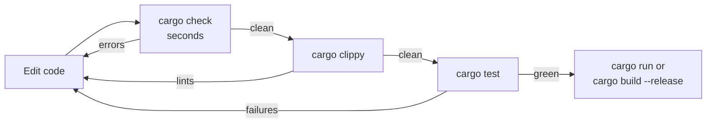
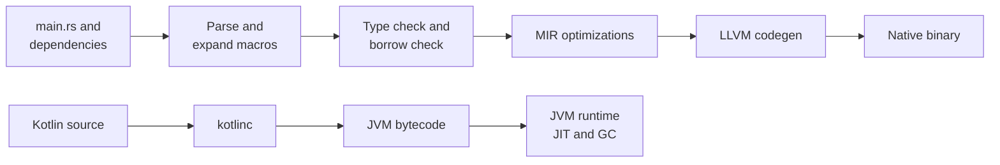
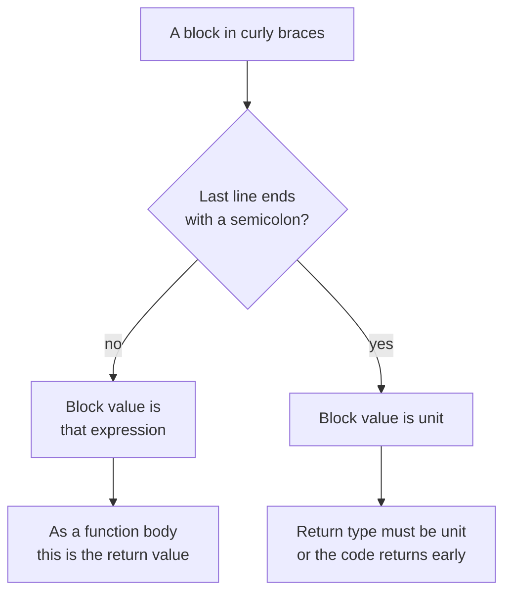

import Callout from '../../components/mdx/Callout.astro';

This series is for engineers who already ship software in a garbage-collected language, Kotlin, Java, Go, TypeScript, and want to become genuinely productive in Rust, then take it all the way to designing libraries and deciding whether a whole organization should adopt it. Part 1 is the on-ramp. By the end of it you will know why Rust makes the trade-offs it makes, have a working toolchain, understand the shape of a cargo project, be able to read and write the basic syntax without guessing, and have built and unit-tested a small command-line word counter.

Nothing here is hard yet. The point of this post is to get the boring-but-essential mechanics out of the way so that Part 2, ownership and borrowing, can have your full attention.

<Callout variant="tip" title="What you'll learn">
- What problem Rust solves, where it is used in production, and what it honestly costs
- Installing Rust with rustup and the role of editions (edition 2024)
- The cargo workflow: `new`, `check`, `build`, `run`, `test`, `fmt`, `clippy`
- Variables, mutability, shadowing, constants
- Scalar and compound types, and how Rust handles integer overflow
- Functions, and the expression-versus-statement distinction that confuses everyone at first
- `if`, `loop`, `while`, `for`, `match`, and formatted printing
- Writing your first unit test, then a complete CLI word counter
</Callout>

## Why Rust

### The problem: memory safety without a garbage collector

Every program has to answer one question about memory: who frees it, and when? There have historically been two answers.

**Manual management** (C, C++): the programmer calls `free` or `delete`, or relies on destructors. This is fast and predictable, and it is the source of a whole family of bugs: use-after-free, double free, buffer overflows, dangling pointers, data races. These are not just crashes; they are the most common root cause of exploitable security vulnerabilities. Microsoft and the Chromium project have both publicly reported that roughly 70% of their serious security bugs were memory-safety issues. The exact figure varies by codebase and year, but the order of magnitude has been consistent across many large C and C++ projects.

**Garbage collection** (Java, Kotlin, Go, C#, JavaScript): a runtime tracks which objects are still reachable and frees the rest. This removes the whole bug class above, at the cost of a runtime, extra memory headroom, and pauses or background CPU spent on collection. Modern collectors are very good, and for most business software the trade is excellent. But it is a poor fit for an operating-system kernel, a browser engine, an embedded device with 64 KB of RAM, or a proxy where every millisecond of tail latency matters.

Rust takes a third route. The compiler tracks, at compile time, which variable **owns** each piece of memory and how long every **reference** to it lives. When the owner goes out of scope, the memory is freed, deterministically, with no runtime collector. If your code could produce a dangling reference or a data race, it does not compile. You get C-like control and performance with the memory-safety guarantees of a GC language, in exchange for satisfying a stricter compiler.


That compile-time model, ownership and borrowing, is the subject of Part 2. For now, keep one sentence in mind: **Rust moves a class of runtime bugs into compile errors.**

### Where Rust is used

Rust 1.0 shipped in 2015. A decade later it is a mainstream systems language with some well-known production users:

- **Operating systems**: the Linux kernel has accepted Rust code since version 6.1, and Android has been writing new low-level components in Rust. Google has publicly reported that the share of memory-safety vulnerabilities in Android fell substantially as new code moved to memory-safe languages.
- **Infrastructure**: AWS built Firecracker, the microVM monitor behind Lambda and Fargate, in Rust. Cloudflare has written proxies and other edge services in Rust. Discord has written publicly about moving a latency-sensitive service from Go to Rust to escape GC-related latency spikes.
- **Developer tooling**: a surprising amount of the JavaScript and Python tooling you use is now written in Rust because start-up time and throughput matter in a CLI.
- **Backend services**: HTTP APIs, data pipelines and message consumers, which is what [Series B](/blog/rust-backend-01-first-http-service) of this blog builds.

Part 11 of this series looks at these adoptions more carefully, including when they were *not* worth it.

### The honest costs

Rust is not free, and you should know the bill before you start:

- **Learning curve.** The borrow checker rejects programs that would be perfectly fine in Kotlin. Most people report a few weeks of friction before it starts to feel natural, and a few months before they stop fighting it. The friction is front-loaded: it is worst exactly when you are learning.
- **Compile times.** Rust compiles to native code through LLVM, monomorphizes generics, and does heavy analysis. Clean builds of large projects take minutes; incremental builds are usually seconds. You will learn to lean on `cargo check`, which skips code generation.
- **Smaller ecosystem than the JVM** for enterprise integrations. The core libraries (async runtimes, HTTP, serialization, databases) are excellent; niche SDKs may not exist.
- **Hiring.** There are fewer experienced Rust engineers than Java engineers. That is a real organizational cost, discussed in Part 11.

What you get back: predictable performance, a small memory footprint, a single static-ish binary with no runtime to install, and an unusually high chance that code which compiles also works.

## Installing the toolchain

### rustup, rustc and cargo

Install Rust with **rustup**, the official toolchain manager. On macOS and Linux:

```bash
curl --proto '=https' --tlsv1.2 -sSf https://sh.rustup.rs | sh
# then open a new shell, or: source "$HOME/.cargo/env"

rustc --version   # the compiler
cargo --version   # the build tool and package manager
rustup update     # upgrade to the latest stable release
```

On Windows, download `rustup-init.exe` from rustup.rs. The default profile also installs **rustfmt** (formatter) and **clippy** (linter). If they are missing, run `rustup component add rustfmt clippy`.

Three tools, three jobs:

| Tool | Analogy in JVM land | Job |
|---|---|---|
| `rustup` | SDKMAN | Installs and switches toolchains (stable, beta, nightly, specific versions) |
| `rustc` | `kotlinc` / `javac` | The compiler; you rarely call it directly |
| `cargo` | Gradle + Maven Central | Builds, tests, runs, manages dependencies from crates.io |

Stable Rust releases every six weeks. Upgrading is almost always painless, because the project takes backward compatibility seriously.

### Editions

Rust evolves without breaking old code through **editions**: 2015, 2018, 2021 and 2024. An edition is a per-crate opt-in that can change some syntax or defaults (for example, reserving a new keyword). Crates of different editions link together freely, so your edition 2024 code can depend on a library written in 2018.

Edition 2024 became stable with Rust 1.85 in February 2025, and `cargo new` uses it by default. Everything in this series targets edition 2024.

If you want a project pinned to a specific toolchain, so that every developer and CI agent uses the same compiler, add a `rust-toolchain.toml` at the root:

```toml
[toolchain]
channel = "1.85"            # or "stable"
components = ["rustfmt", "clippy"]
```

### Editor setup

Use **rust-analyzer**, the official language server. It works in VS Code, RustRover, Zed, Neovim and Helix. It gives you inline types, go-to-definition, inline compiler errors and quick fixes. Turn on inlay type hints at the beginning; seeing what types the compiler inferred is one of the fastest ways to learn.

## Your first cargo project

### `cargo new` and the project layout

```bash
cargo new hello-rust
cd hello-rust
cargo run
```

```text
   Compiling hello-rust v0.1.0 (/home/you/hello-rust)
    Finished `dev` profile [unoptimized + debuginfo] target(s) in 0.42s
     Running `target/debug/hello-rust`
Hello, world!
```

`cargo new` created a git repository with this layout:


The manifest, `Cargo.toml`, is the equivalent of `build.gradle.kts`:

```toml
[package]
name = "hello-rust"
version = "0.1.0"
edition = "2024"

[dependencies]
# crates from crates.io go here, e.g.
# serde = { version = "1", features = ["derive"] }
```

A few conventions that cargo relies on instead of configuration:

- `src/main.rs` is the root of a **binary crate** (it has a `main` function and produces an executable).
- `src/lib.rs` is the root of a **library crate**. Create one with `cargo new --lib`. A package can have both.
- `src/bin/*.rs` are extra binaries.
- `tests/` holds integration tests, `examples/` runnable examples, `benches/` benchmarks.
- `Cargo.lock` pins the exact version of every dependency. Commit it for applications. For libraries the convention has relaxed over the years and committing it is now also common; it does not affect your downstream users either way.
- `target/` holds all build output. Never commit it.

The word **crate** means a compilation unit: one library or one binary. A **package** is what a `Cargo.toml` describes and can contain several crates. Modules, workspaces and features are covered in Part 5.

### The everyday cargo commands

```bash
cargo check            # type-check and borrow-check, no code generation: fastest feedback
cargo build            # debug build into target/debug/
cargo build --release  # optimized build into target/release/
cargo run              # build (if needed) and run the binary
cargo run -- input.txt # everything after -- goes to your program as arguments
cargo test             # build and run all tests
cargo fmt              # format the code with rustfmt
cargo clippy           # run hundreds of lints on top of the compiler's warnings
cargo doc --open       # build HTML docs for your crate and every dependency
cargo add serde        # add a dependency to Cargo.toml
```

The inner loop most Rust developers settle into looks like this:



Run `cargo check` constantly (rust-analyzer does it on save). Run clippy and tests before you commit. The difference between debug and release builds is large in Rust, often ten times or more for compute-heavy code, so never benchmark or judge performance from a debug build.

### What happens when you build

Rust compiles ahead of time to native machine code. There is no virtual machine and no JIT warm-up.



The borrow checker runs in the middle of this pipeline, which is why `cargo check` can report every ownership error without spending time on LLVM. The result is one executable that depends only on the system C library (and not even that if you target musl). Ship it, run it.

## Variables, mutability and shadowing

### `let` is immutable by default

```rust
fn main() {
    let x = 5;
    let mut count = 0;
    count += x;
    println!("x = {x}, count = {count}");
}
```

`let` introduces a binding. Bindings are **immutable unless you write `mut`**. This is the same idea as Kotlin's `val` versus `var`, except that the default is flipped: you opt *into* mutability. Try to assign to an immutable binding and the compiler tells you exactly what to do:

```text
error[E0384]: cannot assign twice to immutable variable `count`
 --> src/main.rs:3:5
  |
2 |     let count = 0;
  |         ----- first assignment to `count`
3 |     count += 1;
  |     ^^^^^^^^^^ cannot assign twice to immutable variable
  |
help: consider making this binding mutable
  |
2 |     let mut count = 0;
  |         +++
```

Get used to reading errors like this one. Rust's compiler messages are unusually good: they point at the exact spans involved, explain why, and very often suggest the fix. Every error has a code you can look up with `rustc --explain E0384`.

Types are inferred locally. You can always annotate them, and you must annotate function signatures:

```rust
let port: u16 = 8080;
let ratio = 0.75;          // inferred as f64
let name = "orders-api";   // inferred as &str (a string slice; see Part 2)
```

### Shadowing

You can declare a new variable with the same name as an old one. The new binding **shadows** the old one from that point on:

```rust
let input = "  42  ";
let input = input.trim();
let input: u32 = input.parse().expect("not a number");
println!("parsed {input}");
```

This is not mutation. Each `let` creates a brand-new variable, and it can have a different type: here `input` goes from a padded `&str`, to a trimmed `&str`, to a `u32`. Shadowing is idiomatic for this kind of step-by-step transformation, where the intermediate values are never needed again and inventing names like `input_trimmed` and `input_parsed` adds noise. Contrast with `mut`, which keeps one variable and one type and changes its value.

Kotlin would warn about name shadowing; in Rust it is normal style. Use it for transformations of the same logical value, not to reuse a name for something unrelated.

### Constants and statics

```rust
const MAX_RETRIES: u32 = 3;
static GREETING: &str = "hello";
```

`const` values must have an explicit type and be computable at compile time. They are inlined wherever they are used, like a Kotlin `const val`. `static` items have a single fixed memory address for the whole program run. Use `const` by default; reach for `static` when you genuinely need one shared location (Part 6 covers lazily initialized statics with `LazyLock`).

## Types

### Scalar types

| Kind | Types | Notes |
|---|---|---|
| Signed integers | `i8` `i16` `i32` `i64` `i128` `isize` | `i32` is the default for integer literals |
| Unsigned integers | `u8` `u16` `u32` `u64` `u128` `usize` | `usize` is pointer-sized; used for indexing and lengths |
| Floats | `f32` `f64` | `f64` is the default |
| Boolean | `bool` | `true` / `false`, one byte |
| Character | `char` | A Unicode scalar value, four bytes; not a byte and not a UTF-16 unit |

```rust
let a: i32 = -17;
let b: u64 = 1_000_000;      // underscores for readability
let c = 0xff_u8;             // hex literal with a type suffix
let d: f64 = 2.5;
let e: bool = true;
let f: char = 'é';           // single quotes for char, double for strings
let g: usize = 3;
```

Unlike Java, there is a full set of unsigned types, and there are **no implicit numeric conversions**. You cannot add an `i32` to an `i64` without saying how:

```text
error[E0308]: mismatched types
 --> src/main.rs:4:17
  |
4 |     let z = x + y;
  |                 ^ expected `i32`, found `i64`
```

Convert explicitly. `as` performs a cast that can silently truncate; `try_from` checks and returns a `Result` (more on `Result` in Part 3):

```rust
let n: i64 = 300;
let truncated = n as u8;                      // 44: 300 mod 256, silently
let safe: Result<u8, _> = u8::try_from(n);    // Err(TryFromIntError(..))
```

Prefer `try_from` or the lossless `From` conversions (`i64::from(some_i32)`) in application code; `as` is for when you really mean "reinterpret these bits" or you have just checked the range yourself.

### Integer overflow

What does `255_u8 + 1` produce? In Rust the answer depends on the build profile, and both answers are deliberate:

- In **debug** builds, overflow **panics**: `attempt to add with overflow`. You find the bug during development.
- In **release** builds, overflow checks are off by default for speed and the value **wraps** using two's complement. It is defined behavior, unlike signed overflow in C, but it is almost certainly a logic bug.

When overflow is a real possibility, say what you want explicitly:

```rust
let big: u8 = 255;
let wrapped = big.wrapping_add(1);       // 0
let checked = big.checked_add(1);        // None
let saturated = big.saturating_add(1);   // 255
```

You can also turn on checks in release with `overflow-checks = true` under `[profile.release]` in `Cargo.toml`. Some teams do this for financial code and accept the small cost.

### Compound types: tuples and arrays

A **tuple** groups a fixed number of values of possibly different types:

```rust
let point: (i32, f64, &str) = (3, 4.5, "origin");
let (px, py, label) = point;          // destructuring
println!("{px} {py} {label} {}", point.0);  // or access by index
```

The empty tuple `()` is called **unit**. It is the type of expressions that produce no meaningful value, like Kotlin's `Unit`. A function with no return type returns `()`.

An **array** has a fixed length that is part of its type, and lives inline (on the stack, for a local):

```rust
let primes: [u32; 5] = [2, 3, 5, 7, 11];
let zeros = [0u8; 16];               // 16 zero bytes
let first_three = &primes[..3];      // a slice: a view into part of the array
println!("{} {} {:?}", primes[0], zeros.len(), first_three);
```

Indexing is bounds-checked. `primes[10]` panics instead of reading arbitrary memory, which is exactly the class of bug C allows. For a growable list you want `Vec`, written `vec![1, 2, 3]`; vectors and the other collections get a full treatment in Part 5, and slices in Part 2.

## Functions

```rust
fn add(a: i32, b: i32) -> i32 {
    a + b
}
```

Functions are declared with `fn`, parameters always have types, and the return type follows `->`. Function names and variables use `snake_case`; types use `UpperCamelCase`; constants use `SCREAMING_SNAKE_CASE`. The compiler warns when you break these conventions.

Notice that the body is `a + b` with **no semicolon and no `return`**. That is not a shorthand; it is the core of how Rust is structured.

### Expressions versus statements

Almost everything in Rust is an **expression**: something that evaluates to a value. A **statement** performs an action and evaluates to nothing. The rules that matter in practice:

1. `let x = ...;` is a statement.
2. Adding a semicolon to an expression turns it into a statement and throws its value away.
3. A block `{ ... }` is an expression. Its value is the value of its last expression, if that last line has no semicolon. Otherwise the block's value is `()`.
4. A function body is a block, so its final expression is the return value. `return` exists for early exits.

```rust
let y = {
    let base = 10;
    base * 2          // no semicolon: this is the block's value
};                    // y == 20

let label = if y > 15 { "big" } else { "small" };  // if is an expression too
```

`if` being an expression is why Rust has no ternary operator: you do not need one. Kotlin developers will find this familiar, since Kotlin's `if` and `when` are expressions too.

The most common beginner error is adding a semicolon to the last line of a function:

```rust
fn add(a: i32, b: i32) -> i32 {
    a + b;
}
```

```text
error[E0308]: mismatched types
 --> src/main.rs:1:27
  |
1 | fn add(a: i32, b: i32) -> i32 {
  |    ---                    ^^^ expected `i32`, found `()`
  |    |
  |    implicitly returns `()` as its body has no tail or `return` expression
2 |     a + b;
  |          - help: remove this semicolon to return this value
```

The semicolon made the last line a statement, so the block evaluates to `()`, which is not an `i32`. Once the expression model clicks, this error becomes a one-second fix.



## Control flow

### `if`

```rust
fn classify(n: i32) -> &'static str {
    if n < 0 {
        "negative"
    } else if n == 0 {
        "zero"
    } else {
        "positive"
    }
}
```

The condition must be a `bool`. There is no truthiness: `if count { ... }` with an integer does not compile. When `if` is used as an expression, both branches must have the same type. (The `&'static str` return type means "a string slice that lives for the whole program", which string literals do. Part 2 explains `&str` and Part 6 explains `'static`.)

### `loop`, `while` and `for`

`loop` repeats forever until you `break`. Because `loop` is an expression, `break` can carry a value out of it, which is handy for retry logic:

```rust
let mut attempts = 0;
let result = loop {
    attempts += 1;
    if attempts == 3 {
        break attempts * 10;   // the loop evaluates to 30
    }
};
```

`while` loops while a condition holds:

```rust
let mut n = 3;
while n > 0 {
    println!("{n}...");
    n -= 1;
}
```

`for` iterates over anything iterable. This is the loop you will write most often:

```rust
for i in 0..3 {                 // 0, 1, 2 (half-open range); 0..=3 includes 3
    println!("i = {i}");
}

for (index, word) in ["alpha", "beta"].iter().enumerate() {
    println!("{index}: {word}");
}
```

There is no C-style `for (i = 0; i < n; i++)`. Ranges and iterators replace it, and they avoid off-by-one errors and bounds-check overhead in the common case. Loops can be labeled to break out of an outer loop from an inner one:

```rust
'outer: for row in 0..5 {
    for col in 0..5 {
        if row * col > 6 {
            println!("stopping at {row},{col}");
            break 'outer;
        }
    }
}
```

### A first look at `match`

`match` compares a value against patterns, top to bottom, and runs the first arm that matches. It is like Kotlin's `when`, but more powerful and **exhaustive**: the compiler rejects a `match` that does not cover every possible value.

```rust
fn describe_status(code: u16) -> &'static str {
    match code {
        200 => "ok",
        301 | 302 => "redirect",
        400..=499 => "client error",
        500..=599 => "server error",
        _ => "unknown",    // the wildcard covers every other u16
    }
}
```

Remove the `_` arm and the code no longer compiles, because a `u16` can be 600. That exhaustiveness check becomes one of Rust's most valuable features once you combine `match` with enums in Part 3.

## Printing and formatting

`println!` is a **macro**, not a function; the `!` marks macro calls. Macros run at compile time, which is how `println!` can check that your format string and arguments agree. A typo in a placeholder is a compile error, not a runtime surprise.

```rust
let name = "Ada";
let score = 97.456_f64;

println!("Hello, {name}!");                     // inline variable capture
println!("{:>8}|{:<8}|{:^8}|", "right", "left", "mid");  // alignment
println!("{score:.2}");                          // 97.46: two decimal places
println!("{:08.3}", score);                      // 0097.456: zero-padded width 8
println!("{:#x} {:#b}", 255, 5);                 // 0xff 0b101
println!("{:?}", vec![1, 2, 3]);                 // Debug formatting: [1, 2, 3]
println!("{:#?}", (1, "two"));                   // pretty-printed Debug
let width = 10;
println!("[{name:>width$}]");                    // width from a variable

let s = format!("{name} scored {score:.1}");     // build a String instead of printing
eprintln!("to stderr: {s}");                     // print to standard error
```

Two traits drive formatting. `{}` uses `Display`, meant for end users; you implement it yourself for your types. `{:?}` uses `Debug`, meant for developers; you usually get it for free with `#[derive(Debug)]`. Traits are Part 4's topic, but you will type `{:?}` from day one.

Other macros you will meet early: `format!` (like `println!` but returns a `String`), `eprintln!` (stderr), `assert!` and `assert_eq!` (tests and invariants), `vec!` (build a vector), `panic!` (crash the current thread with a message), and `todo!()` / `unimplemented!()` (placeholders that compile but panic if reached).

## Your first unit test

Rust has a test framework built into the language and cargo. No JUnit dependency, no configuration. By convention, unit tests live in the same file as the code, inside a module that is only compiled for tests:

```rust
fn add(a: i32, b: i32) -> i32 {
    a + b
}

#[cfg(test)]
mod tests {
    use super::*;   // bring the parent module's items into scope

    #[test]
    fn adds_two_numbers() {
        assert_eq!(add(2, 3), 5);
    }

    #[test]
    fn handles_negatives() {
        assert_eq!(add(-2, -3), -5, "negative inputs should still add");
    }

    #[test]
    #[should_panic(expected = "overflow")]
    fn overflow_panics_in_debug() {
        let x: i32 = i32::MAX;
        let _ = add(x, 1);
    }
}
```

- `#[cfg(test)]` means "only compile this module when building tests", so test code never ships in your binary.
- `#[test]` marks a function as a test. A test passes if it returns without panicking.
- `assert_eq!` prints both values on failure, and an optional custom message.
- `#[should_panic]` asserts that the code panics. The overflow test relies on debug-mode overflow checks, which `cargo test` uses by default.

Because unit tests are inside the module, they can test private functions. Integration tests in `tests/` can only use your public API; Part 5 covers that split. Run tests with `cargo test`, or filter them by name with `cargo test overflow`.

## Mini project: a command-line word counter

Time to put it together. We will build `wc-rs`: it reads text from a file (or from standard input if no file is given), prints line, word and character counts, and lists the five most frequent words. It uses a few things that later parts explain fully: a `struct`, a `HashMap`, and `Result`. You do not need to understand them deeply yet; read them for the shape.

```bash
cargo new wc-rs
cd wc-rs
```

Replace `src/main.rs` with:

```rust
use std::collections::HashMap;
use std::env;
use std::fs;
use std::io::{self, Read};
use std::process;

#[derive(Debug, PartialEq)]
struct Counts {
    lines: usize,
    words: usize,
    chars: usize,
}

fn count(text: &str) -> Counts {
    Counts {
        lines: text.lines().count(),
        words: text.split_whitespace().count(),
        chars: text.chars().count(),
    }
}

fn normalize(word: &str) -> String {
    word.trim_matches(|c: char| !c.is_alphanumeric())
        .to_lowercase()
}

fn top_words(text: &str, n: usize) -> Vec<(String, usize)> {
    let mut freq: HashMap<String, usize> = HashMap::new();
    for raw in text.split_whitespace() {
        let word = normalize(raw);
        if word.is_empty() {
            continue;
        }
        *freq.entry(word).or_insert(0) += 1;
    }

    let mut pairs: Vec<(String, usize)> = freq.into_iter().collect();
    // Highest count first; ties broken alphabetically so output is stable.
    pairs.sort_by(|a, b| b.1.cmp(&a.1).then_with(|| a.0.cmp(&b.0)));
    pairs.truncate(n);
    pairs
}

fn read_input(path: Option<&str>) -> io::Result<String> {
    match path {
        Some(p) => fs::read_to_string(p),
        None => {
            let mut buf = String::new();
            io::stdin().read_to_string(&mut buf)?;
            Ok(buf)
        }
    }
}

fn main() {
    let args: Vec<String> = env::args().collect();
    let path = args.get(1).map(|s| s.as_str());

    let text = match read_input(path) {
        Ok(text) => text,
        Err(err) => {
            eprintln!("wc-rs: cannot read input: {err}");
            process::exit(1);
        }
    };

    let c = count(&text);
    println!(
        "{:>8} lines {:>8} words {:>8} chars",
        c.lines, c.words, c.chars
    );

    println!("\nTop words:");
    for (rank, (word, n)) in top_words(&text, 5).iter().enumerate() {
        println!("{:>2}. {word:<15} {n}", rank + 1);
    }
}
```

Walking through the parts that are new:

- **`use`** brings items from the standard library into scope, like Kotlin `import`.
- **`struct Counts`** groups three values. `#[derive(Debug, PartialEq)]` asks the compiler to generate debug printing and equality, which `assert_eq!` needs. Part 3 covers structs.
- **`&str` parameters**: the functions borrow the text rather than taking ownership of it. That is why `main` can pass `&text` to `count` and still use `text` afterwards. Part 2 is entirely about this.
- **`text.chars().count()`** counts Unicode characters. `text.len()` would count bytes, which differs for anything outside ASCII.
- **`freq.entry(word).or_insert(0)`** gets the counter for a word, inserting zero the first time, and `*... += 1` increments it through the returned reference. This is the HashMap entry API from Part 5.
- **`io::Result<String>`** and the **`?` operator** in `read_input`: reading stdin can fail, so the function returns either `Ok(text)` or `Err(error)`, and `?` returns early on error. Part 3 is about this.
- **`match read_input(path)`** handles both outcomes. On error the program prints to stderr and exits with status 1, which is what a well-behaved CLI does.
- **`args.get(1)`** returns an `Option`: `Some(&String)` if there is a first argument, `None` if not. The `map` turns it into an `Option<&str>`. No nulls anywhere.

Run it:

```bash
printf 'The quick brown fox.\nThe lazy dog, the end.\n' | cargo run -q
```

```text
       2 lines        9 words       44 chars

Top words:
 1. the             3
 2. brown           1
 3. dog             1
 4. end             1
 5. fox             1
```

### Testing the word counter

Add tests at the bottom of `main.rs`:

```rust
#[cfg(test)]
mod tests {
    use super::*;

    #[test]
    fn counts_lines_words_and_chars() {
        let c = count("hello world\nhi\n");
        assert_eq!(
            c,
            Counts {
                lines: 2,
                words: 3,
                chars: 15
            }
        );
    }

    #[test]
    fn empty_input_is_all_zero() {
        assert_eq!(
            count(""),
            Counts {
                lines: 0,
                words: 0,
                chars: 0
            }
        );
    }

    #[test]
    fn chars_are_not_bytes() {
        // "café" is 4 chars but 5 bytes in UTF-8.
        assert_eq!(count("café").chars, 4);
        assert_eq!("café".len(), 5);
    }

    #[test]
    fn top_words_ignores_case_and_punctuation() {
        let top = top_words("The cat. the CAT! a dog", 2);
        assert_eq!(top, vec![("cat".to_string(), 2), ("the".to_string(), 2)]);
    }
}
```

```bash
cargo test
```

```text
running 4 tests
test tests::chars_are_not_bytes ... ok
test tests::counts_lines_words_and_chars ... ok
test tests::empty_input_is_all_zero ... ok
test tests::top_words_ignores_case_and_punctuation ... ok

test result: ok. 4 passed; 0 failed; 0 ignored; 0 measured; 0 filtered out
```

Notice how the code was designed for testing: the logic lives in pure functions (`count`, `top_words`) that take a `&str` and return values, and only `main` touches files, stdin and the process exit code. That separation of pure logic from I/O is good design in any language, and Rust's test setup rewards it.

Finally, run the two quality gates you should run before every commit:

```bash
cargo fmt
cargo clippy
```

`cargo fmt` reformats the code to the community-standard style (it is what turned the long `println!` into the multi-line form above). Formatting debates do not exist in Rust teams; everyone uses rustfmt. Clippy is quiet on this program, but on real code it catches hundreds of patterns, from `&String` parameters that should be `&str` to needless clones. Treat its warnings as free code review.

### Ideas to extend it

If you want practice before Part 2: add a `--top N` flag (parse `args` by hand, then look at the `clap` crate), count bytes as well as characters, accept several files and print a total line like Unix `wc`, or make the comparison treat "don't" as one word. Each of these will push you into a borrow-checker error or two, which is exactly the right preparation for the next post.

## Common mistakes

**Putting a semicolon on the last line of a function.** The block then evaluates to `()` and you get "expected `i32`, found `()`". Remove the semicolon, or write `return`.

**Expecting numeric types to convert implicitly.** `let total: u64 = count_u32 + offset_u64;` does not compile. Convert with `u64::from(count_u32)` (lossless) or `try_from` (fallible). Reaching for `as` everywhere hides truncation bugs.

**Judging performance from `cargo run`.** Debug builds are unoptimized and often an order of magnitude slower. Use `cargo run --release` for anything performance-related.

**Using `len()` for "number of characters".** `String::len` is bytes. Use `.chars().count()` for Unicode scalar values, and know that even that is not the same as user-visible characters (grapheme clusters) for emoji and combining accents.

**Confusing shadowing with mutation.** `let x = x + 1;` creates a new variable; the old one is untouched and any reference to it still sees the old value. If you need to change a value in a loop, you need `mut`.

**Ignoring clippy and compiler warnings.** Warnings such as "unused variable" or "value assigned is never read" frequently point at real bugs. Many teams run `cargo clippy -- -D warnings` in CI so warnings fail the build.

**Fighting `cargo` conventions.** Putting sources outside `src/`, or trying to configure the layout the way you would in Gradle, creates friction. Follow the defaults.

**Calling `.unwrap()` on everything to make errors go away.** It compiles, and it turns every error into a crash. Fine in a throwaway script or a test; not in code you ship. Part 3 shows the alternatives.

## Interview questions

<details>
<summary>How does Rust achieve memory safety without a garbage collector?</summary>

Through ownership and borrowing, enforced at compile time. Every value has exactly one owner; when the owner goes out of scope the value is dropped and its memory freed deterministically. Other code can borrow references to the value, and the compiler's borrow checker verifies that no reference outlives the data it points to and that mutable access is never aliased. Programs that could produce use-after-free, double free or data races are rejected before they run, so no runtime collector is needed. The cost is a stricter compiler and some programs that are safe but cannot be proven safe by these rules.

</details>

<details>
<summary>What is the difference between `cargo check`, `cargo build` and `cargo build --release`?</summary>

`cargo check` runs parsing, type checking and borrow checking but skips code generation, so it is the fastest way to find errors and is what editors run continuously. `cargo build` produces an unoptimized debug binary with debug info and overflow checks in `target/debug`. `cargo build --release` enables optimizations (and, by default, disables integer overflow checks) and writes to `target/release`; it is much slower to compile and much faster to run. Performance should only be measured on release builds.

</details>

<details>
<summary>What is an edition, and can crates of different editions be used together?</summary>

An edition is a per-crate opt-in set of language changes that would otherwise be breaking, such as new reserved keywords or changed defaults. Rust has editions 2015, 2018, 2021 and 2024, the last stabilized with Rust 1.85 in early 2025. The edition is set in `Cargo.toml`. Crates of any edition interoperate, because editions only affect how source code is interpreted, not the compiled interface. Upgrading is usually mechanical with `cargo fix --edition`.

</details>

<details>
<summary>Explain shadowing and how it differs from a mutable variable.</summary>

Shadowing declares a new variable with the same name using another `let`. The new binding can have a different type, and the old one still exists until the end of its scope but can no longer be named. A `mut` variable is one binding whose value can be reassigned, but whose type cannot change. Shadowing is idiomatic for staged transformations like parsing a string into a number; `mut` is for state that genuinely changes, such as a loop counter.

</details>

<details>
<summary>What happens on integer overflow in Rust?</summary>

In debug builds, arithmetic overflow panics. In release builds, overflow checks are disabled by default and values wrap with two's-complement semantics, which is well-defined behavior rather than undefined behavior as in C. Code that must handle overflow should say so explicitly with `checked_*` (returns an `Option`), `wrapping_*`, `saturating_*` or `overflowing_*` methods, and a project can enable checks in release with `overflow-checks = true` in its profile.

</details>

<details>
<summary>What is the difference between an expression and a statement in Rust, and why does it matter?</summary>

An expression evaluates to a value; a statement does not. `let` bindings are statements, and adding a semicolon to an expression turns it into a statement whose value is discarded. Blocks, `if`, `match` and `loop` are all expressions, and a block's value is its final expression without a semicolon. This is why functions can return their last expression without `return`, why `if` replaces the ternary operator, and why an accidental trailing semicolon produces a "found `()`" type error.

</details>

<details>
<summary>Why is `println!` a macro rather than a function?</summary>

Rust functions take a fixed number of arguments of fixed types, and `println!` needs a variable number of arguments of different types. As a macro it is expanded at compile time, which also lets the compiler parse the format string and verify that every placeholder has a matching argument that implements the required formatting trait (`Display` for `{}`, `Debug` for `{:?}`). Format mistakes become compile errors instead of runtime exceptions.

</details>

<details>
<summary>What are the honest downsides of choosing Rust?</summary>

A steep initial learning curve, mostly around ownership and lifetimes; longer compile times than Go or the JVM's incremental compilers, especially for clean builds; a smaller ecosystem for enterprise integrations; and a smaller hiring pool. For a typical CRUD service where a GC language is fast enough, those costs can outweigh the benefits. Rust pays off most where memory safety, predictable latency, low footprint or a dependency-free binary matter.

</details>

## Key takeaways

- Rust's core trade: memory safety and no garbage collector, paid for with a stricter compiler that checks ownership at compile time.
- Install with rustup; use cargo for everything; edition 2024 is the current default.
- Your inner loop is `cargo check`, then `clippy`, then `test`. Judge speed only in `--release`.
- Bindings are immutable by default. `mut` opts into mutation; shadowing creates a new binding and can change the type.
- No implicit numeric conversions; overflow panics in debug and wraps in release unless you choose explicit behavior.
- Almost everything is an expression. A block's value is its last line without a semicolon.
- `match` is exhaustive, `if` has no truthiness, `for` iterates over ranges and iterators.
- Unit tests live next to the code in a `#[cfg(test)]` module and run with `cargo test`.
- Keep logic in pure functions that take borrowed data, and keep I/O at the edges.
