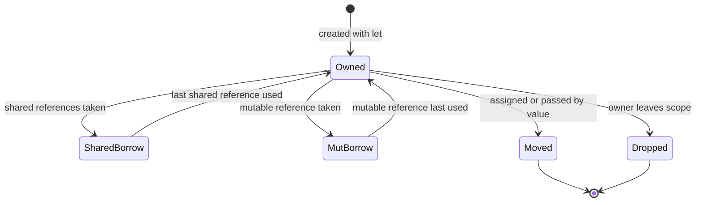
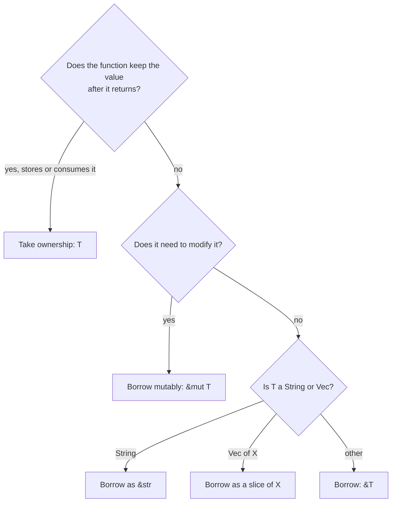
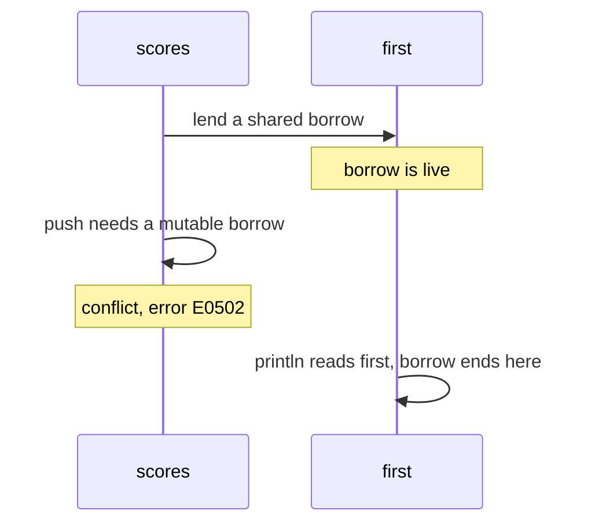
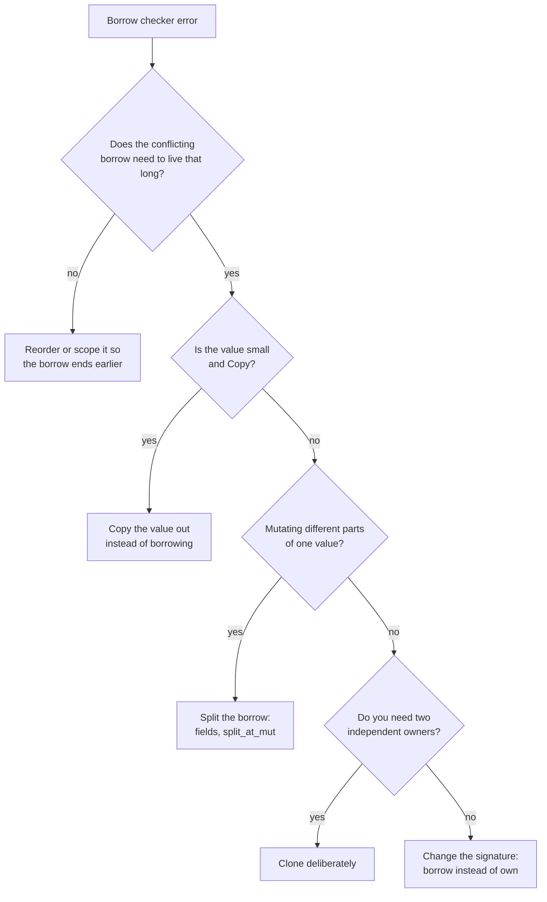

import Callout from '../../components/mdx/Callout.astro';

Ownership is the idea that makes Rust Rust. It is also the part that makes experienced Kotlin and Java developers feel like beginners for a few weeks. This post is for exactly that moment. It explains what the compiler is tracking, why the rules are what they are, and, most practically, how to read the four or five borrow-checker errors that account for nearly all early frustration and fix each one without reaching for `.clone()` by reflex.

By the end you should be able to look at a function signature and know whether it takes, borrows or mutates its arguments, predict which lines the borrow checker will reject, and choose between `String` and `&str` without guessing.

<Callout variant="note" title="You should already know">
How to create and run a cargo project, variables and `mut`, basic types, functions and the expression model, all from [Part 1: Getting Started](/blog/rust-01-getting-started).
</Callout>

## The problem ownership solves

Every language has to answer two questions about a piece of heap memory:

1. **When is it freed?** Free it too early and someone reads garbage (use-after-free). Free it twice and the allocator's bookkeeping is corrupted. Never free it and you leak.
2. **Who can change it, and when?** If two parts of the program hold a pointer to the same data and one of them modifies it, the other may be looking at something that has been moved, resized or half-written.

A garbage collector answers the first question at runtime and largely ignores the second. In Kotlin, every object variable is a reference, references are copied freely, and any of them can mutate the object. That is convenient, and it is how you get a `ConcurrentModificationException` when you modify a list while iterating it, or a data race when two threads update a `HashMap`.

Rust answers both questions at compile time with two connected ideas:

- **Ownership** decides when memory is freed: each value has one owner, and it is freed when that owner goes away.
- **Borrowing** decides who can access it: you can lend out either many read-only references or one mutable reference, never both at once, and no reference may outlive the owner.

To understand why these rules matter, you first need a clear picture of where values live.

## Stack and heap

### The stack

Each function call gets a **stack frame**: a block of memory holding its local variables, at sizes known at compile time. Allocating a frame is just moving the stack pointer, and freeing it on return is moving it back. It is extremely fast, and it is automatically cleaned up. Integers, floats, booleans, chars, fixed-size arrays and tuples or structs made of those can live entirely on the stack.

The limitation: everything on the stack must have a size known at compile time, and it disappears when the function returns.

### The heap

Data whose size is only known at runtime, or that must outlive the function that created it, goes on the **heap**. You ask the allocator for a block of memory, it gives back a pointer, and someone must eventually give the memory back. Heap allocation is much slower than stack allocation, and accessing data through a pointer is less cache-friendly.

### What a `String` actually is

A `String` is the clearest example of a value that spans both. The `String` variable itself is three machine words on the stack: a **pointer** to a heap buffer, a **length** (bytes in use), and a **capacity** (bytes allocated). The characters live in the heap buffer.

```rust
let s1 = String::from("hello");
```


Now consider `let s2 = s1;`. What should happen?

- If Rust copied the three stack words, `s1` and `s2` would both point at the same buffer. When both go out of scope, both would free it: a **double free**.
- If Rust deep-copied the heap buffer, every assignment would silently allocate, which would make performance unpredictable.

Rust does neither. It copies the three stack words and **considers `s1` no longer valid**. This is called a **move**. Ownership of the buffer has transferred to `s2`; only `s2` will free it.

## The ownership rules

The Rust Book states them in three lines, and they are worth memorizing:

1. Each value in Rust has an **owner**.
2. There can only be **one owner at a time**.
3. When the owner goes **out of scope**, the value is **dropped**.

```rust
fn scope_demo() {
    {
        let greeting = String::from("hello"); // allocated on the heap
        println!("{greeting}");
    } // `greeting` goes out of scope: drop runs, the buffer is freed
}
```

"Dropped" means Rust calls the type's destructor, the `Drop` implementation, which for `String` frees the heap buffer. This happens at a statically known point, the closing brace, not "sometime later" as with a GC. The same mechanism closes files, releases locks and returns database connections to their pool. C++ calls the pattern RAII; Part 6 covers `Drop` in depth.

You can visualize the life of any owned value as a small state machine:



A moved-from variable cannot be used again (unless you assign it a fresh value). A borrowed value cannot be moved or dropped while the borrow is still in use. Those two facts generate most of the errors you will see.

## Moves

### Assignment moves

```rust
let name = String::from("Ferris");
let moved = name;
println!("{name} and {moved}");
```

```text
error[E0382]: borrow of moved value: `name`
 --> src/main.rs:4:16
  |
2 |     let name = String::from("Ferris");
  |         ---- move occurs because `name` has type `String`, which does not implement the `Copy` trait
3 |     let moved = name;
  |                 ---- value moved here
4 |     println!("{name} and {moved}");
  |                ^^^^ value borrowed here after move
  |
help: consider cloning the value if the performance cost is acceptable
  |
3 |     let moved = name.clone();
  |                     ++++++++
```

Read the error top to bottom: the type does not implement `Copy`, so line 3 moved it, so line 4 cannot use it. The compiler's suggestion, `.clone()`, is valid, but it is only one of several fixes, and often not the best one. More on that below.

### Function calls move too

Passing a value to a function parameter is also an assignment, so it moves. Returning a value moves it out to the caller.

```rust
fn takes_ownership(s: String) -> usize {
    s.len()
} // s dropped here

fn gives_back(mut s: String) -> String {
    s.push('!');
    s // ownership moves out to the caller
}

let s = String::from("hi");
let n = takes_ownership(s); // s is moved in; it is freed at the end of takes_ownership
// println!("{s}");         // error[E0382]: borrow of moved value
let t = gives_back(String::from("hey"));
```

A function that takes `String` (by value) is saying "give this to me; you will not need it again". That is the right signature when the function stores the value somewhere, such as pushing it into a struct or a collection, or transforms it into something else. It is the wrong signature when the function only needs to look at it, and the fix there is borrowing.

A loop makes this especially visible, because a value can only be moved once:

```text
error[E0382]: use of moved value: `names`
 --> src/main.rs:7:19
  |
5 |     let names = vec![String::from("a"), String::from("b")];
  |         ----- move occurs because `names` has type `Vec<String>`, which does not implement the `Copy` trait
6 |     for _ in 0..2 {
  |     ------------- inside of this loop
7 |         print_all(names);
  |                   ^^^^^ value moved here, in previous iteration of loop
  |
note: consider changing this parameter type in function `print_all` to borrow instead if owning the value isn't necessary
```

The note is the correct fix: `print_all` only reads, so it should borrow.

### How this compares with Kotlin and Java

In Kotlin, `val b = a` for an object copies a reference. Both names point at the same object, both can use it, and the GC frees it when nobody can reach it:

```kotlin
val names = mutableListOf("a", "b")
val alias = names          // two references, one list
alias.add("c")
println(names)             // [a, b, c]: mutation is visible through every alias

for (n in names) {
    if (n == "a") names.add("z")   // compiles; throws ConcurrentModificationException at runtime
}
```

Rust's version of the second half does not compile at all, as you will see under E0502. That is the trade in one example: Kotlin lets you alias and mutate freely and catches some misuse at runtime; Rust restricts aliasing and catches it at compile time.

## Copy and Clone

### Copy: types that are duplicated, not moved

```rust
let a: i32 = 7;
let b = a;          // i32 is Copy: the bits are duplicated, `a` stays valid
println!("{a} {b}");
```

Some types are so cheap and simple to duplicate that moving them would be pointless. These implement the **`Copy`** trait, and assignment copies them bit-for-bit, leaving the original usable. `Copy` types include all integers and floats, `bool`, `char`, shared references `&T`, and tuples and arrays whose elements are all `Copy`.

A type can only be `Copy` if copying its bytes is a complete, correct copy, which means it owns no heap resources and has no destructor. `String`, `Vec`, `Box` and anything containing them can never be `Copy`. Your own types can opt in with `#[derive(Clone, Copy)]` if all their fields are `Copy`:

```rust
#[derive(Debug, Clone, Copy)]
struct Point {
    x: f64,
    y: f64,
}
```

### Clone: an explicit, possibly expensive copy

```rust
let s1 = String::from("heap data");
let s2 = s1.clone();   // allocates a new buffer and copies the bytes
println!("{s1} {s2}"); // both valid, independent owners
```

**`Clone`** is an explicit method call that produces an independent duplicate. For a `String` or `Vec` that means a new heap allocation and a copy of every element. The fact that it is visible in the code is the point: in Rust, an expensive copy is never hidden behind `=`.

| | Move | Copy | Clone |
|---|---|---|---|
| Triggered by | `=`, passing, returning | `=`, passing, returning | calling `.clone()` |
| Original usable after? | No | Yes | Yes |
| Cost | Copies the stack bytes only | Copies the stack bytes only | Whatever the type does; often allocates |
| Applies to | Every non-`Copy` type | Simple types with no destructor | Types that implement `Clone` |

Cloning is not wrong. Cloning a small string once at startup is irrelevant. Cloning a large vector inside a hot loop because the borrow checker complained is the pattern to avoid. Before cloning, ask whether the code actually needs a second owner, or just needs to look at the data.

## Borrowing: references

### Shared references

Most functions do not need to own their inputs. They need to read them. A **reference** lets you refer to a value without taking ownership; creating one is called **borrowing**.

```rust
fn word_count(s: &str) -> usize {
    s.split_whitespace().count()
}

let owned = String::from("on the heap");
let n = word_count(&owned); // lend it out
println!("{owned} has {n} words"); // still ours
```

`&owned` creates a shared reference. It is just a pointer (plus, for `&str`, a length), it is `Copy`, and you can have as many as you like at the same time. Through a shared reference you can read but not modify.

### Mutable references

```rust
fn shout(s: &mut String) {
    s.make_ascii_uppercase();
}

let mut owned = String::from("quiet");
shout(&mut owned);
println!("{owned}"); // QUIET
```

`&mut T` is a **mutable reference**: it allows modifying the value in place without taking ownership. Two conditions: the variable itself must be declared `mut`, and you must write `&mut` at the call site. The second condition is a readability feature, since anyone reading `shout(&mut owned)` knows `owned` may change.

### Choosing the parameter type

Every function signature makes an ownership decision. This flowchart covers the vast majority of cases:



Small `Copy` types like `i32` or a `Point` of two floats are usually passed by value, since copying them is as cheap as passing a pointer.

## The borrowing rules

At any given time, for a given value, you can have **either**:

- **any number of shared references `&T`**, or
- **exactly one mutable reference `&mut T`**,

and every reference must always be **valid**: it cannot outlive the value it points to.

People summarize the first rule as "aliasing XOR mutability", or "many readers or one writer". It is the same rule as a read-write lock, enforced at compile time and with zero runtime cost.


### Why such a strict rule?

Because aliasing plus mutation is where whole categories of bugs live, even in single-threaded code:

- **Iterator invalidation.** You hold a reference into a `Vec`, then push to it. The push may reallocate the buffer to a new address, and your reference now points at freed memory. In C++ this is undefined behavior; in Java it is the `ConcurrentModificationException` that only shows up at runtime.
- **Data races.** Two threads, at least one writing, no synchronization. Under the borrow rules, if one thread has `&mut` access, no other thread can have any access, so data races are impossible in safe Rust. Part 7 builds on this.
- **Optimizations.** Because `&mut T` guarantees no one else is looking, the compiler can keep values in registers and reorder loads and stores more aggressively, much like C's `restrict`, but checked.

### Non-lexical lifetimes: borrows end at their last use

An important detail that trips up people who learned Rust from older material: a borrow lasts from where it is created **to where it is last used**, not to the end of the enclosing block. This is called **non-lexical lifetimes** (NLL) and it has been the default since the 2018 edition.

```rust
let mut scores = vec![10, 20, 30];
let first = &scores[0];
println!("first = {first}"); // last use of `first`: the borrow ends here
scores.push(40);              // fine: no live borrow
println!("{scores:?}");
```

This compiles. Move the `println!` after the `push` and it does not, because then the shared borrow is still live at the moment `push` needs a mutable one:



When reading a borrow error, always ask: **where is the conflicting borrow last used?** That line, not the line where the borrow was created, is usually what you need to move.

## Strings and slices

### `String` versus `&str`

This is the single most common source of confusion for newcomers, so here it is directly:

- **`String`** is an **owned**, growable, heap-allocated UTF-8 buffer (pointer, length, capacity). You can push to it. It frees its buffer when dropped. Use it when you need to own or build text: struct fields, return values you construct, collections of names.
- **`&str`** (a "string slice") is a **borrowed view** into UTF-8 bytes that live somewhere else (pointer and length). It cannot grow. It might point into a `String`, into a string literal compiled into your binary, or into part of a larger buffer. Use it for parameters that only read text.

```rust
let literal: &'static str = "baked into the binary";
let owned: String = String::from("on the heap");
let borrowed: &str = &owned;     // &String coerces to &str automatically
let slice: &str = &owned[0..2];  // "on": a view of the first two bytes
```

String literals have type `&'static str`: a slice pointing into the program's read-only data, valid for the whole run.

The relationship mirrors `Vec<T>` (owned, growable) and `&[T]` (borrowed slice of elements). Once you see the pattern, it is everywhere: `PathBuf` and `&Path`, `OsString` and `&OsStr`.

### Take `&str` in parameters

```rust
fn word_count(s: &str) -> usize { /* ... */ }
```

Writing `&str` instead of `&String` makes the function accept both a `&String` (thanks to **deref coercion**, which converts `&String` to `&str` automatically) and a literal. Clippy's `ptr_arg` lint warns if you write `&String`:

```text
warning: writing `&String` instead of `&str` involves a new object where a slice will do
  --> src/main.rs:33:24
   |
33 | fn calculate_length(s: &String) -> usize {
   |                        ^^^^^^^
```

The same applies to vectors: take `&[T]`, not `&Vec<T>`.

### Slices

A slice is a reference to a contiguous range of elements. For arrays and vectors the type is `&[T]` or `&mut [T]`:

```rust
fn sum(values: &[i64]) -> i64 {
    let mut total = 0;
    for v in values {
        total += v;
    }
    total
}

fn double_all(values: &mut [i64]) {
    for v in values.iter_mut() {
        *v *= 2;  // * dereferences: write through the reference
    }
}

let mut v = vec![1, 2, 3];
double_all(&mut v);           // [2, 4, 6]
println!("{} {}", sum(&v), sum(&v[1..])); // 12 10
```

Returning a slice ties the result to the input, which the compiler tracks:

```rust
fn first_word(s: &str) -> &str {
    match s.find(' ') {
        Some(i) => &s[..i],
        None => s,
    }
}
```

The returned `&str` borrows from `s`. If the caller drops or mutates the original `String` while still holding the result, the borrow checker rejects it. In a GC language, the equivalent bug would be holding an index into a string that has since changed. Here, the "index" and the data are tied together and the compiler keeps them consistent. (How the compiler knows the output borrows from the input is lifetime elision, covered in Part 6.)

### UTF-8 and byte indices

String slicing uses **byte** offsets, and Rust strings are always valid UTF-8. Slicing in the middle of a multi-byte character would create invalid UTF-8, so it panics:

```rust
let city = String::from("Zürich");
println!("{} bytes, {} chars", city.len(), city.chars().count()); // 7 bytes, 6 chars
let bad = &city[0..2]; // panics
```

```text
thread 'main' panicked at src/main.rs:3:16:
end byte index 2 is not a char boundary; it is inside 'ü' (bytes 1..3 of string)
```

Use `city.get(0..2)`, which returns `None` instead of panicking, or iterate with `.chars()` or `.char_indices()` when you need character positions.

## Reading borrow-checker errors

Every borrow-checker error has the same structure: the **error line** names the conflict, and the **labels** mark where the first borrow (or move) happened, where the conflicting action happened, and where the first borrow is used later. That last label is the key to the fix. Here are the errors you will see most, with the real compiler output and the usual fixes.

### E0382: use of a moved value

You saw it above. The value was moved, and then used again.

Fixes, in order of preference:

1. **Borrow instead of moving.** If the receiving function only reads, change its parameter to `&T`, `&str` or `&[T]` and pass `&value`.
2. **Reorder.** Use the value before the move.
3. **Clone deliberately**, if you truly need two independent owners and the cost is acceptable.
4. **Restructure ownership**, for example by having the function return the value back. Rarely the best choice, but sometimes natural for builder-style code.

### E0499: two mutable borrows at once

```rust
let mut log = String::from("start");
let a = &mut log;
let b = &mut log;
a.push_str(" a");
b.push_str(" b");
```

```text
error[E0499]: cannot borrow `log` as mutable more than once at a time
 --> src/main.rs:4:13
  |
3 |     let a = &mut log;
  |             -------- first mutable borrow occurs here
4 |     let b = &mut log;
  |             ^^^^^^^^ second mutable borrow occurs here
5 |     a.push_str(" a");
  |     - first borrow later used here
```

The fix is to make the first mutable borrow end before the second starts, by finishing all uses of `a` before creating `b`, or by scoping it:

```rust
let mut log = String::from("start");
{
    let a = &mut log;
    a.push_str(" a");
} // a's borrow ends
let b = &mut log;
b.push_str(" b");
```

In real code, E0499 often appears when you want mutable access to two parts of one collection at once. The standard library has tools for exactly that: `split_at_mut` gives you two non-overlapping mutable slices, and the compiler understands that **different fields of a struct** are separate places:

```rust
let mut buf = [1, 2, 3, 4, 5, 6];
let (left, right) = buf.split_at_mut(3);
left[0] = right[0] * 10; // two &mut slices, provably disjoint

struct Counter {
    hits: u64,
    misses: u64,
    label: String,
}

fn disjoint_fields(c: &mut Counter) {
    let hits = &mut c.hits;
    let misses = &mut c.misses; // different field: allowed
    *hits += 1;
    *misses += 1;
}
```

The field trick only works when the compiler can see the fields directly. If you call `c.hits_mut()` and `c.misses_mut()` methods that each take `&mut self`, both calls borrow all of `c`, and you are back to E0499. That is a common reason to access fields directly inside a module.

### E0502: shared and mutable borrow overlap

```rust
let mut scores = vec![10, 20, 30];
let first = &scores[0];
scores.push(40);
println!("first = {first}");
```

```text
error[E0502]: cannot borrow `scores` as mutable because it is also borrowed as immutable
 --> src/main.rs:4:5
  |
3 |     let first = &scores[0];
  |                  ------ immutable borrow occurs here
4 |     scores.push(40);
  |     ^^^^^^^^^^^^^^^ mutable borrow occurs here
5 |     println!("first = {first}");
  |                        ----- immutable borrow later used here
```

This is not pedantry. `push` may reallocate the vector, and `first` would then point at freed memory. Fixes:

- **Copy the value out** if it is `Copy`: `let first = scores[0];` holds an `i32`, not a reference.
- **Move the last use earlier**, so the borrow ends before the mutation (the NLL example above).
- **Clone** the element if it is not `Copy` and you need it to outlive the mutation.

The loop version is the one Kotlin developers write on day one:

```rust
let mut users = vec![String::from("ann"), String::new()];
for u in &users {
    if u.is_empty() {
        users.push(String::from("placeholder"));
    }
}
```

```text
error[E0502]: cannot borrow `users` as mutable because it is also borrowed as immutable
 --> src/main.rs:5:13
  |
3 |       for u in &users {
  |       -        ------
  |       |        |
  |       |        immutable borrow occurs here
  |  _____|        immutable borrow later used here
  | |
4 | |         if u.is_empty() {
5 | |             users.push(String::from("placeholder"));
  | |             ^^^^^^^^^^^^^^^^^^^^^^^^^^^^^^^^^^^^^^^ mutable borrow occurs here
6 | |         }
7 | |     }
  | |_____- this for loop borrows `users` immutably, preventing mutation within its body
  |
  = help: consider using an index-based loop instead, or collecting modifications into a separate collection
```

Exactly the `ConcurrentModificationException` from the Kotlin example, caught before the program runs. The help text names the two standard fixes: compute the changes first and apply them after the loop, or use a purpose-built method. For removal, `retain` is that method:

```rust
let mut users = vec!["ann", "", "bob", ""];
users.retain(|u| !u.is_empty()); // ["ann", "bob"]
```

### E0505: moving out while borrowed

```rust
fn consume(s: String) -> usize { s.len() }

let title = String::from("Ownership");
let view = &title;
let n = consume(title);
println!("{view} {n}");
```

```text
error[E0505]: cannot move out of `title` because it is borrowed
 --> src/main.rs:5:21
  |
3 |     let title = String::from("Ownership");
  |         ----- binding `title` declared here
4 |     let view = &title;
  |                ------ borrow of `title` occurs here
5 |     let n = consume(title);
  |                     ^^^^^ move out of `title` occurs here
6 |     println!("{view} {n}");
  |                ---- borrow later used here
```

Moving `title` into `consume` means it will be freed at the end of `consume`, and `view` would dangle. Fixes: finish using `view` before the move; make `consume` borrow if it does not really need ownership; or clone if you genuinely need both. Note that the compiler's suggestion here, `&title.clone()`, is technically valid but usually the least sensible option: think about which side actually needs ownership.

### E0597 and E0106: references that would outlive their data

Two related errors show the "references must always be valid" rule:

```rust
let r;
{
    let s = String::from("short-lived");
    r = &s;
}
println!("{r}");
```

```text
error[E0597]: `s` does not live long enough
 --> src/main.rs:5:13
  |
4 |         let s = String::from("short-lived");
  |             - binding `s` declared here
5 |         r = &s;
  |             ^^ borrowed value does not live long enough
6 |     }
  |     - `s` dropped here while still borrowed
7 |     println!("{r}");
  |                - borrow later used here
```

And returning a reference to a local:

```rust
fn longest_line() -> &str {
    let text = String::from("a\nbb");
    text.lines().max_by_key(|l| l.len()).unwrap()
}
```

```text
error[E0106]: missing lifetime specifier
 --> src/main.rs:1:22
  |
1 | fn longest_line() -> &str {
  |                      ^ expected named lifetime parameter
  |
  = help: this function's return type contains a borrowed value, but there is no value for it to be borrowed from
help: instead, you are more likely to want to return an owned value
  |
1 - fn longest_line() -> &str {
1 + fn longest_line() -> String {
  |
```

A returned reference must borrow from something the caller passed in; otherwise it would point into the function's dead stack frame. Either return an owned `String`, or take the text as a parameter so the result can borrow from it:

```rust
fn longest_line(text: &str) -> &str {
    text.lines().max_by_key(|l| l.len()).unwrap_or("")
}
```

This is the dangling-pointer bug from C, and in Rust it is a compile error with a suggested fix. Lifetimes, the names the compiler uses for "how long a borrow is valid", get their own full treatment in Part 6.

### A decision tree for borrow errors



### Two more tools: `mem::take` and owning the result

Sometimes you have a `&mut` to a struct and want to move a field out of it, which is not allowed because it would leave the struct half-empty. `std::mem::take` swaps in the type's default value and gives you the old one:

```rust
let mut pending: Vec<String> = vec!["a".into(), "b".into()];
let batch = std::mem::take(&mut pending); // moves the Vec out, leaves an empty one
println!("{} sent, {} pending", batch.len(), pending.len()); // 2 sent, 0 pending
```

`std::mem::replace` does the same with a value you choose. These are the idiomatic way to "drain" a buffer that lives inside a struct.

## Thinking in ownership as a Kotlin or Java developer

A few mental shifts help more than memorizing rules:

- **Every `=` is a decision.** In Kotlin, assignment always shares. In Rust, it moves (or copies, for `Copy` types). When you want sharing, you write `&`. When you want a duplicate, you write `.clone()`. Nothing expensive or aliasing happens implicitly.
- **Signatures are documentation.** `fn save(order: Order)` consumes; `fn validate(order: &Order)` reads; `fn apply_discount(order: &mut Order)` modifies. A Kotlin signature `fun save(order: Order)` tells you none of this.
- **Data flows like a tree, not a graph.** Rust code is easiest when each value has a clear owner and references point "down" or "inward" for short periods. Long-lived webs of objects pointing at each other, which are effortless in a GC language, require deliberate tools in Rust (`Rc`, `Arc`, arenas with indices; Part 6). If you find yourself fighting the borrow checker for an hour, the design is often asking for a different ownership structure.
- **Short borrows, owned storage.** Structs usually own their data (`String`, `Vec`), and functions borrow it temporarily. Structs that hold references are possible but carry lifetime parameters; avoid them until Part 6.
- **The borrow checker is conservative.** It rejects some programs that are actually fine, because it cannot prove they are fine. That is the price of a sound, fast, local analysis. When you hit one of those cases, the fix is almost always a small restructuring, not `unsafe`.

## Common mistakes

**Cloning to silence the compiler.** `.clone()` makes most borrow errors disappear and often hides a signature that should borrow. Use it consciously, and look for a borrowing fix first, especially in loops.

**Taking `&String` or `&Vec<T>` parameters.** Take `&str` and `&[T]`; they accept more callers and avoid a double indirection. Clippy flags this.

**Taking ownership in functions that only read.** `fn print_report(orders: Vec<Order>)` forces every caller to give up their vector or clone it. Borrow.

**Holding a reference across a mutation of the same collection.** Grabbing `&v[0]` and then pushing to `v` is E0502. Copy the value out, or finish with the reference first.

**Indexing strings by "character position".** `&s[0..3]` is bytes, not characters, and panics in the middle of a multi-byte character. Use `.chars()`, `.char_indices()` or `get`.

**Assuming borrows last until the end of the block.** Since NLL, they last until their last use. Often the fix for an error is just to move a `println!` or another use earlier.

**Writing getter methods that borrow all of `self` and then trying to use two at once.** Two `&mut self` method calls cannot overlap. Inside the module, borrow the fields directly, or design a method that returns both parts.

**Reaching for `unsafe` or `Rc<RefCell<T>>` to escape a borrow error.** Both have legitimate uses (Parts 6 and 9). Neither is the right answer to a first-week borrow error, which almost always yields to reordering or a signature change.

## Interview questions

<details>
<summary>State Rust's ownership rules and explain what problem they solve.</summary>

Each value has exactly one owner at a time, and when the owner goes out of scope the value is dropped. Together with move semantics, this means every heap allocation is freed exactly once, at a statically known point, without a garbage collector. That eliminates leaks of the common kind, double frees and use-after-free. Borrowing extends the model by letting code access a value without owning it, under rules the compiler checks.

</details>

<details>
<summary>What is the difference between a move, a copy and a clone?</summary>

A move transfers ownership: the bytes of the value (for a `String`, its pointer, length and capacity) are copied to the new location and the old binding becomes unusable, so only one owner will free the heap data. A copy happens for `Copy` types, which have no destructor and own no resources; the bits are duplicated and both bindings remain valid. A clone is an explicit `.clone()` call that creates an independent duplicate, often allocating, and is visible in the code so that expensive copies are never implicit.

</details>

<details>
<summary>Explain the borrowing rules and why Rust enforces them.</summary>

At any time a value can have either any number of shared references or exactly one mutable reference, and no reference may outlive the value. The first rule, aliasing XOR mutability, prevents iterator invalidation and similar bugs where data changes or moves underneath a reader, and it makes data races impossible in safe code because a writer always has exclusive access. It also allows the compiler to optimize more aggressively. The second rule prevents dangling references.

</details>

<details>
<summary>What are non-lexical lifetimes?</summary>

Before the 2018 edition, a borrow lasted until the end of the lexical scope that held the reference. With non-lexical lifetimes, the borrow checker computes the region where a reference is actually live, from its creation to its last use, based on the control-flow graph. This accepts many correct programs that the old checker rejected, such as taking a reference, using it, and then mutating the original later in the same block.

</details>

<details>
<summary>When should a function take `String`, `&String` or `&str`?</summary>

Take `String` when the function needs ownership, for example to store the value in a struct or collection, so the caller hands it over without an extra copy. Take `&str` when the function only reads the text; it accepts string literals, `&String` through deref coercion, and slices of larger strings. There is almost never a reason to take `&String`, which is strictly less flexible and adds an extra indirection; clippy warns about it.

</details>

<details>
<summary>Why can't you index a Rust string with `s[i]` to get a character?</summary>

Strings are UTF-8, so characters take one to four bytes and the i-th character is not at byte offset i. Indexing by byte would be misleading and finding the i-th character is O(n), so Rust does not provide `Index<usize>` for strings. You can slice with byte ranges, which panic if a boundary falls inside a character, or use `.chars()`, `.char_indices()`, `.bytes()` or the non-panicking `get` method depending on what you actually need.

</details>

<details>
<summary>You get E0502 when pushing to a vector while iterating it. What are your options?</summary>

The loop holds a shared borrow of the vector for its whole duration, and `push` needs a mutable one; it is rejected because `push` may reallocate and invalidate the iterator. Options: collect the new items into a separate vector during the loop and `extend` afterwards; iterate over indices if the semantics allow it; use a dedicated method such as `retain`, `retain_mut`, `extend` or `drain` that performs the operation safely; or restructure into building a new vector with an iterator chain. Cloning the whole vector to iterate over the copy works but is usually the most expensive choice.

</details>

<details>
<summary>How does Rust's model compare with Java's or Kotlin's for memory and aliasing?</summary>

In Java and Kotlin every object variable is a reference, references are freely copied, any alias may mutate the object, and a tracing garbage collector frees objects when unreachable. Memory safety is guaranteed at runtime, but aliasing bugs like concurrent modification and data races are only caught at runtime or not at all. Rust tracks a single owner, frees deterministically at scope end, and restricts aliasing of mutable data at compile time. The cost is that some designs natural in a GC language, such as object graphs with shared mutable nodes, require explicit tools like `Rc`, `Arc`, `RefCell` or index-based arenas.

</details>

## Key takeaways

- Stack data is fixed-size and freed automatically on return; heap data needs an owner to free it. A `String` is a stack handle (pointer, length, capacity) to a heap buffer.
- One owner per value; the value is dropped when the owner goes out of scope. Assignment and passing move non-`Copy` values.
- `Copy` types are duplicated implicitly; `Clone` is explicit and may allocate. Do not clone by reflex.
- Borrow with `&T` to read and `&mut T` to modify. Many readers or one writer, never both, and no reference outlives its owner.
- Borrows end at their last use (NLL). When an error appears, look at where the conflicting borrow is last used.
- Own text with `String`, borrow it as `&str`; own lists with `Vec<T>`, borrow them as `&[T]`.
- E0382, E0499, E0502, E0505 and E0597 cover most early errors. Fix them by reordering, borrowing instead of owning, copying out small values, splitting borrows, or cloning deliberately.

Previous: [Part 1: Getting Started](/blog/rust-01-getting-started) · Next: [Part 3: Types, Enums, and Error Handling](/blog/rust-03-types-enums-errors)
