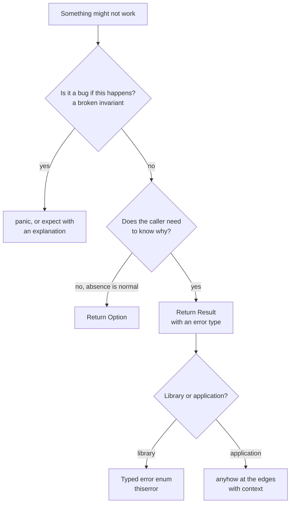
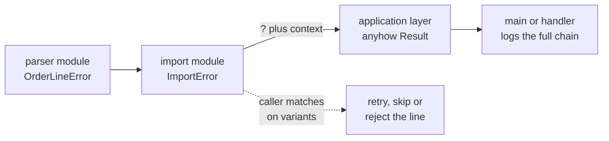
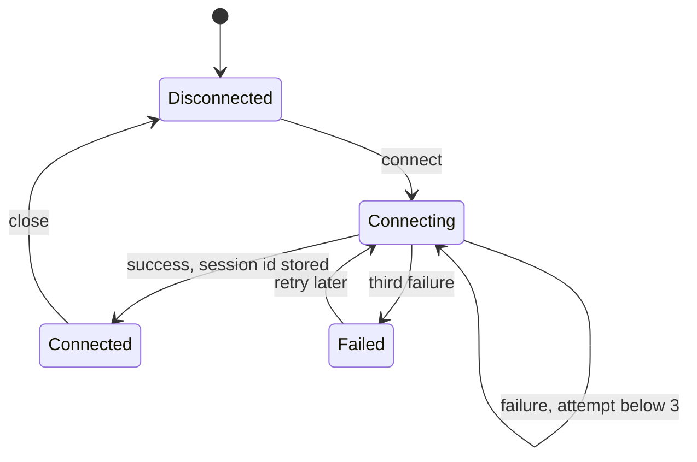

import Callout from '../../components/mdx/Callout.astro';

Part 2 was about who owns data. This part is about what shape the data has. It is for developers who can write small Rust programs but still model everything with strings, booleans and `.unwrap()`. By the end you will be able to define structs with methods, use enums that carry data the way Kotlin uses sealed classes, write exhaustive `match` expressions, replace null with `Option`, propagate errors with `Result` and `?`, build your own error types, and choose between `thiserror` and `anyhow`.

The thread running through all of it is a single idea: **put the rules of your domain into the types, so the compiler enforces them for you.** Rust's type system is unusually good at this, and once you have used it you will miss it in other languages.

<Callout variant="note" title="You should already know">
Cargo, variables, basic types, functions and control flow from [Part 1: Getting Started](/blog/rust-01-getting-started), and moves, borrows, `String` versus `&str` from [Part 2: Ownership and Borrowing](/blog/rust-02-ownership-borrowing).
</Callout>

## Structs

### Defining and creating structs

A struct groups named fields into one type. It is the equivalent of a Kotlin `data class` without the generated methods (you opt into those with `derive`).

```rust
#[derive(Debug, Clone, PartialEq)]
struct Customer {
    id: u64,
    name: String,
    email: String,
    active: bool,
}
```

Notice that the fields are `String`, not `&str`. A struct should normally **own** its data, so that a `Customer` can live as long as it needs to without depending on some other buffer. Structs that hold references are possible but need lifetime annotations; Part 6 covers when that is worth it.

Creating an instance lists every field. There are no default values and no partially initialized structs:

```rust
let c = Customer {
    id: 1,
    name: String::from("Ada"),
    email: String::from("ada@example.com"),
    active: true,
};
```

Two pieces of syntax save typing. **Field init shorthand**: if a variable has the same name as the field, write it once (`Customer { id, name, email, active: true }`). **Struct update syntax** copies the remaining fields from another instance:

```rust
let updated = Customer {
    name: String::from("Ada L."),
    ..c.clone()
};
```

The `..c.clone()` matters. Without the clone, `..c` would move the non-`Copy` fields (here `email`) out of `c`, and `c` would be partly unusable afterwards, which is the same move rule from Part 2 applied field by field.

You can also destructure a struct with a pattern, which is useful in `let`, function parameters and `match`:

```rust
let Customer { id, ref name, .. } = updated;
println!("{id} {name}");
```

`ref name` borrows the field instead of moving it out, and `..` ignores the rest.

### Tuple structs, newtypes and unit structs

```rust
#[derive(Debug, Clone, Copy, PartialEq)]
struct Money(i64); // amount in cents

struct Marker; // unit struct: no fields, zero size
```

A **tuple struct** has unnamed fields accessed with `.0`, `.1`. The single-field form is called a **newtype**, and it is one of the most useful patterns in Rust: `Money(i64)` is a different type from a plain `i64` and from `UserId(i64)`, so you cannot add money to a user ID or pass cents where dollars are expected. At runtime it costs nothing; the wrapper disappears in the compiled code. Kotlin's `@JvmInline value class` is the closest equivalent.

A **unit struct** has no data. It is used as a marker, or as a type that implements a trait without needing state (Part 4).

## Methods and `impl` blocks

Behavior lives in `impl` blocks, separate from the data definition. A type can have several `impl` blocks, even in different modules of the same crate.

```rust
impl Customer {
    // Associated function: no `self`. By convention, `new` is the constructor.
    fn new(id: u64, name: &str, email: &str) -> Self {
        Self {
            id,
            name: name.to_string(),
            email: email.to_string(),
            active: true,
        }
    }

    // &self: borrow immutably, read-only access
    fn display_name(&self) -> String {
        format!("{} <{}>", self.name, self.email)
    }

    // &mut self: borrow mutably, change in place
    fn deactivate(&mut self) {
        self.active = false;
    }

    // self: take ownership, consume the value
    fn into_email(self) -> String {
        self.email
    }
}

let mut c = Customer::new(1, "Ada", "ada@example.com");
println!("{}", c.display_name());
c.deactivate();
let email = c.into_email(); // c is moved; it cannot be used after this line
```

The receiver is the ownership decision from Part 2 applied to methods:

| Receiver | Meaning | Typical use |
|---|---|---|
| `&self` | Read the value | Getters, queries, formatting |
| `&mut self` | Modify the value in place | Setters, state updates, pushing to an internal buffer |
| `self` | Consume the value | Conversions (`into_*`), builders, state transitions |
| none | Associated function, called as `Type::name()` | Constructors, factory functions |

`Self` inside an `impl` is an alias for the type being implemented. Method calls automatically borrow: `c.display_name()` is sugar for `Customer::display_name(&c)`, so you rarely write `&` or `&mut` at call sites for methods.

There are no constructors in the Java sense. `new` is just a convention, and it is common to have several named constructors like `Money::from_major(12)` or `Config::from_env()`. An `impl` can also hold associated constants:

```rust
impl Money {
    const ZERO: Money = Money(0);

    fn from_major(units: i64) -> Self {
        Money(units * 100)
    }

    fn add(self, other: Money) -> Money {
        Money(self.0 + other.0)
    }
}
```

`add` takes `self` by value, which is fine because `Money` is `Copy`: the caller keeps its copy.

### Implementing `Display`

To print a type with `{}`, implement the `Display` trait. Traits are Part 4's topic, but this one is too useful to wait for:

```rust
use std::fmt;

impl fmt::Display for Money {
    fn fmt(&self, f: &mut fmt::Formatter<'_>) -> fmt::Result {
        let sign = if self.0 < 0 { "-" } else { "" };
        let cents = self.0.unsigned_abs();
        write!(f, "{sign}{}.{:02}", cents / 100, cents % 100)
    }
}

println!("{}", Money::from_major(12).add(Money(50))); // 12.50
println!("{}", Money(-50));                            // -0.50
```

`Debug` (`{:?}`) is for developers and is usually derived. `Display` is for users and is always written by hand, because only you know how your type should read.

## Enums that carry data

### More than a list of constants

In Java, an enum is a fixed set of named instances. Rust enums can do that, but each **variant can also carry its own data, of a different shape**:

```rust
#[derive(Debug, Clone, PartialEq)]
enum PaymentMethod {
    Cash,
    Card { last4: String, network: CardNetwork },
    BankTransfer(String), // IBAN
    Voucher { code: String, value: Money },
}

#[derive(Debug, Clone, Copy, PartialEq)]
enum CardNetwork {
    Visa,
    Mastercard,
}
```

A `PaymentMethod` is exactly one of these four things. If it is a card, it has a `last4` and a network. If it is cash, it has nothing. There is no way to build a cash payment with a card number attached, and no `cardNumber: String?` field that is "only set when type is CARD".

Kotlin developers will recognize this as a sealed class hierarchy:

```kotlin
sealed interface PaymentMethod {
    data object Cash : PaymentMethod
    data class Card(val last4: String, val network: CardNetwork) : PaymentMethod
    data class BankTransfer(val iban: String) : PaymentMethod
    data class Voucher(val code: String, val value: Money) : PaymentMethod
}
```

The idea is the same; the implementation differs. Kotlin variants are separate heap-allocated classes behind a reference. A Rust enum is a single value whose size is the size of its largest variant plus a small **tag** (the discriminant) that records which variant it is. It can live on the stack, inside a `Vec` contiguously, or inside another struct, with no allocation of its own.


In type-theory terms, a struct is a **product type** (all fields at once) and an enum is a **sum type** (exactly one variant). Having both, with first-class pattern matching, is what makes the "illegal states" technique at the end of this post possible.

Enums can have methods like structs:

```rust
impl PaymentMethod {
    fn describe(&self) -> String {
        match self {
            Self::Cash => "cash".to_string(),
            Self::Card { last4, network } => format!("{network:?} ending {last4}"),
            Self::BankTransfer(iban) => format!("transfer from {}", &iban[..4]),
            Self::Voucher { code, .. } => format!("voucher {code}"),
        }
    }
}
```

## Pattern matching

### `match` in depth

`match` is how you get data out of an enum. Each arm is a **pattern**, and patterns can destructure, bind variables, match literals and ranges, and add guards:

```rust
impl PaymentMethod {
    fn fee(&self, amount: Money) -> Money {
        match self {
            PaymentMethod::Cash => Money::ZERO,
            PaymentMethod::Card { network: CardNetwork::Visa, .. } => Money(amount.0 * 2 / 100),
            PaymentMethod::Card { .. } => Money(amount.0 * 3 / 100),
            PaymentMethod::BankTransfer(_) => Money(25),
            PaymentMethod::Voucher { value, .. } if value.0 >= amount.0 => Money::ZERO,
            PaymentMethod::Voucher { .. } => Money(10),
        }
    }
}
```

Things to notice:

- **Nested patterns**: `Card { network: CardNetwork::Visa, .. }` matches only Visa cards.
- **`..`** ignores remaining fields; **`_`** ignores one value.
- **Guards**: `if value.0 >= amount.0` adds a condition. A guarded arm does not count toward exhaustiveness, which is why the unguarded `Voucher { .. }` arm follows it.
- **Order matters**: arms are tried top to bottom, so the specific Visa arm must come before the general card arm.
- **Binding modes**: `match self` on a `&PaymentMethod` binds fields like `value` as references automatically. You do not need to write `&` or `ref` in the patterns.

Patterns also work with numbers, and `@` binds a value while testing it:

```rust
fn http_class(code: u16) -> &'static str {
    match code {
        100..=199 => "informational",
        200..=299 => "success",
        n @ 300..=399 if n != 304 => "redirect",
        304 => "not modified",
        400..=499 => "client error",
        _ => "server error or invalid",
    }
}
```

### Exhaustiveness

The compiler checks that a `match` covers every possible value. Add a variant to `PaymentMethod` and every `match` that does not handle it becomes a compile error:

```text
error[E0004]: non-exhaustive patterns: `&PaymentMethod::Voucher { .. }` not covered
 --> src/main.rs:3:11
  |
3 |     match m {
  |           ^ pattern `&PaymentMethod::Voucher { .. }` not covered
  |
note: `PaymentMethod` defined here
 --> src/main.rs:1:6
  |
1 | enum PaymentMethod { Cash, Card { last4: String }, BankTransfer(String), Voucher { code: String } }
  |      ^^^^^^^^^^^^^                                                       ------- not covered
  = note: the matched value is of type `&PaymentMethod`
help: ensure that all possible cases are being handled by adding a match arm with a wildcard pattern or an explicit pattern as shown
```

This is the most valuable refactoring tool Rust has. In a large codebase, adding a variant gives you a precise to-do list of every place that needs a decision. It only works if you resist the wildcard: a `_ => ...` arm on your own enum silences the compiler for every future variant too. Prefer listing variants explicitly, especially for enums that will grow.

### `if let`, `let else`, `while let` and `matches!`

When you only care about one pattern, a full `match` is noisy. `if let` handles one case:

```rust
if let PaymentMethod::Card { last4, .. } = &method {
    println!("card ending {last4}");
}
```

**`let else`** (stable since Rust 1.65) is the reverse: bind a pattern or leave the function. It flattens validation code that would otherwise nest deeper with every check:

```rust
fn greeting(customers: &[Customer], id: u64) -> String {
    let Some(c) = find_customer(customers, id) else {
        return "Hello, stranger".to_string();
    };
    let Some(domain) = domain_of(&c.email) else {
        return format!("Hello, {}", c.name);
    };
    format!("Hello, {} from {domain}", c.name)
}
```

The `else` block must diverge: `return`, `break`, `continue` or panic. After the statement, `c` and `domain` are plain bound variables. Kotlin's `val c = find(id) ?: return "..."` is the nearest equivalent.

`while let` loops as long as a pattern matches, and `matches!` turns a pattern into a `bool`:

```rust
let mut stack = vec![1, 2, 3];
while let Some(top) = stack.pop() {
    println!("popped {top}");
}

fn is_usable(conn: &Connection) -> bool {
    matches!(conn, Connection::Connected { .. })
}
```

## `Option`: no null

### Absence as a type

Rust has no `null`. A value that might be missing has type `Option<T>`, an ordinary enum from the standard library:

```rust
enum Option<T> {
    None,
    Some(T),
}
```

It is so common that `Some` and `None` are in scope everywhere. The crucial property: an `Option<u32>` is **not** a `u32`, so you cannot accidentally use a missing value as if it were present.

```rust
fn find(id: u32) -> Option<u32> { /* ... */ }

let balance = find(1);
let total = balance + 50;
```

```text
error[E0369]: cannot add `{integer}` to `Option<u32>`
 --> src/main.rs:4:25
  |
4 |     let total = balance + 50;
  |                 ------- ^ -- {integer}
  |                 |
  |                 Option<u32>
```

This is Kotlin's nullable types (`Int?`) taken one step further: it is not a special language feature but a regular type with regular methods, and it nests (`Option<Option<T>>` is meaningful, whereas `Int??` is not). It is also free at runtime for references and `Box`: `Option<&T>` is the same size as `&T`, because the compiler uses the null pointer value, which a reference can never hold, to represent `None`.

### Working with `Option`

```rust
fn find_customer(customers: &[Customer], id: u64) -> Option<&Customer> {
    customers.iter().find(|c| c.id == id)
}

fn domain_of(email: &str) -> Option<&str> {
    let at = email.find('@')?; // ? on an Option: return None if None
    let domain = &email[at + 1..];
    if domain.is_empty() { None } else { Some(domain) }
}

// match: handle both cases explicitly
match find_customer(&customers, 1) {
    Some(c) => println!("found {}", c.name),
    None => println!("no such customer"),
}

// map + unwrap_or: transform if present, fall back if not
let name = find_customer(&customers, 99)
    .map(|c| c.name.as_str())
    .unwrap_or("guest");

// and_then: chain steps that can each return None
let domain = find_customer(&customers, 1)
    .and_then(|c| domain_of(&c.email))
    .unwrap_or("unknown");
```

The methods you will use daily:

| Method | Does | Kotlin analogue |
|---|---|---|
| `map(f)` | Transform the value if present | `?.let` |
| `and_then(f)` | Chain a step that itself returns `Option` | `?.let` returning nullable |
| `unwrap_or(v)` / `unwrap_or_else(f)` | Value or fallback | `?:` |
| `unwrap_or_default()` | Value or the type's default | `?: 0` |
| `ok_or(err)` / `ok_or_else(f)` | Convert to `Result` | `?: throw` |
| `filter(pred)` | Keep only if predicate holds | `takeIf` |
| `is_some()` / `is_none()` | Test | `!= null` |
| `?` | Return `None` early from a function returning `Option` | `?: return null` |
| `unwrap()` / `expect(msg)` | Value or panic | `!!` |

`unwrap()` is Rust's `!!`. Use it only when `None` would be a bug, and prefer `expect("why this cannot be None")`, which documents the assumption and appears in the panic message.

## `Result` and the `?` operator

### Errors are values

Rust has no exceptions. A function that can fail returns `Result<T, E>`:

```rust
enum Result<T, E> {
    Ok(T),
    Err(E),
}
```

The failure is part of the signature. A caller cannot forget that `parse` can fail, because it gets a `Result`, not a number, and `Result` is marked `#[must_use]`, so ignoring one produces a warning.

```rust
use std::num::ParseIntError;

fn parse_quantity(s: &str) -> Result<u32, ParseIntError> {
    s.trim().parse::<u32>()
}
```

### Propagating with `?`

Handling every `Result` with `match` would be tedious. The `?` operator does the common thing: if the value is `Ok`, unwrap it and continue; if it is `Err`, **convert the error with `From::from` and return it** from the current function.

```rust
fn total_items(a: &str, b: &str) -> Result<u32, ParseIntError> {
    let x = parse_quantity(a)?;
    let y = parse_quantity(b)?;
    Ok(x + y)
}

println!("{:?}", total_items("2", " 3 "));    // Ok(5)
println!("{:?}", total_items("2", "three"));  // Err(ParseIntError { kind: InvalidDigit })
```


Roughly, `let x = expr?;` expands to:

```rust
let x = match expr {
    Ok(v) => v,
    Err(e) => return Err(From::from(e)),
};
```

That `From::from` call is the hook for error conversion, which is what makes custom error types pleasant. `?` only works inside a function whose return type can carry the error. Use it in a `main` that returns `()` and the compiler says so, and suggests the fix:

```text
error[E0277]: the `?` operator can only be used in a function that returns `Result` or `Option` (or another type that implements `FromResidual`)
 --> src/main.rs:2:30
  |
1 | fn main() {
  | --------- this function should return `Result` or `Option` to accept `?`
2 |     let n: u32 = "42".parse()?;
  |                              ^ cannot use the `?` operator in a function that returns `()`
  |
help: consider adding return type
  |
1 ~ fn main() -> Result<(), Box<dyn std::error::Error>> {
2 |     let n: u32 = "42".parse()?;
3 |     println!("{n}");
4 +     Ok(())
  |
```

`main` may return `Result<(), E>` for any `E: Debug`. If it returns `Err`, the program prints the error's `Debug` form and exits with a non-zero status.

Compared with exceptions, the trade-off is explicitness. In Kotlin, any call may throw, and nothing in the signature says so. In Rust, every fallible call is marked with `?` or handled, so a reader can see each point where the function might return early. You type one character per call site, and in exchange the control flow is never hidden.

### Choosing between `Option`, `Result` and a panic



## Custom error types

### A hand-written error enum

`ParseIntError` is fine for one parse call. Real functions fail in several ways, and callers need to tell them apart. The idiomatic answer is an enum with one variant per failure:

```rust
use std::fmt;
use std::num::ParseIntError;

#[derive(Debug)]
enum OrderLineError {
    MissingField(&'static str),
    BadQuantity(ParseIntError),
    ZeroQuantity,
    UnknownSku(String),
}

impl fmt::Display for OrderLineError {
    fn fmt(&self, f: &mut fmt::Formatter<'_>) -> fmt::Result {
        match self {
            Self::MissingField(field) => write!(f, "missing field `{field}`"),
            Self::BadQuantity(_) => write!(f, "quantity is not a number"),
            Self::ZeroQuantity => write!(f, "quantity must be at least 1"),
            Self::UnknownSku(sku) => write!(f, "unknown SKU {sku}"),
        }
    }
}

impl std::error::Error for OrderLineError {
    fn source(&self) -> Option<&(dyn std::error::Error + 'static)> {
        match self {
            Self::BadQuantity(e) => Some(e),
            _ => None,
        }
    }
}

impl From<ParseIntError> for OrderLineError {
    fn from(e: ParseIntError) -> Self {
        OrderLineError::BadQuantity(e)
    }
}
```

Three pieces, each with a job:

- **`Display`** produces the human-readable message. It describes *this* layer's failure only.
- **`std::error::Error`** marks it as an error type and, through `source()`, exposes the **underlying cause**, forming a chain like Java's `getCause()`.
- **`From<ParseIntError>`** lets `?` convert a `ParseIntError` into an `OrderLineError` automatically.

Now a parser that uses it:

```rust
#[derive(Debug, PartialEq)]
struct OrderLine {
    sku: String,
    quantity: u32,
}

const CATALOG: [&str; 3] = ["SKU-1", "SKU-2", "SKU-3"];

// "SKU-1,3" -> OrderLine
fn parse_line(line: &str) -> Result<OrderLine, OrderLineError> {
    let mut parts = line.split(',');
    let sku = parts
        .next()
        .filter(|s| !s.is_empty())
        .ok_or(OrderLineError::MissingField("sku"))?;
    let qty_text = parts.next().ok_or(OrderLineError::MissingField("quantity"))?;
    let quantity: u32 = qty_text.trim().parse()?; // ParseIntError -> OrderLineError via From
    if quantity == 0 {
        return Err(OrderLineError::ZeroQuantity);
    }
    if !CATALOG.contains(&sku) {
        return Err(OrderLineError::UnknownSku(sku.to_string()));
    }
    Ok(OrderLine { sku: sku.to_string(), quantity })
}

fn parse_order(text: &str) -> Result<Vec<OrderLine>, OrderLineError> {
    text.lines().map(parse_line).collect()
}
```

Two details worth pausing on. `ok_or` converts an `Option` into a `Result`, so a missing field becomes a typed error that `?` can propagate. And `collect()` into a `Result<Vec<_>, _>` stops at the first error: an iterator of `Result`s can be collected into a `Result` of a collection. Running it on bad input:

```text
   SKU-1 -> error: missing field `quantity`
 SKU-1,x -> error: quantity is not a number (caused by: invalid digit found in string)
 SKU-1,0 -> error: quantity must be at least 1
 SKU-9,1 -> error: unknown SKU SKU-9
      ,1 -> error: missing field `sku`
```

The caller can `match` on the variant to decide what to do (reject the line, ask the user, skip it), and a logger can walk the `source()` chain for the full story.

### `thiserror`: the same thing without the boilerplate

Writing `Display`, `Error` and `From` by hand is mechanical. The `thiserror` crate (version 2 at the time of writing) generates exactly that code from attributes. It does not appear in your public API; the result is an ordinary enum.

```toml
[dependencies]
thiserror = "2"
anyhow = "1"
```

```rust
use std::num::ParseIntError;
use thiserror::Error;

#[derive(Debug, Error)]
pub enum OrderLineError {
    #[error("missing field `{0}`")]
    MissingField(&'static str),
    #[error("quantity is not a number")]
    BadQuantity(#[from] ParseIntError),
    #[error("quantity must be at least 1")]
    ZeroQuantity,
    #[error("unknown SKU {0}")]
    UnknownSku(String),
}

#[derive(Debug, Error)]
pub enum ImportError {
    #[error("could not read {path}")]
    Io {
        path: String,
        #[source]
        source: std::io::Error,
    },
    #[error("invalid order on line {line}")]
    Line {
        line: usize,
        #[source]
        source: OrderLineError,
    },
}
```

`#[error("...")]` generates `Display`, `#[from]` generates the `From` impl and marks the field as the source, and `#[source]` marks a cause without generating `From`. Adding context such as a file path or line number is done with `map_err`:

```rust
fn import(path: &str) -> Result<u32, ImportError> {
    let text = std::fs::read_to_string(path).map_err(|source| ImportError::Io {
        path: path.to_string(),
        source,
    })?;
    let mut total = 0;
    for (i, line) in text.lines().enumerate() {
        let qty = parse_line(line).map_err(|source| ImportError::Line { line: i + 1, source })?;
        total += qty;
    }
    Ok(total)
}
```

Here `parse_line` is the thiserror version of the parser, returning just the quantity. A subtle rule: **do not repeat the source in your own message.** My first draft of `Line` was `#[error("line {line}: {source}")]`, and the report printed the cause twice, once in the message and once as the next link of the chain:

```text
Caused by:
    0: line 2: quantity must be at least 1
    1: quantity must be at least 1
```

Either show the cause in `Display` or expose it as `source`, not both. Exposing it as `source` is the better default, because tools that walk the chain then format it consistently.

### `anyhow`: errors in applications

A library needs typed errors, because its callers match on them. An application's `main`, a CLI command handler or a background job usually does not; it needs to report what went wrong, with enough context to debug it, and stop. That is what `anyhow` is for. `anyhow::Error` wraps any error type, and `anyhow::Result<T>` is `Result<T, anyhow::Error>`.

```rust
use anyhow::{Context, Result, bail};

fn load_threshold() -> Result<u32> {
    let raw = std::env::var("THRESHOLD").context("THRESHOLD is not set")?;
    let value: u32 = raw
        .parse()
        .with_context(|| format!("THRESHOLD={raw:?} is not a number"))?;
    if value > 1_000 {
        bail!("THRESHOLD {value} is above the 1000 limit");
    }
    Ok(value)
}

fn main() -> Result<()> {
    let total = import("orders.csv").context("importing daily orders")?;
    println!("{total}");
    Ok(())
}
```

`.context(...)` wraps an error with a message describing what *this* code was trying to do (`with_context` takes a closure so the string is only built on failure). `bail!` returns an ad-hoc error. When `main` returns the error, anyhow prints the whole chain:

```text
Error: importing daily orders

Caused by:
    0: invalid order on line 2
    1: quantity must be at least 1
```

Formatting an `anyhow::Error` with `{}` shows only the outermost message, `{:#}` shows the chain on one line (`THRESHOLD="abc" is not a number: invalid digit found in string`), and `{:?}` shows the multi-line report above. Pick `{:#}` for single-line structured logs.

The usual architecture combines them:



Typed errors (thiserror) where someone will make a decision based on the kind of failure; `anyhow` where the only decision left is "report it". In a web service, the HTTP layer has its own error enum that maps variants to status codes, which [Series B](/blog/rust-backend-01-first-http-service) builds.

## Panics: unrecoverable errors

A **panic** stops the current thread, unwinding the stack and running destructors along the way. If it is the main thread, the program exits with an error. You trigger one with `panic!`, `unwrap()` on `None` or `Err`, `expect`, out-of-bounds indexing, integer overflow in debug builds, or `unreachable!()`.

Panics are for **bugs**, not for expected failures:

- **Panic** when an invariant your code is supposed to guarantee has been broken: an index that was just bounds-checked, a configuration value validated at startup, a state that the type system already rules out. Continuing would mean running with corrupted assumptions.
- **Return `Result`** for anything the outside world can cause: user input, files, network, databases, other services. Those failures are normal events, and the caller should decide what to do.

Practical rules for `unwrap` and `expect`:

- Fine in tests, examples, and quick prototypes.
- Fine when you can prove the value exists, ideally with an `expect` that says why: `let re = Regex::new(PATTERN).expect("PATTERN is a valid literal regex")`.
- Not fine on I/O, parsing of external input, or anything in a request path. One bad request should produce a 400, not crash a worker.

Two more facts worth knowing. A release profile can set `panic = "abort"`, which skips unwinding and makes binaries smaller, at the cost of not running destructors on panic (Part 10). And `std::panic::catch_unwind` exists for boundaries like FFI or thread pools; it is not an exception mechanism for control flow, and it does not catch aborts.

## Making illegal states unrepresentable

Here is where structs, enums and errors combine into a design technique. The idea, popularized in the ML and F# communities: **design types so that invalid combinations of data cannot be constructed.** Then you do not need to check for them, test for them, or remember them.

### Replace flag soup with an enum

A common shape in Java and Kotlin code:

```rust
struct ConnectionFlags {
    connected: bool,
    connecting: bool,
    session_id: Option<String>,
    last_error: Option<String>,
}
```

Four fields produce 16 combinations of "set" and "unset", and most are nonsense: connected and connecting at the same time, connected without a session ID, an error while connected. Every method has to check for them, and someone will eventually forget. Model the actual states instead:

```rust
enum Connection {
    Disconnected,
    Connecting { attempt: u32 },
    Connected { session_id: String },
    Failed { error: String, attempts: u32 },
}

impl Connection {
    fn on_success(self, session_id: String) -> Connection {
        match self {
            Connection::Connecting { .. } => Connection::Connected { session_id },
            other => other,
        }
    }

    fn on_failure(self, error: String) -> Connection {
        match self {
            Connection::Connecting { attempt } if attempt < 3 => {
                Connection::Connecting { attempt: attempt + 1 }
            }
            Connection::Connecting { attempt } => Connection::Failed { error, attempts: attempt },
            other => other,
        }
    }
}
```

Now a session ID exists exactly when the connection is connected, because it is stored inside that variant. Code that needs the session ID must `match` and handle the other states. The transitions take `self`, so the old state is consumed and cannot be used by mistake:



### Parse, don't validate

The second technique applies to values. Instead of passing a raw `String` around and calling `is_valid_email()` in several places, convert it **once**, at the boundary, into a type that can only hold valid values:

```rust
#[derive(Debug, Clone, PartialEq)]
struct Email(String);

impl Email {
    fn parse(raw: &str) -> Result<Email, String> {
        let raw = raw.trim();
        match raw.split_once('@') {
            Some((local, domain)) if !local.is_empty() && domain.contains('.') => {
                Ok(Email(raw.to_lowercase()))
            }
            _ => Err(format!("invalid email: {raw}")),
        }
    }

    fn as_str(&self) -> &str {
        &self.0
    }
}

fn send_receipt(to: &Email, amount: Money) {
    println!("receipt for {amount} sent to {}", to.as_str());
}
```

(The validation here is deliberately simple; real email validation is famously messy. The pattern is the point.) Once the inner field is private to its module, which Part 5 covers with `pub`, the only way to obtain an `Email` is `Email::parse`. `send_receipt` cannot receive an unvalidated string, and it does not need to check. The validation happens once, the result is a type, and the type travels through the program carrying the proof.

Apply the same idea to IDs (`OrderId(u64)` versus `CustomerId(u64)`), to money (`Money` in cents rather than `f64`), to non-empty lists, to percentages between 0 and 100. Each newtype removes a class of mix-ups and moves a runtime check to a single constructor. Part 10 takes this further with the typestate pattern, where the *state* of an object is encoded in its type parameter.

## Common mistakes

**Using a wildcard arm on your own enums.** `_ => {}` compiles today and silently swallows every variant you add tomorrow. List variants explicitly where a future variant deserves a decision.

**Booleans and `Option` fields instead of an enum.** If some fields only make sense in some states, those states want to be enum variants that carry their own data.

**`unwrap()` on external input.** Parsing user input, reading files or decoding JSON with `unwrap` turns ordinary bad input into a crash. Return a `Result`, or use `expect` only where failure would truly be a bug.

**`String` as the error type everywhere.** `Result<T, String>` is fine for a prototype, but callers cannot match on it and it has no source chain. Use an enum for anything others call.

**Repeating the cause in the error message.** With `thiserror`, writing `{source}` in the message and also marking it `#[source]` prints the cause twice in reports. Pick one.

**Using `anyhow` in a library's public API.** Callers lose the ability to handle specific failures. Libraries expose typed errors; applications may use `anyhow`.

**Losing context while propagating.** A bare `?` on an I/O error yields "No such file or directory" with no file name. Add `map_err` with the path, or `.context(...)` in application code.

**Converting `Option` to a default too early.** `unwrap_or(0)` at the first opportunity throws away the information that the value was missing. Keep the `Option` until the point where a decision is actually made.

**Moving fields out with struct update syntax.** `Customer { name, ..old }` moves `old`'s non-`Copy` fields, leaving `old` partially moved. Clone, or let `old` go.

## Interview questions

<details>
<summary>How do Rust enums differ from Java enums, and how do they compare with Kotlin sealed classes?</summary>

Java enum constants are singleton instances that all share the same fields. A Rust enum is a sum type: each variant can carry different data, so a value is exactly one variant with exactly that variant's fields. This matches Kotlin sealed hierarchies conceptually, but a Rust enum is a single value laid out as a tag plus space for the largest variant, with no per-variant heap allocation, and `match` over it is checked for exhaustiveness by the compiler in every context.

</details>

<details>
<summary>Why does Rust have `Option` instead of null, and what does it cost at runtime?</summary>

Null references let a missing value pass through the type system unnoticed until something dereferences it. `Option<T>` makes absence part of the type, so the compiler forces callers to handle `None` before using the value, and the standard library offers combinators like `map`, `and_then`, `unwrap_or` and `?` for doing that concisely. For references, `Box` and other non-nullable pointers, `Option` has no space cost because the null bit pattern represents `None`. For other types it adds a discriminant, often a byte plus padding.

</details>

<details>
<summary>What exactly does the `?` operator do?</summary>

Applied to a `Result`, it evaluates to the `Ok` value, or returns early from the enclosing function with the `Err` value converted via `From::from` into the function's error type. Applied to an `Option`, it returns `None` early. The function's return type must be compatible, which is why `?` does not compile in a function returning `()`. The `From` conversion is what lets several low-level error types flow into one higher-level error enum without explicit mapping at each call site.

</details>

<details>
<summary>When should code panic instead of returning a `Result`?</summary>

Panic when continuing would be wrong because the program itself has a bug: a broken internal invariant, an impossible state, an index that was supposed to be in range. Return `Result` for failures caused by the environment or by input, such as I/O errors, invalid user data, network failures or missing configuration, because those are expected and the caller should decide how to handle them. `unwrap` is acceptable in tests and prototypes, and `expect` with an explanation is acceptable where the value is provably present.

</details>

<details>
<summary>What is the difference between `thiserror` and `anyhow`, and when do you use each?</summary>

`thiserror` is a derive macro that generates `Display`, `std::error::Error` and `From` implementations for your own error enums or structs; the result is an ordinary typed error that callers can match on, which is what libraries and domain modules should expose. `anyhow` provides a single opaque error type that can hold any error, plus `context` for adding messages and `bail!` for ad-hoc errors; it suits application code, CLIs and top-level handlers where the error will be reported rather than handled by kind. Many projects use thiserror in their modules and anyhow in `main`.

</details>

<details>
<summary>How do you design a custom error type for a module?</summary>

Make it an enum with one variant per failure a caller might want to distinguish, carrying the data needed to act on or explain it, such as a field name, a line number or the underlying cause. Implement `Display` with a message describing only that layer's failure, implement `std::error::Error` with `source()` returning the wrapped cause, and implement `From` for lower-level errors that should convert automatically with `?`. Avoid leaking implementation details you might change, avoid a catch-all string variant for everything, and do not duplicate the source's message inside your own.

</details>

<details>
<summary>What does "make illegal states unrepresentable" mean in practice?</summary>

It means shaping types so that invalid combinations cannot be constructed, rather than validating them everywhere at runtime. In Rust that usually means replacing combinations of booleans and optional fields with an enum whose variants carry only the data valid in that state, and wrapping primitive values in newtypes with a validating constructor, so that holding an `Email` or `OrderId` is proof the value is valid and of the right kind. The compiler then enforces the rules, and exhaustive matching flags every place that must change when a new state is added.

</details>

<details>
<summary>What are `if let` and `let else` for, and how do they differ?</summary>

Both match a single pattern. `if let` runs a block when the pattern matches and optionally an `else` block when it does not, with the bindings scoped to the first block. `let else`, stable since Rust 1.65, binds the pattern's variables into the surrounding scope and requires the `else` block to diverge with `return`, `break`, `continue` or a panic. It is ideal for early-exit validation, because it keeps the happy path unindented instead of nesting it inside successive `if let` blocks.

</details>

## Key takeaways

- Structs own their data and group fields with AND; enums choose one variant with OR, and each variant can carry its own data.
- Methods take `&self`, `&mut self` or `self`, which is the ownership decision from Part 2 applied to the receiver. Associated functions like `new` are constructors by convention.
- `match` is exhaustive. Avoid wildcard arms on your own enums so new variants produce compile errors where decisions are needed.
- `if let`, `let else`, `while let` and `matches!` handle single patterns concisely.
- `Option` replaces null; `Result` replaces exceptions. Both are ordinary enums with rich combinators.
- `?` unwraps or returns early, converting errors with `From`. Add context as errors cross layers.
- Libraries expose typed error enums (often via thiserror); applications can use anyhow at the edges.
- Panic for bugs and broken invariants, not for bad input or failed I/O.
- Encode domain rules in types: enums for states, newtypes for validated values. Parse once at the boundary.
