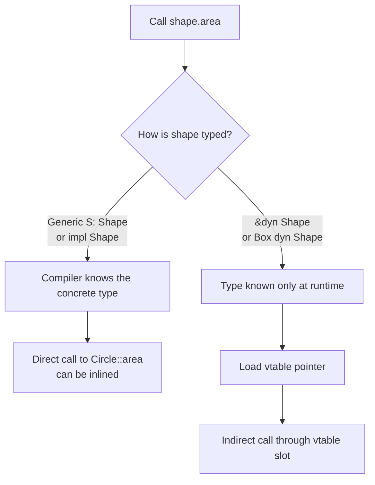
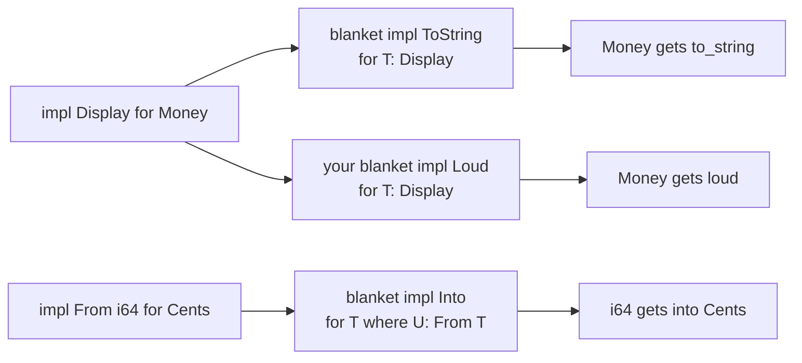
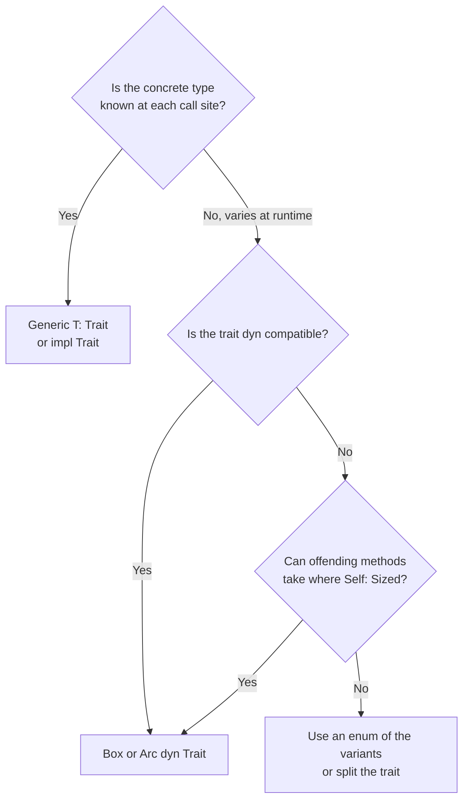

import Callout from '../../components/mdx/Callout.astro';

Rust has no classes and no inheritance, yet you can write code that is every bit as abstract as a Kotlin interface hierarchy or a Java generic library. The tool is the trait, combined with generics. This part is for developers who can write structs, enums and `Result`-returning functions and now want to design reusable abstractions. By the end you will know which standard traits to implement on your own types, how to choose between generics, `impl Trait` and `dyn Trait`, what static and dynamic dispatch cost, why some traits cannot become trait objects, and how the orphan rule shapes library design.

<Callout variant="note" title="You should already know">
- Cargo, functions, control flow and tests from [Part 1: Getting Started](/blog/rust-01-getting-started)
- Ownership, borrowing, `&` versus `&mut` from [Part 2: Ownership and Borrowing](/blog/rust-02-ownership-borrowing)
- Structs, `impl` blocks, enums, `Option` and `Result` from [Part 3: Types, Enums, and Error Handling](/blog/rust-03-types-enums-errors)
</Callout>

## What a trait is

A trait is a named set of methods that a type promises to provide. If you come from Kotlin or Java, the closest analogy is an interface, and for a first approximation that analogy works. The differences matter later, so here they are up front:

- A trait can be implemented for a type **outside the type's definition**, including for types you did not write (with limits, see the orphan rule below). In Java, a class has to declare `implements Comparable` in its own source.
- Traits are used in two very different ways: as **bounds on generics** (resolved at compile time, no runtime cost) and as **trait objects** (`dyn Trait`, resolved at runtime through a vtable). Java interfaces always go through virtual dispatch, and the JIT tries to undo it.
- There is no inheritance of state. A trait can require another trait (a supertrait), but there are no fields in traits and no base classes.

Here is a minimal trait with one required method set and one default method:

```rust
pub trait Shape {
    fn area(&self) -> f64;
    fn name(&self) -> String;

    // Default method: implementors get it for free, and may override it.
    fn describe(&self) -> String {
        format!("{} with area {:.2}", self.name(), self.area())
    }
}

#[derive(Debug, Clone, Copy, PartialEq)]
pub struct Circle {
    pub radius: f64,
}

#[derive(Debug, Clone, Copy, PartialEq)]
pub struct Rect {
    pub w: f64,
    pub h: f64,
}

impl Shape for Circle {
    fn area(&self) -> f64 {
        std::f64::consts::PI * self.radius * self.radius
    }
    fn name(&self) -> String {
        "circle".to_string()
    }
}

impl Shape for Rect {
    fn area(&self) -> f64 {
        self.w * self.h
    }
    fn name(&self) -> String {
        "rectangle".to_string()
    }
    // Override the default.
    fn describe(&self) -> String {
        format!("{}x{} rectangle", self.w, self.h)
    }
}
```

Two rules about calling trait methods catch newcomers. First, the trait must be **in scope** to call its methods: if `Shape` lives in another module, you need `use crate::geometry::Shape;` even though you already have a `Circle` value. The compiler tells you this when you forget, with a hint to add the `use`. Second, default methods can only use what the trait itself guarantees. `describe` can call `self.name()` and `self.area()` because those are trait methods; it cannot touch `self.radius`, because not every `Shape` has one.

### Supertraits

A trait can require that implementors also implement another trait:

```rust
use std::fmt;

pub trait Entity: fmt::Debug + Clone {
    fn id(&self) -> u64;
}
```

Anything that implements `Entity` must also implement `Debug` and `Clone`, and code holding a `T: Entity` may call `.clone()` and format with `{:?}`. This is composition of capabilities, not inheritance of behavior: `Entity` does not get `Debug`'s implementation, it only demands that one exists.

## Derive and the standard traits

Much of Rust's ergonomics comes from a handful of standard library traits. Implementing them is how your type plugs into the rest of the ecosystem: `HashMap` keys need `Hash + Eq`, sorting needs `Ord`, `{}` in `format!` needs `Display`, and `?` uses `From` to convert errors. Many of them can be generated with `#[derive]`.

| Trait | What it gives you | Derivable? |
|---|---|---|
| `Debug` | `{:?}` formatting, `dbg!`, test failure output | yes |
| `Clone` | explicit `.clone()` deep-ish copy | yes |
| `Copy` | implicit bitwise copy on assignment (requires `Clone`) | yes, only if all fields are `Copy` |
| `PartialEq` / `Eq` | `==` and `!=`; `Eq` asserts equality is reflexive | yes |
| `PartialOrd` / `Ord` | `<`, `>`, sorting, `BTreeMap` keys | yes (field order, top to bottom) |
| `Hash` | `HashMap`/`HashSet` keys | yes |
| `Default` | `T::default()`, `..Default::default()` | yes |
| `Display` | `{}` formatting, `.to_string()` | no, you write it |
| `From` / `Into` | infallible conversions; powers `?` on errors | no |
| `TryFrom` / `TryInto` | fallible conversions | no |
| `Iterator` | `for` loops and every adapter in Part 5 | no |

A sensible default for small value types is to derive generously:

```rust
#[derive(Debug, Clone, PartialEq, Eq, Hash, PartialOrd, Ord)]
pub struct UserId(u64);

#[derive(Debug, Clone, Copy, PartialEq, Eq, PartialOrd, Ord, Hash, Default)]
pub struct Cents(i64);
```

Each derive is code generation: `#[derive(PartialEq)]` writes the field-by-field comparison you would have written by hand. It also adds a bound for generic types: deriving `Clone` on `Wrapper<T>` produces `impl<T: Clone> Clone for Wrapper<T>`, which is usually what you want but occasionally too strict (for example when `T` sits behind an `Rc` and does not actually need to be `Clone`).

### Why `PartialEq` and `Eq` are separate

Floating-point numbers break the reflexivity rule: `f64::NAN == f64::NAN` is `false`. So `f64` implements `PartialEq` but not `Eq`, and similarly `PartialOrd` but not `Ord`. That is why you cannot put an `f64` in a `HashSet` or call `.sort()` on a `Vec<f64>` directly. If your struct contains a float, you can derive `PartialEq` but not `Eq` or `Hash`. When you do need ordering on floats, use `f64::total_cmp`, e.g. `v.sort_by(|a, b| a.total_cmp(b))`.

### Writing `Display` and `Ord` by hand

`Display` is user-facing formatting, so the compiler cannot guess it:

```rust
use std::fmt;

#[derive(Debug, Clone, PartialEq, Eq, Hash)]
pub struct Email(String);

impl fmt::Display for Email {
    fn fmt(&self, f: &mut fmt::Formatter<'_>) -> fmt::Result {
        write!(f, "{}", self.0)
    }
}
```

Implementing `Display` gives you `.to_string()` for free, through a blanket impl we will look at near the end.

Derived `Ord` compares fields in declaration order, which is often not the business order. A job queue where higher priority comes first, and ties go to the oldest task, needs a manual implementation:

```rust
use std::cmp::Ordering;

#[derive(Debug, PartialEq, Eq)]
pub struct Task {
    pub priority: u8,
    pub created_at: u64,
    pub title: String,
}

impl Ord for Task {
    fn cmp(&self, other: &Self) -> Ordering {
        other
            .priority
            .cmp(&self.priority) // reversed: higher priority sorts first
            .then_with(|| self.created_at.cmp(&other.created_at))
    }
}

impl PartialOrd for Task {
    fn partial_cmp(&self, other: &Self) -> Option<Ordering> {
        Some(self.cmp(other)) // always delegate, never re-implement
    }
}
```

One subtle trap: this `Ord` ignores `title`, but the derived `PartialEq` compares it. That means two tasks can be `Ordering::Equal` yet not `==`. The documentation requires `Ord` to be consistent with `Eq`; `BTreeMap` and `sort` will not crash if you violate it, but they will behave in surprising ways. Either compare every field in `cmp`, or implement `PartialEq` by hand to match.

### `From`, `Into` and `TryFrom`

`From` describes an infallible conversion. You implement `From`, and the standard library gives you `Into` in the opposite direction for free:

```rust
impl From<i64> for Cents {
    fn from(value: i64) -> Self {
        Cents(value)
    }
}

let a = Cents::from(100);
let b: Cents = 250.into(); // Into comes from a blanket impl over From
assert!(b > a);
```

For conversions that can fail, use `TryFrom`, whose associated `Error` type says how:

```rust
#[derive(Debug)]
pub struct InvalidEmail(String);

impl TryFrom<String> for Email {
    type Error = InvalidEmail;

    fn try_from(value: String) -> Result<Self, Self::Error> {
        if value.contains('@') {
            Ok(Email(value.to_lowercase()))
        } else {
            Err(InvalidEmail(value))
        }
    }
}

let email: Email = String::from("A@B.com").try_into().unwrap();
assert_eq!(email.to_string(), "a@b.com");
```

This pattern, a private field plus `TryFrom` as the only constructor, is the type-driven validation from Part 3: once you hold an `Email`, it is valid. As a rule, implement `From`, never `Into` directly, and put conversions in `From` impls rather than in ad hoc `to_x()` functions so that `?` and generic code can use them.

### `Default` and struct update syntax

`Default` pairs well with struct update syntax for configuration types:

```rust
#[derive(Debug, Clone)]
pub struct HttpConfig {
    pub host: String,
    pub port: u16,
    pub timeout_ms: u64,
    pub retries: u32,
}

impl Default for HttpConfig {
    fn default() -> Self {
        Self {
            host: "127.0.0.1".into(),
            port: 8080,
            timeout_ms: 5_000,
            retries: 3,
        }
    }
}

let cfg = HttpConfig {
    port: 9090,
    ..Default::default()
};
```

## Generics

A generic function is written once and works for any type that satisfies its bounds. The classic first example, finding the largest element, fails without a bound:

```rust
fn largest<T>(items: &[T]) -> &T {
    let mut max = &items[0];
    for item in items {
        if item > max {
            max = item;
        }
    }
    max
}
```

```text
error[E0369]: binary operation `>` cannot be applied to type `&T`
 --> src/lib.rs:4:17
  |
4 |         if item > max {
  |            ---- ^ --- &T
  |            |
  |            &T
  |
help: consider restricting type parameter `T` with trait `PartialOrd`
  |
1 | fn largest<T: std::cmp::PartialOrd>(items: &[T]) -> &T {
  |             ++++++++++++++++++++++
```

This is the core difference from C++ templates. In C++, a template is checked when it is instantiated, so the error appears at the call site deep inside someone else's code. In Rust, a generic body may only use what its bounds promise, and the body is type-checked once, at the definition. If the definition compiles, every call that satisfies the bounds compiles too. Here is a version that also handles the empty slice instead of panicking:

```rust
pub fn largest<T: PartialOrd + Copy>(items: &[T]) -> Option<T> {
    let mut iter = items.iter().copied();
    let mut max = iter.next()?;
    for item in iter {
        if item > max {
            max = item;
        }
    }
    Some(max)
}

assert_eq!(largest(&[3, 9, 2]), Some(9));
assert_eq!(largest::<f64>(&[]), None);
```

### `where` clauses

When bounds grow, move them into a `where` clause. This function counts items by a key computed by a closure (closures and the `Fn` traits are covered properly in Part 5):

```rust
use std::collections::HashMap;
use std::hash::Hash;

pub fn count_by<T, K, F>(items: &[T], key: F) -> HashMap<K, usize>
where
    K: Eq + Hash,
    F: Fn(&T) -> K,
{
    let mut counts = HashMap::new();
    for item in items {
        *counts.entry(key(item)).or_insert(0) += 1;
    }
    counts
}

let words = ["apple", "avocado", "banana"];
let by_letter = count_by(&words, |w| w.chars().next().unwrap());
assert_eq!(by_letter[&'a'], 2);
```

`where` clauses can also express bounds that inline syntax cannot, such as bounds on associated types (`R::Error: Debug`), which we will use shortly.

### Generic types and conditional methods

Structs and enums can be generic too, and an `impl` block can add methods only when the type parameter satisfies extra bounds:

```rust
use std::fmt;

#[derive(Debug)]
pub struct Stack<T> {
    items: Vec<T>,
}

impl<T> Stack<T> {
    pub fn new() -> Self {
        Self { items: Vec::new() }
    }
    pub fn push(&mut self, item: T) {
        self.items.push(item);
    }
    pub fn pop(&mut self) -> Option<T> {
        self.items.pop()
    }
}

// Only stacks of displayable things can render themselves.
impl<T: fmt::Display> Stack<T> {
    pub fn render(&self) -> String {
        self.items
            .iter()
            .map(|i| i.to_string())
            .collect::<Vec<_>>()
            .join(" | ")
    }
}
```

A `Stack<Vec<u8>>` still has `push` and `pop`, it just has no `render`. Kotlin can approximate this with extension functions on `Stack<T : Something>`; Java cannot express it without a subclass.

### Monomorphization

How does generic code run without any runtime type information? The compiler generates a separate copy of the function for each concrete type it is used with. `largest::<i32>` and `largest::<f64>` become two distinct machine-code functions, each optimized as if you had written it by hand for that type. This is called **monomorphization**, and it is why generics in Rust are a zero-cost abstraction at runtime.


The cost moves to compile time and binary size. Heavily generic code compiles more slowly and can bloat binaries, which is a real concern in large codebases; Part 10 covers techniques such as moving the non-generic bulk of a function into an inner helper. Contrast this with Java's type erasure, where `List<String>` and `List<Integer>` share one implementation and the type parameter disappears at runtime:

```kotlin
// Kotlin on the JVM: one compiled body, values are boxed references,
// and the call to compareTo is a virtual (interface) call.
fun <T : Comparable<T>> largest(items: List<T>): T? = items.maxOrNull()
```

Erasure keeps binaries small and compile times flat, at the cost of boxing primitives and relying on the JIT to devirtualize hot calls. Rust makes the opposite trade.

## `impl Trait`

`impl Trait` is shorthand that shows up in two positions, and it means different things in each.

### In argument position

```rust
pub fn total_area(shapes: &[impl Shape]) -> f64 {
    shapes.iter().map(|s| s.area()).sum()
}

pub fn print_all(items: impl IntoIterator<Item = impl std::fmt::Display>) {
    for item in items {
        println!("{item}");
    }
}
```

In argument position, `impl Shape` is sugar for an anonymous generic parameter: `fn total_area<S: Shape>(shapes: &[S])`. The caller chooses the type. The only practical difference is that callers cannot name the type with turbofish (`total_area::<Circle>(...)`), which matters occasionally for library APIs. Note `&[impl Shape]` is a slice of one concrete type: you cannot pass a mix of circles and rectangles. That needs `dyn`.

### In return position

```rust
pub fn evens(limit: u32) -> impl Iterator<Item = u32> {
    (0..limit).filter(|n| n % 2 == 0)
}
```

In return position, the **function** chooses the type and the caller only knows that it implements `Iterator<Item = u32>`. The concrete type here is `Filter<Range<u32>, {closure}>`, which you could not even write because closures have anonymous types. Return-position `impl Trait` is what makes returning iterators and closures practical, and it still compiles to static dispatch.

The restriction: a function returning `impl Trait` must return **one** concrete type on every path. This does not compile, because the branches produce different types:

```rust
// Does not compile: `if` and `else` have incompatible types.
fn make_shape(round: bool) -> impl Shape {
    if round { Circle { radius: 1.0 } } else { Rect { w: 1.0, h: 2.0 } }
}
```

When the concrete type genuinely varies at runtime, you need a trait object.

## Trait objects and dynamic dispatch

A trait object, written `dyn Shape`, is a value whose concrete type is known only at runtime. Because its size is unknown at compile time, it always lives behind a pointer: `&dyn Shape`, `Box<dyn Shape>`, `Arc<dyn Shape>`.

```rust
pub fn make_shape(round: bool) -> Box<dyn Shape> {
    if round {
        Box::new(Circle { radius: 1.0 })
    } else {
        Box::new(Rect { w: 1.0, h: 2.0 })
    }
}

let shapes: Vec<Box<dyn Shape>> = vec![
    Box::new(Circle { radius: 2.0 }),
    Box::new(Rect { w: 3.0, h: 4.0 }),
];
let total: f64 = shapes.iter().map(|s| s.area()).sum();
```

A heterogeneous collection like this is exactly what Kotlin's `List<Shape>` gives you by default. In Rust you opt into it explicitly.

### What a `dyn` pointer looks like

`&dyn Shape` is a **fat pointer**: two machine words. One points at the data (the `Circle`), the other at a **vtable**, a static table generated by the compiler for the pair `(Circle, Shape)`. The vtable holds the size and alignment of the concrete type, its destructor, and one function pointer per trait method.


Calling `shape.area()` through it means: load the vtable pointer, load the `area` entry, make an indirect call. That is cheap, a few nanoseconds at most, but it has a hidden cost that matters more: the compiler cannot inline through an indirect call, so it loses the chance to optimize across the call boundary. In a hot loop over millions of elements, that can matter; in a request handler that calls a database, it never will.

### Static versus dynamic dispatch

```rust
pub fn describe_static<S: Shape>(shape: &S) -> String {
    shape.describe() // resolved at compile time, inlinable
}

pub fn describe_dyn(shape: &dyn Shape) -> String {
    shape.describe() // resolved at runtime via the vtable
}
```



A practical way to choose:

| Use | When |
|---|---|
| Generics / `impl Trait` | The type is known at each call site; you want maximum performance; you are writing a library function |
| `dyn Trait` | You need a heterogeneous collection, a plugin registry, or to swap implementations at runtime; you want to cut compile time and binary size; the call is not on a hot path |

Experienced Rust developers use both. A web framework is typically generic over its handler types for speed, while an application stores `Arc<dyn PaymentGateway>` in its state so tests can inject a fake.

## Dyn compatibility (object safety)

Not every trait can be turned into a trait object. The rules used to be called **object safety**; current compiler messages call it **dyn compatibility**. The intuition is simple: a vtable is a fixed table of function pointers, so every method callable through `dyn Trait` must have exactly one implementation per concrete type that can be put in that table.

That rules out, roughly:

- **Generic methods**: `fn get_as<T>(&self)` would need one vtable entry per possible `T`, an infinite table.
- **Returning `Self`** by value: the caller does not know the size of `Self`.
- **Associated functions without a receiver** (`fn new() -> Self`): there is no `self` to find the vtable from.
- A `Sized` supertrait bound (`trait Foo: Sized`).

Here is a cache trait that a team wants to use as `&dyn Cache`:

```rust
pub trait Cache {
    fn get(&self, key: &str) -> Option<Vec<u8>>;
    fn get_as<T: From<Vec<u8>>>(&self, key: &str) -> Option<T>;
}

pub fn use_cache(c: &dyn Cache) {
    let _ = c.get("k");
}
```

```text
error[E0038]: the trait `Cache` is not dyn compatible
 --> src/lib.rs:6:22
  |
6 | pub fn use_cache(c: &dyn Cache) {
  |                      ^^^^^^^^^ `Cache` is not dyn compatible
  |
note: for a trait to be dyn compatible it needs to allow building a vtable
      for more information, visit <https://doc.rust-lang.org/reference/items/traits.html#dyn-compatibility>
 --> src/lib.rs:3:8
  |
1 | pub trait Cache {
  |           ----- this trait is not dyn compatible...
2 |     fn get(&self, key: &str) -> Option<Vec<u8>>;
3 |     fn get_as<T: From<Vec<u8>>>(&self, key: &str) -> Option<T>;
  |        ^^^^^^ ...because method `get_as` has generic type parameters
  = help: consider moving `get_as` to another trait
```

The fix is to exclude the offending method from the vtable with a `where Self: Sized` bound. The method stays available on concrete types and is simply not callable through `dyn Cache`:

```rust
pub trait Cache {
    fn get(&self, key: &str) -> Option<Vec<u8>>;
    fn put(&mut self, key: &str, value: Vec<u8>);

    fn get_as<T: From<Vec<u8>>>(&self, key: &str) -> Option<T>
    where
        Self: Sized,
    {
        self.get(key).map(T::from)
    }
}

pub fn use_cache(c: &mut dyn Cache) {
    c.put("k", vec![1]);
    let _ = c.get("k");
}
```

The other common fix, as the compiler suggests, is to split the trait: a dyn-compatible core trait and an extension trait with the generic conveniences, implemented for every type that implements the core.

## Associated types

Some traits have a type that is determined by the implementor, not chosen by the caller. `Iterator` is the canonical example:

```rust
pub struct Countdown(u32);

impl Iterator for Countdown {
    type Item = u32;

    fn next(&mut self) -> Option<u32> {
        if self.0 == 0 {
            None
        } else {
            self.0 -= 1;
            Some(self.0 + 1)
        }
    }
}

assert_eq!(Countdown(3).collect::<Vec<_>>(), vec![3, 2, 1]);
```

Why `type Item` and not `trait Iterator<Item>`? With a generic parameter, a single type could implement `Iterator<u32>` and `Iterator<String>` at the same time, and every call to `next()` would need an annotation to say which. An associated type says: for a given implementor there is **exactly one** item type. Use a generic parameter when multiple implementations per type make sense (`From<i64>` and `From<i32>` on the same type is fine), and an associated type when there is one natural answer.

Associated types are great for describing families of related types, for example a repository abstraction:

```rust
use std::collections::HashMap;
use std::fmt;

pub trait Repository {
    type Id;
    type Entity;
    type Error;

    fn find(&self, id: &Self::Id) -> Result<Option<Self::Entity>, Self::Error>;
    fn save(&mut self, entity: Self::Entity) -> Result<Self::Id, Self::Error>;
}

#[derive(Debug, Clone, Default)]
pub struct User {
    pub name: String,
}

pub struct InMemoryUsers {
    next: u64,
    rows: HashMap<u64, User>,
}

impl Repository for InMemoryUsers {
    type Id = u64;
    type Entity = User;
    type Error = std::convert::Infallible; // this impl cannot fail

    fn find(&self, id: &u64) -> Result<Option<User>, Self::Error> {
        Ok(self.rows.get(id).cloned())
    }

    fn save(&mut self, entity: User) -> Result<u64, Self::Error> {
        self.next += 1;
        self.rows.insert(self.next, entity);
        Ok(self.next)
    }
}

// Bounds on associated types live in the where clause.
pub fn load_or_default<R>(repo: &R, id: R::Id) -> R::Entity
where
    R: Repository,
    R::Entity: Default,
    R::Error: fmt::Debug,
{
    repo.find(&id).expect("repository failed").unwrap_or_default()
}
```

A word of caution from experience: in application code, a trait like this is often premature. If there is one real implementation and one test fake, a concrete struct plus a small trait at the seam you actually need to fake is usually simpler. Series B revisits this in the context of SQLx.

## The orphan rule and the newtype pattern

You can implement a trait for a type only if **either the trait or the type is defined in your crate**. This is the orphan rule (part of what the reference calls coherence). It prevents two unrelated crates from both implementing `Display for Vec<String>` and leaving the compiler unable to choose:

```rust
use std::fmt;

impl fmt::Display for Vec<String> {
    fn fmt(&self, f: &mut fmt::Formatter<'_>) -> fmt::Result {
        write!(f, "{}", self.join(","))
    }
}
```

```text
error[E0117]: only traits defined in the current crate can be implemented for types defined outside of the crate
 --> src/lib.rs:3:1
  |
3 | impl fmt::Display for Vec<String> {
  | ^^^^^^^^^^^^^^^^^^^^^^-----------
  |                       |
  |                       `Vec` is not defined in the current crate
  |
  = note: impl doesn't have any local type before any uncovered type parameters
  = note: for more information see https://doc.rust-lang.org/reference/items/implementations.html#orphan-rules
  = note: define and implement a trait or new type instead
```

The compiler already names both escape hatches. If you own the **trait**, you can implement it for foreign types; this is the "extension trait" pattern, Rust's answer to Kotlin extension functions:

```rust
pub trait StrExt {
    fn is_blank(&self) -> bool;
}

impl StrExt for str {
    fn is_blank(&self) -> bool {
        self.trim().is_empty()
    }
}

assert!("   ".is_blank());
```

If you own neither, wrap the foreign type in a local tuple struct, a **newtype**:

```rust
pub struct CsvRow(pub Vec<String>);

impl fmt::Display for CsvRow {
    fn fmt(&self, f: &mut fmt::Formatter<'_>) -> fmt::Result {
        write!(f, "{}", self.0.join(","))
    }
}
```

Newtypes have zero runtime cost: `CsvRow` has the same layout as `Vec<String>`. They are also the main tool for domain modeling, as with `UserId(u64)` and `Email(String)` above: a function that takes `UserId` cannot be passed an order id by mistake, which plain `u64` parameters cannot guarantee.

The downside is that the wrapper hides the inner type's methods. You can forward the ones you need, or implement `Deref` to expose the inner type's API. Use `Deref` sparingly on newtypes: it is designed for smart pointers (Part 6), and a newtype whose purpose is to *restrict* what you can do with the inner value should not hand all of it back through `Deref`.

## Operator overloading

Operators in Rust are traits in `std::ops`: `+` is `Add`, `*` is `Mul`, `+=` is `AddAssign`, `-x` is `Neg`, `a[i]` is `Index`. Implementing them for a money type keeps arithmetic readable without giving up type safety:

```rust
use std::fmt;
use std::ops::{Add, AddAssign, Mul};

#[derive(Debug, Clone, Copy, PartialEq, Eq, PartialOrd, Ord)]
pub struct Money {
    cents: i64,
}

impl Money {
    pub fn new(cents: i64) -> Self {
        Self { cents }
    }
}

impl Add for Money {
    type Output = Money;
    fn add(self, rhs: Money) -> Money {
        Money { cents: self.cents + rhs.cents }
    }
}

impl AddAssign for Money {
    fn add_assign(&mut self, rhs: Money) {
        self.cents += rhs.cents;
    }
}

// Money * quantity, but deliberately not Money * Money.
impl Mul<u32> for Money {
    type Output = Money;
    fn mul(self, qty: u32) -> Money {
        Money { cents: self.cents * i64::from(qty) }
    }
}

// Lets `.sum()` work on iterators of Money.
impl std::iter::Sum for Money {
    fn sum<I: Iterator<Item = Money>>(iter: I) -> Money {
        iter.fold(Money::new(0), |acc, m| acc + m)
    }
}

impl fmt::Display for Money {
    fn fmt(&self, f: &mut fmt::Formatter<'_>) -> fmt::Result {
        write!(f, "${}.{:02}", self.cents / 100, self.cents.abs() % 100)
    }
}

let lines = [(Money::new(1999), 2), (Money::new(500), 3)];
let total: Money = lines.iter().map(|&(price, qty)| price * qty).sum();
assert_eq!(total.to_string(), "$54.98");
```

Notice how the trait design encodes domain rules: `Mul<u32>` exists, `Mul<Money>` does not, so "dollars times dollars" is a compile error. `Output` is an associated type, so `Money + Money` has exactly one result type. Keep operators unsurprising: if `+` on your type does I/O or allocates heavily, a named method is better. (In production, also decide what happens on overflow: `checked_add` returning `Option` is often more honest than `+`, which panics on overflow in debug builds and wraps in release builds by default.)

## Blanket implementations

A blanket impl implements a trait for every type that satisfies some bound. The standard library is full of them. `ToString` is implemented for every `T: Display + ?Sized`, which is why implementing `Display` gave `Email` a `.to_string()`. `Into<U> for T` is implemented for every `T` where `U: From<T>`.

You can write your own:

```rust
use std::fmt;

pub trait Loud {
    fn loud(&self) -> String;
}

impl<T: fmt::Display + ?Sized> Loud for T {
    fn loud(&self) -> String {
        self.to_string().to_uppercase()
    }
}

assert_eq!(
    format!("{} {} {}", "hi".loud(), 42.loud(), Money::new(5).loud()),
    "HI 42 $0.05"
);
```

`?Sized` relaxes the implicit `Sized` bound so the impl also covers unsized types such as `str` and `dyn Display`. Blanket impls are powerful but they constrain the future: once `impl<T: Display> Loud for T` exists, no one, including you, can write a separate `impl Loud for MyType` for a type that is `Display`, because the two impls would overlap. Rust has no stable specialization, so overlapping impls are rejected. Library authors think hard before publishing a blanket impl for exactly this reason.



## Putting it together: choosing an abstraction

When you design an API around a trait, ask these in order:



The last box deserves emphasis. When the set of variants is closed and known (three payment providers, four message types), an **enum** is often better than any trait: `match` is exhaustive, dispatch is a jump table, and there is no allocation. Traits shine when the set is open, meaning other crates or tests need to add implementations.

## Common mistakes

- **Reaching for `dyn Trait` by reflex.** Developers from Java/Kotlin tend to box everything. Start with generics or an enum; use `dyn` when you actually need runtime heterogeneity or want to save compile time.
- **Over-constraining generics.** Adding `T: Clone + Debug + Send + Sync + 'static` "just in case" to every function makes APIs hard to use and propagates bounds through your codebase. Put bounds on the functions that need them, not on the struct definition.
- **Putting bounds on struct definitions.** `struct Cache<K: Hash + Eq, V>` forces every `impl` and every user to repeat the bound. Prefer `struct Cache<K, V>` and bounds on the `impl` blocks that require them. (The standard library's `HashMap` does exactly this.)
- **Inconsistent `Eq`/`Ord`/`Hash`.** If two values are `==`, their hashes must be equal and `cmp` should return `Equal`. Hand-written impls that compare different fields break `HashMap` and `BTreeMap` in subtle ways.
- **Implementing `Into` instead of `From`.** Implement `From`; you get `Into` for free. The reverse is not true.
- **Forgetting to import the trait.** "no method named `describe` found" often just means the trait is not in scope.
- **Using `Deref` for inheritance.** Implementing `Deref<Target = Base>` on a struct to "inherit" `Base`'s methods is a known anti-pattern. It confuses method resolution and does not give you polymorphism. Use composition and explicit delegation, or a trait.
- **Publishing a blanket impl casually.** It forecloses implementations for whole families of types, permanently, without a breaking change.

## Interview questions

<details>
<summary>What is the difference between a trait in Rust and an interface in Java or Kotlin?</summary>

Both declare a set of methods a type can provide, and both support default methods. The differences: a Rust trait can be implemented for a type outside the type's own definition (including foreign types, subject to the orphan rule), there is no implementation inheritance or state in traits, and traits are used in two modes. As generic bounds they are resolved at compile time through monomorphization with no runtime cost; as `dyn Trait` objects they use a vtable, similar to interface dispatch. Java interfaces are always dynamically dispatched and rely on the JIT to devirtualize. Rust also has associated types and blanket impls, which Java interfaces have no direct equivalent for.

</details>

<details>
<summary>Explain static versus dynamic dispatch and the trade-offs.</summary>

Static dispatch happens with generics and `impl Trait`: the compiler generates a specialized copy of the function per concrete type (monomorphization) and calls methods directly, enabling inlining. The cost is compile time and binary size. Dynamic dispatch happens with `dyn Trait`: a fat pointer carries a data pointer and a vtable pointer, and method calls are indirect. It allows heterogeneous collections and runtime substitution, produces one copy of the code, but prevents inlining and usually requires a heap allocation for owned objects. A strong answer adds that the indirect call itself is rarely the bottleneck; lost optimization in tight loops is, and that enums are a third option when the set of types is closed.

</details>

<details>
<summary>What makes a trait not dyn compatible (object safe), and how do you work around it?</summary>

A trait object needs a vtable with one function pointer per method. Methods with generic type parameters, methods returning `Self` by value, associated functions without a `self` receiver, and a `Sized` supertrait all prevent that. Workarounds: add `where Self: Sized` to the offending methods so they are excluded from the vtable but remain callable on concrete types, split the trait into a dyn-compatible core plus an extension trait with a blanket impl, or replace generic parameters with trait objects (`&dyn Any`, `Box<dyn Fn>`).

</details>

<details>
<summary>When would you use an associated type instead of a generic type parameter on a trait?</summary>

Use an associated type when each implementing type has exactly one natural choice, as with `Iterator::Item` or a repository's `Id` type. It keeps call sites free of annotations and makes the relationship part of the implementation. Use a generic parameter when it makes sense for one type to implement the trait several times with different parameters, as with `From<T>` or `Add<Rhs>`, where `Money` might implement `Mul<u32>` and `Mul<Decimal>`.

</details>

<details>
<summary>What is the orphan rule and why does it exist? How do you get around it?</summary>

You may implement a trait for a type only if the trait or the type is local to your crate. It guarantees coherence: there is at most one implementation of a trait for a type in the whole dependency graph, so adding a dependency can never create a conflict between two crates' impls. To work around it, define a local extension trait and implement it for the foreign type, or wrap the foreign type in a newtype and implement the foreign trait for the wrapper. Newtypes are zero-cost and also improve type safety.

</details>

<details>
<summary>What is the difference between impl Trait in argument position and in return position?</summary>

In argument position it is sugar for an anonymous generic parameter: the caller picks the concrete type, and you get static dispatch, but callers cannot specify the type with turbofish. In return position the callee picks one concrete type and hides it; the caller sees only the trait. This is essential for returning iterators and closures whose types cannot be named. All return paths must produce the same concrete type; if they differ, you need `Box<dyn Trait>` or an enum.

</details>

<details>
<summary>What is a blanket implementation, and what is the risk of adding one to a public library?</summary>

A blanket impl implements a trait for all types meeting a bound, such as `impl<T: Display + ?Sized> ToString for T`. It gives broad functionality for free. The risk is that Rust forbids overlapping impls (no stable specialization), so a blanket impl prevents anyone from writing a more specific impl for any covered type. Adding a blanket impl to an existing public trait can also break downstream crates that already implemented the trait for a type now covered by the blanket, which makes it a semver-breaking change.

</details>

## Key takeaways

- Traits describe capabilities; generics use them at compile time, `dyn Trait` at runtime. Pick deliberately.
- Derive `Debug`, `Clone`, `PartialEq`, `Eq`, `Hash` and `Default` generously on value types; write `Display` and `Ord` by hand when business rules demand it, and keep `Eq`, `Ord` and `Hash` consistent.
- Implement `From` and `TryFrom`, never `Into` directly. They power `?` and generic conversion.
- Generics are monomorphized: fast at runtime, paid for in compile time and binary size.
- `impl Trait` hides a single concrete type; `dyn Trait` allows many, through a fat pointer and vtable.
- Dyn compatibility rules exist because vtables are finite; `where Self: Sized` is the usual escape hatch.
- The orphan rule guarantees coherence; extension traits and newtypes are the idiomatic workarounds.
- Consider an enum before a trait when the set of variants is closed.

Previous: [Part 3: Types, Enums, and Error Handling](/blog/rust-03-types-enums-errors) · Next: [Part 5: Collections, Iterators, and Closures](/blog/rust-05-collections-iterators-closures)
