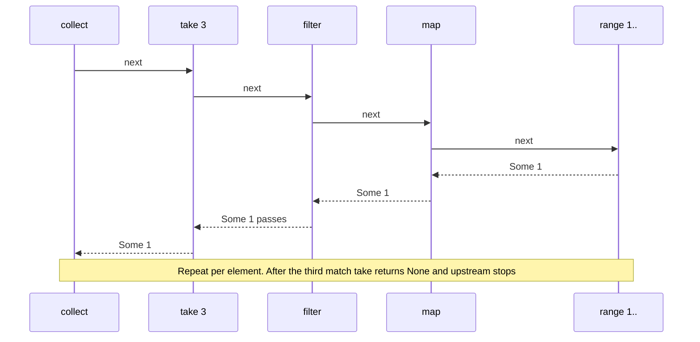
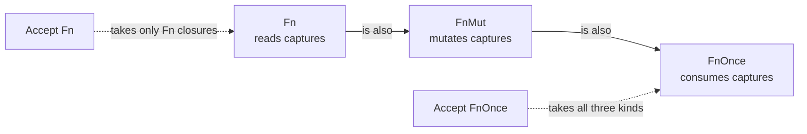
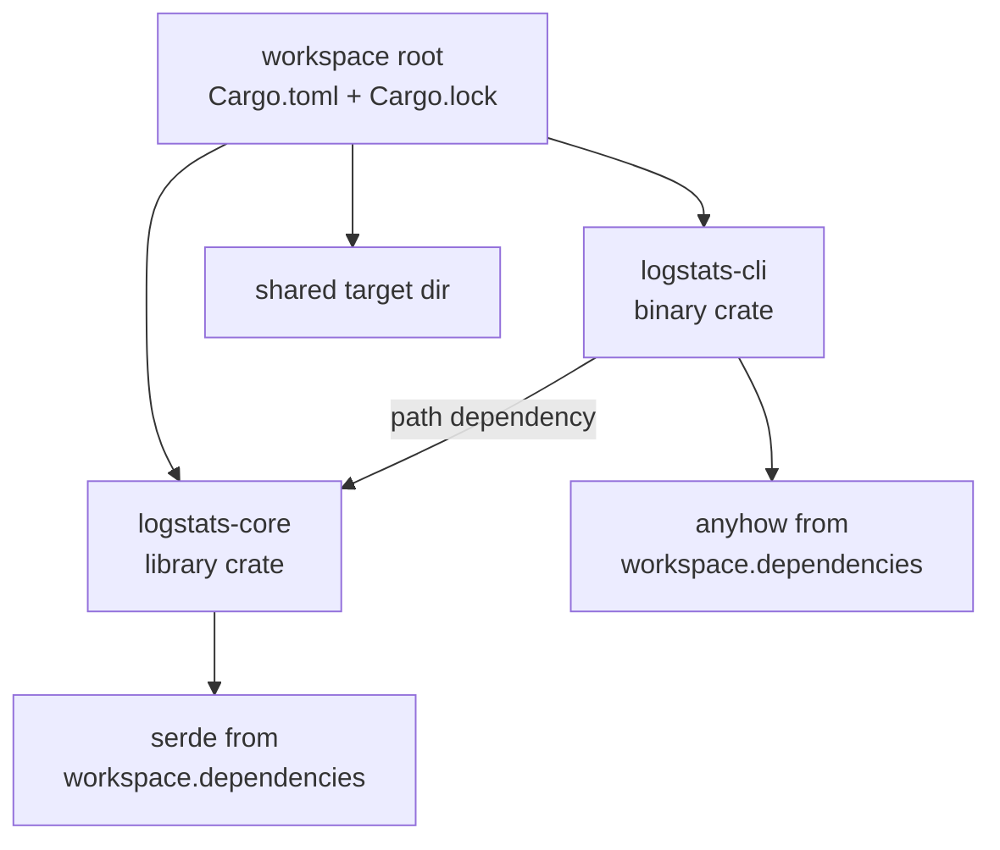

import Callout from '../../components/mdx/Callout.astro';

Most real Rust code is data in collections, transformed by iterator pipelines, parameterized by closures. If you have written Kotlin's `list.filter { }.map { }` or Java streams, the shape will feel familiar, but Rust's version is lazy by default, compiles to the same machine code as a hand-written loop, and makes ownership visible in every step. This part is for developers who know traits and generics (Part 4) and want to write idiomatic, efficient data-processing code. In the second half we zoom out to how that code is organized: modules, crates, workspaces, Cargo features, and the three kinds of tests plus benchmarks.

<Callout variant="note" title="You should already know">
- Ownership, borrowing and slices from [Part 2: Ownership and Borrowing](/blog/rust-02-ownership-borrowing)
- `Option`, `Result` and `?` from [Part 3: Types, Enums, and Error Handling](/blog/rust-03-types-enums-errors)
- Traits, generics, `impl Trait` and associated types from [Part 4: Traits and Generics](/blog/rust-04-traits-generics)
</Callout>

Throughout this post we use a small running example: parsing and analyzing HTTP access-log lines of the form `STATUS PATH LATENCY_MS`.

```rust
#[derive(Debug, Clone, PartialEq)]
pub struct LogLine {
    pub status: u16,
    pub path: String,
    pub latency_ms: u32,
}

pub fn parse_line(raw: &str) -> Option<LogLine> {
    let mut parts = raw.split_whitespace();
    let status = parts.next()?.parse().ok()?;
    let path = parts.next()?.to_string();
    let latency_ms = parts.next()?.parse().ok()?;
    Some(LogLine { status, path, latency_ms })
}
```

Note how `?` works on `Option` too: any missing field or failed parse returns `None` early.

## Collections

The standard library ships a small, well-chosen set of collections in `std::collections`, plus `Vec` and `String` in the prelude. Unlike Java, there is no `List` interface with many implementations; you pick the concrete type.


### `Vec<T>`

`Vec` is a growable array: a pointer to a heap buffer, a length and a capacity. It is the default collection, and the right choice far more often than people expect, because contiguous memory is extremely cache friendly. A linear scan over a few hundred elements in a `Vec` often beats a hash lookup.

```rust
let mut v: Vec<u32> = Vec::with_capacity(4); // avoid reallocations when size is known
v.push(10);
v.extend([20, 30]);

let first = v.first().copied(); // Option<u32>, no panic on empty
let maybe = v.get(10);          // None instead of panicking like v[10]
assert_eq!(first, Some(10));
assert_eq!(maybe, None);

v.retain(|&x| x != 20);                 // in-place filter
v.sort_unstable_by(|a, b| b.cmp(a));    // descending; unstable sort is faster
assert_eq!(v, [30, 10]);
```

Indexing with `v[i]` panics when out of bounds; `v.get(i)` returns an `Option`. Use indexing when an out-of-bounds index would be a bug, and `get` when it is a normal possibility. When `Vec` runs out of capacity it allocates a buffer roughly twice as large and moves the elements, which is why `push` is amortized O(1) and why references into a `Vec` cannot survive a `push` (the borrow checker enforces this, as we will see).

### `HashMap<K, V>` and the entry API

`HashMap` needs keys that implement `Hash + Eq`. Its default hasher is SipHash-1-3, chosen to resist hash-flooding attacks from untrusted input, not for raw speed. For internal hot paths with trusted keys, crates such as `rustc-hash` or `ahash` offer faster hashers; measure before switching.

The most important `HashMap` API to learn is `entry`. It looks up a key once and gives you a handle to either the occupied or the vacant slot, avoiding the double lookup of "check, then insert":

```rust
use std::collections::HashMap;

pub fn word_freq(text: &str) -> HashMap<String, usize> {
    let mut freq = HashMap::new();
    for word in text.split_whitespace() {
        *freq.entry(word.to_lowercase()).or_insert(0) += 1;
    }
    freq
}
```

Compare the naive version you might write coming from Java:

```rust
// Works, but hashes the key twice on a miss and is more code.
if let Some(count) = freq.get_mut(&key) {
    *count += 1;
} else {
    freq.insert(key, 1);
}
```

The entry API has a few variants worth knowing:

| Call | Inserts when vacant | Typical use |
|---|---|---|
| `or_insert(v)` | `v` (always evaluated) | counters with a cheap default |
| `or_insert_with(f)` | `f()` (only when vacant) | expensive defaults |
| `or_default()` | `V::default()` | grouping into `Vec`, counting into `usize` |
| `and_modify(f).or_insert(v)` | `v`, otherwise runs `f` | update-or-insert in one expression |

For full control, match on the `Entry` enum:

```rust
use std::collections::hash_map::Entry;

pub fn entry_match(cache: &mut HashMap<String, u32>, key: &str) -> u32 {
    match cache.entry(key.to_string()) {
        Entry::Occupied(mut e) => {
            *e.get_mut() += 1;
            *e.get()
        }
        Entry::Vacant(e) => *e.insert(1),
    }
}
```

### `BTreeMap<K, V>`

`BTreeMap` keeps keys sorted, requires `Ord` instead of `Hash`, and supports range queries (`map.range(200..300)`). Iteration order is deterministic, which makes it a good choice for anything you print, snapshot-test or serialize where stable output matters. Grouping log lines by status code:

```rust
use std::collections::BTreeMap;

pub fn group_by_status(lines: &[LogLine]) -> BTreeMap<u16, Vec<&str>> {
    let mut groups: BTreeMap<u16, Vec<&str>> = BTreeMap::new();
    for line in lines {
        groups.entry(line.status).or_default().push(&line.path);
    }
    groups
}
```

The return type borrows from the input: `Vec<&str>` holds slices of the `path` strings owned by `lines`. No strings are copied. The compiler infers that the output cannot outlive `lines` (lifetime elision, explained in Part 6).

### `HashSet<T>` and `BTreeSet<T>`

Sets are maps without values. `insert` returns `bool`, telling you whether the value was new, which makes deduplication-while-iterating trivial:

```rust
use std::collections::HashSet;

let admins: HashSet<&str> = ["ana", "bo"].into_iter().collect();
let active: HashSet<&str> = ["bo", "cy"].into_iter().collect();
let both: Vec<_> = admins.intersection(&active).collect();
assert_eq!(both, [&"bo"]);

let mut seen = HashSet::new();
assert!(seen.insert("x"));  // new
assert!(!seen.insert("x")); // duplicate
```

### `VecDeque<T>`

`VecDeque` is a ring buffer: O(1) push and pop at both ends. Use it for queues, BFS, and sliding windows. Here is a moving average over the last `cap` latencies:

```rust
use std::collections::VecDeque;

pub struct SlidingWindow {
    window: VecDeque<u32>,
    cap: usize,
    sum: u64,
}

impl SlidingWindow {
    pub fn new(cap: usize) -> Self {
        Self { window: VecDeque::with_capacity(cap), cap, sum: 0 }
    }

    pub fn push(&mut self, v: u32) -> f64 {
        if self.window.len() == self.cap
            && let Some(old) = self.window.pop_front()
        {
            self.sum -= u64::from(old);
        }
        self.window.push_back(v);
        self.sum += u64::from(v);
        self.sum as f64 / self.window.len() as f64
    }
}
```

The `if ... && let ...` form is a let chain, stable since Rust 1.88 on edition 2024. And a note on what is missing: `LinkedList` exists but is almost never the right choice; `Vec` or `VecDeque` beat it on nearly every workload because of cache locality. `BinaryHeap` is the priority queue (a max-heap; wrap items in `std::cmp::Reverse` for a min-heap).

## Iterators

An iterator is anything that implements the `Iterator` trait from Part 4:

```rust
pub trait Iterator {
    type Item;
    fn next(&mut self) -> Option<Self::Item>;
    // ...plus dozens of provided methods built on top of next()
}
```

That one required method is the entire protocol. `for` loops, `map`, `filter`, `sum`, `collect` and every other adapter are built on repeated calls to `next()`.

### `iter`, `iter_mut`, `into_iter`

Collections offer three ways to iterate, and the difference is ownership, which is where Rust diverges most from Kotlin:

```rust
let mut names = vec![String::from("ana"), String::from("bo")];

for n in names.iter() {       // n: &String   (borrow)
    println!("{n}");
}
for n in names.iter_mut() {   // n: &mut String (mutable borrow)
    n.make_ascii_uppercase();
}
for n in names {              // n: String  (names is moved and consumed)
    drop(n);
}
// names is no longer usable here
```

`for x in &v` is shorthand for `v.iter()`, `for x in &mut v` for `v.iter_mut()`, and `for x in v` for `v.into_iter()`. Choose by what the loop body needs: read, modify in place, or take ownership of each element.


A classic borrow-checker error is modifying a collection while iterating it:

```rust
let mut ids = vec![1, 2, 3];
for id in &ids {
    if *id == 2 {
        ids.push(4);
    }
}
```

```text
error[E0502]: cannot borrow `ids` as mutable because it is also borrowed as immutable
 --> src/main.rs:5:13
  |
3 |       for id in &ids {
  |       -         ----
  |       |         |
  |       |         immutable borrow occurs here
  |  _____|         immutable borrow later used here
  | |
4 | |         if *id == 2 {
5 | |             ids.push(4);
  | |             ^^^^^^^^^^^ mutable borrow occurs here
6 | |         }
7 | |     }
  | |_____- this for loop borrows `ids` immutably, preventing mutation within its body
  |
  = help: consider using an index-based loop instead, or collecting modifications into a separate collection
```

In Java this is a `ConcurrentModificationException` at runtime, if you are lucky. In C++ it is undefined behavior, because `push` may reallocate and leave the iterator dangling. Rust rejects it at compile time. The fix is the one the compiler suggests: collect the changes first, then apply them (`let extra: Vec<_> = ids.iter().filter(...).map(...).collect(); ids.extend(extra);`).

### Adapters and consumers

Iterator methods come in two kinds. **Adapters** (`map`, `filter`, `take`, `zip`, `enumerate`, `flat_map`, `skip`, `chain`, `rev`, `step_by`, `take_while`, `peekable`...) take an iterator and return a new iterator. **Consumers** (`collect`, `sum`, `count`, `fold`, `for_each`, `max`, `min`, `any`, `all`, `find`, `position`...) drive the iterator to produce a value.

```rust
pub fn slow_paths(lines: &[LogLine], threshold: u32) -> Vec<&str> {
    lines
        .iter()
        .filter(|l| l.status < 500)
        .filter(|l| l.latency_ms > threshold)
        .map(|l| l.path.as_str())
        .collect()
}
```

A tour of the adapters you will use weekly:

```rust
let v = [3, 1, 4, 1, 5, 9, 2, 6];

let total: i32 = v.iter().sum();
let max = v.iter().max();                                   // Some(&9)
let pos = v.iter().position(|&x| x == 9);                   // Some(5)
let any_big = v.iter().any(|&x| x > 8);                     // true
let firsts: Vec<_> = v.iter().take_while(|&&x| x != 5).collect();
let pairs: Vec<(i32, char)> = v.iter().copied().zip("abc".chars()).collect();
let deltas: Vec<i32> = v.windows(2).map(|w| w[1] - w[0]).collect();
let sums: Vec<i32> = v.chunks(3).map(|c| c.iter().sum()).collect();
let chars: Vec<char> = ["ab", "cd"].iter().flat_map(|s| s.chars()).collect();
let joined = v.iter().fold(String::new(), |mut acc, n| {
    if !acc.is_empty() {
        acc.push('-');
    }
    acc.push_str(&n.to_string());
    acc
});
```

The `|&x|` and `|&&x|` patterns trip people up. `v.iter()` yields `&i32`. `position` passes each item by value, so the closure receives `&i32`, and `|&x|` destructures it to `i32`. `take_while` and `filter` pass a reference **to** the item, so the closure receives `&&i32`. When in doubt, write `|x|` and let the compiler error tell you the type, or call `.copied()` early on iterators of small `Copy` types.

### `collect` is generic over its output

`collect` is one of the most powerful functions in the standard library because it is generic over the target collection through the `FromIterator` trait. The same pipeline can produce very different results depending on the type you ask for:

```rust
use std::collections::{HashMap, HashSet};

let raw = ["200 /a 12", "oops", "500 /b 40"];

// Keep every result, including failures.
let parsed: Vec<Option<LogLine>> = raw.iter().map(|r| parse_line(r)).collect();

// All-or-nothing: None if any line fails.
let all: Option<Vec<LogLine>> = raw.iter().map(|r| parse_line(r)).collect();

// Same for Result: stops at the first Err and returns it.
let nums: Result<Vec<u32>, std::num::ParseIntError> =
    ["1", "2", "x"].iter().map(|s| s.parse::<u32>()).collect();
assert!(nums.is_err());

// Deduplicate.
let paths: HashSet<&str> = ["/a", "/b", "/a"].into_iter().collect();

// Build a lookup table.
let index: HashMap<&str, usize> =
    ["x", "y"].iter().enumerate().map(|(i, s)| (*s, i)).collect();

// Build a String from chars.
let shout: String = "abc".chars().map(|c| c.to_ascii_uppercase()).collect();

// Split in two.
let (ok, bad): (Vec<u16>, Vec<u16>) = [200u16, 503, 201].iter().partition(|&&s| s < 500);
```

Collecting into `Result<Vec<T>, E>` is the idiomatic way to validate a batch: it short-circuits on the first error, so you never process half a batch by accident. If instead you want to skip bad lines, use `filter_map(|r| parse_line(r))` and collect into `Vec<LogLine>`.

When the compiler cannot infer the target type, either annotate the binding (`let v: Vec<_> = ...`) or use turbofish (`.collect::<Vec<_>>()`). The `_` lets it infer the element type.

### Laziness

Adapters do nothing until a consumer pulls values. Write `v.iter().map(|x| x * 2);` on its own and the compiler warns you:

```text
warning: unused `Map` that must be used
 --> src/main.rs:3:5
  |
3 |     v.iter().map(|x| x * 2);
  |     ^^^^^^^^^^^^^^^^^^^^^^^
  |
  = note: iterators are lazy and do nothing unless consumed
```

Laziness means pipelines process one element at a time through all stages, with no intermediate collections, and can work on infinite sequences:

```rust
let mut calls = 0;
let firsts: Vec<u64> = (1..)               // infinite range
    .map(|n: u64| {
        calls += 1;
        n * n
    })
    .filter(|sq| sq % 3 == 1)
    .take(3)                               // stop after three matches
    .collect();

assert_eq!(firsts, vec![1, 4, 16]);
assert_eq!(calls, 4);                      // 9 was squared and rejected; nothing after 16
```



This is the same pull model as Kotlin's `Sequence` and Java's `Stream`, but Kotlin's `List.map` is eager and allocates a new list at every step. In Rust, `Vec::iter().map()` is always lazy.

### Zero-cost: why iterators are as fast as loops

Each adapter is a small generic struct (`Map<I, F>`, `Filter<I, P>`) wrapping the previous iterator and a closure. Because everything is generic, monomorphization (Part 4) produces one specialized type for the whole pipeline, and the optimizer inlines every `next()` call and every closure. The result is typically the same machine code as a hand-written `for` loop, sometimes better, because iterating a slice lets the compiler drop bounds checks that `v[i]` indexing would need. That is what "zero-cost abstraction" means here: you could not write it faster by hand. It is a property of optimized builds; in debug builds, iterator-heavy code can be dramatically slower than in release, so never benchmark in debug.

## Closures

A closure is an anonymous function that can capture variables from its environment: `|x| x + offset`. Each closure has its own unique, unnameable type, generated by the compiler as a struct holding the captured variables, plus an implementation of one or more of the `Fn` traits.

### `Fn`, `FnMut`, `FnOnce`

How a closure uses its captures determines which traits it implements:

| Trait | Closure body does what with captures | Can be called |
|---|---|---|
| `Fn` | only reads them (captures by shared reference) | many times, even concurrently |
| `FnMut` | mutates them (captures by mutable reference) | many times, but not concurrently |
| `FnOnce` | moves them out (consumes them) | once |

```rust
let threshold = 100;
let is_slow = |ms: u32| ms > threshold;   // Fn: only reads threshold
assert!(is_slow(150));

let mut seen = 0;
let mut count = |_: &u32| seen += 1;      // FnMut: mutates seen
[1, 2, 3].iter().for_each(&mut count);
assert_eq!(seen, 3);

let name = String::from("orders");
let consume = move || name;               // FnOnce: returns the captured String
let back = consume();
// consume();  // error: closure cannot be invoked more than once
```

The traits form a hierarchy: every `Fn` closure is also `FnMut`, and every `FnMut` is also `FnOnce`. So when you write a function that **accepts** a closure, ask for the least capable trait you can get away with, because that accepts the most closures:



```rust
pub fn apply<F: Fn(u32) -> u32>(f: F, x: u32) -> u32 {
    f(x)
}

pub fn apply_mut<F: FnMut()>(mut f: F) {
    f();
    f();
}

pub fn apply_once<F: FnOnce() -> String>(f: F) -> String {
    f()
}
```

`Option::map` takes `FnOnce` because it calls the closure at most once. `Iterator::map` takes `FnMut` because it calls it repeatedly but sequentially. `std::thread::spawn` takes `FnOnce` because the thread runs it once. A function that will call the closure from several threads at once needs `Fn + Sync`. Pass a mutating closure where `Fn` is required, and the compiler says so precisely:

```text
error[E0594]: cannot assign to `count`, as it is a captured variable in a `Fn` closure
 --> src/main.rs:7:14
  |
1 | fn apply<F: Fn()>(f: F) {
  |                      - change this to accept `FnMut` instead of `Fn`
...
6 |     let mut count = 0;
  |         --------- `count` declared here, outside the closure
7 |     apply(|| count += 1);
  |     ----- -- ^^^^^^^^^^ cannot assign
  |     |     |
  |     |     in this closure
  |     expects `Fn` instead of `FnMut`
```

### `move` closures

By default a closure captures each variable in the least invasive way that works: by shared reference, then mutable reference, then by value. Since edition 2021, closures capture individual fields (`self.config.timeout`) rather than whole variables, which avoids many spurious borrow conflicts.

The `move` keyword forces captures by value. You need it whenever the closure must outlive the current stack frame: spawning a thread, returning a closure, or storing it in a struct:

```rust
let tags = vec!["a".to_string()];
let handle = std::thread::spawn(move || tags.len()); // tags moves into the thread
assert_eq!(handle.join().unwrap(), 1);
```

A common misunderstanding: `move` decides **how** variables are captured, not which `Fn` trait the closure implements. A `move` closure that only reads its captured `Vec` is still `Fn`. Copy types like `i32` are copied into a `move` closure, so the original stays usable.

### Returning closures

Since each closure has an anonymous type, you return it with `impl Fn` when there is one concrete closure, or `Box<dyn Fn>` when the function picks between different closures at runtime, exactly the `impl Trait` versus `dyn Trait` choice from Part 4:

```rust
pub fn make_adder(n: u32) -> impl Fn(u32) -> u32 {
    move |x| x + n // must move n: the closure outlives this call
}

pub fn make_validator(strict: bool) -> Box<dyn Fn(&str) -> bool> {
    if strict {
        Box::new(|s| !s.is_empty() && s.chars().all(|c| c.is_ascii_alphanumeric()))
    } else {
        Box::new(|s| !s.trim().is_empty())
    }
}

pub fn make_counter() -> impl FnMut() -> u32 {
    let mut n = 0;
    move || {
        n += 1; // state lives inside the closure
        n
    }
}

let add2 = make_adder(2);
assert_eq!(add2(3), 5);
let mut next_id = make_counter();
next_id();
assert_eq!(next_id(), 2);
```

### Storing closures in structs

Store closures as a generic field when the type is fixed per instance (static dispatch, no allocation), or as `Box<dyn Fn...>` when you need a collection of different closures, such as a list of middleware or event handlers. Here is a small retry helper, generic over the operation:

```rust
pub struct Retry<F> {
    attempts: u32,
    op: F,
}

impl<F, T, E> Retry<F>
where
    F: FnMut(u32) -> Result<T, E>,
{
    pub fn run(mut self) -> Result<T, E> {
        let mut attempt = 1;
        loop {
            match (self.op)(attempt) {
                Ok(v) => return Ok(v),
                Err(e) if attempt >= self.attempts => return Err(e),
                Err(_) => attempt += 1,
            }
        }
    }
}

let result = Retry {
    attempts: 3,
    op: |attempt| if attempt < 3 { Err(format!("fail {attempt}")) } else { Ok("done") },
}
.run();
assert_eq!(result, Ok("done"));
```

Note the parentheses in `(self.op)(attempt)`: without them, Rust would look for a **method** named `op`. Real retry logic for network calls needs backoff and jitter; the [async processing post](/blog/backend-06-async-processing-queues) and the [duplicate payments case study](/blog/case-03-duplicate-payments-retries) cover why retries must be paired with idempotency.

Kotlin developers will recognize most of this. The main difference is that Kotlin lambdas are always heap objects behind a `Function1` interface (unless inlined via `inline fun`), whereas Rust closures are plain structs that are inlined by default when passed generically:

```kotlin
// Kotlin: `inline` is what lets the compiler eliminate the lambda object.
inline fun <T> retry(times: Int, op: (Int) -> T): T {
    repeat(times - 1) { attempt -> runCatching { return op(attempt + 1) } }
    return op(times)
}
```

## Writing your own iterator

Implementing `Iterator` means implementing `next`; you get every adapter for free. A Fibonacci generator that stops cleanly before `u64` overflow:

```rust
pub struct Fib {
    curr: u64,
    next: u64,
}

impl Default for Fib {
    fn default() -> Self {
        Fib { curr: 0, next: 1 }
    }
}

impl Iterator for Fib {
    type Item = u64;

    fn next(&mut self) -> Option<u64> {
        let out = self.curr;
        let new_next = self.curr.checked_add(self.next)?; // None ends the iterator
        self.curr = self.next;
        self.next = new_next;
        Some(out)
    }
}

assert_eq!(Fib::default().take(6).collect::<Vec<_>>(), [0, 1, 1, 2, 3, 5]);
let even_sum: u64 = Fib::default().filter(|n| n % 2 == 0).take_while(|&n| n < 4_000_000).sum();
```

Iterators that borrow from a collection need a lifetime parameter, which ties the yielded items to the data they point into. This pager yields slices of an existing slice without copying:

```rust
pub struct Pages<'a, T> {
    items: &'a [T],
    size: usize,
}

impl<'a, T> Iterator for Pages<'a, T> {
    type Item = &'a [T];

    fn next(&mut self) -> Option<&'a [T]> {
        if self.items.is_empty() {
            return None;
        }
        let n = self.size.min(self.items.len());
        let (page, rest) = self.items.split_at(n);
        self.items = rest;
        Some(page)
    }
}

pub fn pages<T>(items: &[T], size: usize) -> Pages<'_, T> {
    assert!(size > 0, "page size must be positive");
    Pages { items, size }
}

assert_eq!(pages(&[1, 2, 3, 4, 5], 2).count(), 3);
```

(The standard library already has this as `slice.chunks(n)`; writing it yourself is how you learn the pattern.) Part 6 explains lifetime parameters properly.

For one-off iterators, `std::iter::from_fn` turns a closure into an iterator without defining a struct:

```rust
let mut n = 1;
let powers: Vec<u32> = std::iter::from_fn(move || {
    n *= 2;
    (n <= 16).then_some(n)
})
.collect();
assert_eq!(powers, [2, 4, 8, 16]);
```

### Accepting iterators in your APIs

Functions that process sequences should usually accept `impl IntoIterator` rather than `&Vec<T>`, so callers can pass a `Vec`, an array, a slice, or a lazy pipeline:

```rust
pub fn sum_latencies<I>(lines: I) -> u64
where
    I: IntoIterator,
    I::Item: AsRef<str>,
{
    lines
        .into_iter()
        .filter_map(|l| parse_line(l.as_ref()))
        .map(|l| u64::from(l.latency_ms))
        .sum()
}

assert_eq!(sum_latencies(vec!["200 /a 5", "junk", "500 /b 7"]), 12);
assert_eq!(sum_latencies(&["200 /a 5"]), 5);
```

For plain read-only access to contiguous data, take `&[T]` rather than `&Vec<T>`; clippy flags the latter (`ptr_arg`).

## Organizing code: modules, crates and workspaces

Now that we have a small library's worth of code, let us look at how Rust organizes it.

### Modules and visibility

A **crate** is a compilation unit: a library (`src/lib.rs`) or a binary (`src/main.rs`). Inside a crate, code is organized into **modules**, a tree rooted at `lib.rs` or `main.rs`. Everything is private to its module by default.

```rust
// src/lib.rs
pub mod parse;   // loads src/parse.rs
pub mod report;  // loads src/report.rs or src/report/mod.rs

pub use parse::{LogLine, parse_line}; // re-export: users write logstats::parse_line
```

```rust
// src/report.rs
pub mod format {
    pub fn percent(part: usize, whole: usize) -> String {
        format!("{:.1}%", ratio(part, whole))
    }

    fn ratio(part: usize, whole: usize) -> f64 { // private to `format`
        if whole == 0 { 0.0 } else { part as f64 * 100.0 / whole as f64 }
    }
}

pub(crate) fn internal_helper() {} // visible anywhere in this crate, not outside

pub use self::format::percent;
```

The visibility levels are `pub` (anyone), `pub(crate)` (this crate), `pub(super)` (the parent module), and private (this module and its children). Rust's privacy is about modules, not types: code in the same module can see private fields of a struct. Child modules can see their ancestors' private items, which is why `#[cfg(test)] mod tests` inside a file can test private functions.

`pub use` re-exports are how libraries present a clean public API independent of their internal file layout. A user of the crate should not need to know that `parse_line` lives in `src/parse.rs`.

Paths: `crate::` starts at the crate root, `self::` at the current module, `super::` at the parent. Prefer `use crate::parse::LogLine` over long `super::super::` chains.

### Workspaces

As a project grows, split it into several crates in one **workspace**: they share a `Cargo.lock` and a `target/` directory, so dependencies are built once.

```toml
# Cargo.toml at the repository root
[workspace]
resolver = "3"
members = ["crates/logstats-core", "crates/logstats-cli"]

[workspace.package]
edition = "2024"
license = "MIT"

[workspace.dependencies]
serde = { version = "1", features = ["derive"] }
anyhow = "1"
```

```toml
# crates/logstats-cli/Cargo.toml
[package]
name = "logstats-cli"
version = "0.1.0"
edition.workspace = true
license.workspace = true

[dependencies]
logstats-core = { path = "../logstats-core" }
anyhow.workspace = true
```



Why split at all? Crates are Rust's unit of compilation, so splitting into crates lets Cargo compile them in parallel and rebuild only what changed, which matters for compile times at scale (Part 11). Crates are also a hard visibility boundary: `pub(crate)` items in the core library are invisible to the CLI. A typical service has a domain crate with no I/O dependencies, an infrastructure crate, and a thin binary.

### Cargo features

Features are compile-time switches for optional functionality and dependencies:

```toml
[dependencies]
serde = { version = "1", features = ["derive"], optional = true }

[features]
default = []
json = ["dep:serde"]
```

```rust
#[derive(Debug, Clone, PartialEq)]
#[cfg_attr(feature = "json", derive(serde::Serialize))]
pub struct LogLine {
    pub status: u16,
    pub path: String,
    pub latency_ms: u32,
}
```

Users opt in with `cargo build --features json` or `logstats-core = { version = "0.1", features = ["json"] }`. Two rules matter. Features must be **additive**: enabling a feature may add API but must never remove or change existing API, because Cargo unifies features across the dependency graph, so if any crate in your build enables `json`, everyone gets it. And test the combinations you support, at least `--no-default-features` and `--all-features`, in CI.

## Testing, doc tests and benchmarks

Cargo has three kinds of tests built in, plus benchmarks via a crate.

**Unit tests** live in the same file as the code, in a `#[cfg(test)]` module, and can test private items:

```rust
#[cfg(test)]
mod tests {
    use super::*;

    #[test]
    fn groups_paths_by_status_in_sorted_order() {
        let lines = vec![
            parse_line("500 /c 900").unwrap(),
            parse_line("200 /a 10").unwrap(),
            parse_line("200 /b 300").unwrap(),
        ];
        let groups = group_by_status(&lines);
        assert_eq!(groups.keys().copied().collect::<Vec<_>>(), [200, 500]);
        assert_eq!(groups[&200], ["/a", "/b"]);
    }
}
```

**Integration tests** live in `tests/*.rs`. Each file is compiled as a separate crate that depends on your library, so it can only use the public API, exactly like a real user:

```rust
// tests/parse.rs
use logstats::{parse_line, slow_paths};

#[test]
fn parses_and_filters_a_realistic_log() {
    let raw = ["200 /orders 12", "200 /orders/42 340", "503 /pay 2000", "nonsense"];
    let lines: Vec<_> = raw.iter().filter_map(|r| parse_line(r)).collect();

    assert_eq!(lines.len(), 3);
    assert_eq!(slow_paths(&lines, 100), ["/orders/42"]);
}
```

**Doc tests** are code blocks inside `///` documentation comments. `cargo test` compiles and runs them, so your examples can never silently rot:

````rust
/// Parses one access-log line of the form `STATUS PATH LATENCY_MS`.
///
/// ```
/// use logstats::parse_line;
///
/// let line = parse_line("200 /orders 37").unwrap();
/// assert_eq!(line.status, 200);
/// assert_eq!(line.path, "/orders");
/// assert!(parse_line("garbage").is_none());
/// ```
pub fn parse_line(raw: &str) -> Option<LogLine> {
    // ...
}
````

Doc tests only run for library crates, and like integration tests they see only the public API. Mark an example `no_run` to compile it without running it (useful for network code) or `ignore` to skip it.

**Benchmarks**: the built-in `#[bench]` attribute is still unstable, so the de facto standard is the `criterion` crate, which runs statistically sound measurements and reports changes between runs:

```toml
[dev-dependencies]
criterion = "0.7"

[[bench]]
name = "parse"
harness = false
```

```rust
// benches/parse.rs
use criterion::{Criterion, criterion_group, criterion_main};
use logstats::parse_line;
use std::hint::black_box;

fn bench_parse(c: &mut Criterion) {
    let line = "200 /orders/42 37";
    c.bench_function("parse_line", |b| b.iter(|| parse_line(black_box(line))));
}

criterion_group!(benches, bench_parse);
criterion_main!(benches);
```

`black_box` stops the optimizer from constant-folding the input and deleting the work you meant to measure, the most common benchmarking mistake in Rust. Run with `cargo bench`. Part 10 goes much deeper into benchmarking and profiling.

### Clippy

`cargo clippy` is the official linter, with hundreds of lints in groups: `correctness` (deny by default, likely bugs), `suspicious`, `style`, `complexity`, `perf`, plus opt-in `pedantic` and `restriction`. On the code in this post it flagged a nested `if` that could become a let chain, and a `new()` without a `Default` impl. You can configure lints for a whole workspace in `Cargo.toml`:

```toml
[workspace.lints.clippy]
pedantic = { level = "warn", priority = -1 }
unwrap_used = "warn"
module_name_repetitions = "allow"

[workspace.lints.rust]
unsafe_code = "forbid"
```

Each member crate then opts in with `[lints] workspace = true`. In CI, run `cargo clippy --all-targets --all-features -- -D warnings` so lints fail the build. Enabling `pedantic` wholesale is noisy; turning it on and then allowing the handful of lints your team disagrees with is a common, workable policy.

## Common mistakes

- **Calling `.collect()` just to iterate again.** `let v: Vec<_> = it.map(f).collect(); for x in v { ... }` allocates for nothing. Keep the pipeline lazy and loop over it directly, unless you genuinely need the data twice.
- **`.iter().cloned()` everywhere to silence the borrow checker.** Cloning a `Vec<String>` element by element is expensive. Often you can borrow (`Vec<&str>`) or consume with `into_iter()` instead.
- **Using `contains` on a `Vec` in a loop.** That is O(n·m). Build a `HashSet` first if the lookup side is large.
- **The double lookup.** `if map.contains_key(k) { map.get_mut(k) } else { map.insert(...) }` should be one `entry` call.
- **Relying on `HashMap` iteration order.** It is randomized per process. Use `BTreeMap`, or sort, when order matters for output or tests.
- **Asking for `Fn` when `FnMut` or `FnOnce` would do.** It rejects closures that would have worked.
- **Forgetting `move` on closures passed to threads or returned from functions.** The compiler error (closure may outlive the current function) suggests `move`; take the hint.
- **Non-additive features.** A feature that switches behavior (e.g. `feature = "fast"` changes the algorithm's output) will surprise users when another dependency enables it.
- **Benchmarking without `black_box` or in debug mode.** Both produce meaningless numbers.

## Interview questions

<details>
<summary>What is the difference between iter, iter_mut and into_iter on a Vec?</summary>

`iter()` borrows the vector and yields `&T`; the vector is still usable afterwards. `iter_mut()` borrows it mutably and yields `&mut T`, allowing in-place modification. `into_iter()` takes the vector by value and yields owned `T`, consuming it. In a `for` loop, `for x in &v`, `for x in &mut v` and `for x in v` map to these three. The choice expresses whether the loop needs to read, modify, or take ownership of the elements, and the borrow checker enforces the consequences, such as not being able to push to the vector while iterating over it.

</details>

<details>
<summary>Explain Fn, FnMut and FnOnce. Which should a function that accepts a closure require?</summary>

They describe how a closure uses its captured environment. `Fn` only reads captures and can be called any number of times, including concurrently if it is `Sync`. `FnMut` mutates captures, so calls need exclusive access. `FnOnce` may move captured values out, so it can be called only once. Every `Fn` is `FnMut` and every `FnMut` is `FnOnce`. A function should require the most permissive bound that its implementation allows: `FnOnce` if it calls the closure once, `FnMut` if it calls it repeatedly in sequence, and `Fn` only if it needs shared or concurrent calls. That accepts the widest range of closures.

</details>

<details>
<summary>Why are Rust iterator chains considered zero-cost? Are there cases where they are not?</summary>

Each adapter is a generic struct wrapping the previous iterator and a closure, so the whole chain is one concrete type known at compile time. Monomorphization plus inlining collapses it into a loop equivalent to hand-written code, often with fewer bounds checks. They are not zero-cost in debug builds, where nothing is inlined; when they go through `Box<dyn Iterator>`, which prevents inlining; and when the pipeline includes unnecessary `collect` or `clone` calls that allocate. Some adapters like `chain` or `flat_map` can also be harder for the optimizer to vectorize than a plain loop.

</details>

<details>
<summary>How does collect know what to produce, and how would you validate a batch of inputs so that any error fails the whole batch?</summary>

`collect` is generic over any type implementing `FromIterator` for the item type, and the target is chosen by type inference from the annotation or turbofish. `Result<Vec<T>, E>` implements `FromIterator<Result<T, E>>`: it collects successes and short-circuits at the first `Err`, returning it. So `inputs.iter().map(parse).collect::<Result<Vec<_>, _>>()?` validates the whole batch and propagates the first error. The same works for `Option<Vec<T>>`. If you want to skip failures instead, use `filter_map` or `flatten`.

</details>

<details>
<summary>When would you choose BTreeMap over HashMap, and VecDeque over Vec?</summary>

`BTreeMap` when you need keys in sorted order, range queries, deterministic iteration for output or tests, or when keys implement `Ord` but not `Hash`. `HashMap` for pure point lookups at scale, with average O(1) operations. `VecDeque` when you push or pop at the front, as in queues, BFS or sliding windows, because `Vec::remove(0)` is O(n). Otherwise `Vec`, because contiguous memory is the fastest thing to iterate and small linear scans often beat hashing.

</details>

<details>
<summary>What does the move keyword do on a closure? Does it change which Fn trait the closure implements?</summary>

`move` forces the closure to capture variables by value rather than by reference, so the closure owns them and can outlive the scope that created it. It is needed for spawned threads, returned closures, and closures stored in long-lived structs. It does not decide the `Fn` trait: that is determined by what the body does with the captures. A `move` closure that only reads its owned `Vec` is still `Fn`; one that returns the captured value is `FnOnce`. Captured `Copy` values are copied, so the originals remain usable.

</details>

<details>
<summary>What are Cargo features and what does it mean that they must be additive?</summary>

Features are named compile-time flags declared in `Cargo.toml` that enable optional code (via `cfg(feature = "...")`) and optional dependencies. Cargo unifies features: if two crates in the dependency graph depend on the same library with different features, it is compiled once with the union of them. Therefore enabling a feature must only add functionality and never remove or change existing behavior, or some other crate in the build will break when a third crate turns the feature on. Mutually exclusive features are a known anti-pattern.

</details>

<details>
<summary>What are the three kinds of tests Cargo runs, and what can each see?</summary>

Unit tests live inside the crate in `#[cfg(test)]` modules and can access private items, because child modules see their ancestors' privates. Integration tests live in `tests/` and are compiled as separate crates linking the library, so they see only the public API. Doc tests are code examples in `///` comments, compiled and run as separate small crates against the public API, which keeps documentation correct. Benchmarks are typically done with criterion in `benches/` with `harness = false`, using `black_box` to defeat constant folding.

</details>

## Key takeaways

- Default to `Vec`. Use `HashMap` for lookups, `BTreeMap` for order, `HashSet` for membership, `VecDeque` for queues.
- Learn the entry API; it replaces almost every check-then-insert pattern with one lookup.
- `iter`, `iter_mut` and `into_iter` encode borrow, mutable borrow and ownership; pick by what the loop needs.
- Iterators are lazy and compile down to plain loops in release builds; avoid unnecessary `collect` and `clone`.
- `collect` targets any `FromIterator` type; `Result<Vec<_>, _>` gives all-or-nothing validation for free.
- Closures implement `Fn`, `FnMut` or `FnOnce` based on how they use captures; accept the weakest bound you can, and use `move` when the closure outlives its scope.
- Return closures and iterators with `impl Trait`; use `Box<dyn ...>` only when the concrete type varies.
- Modules organize code within a crate, crates are the unit of compilation, and workspaces share a lock file and build cache.
- Keep Cargo features additive, test with doc tests and integration tests, benchmark with criterion and `black_box`, and make clippy warnings fail CI.
