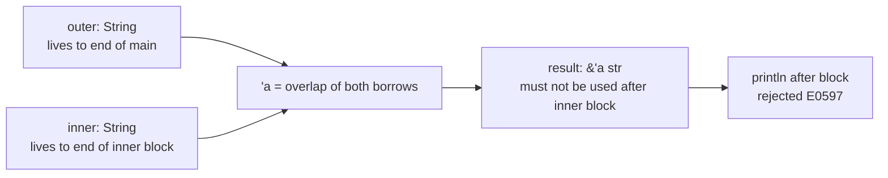
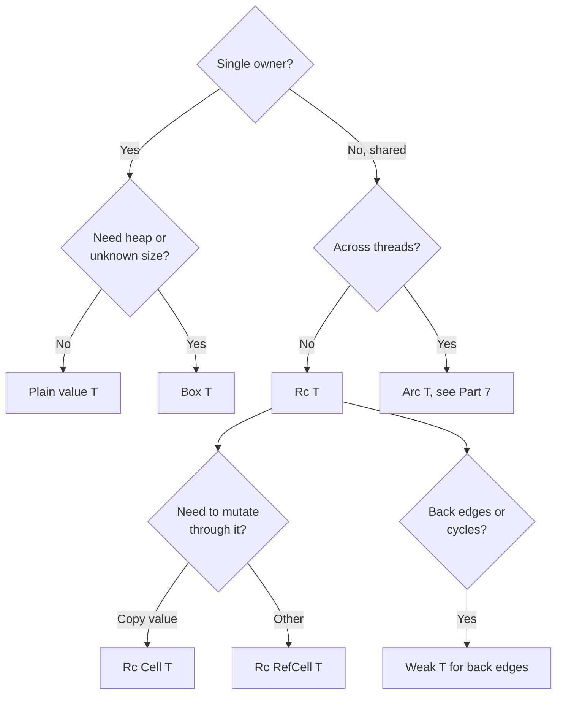
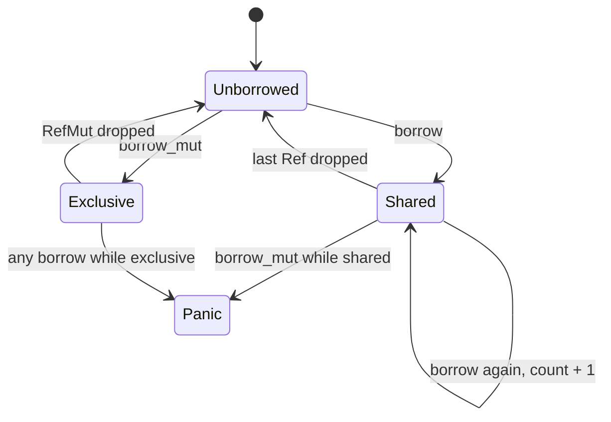

import Callout from '../../components/mdx/Callout.astro';

Lifetimes and smart pointers are where many developers coming from garbage-collected languages either give up on Rust or have the moment it clicks. Both topics answer the same question from different directions: **who keeps this data alive, and for how long?** Lifetimes let you borrow data without owning it and have the compiler prove the borrow never dangles. Smart pointers let you own data in ways a single owner on the stack cannot express: on the heap, shared among several owners, or mutable through a shared reference. This part is for developers who are comfortable with ownership, traits and iterators and keep hitting walls when they try to store references in structs or build linked data structures. By the end you will read lifetime signatures fluently, know when `'static` is and is not required, and pick the right pointer type for trees, graphs and caches.

<Callout variant="note" title="You should already know">
- Ownership, moves and the borrow rules from [Part 2: Ownership and Borrowing](/blog/rust-02-ownership-borrowing)
- Traits, generics and `dyn Trait` from [Part 4: Traits and Generics](/blog/rust-04-traits-generics)
- Iterators and closures, including an iterator with a lifetime parameter, from [Part 5: Collections, Iterators, and Closures](/blog/rust-05-collections-iterators-closures)
</Callout>

## Lifetimes: what they are and are not

Every reference in Rust has a lifetime: the region of code during which the reference is valid. The borrow checker's job is to prove that no reference outlives the data it points to. Most of the time it infers lifetimes completely. You only write them when a signature is ambiguous, and then the annotation does **not** change how long anything lives. It describes a relationship the compiler then checks.

Here is the canonical example. A function returns one of two string slices:

```rust
fn longest(a: &str, b: &str) -> &str {
    if a.len() >= b.len() { a } else { b }
}
```

```text
error[E0106]: missing lifetime specifier
 --> src/lib.rs:1:33
  |
1 | fn longest(a: &str, b: &str) -> &str {
  |               ----     ----     ^ expected named lifetime parameter
  |
  = help: this function's return type contains a borrowed value, but the signature does not say whether it is borrowed from `a` or `b`
help: consider introducing a named lifetime parameter
  |
1 | fn longest<'a>(a: &'a str, b: &'a str) -> &'a str {
  |           ++++     ++          ++          ++
```

The help text says exactly what is going on. The compiler checks each function in isolation, using only signatures, so callers need to know: is the returned reference tied to `a`, to `b`, or to both? The fix:

```rust
pub fn longest<'a>(a: &'a str, b: &'a str) -> &'a str {
    if a.len() >= b.len() { a } else { b }
}
```

Read `'a` as: "there is some region `'a` during which both inputs are valid, and the output is valid for that same region." At a call site the compiler picks `'a` as the overlap of the two arguments' lifetimes, so the result cannot be used after **either** input dies:

```rust
fn main() {
    let outer = String::from("a fairly long string");
    let result;
    {
        let inner = String::from("short");
        result = longest(&outer, &inner);
    }
    println!("{result}");
}
```

```text
error[E0597]: `inner` does not live long enough
  --> src/main.rs:10:34
   |
 9 |         let inner = String::from("short");
   |             ----- binding `inner` declared here
10 |         result = longest(&outer, &inner);
   |                                  ^^^^^^ borrowed value does not live long enough
11 |     }
   |     - `inner` dropped here while still borrowed
12 |     println!("{result}");
   |                ------ borrow later used here
```

At runtime this program would have been fine, since `outer` is longer and would have been returned. But the signature promised only "valid while both are valid," and the compiler holds you to the signature. That is the deal: signatures are contracts, and checking is local.



If the output really only depends on one input, say so, and the other parameter gets an independent lifetime:

```rust
pub fn pick_key<'a>(key: &'a str, _fallback: &str) -> &'a str {
    key
}
```

### What you cannot do with any annotation

No lifetime annotation lets you return a reference to a local value, because the value is gone when the function returns:

```rust
fn make_greeting(name: &str) -> &str {
    let s = format!("hello, {name}");
    &s
}
```

```text
error[E0515]: cannot return reference to local variable `s`
 --> src/lib.rs:3:5
  |
3 |     &s
  |     ^^ returns a reference to data owned by the current function
```

The fix is to return the owned `String`. When you notice yourself fighting to return a reference to something you just created, the answer is almost always "return the owned value."

## Lifetime elision rules

If every function needed annotations, Rust would be unbearable. Instead the compiler applies three **elision rules** to fill in lifetimes in function signatures; you only annotate when the rules do not produce an answer.

1. Each reference parameter gets its own distinct lifetime. `fn f(a: &str, b: &str)` becomes `fn f<'a, 'b>(a: &'a str, b: &'b str)`.
2. If there is exactly one input lifetime, it is assigned to every output reference. `fn first_word(s: &str) -> &str` becomes `fn first_word<'a>(s: &'a str) -> &'a str`.
3. If one of the parameters is `&self` or `&mut self`, the lifetime of `self` is assigned to every output reference.

```rust
// Rule 2: one input, so the output borrows from s.
pub fn first_word(s: &str) -> &str {
    s.split_whitespace().next().unwrap_or("")
}

pub struct Config {
    values: HashMap<String, String>,
}

impl Config {
    // Rule 3: output borrows from self, not from key.
    pub fn get(&self, key: &str) -> Option<&str> {
        self.values.get(key).map(String::as_str)
    }
}
```

`longest` failed because it has two inputs and no `self`, so none of the rules apply. Rule 3 is usually right for methods, but occasionally wrong: if a method returns something borrowed from an argument rather than from `self`, you must annotate it explicitly.

The same elision applies to types in signatures. `Pages<'_, T>` in Part 5 used the anonymous lifetime `'_` to say "there is a lifetime here, infer it by the usual rules." Write `'_` rather than omitting it for structs with lifetime parameters; the `elided_lifetimes_in_paths` lint (allow-by-default, part of the `rust_2018_idioms` group) flags the omission, because `'_` makes the borrow visible to readers.

## Structs that hold references

A struct can hold references, but it must declare a lifetime parameter, and an instance cannot outlive the data it borrows. This is exactly what you want for zero-copy parsers, where tokens point into the input instead of allocating:

```rust
#[derive(Debug, PartialEq)]
pub enum Token<'src> {
    Ident(&'src str),
    Number(i64),
    Symbol(char),
}

pub struct Lexer<'src> {
    input: &'src str,
    pos: usize,
}

impl<'src> Lexer<'src> {
    pub fn new(input: &'src str) -> Self {
        Self { input, pos: 0 }
    }

    // The tokens borrow from the input, NOT from the lexer.
    pub fn next_token(&mut self) -> Option<Token<'src>> {
        let rest = &self.input[self.pos..];
        let trimmed = rest.trim_start();
        self.pos += rest.len() - trimmed.len();
        let c = trimmed.chars().next()?;

        if c.is_ascii_alphabetic() {
            let end = trimmed
                .find(|ch: char| !ch.is_ascii_alphanumeric())
                .unwrap_or(trimmed.len());
            self.pos += end;
            Some(Token::Ident(&trimmed[..end]))
        } else if c.is_ascii_digit() {
            let end = trimmed.find(|ch: char| !ch.is_ascii_digit()).unwrap_or(trimmed.len());
            self.pos += end;
            Some(Token::Number(trimmed[..end].parse().ok()?))
        } else {
            self.pos += c.len_utf8();
            Some(Token::Symbol(c))
        }
    }
}

impl<'src> Iterator for Lexer<'src> {
    type Item = Token<'src>;
    fn next(&mut self) -> Option<Token<'src>> {
        self.next_token()
    }
}

pub fn idents(src: &str) -> Vec<&str> {
    Lexer::new(src)
        .filter_map(|t| match t {
            Token::Ident(name) => Some(name),
            _ => None,
        })
        .collect()
}

assert_eq!(idents("let x = 42 + y1;"), ["let", "x", "y1"]);
```

Look closely at `next_token`. It takes `&mut self` but returns `Token<'src>`. If we had written `-> Option<Token<'_>>` or relied on elision, rule 3 would tie each token to the `&mut self` borrow, and you could not hold one token while asking for the next. Naming `'src` explicitly says the tokens borrow from the original input, which outlives the lexer. Getting this right is the most common real-world reason to write a lifetime by hand.

Guidance on when to put references in structs: do it for short-lived views (parsers, iterators, request-scoped helpers that borrow from a request). Do not do it for long-lived application state, caches, or anything that crosses threads or `.await` points; own the data there (`String`, `Arc<str>`), or the lifetime parameter will spread through every type that touches the struct.

## `'static` and the common misconception

`'static` appears in two forms that mean different things, and confusing them is the single most common lifetime misunderstanding.

**`&'static T`** is a reference that is valid for the entire rest of the program. String literals are `&'static str` because they are baked into the binary. You can also create one by leaking memory deliberately (`Box::leak`), occasionally useful for configuration loaded once at startup.

**`T: 'static`** is a bound on a type, and it means "this type contains no non-static references." It does **not** mean the value lives forever. Every owned type with no borrowed fields satisfies it: `String`, `Vec<u8>`, `i32`, `Arc<Config>`. A `String` created a millisecond ago and dropped a millisecond later is `'static` in this sense.

You meet `T: 'static` most often on `std::thread::spawn` and `tokio::spawn`, because the spawned task may outlive the caller:

```rust
pub fn spawn_logger<T: std::fmt::Debug + Send + 'static>(value: T) -> std::thread::JoinHandle<()> {
    std::thread::spawn(move || println!("{value:?}"))
}

let owned = String::from("owned, not a &'static str");
spawn_logger(owned).join().unwrap(); // fine: String is 'static
spawn_logger(vec![1, 2, 3]).join().unwrap(); // fine
```

Passing a borrow fails, because the thread might run after `names` is dropped:

```rust
let names = vec![String::from("ana")];
spawn_logger(&names);
```

```text
error[E0597]: `names` does not live long enough
 --> src/main.rs:7:18
  |
6 |     let names = vec![String::from("ana")];
  |         ----- binding `names` declared here
7 |     spawn_logger(&names);
  |     -------------^^^^^^-
  |     |            |
  |     |            borrowed value does not live long enough
  |     argument requires that `names` is borrowed for `'static`
8 | }
  | - `names` dropped here while still borrowed
```

The fixes, in order of preference: move ownership in (`spawn_logger(names)`); share with `Arc` if several threads need it; or use `std::thread::scope` (Part 7), which lets threads borrow because the scope guarantees they finish before the borrowed data is dropped. The fix is almost never "make the data `&'static`."

## Variance, at a practical level

Variance answers: when can a reference with a longer lifetime be used where a shorter one is expected? You rarely need the theory, but you will meet its consequences.

Most things are **covariant** in their lifetime: a `&'static str` can be used wherever a `&'a str` is needed, because something that lives longer is fine where something shorter would do. The same goes for `&'a T`, `Box<T>`, `Vec<T>` and `Option<T>`. This compiles because a `Vec<&'static str>` can be viewed as a `Vec<&'a str>` through a shared reference:

```rust
pub fn shorten<'a>(v: &'a Vec<&'static str>) -> &'a Vec<&'a str> {
    v
}
```

The important exception: **`&mut T` is invariant in `T`**. Through a mutable reference you can write as well as read, so the compiler must not let you treat a `Vec<&'static str>` as a `Vec<&'a str>`; you could then push a short-lived string into a vector the rest of the program believes only contains static strings:

```rust
fn push_temp<'a>(list: &mut Vec<&'a str>, item: &'a str) {
    list.push(item);
}

fn main() {
    let mut names: Vec<&'static str> = vec!["static"];
    let local = String::from("local");
    push_temp(&mut names, &local);
    let keep: Vec<&'static str> = names;
    println!("{keep:?}");
}
```

```text
error[E0597]: `local` does not live long enough
  --> src/main.rs:8:27
   |
 6 |     let mut names: Vec<&'static str> = vec!["static"];
   |                    ----------------- type annotation requires that `local` is borrowed for `'static`
 7 |     let local = String::from("local");
   |         ----- binding `local` declared here
 8 |     push_temp(&mut names, &local);
   |                           ^^^^^^ borrowed value does not live long enough
...
11 | }
   | - `local` dropped here while still borrowed
```

Because `&mut Vec<&'a str>` is invariant, `'a` is forced to be exactly `'static`, and then `&local` is not long enough. Without invariance this would be a use-after-free waiting to happen. Practical takeaway: when an error mentions a lifetime that "must outlive `'static`" and you never wrote `'static`, look for a `&mut` around a type with a lifetime inside; that is invariance propagating a requirement. `Cell<T>` and `RefCell<T>` are invariant for the same reason.

## Smart pointers

A smart pointer is a struct that acts like a pointer (via `Deref`) and adds behavior, usually ownership semantics and cleanup (via `Drop`). You have already used two: `String` and `Vec<T>` own heap buffers and free them on drop. The standard library adds a handful more, each answering a specific ownership question.



### `Box<T>`: single owner on the heap

`Box<T>` puts a value on the heap with a single owner. It is a thin pointer (for sized `T`), and dropping the box frees the allocation. You need it in three situations.

**Recursive types.** A type cannot contain itself directly, because its size would be infinite:

```rust
enum List {
    Cons(i32, List),
    Nil,
}
```

```text
error[E0072]: recursive type `List` has infinite size
 --> src/lib.rs:1:1
  |
1 | enum List {
  | ^^^^^^^^^
2 |     Cons(i32, List),
  |               ---- recursive without indirection
  |
help: insert some indirection (e.g., a `Box`, `Rc`, or `&`) to break the cycle
  |
2 |     Cons(i32, Box<List>),
  |               ++++    +
```

A `Box` has a fixed size (one pointer), which breaks the cycle. A more realistic example is an expression tree:

```rust
#[derive(Debug)]
pub enum Expr {
    Num(f64),
    Add(Box<Expr>, Box<Expr>),
    Mul(Box<Expr>, Box<Expr>),
    Neg(Box<Expr>),
}

impl Expr {
    pub fn eval(&self) -> f64 {
        match self {
            Expr::Num(n) => *n,
            Expr::Add(a, b) => a.eval() + b.eval(),
            Expr::Mul(a, b) => a.eval() * b.eval(),
            Expr::Neg(e) => -e.eval(),
        }
    }
}

// 2 + 3 * -4
use Expr::*;
let e = Add(
    Box::new(Num(2.0)),
    Box::new(Mul(Box::new(Num(3.0)), Box::new(Neg(Box::new(Num(4.0)))))),
);
assert_eq!(e.eval(), -10.0);
```

**Trait objects.** `Box<dyn Shape>` from Part 4: an owned value whose concrete type is known only at runtime.

**Large values you want to move cheaply.** Moving a `Box<[u8; 1_000_000]>` copies 8 bytes, not a megabyte. This matters less often than people think, since the optimizer elides many moves, but it is a legitimate use.

### `Rc<T>`: shared ownership, single thread

Sometimes a value genuinely has several owners and no single one of them outlives the rest: nodes in a graph, a configuration shared by several components. `Rc<T>` (reference counted) keeps a count of owners next to the value on the heap. `Rc::clone` increments the count, which is cheap and does **not** deep-copy the value; dropping an `Rc` decrements it, and the value is freed when the count reaches zero.

```rust
use std::rc::Rc;

#[derive(Debug)]
pub struct Settings {
    pub region: String,
}

pub struct Service {
    pub name: &'static str,
    pub settings: Rc<Settings>,
}

let settings = Rc::new(Settings { region: "eu-west-1".into() });
let a = Service { name: "orders", settings: Rc::clone(&settings) };
let b = Service { name: "billing", settings: Rc::clone(&settings) };
assert_eq!(Rc::strong_count(&settings), 3);

drop(a);
assert_eq!(Rc::strong_count(&settings), 2);
assert_eq!(b.settings.region, "eu-west-1");
```

Writing `Rc::clone(&x)` instead of `x.clone()` is a convention that signals to readers "this is a cheap reference-count bump, not a deep copy."

Two limitations define how you use `Rc`. First, it gives only **shared** access: `Rc<T>` derefs to `&T`, never `&mut T`, because several owners could otherwise mutate simultaneously. Second, the count is not atomic, so `Rc` is not `Send`, and the compiler refuses to move one to another thread:

```text
error[E0277]: `Rc<Vec<i32>>` cannot be sent between threads safely
 --> src/main.rs:4:24
  |
4 |     std::thread::spawn(move || println!("{shared:?}"));
  |     ------------------ -------^^^^^^^^^^^^^^^^^^^^^^^
  |     |                  |
  |     |                  `Rc<Vec<i32>>` cannot be sent between threads safely
  |     |                  within this `{closure@src/main.rs:4:24: 4:31}`
  |     required by a bound introduced by this call
  |
  = help: within `{closure@src/main.rs:4:24: 4:31}`, the trait `Send` is not implemented for `Rc<Vec<i32>>`
```

The thread-safe equivalent is `Arc<T>` (atomic reference counting), covered in Part 7 with `Send` and `Sync`. The JVM comparison is useful here: in Kotlin every object reference is effectively shared ownership managed by the GC. In Rust you opt in per value, pay a counter increment per clone, and get deterministic freeing.

### `Weak<T>`: references that do not keep things alive

Reference counting has one classic failure: cycles. If A holds an `Rc` to B and B holds an `Rc` to A, both counts stay at least 1 forever, and the memory leaks. Rust's memory safety guarantees do not include freedom from leaks; leaking is safe (it is even a public API, `Box::leak`), just wasteful.

`Weak<T>` breaks cycles. It is a non-owning pointer created with `Rc::downgrade`. It does not contribute to the strong count, so it does not keep the value alive, and to use it you call `upgrade()`, which returns `Option<Rc<T>>`: `None` if the value has already been dropped. The rule for trees: **parents own children with `Rc`, children point to parents with `Weak`.**

### Interior mutability: `Cell<T>` and `RefCell<T>`

The borrow rules (one `&mut` XOR many `&`) are checked at compile time. Sometimes a design is safe but the compiler cannot prove it statically: a cache inside a struct you only have `&self` to, a counter incremented from a `&self` method, a node in a shared graph. **Interior mutability** types let you mutate through a shared reference by moving the check elsewhere.

`Cell<T>` works by never handing out references to its contents at all. You `get()` a copy (for `Copy` types) or `set()`/`replace()`/`take()` the whole value. Since nobody can hold a reference into it, mutation is always safe, at zero runtime cost.

`RefCell<T>` hands out references, so it tracks borrows **at runtime**. `borrow()` returns a `Ref<T>` guard (shared), `borrow_mut()` a `RefMut<T>` guard (exclusive). The guard updates a borrow counter in the `RefCell`, and dropping the guard releases it. Violating the rules at runtime panics:

```rust
use std::cell::RefCell;

let cell = RefCell::new(vec![1]);
let first = cell.borrow();
cell.borrow_mut().push(2); // panics: already borrowed
println!("{first:?}");
```

```text
thread 'main' panicked at src/main.rs:5:10:
RefCell already borrowed
```



Use `try_borrow_mut()` when contention is a normal possibility and you want a `Result` instead of a panic. Here is a client that caches responses and counts upstream calls, all from `&self` methods:

```rust
use std::cell::{Cell, RefCell};
use std::collections::HashMap;

#[derive(Default)]
pub struct CachingClient {
    calls: Cell<u32>,
    cache: RefCell<HashMap<String, String>>,
}

impl CachingClient {
    pub fn fetch(&self, key: &str) -> String {
        if let Some(hit) = self.cache.borrow().get(key) {
            return hit.clone();
        } // the shared borrow ends here, before borrow_mut below

        self.calls.set(self.calls.get() + 1);
        let value = format!("value-for-{key}"); // stand-in for a real request
        self.cache.borrow_mut().insert(key.to_string(), value.clone());
        value
    }

    pub fn calls(&self) -> u32 {
        self.calls.get()
    }
}

let client = CachingClient::default();
client.fetch("a");
client.fetch("a");
assert_eq!(client.calls(), 1);
```

Neither `Cell` nor `RefCell` is `Sync`, so they stay on one thread. Their thread-safe counterparts are atomics and `Mutex`/`RwLock` (Part 7), and the mapping is direct: `Cell<u32>` is to `AtomicU32` what `RefCell<T>` is to `Mutex<T>`.

### `Rc<RefCell<T>>`: shared and mutable

Combine them and you get several owners who can all mutate, the closest thing in Rust to a plain Java object reference:

```rust
#[derive(Debug, Default)]
pub struct Account {
    pub balance: i64,
}

let account = Rc::new(RefCell::new(Account::default()));
let handle_a = Rc::clone(&account);
let handle_b = Rc::clone(&account);

handle_a.borrow_mut().balance += 100;
handle_b.borrow_mut().balance -= 30;
assert_eq!(account.borrow().balance, 70);
```

It works, and it is sometimes the right tool, but be honest about the trade-offs:

- **Borrow errors move from compile time to runtime.** A `borrow_mut` while another part of the code holds a `borrow` is a panic in production, not a compiler error in your editor. The bug class Rust normally eliminates comes back.
- **Overhead**: one heap allocation per value, a reference count increment per clone, a borrow-flag check per access, and a pointer chase per hop. Usually small, but it adds up in hot data structures.
- **Leak risk** with cycles unless you use `Weak` correctly.
- **Ergonomics**: `node.borrow().children.borrow()[0].borrow().name` is not pleasant, and guards that live too long cause the panics above.
- **Design smell**: if everything ends up as `Rc<RefCell<T>>`, you are writing Java with extra steps. Often the data has a clear owner and the rest of the code should hold IDs, not pointers. The arena approach below makes that concrete.

## Deref, Drop and RAII

Two traits make a type behave like a smart pointer.

**`Deref`** lets `*x` and method calls see through the wrapper. Auto-deref means that when you call `x.len()` on a `Box<Vec<T>>`, the compiler inserts as many derefs as needed to find `len`. **Deref coercion** means a `&Box<String>` or `&String` is accepted where `&str` is expected. Here is a wrapper that counts reads, illustrating both `Deref`/`DerefMut` and a `Cell` used for bookkeeping:

```rust
use std::cell::Cell;
use std::ops::{Deref, DerefMut};

pub struct Tracked<T> {
    inner: T,
    reads: Cell<u32>,
}

impl<T> Tracked<T> {
    pub fn new(inner: T) -> Self {
        Self { inner, reads: Cell::new(0) }
    }
    // An associated fn, not a method, so it cannot collide with T's methods.
    pub fn reads(this: &Self) -> u32 {
        this.reads.get()
    }
}

impl<T> Deref for Tracked<T> {
    type Target = T;
    fn deref(&self) -> &T {
        self.reads.set(self.reads.get() + 1);
        &self.inner
    }
}

impl<T> DerefMut for Tracked<T> {
    fn deref_mut(&mut self) -> &mut T {
        &mut self.inner
    }
}

let mut names = Tracked::new(vec![String::from("ana")]);
names.push(String::from("bo"));  // DerefMut to Vec, then Vec::push
let n = names.len();             // Deref to Vec, then Vec::len
let first_len = names[0].len();  // Deref, then Index
assert_eq!((n, first_len), (2, 3));
assert_eq!(Tracked::reads(&names), 2);
```

The `Tracked::reads(&names)` style is how `Rc::strong_count(&rc)` works too: smart pointers expose their own operations as associated functions so they never shadow a method of the pointed-to type.

**`Drop`** runs code when a value goes out of scope. This is **RAII** (resource acquisition is initialization), and it is how Rust manages every resource, not just memory: files close, locks release, database transactions roll back, and network connections return to their pool when their owner is dropped. A scope timer:

```rust
pub struct Timer {
    label: &'static str,
    start: std::time::Instant,
}

impl Timer {
    pub fn start(label: &'static str) -> Self {
        Self { label, start: std::time::Instant::now() }
    }
}

impl Drop for Timer {
    fn drop(&mut self) {
        println!("{} took {:?}", self.label, self.start.elapsed());
    }
}

pub fn checksum() -> u64 {
    let _t = Timer::start("checksum"); // note: `_t`, not `_`
    (1..=1000u64).sum()
} // _t dropped here, prints the duration, even on early return or panic unwinding
```

Drop order is deterministic: local variables are dropped in **reverse** order of declaration, struct fields in declaration order. A subtle trap: `let _ = Timer::start("x");` drops the timer immediately, because `_` is not a binding; `let _t = ...` keeps it alive to the end of the scope. The same trap applies to lock guards.

Compare with the JVM, where finalizers are deprecated and cleanup depends on `try`/`finally` or `use`:

```kotlin
// Kotlin: cleanup is opt-in at every call site.
FileInputStream(path).use { stream ->
    process(stream)
} // closed here; forget `use` and it closes whenever the GC gets around to it
```

In Rust, cleanup is attached to the type, so every user gets it without remembering anything. You cannot call `drop()` methods directly (the compiler forbids `x.drop()`); use `std::mem::drop(x)` to drop early, which simply takes ownership and lets the value go out of scope.

## Trees and graphs: `Rc` versus arenas

Linked data structures are the classic Rust stumbling block, because a node with a parent pointer and child pointers is inherently shared and cyclic. There are two main approaches.

### Approach 1: `Rc` children, `Weak` parents

```rust
use std::cell::RefCell;
use std::rc::{Rc, Weak};

#[derive(Debug)]
pub struct Node {
    pub name: String,
    pub parent: RefCell<Weak<Node>>,
    pub children: RefCell<Vec<Rc<Node>>>,
}

impl Node {
    pub fn new(name: &str) -> Rc<Node> {
        Rc::new(Node {
            name: name.to_string(),
            parent: RefCell::new(Weak::new()),
            children: RefCell::new(Vec::new()),
        })
    }

    pub fn add_child(parent: &Rc<Node>, child: Rc<Node>) {
        *child.parent.borrow_mut() = Rc::downgrade(parent);
        parent.children.borrow_mut().push(child);
    }

    pub fn path(&self) -> String {
        match self.parent.borrow().upgrade() {
            Some(p) => format!("{}/{}", p.path(), self.name),
            None => self.name.clone(),
        }
    }
}

let root = Node::new("root");
let src = Node::new("src");
let main = Node::new("main.rs");
Node::add_child(&root, Rc::clone(&src));
Node::add_child(&src, Rc::clone(&main));

assert_eq!(main.path(), "root/src/main.rs");
assert_eq!(Rc::strong_count(&src), 2); // `src` variable + root's children vec
assert_eq!(Rc::weak_count(&src), 1);   // main's parent pointer
```


When `root` and the local handles are dropped, every strong count reaches zero and the whole tree is freed. If parent pointers were `Rc`, each parent and child would keep each other alive and nothing would be freed.

### Approach 2: an arena with indices

The alternative is to store all nodes in one `Vec` owned by the tree, and have nodes refer to each other by index:

```rust
#[derive(Debug, Clone, Copy, PartialEq, Eq, Hash)]
pub struct NodeId(usize);

#[derive(Debug)]
struct ArenaNode {
    name: String,
    parent: Option<NodeId>,
    children: Vec<NodeId>,
}

#[derive(Debug, Default)]
pub struct Tree {
    nodes: Vec<ArenaNode>,
}

impl Tree {
    pub fn add(&mut self, name: &str, parent: Option<NodeId>) -> NodeId {
        let id = NodeId(self.nodes.len());
        self.nodes.push(ArenaNode { name: name.to_string(), parent, children: Vec::new() });
        if let Some(p) = parent {
            self.nodes[p.0].children.push(id);
        }
        id
    }

    pub fn rename(&mut self, id: NodeId, name: &str) {
        self.nodes[id.0].name = name.to_string(); // plain &mut, no RefCell
    }

    pub fn path(&self, id: NodeId) -> String {
        let mut parts = Vec::new();
        let mut cur = Some(id);
        while let Some(i) = cur {
            let node = &self.nodes[i.0];
            parts.push(node.name.as_str());
            cur = node.parent;
        }
        parts.reverse();
        parts.join("/")
    }

    pub fn children(&self, id: NodeId) -> impl Iterator<Item = NodeId> + '_ {
        self.nodes[id.0].children.iter().copied()
    }
}

let mut t = Tree::default();
let root = t.add("root", None);
let src = t.add("src", Some(root));
let main = t.add("main.rs", Some(src));
t.rename(src, "lib");
assert_eq!(t.path(main), "root/lib/main.rs");
```

There is one owner (the `Tree`), so mutation is ordinary `&mut self`, checked at compile time. Cycles are just numbers and cannot leak. Nodes sit contiguously in memory, which is fast to traverse and cheap to allocate. The whole structure is trivially `Send` and easy to serialize. This is the approach used by many compilers and game engines, and it is usually where experienced Rust developers start for graphs.

The costs: a `NodeId` is not tied to a specific tree, so passing an ID from tree A to tree B is a logic bug the type system will not catch; and deleting nodes needs care, because removing from the `Vec` shifts indices. Crates such as `slotmap` add generation counters so stale IDs are detected instead of silently pointing at a reused slot, and `petgraph` gives you a full graph library on the same idea.


| | `Rc` + `RefCell` + `Weak` | Arena + indices |
|---|---|---|
| Borrow checking | runtime (panics) | compile time |
| Memory | one allocation per node | one growable `Vec` |
| Cycles | leak unless `Weak` is used correctly | harmless |
| Deleting nodes | natural (drop the `Rc`) | needs free list or generations |
| Thread-safe | no (`Arc` + `Mutex` needed) | yes if contents are |
| Stale references | `Weak::upgrade` returns `None` | stale index (use `slotmap`) |

## `Cow`: borrow when you can, own when you must

`Cow<'a, B>` (clone on write) is an enum that holds either a borrowed reference or an owned value. It shines in functions that usually return their input unchanged but sometimes need to modify it:

```rust
use std::borrow::Cow;

pub fn escape_html(input: &str) -> Cow<'_, str> {
    if !input.contains(['<', '>', '&']) {
        return Cow::Borrowed(input); // common case: zero allocations
    }
    let mut out = String::with_capacity(input.len() + 8);
    for c in input.chars() {
        match c {
            '<' => out.push_str("&lt;"),
            '>' => out.push_str("&gt;"),
            '&' => out.push_str("&amp;"),
            _ => out.push(c),
        }
    }
    Cow::Owned(out)
}

assert!(matches!(escape_html("plain text"), Cow::Borrowed(_)));
assert_eq!(escape_html("a<b"), "a&lt;b");
```

Callers treat the result like a `&str` (through `Deref`), and can call `.into_owned()` if they need a `String`. In a hot path where most inputs need no escaping, this avoids an allocation per call.

`Cow<'static, str>` is also a neat type for fields that are usually string literals but occasionally computed:

```rust
pub struct Message {
    pub topic: Cow<'static, str>,
}

let fixed = Message { topic: Cow::Borrowed("orders") };
let dynamic = Message { topic: Cow::Owned(format!("orders.{}", 7)) };
```

Do not reach for `Cow` by default: for most APIs, taking `&str` and returning `String` is simpler and fast enough. Use it when profiling shows allocation in that path matters, or in library APIs where avoiding the allocation is part of the contract. Serde uses `Cow` for exactly this reason, to deserialize strings without copying when the input allows it.

## Common mistakes

- **Adding lifetime annotations to "fix" an error.** Annotations describe relationships; they cannot extend a lifetime. If the data dies too early, the fix is to change ownership (return owned data, move instead of borrow, restructure scopes), not to add `'a` everywhere.
- **Reading `T: 'static` as "lives forever."** It means "owns all its data." `String` is `'static`; `&String` borrowed from a local is not.
- **Putting references in long-lived structs.** A lifetime parameter on an application-state struct spreads to everything that holds it. Own the data or use `Arc`.
- **Letting elision tie outputs to `&mut self` when they borrow from elsewhere.** Name the lifetime of the data you actually borrow from, as with `Lexer<'src>`.
- **Holding a `RefCell` guard too long.** `let x = cell.borrow();` at the top of a function and `cell.borrow_mut()` further down is a runtime panic. Keep guards in tight scopes or clone out what you need.
- **`Rc` cycles.** Parent pointers, observer lists and caches that point back at their owners leak unless the back edge is `Weak`.
- **`let _ = guard;`** drops immediately. Use `let _guard = ...` for anything whose `Drop` matters.
- **Defaulting to `Rc<RefCell<T>>` for every graph.** Try an arena with indices first; it is usually simpler, faster and checked at compile time.
- **Using `Rc` across threads.** The compiler stops you, but the fix is `Arc` plus `Mutex` or atomics, not wrapping `Rc` in something "unsafe."

## Interview questions

<details>
<summary>What does a lifetime annotation like 'a actually do? Does it change how long a value lives?</summary>

No. A lifetime annotation is a constraint in a signature that relates the validity of references, for example "the returned reference is valid only as long as both inputs are." The borrow checker uses these constraints to verify each function body and each call site independently. Values live exactly as long as their owners keep them; annotations only make the relationships explicit when elision cannot infer them. A good answer adds that adding annotations can never fix a reference to data that is actually dropped too early.

</details>

<details>
<summary>State the lifetime elision rules.</summary>

First, each elided lifetime in the parameters becomes a distinct lifetime parameter. Second, if there is exactly one input lifetime, it is assigned to all elided output lifetimes. Third, if there are multiple input lifetimes but one of them is `&self` or `&mut self`, the lifetime of `self` is assigned to all elided output lifetimes. If none of these determines the output lifetime, the compiler requires an explicit annotation, as with a free function taking two references and returning one.

</details>

<details>
<summary>What is the difference between &'static T and T: 'static?</summary>

`&'static T` is a reference valid for the remainder of the program, such as a string literal or leaked memory. `T: 'static` is a bound meaning the type contains no non-static borrowed data, so a value of that type could be kept as long as needed. All owned types such as `String`, `Vec<u8>` and `Arc<Config>` satisfy it even though their values are dropped normally. `thread::spawn` and `tokio::spawn` require `T: 'static` because the task may outlive the caller; the fix for a borrow error there is to move or `Arc` the data or use scoped threads, not to make it `&'static`.

</details>

<details>
<summary>Explain Rc, Weak and when you would get a memory leak in safe Rust.</summary>

`Rc<T>` provides shared ownership on one thread via a non-atomic reference count; cloning increments it and the value is freed when it reaches zero. If values reference each other in a cycle through `Rc`, the counts never reach zero and the memory leaks. That is allowed in safe Rust because leaking is not a memory-safety violation. `Weak<T>` is a non-owning pointer created by `Rc::downgrade` that does not increase the strong count; `upgrade` returns `None` if the value is gone. In trees, parents hold `Rc` to children and children hold `Weak` to parents.

</details>

<details>
<summary>What is interior mutability? Compare Cell and RefCell, and give their thread-safe equivalents.</summary>

Interior mutability allows mutation through a shared reference by moving the safety check from compile time to somewhere else. `Cell<T>` never gives out references to its contents; you get, set, replace or take whole values, so it has no runtime cost and is ideal for `Copy` counters and flags. `RefCell<T>` gives out `Ref` and `RefMut` guards and tracks borrows at runtime, panicking on a conflicting borrow (or returning an error with `try_borrow_mut`). Neither is `Sync`. The thread-safe equivalents are atomics for `Cell`-like use and `Mutex` or `RwLock` for `RefCell`-like use.

</details>

<details>
<summary>How would you implement a graph with cycles in Rust? Compare the approaches.</summary>

One approach is `Rc<RefCell<Node>>` for owned edges and `Weak` for back edges: flexible and pointer-like, but borrow conflicts become runtime panics, each node is a separate allocation, and incorrect use of strong edges leaks. The other is an arena: store nodes in a `Vec` owned by the graph and reference them by index or typed ID. There is a single owner so mutation is normal `&mut` checked at compile time, cycles are harmless, memory is contiguous and the structure is easily `Send`. Its drawbacks are that IDs are not tied to their arena and deletion needs a free list or generational indices, which crates such as `slotmap` and `petgraph` provide. Most experienced developers start with the arena.

</details>

<details>
<summary>What is RAII and how does Drop implement it? What are the drop order rules?</summary>

RAII ties a resource's lifetime to an owning value: acquire in the constructor, release in the destructor. In Rust the destructor is the `Drop` trait, called automatically when the owner goes out of scope, including on early return and panic unwinding, so files, locks, transactions and pooled connections are released without call-site discipline. Locals drop in reverse order of declaration, struct fields and collection elements in declaration order. You cannot call `drop` directly; `std::mem::drop` takes ownership to drop early. A pitfall is `let _ = guard;`, which drops immediately because `_` does not bind.

</details>

<details>
<summary>When is Cow useful, and when is it overkill?</summary>

`Cow` holds either a borrowed or an owned value and lets a function return its input without allocating in the common case while still being able to return a modified, owned version when needed, as in escaping or normalization. It is also handy for fields that are usually static strings but sometimes computed, and serde uses it for zero-copy deserialization. It is overkill when the allocation does not matter for performance, because it adds a lifetime parameter and complexity to the API; returning `String` is simpler.

</details>

## Key takeaways

- Lifetime annotations describe relationships between references; they never extend how long data lives.
- Three elision rules cover most signatures; annotate when a function returns a reference derived from more than one input or from a non-`self` argument.
- Structs that borrow are great for short-lived views like parsers; own the data in long-lived state.
- `T: 'static` means "owns its data," not "lives forever." Spawned tasks need it, and moving or `Arc`-ing data satisfies it.
- `&mut T` is invariant: it is why some lifetime errors demand `'static` when you never wrote it.
- `Box` for single ownership on the heap, recursive types and trait objects; `Rc` for shared ownership on one thread; `Weak` for back edges; `Cell`/`RefCell` for mutation through `&self`.
- `Rc<RefCell<T>>` trades compile-time checks for runtime panics; prefer an arena with indices for trees and graphs.
- `Drop` gives deterministic cleanup for every resource, not just memory. Watch `let _ =` and drop order.
- `Cow` avoids allocation when most inputs pass through unchanged.
