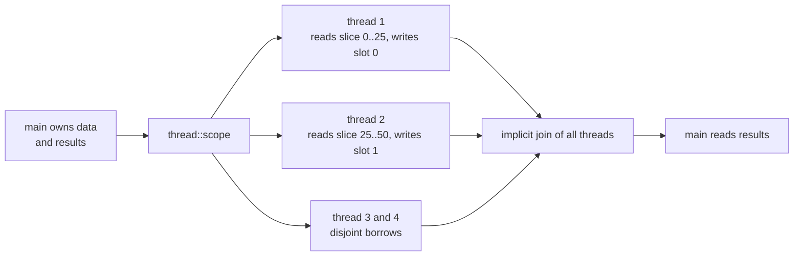
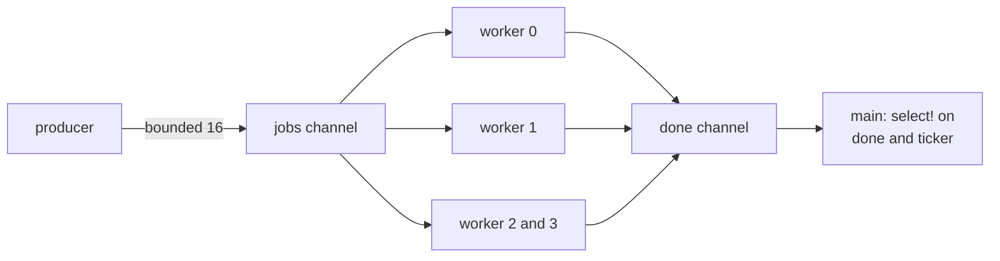
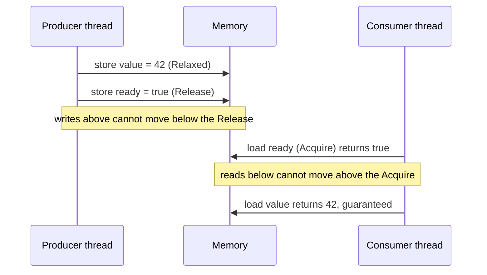
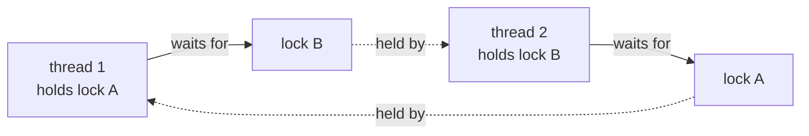

import Callout from '../../components/mdx/Callout.astro';

This part is for engineers who have written multithreaded code in Java or Kotlin, have been burned by a data race at least once, and want to know exactly what Rust's "fearless concurrency" buys them. By the end you will be able to spawn and scope threads, share state with `Arc`, `Mutex` and `RwLock`, move work through channels, use atomics with the right memory ordering, parallelize CPU-bound loops with rayon, and, just as important, name the classes of concurrency bugs that still compile.

<Callout variant="note" title="You should already know">
Ownership, moves and the borrow rules ([Part 2](/blog/rust-02-ownership-borrowing)), traits and generics including trait bounds ([Part 4](/blog/rust-04-traits-generics)), closures and `move` ([Part 5](/blog/rust-05-collections-iterators-closures)), and `Rc`, `RefCell` and interior mutability ([Part 6](/blog/rust-06-lifetimes-smart-pointers)). Everything here builds on those.
</Callout>

## The core idea: the borrow rules, applied across threads

A data race is two threads accessing the same memory at the same time, at least one of them writing, with no synchronization. In C, C++ and Java this is either undefined behavior or a source of torn and stale reads. Rust's answer is not a new mechanism. It is the rule you already know from Part 2: at any moment a value has either one `&mut` or any number of `&`, never both.

On one thread that rule prevents iterator invalidation and use-after-free. Across threads it prevents data races, as long as two extra facts hold:

1. A thread can't keep a reference to something that might be freed while it runs (lifetimes, plus the `'static` bound on `thread::spawn`).
2. Types that are unsafe to share or move between threads are marked as such, and the compiler checks those marks (the `Send` and `Sync` traits).

Everything in this post is a consequence of those two facts. Locks, channels and atomics are library types that use `unsafe` internally to provide shared mutation through a `&` reference, and they implement `Send` and `Sync` only when that is sound.

## Threads

### Spawning and joining

`std::thread::spawn` starts an OS thread and returns a `JoinHandle<T>`. Joining waits for the thread and gives back whatever the closure returned:

```rust
use std::thread;

fn main() {
    let handle = thread::spawn(|| {
        let mut sum = 0u64;
        for i in 1..=1_000 {
            sum += i;
        }
        sum
    });

    let total = handle.join().expect("worker panicked");
    println!("sum = {total}");
}
```

`join` returns a `Result` because the thread may have panicked. A panic in a spawned thread unwinds that thread only; the main thread learns about it through `Err` from `join`. If you drop a `JoinHandle` without joining, the thread is detached and keeps running, and when `main` returns the process exits and kills it mid-flight.

These are real OS threads, one-to-one with kernel threads, typically with a 2 MiB default stack (configurable via `thread::Builder`). There is no green-thread runtime in `std`. Tens of threads are cheap; tens of thousands are not, and that is the problem async solves in [Part 8](/blog/rust-08-async-rust).

### Why `move` is almost always required

Here is the first error everyone hits:

```rust
use std::thread;

fn main() {
    let names = vec!["a".to_string(), "b".to_string()];
    let handle = thread::spawn(|| {
        println!("{names:?}");
    });
    handle.join().unwrap();
}
```

```text
error[E0373]: closure may outlive the current function, but it borrows `names`, which is owned by the current function
 --> src/main.rs:5:32
  |
5 |     let handle = thread::spawn(|| {
  |                                ^^ may outlive borrowed value `names`
6 |         println!("{names:?}");
  |                    ----- `names` is borrowed here
  |
note: function requires argument type to outlive `'static`
help: to force the closure to take ownership of `names` (and any other referenced variables), use the `move` keyword
  |
5 |     let handle = thread::spawn(move || {
  |                                ++++
```

The closure only reads `names`, so Rust captures it by reference. But `spawn` has this signature:

```rust
pub fn spawn<F, T>(f: F) -> JoinHandle<T>
where
    F: FnOnce() -> T + Send + 'static,
    T: Send + 'static,
```

The `'static` bound says the closure must not borrow anything that could die before the thread does. The compiler can't know you will join before `names` goes out of scope (you might not, and the thread might be detached), so it refuses. Adding `move` transfers ownership of `names` into the closure, which satisfies `'static`.

```rust
let words = vec!["alpha".to_string(), "beta".to_string()];
let handle = thread::spawn(move || words.iter().map(|w| w.len()).sum::<usize>());
println!("{}", handle.join().unwrap());
```

After the `move`, `words` is gone from `main`. If you need it in both places you either clone it, wrap it in `Arc`, or use scoped threads.

### Scoped threads: borrowing without `'static`

Since Rust 1.63, `std::thread::scope` lets threads borrow from the enclosing stack frame. The scope guarantees that every thread spawned inside it is joined before `scope` returns, so borrowed data is guaranteed to outlive them:

```rust
use std::thread;

fn main() {
    let data: Vec<u32> = (1..=100).collect();
    let mut results = [0u32; 4];
    let chunk = data.len().div_ceil(4);

    thread::scope(|s| {
        for (slot, part) in results.iter_mut().zip(data.chunks(chunk)) {
            s.spawn(move || {
                *slot = part.iter().sum();
            });
        }
    }); // every thread is joined here

    println!("{results:?} total={}", results.iter().sum::<u32>());
}
```

Look at what is happening: four threads each hold a shared slice of `data` and a unique `&mut u32` into `results`. No `Arc`, no `Mutex`. The borrow checker accepts it because `iter_mut` hands out disjoint mutable references, and the scope bounds their lifetime. This is the cleanest way to do fork-join parallelism over borrowed data with only `std`.

The `move` here moves the *references* (`slot` and `part`) into each closure, not the underlying data. If a scoped thread panics, `scope` itself panics after joining all threads, so failures are not silently lost.



## Send and Sync

`Send` and `Sync` are *marker traits*: they have no methods, they only carry a promise.

- `T: Send` means it is safe to move a value of type `T` to another thread.
- `T: Sync` means it is safe for several threads to hold `&T` at the same time. Formally, `T: Sync` exactly when `&T: Send`.

Both are *auto traits*. The compiler implements them for your struct automatically if every field implements them. You almost never write `impl Send`; you get it for free, and you lose it when you add a field that isn't thread-safe.


### Why `Rc` is not `Send`

`Rc<T>` keeps its reference count in a plain `usize`. Cloning increments it with an ordinary, non-atomic add. If two threads cloned the same `Rc` at once, both could read 1, both write 2, and the count would be wrong. When it later hits zero early, the value is freed while someone still points at it. That is use-after-free from a data race.

Rust doesn't make `Rc` slower to make it safe. It marks `Rc` as `!Send` and `!Sync`, and the compiler stops you at the boundary:

```rust
use std::rc::Rc;
use std::thread;

fn main() {
    let shared = Rc::new(vec![1, 2, 3]);
    let clone = Rc::clone(&shared);
    thread::spawn(move || {
        println!("{clone:?}");
    });
}
```

```text
error[E0277]: `Rc<Vec<i32>>` cannot be sent between threads safely
   --> src/main.rs:7:19
    |
  7 |       thread::spawn(move || {
    |       ------------- ^------
    |       |             |
    |  _____|_____________within this `{closure@src/main.rs:7:19: 7:26}`
    | |     |
    | |     required by a bound introduced by this call
  8 | |         println!("{clone:?}");
  9 | |     });
    | |_____^ `Rc<Vec<i32>>` cannot be sent between threads safely
    |
    = help: within `{closure@src/main.rs:7:19: 7:26}`, the trait `Send` is not implemented for `Rc<Vec<i32>>`
note: required by a bound in `spawn`
```

The fix is `Arc<T>` (atomically reference counted), which pays for an atomic increment on every clone and drop. Single-threaded code keeps the cheaper `Rc`; the type system tells you when you've crossed into multithreaded territory.

### `Cell` and `RefCell` are Send but not Sync

`Cell<T>` and `RefCell<T>` allow mutation through `&T` with no synchronization. Moving one to another thread is fine (only that thread then has it). Sharing one is not. So wrapping a `Cell` in an `Arc` doesn't help:

```rust
use std::cell::Cell;
use std::sync::Arc;
use std::thread;

fn main() {
    let hits = Arc::new(Cell::new(0));
    let h = Arc::clone(&hits);
    thread::spawn(move || h.set(h.get() + 1));
}
```

```text
error[E0277]: `Cell<i32>` cannot be shared between threads safely
   --> src/main.rs:8:19
    |
  8 |     thread::spawn(move || h.set(h.get() + 1));
    |     ------------- ^^^^^^^^^^^^^^^^^^^^^^^^^^ `Cell<i32>` cannot be shared between threads safely
    |
    = help: the trait `Sync` is not implemented for `Cell<i32>`
    = note: if you want to do aliasing and mutation between multiple threads, use `std::sync::RwLock` or `std::sync::atomic::AtomicI32` instead
    = note: required for `Arc<Cell<i32>>` to implement `Send`
```

Note the chain: `Arc<T>` is `Send` only if `T: Send + Sync`, because sending an `Arc` to another thread means two threads now share the inner `T`. The thread-safe counterparts are exactly what the compiler suggests: atomics instead of `Cell`, `Mutex` or `RwLock` instead of `RefCell`.

| Single-threaded | Thread-safe | What changes |
|---|---|---|
| `Rc<T>` | `Arc<T>` | atomic refcount |
| `Cell<T>` | `AtomicU64`, `AtomicBool`, ... | atomic load/store/RMW |
| `RefCell<T>` | `Mutex<T>`, `RwLock<T>` | blocking lock instead of a panicking borrow flag |
| `OnceCell<T>` | `OnceLock<T>` | synchronized one-time init |
| `LazyCell<T>` | `LazyLock<T>` | synchronized lazy init (both stable since 1.80) |

`MutexGuard` is the odd one: it is `Sync` but not `Send`. Some platform lock implementations require the unlocking thread to be the locking thread, so a guard must stay on the thread that created it. That detail becomes important in async code, where a task can resume on a different thread after an `.await`.

## Shared state: Arc, Mutex, RwLock

### `Arc<Mutex<T>>`

The standard way to share mutable state is to give every thread an `Arc` pointing at a `Mutex` that owns the data:

```rust
use std::collections::HashMap;
use std::sync::{Arc, Mutex};
use std::thread;

fn main() {
    let counts: Arc<Mutex<HashMap<String, usize>>> = Arc::new(Mutex::new(HashMap::new()));
    let mut handles = Vec::new();

    for worker in 0..4 {
        let counts = Arc::clone(&counts);
        handles.push(thread::spawn(move || {
            for i in 0..1_000 {
                let key = format!("bucket-{}", (i + worker) % 3);
                let mut map = counts.lock().unwrap();
                *map.entry(key).or_insert(0) += 1;
            } // guard dropped at the end of each iteration
        }));
    }

    for h in handles {
        h.join().unwrap();
    }
    println!("{:?}", counts.lock().unwrap());
}
```

The design difference from Java is the important part. In Java a lock protects *code*: you agree by convention that every access to `counts` happens inside `synchronized (lock)`. Nothing stops a colleague from reading the map outside the block.

```kotlin
class Counter {
    private val lock = Any()
    private val counts = HashMap<String, Int>()

    fun inc(key: String) = synchronized(lock) { counts.merge(key, 1, Int::plus) }

    // Compiles. Races with inc(). Nothing in the type system objects.
    fun peek(key: String) = counts[key]
}
```

In Rust, `Mutex<T>` *owns* the `T`. The only way to reach the data is `lock()`, which returns a `MutexGuard<T>` that derefs to `&mut T`. When the guard is dropped, the lock is released. You can't forget to lock, and you can't forget to unlock (RAII from Part 6 again). Keep the critical section short by keeping the guard's scope short; in the loop above the guard dies at the end of each iteration.

### `RwLock` for read-heavy data

`RwLock<T>` allows many concurrent readers (`read()`) or one writer (`write()`). It is a good fit for configuration or routing tables that are read on every request and changed rarely:

```rust
use std::sync::{Arc, RwLock};

struct Config {
    max_connections: u32,
    feature_flags: Vec<String>,
}

fn reload(config: &RwLock<Config>) {
    let mut cfg = config.write().unwrap();
    cfg.max_connections = 20;
    cfg.feature_flags.push("fast-path".into());
}

fn current_max(config: &Arc<RwLock<Config>>) -> u32 {
    config.read().unwrap().max_connections
}
```

Two cautions. First, `RwLock` is not automatically faster than `Mutex`; it has more bookkeeping, and if critical sections are tiny a `Mutex` often wins. Measure. Second, the fairness policy (whether waiting writers block new readers) is platform-dependent in `std`, so a steady stream of readers could starve a writer on some platforms. If you need a fixed policy, `parking_lot::RwLock` documents its fairness behavior explicitly. For hot, read-mostly data that changes atomically as a whole, also look at the `arc-swap` crate, which lets readers grab an `Arc` snapshot with no lock at all.

### Poisoning

Why `lock().unwrap()` everywhere? Because `lock()` returns `Result<MutexGuard<T>, PoisonError<...>>`. If a thread panics while holding the guard, the mutex is marked *poisoned*: the data might be halfway through an update, and other threads should know.

```rust
use std::sync::{Arc, Mutex};
use std::thread;

fn main() {
    let shared = Arc::new(Mutex::new(vec![1, 2, 3]));
    let s2 = Arc::clone(&shared);

    let _ = thread::spawn(move || {
        let mut v = s2.lock().unwrap();
        v.push(4);
        panic!("invariant broken halfway through an update");
    })
    .join();

    match shared.lock() {
        Ok(v) => println!("clean: {v:?}"),
        Err(poisoned) => {
            // We decide the data is still usable.
            let v = poisoned.into_inner();
            println!("poisoned, recovered data: {v:?}");
        }
    }
    shared.clear_poison();
}
```

In practice most services treat poisoning as fatal and `unwrap()`, which propagates the panic: a panic while mutating shared state is a bug, and continuing with possibly inconsistent data is usually worse than crashing and restarting. If your data can't be left inconsistent (for example you only ever replace a whole value), recovering with `into_inner()` is reasonable. `parking_lot::Mutex` skips poisoning entirely, which is one reason some codebases prefer it; it trades that signal for a simpler API.

## Message passing: channels

The Go proverb "don't communicate by sharing memory; share memory by communicating" applies well to Rust, because sending a value through a channel *moves* it. After `tx.send(order)`, the sender no longer has `order`. Ownership transfer is the synchronization.

### `std::sync::mpsc`

`std` ships a multi-producer, single-consumer channel:

```rust
use std::sync::mpsc;
use std::thread;

fn main() {
    let (tx, rx) = mpsc::channel::<String>();

    for id in 0..3 {
        let tx = tx.clone();
        thread::spawn(move || {
            for n in 0..2 {
                tx.send(format!("worker {id}: item {n}")).unwrap();
            }
        });
    }
    drop(tx); // otherwise rx waits forever for the original sender

    for msg in rx {
        println!("{msg}");
    }
}
```

The receiver loop ends when every `Sender` has been dropped. Forgetting `drop(tx)` on the original sender is the classic "my program hangs at the end" bug.

`mpsc::channel()` is *unbounded*: if producers outrun the consumer, memory grows without limit. In production prefer `mpsc::sync_channel(n)`, which is bounded. When it is full, `send` blocks, which slows producers down to the consumer's pace. That is backpressure, and it is how you keep a burst from turning into an out-of-memory kill.

```rust
let (tx, rx) = mpsc::sync_channel::<u64>(8); // at most 8 in flight
let producer = thread::spawn(move || {
    for i in 0..100 {
        tx.send(i).unwrap(); // blocks while the buffer is full
    }
});
let sum: u64 = rx.iter().sum();
producer.join().unwrap();
```

### crossbeam-channel for worker pools

`std::mpsc` has a single consumer, so it can't directly feed a pool of workers. The `crossbeam-channel` crate provides multi-producer, multi-consumer channels where the `Receiver` is `Clone`, plus a `select!` macro to wait on several channels at once. (Since Rust 1.67, `std::mpsc` is itself implemented on crossbeam's algorithm, but the multi-consumer `std::sync::mpmc` API is still unstable at the time of writing, so the crate remains the usual choice.)

```rust
use crossbeam_channel::{bounded, select, tick};
use std::thread;
use std::time::Duration;

fn main() {
    let (jobs_tx, jobs_rx) = bounded::<u32>(16);
    let (done_tx, done_rx) = bounded::<(usize, u32)>(16);

    let workers: Vec<_> = (0..4)
        .map(|id| {
            let jobs_rx = jobs_rx.clone();
            let done_tx = done_tx.clone();
            thread::spawn(move || {
                for job in jobs_rx {
                    done_tx.send((id, job * job)).unwrap();
                }
            })
        })
        .collect();
    drop(done_tx);

    let producer = thread::spawn(move || {
        for j in 0..20 {
            jobs_tx.send(j).unwrap();
        }
    }); // jobs_tx dropped here: workers' loops end

    let ticker = tick(Duration::from_millis(100));
    let mut received = 0;
    loop {
        select! {
            recv(done_rx) -> msg => match msg {
                Ok(_) => received += 1,
                Err(_) => break, // all workers gone
            },
            recv(ticker) -> _ => println!("progress: {received}"),
        }
    }

    producer.join().unwrap();
    for w in workers {
        w.join().unwrap();
    }
    println!("received {received}");
}
```



Shutdown is driven entirely by dropping senders: the producer finishes and drops `jobs_tx`, so each worker's `for job in jobs_rx` loop ends, each worker drops its `done_tx` clone, and finally `done_rx` returns `Err`. No flags, no sentinel values.

### Locks or channels?

Use a lock when several threads need to read and update *the same* piece of state (a cache, a counter map, a connection registry). Use a channel when work or ownership *flows* from one stage to the next (a pipeline, a job queue, an actor that owns a resource). A good smell test: if you find yourself wrapping a channel around request/response pairs to protect a single `HashMap`, a `Mutex` is simpler; if you find yourself holding a lock while doing I/O, an owner thread fed by a channel is probably the better design.

## Atomics and memory ordering

### Atomics as lock-free shared counters

`std::sync::atomic` provides `AtomicBool`, `AtomicUsize`, `AtomicU64`, `AtomicPtr` and friends. They support `load`, `store`, and read-modify-write operations like `fetch_add`, `swap` and `compare_exchange`, all through `&self`. Since `Atomic*::new` is `const`, they work as plain `static`s:

```rust
use std::sync::atomic::{AtomicU64, Ordering};
use std::thread;

static REQUESTS: AtomicU64 = AtomicU64::new(0);

fn main() {
    thread::scope(|s| {
        for _ in 0..8 {
            s.spawn(|| {
                for _ in 0..10_000 {
                    REQUESTS.fetch_add(1, Ordering::Relaxed);
                }
            });
        }
    });
    println!("{}", REQUESTS.load(Ordering::Relaxed)); // always 80000
}
```

Every atomic operation takes an `Ordering`. This is the part people find intimidating, so here is the usable version.

### What ordering means

Modern CPUs and compilers reorder memory operations for speed. On a single thread you never notice, because reordering preserves single-threaded behavior. Another thread, though, can observe your writes in a different order than you issued them. `Ordering` tells the compiler and CPU which reorderings are forbidden around a particular atomic operation.

- **`Relaxed`**: the operation itself is atomic (no torn values, no lost increments), but it imposes no ordering on *other* memory. Right for independent counters and statistics, where you only care about the final number.
- **`Release`** (on a store) and **`Acquire`** (on a load): a pair. Every write the releasing thread made *before* the release store is visible to a thread that acquire-loads that store's value. This is how you *publish* data.
- **`AcqRel`**: both, for read-modify-write operations like `fetch_add` or `compare_exchange` that both consume and publish.
- **`SeqCst`**: Acquire/Release plus a single global order of all `SeqCst` operations that every thread agrees on. Needed for a few algorithms where two threads each write one flag and read the other's (Dekker-style); otherwise usually stronger than you need.

The publish pattern:

```rust
use std::sync::Arc;
use std::sync::atomic::{AtomicBool, AtomicUsize, Ordering};
use std::thread;

fn main() {
    let value = Arc::new(AtomicUsize::new(0));
    let ready = Arc::new(AtomicBool::new(false));
    let (v, r) = (Arc::clone(&value), Arc::clone(&ready));

    let producer = thread::spawn(move || {
        v.store(42, Ordering::Relaxed);   // 1. write the payload
        r.store(true, Ordering::Release); // 2. publish: "everything before me is done"
    });

    while !ready.load(Ordering::Acquire) { // 3. sees true...
        std::hint::spin_loop();
    }
    assert_eq!(value.load(Ordering::Relaxed), 42); // 4. ...so is guaranteed to see 42
    producer.join().unwrap();
}
```



If you used `Relaxed` for the `ready` flag, the consumer could see `ready == true` and still read `0`. This is not undefined behavior in Rust (both variables are atomics), but it is a logic bug, and a nasty one: x86's strong memory model happens to make the bug invisible, while ARM (Apple Silicon, AWS Graviton, phones) will expose it. Code that "worked for years" on Intel servers and fails after a move to Graviton is a known story.

### Compare-and-swap loops

When the new value depends on the old one in a way no `fetch_*` method covers, use a CAS loop:

```rust
use std::sync::atomic::{AtomicU64, Ordering};

fn record_max(max: &AtomicU64, latency: u64) {
    let mut current = max.load(Ordering::Relaxed);
    while latency > current {
        match max.compare_exchange_weak(current, latency, Ordering::Relaxed, Ordering::Relaxed) {
            Ok(_) => break,
            Err(actual) => current = actual, // someone else won; retry with their value
        }
    }
}
```

(For this exact case `fetch_max` exists. The loop shape is what generalizes.) `compare_exchange_weak` may fail spuriously, which is fine inside a loop and can be cheaper on ARM; use `compare_exchange` when you are not looping.

### A practical policy

1. Prefer a `Mutex`. Uncontended locks are cheap (a single atomic operation to acquire on most platforms), and they are far easier to reason about.
2. Use atomics for counters, flags and simple metrics. `Relaxed` for counters you only read for reporting.
3. For flag-guards-data patterns, use `Release` on the store and `Acquire` on the load, and comment *which* data the pair publishes.
4. Reach for `SeqCst` only when you can name the reason, and treat any custom lock-free data structure as a project of its own: test it with `loom`, which exhaustively explores thread interleavings and memory-model behaviors in a model of your code.

Mara Bos's book *Rust Atomics and Locks* is the standard deep reference if you need to go further.

## Deadlocks and logic races: what the compiler does not catch


### Deadlock by lock ordering

Two accounts, each with its own lock. Thread 1 transfers A to B, locking A then B. Thread 2 transfers B to A, locking B then A. Each holds one lock and waits forever for the other. This compiles without a warning.



The standard fix is a global lock order. Always acquire locks in the same order, for example by ascending id:

```rust
use std::sync::Mutex;

struct Account {
    id: u32,
    balance: Mutex<i64>,
}

fn transfer(from: &Account, to: &Account, amount: i64) {
    // Always lock the lower id first, whatever the transfer direction.
    let (first, second) = if from.id < to.id { (from, to) } else { (to, from) };
    let mut a = first.balance.lock().unwrap();
    let mut b = second.balance.lock().unwrap();

    if first.id == from.id {
        *a -= amount;
        *b += amount;
    } else {
        *b -= amount;
        *a += amount;
    }
}
```

Other sources of deadlock in Rust code:

- **Re-entrant locking.** `std::sync::Mutex` is not re-entrant. Locking it twice on the same thread will deadlock or panic (the docs leave it unspecified). This often happens indirectly: a method locks, then calls a helper that also locks.
- **Holding a lock while blocking on something else**: sending on a full bounded channel, joining a thread that needs the same lock, or waiting on I/O.
- **Temporaries that live longer than you think.** In `match cache.lock().unwrap().get(&k) { ... }` the guard is a temporary in the scrutinee, and it lives until the end of the whole `match`. If an arm locks `cache` again, you deadlock. Edition 2024 changed `if let` so that scrutinee temporaries are dropped before the `else` branch, which removed one variant of this trap, but `match` still keeps them alive for every arm. Bind the value you need in a `let` first, then match on it.

### Logic races (check-then-act)

Each individual access below is properly locked, so there is no data race. The program is still wrong:

```rust
use std::sync::atomic::{AtomicU64, Ordering};
use std::sync::{Arc, Mutex};
use std::thread;
use std::time::Duration;

fn main() {
    let stock = Arc::new(Mutex::new(1u32)); // one item left
    let sold = Arc::new(AtomicU64::new(0));

    thread::scope(|s| {
        for _ in 0..4 {
            let stock = Arc::clone(&stock);
            let sold = Arc::clone(&sold);
            s.spawn(move || {
                // BUG: check and act use two separate lock acquisitions.
                let available = *stock.lock().unwrap() > 0;
                if available {
                    thread::sleep(Duration::from_millis(1));
                    let mut s = stock.lock().unwrap();
                    *s = s.saturating_sub(1);
                    sold.fetch_add(1, Ordering::Relaxed);
                }
            });
        }
    });
    println!("sold {} of 1", sold.load(Ordering::Relaxed));
}
```

In a test run this printed `sold 4 of 1`. All four threads saw stock available, then all four sold. The fix is to make the check and the act one critical section:

```rust
fn try_sell(stock: &Mutex<u32>) -> bool {
    let mut s = stock.lock().unwrap();
    if *s > 0 {
        *s -= 1;
        true
    } else {
        false
    }
}
```

This is the in-memory version of the overselling and double-booking problems from [Part 3 of the backend series](/blog/backend-03-databases-fundamentals): the invariant must be protected by one atomic unit of work, whether that unit is a mutex, a database transaction or a conditional update.

## Data parallelism with rayon

For CPU-bound work over collections, hand-rolled threads are rarely the right tool. The `rayon` crate turns iterator chains into parallel ones with a work-stealing thread pool (by default one thread per logical CPU):

```rust
use rayon::prelude::*;
use std::collections::HashMap;

fn main() {
    let lines: Vec<String> = (0..100_000)
        .map(|i| format!("GET /orders/{} 200 {}ms", i, i % 250))
        .collect();

    // Swap iter() for par_iter(); the rest of the chain is unchanged.
    let slow: usize = lines
        .par_iter()
        .filter_map(|l| l.rsplit(' ').next()?.strip_suffix("ms")?.parse::<u32>().ok())
        .filter(|&ms| ms > 200)
        .count();
    println!("slow = {slow}");

    // Parallel sort, and fork-join for two independent computations.
    let mut v: Vec<u64> = (0..1_000_000).rev().collect();
    v.par_sort_unstable();
    let (head_sum, len) = rayon::join(|| v.iter().take(10).sum::<u64>(), || v.len());
    println!("{head_sum} {len}");

    // Aggregation without a shared lock: per-thread maps, merged at the end.
    let by_status = lines
        .par_iter()
        .fold(HashMap::new, |mut m: HashMap<u32, usize>, l| {
            let code: u32 = l.split(' ').nth(2).unwrap().parse().unwrap();
            *m.entry(code).or_default() += 1;
            m
        })
        .reduce(HashMap::new, |mut a, b| {
            for (k, v) in b {
                *a.entry(k).or_default() += v;
            }
            a
        });
    println!("{by_status:?}");
}
```

Why this is safe: `par_iter()` requires the closures to be `Send + Sync` where they need to be, so if you try to mutate a captured `Vec` from inside a `for_each`, you get a compile error, not a race. The `fold`/`reduce` pattern shows the idiomatic alternative to a shared `Mutex<HashMap>`: each worker builds a private map, and maps are merged pairwise. No lock contention at all.

When rayon is the wrong tool:

- **Tiny workloads.** Splitting and stealing have overhead. Parallelizing a loop over 100 cheap items will often be slower than the sequential version. Benchmark (criterion, from Part 5) before and after.
- **Blocking I/O inside `par_iter`.** Rayon's pool is sized for CPU work. Blocking its threads on network calls starves everything else using the global pool. I/O-bound concurrency is what async is for.
- **Inside an async runtime.** Calling a long rayon job directly from an async task blocks a runtime worker. Run it via `spawn_blocking`, or send it to rayon and await the result through a oneshot channel. Part 8 covers this.

## Common mistakes

- **Unbounded channels in long-running services.** `mpsc::channel()` and `crossbeam_channel::unbounded()` will happily absorb a burst until the process is killed. Default to bounded and decide explicitly what happens when the buffer is full: block, drop or reject.
- **Holding a guard across slow work.** Copy or `std::mem::take` what you need out of the lock, drop the guard, then do the I/O or computation.
- **`Arc<Mutex<T>>` everywhere by reflex.** Ask first whether the data needs to be shared at all. Often one thread can own it and others send it messages, or scoped threads can borrow it with no `Arc`.
- **Mutex around a single number.** An `AtomicU64` with `Relaxed` is simpler and faster for a counter.
- **`Relaxed` for a ready flag.** Flags that guard other data need `Release`/`Acquire`. Tests on x86 won't catch this.
- **Spinning instead of blocking.** A `while !flag.load(...)` loop burns a whole core. Spin only for very short waits; otherwise use a channel, `Condvar`, `thread::park` or a `Barrier`.
- **Forgetting the original `Sender`.** The receiver loop never ends if the sender you cloned from is still alive.
- **Detached threads in libraries.** If a library spawns a thread and drops the handle, callers can't shut it down cleanly. Return the handle or provide a shutdown method.
- **Treating poisoning as noise.** `unwrap()` on a poisoned lock is a deliberate choice to crash. Make it deliberately, and don't wrap it in a retry loop.

## Interview questions

<details>
<summary>What do Send and Sync mean, and how are they related?</summary>

`Send` means a value of the type can be moved to another thread; `Sync` means a shared reference `&T` can be used from several threads at once. They are related by definition: `T: Sync` if and only if `&T: Send`. Both are auto traits, so a struct gets them automatically when all its fields have them, and they are `unsafe` to implement manually because the compiler can't verify the promise. A strong answer gives examples from each quadrant: `Rc` is neither (non-atomic refcount), `Cell`/`RefCell` are `Send` but not `Sync` (unsynchronized interior mutability), `MutexGuard` is `Sync` but not `Send` (must unlock on the locking thread), and most ordinary types are both.

</details>

<details>
<summary>Why does thread::spawn require 'static, and how do scoped threads avoid it?</summary>

A spawned thread can outlive the function that spawned it, since nothing forces a join, so any borrowed data could be freed while the thread still uses it. The `'static` bound forbids non-static borrows, which is why `move` or `Arc` is usually needed. `thread::scope` (stable since 1.63) guarantees that all threads spawned inside it are joined before `scope` returns, so the compiler can let them borrow local data whose lifetime covers the scope, including disjoint `&mut` borrows from `iter_mut` or `chunks_mut`.

</details>

<details>
<summary>Rust claims fearless concurrency. What exactly is guaranteed, and what is not?</summary>

Safe Rust guarantees freedom from data races: unsynchronized concurrent access to the same memory where at least one access is a write. It does that by applying the aliasing XOR mutability rule across threads and by `Send`/`Sync` checks at thread boundaries. It does not prevent deadlocks, logic races like check-then-act, starvation or livelock, lock contention, memory leaks through `Arc` cycles, or bugs from atomic orderings that are too weak for your algorithm. Those are not undefined behavior, so they're outside what the type system tries to prove.

</details>

<details>
<summary>Explain Relaxed, Acquire/Release and SeqCst. When would you use each?</summary>

All of them make the individual operation atomic. `Relaxed` imposes no ordering on other memory and fits independent counters. A `Release` store paired with an `Acquire` load that reads its value creates a happens-before edge: everything the releasing thread wrote before the store is visible after the load. That is the pattern for publishing data behind a flag or pointer. `AcqRel` is the combination for read-modify-write operations. `SeqCst` adds a single total order over all `SeqCst` operations; it's needed for some algorithms where threads write one variable and read another, and it is a reasonable default when you're unsure, but stronger and sometimes slower. A good answer mentions that x86 hides many ordering bugs that show up on ARM, and that `loom` can test such code.

</details>

<details>
<summary>How does Rust's Mutex differ from Java's synchronized, and why does it matter?</summary>

Java's lock protects code by convention: data and lock are separate, and nothing prevents an access outside the synchronized block. Rust's `Mutex<T>` owns the data, and the only way to reach it is through the guard returned by `lock()`, which also releases the lock on drop. So "forgot to lock" and "forgot to unlock" are impossible in safe Rust. Rust's std mutex is also not re-entrant and has poisoning, which Java's monitors don't. Both share the remaining hazards: deadlocks and long critical sections.

</details>

<details>
<summary>You have a deadlock in production between two code paths. How do you find and fix it?</summary>

Find it by capturing thread stacks of the hung process (gdb or lldb `thread apply all bt`, or a debugger attach) and looking for threads blocked in lock acquisition, then identifying which locks each holds. Fix by establishing a global lock order (by id, by address or by a documented hierarchy), by reducing to one lock, by never holding a lock while calling unknown code or blocking on a channel, or by using `try_lock` with backoff where ordering is impossible. Also check for hidden guard lifetimes, such as a guard temporary in a `match` scrutinee that lives for the whole match. `parking_lot` has an optional deadlock detector that can help in testing.

</details>

<details>
<summary>When would you use rayon, std threads, channels, or async?</summary>

Rayon for CPU-bound data parallelism over collections: it handles splitting and work stealing, and its closures are checked for thread safety. Scoped std threads for a handful of long-lived or fork-join tasks where you want explicit control without a dependency. Channels when work or ownership flows between stages, with bounded capacity for backpressure. Async when you have many concurrent I/O-bound operations (thousands of sockets) where an OS thread per operation would be too expensive. Mixing them carefully matters: CPU-heavy or blocking work should not run directly on async runtime threads.

</details>

## Key takeaways

- Rust prevents data races with the same rule it uses everywhere: one `&mut` or many `&`. `Send` and `Sync` extend it across thread boundaries.
- `thread::spawn` needs `'static` data; `thread::scope` lets threads borrow locals safely and is often the simplest option.
- `Rc` and `RefCell` are for one thread; `Arc` and `Mutex`/`RwLock` are their thread-safe counterparts, and the compiler tells you when you need to switch.
- `Mutex<T>` owns its data, so you can't access it without locking. Keep guards short-lived and know when temporaries keep them alive.
- Channels move ownership; prefer bounded channels so a slow consumer applies backpressure instead of consuming memory.
- Use `Relaxed` for counters, `Release`/`Acquire` to publish data, and `SeqCst` when you can name why. Test lock-free code with `loom`.
- Deadlocks and check-then-act races still compile. Lock ordering and single critical sections are your job.
- Rayon is the default for CPU-bound parallelism; async (next part) is for I/O-bound concurrency.

Previous: [Part 6: Lifetimes and Smart Pointers](/blog/rust-06-lifetimes-smart-pointers) · Next: [Part 8: Async Rust](/blog/rust-08-async-rust)
