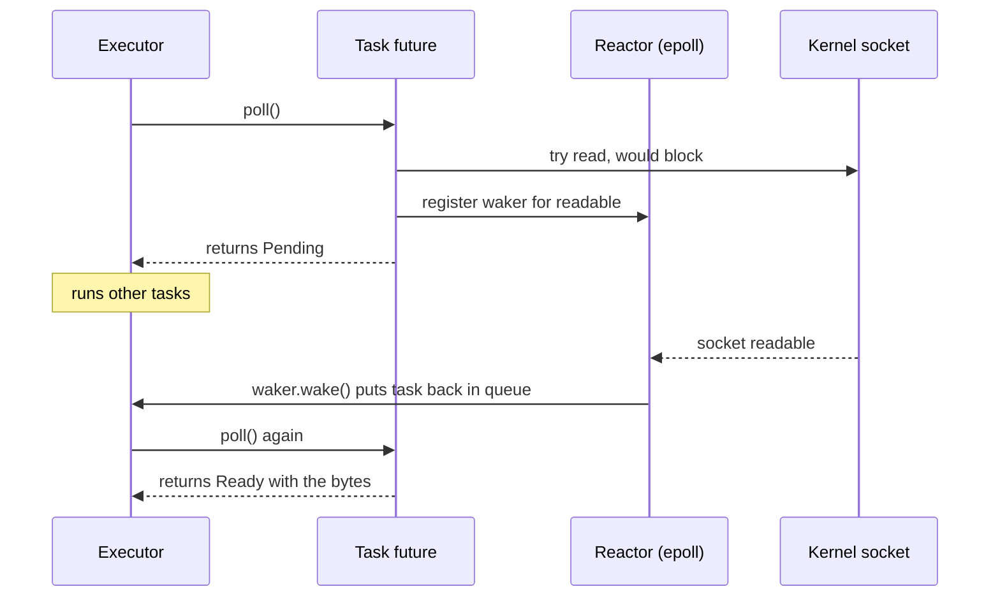
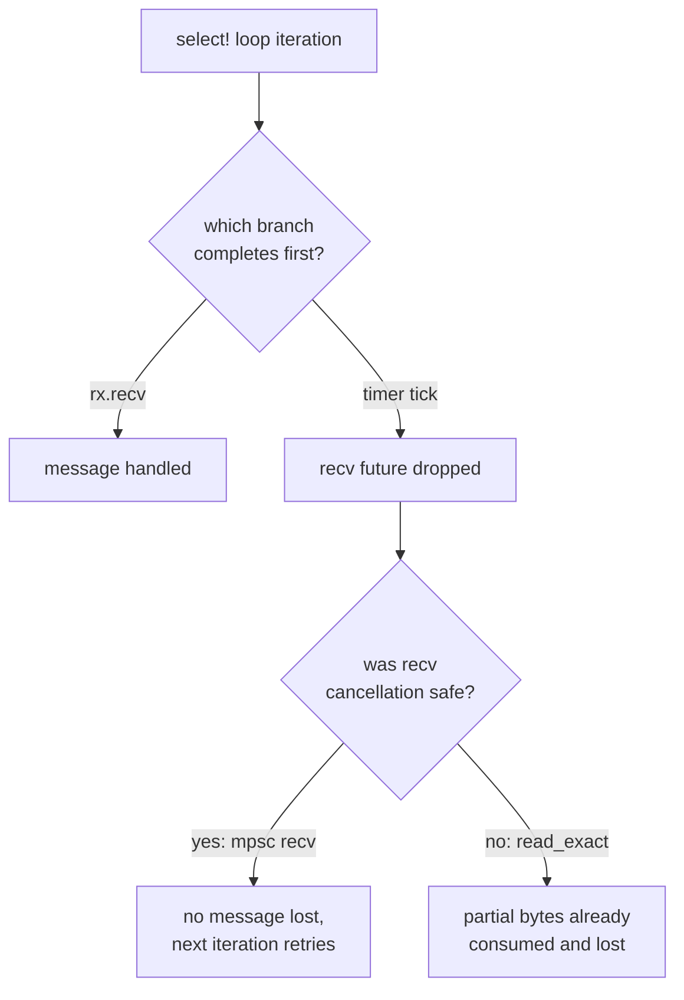
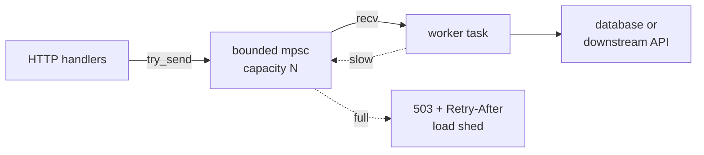

import Callout from '../../components/mdx/Callout.astro';

Async Rust has a reputation for being hard, and most of that reputation comes from learning the syntax before the mechanism. This part is for engineers who know threads (Part 7) and probably know Kotlin coroutines, and who want to write and review async Rust with confidence. By the end you will know what a future actually is, what `.await` compiles into, how Tokio schedules tasks, when to use `join!`, `spawn` or `select!`, what "cancellation safe" means, why `Pin` exists, and the handful of mistakes that cause most async production incidents.

<Callout variant="note" title="You should already know">
Traits, generics and `impl Trait` ([Part 4](/blog/rust-04-traits-generics)), closures and `move` ([Part 5](/blog/rust-05-collections-iterators-closures)), lifetimes and smart pointers ([Part 6](/blog/rust-06-lifetimes-smart-pointers)), and `Send`, `Sync`, `Arc` and `Mutex` ([Part 7](/blog/rust-07-concurrency)). Async builds directly on `Send`.
</Callout>

## Why async exists

Threads are a fine way to run ten things at once. They are an expensive way to run ten thousand things at once. Each OS thread has its own stack (often reserved at 2 to 8 MiB of virtual memory, with real memory committed as it's touched), each context switch goes through the kernel, and a backend service spends almost all of its time *waiting*: for the database, for another service, for a client to send the next bytes.

Async lets one OS thread juggle many waiting operations. Instead of blocking the thread inside `read()`, a task says "I can't make progress until this socket is readable, wake me then," and the thread moves on to another task. A web server written this way can hold tens of thousands of open connections on a few threads.

The trade-off: async is *cooperative*. A task gives up its thread only at `.await` points. If it computes for 300 ms without awaiting, nothing else runs on that thread for 300 ms. Keep that in mind; it explains most of the pitfalls later.

### How Rust's model differs from Kotlin coroutines

If you know coroutines, most concepts map across, but four differences matter.

```kotlin
suspend fun loadPage(id: Long): Page = coroutineScope {
    val user = async { fetchUser(id) }       // starts immediately
    val orders = async { fetchOrders(id) }   // starts immediately
    Page(user.await(), orders.await())
}
```

1. **Futures are lazy.** Calling an `async fn` in Rust does nothing except build a value. No work starts until something polls it. Kotlin's `async {}` starts eagerly.
2. **There is no built-in runtime.** The language defines `Future` and `async`/`.await`; the scheduler, timers and I/O come from a library. In practice that library is almost always Tokio for servers.
3. **Cancellation is drop.** Kotlin cancels cooperatively via `CancellationException` at suspension points. In Rust you cancel a future by dropping it, and it simply never gets polled again. There is no exception to catch and no `finally` block, only `Drop` impls.
4. **Structured concurrency is opt-in.** Kotlin scopes make child coroutines part of the parent's lifetime by default. `tokio::spawn` creates a detached task; you get structure back with `JoinSet`, cancellation tokens and discipline. (The [Kotlin coroutines in production](/blog/kotlin-coroutines-production) post covers the Kotlin side if you want to compare in detail.)

## Futures are state machines

### The Future trait

Everything async is built on one trait:

```rust
pub trait Future {
    type Output;
    fn poll(self: Pin<&mut Self>, cx: &mut Context<'_>) -> Poll<Self::Output>;
}

pub enum Poll<T> {
    Ready(T),
    Pending,
}
```

`poll` asks "can you finish now?". The future either returns `Ready(value)`, or returns `Pending` *and arranges to be woken up* when it might be able to make progress. That second half is the contract people miss: returning `Pending` without arranging a wake-up means the future is never polled again and hangs forever.

Here is a hand-written future that counts down, returning `Pending` three times. It wakes itself immediately each time (real futures register with an I/O source or timer instead):

```rust
use std::future::Future;
use std::pin::Pin;
use std::task::{Context, Poll};

struct Countdown {
    remaining: u32,
}

impl Future for Countdown {
    type Output = &'static str;

    fn poll(mut self: Pin<&mut Self>, cx: &mut Context<'_>) -> Poll<Self::Output> {
        if self.remaining == 0 {
            Poll::Ready("liftoff")
        } else {
            println!("countdown: {}", self.remaining);
            self.remaining -= 1;
            cx.waker().wake_by_ref(); // "poll me again"
            Poll::Pending
        }
    }
}
```

### What `async fn` compiles into

You rarely implement `Future` by hand, because the compiler does it for you. An `async fn` becomes a function that returns an anonymous type implementing `Future`, and that type is an enum with one variant per `.await` point. Local variables that are alive across an `.await` become fields of the variant.


```rust
async fn fetch_user(id: u64) -> Result<User, String> { /* ... */ }
async fn fetch_orders(user_id: u64) -> Result<Vec<Order>, String> { /* ... */ }

async fn sequential(id: u64) -> Result<(User, Vec<Order>), String> {
    let user = fetch_user(id).await?;     // state: AwaitingUser
    let orders = fetch_orders(id).await?; // state: AwaitingOrders, holds `user`
    Ok((user, orders))
}
```

Each call to `poll` resumes from the current state, polls the inner future, and either moves to the next state or returns `Pending`. This has concrete consequences:

- **No heap allocation per await.** The whole chain of nested futures is one value whose size is known at compile time. You can put it on the stack, in a `Box`, or inside a task. This is why Rust async can be very lean.
- **The future's size is its largest state.** A 64 KiB buffer that lives across an `.await` makes the future at least 64 KiB. Deeply nested async calls with big locals produce big futures; boxing a large inner future (`Box::pin(fut).await`) is the escape hatch.
- **`Send`-ness is decided by what lives across awaits.** If any value held across an `.await` is `!Send`, the whole future is `!Send` and can't be spawned on a multithreaded runtime. This is the source of the most common async compile error, covered below.
- **Recursion needs boxing**, since an enum can't contain itself. A recursive `async fn` has to box the recursive call.

## Executors and wakers

A future does nothing until an *executor* polls it. The smallest possible executor polls a future, and when the future returns `Pending`, parks the thread until the waker unparks it:

```rust
use std::future::Future;
use std::sync::Arc;
use std::task::{Context, Poll, Wake, Waker};

struct ThreadWaker(std::thread::Thread);

impl Wake for ThreadWaker {
    fn wake(self: Arc<Self>) {
        self.0.unpark();
    }
}

fn block_on<F: Future>(fut: F) -> F::Output {
    let mut fut = std::pin::pin!(fut);
    let waker = Waker::from(Arc::new(ThreadWaker(std::thread::current())));
    let mut cx = Context::from_waker(&waker);
    loop {
        match fut.as_mut().poll(&mut cx) {
            Poll::Ready(out) => return out,
            Poll::Pending => std::thread::park(), // sleep until wake() is called
        }
    }
}

fn main() {
    println!("{}", block_on(Countdown { remaining: 3 }));
    // countdown: 3, countdown: 2, countdown: 1, liftoff
}
```

That's a real, working executor in about 20 lines. A production runtime adds three things:

1. **A reactor.** Futures that wait on sockets register interest with the OS (epoll on Linux, kqueue on macOS, IOCP on Windows). When the OS reports readiness, the reactor calls the stored waker.
2. **A timer wheel** for `sleep` and timeouts.
3. **A scheduler** that keeps many tasks in queues, polls whichever are ready, and spreads them across worker threads.



The waker is how a future says "I'll tell you when to try again." Without it the executor would have to busy-poll every task constantly. With it, an idle task costs nothing but its memory.

## The Tokio runtime

### Starting a runtime

```toml
[dependencies]
tokio = { version = "1", features = ["full"] }
```

```rust
#[tokio::main]
async fn main() {
    let user = fetch_user(1).await;
    println!("{user:?}");
}
```

`#[tokio::main]` is a macro that builds a runtime and calls `block_on` on your `async fn main`. By default that is the *multi-thread* runtime: one worker thread per CPU core, each with a local run queue, plus *work stealing* so an idle worker takes tasks from a busy one.

The *current-thread* runtime runs everything on the thread that calls `block_on`:

```rust
fn main() {
    let rt = tokio::runtime::Builder::new_current_thread()
        .enable_all() // I/O driver and timers
        .build()
        .unwrap();
    let user = rt.block_on(fetch_user(99));
    println!("{user:?}");
}
```

Use the current-thread flavor (`#[tokio::main(flavor = "current_thread")]`) for CLIs, tests (`#[tokio::test]` defaults to it), and embedding async into a mostly synchronous program. It also lets you run `!Send` futures, via `tokio::task::spawn_local` inside a `LocalSet`. Use multi-thread for servers. Worker count is configurable with `worker_threads`, but the default is right for most services.

### Three ways to run futures concurrently

This is the table worth memorizing.

| Tool | Runs on | Needs `'static` + `Send` | Concurrency or parallelism | Typical use |
|---|---|---|---|---|
| `join!` / `try_join!` | the current task | no | concurrency only | a fixed number of independent awaits |
| `tokio::spawn` | a new task, any worker | yes | can run in parallel | independent background work, per-connection handlers |
| `select!` | the current task | no | first one wins, others dropped | timeouts, shutdown signals, racing |

**`join!`** polls several futures inside the *same* task, interleaving them on one thread at a time:

```rust
async fn concurrent(id: u64) -> Result<(User, Vec<Order>), String> {
    let (user, orders) = tokio::try_join!(fetch_user(id), fetch_orders(id))?;
    Ok((user, orders))
}
```

With simulated latencies of 50 ms and 80 ms, `sequential` took about 130 ms and `concurrent` about 80 ms in a local run. `try_join!` also short-circuits: the first `Err` returns immediately and drops the other futures, cancelling them.

**`tokio::spawn`** hands a future to the scheduler as an independent *task*:

```rust
async fn spawn_demo() {
    let handle: tokio::task::JoinHandle<u64> = tokio::spawn(async {
        tokio::time::sleep(std::time::Duration::from_millis(10)).await;
        42
    });

    match handle.await {
        Ok(v) => println!("task returned {v}"),
        Err(e) if e.is_panic() => println!("task panicked"),
        Err(e) => println!("task cancelled: {e}"),
    }
}
```

Because the task can move between worker threads and outlive the caller, `spawn` requires `F: Future + Send + 'static`, the async twin of `thread::spawn`'s bounds. A panic inside a task is caught and reported through the `JoinHandle` instead of crashing the process. Dropping a `JoinHandle` *detaches* the task (it keeps running); `handle.abort()` cancels it.

Spawning is cheap (a task is one allocation holding its future), but it is not free, and spawned tasks lose structured lifetime. Don't spawn just to call two functions concurrently; `join!` is the right tool for that.

### JoinSet and bounded fan-out

For "run N tasks and collect results", `JoinSet` gives you structure back:

```rust
use tokio::task::JoinSet;

async fn load_users(ids: Vec<u64>) -> Vec<User> {
    let mut set = JoinSet::new();
    for id in ids {
        set.spawn(async move { fetch_user(id).await });
    }

    let mut users = Vec::new();
    while let Some(res) = set.join_next().await {
        match res {
            Ok(Ok(user)) => users.push(user),
            Ok(Err(e)) => eprintln!("fetch failed: {e}"),
            Err(join_err) => eprintln!("task failed: {join_err}"),
        }
    }
    users
}
```

Results arrive in completion order, not spawn order. Most importantly, *dropping a `JoinSet` aborts every task still in it*, so if the caller is cancelled, its children go too. That is the closest thing to a Kotlin `coroutineScope` in Tokio.

Unbounded fan-out is a classic way to overload a database: 10,000 ids become 10,000 simultaneous queries. Bound it with a semaphore:

```rust
use std::sync::Arc;
use tokio::sync::Semaphore;
use tokio::task::JoinSet;

async fn bounded_concurrency(ids: Vec<u64>) -> Vec<User> {
    let limit = Arc::new(Semaphore::new(3)); // at most 3 fetches in flight
    let mut set = JoinSet::new();
    for id in ids {
        let permit = Arc::clone(&limit).acquire_owned().await.unwrap();
        set.spawn(async move {
            let _permit = permit; // released when the task finishes
            fetch_user(id).await
        });
    }

    let mut out = Vec::new();
    while let Some(r) = set.join_next().await {
        if let Ok(Ok(u)) = r {
            out.push(u);
        }
    }
    out
}
```

Acquiring the permit *before* spawning means the loop itself waits, so you never even create more than three tasks at a time. Size the limit against what the downstream can handle, typically well under your connection pool size (see [connection pool exhaustion](/blog/case-01-connection-pool-exhaustion) for what happens otherwise).

## select!, timeouts and cancellation

### Racing futures

`tokio::select!` polls several futures and runs the branch of whichever completes first. *All the other futures are dropped*, which cancels them:

```rust
use std::time::Duration;

async fn select_timeout() {
    tokio::select! {
        res = fetch_orders(7) => println!("orders: {res:?}"),
        _ = tokio::time::sleep(Duration::from_millis(20)) => {
            println!("timed out, fetch_orders dropped");
        }
    }

    // The same idea, packaged:
    match tokio::time::timeout(Duration::from_millis(200), fetch_user(1)).await {
        Ok(Ok(u)) => println!("user {}", u.name),
        Ok(Err(e)) => println!("error {e}"),
        Err(_elapsed) => println!("timeout"),
    }
}
```

By default `select!` picks randomly among branches that are ready at the same time, so no branch starves. Add `biased;` as the first line to check branches in order, which is useful when a shutdown branch should always win.

The most common shape in services is a loop that handles messages until told to stop:

```rust
use tokio::sync::{mpsc, watch};

async fn run(mut rx: mpsc::Receiver<String>, mut shutdown: watch::Receiver<bool>) {
    let mut tick = tokio::time::interval(std::time::Duration::from_secs(5));
    loop {
        tokio::select! {
            Some(msg) = rx.recv() => println!("handle {msg}"),
            _ = tick.tick() => println!("flush metrics"),
            _ = shutdown.changed() => {
                println!("shutting down");
                break;
            }
        }
    }
}
```

The `Some(msg) = rx.recv()` pattern disables that branch if `recv` returns `None` (channel closed), instead of looping on it forever.

For shutdown across many tasks, `tokio_util::sync::CancellationToken` is cleaner than a `watch` channel. Child tokens let you cancel a subtree:

```rust
use tokio_util::sync::CancellationToken;

async fn graceful() {
    let token = CancellationToken::new();
    let child = token.child_token();

    let worker = tokio::spawn(async move {
        let mut processed = 0;
        loop {
            tokio::select! {
                _ = child.cancelled() => break processed,
                _ = tokio::time::sleep(std::time::Duration::from_millis(5)) => processed += 1,
            }
        }
    });

    tokio::time::sleep(std::time::Duration::from_millis(30)).await;
    token.cancel(); // e.g. on SIGTERM
    println!("worker processed {}", worker.await.unwrap());
}
```

The wider process-level picture (stop accepting, drain, then exit before the orchestrator kills you) is in [graceful shutdown for microservices](/blog/graceful-shutdown-microservices).

### Cancellation safety

Here is the subtle part. When `select!` drops the losing branch, that future stops *wherever it last paused*. If it had already done half its work, that half is lost. A future is **cancellation safe** if dropping it at any `.await` point loses nothing.



Tokio documents this per method. Some examples:

- **Safe:** `mpsc::Receiver::recv`, `broadcast::Receiver::recv`, `AsyncReadExt::read` (it either returns data or consumed nothing), `TcpListener::accept`, `CancellationToken::cancelled`, `sleep`.
- **Not safe:** `AsyncReadExt::read_exact`, `read_to_end`, `read_line` (bytes may have been read into an internal buffer you then drop), `AsyncWriteExt::write_all` (you don't know how much was written), and most of your own `async fn`s that do several steps.

Patterns to stay safe:

1. Put only cancellation-safe operations directly in a looping `select!`.
2. If you need a non-safe operation, create the future *once* outside the loop, pin it, and poll it by `&mut` reference so it is never dropped mid-way:

```rust
async fn pinned_future_reuse() {
    let deadline = tokio::time::sleep(std::time::Duration::from_millis(30));
    tokio::pin!(deadline); // needed: select! polls it by &mut across iterations

    let mut ticks = 0;
    loop {
        tokio::select! {
            _ = &mut deadline => break,
            _ = tokio::time::sleep(std::time::Duration::from_millis(10)) => ticks += 1,
        }
    }
    println!("ticks before deadline: {ticks}");
}
```

3. Move the multi-step work into its own spawned task and `select!` on its `JoinHandle` or a channel. A task runs to completion regardless of who stops listening.
4. For writes that must complete (committing an offset, finishing a payment call), do not race them against a timeout that drops them halfway. Decide the timeout before the operation starts, or make the operation idempotent so retrying is harmless (the [duplicate payments case study](/blog/case-03-duplicate-payments-retries) shows why that matters).

## Blocking inside async

Because scheduling is cooperative, any synchronous call that takes a long time stalls a worker thread: `std::fs`, `std::thread::sleep`, a blocking HTTP client, a big JSON parse, password hashing, compression, a long rayon job. On the multi-thread runtime that hurts every task queued on that worker. On a current-thread runtime, it stops everything.


The fix is to move blocking work off the async workers:

```rust
fn hash_password(pw: &str) -> String {
    // Stand-in for argon2: deliberately slow, CPU-bound, synchronous.
    std::thread::sleep(std::time::Duration::from_millis(20));
    format!("hashed:{pw}")
}

async fn register(pw: String) -> String {
    tokio::task::spawn_blocking(move || hash_password(&pw))
        .await
        .expect("blocking task panicked")
}
```

`spawn_blocking` runs the closure on a separate, elastic pool of threads (the default cap is large, 512 threads, because it's designed for blocking I/O) and gives you a future for the result. Guidelines:

- **Blocking I/O or short CPU bursts** (hashing, file reads, a sync library call): `spawn_blocking`.
- **Heavy, parallel CPU work** (image processing, big aggregations): send it to rayon and await the result via a `tokio::sync::oneshot` channel, so the CPU pool is sized to cores rather than to 512.
- **A thread that runs forever** (a sync consumer loop): a plain `std::thread::spawn`, not `spawn_blocking`, which would hold a blocking-pool thread permanently.
- **Async file I/O:** `tokio::fs` exists, but it uses `spawn_blocking` internally on most platforms. That's fine, just don't expect it to be faster than batching the work in one blocking call.

How short is short enough between awaits? A rule of thumb from Tokio's maintainers is on the order of 10 to 100 microseconds. You don't need to measure every function, but anything that loops over a large collection or calls out to a sync library deserves a look. `tokio-console` shows tasks with long poll times, which is the fastest way to find offenders.

## Pin and Unpin, practically

You will see `Pin` in the `Future` trait and in a few error messages. Here is what you need to know to use it, without the full theory.

**The problem.** The compiler-generated state machine can hold a reference to one of its own fields. In this function, `buf` and the future returned by `read` (which borrows `buf`) both live inside the same state:

```rust
async fn read_some(mut reader: impl tokio::io::AsyncRead + Unpin) -> usize {
    use tokio::io::AsyncReadExt;
    let mut buf = [0u8; 1024];
    reader.read(&mut buf).await.unwrap() // this future points into `buf`
}
```

If that state machine were moved in memory after polling started, the internal pointer would dangle. So once a future has been polled, it must not move.

**The solution.** `Pin<P>` wraps a pointer and promises that the value behind it will not be moved again (unless the type opts out). `poll` takes `self: Pin<&mut Self>` so that every future can rely on staying put once polled.

**`Unpin`** is an auto trait for types that don't care about being moved: almost every normal type (`i32`, `String`, `Vec<T>`, `Box<T>`). For those, `Pin` is a no-op and you can get `&mut T` out freely. Compiler-generated `async` futures are generally *not* `Unpin`, because they may be self-referential.

**What this means in daily code:**

- `.await` handles pinning for you. Most async code never mentions `Pin`.
- When a function or macro needs a pinned future it can poll repeatedly (`select!` on `&mut fut`, or calling `poll` manually), pin it on the stack with `std::pin::pin!(fut)` (std, stable since 1.68) or `tokio::pin!(fut)`.
- When you need to store a future in a struct, return different future types from one function, or make a trait object, pin it on the heap: `Box::pin(fut)` gives `Pin<Box<dyn Future<Output = T> + Send>>`.
- If an error says some `Future` "cannot be unpinned", the fix is almost always one of the two lines above.
- Writing your own `Future` impl or a combinator that projects pinned fields is where Pin gets hard. Use the `pin-project-lite` crate instead of `unsafe` for that.

## Shared state in async code

### std Mutex vs tokio Mutex

The type `std::sync::Mutex` works fine in async code, as long as you never hold its guard across an `.await`. In fact Tokio's documentation recommends the std mutex as the default for protecting plain data:

```rust
use std::collections::HashMap;
use std::sync::{Arc, Mutex};

#[derive(Clone, Default)]
struct Cache {
    inner: Arc<Mutex<HashMap<u64, User>>>,
}

impl Cache {
    // Synchronous methods: the guard can't possibly cross an await.
    fn get(&self, id: u64) -> Option<User> {
        self.inner.lock().unwrap().get(&id).cloned()
    }
    fn put(&self, user: User) {
        self.inner.lock().unwrap().insert(user.id, user);
    }
}

async fn get_user_cached(cache: &Cache, id: u64) -> Result<User, String> {
    if let Some(u) = cache.get(id) {
        return Ok(u);
    }
    let user = fetch_user(id).await?; // no lock held here
    cache.put(user.clone());
    Ok(user)
}
```

Wrapping lock access in small synchronous methods is the cleanest way to make "guard across await" structurally impossible.

`tokio::sync::Mutex` has an `async fn lock()` and its guard *can* be held across `.await`. Use it when the critical section genuinely must include I/O, typically to serialize access to a single connection or resource. It is slower than the std mutex, and holding any lock across I/O is a contention risk, so often the better design is a task that owns the resource and receives requests over a channel (an actor).

### The error you will definitely see

Hold a std guard across an await inside `tokio::spawn`, and you get this:

```rust
use std::sync::{Arc, Mutex};

async fn flush(_batch: &[String]) { /* network call */ }

#[tokio::main]
async fn main() {
    let buffer = Arc::new(Mutex::new(Vec::<String>::new()));
    let b = Arc::clone(&buffer);
    tokio::spawn(async move {
        let guard = b.lock().unwrap();
        flush(&guard).await;
    });
}
```

```text
error: future cannot be sent between threads safely
   --> src/main.rs:12:5
    |
 12 | /     tokio::spawn(async move {
 13 | |         let guard = b.lock().unwrap();
 14 | |         flush(&guard).await;
 15 | |     });
    | |______^ future created by async block is not `Send`
    |
    = help: within `{async block@src/main.rs:12:18: 12:28}`, the trait `Send` is not implemented for `std::sync::MutexGuard<'_, Vec<String>>`
note: future is not `Send` as this value is used across an await
   --> src/main.rs:14:23
    |
 13 |         let guard = b.lock().unwrap();
    |             ----- has type `std::sync::MutexGuard<'_, Vec<String>>` which is not `Send`
 14 |         flush(&guard).await;
    |                       ^^^^^ await occurs here, with `guard` maybe used later
note: required by a bound in `tokio::spawn`
```

Connect it to what you learned: the guard lives across the await, so it becomes a field of the state machine; `MutexGuard` is `!Send` (Part 7); so the future is `!Send`; so `spawn` refuses it. The compiler is also saving you from a real bug: while `flush` is waiting on the network, every other task that wants the lock would block its worker thread.

The fix is to take what you need and release the lock *in a block* before awaiting:

```rust
tokio::spawn(async move {
    let batch = {
        let mut guard = b.lock().unwrap();
        std::mem::take(&mut *guard) // swap the buffer out, leave an empty Vec
    }; // guard dropped here
    flush(&batch).await;
});
```

Use a block rather than `drop(guard)`. With the toolchain used for this post, calling `drop(guard)` before the await was still rejected by the `Send` check, because the analysis is based on scopes. A block makes the guard's end unambiguous.

## async fn in traits

### Native support and its Send caveat

Since Rust 1.75 you can write `async fn` directly in traits:

```rust
trait OrderRepo {
    async fn find(&self, id: u64) -> Option<Order>;
}

struct InMemoryRepo;

impl OrderRepo for InMemoryRepo {
    async fn find(&self, id: u64) -> Option<Order> {
        Some(Order { id, total_cents: 500 })
    }
}
```

This desugars to a method returning `impl Future<Output = Option<Order>>`, with a distinct future type per implementation. The catch shows up when generic code spawns:

```rust
async fn spawn_lookup<R: OrderRepo + Send + Sync + 'static>(repo: Arc<R>) {
    tokio::spawn(async move {
        let _ = repo.find(1).await;
    });
}
```

```text
error: future cannot be sent between threads safely
   --> src/main.rs:10:5
    |
 10 | /     tokio::spawn(async move {
 11 | |         let _ = repo.find(1).await;
 12 | |     });
    | |______^ future created by async block is not `Send`
    |
    = help: within `{async block@src/main.rs:10:18: 10:28}`, the trait `Send` is not implemented for `impl Future<Output = Option<Order>>`
note: future is not `Send` as it awaits another future which is not `Send`
help: `Send` can be made part of the associated future's guarantees for all implementations of `OrderRepo::find`
    |
  6 -     async fn find(&self, id: u64) -> Option<Order>;
  6 +     fn find(&self, id: u64) -> impl std::future::Future<Output = Option<Order>> + Send;
```

`R: Send` says the *repository* is `Send`; it says nothing about the *future* that `find` returns. Some implementation might hold an `Rc` across an await. The fix is the one the compiler suggests: declare the method with an explicit `Send` bound on its return type. Implementations can still write `async fn`:

```rust
trait OrderRepo: Send + Sync {
    fn find(&self, id: u64) -> impl Future<Output = Option<Order>> + Send;
}

impl OrderRepo for InMemoryRepo {
    async fn find(&self, id: u64) -> Option<Order> {
        Some(Order { id, total_cents: 700 })
    }
}

async fn spawn_with_repo<R: OrderRepo + 'static>(repo: Arc<R>) {
    let h = tokio::spawn(async move { repo.find(1).await });
    println!("{:?}", h.await.unwrap());
}
```

For libraries that want both a `Send` and a non-`Send` version, the `trait-variant` crate generates the `Send` variant from one definition with `#[trait_variant::make(OrderRepo: Send)]`. Rust also warns (`async_fn_in_trait` lint) when you put bare `async fn` in a *public* trait, for exactly this reason.

### Traits with async methods aren't dyn compatible

Native async trait methods return an opaque type, so the trait can't be used as `dyn OrderRepo`:

```text
error[E0038]: the trait `OrderRepo` is not dyn compatible
 --> src/main.rs:5:14
  |
5 | fn take(_r: &dyn OrderRepo) {}
  |              ^^^^^^^^^^^^^ `OrderRepo` is not dyn compatible
  |
3 |     async fn find(&self, id: u64) -> Option<Order>;
  |              ^^^^ ...because method `find` is `async`
```

If you need runtime polymorphism (a plugin registry, choosing an implementation from config), return a boxed future explicitly. This is what the older `async-trait` crate generates for you with a macro:

```rust
use std::future::Future;
use std::pin::Pin;

trait DynRepo: Send + Sync {
    fn find(&self, id: u64) -> Pin<Box<dyn Future<Output = Option<Order>> + Send + '_>>;
}

impl DynRepo for InMemoryRepo {
    fn find(&self, id: u64) -> Pin<Box<dyn Future<Output = Option<Order>> + Send + '_>> {
        Box::pin(async move { Some(Order { id, total_cents: 900 }) })
    }
}

// Now this works:
// let repo: Arc<dyn DynRepo> = Arc::new(InMemoryRepo);
```

The cost is one allocation per call, which is negligible next to a database round trip. For a hot, in-memory path, prefer generics.

### Async closures

Since Rust 1.85, closures can be `async` directly, and they can borrow from their captures in the returned future, which `|x| async move { ... }` could not do well:

```rust
let base = 10u64;
let fetch_shifted = async |id: u64| fetch_user(id + base).await;
let user = fetch_shifted(1).await;
```

Functions that accept them use the `AsyncFn`, `AsyncFnMut` and `AsyncFnOnce` traits, the async counterparts of `Fn`, `FnMut` and `FnOnce` from Part 5.

## Streams and backpressure

### Streams

A `Stream` is the async version of `Iterator`: it yields many values over time. It is not in `std` yet (an `AsyncIterator` trait exists only on nightly), so the ecosystem uses `futures::Stream` with combinators from `futures::StreamExt` and `tokio-stream`:

```rust
use futures::stream::{self, StreamExt};

async fn load_all() -> Vec<User> {
    stream::iter(1..=10u64)
        .map(fetch_user)            // a stream of futures
        .buffer_unordered(4)        // run up to 4 at a time
        .filter_map(|r| async move { r.ok() })
        .collect()
        .await
}
```

`buffer_unordered(n)` is the stream equivalent of the semaphore pattern: a fixed concurrency limit without spawning, all inside the current task. Use `buffered(n)` to keep the input order.

A channel receiver becomes a stream with `tokio_stream::wrappers::ReceiverStream`, which is handy for feeding a channel into stream combinators or into a streaming HTTP response.

### Backpressure with bounded channels

Backpressure is the mechanism by which a slow consumer slows down its producers instead of drowning. In async Rust, the main tool is a bounded `tokio::sync::mpsc` channel: `send(...).await` waits when the buffer is full.

```rust
use tokio::sync::mpsc;

async fn pipeline() {
    let (tx, mut rx) = mpsc::channel::<u64>(8); // capacity 8

    let producer = tokio::spawn(async move {
        for i in 0..32 {
            tx.send(i).await.expect("consumer gone"); // waits while full
        }
    });

    let consumer = tokio::spawn(async move {
        while let Some(_job) = rx.recv().await {
            tokio::time::sleep(std::time::Duration::from_millis(2)).await; // slow work
        }
    });

    producer.await.unwrap();
    consumer.await.unwrap();
}
```

In a local run the producer took about 75 ms to push 32 jobs, because it could only move as fast as the consumer freed slots. The memory used by the queue stays bounded no matter how fast the producer is.

Sometimes waiting is the wrong answer. An HTTP handler should not hang for seconds because a background queue is full; it should fail fast so the client can retry elsewhere. `try_send` gives you that choice:

```rust
match tx.try_send(job) {
    Ok(()) => { /* accepted: return 202 */ }
    Err(mpsc::error::TrySendError::Full(_)) => { /* shed load: return 503 with Retry-After */ }
    Err(mpsc::error::TrySendError::Closed(_)) => { /* worker gone: return 500 */ }
}
```



`tokio::sync::mpsc::unbounded_channel` exists, and it has the same failure mode as unbounded queues anywhere: latency grows silently until memory runs out. The [async processing and queues](/blog/backend-06-async-processing-queues) post covers the system-level version of this trade-off.

## Common mistakes

- **Blocking a runtime worker.** `std::thread::sleep`, `std::fs`, sync HTTP clients, heavy CPU or a blocking `recv()` inside an `async fn`. Use `tokio::time::sleep`, async clients, or `spawn_blocking`. A whole-service latency spike with idle CPUs is often this.
- **Holding a std `MutexGuard` across `.await`.** The compiler catches it when the future must be `Send` (as with `tokio::spawn`), but not in futures that are only awaited directly, run with `block_on` or spawned locally, where it can stall or deadlock instead. Scope guards in blocks or wrap lock access in sync methods.
- **Forgetting futures are lazy.** `let f = save_order(o);` without `.await` does nothing. The `#[must_use]` warning on unused futures is there for a reason; treat it as an error.
- **Spawning instead of joining.** `tokio::spawn` for every little concurrent call costs `'static` + `Send` bounds and loses structured cancellation. Use `join!` for a fixed set, `JoinSet` for dynamic sets.
- **Detached tasks that never stop.** A dropped `JoinHandle` doesn't cancel the task. Keep handles, use `JoinSet`, or pass a `CancellationToken`, and wait for tasks during shutdown.
- **Non-cancellation-safe operations in `select!` loops.** `read_exact`, `read_line` or your own multi-step functions in a loop with a timer branch will lose data. Pin them outside the loop or move them into a task.
- **Unbounded fan-out.** `for id in ids { tokio::spawn(...) }` over user-controlled input. Bound with a `Semaphore`, `buffer_unordered`, or a fixed worker pool.
- **Unbounded channels.** Same issue as in Part 7, with even less visibility, because tasks are cheap and memory grows quietly.
- **Mixing runtimes.** Calling `Runtime::block_on` from inside an async context panics ("Cannot start a runtime from within a runtime"). Libraries that create their own runtime under the hood cause this; prefer libraries that are runtime-agnostic or explicitly Tokio-based.
- **Timeouts that drop non-idempotent work.** Wrapping a payment call in `timeout(...)` means it may have succeeded remotely while you report failure. Make the call idempotent or let it finish in its own task.

## Interview questions

<details>
<summary>What is a Future in Rust, and what happens when you call an async fn?</summary>

A `Future` is a value with a `poll` method that returns `Poll::Ready(output)` or `Poll::Pending`. If it returns `Pending`, it must have arranged for the waker from the `Context` to be called when progress is possible. Calling an `async fn` runs none of its body. It returns an anonymous state-machine type implementing `Future`, with one state per `.await` point and fields for every local that lives across an await. An executor drives it by polling. This is why futures are lazy, why an un-awaited future does nothing, and why the future's size and `Send`-ness depend on what is held across awaits.

</details>

<details>
<summary>What is a waker and why is it needed?</summary>

A waker is a handle a future stores so that some other component (the I/O reactor, a timer, a channel sender) can tell the executor "this task can make progress now, poll it again." Without wakers the executor would have to poll every pending task in a loop, burning CPU. With them, an idle task costs only its memory, and the executor only polls tasks that have been woken. A strong answer adds that returning `Pending` without registering a waker produces a task that hangs forever, and that wakers can be called spuriously, so futures must handle being polled when not ready.

</details>

<details>
<summary>Compare join!, tokio::spawn and select!.</summary>

`join!` runs several futures concurrently inside the current task, has no `'static` or `Send` requirements, and returns when all finish (`try_join!` stops at the first error and drops the rest). `tokio::spawn` creates an independent task that the scheduler may run in parallel on another worker; it requires `Send + 'static`, isolates panics, and is detached if you drop the handle. `select!` waits for the first of several futures and drops the others, which is how timeouts, races and shutdown signals are expressed. Choosing between them is about whether you need parallelism, structured lifetimes, or first-wins semantics.

</details>

<details>
<summary>What does cancellation safety mean? Give a safe and an unsafe example.</summary>

In Rust, cancelling a future means dropping it, so it stops at whatever `.await` it last reached. A future is cancellation safe if being dropped at any await loses no data or leaves no partial side effects. `mpsc::Receiver::recv` is safe: if it's dropped, no message was removed. `AsyncReadExt::read_exact` is not: some bytes may already have been read into its buffer and are lost on drop. This matters most in `select!` loops, where losing branches are dropped every iteration. Fixes include pinning the future outside the loop and polling it by reference, moving the work into its own task, and making side effects idempotent.

</details>

<details>
<summary>Why is holding a std::sync::MutexGuard across .await a problem, and how do you fix it?</summary>

The guard becomes part of the future's state across the await. `MutexGuard` is not `Send`, so the future isn't `Send` and can't be spawned on the multi-thread runtime, which is the compile error people see. Even where it compiles, holding a blocking lock while suspended means other tasks that try to lock will block their worker threads, which can stall or deadlock the runtime. Fixes: copy or `mem::take` the data and release the lock in a block before awaiting, wrap the lock in synchronous methods, use `tokio::sync::Mutex` only when the critical section genuinely must span I/O, or give the resource to a dedicated task and talk to it over a channel.

</details>

<details>
<summary>Explain Pin and Unpin in practical terms.</summary>

Async state machines can contain references to their own fields, for example a buffer and an in-progress read borrowing it. Moving such a value after polling would leave a dangling internal pointer. `Pin` wraps a pointer and guarantees the pointee will not move again, and `Future::poll` takes `Pin<&mut Self>` so all futures can rely on that. `Unpin` is an auto trait for types that are fine to move even when pinned, which covers almost all ordinary types; compiler-generated futures generally are not `Unpin`. In practice `.await` handles pinning, and you use `std::pin::pin!` or `tokio::pin!` for stack pinning when polling by reference, and `Box::pin` for storing or type-erasing futures.

</details>

<details>
<summary>What's the catch with async fn in traits, and how do you work around it?</summary>

Native `async fn` in traits (stable since 1.75) returns an opaque, per-implementation future, and callers can't assume that future is `Send`. Generic code that spawns `repo.find().await` fails to compile even with `R: Send`. The fix is to declare the method as `fn find(&self) -> impl Future<Output = T> + Send` (implementations can still use `async fn`), or generate a `Send` variant with `trait-variant`. Such traits are also not dyn compatible, so for `dyn Trait` you return `Pin<Box<dyn Future + Send>>` manually or use the `async-trait` macro, at the cost of one allocation per call.

</details>

<details>
<summary>A Tokio service has p99 latency spikes but CPUs are mostly idle. What do you suspect and how do you investigate?</summary>

The prime suspect is blocking work on runtime worker threads: synchronous I/O, a sync client, heavy CPU like hashing or JSON on big payloads, or a std mutex contended across tasks. While a worker is blocked, tasks queued on it wait, which shows up as tail latency rather than throughput loss. Investigate with `tokio-console` to find tasks with long poll durations, look at flamegraphs for sync calls under async frames, and check for locks held across awaits. Also check for unbounded concurrency hitting a small connection pool, where tasks wait on pool acquisition. Fixes are `spawn_blocking` or rayon for CPU work, async clients, shorter critical sections, and bounded concurrency.

</details>

## Key takeaways

- A future is a state machine that an executor polls. `async fn` builds one; nothing runs until it's polled.
- Wakers let idle tasks cost nothing: futures return `Pending` and get re-polled only when woken.
- Tokio's multi-thread runtime is the default for servers; current-thread fits CLIs and tests.
- Use `join!` for a fixed set of concurrent awaits, `spawn` for independent tasks, `JoinSet` for dynamic sets with structured cancellation, and `select!` for races, timeouts and shutdown.
- Cancellation is drop. Know which operations are cancellation safe before putting them in a `select!` loop.
- Never block a runtime worker. Use `spawn_blocking` for blocking calls and rayon for heavy CPU work.
- `Pin` exists because futures can be self-referential. `pin!` and `Box::pin` cover nearly all practical needs.
- Keep std mutex guards out of awaits by scoping them in blocks or sync methods.
- `async fn` in traits works natively; add `+ Send` on the returned future for anything that will be spawned, and box futures for `dyn`.
- Bound everything: channels, fan-out and queues. Backpressure and load shedding are design decisions, not afterthoughts.

Previous: [Part 7: Concurrency](/blog/rust-07-concurrency) · Next: [Part 9: Unsafe, FFI and Macros](/blog/rust-09-unsafe-ffi-macros)
