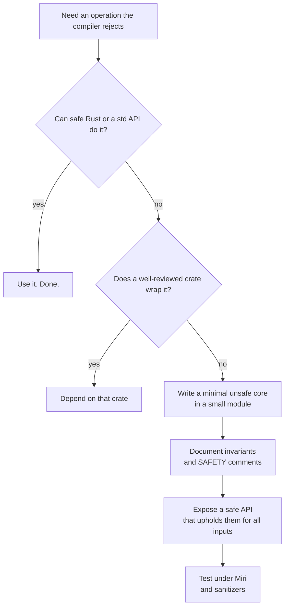
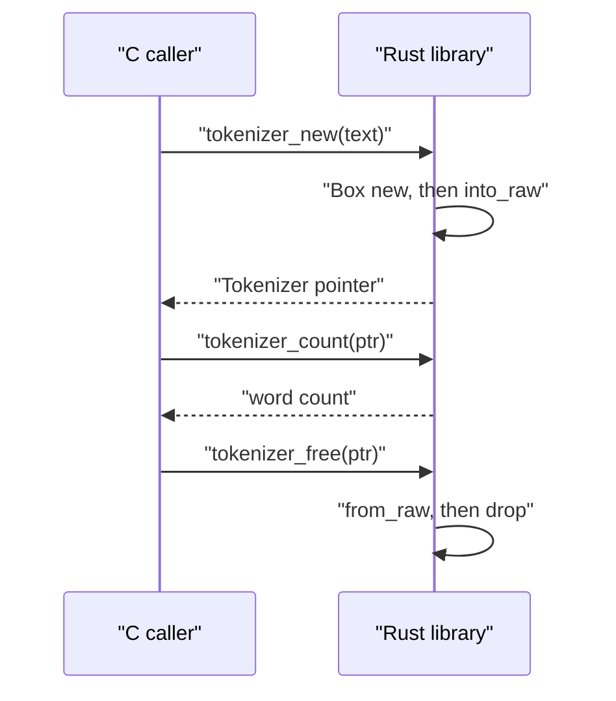
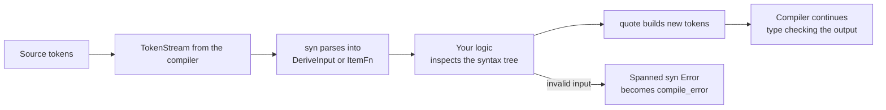

import Callout from '../../components/mdx/Callout.astro';

Every Rust codebase of any size eventually touches the parts of the language that the compiler cannot fully check: a raw pointer from a C library, a hand-rolled data structure that needs uninitialized memory, a macro that generates a hundred lines of boilerplate. This post is for engineers who already write comfortable safe Rust and now need to own those edges. By the end you will be able to say exactly what `unsafe` allows, write a safe abstraction over it that you can defend in review, call C from Rust and Rust from C (and from Kotlin or Python through generated bindings), and write both `macro_rules!` and procedural macros, along with a clear sense of when not to.

<Callout variant="note" title="You should already know">
Ownership and the borrow rules ([Part 2](/blog/rust-02-ownership-borrowing)), traits and generics ([Part 4](/blog/rust-04-traits-generics)), lifetimes, `Box` and `Drop` ([Part 6](/blog/rust-06-lifetimes-smart-pointers)), and `Send`/`Sync` ([Part 7](/blog/rust-07-concurrency)). Every snippet here uses edition 2024.
</Callout>

## What `unsafe` actually means

The most common misreading of `unsafe` is "turn off the borrow checker". It does nothing of the sort. An `unsafe` block lets you perform five specific operations that the compiler cannot prove correct. Everything else, including borrow checking of references, type checking, lifetimes and bounds checks, works exactly as it does outside the block.


The five operations, sometimes called the "unsafe superpowers":

1. **Dereference a raw pointer** (`*const T` or `*mut T`). Creating one is safe; reading or writing through it is not.
2. **Call an `unsafe fn`**, which includes every foreign function declared in an `extern` block unless it is explicitly marked `safe`.
3. **Access or modify a `static mut`**.
4. **Implement an `unsafe trait`**, such as `Send`, `Sync` or `GlobalAlloc`.
5. **Read a field of a `union`**.

Each of those has preconditions the compiler cannot verify. A raw pointer might be null, dangling, misaligned or aliased. A `static mut` might be touched from two threads. A union might hold bytes that are not a valid value of the field you read. Writing `unsafe` is you telling the compiler: "I have checked these preconditions myself."

```rust
fn raw_pointers() {
    let mut x = 10;
    let p1 = &raw const x; // creating raw pointers is safe
    let p2 = &raw mut x;
    unsafe {
        *p2 += 1;           // dereferencing is not
        println!("{}", *p1);
    }
    let addr = 0x1234usize as *const i32; // fine to create, UB to dereference
    let _ = addr;
}
```

The `&raw const` and `&raw mut` syntax (stable since Rust 1.82) creates a raw pointer without first creating a reference. That matters when a reference would itself be invalid, for example to a field of a `#[repr(packed)]` struct, where a `&u32` to a misaligned field is undefined behavior even if you never read through it:

```rust
#[repr(C, packed)]
struct Packed { a: u8, b: u32 }

fn packed() {
    let p = Packed { a: 1, b: 2 };
    let b_ptr = &raw const p.b;            // no intermediate &u32
    let b = unsafe { b_ptr.read_unaligned() };
    println!("{} {b}", p.a);
}
```

Without the `unsafe` block, the compiler stops you at the dereference:

```text
error[E0133]: dereference of raw pointer is unsafe and requires unsafe block
 --> e3.rs:4:20
  |
4 |     println!("{}", *p);
  |                    ^^ dereference of raw pointer
  |
  = note: raw pointers may be null, dangling or unaligned; they can violate aliasing rules and cause data races: all of these are undefined behavior
```

### Undefined behavior is not "it crashes"

Undefined behavior (UB) means the program has violated an assumption the optimizer is allowed to rely on. The compiler does not promise a crash, or a wrong answer, or anything at all. It may produce code that works in debug builds and silently corrupts data in release builds, or that breaks only after a compiler upgrade. A non-exhaustive list of things that are UB in Rust:

- Dereferencing a dangling, null or misaligned pointer.
- Creating two live `&mut` to the same memory, or a `&mut` while a `&` to the same memory is in use. This holds even if you never write through them; the optimizer assumes `&mut` is unique.
- Producing an invalid value: a `bool` that is not 0 or 1, a `char` outside the Unicode scalar range, an enum with an invalid discriminant, a null `&T` or `Box<T>`, or reading uninitialized memory as an integer.
- A data race: two threads accessing the same location without synchronization, at least one writing.
- Calling a function with the wrong ABI, or unwinding a panic out of an `extern "C"` function into C code.

The last two lines of the list are what make FFI dangerous; the second and third are what make hand-written data structures dangerous.

### Soundness: the property you are actually signing up for

A function is **sound** if no safe code can cause undefined behavior by calling it, no matter what arguments it passes or what order it calls things in. Soundness is the contract the rest of the ecosystem relies on: if your crate exposes a safe function and some safe caller can trigger UB through it, your crate has a bug, even if "nobody would call it like that".

That gives two rules that shape every piece of unsafe code:

- An `unsafe fn` documents preconditions the **caller** must uphold, in a `# Safety` section. The caller writes an `unsafe` block and a `// SAFETY:` comment saying why the preconditions hold.
- A safe function that contains an `unsafe` block must establish those preconditions **itself**, for every possible input. If it cannot, it must either check at runtime (and panic or return an error) or be marked `unsafe fn`.

The invariants that make the unsafe block correct often live outside it. In a `Vec`-like type, the unsafe read in `pop` is only correct because every other method maintains "slots `0..len` are initialized". That is why the real unit of safety review is the **module**, not the block: any code that can change `len` can break the invariant, safe or not. Keep fields private and keep the module small.



## Writing a safe abstraction over unsafe code

The canonical first example is `split_at_mut`. Safe Rust cannot express "two `&mut` to disjoint halves of one slice" because the borrow checker sees two mutable borrows of `slice`. The standard library implements it with raw pointers; here is the same idea:

```rust
pub fn split_at_mut<T>(slice: &mut [T], mid: usize) -> (&mut [T], &mut [T]) {
    let len = slice.len();
    assert!(mid <= len, "mid out of bounds");
    let ptr = slice.as_mut_ptr();
    // SAFETY: `mid <= len`, so both halves are inside the original allocation,
    // they do not overlap, and their lifetimes are tied to the `&mut` we were given.
    unsafe {
        (
            std::slice::from_raw_parts_mut(ptr, mid),
            std::slice::from_raw_parts_mut(ptr.add(mid), len - mid),
        )
    }
}
```

Notice where the soundness comes from. The `assert!` is not decoration: without it, a safe caller passing `mid = len + 1` would get a slice extending past the allocation. The function signature does the rest: both returned slices borrow from the input `&mut`, so the caller cannot use the original slice while the halves are alive. Safe Rust's type system enforces the part of the contract that it can, and the `unsafe` block covers only the part it cannot.

### A fixed-capacity vector with `MaybeUninit`

A more realistic example: a vector that stores up to `N` elements inline, with no heap allocation. The storage must start uninitialized, because `T` may not have a cheap default value, so we use `MaybeUninit<T>`, which is allowed to hold garbage.

```rust
use std::mem::MaybeUninit;

pub struct StackVec<T, const N: usize> {
    // Invariant: slots `0..len` are initialized; slots `len..N` are not.
    len: usize,
    items: [MaybeUninit<T>; N],
}

impl<T, const N: usize> StackVec<T, N> {
    pub const fn new() -> Self {
        Self { len: 0, items: [const { MaybeUninit::uninit() }; N] }
    }

    pub fn push(&mut self, value: T) -> Result<(), T> {
        if self.len == N {
            return Err(value);
        }
        self.items[self.len].write(value); // safe: writing never reads the old bytes
        self.len += 1;
        Ok(())
    }

    pub fn pop(&mut self) -> Option<T> {
        if self.len == 0 {
            return None;
        }
        self.len -= 1;
        // SAFETY: slots `0..old_len` are initialized (invariant). We just
        // decremented `len`, so this slot is now logically outside the vec
        // and will never be read again: reading it moves the value out once.
        Some(unsafe { self.items[self.len].assume_init_read() })
    }

    pub fn as_slice(&self) -> &[T] {
        // SAFETY: slots `0..len` are initialized, and `MaybeUninit<T>` has the
        // same layout as `T`.
        unsafe { std::slice::from_raw_parts(self.items.as_ptr().cast::<T>(), self.len) }
    }

    pub fn len(&self) -> usize { self.len }
}

impl<T, const N: usize> Drop for StackVec<T, N> {
    fn drop(&mut self) {
        let initialized: *mut [T] =
            std::ptr::slice_from_raw_parts_mut(self.items.as_mut_ptr().cast::<T>(), self.len);
        // SAFETY: exactly the first `len` slots are initialized and are
        // dropped exactly once here.
        unsafe { std::ptr::drop_in_place(initialized) }
    }
}
```

Three things to notice:

- **The invariant is written down** next to the field. Every `SAFETY:` comment cites it. A reviewer checks two things: does each unsafe block follow from the invariant, and does every method (safe or not) preserve it?
- **`len` is private.** If it were `pub`, any caller could set `len = N` and `as_slice` would read uninitialized memory from safe code. Privacy is a soundness tool.
- **Order of operations in `pop`** matters. We decrement `len` first and then move out. If we moved out first and something panicked in between, `Drop` would later drop a value we had already moved out, which is a double drop. Here nothing can panic between the two lines, but thinking about panic safety is part of the job: unsafe code must leave invariants intact even when a panic unwinds through it.

Also notice what we did not do: we did not implement `Send` or `Sync` by hand. The auto traits derive correctly from `[MaybeUninit<T>; N]`, which is `Send` when `T` is. Writing `unsafe impl Send` on a type is one of the easiest ways to introduce a soundness hole, and it is usually only needed when a type holds raw pointers.

### `unsafe fn` bodies in edition 2024

Before edition 2024, the body of an `unsafe fn` was implicitly one big unsafe block. That conflated two different things: "this function has preconditions for its callers" and "this function's body performs unsafe operations". Edition 2024 makes the `unsafe_op_in_unsafe_fn` lint warn by default, so you write explicit blocks inside `unsafe fn` as well:

```rust
/// Returns the element at `index` without bounds checking.
///
/// # Safety
/// `index` must be less than `slice.len()`.
pub unsafe fn get_unchecked_demo(slice: &[u32], index: usize) -> u32 {
    // SAFETY: the caller guarantees `index < slice.len()`.
    unsafe { *slice.as_ptr().add(index) }
}
```

Leave out the inner block and the compiler tells you:

```text
warning[E0133]: dereference of raw pointer is unsafe and requires unsafe block
 --> e2.rs:4:5
  |
4 |     *p
  |     ^^ dereference of raw pointer
  |
note: an unsafe function restricts its caller, but its body is safe by default
 --> e2.rs:3:1
  |
3 | pub unsafe fn read_it(p: *const u32) -> u32 {
  | ^^^^^^^^^^^^^^^^^^^^^^^^^^^^^^^^^^^^^^^^^^^
  = note: `#[warn(unsafe_op_in_unsafe_fn)]` (part of `#[warn(rust_2024_compatibility)]`) on by default
```

That note, "an unsafe function restricts its caller, but its body is safe by default", is the cleanest one-line summary of the model.

Edition 2024 also turned `static_mut_refs` into a hard error. Taking a reference to a `static mut` (which method calls like `LOG.push(...)` do implicitly) is rejected:

```text
error: creating a mutable reference to mutable static
 --> e5.rs:3:14
  |
3 |     unsafe { LOG.push("x".into()); }
  |              ^^^^^^^^^^^^^^^^^^^^ mutable reference to mutable static
  |
  = help: use a type that relies on "interior mutability" instead
```

In practice you almost never need `static mut`. Use an atomic, a `Mutex`, `OnceLock` or `LazyLock` (stable since 1.80) for global state.

### Testing unsafe code: Miri and sanitizers

Tests that pass are weak evidence for unsafe code, because UB often "works". The tool that actually helps is **Miri**, an interpreter for Rust's mid-level IR that checks every memory access against Rust's rules at runtime: out-of-bounds access, use-after-free, reads of uninitialized memory, invalid values, data races, and violations of the aliasing model (Stacked Borrows by default, Tree Borrows optionally).

```bash
rustup +nightly component add miri
cargo +nightly miri test
# opt into the newer aliasing model
MIRIFLAGS="-Zmiri-tree-borrows" cargo +nightly miri test
```

Miri is slow (often 10 to 100 times slower than a native test run, sometimes more) and cannot execute most FFI calls, so you point it at the unit tests of your unsafe modules, not the whole application. A minimal test for `StackVec` exercises push, pop, overflow and drop of heap-owning values, which is where double drops and leaks show up:

```rust
#[cfg(test)]
mod tests {
    use super::*;

    #[test]
    fn push_pop_drop() {
        let mut s: StackVec<String, 2> = StackVec::new();
        assert!(s.push("a".into()).is_ok());
        assert!(s.push("b".into()).is_ok());
        assert_eq!(s.push("c".into()), Err("c".to_string()));
        assert_eq!(s.pop().as_deref(), Some("b"));
        assert_eq!(s.as_slice(), ["a".to_string()]);
    } // dropping `s` drops "a" exactly once; Miri reports leaks and double frees
}
```

For code that crosses into C, where Miri cannot follow, use the sanitizers (`-Zsanitizer=address` and friends on nightly) and fuzzing (`cargo fuzz`). None of these prove absence of UB; they make finding it cheap. The proof is still the invariant and the `SAFETY` comments.

## FFI: calling C from Rust

Foreign functions are declared in an `extern` block. In edition 2024 that block must itself be written `unsafe extern`, because declaring a signature is a promise: if you get the types wrong, every call is UB, and the compiler cannot check it against the C header.

```text
error: extern blocks must be unsafe
 --> e1.rs:1:1
  |
1 | / extern "C" {
2 | |     fn abs(x: i32) -> i32;
3 | | }
  | | ^ help: needs `unsafe` before the extern keyword: `unsafe`
```

Items inside an `unsafe extern` block can be marked `safe` or `unsafe`. Marking an item `safe` is your assertion that it has no preconditions, so callers do not need an unsafe block:

```rust
use std::ffi::{c_char, c_int, c_void, CStr};

unsafe extern "C" {
    pub safe fn abs(x: c_int) -> c_int;                // no preconditions
    pub unsafe fn strlen(s: *const c_char) -> usize;  // needs a valid C string
    fn qsort(                                          // unsafe by default
        base: *mut c_void,
        nmemb: usize,
        size: usize,
        compar: extern "C" fn(*const c_void, *const c_void) -> c_int,
    );
}

fn c_strlen(s: &CStr) -> usize {
    // SAFETY: `CStr` guarantees a valid, NUL-terminated pointer for the call.
    unsafe { strlen(s.as_ptr()) }
}
```

Use the `std::ffi::c_*` type aliases (`c_int`, `c_long`, `c_char`) rather than guessing that `int` is `i32`: `long` is 64-bit on Linux x86-64 but 32-bit on Windows. For strings, `CString` owns a NUL-terminated buffer you can pass to C, `CStr` borrows one that C gave you, and C-string literals like `c"hello"` (stable since 1.77) produce a `&CStr` at compile time.

Callbacks work by passing an `extern "C" fn`. Here is C's `qsort` sorting a Rust slice:

```rust
extern "C" fn cmp_i32(a: *const c_void, b: *const c_void) -> c_int {
    // SAFETY: qsort only passes pointers into the i32 array we gave it.
    let (a, b) = unsafe { (*a.cast::<i32>(), *b.cast::<i32>()) };
    a.cmp(&b) as c_int
}

fn sort_with_c(v: &mut [i32]) {
    // SAFETY: base/len/size describe `v` exactly; cmp_i32 matches the element type.
    unsafe {
        qsort(v.as_mut_ptr().cast(), v.len(), size_of::<i32>(), cmp_i32);
    }
}
```

The pattern to copy: the raw `extern` declarations stay private, and each one gets a thin safe wrapper (`c_strlen`, `sort_with_c`) whose argument types make the preconditions impossible to violate. That is exactly the `-sys` crate convention in the ecosystem: `libgit2-sys` holds the raw bindings, `git2` holds the safe API on top.

### `#[repr(C)]` and data layout

Rust does not promise any particular field order or padding for a plain `struct`; the compiler is free to reorder fields to reduce size. To share a struct with C, mark it `#[repr(C)]`, which gives C's layout rules: declaration order, C alignment and padding.

```rust
#[repr(C)]
pub struct Point { pub x: f64, pub y: f64 }

#[unsafe(no_mangle)]
pub extern "C" fn point_len(p: Point) -> f64 {
    (p.x * p.x + p.y * p.y).sqrt()
}
```

Enums need care. A fieldless enum with `#[repr(C)]` or `#[repr(u8)]` has a defined size, but if C hands you a value outside the declared variants, transmuting it to the Rust enum is UB. At an FFI boundary, receive an integer and convert with a `TryFrom` that rejects unknown values.

### bindgen and cbindgen

Writing `extern` blocks by hand does not scale past a dozen functions, and every hand-written signature is a chance to get a type wrong. Two tools do it for you:

- **bindgen** reads C (and some C++) headers and generates Rust `extern` declarations and `#[repr(C)]` structs. Usually run from `build.rs`, it produces a `-sys` crate.
- **cbindgen** goes the other way: it reads your Rust crate and generates a C header for the `extern "C"` functions and `#[repr(C)]` types you export.

Both still leave the safety reasoning to you. Generated bindings tell you the types; they do not tell you who frees a pointer or whether a function is thread-safe.

## FFI: exposing Rust to C and other languages

To export a function with a stable symbol name, use `extern "C"` for the calling convention and `#[unsafe(no_mangle)]` to disable name mangling. In edition 2024, `no_mangle`, `export_name` and `link_section` are "unsafe attributes", because two symbols with the same name are UB at link time:

```text
error: unsafe attribute used without unsafe
 --> e4.rs:1:3
  |
1 | #[no_mangle]
  |   ^^^^^^^^^ usage of unsafe attribute
  |
help: wrap the attribute in `unsafe(...)`
  |
1 | #[unsafe(no_mangle)]
  |   +++++++         +
```

### Opaque handles and who frees what

The safest way to hand a Rust object to C is as an **opaque pointer**: C gets a `Tokenizer *` it can store and pass back, but never dereferences. The rule that prevents most FFI memory bugs is "whoever allocates, frees", so you export a constructor and a destructor.

```rust
use std::ffi::{c_char, CStr};

pub struct Tokenizer { words: Vec<String> }

#[unsafe(no_mangle)]
pub extern "C" fn tokenizer_new(text: *const c_char) -> *mut Tokenizer {
    if text.is_null() {
        return std::ptr::null_mut();
    }
    // SAFETY: documented contract: `text` is a valid NUL-terminated string.
    let text = unsafe { CStr::from_ptr(text) }.to_string_lossy();
    let words = text.split_whitespace().map(str::to_owned).collect();
    Box::into_raw(Box::new(Tokenizer { words }))
}

#[unsafe(no_mangle)]
pub extern "C" fn tokenizer_count(t: *const Tokenizer) -> usize {
    // SAFETY: `t` is null or came from `tokenizer_new` and was not freed.
    match unsafe { t.as_ref() } {
        Some(t) => t.words.len(),
        None => 0,
    }
}

#[unsafe(no_mangle)]
pub extern "C" fn tokenizer_free(t: *mut Tokenizer) {
    if !t.is_null() {
        // SAFETY: `t` came from `Box::into_raw` in `tokenizer_new`, freed once.
        drop(unsafe { Box::from_raw(t) });
    }
}
```

A careful reviewer will point out that `tokenizer_new` dereferences a raw pointer from a safe `extern "C" fn`. Strictly, a function whose correctness depends on the caller passing a valid pointer should be `unsafe extern "C" fn`. Many real C APIs keep these functions safe on the Rust side because they are only ever meant to be called from C, where there is no safety marker anyway, and document the contract in the generated header. If Rust code in your crate also calls them, make them `unsafe`.




### Panics must not cross the boundary

Unwinding a Rust panic into C frames was always undefined behavior. Since Rust 1.81, a panic that tries to unwind out of an `extern "C"` function aborts the process instead, which is safe but abrupt. If you want the panic to propagate across a boundary that supports it, the `extern "C-unwind"` ABI exists for that. For a library that C calls, the usual design is to catch the panic and turn it into an error code:

```rust
#[unsafe(no_mangle)]
pub extern "C" fn checked_parse(s: *const c_char, out: *mut i64) -> c_int {
    let result = std::panic::catch_unwind(|| {
        if s.is_null() || out.is_null() { return -1; }
        // SAFETY: non-null, and the contract requires a valid C string.
        let s = unsafe { CStr::from_ptr(s) };
        match s.to_str().ok().and_then(|s| s.parse::<i64>().ok()) {
            Some(v) => { unsafe { out.write(v) }; 0 }
            None => -2,
        }
    });
    result.unwrap_or(-99) // -99: internal panic
}
```

`catch_unwind` does nothing if the crate is built with `panic = "abort"`, which is fine: then there is no unwinding to worry about.

### Calling Rust from Kotlin, the JVM and Python

Hand-writing a C API and then hand-writing JNI glue on top is a lot of unsafe surface. For the languages most backend and mobile teams use, generators do this for you:

- **JNI directly** via the `jni` crate. You write `extern "system"` functions with JNI-mangled names (`Java_com_example_Native_count`) that take a `JNIEnv`. Full control, but you manage local references, exceptions and threading by hand.
- **UniFFI** (from Mozilla, used in Firefox for Android and iOS). You annotate Rust types and functions, and it generates Kotlin, Swift and Python bindings plus the C ABI layer in between. On the Kotlin side the generated code uses JNA to load the native library.
- **PyO3** with **maturin** for Python: `#[pyfunction]` and `#[pyclass]` attributes generate a native extension module; `maturin build` produces a wheel.

A UniFFI-style Rust side looks roughly like this (proc-macro mode; the exact attribute set depends on the UniFFI version, so treat it as a sketch):

```rust
uniffi::setup_scaffolding!();

#[derive(uniffi::Object)]
pub struct Tokenizer { words: Vec<String> }

#[uniffi::export]
impl Tokenizer {
    #[uniffi::constructor]
    pub fn new(text: String) -> Self {
        Self { words: text.split_whitespace().map(str::to_owned).collect() }
    }

    pub fn count(&self) -> u64 {
        self.words.len() as u64
    }
}
```

And the Kotlin caller sees an ordinary class:

```kotlin
// Generated by uniffi-bindgen; the native library is loaded via JNA.
val tokenizer = Tokenizer("the quick brown fox")
println(tokenizer.count())   // 4
tokenizer.close()            // releases the Rust object; or use `tokenizer.use { ... }`
```

The cost model is worth knowing before you choose this route. Every call crosses an FFI boundary and usually serializes arguments (strings and records are copied into a buffer and decoded on the other side). That is negligible for coarse-grained calls ("parse this 2 MB document") and painful for chatty ones ("get field 37 of record 9000"). Design the boundary to be coarse: pass a whole batch in, get a whole result out.

PyO3 is the Python equivalent, and its API is pleasant enough that many popular Python packages (Polars, pydantic-core, the `cryptography` package) ship Rust cores this way:

```rust
use pyo3::prelude::*;

#[pyfunction]
fn word_count(text: &str) -> usize {
    text.split_whitespace().count()
}

#[pymodule]
fn fastwords(m: &Bound<'_, PyModule>) -> PyResult<()> {
    m.add_function(wrap_pyfunction!(word_count, m)?)?;
    Ok(())
}
```

PyO3's API changed noticeably across 0.2x releases (the `Bound` smart pointer arrived in 0.21), so check the version you depend on. For long-running pure-Rust work, release the GIL (`py.allow_threads(...)`, renamed in newer releases) so other Python threads keep running.

## Declarative macros: `macro_rules!`

Macros exist because functions cannot do some things: take a variable number of arguments of different types, generate items (structs, impls), or accept syntax that is not an expression. `macro_rules!` macros pattern-match on token trees and expand into new code before type checking.

### Fragment specifiers and repetition

A `hashmap!` literal macro shows the core features:

```rust
macro_rules! hashmap {
    () => { ::std::collections::HashMap::new() };
    ($($key:expr => $value:expr),+ $(,)?) => {{
        let mut map = ::std::collections::HashMap::with_capacity(hashmap!(@count $($key),+));
        $( map.insert($key, $value); )+
        map
    }};
    (@count $head:expr $(, $tail:expr)*) => { 1usize $(+ { let _ = stringify!($tail); 1usize })* };
}

let m = hashmap! { "a" => 1, "b" => 2, };
```

Reading it:

- `$key:expr` captures an expression. Other fragment specifiers include `ident`, `ty`, `pat`, `path`, `block`, `literal`, `lifetime`, `vis`, `meta` and `tt` (any single token tree).
- `$( ... ),+` repeats one or more times with a comma separator; `$(,)?` allows an optional trailing comma.
- `$( map.insert($key, $value); )+` expands the body once per captured pair.
- `@count` is an **internal rule**: by convention a leading `@token` marks rules that are implementation details. It counts arguments so we can preallocate.
- The double braces `{{ ... }}` make the expansion a block expression, so it can be used anywhere an expression is expected.
- Paths are written `::std::collections::HashMap`, fully qualified, so the macro works even if the caller has shadowed `std` or never imported `HashMap`. Inside a library, use `$crate::path` to refer to your own crate's items.

When the input does not match any rule, the error points at the offending token:

```text
error: no rules expected `;`
 --> e6.rs:8:72
  |
1 | macro_rules! hashmap {
  | -------------------- when calling this macro
...
8 | fn main() { let m: std::collections::HashMap<i32,i32> = hashmap!(1 => 2; 3 => 4); }
  |                                                                        ^ no rules expected this token in macro call
```

### Generating items

Macros earn their keep when they remove repetitive item definitions. Newtype IDs are a classic case in a backend codebase:

```rust
macro_rules! newtype_id {
    ($(#[$meta:meta])* $vis:vis struct $name:ident($inner:ty);) => {
        $(#[$meta])*
        #[derive(Debug, Clone, Copy, PartialEq, Eq, Hash, PartialOrd, Ord)]
        $vis struct $name(pub $inner);

        impl ::std::fmt::Display for $name {
            fn fmt(&self, f: &mut ::std::fmt::Formatter<'_>) -> ::std::fmt::Result {
                write!(f, "{}-{}", stringify!($name), self.0)
            }
        }

        impl From<$inner> for $name {
            fn from(value: $inner) -> Self { Self(value) }
        }
    };
}

newtype_id! {
    /// Identifies a customer.
    pub struct CustomerId(u64);
}
newtype_id! { pub struct OrderId(u64); }
```

Capturing `$(#[$meta:meta])*` passes doc comments and attributes through, so the generated types are documented like hand-written ones.

### Hygiene and the fragment-grouping rule

Two properties make `macro_rules!` safer than C preprocessor macros.

**Captured fragments stay grouped.** In C, `#define SQUARE(x) x * x` turns `SQUARE(2 + 3)` into `2 + 3 * 2 + 3`, which is 11. In Rust, an `$x:expr` fragment is substituted as a single node:

```rust
macro_rules! square {
    ($x:expr) => { $x * $x };
}
println!("{}", square!(2 + 3)); // 25
```

It is still evaluated twice, though: `square!(next_id())` calls `next_id` twice. Bind it first (`let x = $x; x * x`) when the expression may have side effects.

**Local variables are hygienic.** A `let` inside a macro does not capture or shadow a variable of the same name at the call site:

```rust
macro_rules! with_temp {
    ($body:block) => {{ let tmp = 41; $body }};
}
let tmp = 1;
println!("{}", with_temp!({ tmp + 1 })); // 2: the caller's `tmp`, not the macro's
```

Hygiene in `macro_rules!` covers local variables and labels, not items: a function or type name defined by a macro is visible at the call site. That is what makes `newtype_id!` useful.

## Procedural macros

Procedural macros are Rust functions that run at compile time, take a `TokenStream` and return a `TokenStream`. They live in their own crate with `proc-macro = true`, and come in three kinds:

| Kind | Invocation | Input | Typical use |
|---|---|---|---|
| Derive | `#[derive(FieldNames)]` | the item; output is **added** after it | trait impls: serde, thiserror, Clone |
| Attribute | `#[timed]`, `#[tokio::main]` | the item plus attribute args; output **replaces** it | wrapping functions, routing, instrumentation |
| Function-like | `sql!(...)`, `html!(...)` | arbitrary tokens | DSLs, compile-time validation |



Nearly every proc macro is built on two crates: **syn** (version 2) parses tokens into a syntax tree, and **quote** turns quasi-quoted Rust back into tokens. `proc-macro2` wraps the compiler's token types so the logic is testable outside a macro context.

```toml
[package]
name = "macros_derive"
version = "0.1.0"
edition = "2024"

[lib]
proc-macro = true

[dependencies]
syn = { version = "2", features = ["full"] }
quote = "1"
proc-macro2 = "1"
```

### A derive macro with helper attributes

This derive adds a `FIELD_NAMES` constant listing a struct's fields, with `#[field_names(skip)]` and `#[field_names(rename = "...")]` helper attributes. It is small enough to read in one sitting and covers the parts every real derive needs: parsing, rejecting unsupported input with a good error, handling generics, and reading helper attributes.

```rust
use proc_macro::TokenStream;
use quote::quote;
use syn::{parse_macro_input, Data, DeriveInput, Fields, LitStr};

#[proc_macro_derive(FieldNames, attributes(field_names))]
pub fn derive_field_names(input: TokenStream) -> TokenStream {
    let input = parse_macro_input!(input as DeriveInput);
    expand_field_names(&input)
        .unwrap_or_else(syn::Error::into_compile_error)
        .into()
}

fn expand_field_names(input: &DeriveInput) -> syn::Result<proc_macro2::TokenStream> {
    let Data::Struct(data) = &input.data else {
        return Err(syn::Error::new_spanned(
            &input.ident,
            "FieldNames can only be derived for structs",
        ));
    };
    let Fields::Named(fields) = &data.fields else {
        return Err(syn::Error::new_spanned(&data.fields, "FieldNames needs named fields"));
    };

    let mut names = Vec::new();
    for field in &fields.named {
        let mut name = field.ident.as_ref().unwrap().to_string();
        let mut skip = false;
        for attr in field.attrs.iter().filter(|a| a.path().is_ident("field_names")) {
            attr.parse_nested_meta(|meta| {
                if meta.path.is_ident("skip") {
                    skip = true;
                    Ok(())
                } else if meta.path.is_ident("rename") {
                    name = meta.value()?.parse::<LitStr>()?.value();
                    Ok(())
                } else {
                    Err(meta.error("expected `skip` or `rename = \"...\"`"))
                }
            })?;
        }
        if !skip {
            names.push(name);
        }
    }

    let ident = &input.ident;
    let (impl_generics, ty_generics, where_clause) = input.generics.split_for_impl();
    Ok(quote! {
        impl #impl_generics #ident #ty_generics #where_clause {
            pub const FIELD_NAMES: &'static [&'static str] = &[#(#names),*];
        }
    })
}
```

Using it:

```rust
use macros_derive::FieldNames;

#[derive(FieldNames)]
struct Order {
    id: u64,
    #[field_names(rename = "customer")]
    customer_id: u64,
    #[field_names(skip)]
    internal_note: String,
}

fn main() {
    println!("{:?}", Order::FIELD_NAMES); // ["id", "customer"]
}
```

The important design choice is returning `syn::Result` and converting errors with `into_compile_error`. A panicking proc macro produces an unhelpful "proc macro panicked" message; a `syn::Error` attached to a span points the user at the exact token they got wrong:

```text
error: FieldNames can only be derived for structs
 --> src/main.rs:4:6
  |
4 | enum Status { Pending, Paid }
  |      ^^^^^^

error: expected `skip` or `rename = "..."`
 --> src/main.rs:8:19
  |
8 |     #[field_names(renam = "x")]
  |                   ^^^^^
```

### An attribute macro

Attribute macros receive the attribute arguments and the annotated item, and replace the item. This `#[timed]` wraps a function body to log its duration:

```rust
use syn::ItemFn;

#[proc_macro_attribute]
pub fn timed(attr: TokenStream, item: TokenStream) -> TokenStream {
    if !attr.is_empty() {
        let attr = proc_macro2::TokenStream::from(attr);
        return syn::Error::new_spanned(attr, "#[timed] takes no arguments")
            .into_compile_error()
            .into();
    }
    let ItemFn { attrs, vis, sig, block } = parse_macro_input!(item as ItemFn);
    if sig.asyncness.is_some() {
        return syn::Error::new_spanned(sig.asyncness, "#[timed] does not support async fn yet")
            .into_compile_error()
            .into();
    }
    let name = sig.ident.to_string();
    let ret = match &sig.output {
        syn::ReturnType::Default => quote! { () },
        syn::ReturnType::Type(_, ty) => quote! { #ty },
    };
    quote! {
        #(#attrs)*
        #vis #sig {
            let __timed_start = ::std::time::Instant::now();
            let __timed_result = (move || -> #ret #block)();
            ::std::eprintln!("{} took {:?}", #name, __timed_start.elapsed());
            __timed_result
        }
    }
    .into()
}
```

The body runs inside a closure with the function's declared return type, so `return` and `?` inside the original body still behave as the author expects, and the log line runs on every exit path. Rejecting `async fn` explicitly beats silently producing a version that times only the creation of the future. That is a real class of bug in hand-rolled attribute macros, and it is why `tracing::instrument` has dedicated async handling.

Function-like macros (`#[proc_macro]`) have the same shape as the derive: a function from `TokenStream` to `TokenStream`, typically parsing a custom syntax with a `syn::parse::Parse` impl. `sqlx::query!` is the famous example: it connects to a database at compile time to check your SQL.

### Testing and debugging macros

- **`cargo expand`** (a cargo subcommand built on the compiler's `-Zunpretty=expanded`) prints the code after macro expansion. It is the first thing to run when a macro misbehaves.
- **`trybuild`** runs compile-fail tests: you write files that should fail to compile and snapshot the expected error output, so your error messages do not regress.
- Keep the logic in a function that takes and returns `proc_macro2::TokenStream`, like `expand_field_names` above, so you can unit-test it without the compiler.

## When not to write a macro

Macros have real costs. Compile errors in generated code are harder to read. IDEs and rust-analyzer handle them less well than plain code. Proc macros add a dependency chain (syn is one of the heavier crates to compile, though most projects already pull it in through serde) and every proc macro crate must be built before anything that uses it. And a reader cannot understand `#[my_magic]` without opening the macro source.

Reach for, in order:

1. **A function or generic function.** If the arguments are all expressions of known types, it does not need to be a macro.
2. **A trait with a default method or blanket impl.** Most "generate an impl for every type" needs are a blanket impl in disguise.
3. **`macro_rules!`** when you need variadic arguments, item generation, or to avoid repetitive impls inside one crate.
4. **A derive macro** when many downstream users need the same impl on their own types, and the impl is a pure function of the type's shape. This is the serde case.
5. **An attribute or function-like macro** only when you are building a framework-level DSL and are prepared to maintain the error messages.

A useful test: if a new team member would need to run `cargo expand` to understand what a line of business code does, the macro is probably hiding more than it saves.

## Common mistakes

- **Treating `unsafe` as "trust me" for the whole function.** The unsafe block should be as small as possible, wrapping only the operation that needs it, with a `SAFETY:` comment that names the invariant. Huge unsafe blocks hide which line carries the risk.
- **Creating references when you meant raw pointers.** `&mut *ptr` creates a `&mut` that asserts uniqueness. Creating two of them to the same memory, even briefly, is UB. Stay in raw pointers (`ptr.add`, `ptr.read`, `ptr.write`, `&raw mut`) until you are ready to hand out a single reference.
- **`mem::transmute` as a cast.** Transmute reinterprets bits with no checks. Integer-to-enum, `&T` to `&mut T`, or `Vec<T>` to `Vec<U>` via transmute are all UB in common cases. Use `as`, `from_ne_bytes`, `TryFrom`, `bytemuck` or `zerocopy` instead.
- **Public fields on a type with unsafe invariants.** If safe code can write the field, safe code can break the invariant.
- **`unsafe impl Send for MyType {}` to make a compile error go away.** The compiler refused because the type holds something that is not thread-safe. Find out what before overriding it.
- **Wrong C types in `extern` blocks.** `i64` for `long` works on Linux and breaks on Windows. Use `c_long`, or generate the bindings.
- **Freeing memory with the wrong allocator.** Memory from `Box::into_raw` must come back through `Box::from_raw`; memory from C's `malloc` must go to `free`. Crossing them is UB even when it seems to work.
- **Unwinding into C.** Catch panics at every `extern "C"` entry point that might panic, or build with `panic = "abort"` and accept the abort.
- **Macros that evaluate an argument twice**, or that use unqualified paths (`HashMap::new()` instead of `::std::collections::HashMap::new()`), which break when the caller has not imported them.
- **Panicking in proc macros** instead of returning spanned `syn::Error`s.

## Interview questions

<details>
<summary>What does the `unsafe` keyword allow, and what does it not turn off?</summary>

It allows five operations: dereferencing raw pointers, calling unsafe functions (including foreign functions), accessing or modifying mutable statics, implementing unsafe traits, and reading union fields. It does not disable the borrow checker on references, type checking, lifetimes or bounds checks. A strong answer adds the framing: `unsafe` does not make code less checked so much as move specific proof obligations from the compiler to the programmer, who documents them in `SAFETY` comments.

</details>

<details>
<summary>What does it mean for an API to be sound? Give an example of an unsound one.</summary>

An API is sound if no sequence of calls from safe code can cause undefined behavior. An example of unsoundness: a vector-like type with a `pub len: usize` field and an `as_slice` method that uses `from_raw_parts(ptr, len)`. Safe code can set `len` past the initialized region and read uninitialized memory. The fix is to make `len` private so only the module's code, which maintains the invariant, can change it. The point is that soundness is a property of the module boundary, not of individual unsafe blocks.

</details>

<details>
<summary>Why is creating two `&mut` references to the same value UB even if you never write through them?</summary>

Because `&mut T` carries a uniqueness guarantee the compiler relies on for optimization, similar to C's `restrict`. LLVM is told the pointer is `noalias`, so it may cache values in registers or reorder loads and stores assuming no other pointer observes them. Two live `&mut` break that assumption at the moment they exist. Tools like Miri model this with Stacked Borrows or Tree Borrows and report the violation at creation, not at the write.

</details>

<details>
<summary>How do you pass a Rust object to C and make sure it is freed correctly?</summary>

Box it and hand out `Box::into_raw` as an opaque pointer. Export a constructor and a matching destructor (`foo_new` and `foo_free`); the destructor calls `Box::from_raw` and drops it. Document that the pointer must be freed exactly once and only via that function. C should treat the struct as opaque and never call `free` on it, since Rust's allocator may differ from C's. Make the functions null-tolerant, catch panics at the boundary, and generate the header with cbindgen so the signatures cannot drift.

</details>

<details>
<summary>What changed about unsafe code in edition 2024?</summary>

`extern` blocks must be written `unsafe extern`, and their items can be marked `safe` or `unsafe` individually. `no_mangle`, `export_name` and `link_section` became unsafe attributes written `#[unsafe(no_mangle)]`. The `unsafe_op_in_unsafe_fn` lint warns by default, so the body of an `unsafe fn` needs explicit `unsafe` blocks. References to `static mut` (`static_mut_refs`) are denied by default. The common thread is making each place where the programmer asserts something visible and greppable.

</details>

<details>
<summary>What is Miri and what are its limits?</summary>

Miri is an interpreter for Rust's MIR that executes your tests while checking every operation for undefined behavior: out-of-bounds and use-after-free accesses, uninitialized reads, invalid values, alignment, data races and aliasing violations under Stacked or Tree Borrows. Its limits: it is much slower than native execution, it cannot run most foreign function calls, and it only checks the paths your tests execute. So it complements, rather than replaces, careful invariant documentation, fuzzing and sanitizers for FFI-heavy code.

</details>

<details>
<summary>Compare `macro_rules!` and procedural macros. When would you choose each?</summary>

`macro_rules!` is pattern-based substitution on token trees, defined inline, hygienic for local variables, cheap to compile, and good for variadic helpers and repetitive items inside one crate. Procedural macros are arbitrary Rust code running at compile time in a separate crate, usually with syn and quote. They can inspect a type's structure, read helper attributes and emit precise errors, which makes them the right tool for derives used across many crates (serde, thiserror) and framework attributes. They cost compile time and tooling clarity, so a strong answer says: function first, trait second, `macro_rules!` third, proc macro only when the alternatives fail.

</details>

<details>
<summary>How would you expose a Rust library to an Android app written in Kotlin?</summary>

Either hand-write JNI functions with the `jni` crate, or use a binding generator like UniFFI that produces Kotlin classes and the C ABI glue. Build the library for each Android ABI (for example with `cargo ndk`) and package the `.so` files in the app. Key design points: keep the boundary coarse-grained because every call has marshaling cost; keep objects on the Rust side behind handles with explicit or `AutoCloseable` lifetimes; never let panics cross the boundary; and decide early how errors map to Kotlin exceptions.

</details>

## Key takeaways

- `unsafe` unlocks exactly five operations and turns nothing off. It moves specific proof obligations from the compiler to you.
- Soundness is the bar: no safe caller can cause UB through your API. Enforce invariants with private fields, runtime checks where needed, and `SAFETY` comments that cite them.
- Review unsafe code at the module level, keep unsafe blocks tiny, and test under Miri; use sanitizers and fuzzing where FFI blocks Miri.
- Edition 2024 makes unsafe assertions explicit: `unsafe extern`, `#[unsafe(no_mangle)]`, unsafe blocks inside `unsafe fn`, and no references to `static mut`.
- For FFI, use `#[repr(C)]`, the `c_*` type aliases, opaque handles with paired constructor and destructor, and catch panics at the boundary. Generate bindings with bindgen or cbindgen, and use UniFFI, `jni` or PyO3 for Kotlin, the JVM and Python.
- Prefer functions and traits over macros. Use `macro_rules!` for variadic helpers and repetitive items; use proc macros with syn and quote for derives and attributes, and always report errors as spanned `syn::Error`s.
