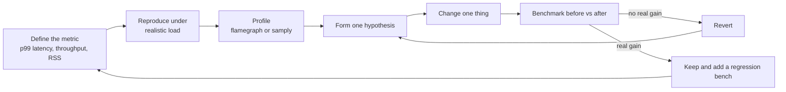
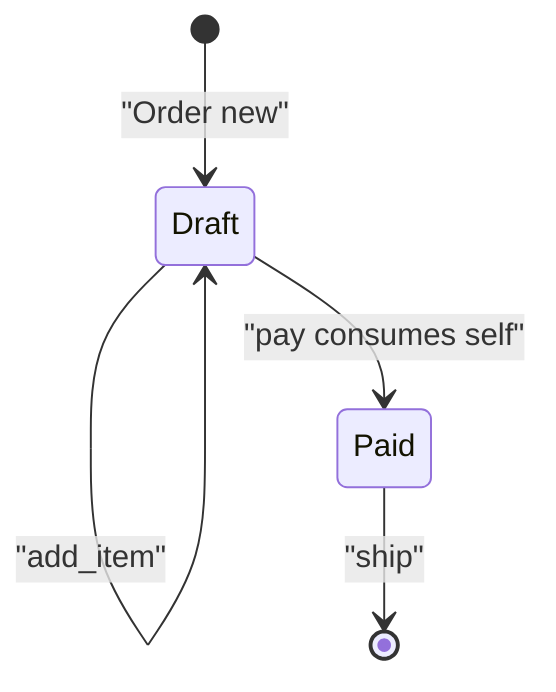
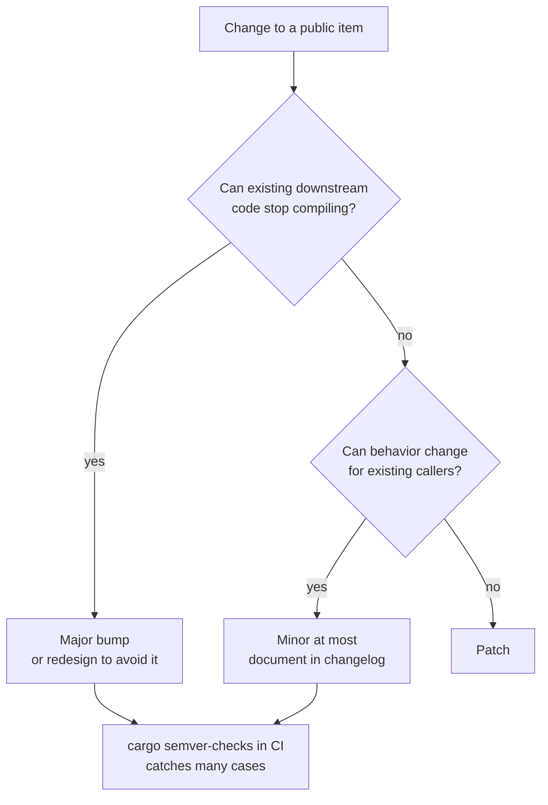

import Callout from '../../components/mdx/Callout.astro';

Rust has a reputation for being fast by default, and mostly it is. But "fast by default" means the floor is high, not that the ceiling is automatic. A Rust service can still spend half its time in the allocator, thrash the cache with a badly laid-out struct, or hide a hot path behind a `dyn Trait` the optimizer cannot see through. This post is for engineers who own code other people depend on: a hot service path, or a library crate with downstream users. The first half covers performance: what zero-cost really means, how to profile and benchmark honestly, and the handful of techniques (allocation reduction, layout, release profile settings) that pay off most often. The second half covers API design: how to shape a library so it is pleasant to use, hard to misuse, and possible to evolve without breaking everyone.

<Callout variant="note" title="You should already know">
Traits, generics and `dyn Trait` ([Part 4](/blog/rust-04-traits-generics)), iterators and closures ([Part 5](/blog/rust-05-collections-iterators-closures)), smart pointers and `Cow` ([Part 6](/blog/rust-06-lifetimes-smart-pointers)), and how `unsafe` and `#[repr(C)]` work ([Part 9](/blog/rust-09-unsafe-ffi-macros)).
</Callout>

## Zero-cost abstractions, precisely

"Zero-cost abstraction" is Bjarne Stroustrup's phrase, and it has two halves: you don't pay for what you don't use, and what you do use you couldn't hand-code any better. It does **not** mean the abstraction is free. It means it costs the same as the equivalent hand-written code.

The textbook example is iterators. These two functions compile to essentially the same machine code in a release build:

```rust
fn sum_iter(xs: &[u64]) -> u64 {
    xs.iter().copied().filter(|x| x % 3 == 0).sum()
}

fn sum_loop(xs: &[u64]) -> u64 {
    let mut total = 0;
    for i in 0..xs.len() {
        if xs[i] % 3 == 0 { total += xs[i]; }
    }
    total
}
```

Both closures are monomorphized and inlined, so there is no function-pointer call per element, no heap-allocated iterator, and the bounds check in the indexed loop is removed because the compiler can prove `i < xs.len()`. A quick timing on one machine showed the two within noise of each other, which is exactly the point: you get the readable version for free.

### Where abstractions are not free

The guarantee holds only when the optimizer can see through the abstraction. Some common places where it cannot, or where the abstraction inherently does more work:

- **Dynamic dispatch.** A call through `dyn Trait` is an indirect call through a vtable. The call itself is cheap, a few nanoseconds at most, but it blocks inlining, and inlining is what enables most other optimizations (constant folding, vectorization, bounds-check elimination). A `Vec<Box<dyn Shape>>` in a hot loop can be several times slower than a `Vec<Circle>` or an enum of shapes.
- **Bounds checks.** Indexing with a value the compiler cannot prove in range keeps the check and its panic branch. Usually cheap, but it can block vectorization in tight loops. Iterators, slicing once up front (`let xs = &xs[..n];`) or an `assert!` before the loop typically let the compiler hoist or remove them; `get_unchecked` is the last resort, not the first.
- **Reference counting.** Cloning an `Arc` is an atomic increment. Uncontended it is a few nanoseconds; when many cores clone the same `Arc` the cache line bounces between them and it becomes a real cost. `Rc` avoids the atomic but is single-threaded.
- **`RefCell` and `Mutex`.** Runtime borrow flags and locks are real work on every access.
- **Monomorphization bloat.** Each concrete type a generic function is instantiated with gets its own copy. That makes calls fast but can grow binary size and compile time and pressure the instruction cache. The standard trick is a thin generic shell over a non-generic core:

```rust
use std::path::Path;

pub fn read_config<P: AsRef<Path>>(path: P) -> std::io::Result<String> {
    fn inner(path: &Path) -> std::io::Result<String> {
        let text = std::fs::read_to_string(path)?;
        Ok(text.trim().to_owned())
    }
    inner(path.as_ref()) // only this one-line shell is duplicated per caller type
}
```

- **Large async futures.** An `async fn` compiles to a state machine sized for its largest set of variables live across an `.await`. Deeply nested futures can be many kilobytes, and moving them around costs memcpys. Clippy's `large_futures` lint flags them; boxing the large inner future (`Box::pin`) is the usual fix.
- **Hidden allocations.** `format!`, `to_string`, `collect` into a fresh `Vec`, `clone` on a `String`: each is cheap in isolation and they add up. This is usually the biggest win in real services, and gets its own section below.
- **Default hashing.** `HashMap` uses SipHash by default, which resists hash-flooding attacks but is slower than non-cryptographic hashes. For keys that are not attacker-controlled, `rustc-hash` (FxHash) or `ahash` can be noticeably faster. Keep the default for anything keyed by user input.

## Measure first: profiling

Performance work without measurement mostly produces code that is harder to read and not measurably faster. The loop that works:



### Build something worth profiling

Profile a release build: debug builds can be an order of magnitude slower or more, in ways that have nothing to do with production. But a default release build has no debug info, so the profiler cannot map addresses back to function names and lines well. Add a custom profile:

```toml
[profile.profiling]
inherits = "release"
debug = true      # full debug info for symbols and inlined frames
strip = false
```

```bash
cargo build --profile profiling
```

Stack unwinding in profilers is more reliable with frame pointers. On Linux, building with `RUSTFLAGS="-C force-frame-pointers=yes"` usually gives cleaner stacks than DWARF unwinding at a small runtime cost.

### The tools

- **`cargo flamegraph`** (the `flamegraph` crate) wraps `perf` on Linux and `dtrace` on macOS and produces an SVG flame graph. Width is time on CPU; look for wide plateaus near the top.
- **samply** is a sampling profiler for Linux and macOS that opens results in the Firefox Profiler UI, with a call tree, flame graph and timeline. `samply record ./target/profiling/my-app` is often the fastest way from zero to a usable profile.
- **perf** directly (`perf record -g`, `perf report`) gives the most control on Linux, including hardware counters: `perf stat -e cache-misses,branch-misses` tells you whether you are compute bound or memory bound.
- **Heap profilers** such as `dhat` (the `dhat` crate, which you install as the global allocator in a profiling build) or `heaptrack` show where allocations come from, how many, and how long they live.
- For async services, a CPU profile shows where the executor's threads spend time, not why a request waited. Pair it with tracing spans (covered in [Series B](/blog/rust-backend-01-first-http-service)) and `tokio-console`.

A flame graph answers "where does the CPU time go", not "what should I change". Before touching code, write down the hypothesis: "40 percent of time is in `alloc::raw_vec::grow` under `parse_line`; preallocating should remove most of it." Then you can check whether you were right.

## Benchmarking without fooling yourself

Microbenchmarks are easy to write and easy to get wrong. The common traps:

- **The optimizer deletes your work.** If the result of the benchmarked code is never used, the compiler may remove the computation entirely and you will measure an empty loop. Wrap inputs and outputs in `std::hint::black_box` (stable since 1.66), which tells the optimizer to treat the value as used and unknown.
- **Measuring debug builds.** `cargo bench` uses the `bench` profile, which inherits from `release`. Hand-rolled `Instant::now()` timing in a `cargo run` without `--release` measures the wrong thing.
- **Too few iterations, no warm-up.** First iterations pay for cold caches, page faults and CPU frequency ramp-up. A harness runs warm-up rounds and many samples and reports a distribution.
- **Noisy machines.** Laptops throttle, cloud VMs have noisy neighbors, and CPU frequency scaling changes between runs. Treat differences under a few percent as noise unless you have controlled the environment, and compare distributions rather than single numbers.
- **Unrealistic inputs.** A benchmark that sorts 100 already-sorted integers tells you little about sorting a million real records. Use input sizes and shapes that match production, ideally several sizes, because algorithms cross over.
- **Benchmarking in isolation what is slow in context.** A function that is fast alone may be slow in production because the real workload evicts its data from cache. End-to-end load tests catch what microbenchmarks miss.

Criterion is the de facto benchmark harness on stable Rust. It handles warm-up, statistics, outlier detection and comparison against the previous run:

```toml
[dev-dependencies]
criterion = "0.5"

[[bench]]
name = "normalize"
harness = false
```

```rust
use benchy::{normalize, normalize_into};
use criterion::{BenchmarkId, Criterion, Throughput, criterion_group, criterion_main};
use std::hint::black_box;

fn bench_normalize(c: &mut Criterion) {
    let mut group = c.benchmark_group("normalize");
    for size in [10usize, 1_000, 100_000] {
        let input: Vec<String> = (0..size).map(|i| format!("  Line {i} OF Text  ")).collect();
        let lines: Vec<&str> = input.iter().map(String::as_str).collect();
        group.throughput(Throughput::Elements(size as u64));

        group.bench_with_input(BenchmarkId::new("fresh_vec", size), &lines, |b, lines| {
            b.iter(|| normalize(black_box(lines)))
        });

        let mut out = Vec::with_capacity(size);
        group.bench_with_input(BenchmarkId::new("reused_vec", size), &lines, |b, lines| {
            b.iter(|| normalize_into(black_box(lines), &mut out))
        });
    }
    group.finish();
}

criterion_group!(benches, bench_normalize);
criterion_main!(benches);
```

Alternatives worth knowing: **divan** has a lighter, attribute-based API; **iai-callgrind** counts instructions under Valgrind instead of measuring wall time, which makes it deterministic enough to run in CI and fail a build on regression. Wall-clock benchmarks in shared CI runners are usually too noisy to gate on.

## Reducing allocations

In most real Rust services, after the algorithm is right, the biggest remaining cost is allocation: `malloc` and `free` themselves, the cache misses of touching fresh memory, and the copies that come with owned values. The good news is that allocations are easy to count. A tiny global allocator wrapper makes it a test you can assert on:

```rust
use std::alloc::{GlobalAlloc, Layout, System};
use std::sync::atomic::{AtomicUsize, Ordering};

struct CountingAlloc;
static ALLOCATIONS: AtomicUsize = AtomicUsize::new(0);

unsafe impl GlobalAlloc for CountingAlloc {
    unsafe fn alloc(&self, layout: Layout) -> *mut u8 {
        ALLOCATIONS.fetch_add(1, Ordering::Relaxed);
        // SAFETY: forwarding the caller's contract to the system allocator.
        unsafe { System.alloc(layout) }
    }
    unsafe fn dealloc(&self, ptr: *mut u8, layout: Layout) {
        // SAFETY: as above.
        unsafe { System.dealloc(ptr, layout) }
    }
}

#[global_allocator]
static GLOBAL: CountingAlloc = CountingAlloc;

fn allocations_during<R>(f: impl FnOnce() -> R) -> (R, usize) {
    let before = ALLOCATIONS.load(Ordering::Relaxed);
    let r = f();
    (r, ALLOCATIONS.load(Ordering::Relaxed) - before)
}
```

(Counts are only exact in a single-threaded test; other threads allocate too.)

### Techniques, in order of payoff

**Don't create intermediates.** This normalizes three lines:

```rust
fn normalize_naive(lines: &[&str]) -> Vec<String> {
    let mut out = Vec::new();
    for line in lines {
        let trimmed = line.trim().to_string(); // allocation 1: a copy we throw away
        let lower = trimmed.to_lowercase();    // allocation 2
        out.push(lower);                       // plus Vec growth
    }
    out
}

fn normalize_lean(lines: &[&str]) -> Vec<String> {
    lines.iter().map(|l| l.trim().to_lowercase()).collect()
}
```

With three input lines the counting allocator reported 7 allocations for the naive version and 4 for the lean one: one per output string plus a single exact-size `Vec`, because `collect` on a slice iterator knows the length up front.

**Borrow when you can, own when you must.** If most inputs need no change, return a `Cow<str>`:

```rust
use std::borrow::Cow;

fn normalize_cow(line: &str) -> Cow<'_, str> {
    let t = line.trim();
    if t.bytes().any(|b| b.is_ascii_uppercase()) {
        Cow::Owned(t.to_ascii_lowercase())
    } else {
        Cow::Borrowed(t) // no allocation for already-normalized input
    }
}
```

**Preallocate and reuse buffers.** `Vec::with_capacity` and `String::with_capacity` avoid repeated growth. In a loop, keep a buffer outside and `clear()` it each iteration: `clear` keeps the capacity, so after the first iteration there are no allocations at all.

```rust
use std::fmt::Write as _;

fn render_ids(ids: &[u64], out: &mut String) {
    out.clear();
    for (i, id) in ids.iter().enumerate() {
        if i > 0 {
            out.push(',');
        }
        write!(out, "{id}").unwrap(); // writing to a String cannot fail
    }
}
```

`write!` into an existing `String` instead of `format!` is the same idea: format into a buffer you own instead of allocating a new one per call.

**Keep small collections inline.** `SmallVec<[T; N]>` (the `smallvec` crate) stores up to `N` elements inline and spills to the heap only beyond that. If 95 percent of your orders have four or fewer tags, `SmallVec<[u32; 4]>` makes those allocation-free. In the counting test, collecting 3 elements allocated nothing and collecting 10 allocated once. The cost: a larger handle, a branch on every access, and worse behavior than `Vec` if most instances do spill. Measure the distribution first. `arrayvec` is the fixed-capacity variant that never spills.

**Shrink handles you store in bulk.** Once a string is built and will never change, it does not need a capacity field:


`size_of` on a 64-bit target confirms the handle sizes:

```text
String 24  Box<str> 16  &str 16  Arc<str> 16  Rc<str> 16
Vec<u32> 24 Box<[u32]> 16 SmallVec<[u32;4]> 24
```

`Box<str>` saves 8 bytes per value and drops spare capacity, which matters when you hold millions of them. `Arc<str>` is the right type for text that is read by many owners, such as a tenant name or region shared across thousands of in-flight requests: cloning is a reference-count increment instead of a copy, and there is one allocation instead of two (`Arc<String>` would be a pointer to a block that points to another block).

**Pick the allocator last.** Swapping the global allocator for jemalloc or mimalloc can help allocation-heavy, multi-threaded workloads, and sometimes hurts memory footprint. It is a one-line change, which is exactly why it should be measured, not assumed. [Series B](/blog/rust-backend-01-first-http-service) covers it for a real service.

## Data layout and the cache

A modern CPU can execute many instructions in the time it takes to fetch one cache line from main memory. For data-heavy code, how your data is laid out often matters more than how many instructions you run.

### Rust reorders fields; `repr(C)` does not

```rust
struct Unordered { a: u8, b: u64, c: u8, d: u32 }

#[repr(C)]
struct ReprC { a: u8, b: u64, c: u8, d: u32 }
```

On a 64-bit target `Unordered` is 16 bytes and `ReprC` is 24: with the default representation the compiler is free to put `b` first and pack the small fields together, while `repr(C)` must keep declaration order and pad each field to its alignment. Use `repr(C)` only when you need a fixed layout (FFI, memory-mapped formats), and when you do, order fields from largest to smallest alignment yourself.

### Niches make `Option` free, sometimes

`Option<Box<T>>`, `Option<&T>` and `Option<NonZeroU64>` are all 8 bytes, the same as the type inside: the compiler uses the forbidden value (null, zero) to represent `None`. `Option<u64>` is 16 bytes, because every bit pattern of `u64` is valid and the discriminant needs its own space, padded to alignment. Use `NonZero` integer types for IDs that can never be zero and you get a free `Option`.

### One large variant inflates every value

An enum is as large as its largest variant:

```rust
enum Message {
    Ping,
    Payload([u8; 1024]),
}

enum MessageBoxed {
    Ping,
    Payload(Box<[u8; 1024]>),
}
```

`Message` is 1,025 bytes, so a `Vec<Message>` of mostly `Ping`s wastes a kilobyte per element. `MessageBoxed` is 8. Clippy's `large_enum_variant` lint catches this. The trade-off is an allocation per large variant, which is the right trade when large variants are rare.

### Arrays of structs vs structs of arrays

If a hot loop reads one field of many records, an array of structs drags every other field through the cache with it:

```rust
struct ParticleAoS { pos: [f32; 3], vel: [f32; 3], mass: f32, id: u64, alive: bool } // 40 bytes

struct ParticlesSoA { pos_x: Vec<f32>, vel_x: Vec<f32>, alive: Vec<bool> }
```

Summing `pos[0]` over a `Vec<ParticleAoS>` uses 4 of every 40 bytes loaded. The struct-of-arrays layout loads only what the loop needs, in contiguous memory the compiler can vectorize. This is the core idea behind entity-component systems in game engines and columnar formats like Arrow. It costs ergonomics, so reserve it for loops that profiling says are memory bound.

### False sharing

Two atomics updated by different threads that happen to sit on the same cache line make the cores fight over that line even though they never touch each other's data. Padding each one to its own line fixes it:

```rust
use std::sync::atomic::{AtomicU64, Ordering};

#[repr(align(128))]
pub struct Padded(pub AtomicU64);

pub struct Counters {
    pub hits: Padded,   // each on its own 128-byte-aligned block
    pub misses: Padded,
}
```

Cache lines are 64 bytes on most x86-64 CPUs, but adjacent-line prefetching and some ARM designs make 128 a safer choice; `crossbeam_utils::CachePadded` picks a per-architecture value for you.

## The release profile

Cargo's default release profile is a reasonable compromise between build time and speed. For a binary you ship, a few settings are worth evaluating:

```toml
[profile.release]
lto = "fat"                 # whole-program optimization across all crates
codegen-units = 1           # one unit per crate: better optimization, slower builds
panic = "abort"             # no unwinding tables or landing pads
debug = "line-tables-only"  # usable backtraces and profiles without full debug info
```

What each one trades:

- **`lto`**: link-time optimization lets LLVM inline across crate boundaries. `"thin"` gets much of the benefit at lower build cost; `"fat"` is the most thorough and the slowest to link. Gains are workload-dependent, from nothing to a noticeable improvement, and the build-time cost is always real.
- **`codegen-units = 1`**: the default of 16 lets a crate compile in parallel but limits cross-unit optimization. One unit is slower to build and often slightly faster to run.
- **`panic = "abort"`**: smaller binaries and slightly less code in hot paths, but `catch_unwind` stops working. In a Tokio service, a panic in any task then kills the whole process instead of just that task. Decide deliberately; many services prefer to keep unwinding and let a supervisor restart on real crashes.
- **`opt-level`**: 3 is the release default. `"s"` or `"z"` optimize for size, useful for WebAssembly and embedded targets.
- **`-C target-cpu=native`**: lets LLVM use every instruction set extension on the build machine. Only safe if the build and production CPUs match; a binary built on a newer CPU can crash with an illegal instruction on an older one. Prefer a specific baseline such as `x86-64-v3` if you control the fleet.

Beyond the profile, **profile-guided optimization** (PGO) builds an instrumented binary, runs it on representative workloads, and feeds the profile back into the compiler so it can lay out hot code together and make better inlining decisions. The `cargo-pgo` tool wraps the process, and can also apply BOLT, a post-link optimizer. The Rust compiler itself is built with PGO. Publicly reported gains for suitable workloads are often in the single digits to low tens of percent, but you only learn your number by measuring, and you have to keep the training workload representative as the code changes.

## Designing library APIs

Performance is about the machine. API design is about the people who call your code, including future you. The reference is the [Rust API Guidelines](https://rust-lang.github.io/api-guidelines/), a checklist maintained by the library team. The highlights that cause the most review comments:

**Naming conventions carry cost information.**

- `as_` is a free, borrowed-to-borrowed view: `as_str`, `as_bytes`.
- `to_` is an expensive conversion that leaves the original: `to_string`, `to_vec`.
- `into_` consumes `self`: `into_inner`, `into_bytes`.
- Getters have no `get_` prefix: `order.id()`, not `order.get_id()`.
- Iterator methods are `iter`, `iter_mut` and `into_iter`.

**Implement the common traits eagerly.** Downstream crates cannot add `Debug`, `Clone`, `PartialEq`, `Eq`, `Hash`, `Default` or serde impls to your types because of the orphan rule ([Part 4](/blog/rust-04-traits-generics)). If a type can sensibly implement them, do it. `Debug` on every public type is close to mandatory.

**Be flexible in what you accept and concrete in what you return.** Take `&str` and `&[T]`, not `&String` and `&Vec<T>`. Take `impl AsRef<Path>` or `impl Into<String>` where callers will have different types. Return concrete types (or `impl Iterator` for iterators) so callers can use every capability of the result. Take ownership only when you are going to store the value, so callers who already own it can move it in without a clone.

**Make types `Send` and `Sync` when possible**, and add a compile-time test so a refactor that adds an `Rc` field fails your build rather than your users': `fn _assert_send_sync<T: Send + Sync>() {}` called with each public type.

### The builder pattern

Rust has no named or default arguments, so constructors with many optional parameters become builders. The owned-builder style chains nicely and lets `build` validate:

```rust
use std::time::Duration;

#[derive(Debug, Clone)]
#[non_exhaustive]
pub struct Config {
    pub base_url: String,
    pub timeout: Duration,
    pub max_retries: u32,
}

#[derive(Debug)]
pub struct Client {
    config: Config,
}

#[derive(Debug, Clone)]
#[must_use = "a builder does nothing until you call `build`"]
pub struct ClientBuilder {
    base_url: String,
    timeout: Duration,
    max_retries: u32,
}

impl Client {
    pub fn builder(base_url: impl Into<String>) -> ClientBuilder {
        ClientBuilder {
            base_url: base_url.into(),
            timeout: Duration::from_secs(10),
            max_retries: 2,
        }
    }
}

impl ClientBuilder {
    /// Sets the per-request timeout. Default: 10 seconds.
    pub fn timeout(mut self, timeout: Duration) -> Self {
        self.timeout = timeout;
        self
    }

    /// Sets the retry budget. Default: 2.
    pub fn max_retries(mut self, n: u32) -> Self {
        self.max_retries = n;
        self
    }

    /// Validates the configuration and builds the client.
    ///
    /// # Errors
    /// Returns [`Error::Config`] if the base URL is not `http(s)://` or the
    /// timeout is zero.
    pub fn build(self) -> Result<Client, Error> {
        if !(self.base_url.starts_with("https://") || self.base_url.starts_with("http://")) {
            return Err(Error::Config(format!("base_url must be http(s): {}", self.base_url)));
        }
        if self.timeout.is_zero() {
            return Err(Error::Config("timeout must be non-zero".into()));
        }
        Ok(Client {
            config: Config {
                base_url: self.base_url,
                timeout: self.timeout,
                max_retries: self.max_retries,
            },
        })
    }
}

// Caller:
let client = Client::builder("https://api.example.com") // `Error` is defined below
    .timeout(Duration::from_secs(3))
    .max_retries(5)
    .build()?;
```

Required parameters go in `builder(...)`, optional ones become methods with documented defaults, and adding a new optional setting later is a non-breaking change. That last property is the main reason to use a builder in a library even when there are only two options today. `#[must_use]` catches the classic bug of configuring a builder and forgetting to call `build`.

For comparison, Kotlin solves the same problem in the language:

```kotlin
class Client(
    val baseUrl: String,
    val timeout: Duration = 10.seconds,
    val maxRetries: Int = 2,
)

val client = Client("https://api.example.com", maxRetries = 5)
```

Rust's builder is more code, but `build` returning a `Result` gives you a single place to validate combinations of settings, which constructors with defaults do not.

### Typestate: making invalid sequences unrepresentable

When an object moves through states and some operations are only valid in some states, you can encode the state as a type parameter so misuse is a compile error instead of a runtime check:

```rust
use std::marker::PhantomData;

pub struct Draft;
pub struct Paid;

pub struct Order<State> {
    id: u64,
    total_cents: u64,
    _state: PhantomData<State>,
}

impl Order<Draft> {
    pub fn new(id: u64) -> Self {
        Order { id, total_cents: 0, _state: PhantomData }
    }

    pub fn add_item(mut self, price_cents: u64) -> Self {
        self.total_cents += price_cents;
        self
    }

    /// Records payment. Consumes the draft.
    pub fn pay(self) -> Order<Paid> {
        Order { id: self.id, total_cents: self.total_cents, _state: PhantomData }
    }
}

impl Order<Paid> {
    /// Only paid orders can ship.
    pub fn ship(&self) -> String {
        format!("shipping order {} ({} cents)", self.id, self.total_cents)
    }
}

impl<S> Order<S> {
    pub fn id(&self) -> u64 { self.id }
}
```



Calling `ship` on a draft does not compile, and the error even points to the state where the method exists:

```text
error[E0599]: no method named `ship` found for struct `Order<Draft>` in the current scope
  --> src/main.rs:11:11
   |
11 |     draft.ship();
   |           ^^^^ method not found in `Order<Draft>`
   |
   = note: the method was found for `Order<Paid>`
```

Because `pay` takes `self` by value, the draft is moved and cannot be used afterward, so there is no stale handle to a draft that has already been paid. `PhantomData` and the zero-sized marker types cost nothing at runtime.

Typestate works best for short-lived values with a linear protocol: builders with required steps, connection setup, a request that must be signed before it is sent. It works badly for state loaded from a database at runtime, where you do not know the state at compile time; there, a plain enum and a `match` are the right tool. Don't force it.

### Sealed traits

If you publish a trait, adding a required method later breaks every downstream implementation. If downstream crates do not need to implement it (they only use your implementations), **seal** it: make it require a supertrait that lives in a private module.

```rust
mod private {
    pub trait Sealed {}
}

/// A storage backend. Sealed: only this crate can implement it,
/// so we can add methods in minor releases.
pub trait Backend: private::Sealed {
    fn name(&self) -> &'static str;
}

pub struct Memory;
impl private::Sealed for Memory {}
impl Backend for Memory {
    fn name(&self) -> &'static str { "memory" }
}
```

Users can call `Backend` methods and use it as a bound, but an outside implementation fails, and recent compilers explain why:

```text
error[E0277]: the trait bound `Redis: ratelimit::private::Sealed` is not satisfied
 --> src/main.rs:5:18
  |
5 | impl Backend for Redis {
  |                  ^^^^^ unsatisfied trait bound
  |
  = note: `Backend` is a "sealed trait", because to implement it you also need to implement `ratelimit::private::Sealed`, which is not accessible; this is usually done to force you to use one of the provided types that already implement it
```

### `#[non_exhaustive]`

`#[non_exhaustive]` on a public enum or struct tells downstream crates that more variants or fields may be added. It has no effect inside the defining crate. Outside it, two things change:

- Matching on a non-exhaustive enum requires a wildcard arm:

```text
error[E0004]: non-exhaustive patterns: `&_` not covered
 --> src/main.rs:5:11
  |
5 |     match e {
  |           ^ pattern `&_` not covered
  |
  = note: `ratelimit::Error` is marked as non-exhaustive, so a wildcard `_` is necessary to match exhaustively
```

- A non-exhaustive struct cannot be built with a struct literal (and cannot be destructured without `..`), even if all its fields are public:

```text
error[E0639]: cannot create non-exhaustive struct using struct expression
  --> src/main.rs:13:13
   |
13 |     let c = Config { base_url: "x".into(), timeout: Duration::ZERO, max_retries: 0 };
   |             ^^^^^^^^^^^^^^^^^^^^^^^^^^^^^^^^^^^^^^^^^^^^^^^^^^^^^^^^^^^^^^^^^^^^^^^^
```

The cost is that users lose exhaustiveness checking: when you add a variant, their code still compiles and silently falls into the wildcard arm. Use it on error enums and configuration structs, which grow over time; avoid it on enums whose whole point is that callers handle every case, like a state machine's states.

### Error design for libraries

Applications can use `anyhow` and move on ([Part 3](/blog/rust-03-types-enums-errors)). Libraries should not, because callers need to make decisions based on what went wrong:

```rust
use std::time::Duration;

/// Errors returned by [`Client`].
#[derive(Debug, thiserror::Error)]
#[non_exhaustive]
pub enum Error {
    #[error("authentication failed")]
    Unauthorized,
    #[error("rate limited, retry after {retry_after:?}")]
    RateLimited { retry_after: Duration },
    #[error("invalid configuration: {0}")]
    Config(String),
    #[error("transport error")]
    Transport(#[source] std::io::Error),
}

impl Error {
    /// Returns `true` if retrying the same request may succeed.
    pub fn is_retryable(&self) -> bool {
        matches!(self, Error::RateLimited { .. } | Error::Transport(_))
    }
}
```

The principles behind it:

- **A concrete enum** that implements `std::error::Error`, `Debug`, `Display`, and is `Send + Sync + 'static`, so it works with `?`, `anyhow`, and across threads and tasks.
- **`#[non_exhaustive]`** so adding a failure mode later is a minor release.
- **Predicates like `is_retryable()`** so most callers never need to match on variants at all, which keeps them working as variants are added.
- **Preserve the chain with `#[source]`**, and do not duplicate the source's message in your `Display` text; error reporters print the chain and would show it twice.
- **Be careful exposing dependencies' error types.** If your public `Error` has a variant holding `reqwest::Error`, upgrading `reqwest` to a new major version is a breaking change for you. Either keep it behind an opaque wrapper or accept that coupling knowingly. Standard library types like `std::io::Error` are safe to expose.
- **Don't panic for recoverable conditions.** A library that panics on bad input takes the decision away from the application. Panic only on violated invariants and document it under `# Panics`.

The broader theory of error contracts between services is in [the REST API design post](/blog/backend-02-rest-api-design); the same "make failures explicit and classifiable" idea applies at the function level.

## Semver, MSRV and documentation

Cargo assumes every crate follows semantic versioning: `^1.4` accepts any `1.x` at or above 1.4, and for `0.x` crates the minor number acts as the major (`0.4` and `0.5` are incompatible). Your users' builds trust that a minor release does not break them. The hard part is that "breaking" is subtler in Rust than in most languages, because type inference, trait resolution and auto traits all depend on details of your API.


Some changes that surprise people:

- **Adding a private field to a struct that had only public fields** breaks anyone who constructed it with a struct literal.
- **Losing an auto trait.** Adding an `Rc` or raw-pointer field makes the type `!Send`, breaking every caller that moves it across threads. No signature changed, which is why this one slips through review.
- **Adding a trait impl** is technically allowed in a minor release but can make method calls ambiguous or break type inference downstream.

You do not need to memorize the full list (the [Cargo SemVer reference](https://doc.rust-lang.org/cargo/reference/semver.html) has it). Run a tool:

```bash
cargo install cargo-semver-checks --locked
cargo semver-checks   # compares the public API against the latest crates.io release
```

`cargo-semver-checks` builds rustdoc JSON for both versions and runs a large set of lints for known breaking-change patterns. It does not catch everything (behavior changes, and some type-system subtleties), but it catches the mechanical mistakes, and it belongs in the release CI job.



### MSRV policy

The minimum supported Rust version is part of your contract. Declare it in `Cargo.toml`:

```toml
[package]
name = "ratelimit"
version = "1.4.0"
edition = "2024"
rust-version = "1.85"
```

Cargo then refuses to build the crate with an older compiler, with a clear message instead of a confusing syntax error. Edition 2024 itself requires 1.85, so that is a natural floor for new crates. Since Rust 1.84, Cargo also has an MSRV-aware dependency resolver, which is the default for edition 2024 projects (`resolver = "3"`): it prefers dependency versions whose own `rust-version` is compatible with yours.

Common policies are "latest stable only" (fine for applications and fast-moving crates), "stable minus N releases" (a few months of slack for distro and enterprise users), or a fixed version bumped deliberately. Whether raising the MSRV is a breaking change is debated in the ecosystem; most crates treat it as a minor-version change and say so up front. Whatever you choose, write it in the README and test it in CI with a job that runs `cargo +1.85 check` (the `cargo-msrv` tool can find the true minimum).

### Documentation is part of the API

rustdoc turns `///` comments into docs.rs pages, and every code block in them is compiled and run as a test by `cargo test`. That makes examples the cheapest kind of test you can write, and keeps them from rotting. Conventions worth enforcing:

- A crate-level `//!` overview with a short, complete example.
- `# Examples` on the main entry points; `# Errors` describing when a `Result` is `Err`; `# Panics` for every way a function can panic; `# Safety` on every `unsafe fn` (see [Part 9](/blog/rust-09-unsafe-ffi-macros)).
- Intra-doc links like ``[`Error::Config`]`` so renames break the docs build instead of silently leaving dead links.
- Lints at the crate root to keep it that way:

```rust
#![warn(missing_docs)]
#![deny(rustdoc::broken_intra_doc_links)]
```

## Common mistakes

- **Optimizing without a profile.** Rewriting code into something uglier because it "should be faster", then never measuring. Profile first, change one thing, benchmark.
- **Benchmarks the optimizer deletes.** No `black_box`, results unused, and an implausibly fast number that gets quoted in a design doc.
- **Profiling debug builds**, or release builds without debug symbols, and drawing conclusions from unreadable stacks.
- **`clone()` to satisfy the borrow checker in hot paths.** It often signals a design problem; borrowing, `Arc<str>`, or restructuring ownership is usually better.
- **Reaching for `unsafe` (`get_unchecked`) before trying iterators or a single up-front slice**, which typically remove the same bounds checks safely.
- **`target-cpu=native` in a shared build pipeline**, producing binaries that crash on older production hardware.
- **`panic = "abort"` in a multi-tenant async service** without realizing that any task panic now takes down every in-flight request.
- **Public fields on library structs** that later need validation or a new field. Prefer private fields with constructors or builders, or `#[non_exhaustive]`.
- **Exposing a dependency's types in your public API by accident**, which ties your major version to theirs.
- **Using `anyhow::Error` as a library's error type**, leaving callers to match on strings.
- **No MSRV declared and no MSRV CI job**, so a dependency bump silently raises it and downstream builds break.

## Interview questions

<details>
<summary>What does "zero-cost abstraction" mean, and give two examples in Rust where an abstraction does have a cost.</summary>

It means you pay nothing for features you don't use, and the abstractions you do use compile to code as good as you would write by hand. It does not mean free. Examples of real costs: `dyn Trait` calls block inlining and the optimizations that follow from it; `Arc::clone` is an atomic operation that contends across cores; generics are monomorphized per type and can bloat binaries and compile times; `RefCell` and `Mutex` do runtime checks; large async state machines cost memcpys when moved. A strong answer adds that the guarantee depends on the optimizer seeing through the abstraction, so it holds in release builds and inlined code, not across opaque boundaries.

</details>

<details>
<summary>Walk me through how you would investigate a Rust service whose p99 latency doubled after a release.</summary>

Confirm the regression with the same load and metric, then diff the release: code, dependency versions (`Cargo.lock`), build flags and allocator. Reproduce it in a staging or load-test environment. Take CPU profiles of the old and new binary under the same load with a profiling build (release plus debug info), and compare flame graphs; look for new wide frames, more time in allocation, or locks. Since p99 is about tail behavior, also check off-CPU time: lock contention, blocking calls on async worker threads, pool waits, GC-like pauses from large drops. Form one hypothesis, test it with a targeted benchmark or by reverting the suspect change, and add a regression benchmark once fixed.

</details>

<details>
<summary>What are the common ways a microbenchmark lies, and how does Criterion help?</summary>

Dead-code elimination removing the work, debug builds, no warm-up, too few samples, noisy machines and frequency scaling, unrealistic inputs, and measuring in isolation something that is slow because of cache effects in context. Criterion runs warm-up, collects many samples, does statistical analysis with outlier detection and compares against the previous run; you still have to use `black_box` and pick realistic inputs. For CI gating, instruction-counting tools like iai-callgrind are more stable than wall-clock numbers.

</details>

<details>
<summary>When would you use a boxed str, an Arc of str, or a Cow of str instead of a `String`?</summary>

`Box<str>` for owned text that will not change after construction and is stored in bulk: it is a 16-byte handle with no spare capacity instead of 24. `Arc<str>` for immutable text shared by many owners or threads, such as configuration values or interned names attached to many requests; clones are a reference-count increment instead of a copy, with one allocation instead of the two `Arc<String>` needs. `Cow<str>` for functions that usually return their input unchanged but sometimes need to modify it, so the common path does not allocate. `String` remains right for text you are building or mutating.

</details>

<details>
<summary>What do LTO, `codegen-units = 1` and `panic = "abort"` do, and what do they cost?</summary>

LTO lets the optimizer work across crate boundaries at link time, so code from dependencies can be inlined into yours; thin LTO gets much of the benefit cheaply, fat LTO is slowest to build. `codegen-units = 1` stops splitting each crate into parallel units, allowing more optimization within the crate at the cost of parallel compilation. `panic = "abort"` removes unwinding, shrinking binaries, but disables `catch_unwind`, which in an async runtime means any task panic terminates the process. All three trade build time or operational behavior for runtime speed or size, and their gains are workload-dependent, so they should be measured.

</details>

<details>
<summary>Explain the typestate pattern. When is it a bad fit?</summary>

You encode an object's state as a type parameter, often a zero-sized marker type, and put each operation only on the states where it is valid. Transitions consume `self` and return the object in the new state, so invalid sequences, like shipping an unpaid order, fail to compile, and the old state cannot be reused. It costs nothing at runtime. It is a bad fit when the state is only known at runtime, for example loaded from a database or received over the network; then you would need an enum wrapping each typed state anyway, and a plain enum with a `match` is simpler. It also gets unwieldy with many states or many orthogonal state dimensions.

</details>

<details>
<summary>You maintain a widely used crate. Which changes need a major version bump, and how do you design to avoid them?</summary>

Removing or renaming public items, changing signatures, adding variants to exhaustive enums, adding public fields to exhaustively constructible structs, adding trait methods without defaults, adding bounds, and losing auto traits like `Send`. To avoid them: `#[non_exhaustive]` on error enums and config structs, private fields with constructors or builders, sealed traits when downstream doesn't need to implement them, default methods on open traits, and not exposing dependencies' types in the public API. Then enforce it with `cargo-semver-checks` in release CI, a declared `rust-version` with an MSRV CI job, and a changelog.

</details>

<details>
<summary>How should a library design its error type?</summary>

A concrete, `#[non_exhaustive]` enum implementing `std::error::Error`, `Display` and `Debug`, and `Send + Sync + 'static`, with one variant per failure mode the caller might act on differently. Preserve underlying causes via `source()` rather than flattening them into strings, and avoid repeating the source's message in your own. Offer predicate methods like `is_retryable()` so callers don't have to match on every variant. Avoid exposing third-party error types if you don't want their major versions to become yours. Leave `anyhow` to applications.

</details>

## Key takeaways

- Zero-cost means "as cheap as hand-written", not free. Dynamic dispatch, atomics, runtime borrow checks, monomorphization and hidden allocations all have costs the optimizer cannot remove.
- Profile a release build with debug info (`cargo flamegraph`, samply, perf), form one hypothesis, change one thing, and benchmark with `black_box` and realistic inputs.
- Allocation is usually the first real win: avoid intermediates, reuse buffers, return `Cow`, keep small collections inline, and store finished text as `Box<str>` or shared text as `Arc<str>`.
- Layout matters: Rust reorders fields for you, niches make some `Option`s free, box large enum variants, consider struct-of-arrays for memory-bound loops, and pad contended atomics.
- Tune the release profile (LTO, codegen units, panic strategy) and consider PGO, but measure each change and understand its operational cost.
- Design libraries with the API Guidelines: conventional names, common traits, flexible inputs and concrete outputs, builders for options, typestate for linear protocols, sealed traits and `#[non_exhaustive]` for room to grow, and a concrete error enum.
- Treat semver, MSRV and docs as part of the API: run `cargo-semver-checks`, declare `rust-version` and test it, and let doc tests keep your examples honest.
