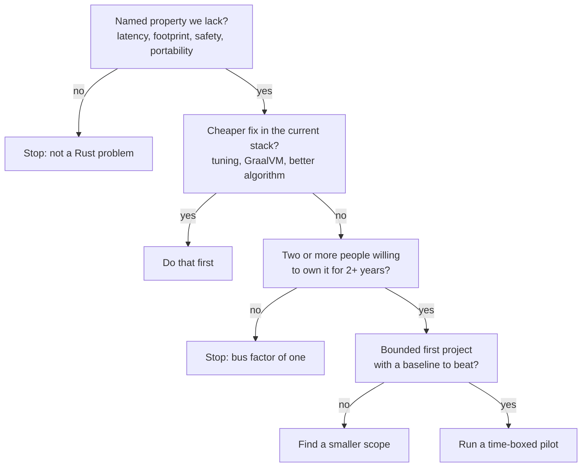
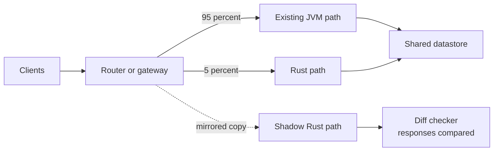
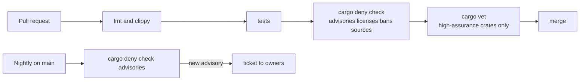
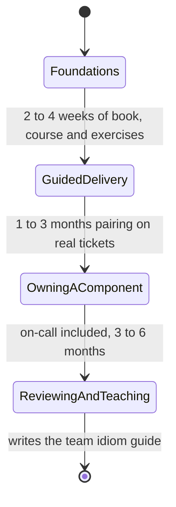

import Callout from '../../components/mdx/Callout.astro';

The first ten parts of this series were about writing Rust well. This one is about a different job: deciding whether your organization should write Rust at all, and if so, where, in what order, under which rules, and how you will know it worked. It is written for principal and staff engineers, tech leads and architects in JVM or Go shops who keep hearing "we should rewrite this in Rust" and need a better answer than yes or no. By the end you should be able to run a Rust evaluation, pick a first project that can actually succeed, write the dependency and build policy before the first service ships, and define the numbers that decide whether you keep going.

<Callout variant="note" title="You should already know">
This part assumes the technical ground covered earlier: ownership and borrowing ([Part 2](/blog/rust-02-ownership-borrowing)), traits and generics ([Part 4](/blog/rust-04-traits-generics)), concurrency and async ([Part 7](/blog/rust-07-concurrency), [Part 8](/blog/rust-08-async-rust)), `unsafe` and FFI ([Part 9](/blog/rust-09-unsafe-ffi-macros)), and release profiles, profiling and library API design ([Part 10](/blog/rust-10-performance-api-design)). You don't need all of it to follow the argument, but you need it to judge the trade-offs.
</Callout>

## The question is never "is Rust good?"

Rust is a good language. That fact settles nothing. The question a principal engineer has to answer is narrower and more uncomfortable: *is Rust the cheapest way for this organization to get a property it currently lacks?* "Cheapest" includes hiring, training, build infrastructure, on-call, library gaps and the opportunity cost of the people doing the migration. "A property it lacks" means something you can name and measure: tail latency, memory per instance, a class of security bugs, a binary that runs on five platforms.

If you can't name the property, you are not evaluating Rust. You are evaluating whether the team finds Rust interesting, which is a real input (motivated engineers are productive engineers) but not a business case.

### What Rust actually buys you

Strip away the enthusiasm and Rust offers a short list of concrete properties:

- **Memory safety without a garbage collector.** Safe Rust rules out use-after-free, double free, buffer overflows and data races at compile time. If you are replacing C or C++, this is the headline. If you are replacing Kotlin or Go, you already have memory safety; what changes is the *absence of a GC*.
- **Predictable latency.** No stop-the-world pauses and no GC tuning. Allocation still costs something, and a badly designed Rust service can have awful tails, but the runtime doesn't add jitter on its own schedule.
- **Small, dense deployments.** A Rust HTTP service typically idles at a few megabytes of resident memory and starts in milliseconds. On the JVM, heap sizing, JIT warm-up and class loading make the same service much larger and slower to become fast. If you run thousands of instances, or run on the edge, or bill per GB-second, this is money.
- **A compiler that enforces invariants.** Exhaustive `match`, `Send`/`Sync`, ownership of resources, typestate APIs. Refactors that would be risky in a dynamic or loosely typed codebase become mechanical.
- **One native core for many platforms.** A Rust library can be called from Kotlin on Android, Swift on iOS, the JVM, Python, Node and the browser (via WebAssembly). That is a different reason to adopt Rust than performance, and often a better one.

### What it costs

The costs are equally concrete, and the people asking for Rust tend to underweight them:

- **Learning curve.** Experienced engineers write working Rust within weeks; idiomatic Rust (lifetimes in APIs, async pitfalls, trait design) takes months. Plan for a productivity dip.
- **Compile times.** A service with a few hundred transitive dependencies takes minutes to build cold. Incremental builds are fine; CI without caching is not.
- **Hiring.** The pool of experienced Rust backend engineers is smaller than for Java, Kotlin or Go. Most organizations grow Rust engineers internally, which makes training part of the decision.
- **Ecosystem fit.** Open-source crates are strong for networking, parsing, cryptography and data processing. The gap is usually *internal*: your auth SDK, feature-flag client, config conventions and observability wrappers exist for the JVM only. Someone has to write and own Rust versions.
- **Operational parity.** Runbooks, dashboards and on-call instincts were built for the JVM. Heap profiling looks different, thread dumps don't exist in the same form, and async stacks need tools like `tokio-console`.

None of these are reasons to say no. They are line items. A decision that doesn't list them isn't a decision.

## A decision framework

I use four filters, in order. Failing any one is enough to stop or to shrink the scope.



**Filter 1: a named property.** "Our payment router's p99 is dominated by GC pauses under load" is a property. "Rust is faster" is not.

**Filter 2: a cheaper fix in the current stack.** Most proposals should die here, and that is fine. JVM GC pauses often shrink dramatically with ZGC or Shenandoah plus allocation discipline; startup and footprint improve with GraalVM native images; a slow hot path is frequently an algorithm problem. If one engineer-month of tuning gets 80% of the win, take it.

**Filter 3: ownership.** A Rust service owned by one enthusiast is a liability the day that person leaves. Require at least two engineers who will own it, and a manager who has agreed to the training time.

**Filter 4: a bounded first project with a baseline.** If you can't measure the current system, you can't claim the new one is better. Capture the baseline before writing a line of Rust.

### A scoring table for candidate workloads

When several teams want to try Rust, have them score their candidate. It is a structure for the conversation, not a formula.

| Signal | Points toward Rust | Points away from Rust |
|---|---|---|
| Latency budget | Strict p99/p999 targets, GC pauses visible in traces | Latency dominated by downstream calls or the database |
| Footprint | Thousands of instances, edge, embedded, per-GB billing | A handful of pods on a shared cluster |
| Input | Parses untrusted bytes (protocols, files, media) | Internal JSON from trusted services |
| Change rate | Stable domain, performance-critical core | Rapid product iteration, schema churn weekly |
| Reuse | Same logic needed on mobile, web, server | One consumer, one platform |
| Team | Two-plus motivated owners, time to learn | One volunteer, deadline next quarter |
| Ecosystem | Needs mature crates (HTTP, gRPC, Postgres, Kafka) | Needs an internal JVM-only SDK nobody will port |

A CRUD service over Postgres that calls three other services scores poorly: its latency is the database's and its bottleneck is the roadmap. A proxy, protocol parser, media pipeline, rules engine shared by three clients, or high-fan-out service with strict tails scores well.

## What the public case studies actually teach

Rust adoption stories get retold until they turn into slogans. The useful thing is the *pattern* behind each one, not the headline number. Everything below is from public engineering blogs and talks; treat the specifics as reported, not as benchmarks you will reproduce.

### Discord: a GC-shaped latency problem

Discord wrote publicly (in 2020) about moving its "Read States" service from Go to Rust. The service held a large in-memory cache and, as they described it, Go's garbage collector caused regular latency spikes because it had to scan that cache periodically even when little garbage was produced. The Rust version, with no GC, removed those spikes and they reported better latency and CPU use overall.

**Pattern:** a long-lived, large, mostly-live heap is the worst case for a tracing GC and the best case for Rust's deterministic deallocation. Note what they did *not* do: rewrite Discord. They rewrote one service with one measurable pathology.

### Cloudflare: a proxy, rebuilt from scratch

Cloudflare described building Pingora, an HTTP proxy framework in Rust, to replace their use of NGINX for a large share of traffic. Their write-up reported significantly lower CPU and memory consumption and better connection reuse, partly from the architecture (a shared connection pool across threads, which was hard to achieve with NGINX's process model) and partly from the language. They later open-sourced the framework.

**Pattern:** the win came from a *new architecture* that Rust made safe to build, not from translating C line by line. When you hear "Rust made it faster", ask how much was language and how much was design.

### AWS Firecracker: safety where it is non-negotiable

Firecracker is the virtual machine monitor behind AWS Lambda and Fargate, open-sourced in 2018. It is written in Rust and deliberately minimal. In a multi-tenant VMM, a memory-safety bug can mean one customer reading another's memory, so eliminating that class of bug at the language level is the point.

**Pattern:** when the cost of a memory-safety bug is catastrophic and the code must be fast and small, the cost-benefit question answers itself. Most backend services are not in that position; know whether yours is.

### Android: new code in safe languages, old code left alone

Google has published data showing that the share of Android vulnerabilities caused by memory-safety bugs dropped substantially (from roughly three-quarters in 2019 to around a quarter by 2024, per their reporting) as new native code shifted to memory-safe languages, primarily Rust, while most existing C and C++ was *not* rewritten. Their explanation is that vulnerabilities concentrate in new and recently changed code, so changing what you write *next* moves the numbers faster than rewriting what you already have.

**Pattern:** this is the single most useful data point for a principal engineer. **Write new components in Rust; don't rewrite stable old ones for safety alone.** The returns from rewriting mature, well-tested code are lower than intuition suggests.

### The Linux kernel: integration is the hard part

Rust support was merged into the mainline Linux kernel in version 6.1 (late 2022), and Rust drivers have been landing since. The public discussions are instructive mostly for what was hard: build-system integration, toolchain version policy, writing safe abstractions over existing C APIs, and the social cost of asking long-time maintainers to review a second language.

**Pattern:** the technology was the easy part. Toolchain policy, review capacity and the bindings layer between old and new code were the expensive parts. Your org will be the same at smaller scale.

## Introducing Rust incrementally

The safe way in is a ladder: each step increases the blast radius only after the previous one proved something specific.


### Rung 1: internal tooling and CLIs

A deploy helper, log processor or schema linter. Low risk, real users (your engineers), fast feedback. It proves the toolchain, CI and code review work; it proves nothing about production services.

### Rung 2: a sidecar

A Rust process that runs next to an existing JVM service in the same pod and does one job: TLS termination, request signing, a local rate limiter, a protocol translator, a compression or encryption step. It communicates over localhost HTTP, gRPC or a Unix socket.

The sidecar proves the operational story: you can build container images, deploy, observe, alert, and wake someone up for a Rust process. Its contract is narrow and its failure is contained.

### Rung 3: a library over FFI

This is where Rust can pay off without anyone deploying a new service. You put pure logic in a Rust crate, expose a C ABI, and call it from the JVM, Android or iOS. Typical candidates: pricing and rules engines that must give identical answers on every platform, parsers for a binary format, cryptographic or compression routines, a sync engine for mobile clients.

Structure it as two crates: a pure core with no FFI concerns, and a thin binding crate that is the only place allowed to touch `unsafe`.

```toml
# Cargo.toml (workspace root)
[workspace]
resolver = "3"
members = ["crates/*"]

[workspace.package]
edition = "2024"
rust-version = "1.85"
license = "Apache-2.0"

[workspace.dependencies]
thiserror = "2"

[workspace.lints.rust]
unsafe_code = "deny"
unsafe_op_in_unsafe_fn = "deny"

[workspace.lints.clippy]
unwrap_used = "warn"
dbg_macro = "deny"
```

The core is ordinary, testable Rust:

```rust
//! crates/pricing-core/src/lib.rs: pure pricing logic, no I/O, no FFI.

#[derive(Debug, thiserror::Error, PartialEq, Eq)]
pub enum PricingError {
    #[error("quantity must be positive")]
    ZeroQuantity,
    #[error("discount {0} basis points exceeds 100%")]
    DiscountTooLarge(u32),
}

/// Price in minor units (cents) after a discount in basis points.
pub fn line_total(unit_cents: u64, quantity: u32, discount_bps: u32) -> Result<u64, PricingError> {
    if quantity == 0 {
        return Err(PricingError::ZeroQuantity);
    }
    if discount_bps > 10_000 {
        return Err(PricingError::DiscountTooLarge(discount_bps));
    }
    let gross = unit_cents.saturating_mul(u64::from(quantity));
    let discount = gross.saturating_mul(u64::from(discount_bps)) / 10_000;
    Ok(gross - discount)
}

#[cfg(test)]
mod tests {
    use super::*;

    #[test]
    fn applies_discount() {
        assert_eq!(line_total(1_000, 3, 1_000), Ok(2_700));
    }

    #[test]
    fn rejects_zero_quantity() {
        assert_eq!(line_total(1_000, 0, 0), Err(PricingError::ZeroQuantity));
    }
}
```

The binding crate opts out of the workspace-wide `unsafe_code = "deny"` explicitly, builds a `cdylib`, and follows three rules at the boundary: only C-compatible types cross it, errors become status codes, and panics never unwind into foreign code.

```toml
# crates/pricing-ffi/Cargo.toml
[package]
name = "pricing-ffi"
version = "0.1.0"
edition.workspace = true
rust-version.workspace = true
license.workspace = true

[lib]
crate-type = ["cdylib"]

[dependencies]
pricing-core = { path = "../pricing-core" }

[lints.rust]
# The one crate where FFI attributes and unsafe blocks are allowed.
unsafe_code = "allow"
unsafe_op_in_unsafe_fn = "deny"
```

```rust
//! crates/pricing-ffi/src/lib.rs: thin C ABI over pricing-core.

use std::panic::catch_unwind;

pub const PRICING_OK: i32 = 0;
pub const PRICING_ZERO_QUANTITY: i32 = 1;
pub const PRICING_DISCOUNT_TOO_LARGE: i32 = 2;
pub const PRICING_NULL_POINTER: i32 = 98;
pub const PRICING_PANIC: i32 = 99;

/// # Safety
/// `out` must be a valid, aligned, writable pointer to a `u64`.
#[unsafe(no_mangle)]
pub unsafe extern "C" fn pricing_line_total(
    unit_cents: u64,
    quantity: u32,
    discount_bps: u32,
    out: *mut u64,
) -> i32 {
    if out.is_null() {
        return PRICING_NULL_POINTER;
    }
    let result = catch_unwind(|| pricing_core::line_total(unit_cents, quantity, discount_bps));
    match result {
        Ok(Ok(total)) => {
            // SAFETY: caller guarantees `out` is valid and writable; checked non-null above.
            unsafe { out.write(total) };
            PRICING_OK
        }
        Ok(Err(pricing_core::PricingError::ZeroQuantity)) => PRICING_ZERO_QUANTITY,
        Ok(Err(pricing_core::PricingError::DiscountTooLarge(_))) => PRICING_DISCOUNT_TOO_LARGE,
        Err(_) => PRICING_PANIC,
    }
}
```

Two edition-2024 details are visible here: `#[unsafe(no_mangle)]` (the attribute is now marked unsafe because exporting a symbol can collide with another one), and the explicit `unsafe { }` block inside the `unsafe fn`, which `unsafe_op_in_unsafe_fn` requires. Since Rust 1.81 a panic that tries to unwind out of an `extern "C"` function aborts the process instead of being undefined behavior; `catch_unwind` turns that abort into an error code the caller can handle.

On the JVM side, Java 22 finalized the Foreign Function and Memory API, which replaces hand-written JNI for this kind of call. From Kotlin:

```kotlin
import java.lang.foreign.Arena
import java.lang.foreign.FunctionDescriptor
import java.lang.foreign.Linker
import java.lang.foreign.SymbolLookup
import java.lang.foreign.ValueLayout

object Pricing {
    private val linker = Linker.nativeLinker()
    private val lib = SymbolLookup.libraryLookup("libpricing_ffi.so", Arena.global())
    private val lineTotal = linker.downcallHandle(
        lib.find("pricing_line_total").orElseThrow(),
        FunctionDescriptor.of(
            ValueLayout.JAVA_INT,   // status code
            ValueLayout.JAVA_LONG,  // unit_cents (u64; keep values below Long.MAX_VALUE)
            ValueLayout.JAVA_INT,   // quantity (u32)
            ValueLayout.JAVA_INT,   // discount_bps (u32)
            ValueLayout.ADDRESS,    // out: *mut u64
        ),
    )

    fun lineTotal(unitCents: Long, quantity: Int, discountBps: Int): Long =
        Arena.ofConfined().use { arena ->
            val out = arena.allocate(ValueLayout.JAVA_LONG)
            val status = lineTotal.invokeWithArguments(unitCents, quantity, discountBps, out) as Int
            when (status) {
                0 -> out.get(ValueLayout.JAVA_LONG, 0)
                1 -> throw IllegalArgumentException("quantity must be positive")
                2 -> throw IllegalArgumentException("discount too large")
                else -> throw IllegalStateException("pricing native error $status")
            }
        }
}
```

`invokeWithArguments` keeps the example readable; for hot paths, Java code typically uses `invokeExact` with exact types. Note the signedness mismatch: Java has no unsigned 64-bit primitive, so the boundary is a place to state your value ranges explicitly.

For anything bigger than a handful of functions, don't hand-write the bindings. Mozilla's UniFFI generates Kotlin, Swift and Python bindings from an interface definition or proc-macro annotations, handles strings, records, enums and errors, and is used in shipping mobile apps. For JVM-only use, JNI crates like `jni` still work; for Python, PyO3 is the standard. Part 9 covered these tools in more depth.

What rung 3 proves: one Rust core can serve several platforms and the binding layer can be owned. It is also where packaging bites: shipping a native library per OS and CPU inside a JAR or AAR is real work.

### Rung 4: a new service

Only now build a new production service in Rust, and make it *new*, not a rewrite: no behavior to preserve bit for bit, no clients relying on quirks. Choose one that scores well on the table above and that has a well-understood interface (an OpenAPI or protobuf contract). Series B of this blog, starting with [Rust Backend, Part 1](/blog/rust-backend-01-first-http-service), builds exactly this kind of service end to end.

### Rung 5: rewrite a measured hot path

The last rung is a targeted rewrite of an existing component that has a measured problem Rust can fix. Never the whole service; one path. Use the strangler pattern: put the new implementation behind the same interface, mirror traffic, compare results, shift traffic gradually, keep the old path as a rollback.



The diff checker is not optional: rewrites fail on undocumented edge cases (rounding, empty strings, time zones, duplicate keys), and comparing outputs on real traffic is how you find them before users do. Shadow paths must not have side effects, so mirror reads or point shadow writes at a sandbox.

## Supply-chain and dependency policy

A Rust service commonly pulls in 200 to 400 transitive crates. Each one is code from someone you don't know, and two kinds of it run *at build time* on your CI machines: `build.rs` scripts and procedural macros. Write the policy before the first service ships, because retrofitting it means arguing about every existing dependency at once.

### The three tools and what each answers

| Tool | Question it answers | Typical use |
|---|---|---|
| `cargo-audit` | Does the lockfile contain a crate version with a known advisory in the RustSec database? | Quick CI gate, nightly scheduled check |
| `cargo-deny` | Do our dependencies meet policy: advisories, licenses, banned crates, allowed sources, duplicates? | The main policy gate in CI |
| `cargo-vet` | Has someone we trust actually reviewed the code of each dependency version? | High-assurance code; import audits from other orgs |

`cargo-deny` covers advisories as well as licenses, bans and sources, so most teams run it as the main gate and use `cargo-audit` as a lightweight extra or not at all. A starting `deny.toml`:

```toml
[graph]
all-features = true

[advisories]
version = 2
yanked = "deny"
ignore = [
    # Every ignore needs a reason and a review date, e.g.
    # { id = "RUSTSEC-YYYY-NNNN", reason = "not reachable: we never call X; revisit by 2027-01-31" },
]

[licenses]
version = 2
allow = ["MIT", "Apache-2.0", "BSD-3-Clause", "ISC", "Unicode-3.0", "Zlib"]
confidence-threshold = 0.9
exceptions = [
    # Mozilla's CA bundle is data under CDLA-Permissive-2.0; approved for this crate only.
    { crate = "webpki-roots", allow = ["CDLA-Permissive-2.0"] },
]

[bans]
multiple-versions = "warn"
wildcards = "deny"
deny = [
    { crate = "openssl-sys", reason = "we standardize on rustls" },
]

[sources]
unknown-registry = "deny"
unknown-git = "deny"
allow-registry = ["https://github.com/rust-lang/crates.io-index"]
```

That `webpki-roots` exception is not hypothetical. Running `cargo deny check` against a plain axum and SQLx (rustls) service with only the usual permissive licenses allowed fails like this:

```text
error[rejected]: failed to satisfy license requirements
   ┌─ ~/.cargo/registry/src/index.crates.io-.../webpki-roots-0.26.11/Cargo.toml:25:12
   │
25 │ license = "CDLA-Permissive-2.0"
   │            ━━━━━━━━━━━━━━━━━━━
   │            │
   │            rejected: license is not explicitly allowed
```

This is the policy working as intended: someone has to look at a non-standard license once, record a decision scoped to one crate, and move on. A per-crate exception is better than adding the license to the global allow list, because the next crate using it gets reviewed too.

### `cargo-vet` and trusted audits

`cargo-audit` and `cargo-deny` only know about *reported* problems. `cargo-vet` asks a stronger question: has a human you trust reviewed this exact version? Your team records audits in the repository, and you can import audit sets that other organizations publish (Mozilla, Google and others have published theirs). New or bumped dependencies without an audit fail the check until someone reviews the diff or explicitly exempts it. It is more work, which is why I recommend it for high-assurance components (anything handling credentials, payments or untrusted input in-process) rather than every repo on day one.

### Policy rules that matter more than tools

- **Commit `Cargo.lock` and build with `--locked` in CI.** A build that silently resolves new versions is a supply-chain hole.
- **Mirror or proxy crates.io** (Artifactory, Cloudsmith, or `cargo vendor`) so builds survive upstream outages and you know what entered your network.
- **Review new dependencies like code.** Maintained? Widely used? Has a `build.rs` or proc macro? How many transitive crates? `cargo tree -i <crate>` and `cargo tree --duplicates` answer most of it.
- **Prefer `default-features = false`** and opt into what you use: fewer crates, fewer build scripts, shorter builds.
- **Scheduled updates.** A weekly Dependabot or Renovate PR plus a nightly `cargo deny check advisories` on `main` catches advisories published after you merged.



## Build times at scale

Rust adoptions tend to hit the same wall around the second or third service: CI takes fifteen minutes and people blame the language. Most of it is fixable once you measure which part is slow. `cargo build --timings` writes an HTML report showing every crate's compile time and how much parallelism the build achieved; start there.


### Workspace shape

Rust's unit of compilation and parallelism is the crate. One enormous crate means every edit recompiles everything in it, serially within that crate's codegen. Split by stability:

- **Leaf crates** for domain types and pure logic that rarely change.
- **Adapter crates** for database, HTTP clients, messaging.
- **A thin binary crate** that wires them together.

Editing a handler then recompiles the binary and maybe one adapter, not the domain. Keep dependency versions in `[workspace.dependencies]` so every crate shares one version of `tokio`, `serde` and friends, and use `[workspace.lints]` so lint policy is set once.

### Caching

- **CI caching of `target/` and the cargo registry**, keyed on `Cargo.lock`, the toolchain version and the target. On GitHub Actions, `Swatinem/rust-cache` does this well. Cold-to-warm can be the difference between ten minutes and two.
- **`sccache`** caches individual compiler invocations, locally or in a shared bucket (S3, GCS, Redis), across branches and machines. Set `RUSTC_WRAPPER=sccache`. It helps most with dependency crates; incremental compilation of workspace crates is not cached by it.
- **Docker builds** need their own strategy: copying the whole source before building invalidates the dependency layer on every commit. `cargo-chef` solves this, and [Rust Backend, Part 8](/blog/rust-backend-08-shipping-production) shows the full Dockerfile.

```bash
# Local developer setup: shared compiler cache
cargo install sccache --locked
export RUSTC_WRAPPER=sccache

# CI: always reproducible, always measured
cargo build --locked --release --timings
sccache --show-stats
```

### Linking, debuginfo and the inner loop

Linking is paid for every test binary and every build. Recent Rust releases use the LLD linker by default on `x86_64-unknown-linux-gnu`; on other targets you can opt into `lld` or `mold` explicitly. Reducing debug info in dev and CI profiles also cuts link time and disk usage noticeably:

```toml
# .cargo/config.toml is for flags; Cargo.toml profiles for these:
[profile.dev]
debug = "line-tables-only"   # enough for backtraces, much less to link

[profile.dev.package."*"]
opt-level = 1                # dependencies a bit optimized, your code fast to rebuild

[profile.release]
lto = "thin"
codegen-units = 1
```

Teach people to live in `cargo check` (type-check only, no codegen) and `rust-analyzer`, and to run `cargo nextest run` instead of `cargo test`; nextest runs each test as its own process in parallel and is usually noticeably faster for large suites. Integration tests deserve a note: each file in `tests/` becomes a separate binary that must be linked, so a crate with forty test files pays forty links. Consolidate them into one `tests/it/main.rs` with modules.

### Set a budget

Put a number on it: "a warm CI run on a typical PR completes in under N minutes". Track it on a dashboard next to deploy frequency. Build time that nobody owns only goes up.

## The training plan

Most of your Rust engineers will be engineers you already have. That is good news: they already know your domain, your systems and your on-call culture. It means the training plan is part of the adoption cost, not a nice-to-have.



A plan that has worked for me, with durations as rough guides rather than promises:

1. **Foundations (2 to 4 weeks, part-time).** *The Rust Programming Language* book, a structured course such as Google's free *Comprehensive Rust*, and Rustlings exercises. Kotlin engineers find enums, pattern matching and `Result` familiar; ownership and lifetimes are the new muscle.
2. **Guided delivery (1 to 3 months).** Real tickets on the pilot, paired or closely reviewed. If nobody internal is experienced, buy a few weeks of external review and pairing; it is cheaper than a year of non-idiomatic code.
3. **Owning a component, on-call included.** On-call teaches what the book doesn't: reading panic backtraces from logs, finding a blocking call in async code, profiling allocation.
4. **Reviewing and teaching.** The first cohort writes the team's idiom guide: error conventions, blessed crates, service structure, and when `unsafe` is allowed (almost never in services).

Two practices make the difference: a **Rust guild** that meets weekly to share code and war stories, and a **paved road**, a service template with logging, tracing, config, health checks, CI and the deny policy already wired. Series B of this blog is that paved road written out.

## Measuring success

Decide what success means *before* the pilot starts, write it down, and agree on kill criteria. Otherwise every pilot is declared a success by the people who wanted it.

### Metrics worth agreeing on

| Category | Example metric | Why |
|---|---|---|
| The property you named | p99 and p999 latency, memory per instance, cost per million requests | This is the business case |
| Reliability | incidents and severity per quarter, rollback rate | A faster service that pages more is not a win |
| Security | memory-safety findings, dependency advisories open more than N days | Especially if replacing C or C++ |
| Delivery | lead time for changes, PR review iterations, build time | Detects the productivity dip and whether it recovers |
| People | time to first merged PR for a new joiner, survey of the team | Sustainability and hiring signal |

Compare against the captured baseline under comparable, load-normalized traffic, for long enough to include a bad week. If the new system also got a new architecture and bigger instances, separate the effects or admit you can't.

### Kill criteria

Write down what would make you stop: "if after two quarters the pilot misses the latency target, or an owner leaves without a replacement, we return to the JVM path and document what we learned." Stopping a pilot that failed its criteria is the process working. Continuing on sunk cost is how organizations end up with an orphaned Rust service nobody can modify.

## When not to use Rust

Some situations where I would say no, or not yet:

- **The bottleneck is elsewhere.** The service waits on Postgres or on three downstream calls. Rust will make the 5% of time spent in your code faster.
- **The product changes weekly.** Early-stage products need iteration speed and the ability to throw code away cheaply. Rust's rigor is an asset for stable cores and friction for exploration.
- **There is one interested engineer.** A bus factor of one is a no regardless of the technical merits.
- **The critical dependency only exists on the JVM.** If you would need to port a large internal SDK or a mature JVM library (a rules engine, a complex reporting library) just to start, the project is really a porting project.
- **The team is already at capacity.** Adoption needs slack for training, slower reviews and build work.
- **It is a résumé project.** Wanting Rust experience is legitimate; give it a hack week or a tooling project, not production risk.

Saying no well is part of the job. A clear "not here, but this other workload qualifies" builds more credibility for Rust than a pilot that fails publicly.

## Common mistakes

- **Starting with a rewrite.** The rewrite inherits every undocumented behavior of the old system and has no new value to show until it reaches parity. Start with new components; rewrite only measured hot paths behind a strangler.
- **No baseline.** "It feels faster" isn't evidence. Without before-and-after numbers on comparable load, you cannot defend the decision to leadership or to skeptical peers.
- **Underestimating internal ecosystem work.** The open-source crates are fine; your company's auth, config, telemetry and service discovery conventions need Rust versions, and somebody has to own them.
- **Ignoring build infrastructure until it hurts.** Fifteen-minute CI runs erode goodwill faster than any borrow-checker error. Caching, workspace layout and a build-time budget belong in the first month.
- **No dependency policy.** Adding `cargo-deny` after a year means arguing about 400 crates at once. Add it with the first service.
- **Allowing `unsafe` casually in services.** Service code should almost never need it. Confine `unsafe` to dedicated FFI or performance crates, deny it by lint elsewhere, and require a second reviewer for any `unsafe` block.
- **Treating two Rust experts as the only reviewers.** They become the bottleneck and the bus factor. Grow reviewers deliberately.

## Interview questions

<details>
<summary>Your team proposes rewriting a Kotlin service in Rust "for performance". How do you respond?</summary>

I would ask which property is lacking and how it was measured: p99 latency, memory, CPU cost. Then I'd check whether the bottleneck is in our code at all; many services spend most of their time waiting on the database or downstream calls. If GC pauses are the problem, I'd want to see whether ZGC, allocation reduction or a better data structure fixes it first. If Rust still makes sense, I'd push for a strangler approach on the specific hot path, with a baseline, shadow traffic and agreed kill criteria, rather than a full rewrite.

</details>

<details>
<summary>How would you introduce Rust into a JVM organization with the least risk?</summary>

Incrementally, raising the blast radius only after each step proves something: first internal tools and CLIs to prove the toolchain and CI; then a sidecar to prove deployment and on-call; then possibly a library called via FFI (Java's FFM API, JNI or UniFFI) to share a core across platforms; then a new service with a clear contract; and only then a targeted rewrite of a measured hot path behind a router with shadow traffic. Each step needs two or more owners, agreed metrics and a rollback path.

</details>

<details>
<summary>What are cargo-audit, cargo-deny and cargo-vet, and how do they differ?</summary>

`cargo-audit` checks the lockfile against the RustSec advisory database for known vulnerable or unmaintained versions. `cargo-deny` is a broader policy engine: advisories plus license allow lists, banned crates, duplicate versions and allowed registries or git sources. `cargo-vet` addresses a different gap: whether each dependency version has actually been reviewed by someone you trust, with audits recorded in the repo and shareable across organizations. Known-bad detection versus policy versus positive review.

</details>

<details>
<summary>CI for your Rust services takes 15 minutes. Walk through how you would bring it down.</summary>

Measure first with `cargo build --timings` and CI step timings to see whether time goes to cold dependency builds, recompiling large crates, linking or running tests. Then: cache `target/` and the registry keyed on the lockfile and toolchain; add sccache for cross-branch sharing; split large crates so edits don't recompile the world; prune dependency features; use a fast linker and lighter debug info; run tests with cargo-nextest and consolidate integration test binaries; use cargo-chef for Docker layers. Finally, set a build-time budget and track it.

</details>

<details>
<summary>What rules do you put in place at an FFI boundary between Rust and the JVM?</summary>

Only C-compatible types cross the boundary; complex data goes as plain structs, byte buffers or a serialized format. Errors become status codes or error objects, never panics: wrap calls in `catch_unwind` (unwinding out of `extern "C"` aborts in current Rust). Document ownership of every pointer and who frees it. Keep the binding crate thin, with all logic in a safe, separately tested core crate. Confine `unsafe` there, deny it elsewhere by lint, and prefer generated bindings (UniFFI, or jextract on the Java side) once the surface grows beyond a few functions.

</details>

<details>
<summary>How do you decide whether a Rust pilot succeeded?</summary>

By criteria written before it started: the target property (latency, footprint or cost) measured against a captured baseline under comparable load; no regression in reliability (incidents, rollbacks); delivery metrics that recover after the initial dip; and people metrics such as onboarding time and owner retention. I'd also set explicit kill criteria and be careful to separate the effect of the language from the effect of any redesign that happened at the same time.

</details>

## Key takeaways

- Evaluate Rust against a named, measurable property your organization lacks, and check for a cheaper fix in the current stack first.
- Rust's real benefits are memory safety without GC, predictable latency, small footprints, strong compile-time invariants and one native core for many platforms. Its real costs are learning time, build times, hiring and internal ecosystem gaps.
- The public case studies share a pattern: targeted adoption for a specific pathology or a new component, not big-bang rewrites. Android's data is the strongest argument for writing new code in Rust rather than rewriting old code.
- Climb the adoption ladder: tooling, sidecar, FFI library, new service, then measured hot-path rewrites behind a strangler with shadow traffic.
- Write supply-chain policy (`cargo-deny`, locked builds, mirrors, dependency review, `cargo-vet` where assurance matters) before the first service ships.
- Treat build time as an owned metric: workspace layout, caching, sccache, linker and nextest.
- Most Rust engineers are grown, not hired. Budget for training, pairing, a guild and a paved-road template.
- Define success and kill criteria up front, and be willing to say no.

Continue with the next series: [Rust Backend, Part 1: Your First HTTP Service](/blog/rust-backend-01-first-http-service)
