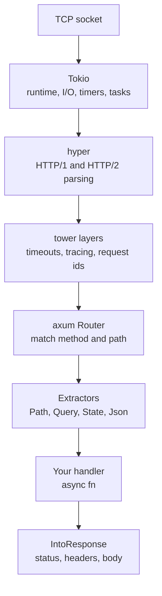
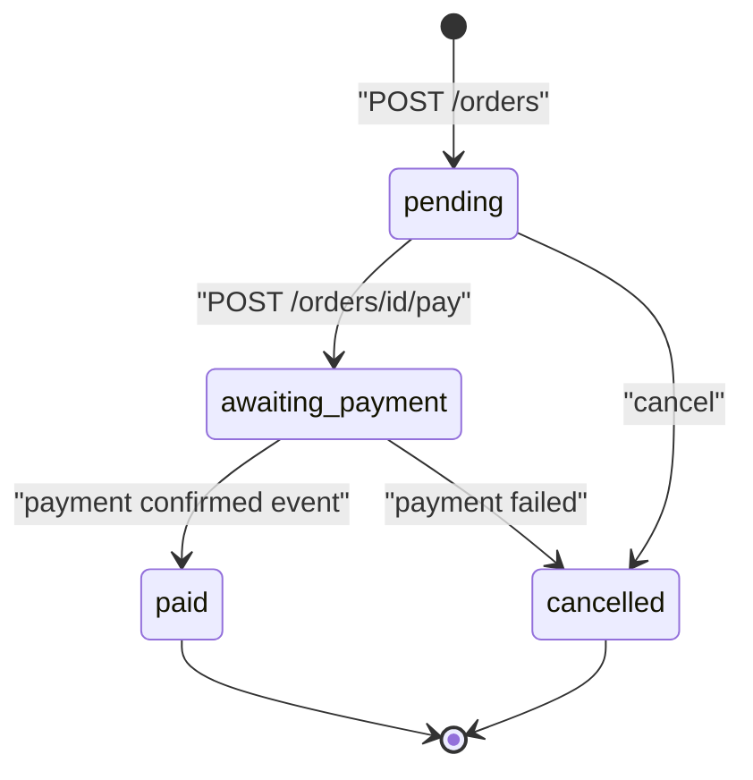
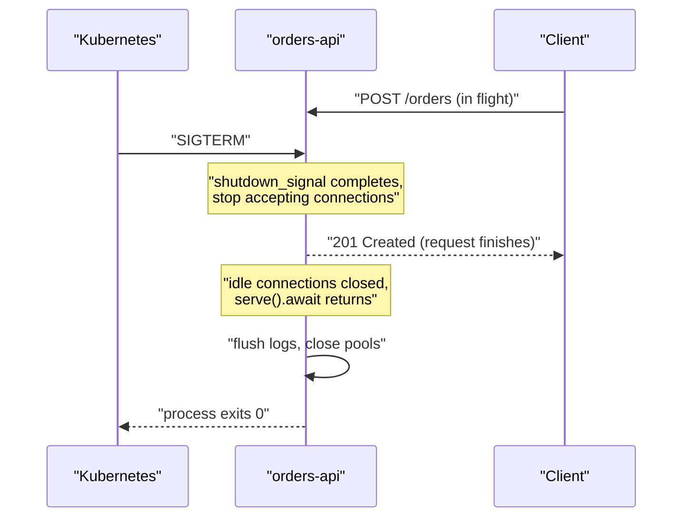

import Callout from '../../components/mdx/Callout.astro';

This series is for engineers who can already write Rust and want to build real backend services with it: HTTP APIs that talk to Postgres, emit structured logs, survive deploys and run in Kubernetes. Over eight parts we build one service, **orders-api**, a small order-management API where customers create orders, list them and pay for them, with payment confirmations arriving asynchronously. By the end of this first part you will have a running axum service with typed request handling, validation, shared state and a clean shutdown path, and you will understand the layers underneath it well enough to debug them.

<Callout variant="note" title="You should already know">
- Ownership, borrowing, traits and generics ([Rust, Part 2](/blog/rust-02-ownership-borrowing), [Part 4](/blog/rust-04-traits-generics))
- `Result`, `Option` and the `?` operator ([Part 3](/blog/rust-03-types-enums-errors))
- What a future is and how Tokio runs them ([Part 8: Async Rust](/blog/rust-08-async-rust))
- HTTP methods, status codes and resource design ([Backend Engineering, Part 2](/blog/backend-02-rest-api-design))
</Callout>

## Why Rust for a backend service

Most backend services are not CPU-bound. They spend their time waiting on databases, caches and other services. So the case for Rust on the backend is not "it is faster" in the naive sense. It is a bundle of more specific properties.

### What you actually get

**Predictable latency and small footprint.** There is no garbage collector, so there are no GC pauses in your p99 and no heap-sizing tuning. A typical axum service idles at a few megabytes of resident memory, where a JVM service usually needs hundreds. When you run hundreds of pods, that difference shows up on the cloud bill. When you run a latency-sensitive proxy or gateway, it shows up in tail latency.

**Correctness pressure at compile time.** The type system catches a class of bugs that other stacks find in production: data races (the compiler rejects unsynchronized shared mutation), null handling (`Option` instead of `null`), unhandled error paths (`Result` must be dealt with) and invalid state transitions if you model your domain with enums. In a service, this mostly means fewer "how did this ever work" incidents.

**Cheap concurrency.** Tokio tasks are a few hundred bytes plus whatever state your future holds. Tens of thousands of concurrent connections on one modest instance are normal. This is similar to what Kotlin coroutines or Go goroutines give you, and very different from thread-per-request servers.

**A single static binary.** Deployment is copying one file into a small container image. No runtime to install, fast startup, no warm-up phase for a JIT.

### The honest costs

**Compile times.** A service with axum, SQLx, tracing and OpenTelemetry takes a while to build from scratch and incremental builds are slower than you are used to from Go. It is manageable (we cover caching in [Part 8](/blog/rust-backend-08-shipping-production)), but it is a real tax on the edit-compile-test loop.

**A smaller ecosystem for enterprise integration.** Need a SOAP client, a mature SAML library, or the official SDK for some niche vendor? The JVM almost certainly has it; Rust might not, or has a community crate with one maintainer.

**The learning curve is front-loaded.** Lifetimes, `Send` bounds on futures and trait-heavy library APIs produce error messages that newcomers find hard to read. A team needs a few people who are genuinely fluent.

### When Kotlin/Spring or Go is the better call

Pick Kotlin with Spring Boot when the service is mostly business rules and integrations, the team already knows the JVM, and you need the breadth of the Spring ecosystem: Spring Security, Spring Data, mature Kafka and messaging support, and every enterprise integration under the sun. You will ship faster, and the JVM's performance is more than enough for a typical CRUD service.

Pick Go when you want a small, simple language that every engineer can read on day one, fast compiles, and good-enough performance without thinking about memory management. Go is excellent for infrastructure glue, CLIs and straightforward network services.

Pick Rust when at least one of these is true: you need tight tail latency or a small memory footprint at scale, the service does real CPU work per request (parsing, compression, crypto, image or data processing), correctness matters enough that you want the compiler to enforce invariants, or the team already has Rust skills and wants one language across services and libraries. The orders-api in this series is deliberately ordinary, because most of what you learn transfers to services where Rust really earns its keep.

## The stack: Tokio, hyper, tower, axum

A Rust HTTP service is several crates stacked on each other, and each one has a narrow job. Understanding the boundaries helps a lot when you read error messages or wire middleware.



### Tokio: the runtime

**Tokio** is the async runtime. It owns a thread pool (by default one worker thread per CPU core), an I/O driver built on epoll or kqueue, and timers. Every accepted connection becomes a task on that runtime, and every request on that connection runs as part of a future polled by Tokio. If you write blocking code in a handler (a synchronous file read, a CPU-heavy loop, `std::thread::sleep`), you stall a worker thread and every other task scheduled on it. [Part 8 of the language series](/blog/rust-08-async-rust) covers the poll model in depth; for now, the rule is simple: in handlers, use async I/O, and push heavy CPU work to `tokio::task::spawn_blocking`.

### hyper: the HTTP implementation

**hyper** parses bytes into HTTP requests and serializes responses back. You rarely touch it directly. axum's `axum::serve` function wires a Tokio `TcpListener` to hyper for you.

### tower: one trait to rule the middleware

**tower** defines the abstraction that everything else plugs into, the `Service` trait. Simplified:

```rust
pub trait Service<Request> {
    type Response;
    type Error;
    type Future: Future<Output = Result<Self::Response, Self::Error>>;

    fn poll_ready(&mut self, cx: &mut Context<'_>) -> Poll<Result<(), Self::Error>>;
    fn call(&mut self, req: Request) -> Self::Future;
}
```

A service is an asynchronous function from a request to a response, with an extra `poll_ready` method that lets it apply backpressure ("I am not ready for another request yet"). A **layer** wraps one service in another: a timeout layer is a service that calls the inner service and races it against a timer. Because everything speaks the same trait, middleware from `tower-http` (tracing, CORS, compression, request ids) works with axum, tonic (gRPC) and any other tower-based server. If you know servlet filters or Ktor plugins, this is the same idea, expressed as a trait instead of a framework hook.

### axum: routing and extractors

**axum** sits on top. Its `Router` is itself a tower `Service`. It matches the method and path, then calls your handler. What makes axum pleasant is the **extractor** system: a handler is a plain `async fn` whose arguments describe what it needs from the request, and axum figures out how to produce them. There are no macros on handlers and no reflection. It is all trait implementations resolved at compile time.


This series uses axum 0.8, tower-http 0.6 and Tokio 1. One axum 0.8 detail trips people up when reading older tutorials: path parameters are written `/orders/{id}`, not `/orders/:id`. The old colon syntax now panics at startup with a message telling you to migrate.

## What orders-api does

The domain is intentionally small so the infrastructure can be the focus:

- A **customer** places an **order** made of **items** (SKU, quantity, unit price in cents).
- An order starts `pending`. The customer asks to pay it, which moves it to `awaiting_payment`.
- A payment provider confirms asynchronously; a consumer (built in [Part 6](/blog/rust-backend-06-async-jobs-messaging-grpc)) moves it to `paid`.
- Pending orders can be cancelled.



In this part we build these endpoints with an in-memory store:

| Method | Path | Purpose |
|---|---|---|
| `GET` | `/health` | liveness check |
| `POST` | `/orders` | create an order |
| `GET` | `/orders` | list orders, optionally by customer |
| `GET` | `/orders/{id}` | fetch one order |
| `POST` | `/orders/{id}/pay` | request payment |

[Part 2](/blog/rust-backend-02-errors-config-tracing) adds proper errors, configuration and logging. [Part 3](/blog/rust-backend-03-postgres-sqlx) replaces the in-memory store with Postgres.

## Project layout

Create the crate with `cargo new orders-api`. Even for a small service, splitting a library from the binary pays off immediately: integration tests can import the router directly, and `main.rs` stays a thin piece of wiring.

```text
orders-api/
├── Cargo.toml
├── src/
│   ├── main.rs          # wiring: runtime, listener, shutdown
│   ├── lib.rs           # module declarations, public API for tests
│   ├── state.rs         # AppState
│   ├── store.rs         # in-memory storage (replaced in Part 3)
│   ├── domain/
│   │   ├── mod.rs
│   │   └── order.rs     # Order, OrderItem, OrderStatus, rules
│   └── routes/
│       ├── mod.rs       # the Router
│       └── orders.rs    # handlers and DTOs
└── tests/
    └── orders.rs        # black-box tests against the Router
```

The `Cargo.toml`:

```toml
[package]
name = "orders-api"
version = "0.1.0"
edition = "2024"

[dependencies]
axum = "0.8"
tokio = { version = "1", features = ["full"] }
serde = { version = "1", features = ["derive"] }
serde_json = "1"
uuid = { version = "1", features = ["v4", "serde"] }
time = { version = "0.3", features = ["serde", "formatting", "parsing"] }
tracing = "0.1"
tracing-subscriber = { version = "0.3", features = ["env-filter"] }

[dev-dependencies]
tower = { version = "0.5", features = ["util"] }
http-body-util = "0.1"
```

The `full` feature of Tokio is convenient while learning; in [Part 8](/blog/rust-backend-08-shipping-production) we trim features to what we use. `lib.rs` just declares modules and re-exports the two things `main.rs` and tests need:

```rust
pub mod domain;
pub mod routes;
pub mod state;
pub mod store;

pub use routes::router;
pub use state::AppState;
```

## The domain model

Start with the domain, not with HTTP. The domain module knows nothing about axum, JSON or status codes. It holds the data and the rules.

```rust
use serde::{Deserialize, Serialize};
use time::OffsetDateTime;
use uuid::Uuid;

#[derive(Debug, Clone, Copy, PartialEq, Eq, Serialize, Deserialize)]
#[serde(rename_all = "snake_case")]
pub enum OrderStatus {
    Pending,
    AwaitingPayment,
    Paid,
    Cancelled,
}

#[derive(Debug, Clone)]
pub struct OrderItem {
    pub sku: String,
    pub quantity: i32,
    pub unit_price_cents: i64,
}

#[derive(Debug, Clone)]
pub struct Order {
    pub id: Uuid,
    pub customer_id: Uuid,
    pub status: OrderStatus,
    pub items: Vec<OrderItem>,
    pub total_cents: i64,
    pub created_at: OffsetDateTime,
}

#[derive(Debug, PartialEq, Eq)]
pub struct TransitionError {
    pub from: OrderStatus,
    pub action: &'static str,
}

impl Order {
    /// Builds a new pending order. Callers validate input first;
    /// this constructor only enforces invariants of the domain.
    pub fn new(customer_id: Uuid, items: Vec<OrderItem>) -> Self {
        let total_cents = items
            .iter()
            .map(|i| i64::from(i.quantity) * i.unit_price_cents)
            .sum();
        Self {
            id: Uuid::new_v4(),
            customer_id,
            status: OrderStatus::Pending,
            items,
            total_cents,
            created_at: OffsetDateTime::now_utc(),
        }
    }

    pub fn request_payment(&mut self) -> Result<(), TransitionError> {
        match self.status {
            OrderStatus::Pending => {
                self.status = OrderStatus::AwaitingPayment;
                Ok(())
            }
            from => Err(TransitionError { from, action: "pay" }),
        }
    }
}
```

A few deliberate choices here:

- **Money is integer cents** (`i64`), never `f64`. Floating point cannot represent 0.1 exactly, and rounding errors in totals are the kind of bug finance teams remember.
- **The state transition is a method that returns `Result`.** Handlers cannot set `status` to an arbitrary value without going through the rule. The `match` is exhaustive, so adding a new status later forces you to decide what `request_payment` does with it.
- **`Serialize` on `OrderStatus`** is a small concession: the enum appears in API responses as `"awaiting_payment"`. Some teams keep serde off domain types entirely and map in the HTTP layer. For an enum this simple, the duplication is not worth it.

A domain rule deserves a unit test, and it needs no HTTP at all:

```rust
#[cfg(test)]
mod tests {
    use super::*;

    #[test]
    fn paying_twice_is_rejected() {
        let mut order = Order::new(Uuid::new_v4(), vec![]);
        assert!(order.request_payment().is_ok());
        assert_eq!(
            order.request_payment(),
            Err(TransitionError { from: OrderStatus::AwaitingPayment, action: "pay" })
        );
    }
}
```

## Shared state and the in-memory store

Handlers need access to storage. In axum, application-wide data lives in a **state** value that you attach to the router once, and that each handler can request with the `State` extractor.

```rust
use std::collections::HashMap;
use std::sync::{Arc, RwLock};

use uuid::Uuid;

use crate::domain::Order;

/// In-memory order storage. Replaced by Postgres in Part 3.
#[derive(Clone, Default)]
pub struct OrderStore {
    inner: Arc<RwLock<HashMap<Uuid, Order>>>,
}

impl OrderStore {
    pub fn insert(&self, order: Order) {
        self.inner.write().unwrap().insert(order.id, order);
    }

    pub fn get(&self, id: Uuid) -> Option<Order> {
        self.inner.read().unwrap().get(&id).cloned()
    }

    pub fn list(&self, customer_id: Option<Uuid>, limit: usize) -> Vec<Order> {
        let guard = self.inner.read().unwrap();
        let mut orders: Vec<Order> = guard
            .values()
            .filter(|o| customer_id.is_none_or(|c| o.customer_id == c))
            .cloned()
            .collect();
        orders.sort_by_key(|o| std::cmp::Reverse(o.created_at));
        orders.truncate(limit);
        orders
    }

    /// Applies `f` to the order while holding the write lock.
    /// Returns `None` if the order does not exist.
    pub fn update<T>(&self, id: Uuid, f: impl FnOnce(&mut Order) -> T) -> Option<T> {
        let mut guard = self.inner.write().unwrap();
        guard.get_mut(&id).map(f)
    }
}
```

And the state struct itself:

```rust
use crate::store::OrderStore;

#[derive(Clone)]
pub struct AppState {
    pub orders: OrderStore,
}
```

Three things are worth understanding here, because they recur in every axum service.

**State must be `Clone`, and cloning must be cheap.** axum clones the state for each request that extracts it. That is why the store wraps its map in an `Arc`: cloning `OrderStore` bumps a reference count, it does not copy the map. In [Part 3](/blog/rust-backend-03-postgres-sqlx) the state becomes `AppState { db: PgPool, config: Arc<Config> }`, and `PgPool` is already an `Arc` internally, so the same rule holds.

**A `std::sync::RwLock` is fine here, and often better than Tokio's.** The common advice "use `tokio::sync::Mutex` in async code" is only half right. A standard lock is a problem when you hold the guard across an `.await`, because the task can be suspended while holding it and another task on the same thread may then block trying to acquire it. Our store never awaits while holding the lock: every method takes the lock, does in-memory work, and releases it. For short critical sections like this, the standard lock is faster. The closure-based `update` method makes that discipline structural: callers cannot accidentally await inside the critical section because the closure is synchronous.

**The `.unwrap()` on the lock is a conscious choice.** A `std` lock is "poisoned" if a thread panicked while holding it. For this throwaway store, propagating that panic is acceptable. Part 3 removes the lock entirely.

## Routing

The router maps method and path pairs to handlers and then attaches the state:

```rust
mod orders;

use axum::{Router, routing::{get, post}};

use crate::AppState;

pub fn router(state: AppState) -> Router {
    Router::new()
        .route("/health", get(health))
        .route("/orders", post(orders::create_order).get(orders::list_orders))
        .route("/orders/{id}", get(orders::get_order))
        .route("/orders/{id}/pay", post(orders::pay_order))
        .with_state(state)
}

async fn health() -> &'static str {
    "ok"
}
```

`get(...)` and `post(...)` build a `MethodRouter`, and you chain more methods onto the same path with `.get(...)`, `.post(...)` and so on. A request whose path matches but whose method does not gets a `405 Method Not Allowed` with an `Allow` header, for free. An unknown path gets `404`.

The type of the router is worth a moment. Before `.with_state(state)`, the value is a `Router<AppState>`: a router that still *needs* an `AppState` to run. After it, it is `Router<()>`, which is what `axum::serve` accepts. If you forget `.with_state`, the program does not compile, which is a nice example of axum pushing configuration mistakes to compile time.

For bigger services, split routes by feature and combine them with `Router::nest("/orders", orders_router())` or `Router::merge`. Keep the top-level router readable: one line per feature module, not a hundred `.route` calls in a row.

## Handlers and extractors

A handler is an `async fn` whose arguments implement extractor traits and whose return type implements `IntoResponse`. That is the whole contract.

### How extractors work

axum has two extractor traits:

- `FromRequestParts` extracts from the request *head*: method, URI, headers, extensions. `Path`, `Query`, `State` and `HeaderMap` implement it. Any number of these can appear in a handler because reading the head does not consume anything.
- `FromRequest` may consume the *body*. `Json`, `String`, `Bytes` and `Form` implement it. The body is a stream that can be read once, so **only one** body extractor is allowed, and it must be the **last** argument.


When an extractor fails, axum does not call your handler. It turns the extractor's **rejection** into a response directly: `400` for a path segment that is not a valid UUID, `415` for a JSON body without `Content-Type: application/json`, `422` for JSON that is well-formed but does not match your type. This is useful (you never handle malformed input in handler code) and also a source of surprise (those responses are plain text, not your API's error format). Part 2 fixes the format.

Get the order wrong and the error is famously unhelpful. This handler puts `Json` before `State`:

```rust
async fn bad(Json(_b): Json<serde_json::Value>, State(_s): State<AppState>) {}
```

```text
error[E0277]: the trait bound `fn(Json<Value>, State<AppState>) -> _ {bad}: Handler<_, _>` is not satisfied
   --> src/routes/mod.rs:22:38
    |
 22 |     Router::new().route("/bad", post(bad)).with_state(state)
    |                                 ---- ^^^ the trait `Handler<_, _>` is not implemented for fn item `fn(Json<Value>, State<AppState>) -> impl Future<Output = ()> {bad}`
    |                                 |
    |                                 required by a bound introduced by this call
    |
    = note: Consider using `#[axum::debug_handler]` to improve the error message
```

The compiler only knows that your function does not implement `Handler`, not why. Take the hint: enable axum's `macros` feature and put `#[axum::debug_handler]` on the function while debugging. It generates targeted errors such as "`Json` consumes the request body and thus must be the last argument". Other common causes of this same error: an argument type that is not an extractor, a return type that is not `IntoResponse`, a state type that does not match the router's, or a future that is not `Send` because you hold something like an `Rc` or a `std` lock guard across an `.await`.

### Path and Query

`Path<T>` deserializes the matched path parameters into `T`. For a single parameter, `T` can be the type itself; for several, use a tuple or a struct with matching field names:

```rust
pub async fn get_order(
    State(state): State<AppState>,
    Path(id): Path<Uuid>,
) -> Result<Json<OrderResponse>, StatusCode> {
    state
        .orders
        .get(id)
        .map(|o| Json(o.into()))
        .ok_or(StatusCode::NOT_FOUND)
}
```

`Path(id): Path<Uuid>` is ordinary Rust pattern destructuring in argument position. Because the type is `Uuid`, `GET /orders/abc` never reaches the handler. axum answers with:

```text
400 Bad Request
Invalid URL: Cannot parse `id` with value `abc`: UUID parsing failed: invalid length: found 3
```

That is "parse, don't validate" applied at the edge: if the handler runs, `id` is a real UUID.

`Query<T>` deserializes the query string into a struct using `serde_urlencoded`. Use `Option` for optional parameters:

```rust
#[derive(Debug, Deserialize)]
pub struct ListOrdersParams {
    pub customer_id: Option<Uuid>,
    pub limit: Option<usize>,
}

pub async fn list_orders(
    State(state): State<AppState>,
    Query(params): Query<ListOrdersParams>,
) -> Json<Vec<OrderResponse>> {
    let limit = params.limit.unwrap_or(20).clamp(1, 100);
    let orders = state.orders.list(params.customer_id, limit);
    Json(orders.into_iter().map(OrderResponse::from).collect())
}
```

Always clamp client-controlled limits. `?limit=1000000` should not be a denial-of-service vector.

### Json and serde DTOs

`Json<T>` deserializes the body into any `T: DeserializeOwned` and, used as a return type, serializes any `T: Serialize`. The structs we accept and return are **DTOs** (data transfer objects), kept separate from the domain types:

```rust
#[derive(Debug, Deserialize)]
#[serde(deny_unknown_fields)]
pub struct CreateOrderRequest {
    pub customer_id: Uuid,
    pub items: Vec<CreateOrderItem>,
}

#[derive(Debug, Deserialize)]
#[serde(deny_unknown_fields)]
pub struct CreateOrderItem {
    pub sku: String,
    pub quantity: i32,
    pub unit_price_cents: i64,
}

#[derive(Debug, Serialize)]
pub struct OrderResponse {
    pub id: Uuid,
    pub customer_id: Uuid,
    pub status: OrderStatus,
    pub items: Vec<OrderItemResponse>,
    pub total_cents: i64,
    #[serde(with = "time::serde::rfc3339")]
    pub created_at: OffsetDateTime,
}

#[derive(Debug, Serialize)]
pub struct OrderItemResponse {
    pub sku: String,
    pub quantity: i32,
    pub unit_price_cents: i64,
}

impl From<Order> for OrderResponse {
    fn from(o: Order) -> Self {
        Self {
            id: o.id,
            customer_id: o.customer_id,
            status: o.status,
            items: o
                .items
                .into_iter()
                .map(|i| OrderItemResponse {
                    sku: i.sku,
                    quantity: i.quantity,
                    unit_price_cents: i.unit_price_cents,
                })
                .collect(),
            total_cents: o.total_cents,
            created_at: o.created_at,
        }
    }
}
```

Why the separation, when the fields look nearly identical today?

- **The API is a contract; the domain is not.** You will rename fields, add internal state (a `version` column in Part 3), or split types in the domain. With DTOs in between, those changes do not leak into the JSON your clients depend on.
- **Input and output differ.** Clients do not send `id`, `status` or `total_cents`. If the request type had those fields, you would need to remember to ignore them, and someone eventually forgets and lets a client set `status: "paid"`. This is the mass-assignment bug, and separate request types make it impossible.
- **Serialization details belong at the edge.** Timestamps in RFC 3339 (`"2026-11-07T00:05:55.420294Z"`) is an API decision, so the `#[serde(with = ...)]` attribute lives on the DTO.

`#[serde(deny_unknown_fields)]` makes typos loud. Without it, a client sending `"quantiy": 2` gets a silently ignored field and a default. With it, they get:

```text
422 Unprocessable Entity
Failed to deserialize the JSON body into the target type: foo: unknown field `foo`, expected `customer_id` or `items` at line 1 column 70
```

The trade-off is forward compatibility: if you later want clients to be able to send newer fields to older servers during a rolling deploy, strict rejection gets in the way. For a request type you own end to end, strict is the better default.

For readers coming from Spring, here is the equivalent controller for comparison. The shape is the same; the difference is that Spring resolves arguments by reflection and annotations at runtime, while axum resolves them through trait implementations at compile time.

```kotlin
@RestController
@RequestMapping("/orders")
class OrderController(private val store: OrderStore) {
    @GetMapping("/{id}")
    fun getOrder(@PathVariable id: UUID): ResponseEntity<OrderResponse> =
        store.get(id)?.let { ResponseEntity.ok(it.toResponse()) }
            ?: ResponseEntity.notFound().build()
}
```

## Validation

Deserialization guarantees *shape*: `customer_id` is a UUID, `quantity` is an integer. It does not guarantee *meaning*: that there is at least one item, that quantities are positive, that the SKU is not an empty string. That is validation, and it happens after deserialization.

```rust
impl CreateOrderRequest {
    /// Returns every problem at once, not just the first one.
    pub fn validate(&self) -> Result<(), Vec<String>> {
        let mut errors = Vec::new();
        if self.items.is_empty() {
            errors.push("items: must contain at least one item".to_string());
        }
        if self.items.len() > 100 {
            errors.push("items: at most 100 items per order".to_string());
        }
        for (i, item) in self.items.iter().enumerate() {
            if item.sku.trim().is_empty() || item.sku.len() > 64 {
                errors.push(format!("items[{i}].sku: must be 1-64 characters"));
            }
            if !(1..=1_000).contains(&item.quantity) {
                errors.push(format!("items[{i}].quantity: must be between 1 and 1000"));
            }
            if !(0..=10_000_000).contains(&item.unit_price_cents) {
                errors.push(format!("items[{i}].unit_price_cents: out of range"));
            }
        }
        if errors.is_empty() { Ok(()) } else { Err(errors) }
    }
}
```

Some guidance on validation in Rust services:

- **Collect all errors, do not stop at the first.** A client fixing a form wants to see every problem in one round trip.
- **Bounds protect you, not just the client.** The limits on item count, quantity and price are not business rules as much as they are guards against overflow (`quantity * unit_price_cents` stays well within `i64`) and abuse (an order with a million items).
- **Hand-written is fine; crates exist.** `validator` and `garde` provide derive macros (`#[garde(length(min = 1, max = 64))]`) that generate this code. They pay off with many request types. For a handful, explicit code is easier to read and debug.
- **Push invariants into types where you can.** A `Sku` newtype whose constructor rejects empty strings, or `NonZeroU32` for quantities, means the check happens once at the boundary and every function after it can rely on it. We keep primitive types here to keep the example short.

In Part 2 we will move validation into a custom extractor, so handlers receive a value that is already valid and never call `validate()` themselves.

## Returning responses with impl IntoResponse

Anything that implements `IntoResponse` can be returned from a handler. axum implements it for a lot of types: `&'static str` and `String` (text/plain), `Json<T>`, `StatusCode`, `HeaderMap`, and tuples that combine them. The tuple forms are the workhorse: `(StatusCode, Json<T>)` sets a status and a body, and `(StatusCode, [(HeaderName, V); N], Json<T>)` adds headers as well.

Here is the create handler:

```rust
pub async fn create_order(
    State(state): State<AppState>,
    Json(req): Json<CreateOrderRequest>,
) -> Result<impl IntoResponse, (StatusCode, Json<serde_json::Value>)> {
    if let Err(errors) = req.validate() {
        return Err((
            StatusCode::UNPROCESSABLE_ENTITY,
            Json(json!({ "errors": errors })),
        ));
    }

    let items = req
        .items
        .into_iter()
        .map(|i| OrderItem {
            sku: i.sku,
            quantity: i.quantity,
            unit_price_cents: i.unit_price_cents,
        })
        .collect();
    let order = Order::new(req.customer_id, items);
    let location = format!("/orders/{}", order.id);
    state.orders.insert(order.clone());

    Ok((
        StatusCode::CREATED,
        [(header::LOCATION, location)],
        Json(OrderResponse::from(order)),
    ))
}
```

A `201 Created` with a `Location` header pointing at the new resource is the REST convention for creation (see [Backend Engineering, Part 2](/blog/backend-02-rest-api-design) for why). The `Result` return type works because axum implements `IntoResponse` for `Result<T, E>` whenever both `T` and `E` do.

`impl IntoResponse` in return position means "some concrete type that implements the trait, which the compiler infers". It saves you spelling out `(StatusCode, [(HeaderName, String); 1], Json<OrderResponse>)`. The catch is the usual one for `impl Trait`: every return path must produce the **same** concrete type. If one branch returns `Json<...>` and another returns `StatusCode`, convert each branch with `.into_response()` and return `axum::response::Response` instead.

The ad-hoc error type `(StatusCode, Json<Value>)` works, but look at the other handlers: `get_order` returns a bare `StatusCode`, and `pay_order` returns `(StatusCode, String)`:

```rust
pub async fn pay_order(
    State(state): State<AppState>,
    Path(id): Path<Uuid>,
) -> Result<StatusCode, (StatusCode, String)> {
    match state.orders.update(id, |order| order.request_payment()) {
        None => Err((StatusCode::NOT_FOUND, "order not found".into())),
        Some(Err(e)) => Err((
            StatusCode::CONFLICT,
            format!("cannot {} an order in status {:?}", e.action, e.from),
        )),
        Some(Ok(())) => Ok(StatusCode::ACCEPTED),
    }
}
```

Three handlers, three error formats, plus axum's plain-text rejections. That inconsistency is exactly what Part 2's `AppError` fixes. Note also the `202 Accepted`: paying does not complete the payment, it starts an asynchronous process, and `202` tells the client so.

## main: binding, serving and graceful shutdown

The binary wires everything together:

```rust
use std::net::SocketAddr;

use orders_api::{AppState, router, store::OrderStore};
use tokio::net::TcpListener;
use tracing_subscriber::EnvFilter;

#[tokio::main]
async fn main() -> std::io::Result<()> {
    tracing_subscriber::fmt()
        .with_env_filter(
            EnvFilter::try_from_default_env().unwrap_or_else(|_| "orders_api=debug,info".into()),
        )
        .init();

    let state = AppState { orders: OrderStore::default() };
    let app = router(state);

    let addr = SocketAddr::from(([0, 0, 0, 0], 3000));
    let listener = TcpListener::bind(addr).await?;
    tracing::info!(%addr, "orders-api listening");

    axum::serve(listener, app)
        .with_graceful_shutdown(shutdown_signal())
        .await?;

    tracing::info!("server stopped, exiting");
    Ok(())
}
```

`#[tokio::main]` turns `main` into a synchronous function that builds a multi-threaded runtime and blocks on your async body. Binding to `0.0.0.0` (all interfaces) rather than `127.0.0.1` matters in containers: a service bound to loopback inside a container is unreachable from outside it. Part 2 moves the address into configuration.

### Graceful shutdown

When Kubernetes (or systemd, or you with Ctrl+C) wants the process to stop, it sends `SIGTERM`. If the process simply exits, any request in flight is cut off mid-response. `with_graceful_shutdown` takes a future; when that future completes, the server stops accepting new connections, lets in-flight requests finish, closes idle keep-alive connections, and only then does `serve(...).await` return.

```rust
async fn shutdown_signal() {
    let ctrl_c = async {
        tokio::signal::ctrl_c()
            .await
            .expect("failed to install Ctrl+C handler");
    };

    #[cfg(unix)]
    let terminate = async {
        tokio::signal::unix::signal(tokio::signal::unix::SignalKind::terminate())
            .expect("failed to install SIGTERM handler")
            .recv()
            .await;
    };

    #[cfg(not(unix))]
    let terminate = std::future::pending::<()>();

    tokio::select! {
        () = ctrl_c => {},
        () = terminate => {},
    }
    tracing::info!("shutdown signal received, draining connections");
}
```



Two things graceful shutdown does not solve on its own. First, it waits for in-flight requests **indefinitely**. A slow or stuck request will hold the process until the orchestrator gives up and sends `SIGKILL` (after 30 seconds by default in Kubernetes). Put a timeout on requests (Part 4 adds `TimeoutLayer`) so draining is bounded. Second, in Kubernetes, endpoints are removed from load balancers asynchronously, so new requests can arrive for a short window after `SIGTERM`. The usual fix is a short `preStop` sleep, covered in [Part 8](/blog/rust-backend-08-shipping-production) and in [Graceful Shutdown in Microservices](/blog/graceful-shutdown-microservices). Background tasks need their own shutdown signal too; Part 6 uses `CancellationToken` for that.

## Trying it out

Run the service and exercise it with curl:

```bash
cargo run

# create an order
curl -i -X POST localhost:3000/orders \
  -H 'content-type: application/json' \
  -d '{"customer_id":"8c1f0e9e-1f5a-4a59-9a4e-2f4f3b1d6c11",
       "items":[{"sku":"BOOK-1","quantity":2,"unit_price_cents":1500}]}'

# HTTP/1.1 201 Created
# location: /orders/f6cfc4ee-f5d1-41a3-88ff-90df6b21357a
# {"id":"f6cfc4ee-...","customer_id":"8c1f0e9e-...","status":"pending",
#  "items":[{"sku":"BOOK-1","quantity":2,"unit_price_cents":1500}],
#  "total_cents":3000,"created_at":"2026-11-07T00:05:55.420294Z"}

# request payment
curl -i -X POST localhost:3000/orders/f6cfc4ee-f5d1-41a3-88ff-90df6b21357a/pay
# HTTP/1.1 202 Accepted

# pay again: domain rule rejects it
curl -i -X POST localhost:3000/orders/f6cfc4ee-f5d1-41a3-88ff-90df6b21357a/pay
# HTTP/1.1 409 Conflict
# cannot pay an order in status AwaitingPayment
```

## A first test without a network

Because the router is a tower `Service`, you can call it directly in tests without binding a port. `tower::ServiceExt::oneshot` sends one request and returns the response:

```rust
use axum::{body::Body, http::{Request, StatusCode}};
use http_body_util::BodyExt;
use orders_api::{AppState, router, store::OrderStore};
use tower::ServiceExt;

#[tokio::test]
async fn create_then_fetch_order() {
    let app = router(AppState { orders: OrderStore::default() });

    let body = r#"{"customer_id":"8c1f0e9e-1f5a-4a59-9a4e-2f4f3b1d6c11",
                   "items":[{"sku":"BOOK-1","quantity":2,"unit_price_cents":1500}]}"#;
    let res = app
        .clone()
        .oneshot(
            Request::post("/orders")
                .header("content-type", "application/json")
                .body(Body::from(body))
                .unwrap(),
        )
        .await
        .unwrap();
    assert_eq!(res.status(), StatusCode::CREATED);

    let location = res.headers()["location"].to_str().unwrap().to_string();
    let bytes = res.into_body().collect().await.unwrap().to_bytes();
    let json: serde_json::Value = serde_json::from_slice(&bytes).unwrap();
    assert_eq!(json["total_cents"], 3000);
    assert_eq!(json["status"], "pending");

    let res = app
        .oneshot(Request::get(&location).body(Body::empty()).unwrap())
        .await
        .unwrap();
    assert_eq!(res.status(), StatusCode::OK);
}
```

This runs in milliseconds and exercises routing, extraction, serialization and the handler together. [Part 5](/blog/rust-backend-05-testing) builds a full test strategy around this technique.

## Common mistakes

**Using the old path syntax.** `"/orders/:id"` comes from axum 0.7 and earlier tutorials. In axum 0.8 it panics when the router is built. Use `"/orders/{id}"`, and `"/files/{*path}"` for wildcards.

**Putting the body extractor anywhere but last.** `Json`, `String`, `Bytes` and `Form` consume the body. The resulting error mentions the `Handler` trait and nothing else; reach for `#[axum::debug_handler]`.

**Holding a `std` lock guard across `.await`.** Besides the deadlock risk, the guard is not `Send`, so the handler's future is not `Send`, and you get the same opaque `Handler` error. Keep critical sections synchronous, or use `tokio::sync::Mutex` when you genuinely must await while holding a lock.

**Blocking the runtime.** Password hashing, image resizing, large JSON transforms or synchronous file I/O inside a handler stall a worker thread. Use `tokio::task::spawn_blocking` for CPU-heavy work and async APIs for I/O.

**Reusing domain types as request bodies.** It is tempting to `#[derive(Deserialize)]` on `Order` and accept it directly. Then clients can set `status`, `total_cents` or `id`. Separate request DTOs prevent mass assignment by construction.

**Making state expensive to clone.** Putting a large `Vec` or `HashMap` directly into `AppState` (without `Arc`) means it is deep-copied on every request. Wrap shared data in `Arc`, or use types like `PgPool` that are already reference-counted.

**Binding to `127.0.0.1` in a container.** The service starts, the health check inside the container passes, and nothing outside can reach it.

**Assuming graceful shutdown is bounded.** Without request timeouts, one stuck request delays shutdown until `SIGKILL`.

## Interview questions

<details>
<summary>What is the relationship between Tokio, hyper, tower and axum?</summary>

Tokio is the async runtime: it schedules tasks across worker threads and drives non-blocking I/O and timers. hyper implements the HTTP protocol on top of Tokio's sockets. tower defines the `Service` trait, an async function from request to response with `poll_ready` for backpressure, plus the `Layer` abstraction for middleware. axum is a routing and extraction layer whose `Router` is itself a tower `Service`, which is why `tower-http` middleware works with it unchanged. A strong answer notes that this separation lets the same middleware run in front of axum, tonic gRPC services, or a hand-written service.

</details>

<details>
<summary>How do axum extractors work, and why must Json be the last argument?</summary>

Each handler argument implements either `FromRequestParts`, which reads only the request head (method, URI, headers, extensions), or `FromRequest`, which can consume the body. axum generates `Handler` implementations for functions whose arguments are all `FromRequestParts` except possibly the last, which may be `FromRequest`. The body is a stream that can only be read once, so only one extractor may consume it and it must run after all the others. If an extractor fails, its rejection is converted to a response and the handler is never called.

</details>

<details>
<summary>Why does axum state need to be Clone, and how do you share mutable data safely?</summary>

axum clones the state for each request that extracts it, so cloning must be cheap. The standard approach is to make state a struct of handles that are reference-counted: `Arc<...>`, connection pools (which are `Arc` internally), or channels. Mutable shared data goes behind a synchronization primitive such as `Arc<RwLock<T>>`. A good answer distinguishes `std::sync` locks, which are fine and faster for short critical sections that never cross an `.await`, from `tokio::sync` locks, which are needed when the guard must be held across an await point. In practice, most mutable state should live in a database rather than in process memory, because a service usually runs as several replicas.

</details>

<details>
<summary>Why keep request and response DTOs separate from domain types?</summary>

The HTTP API is a public contract that should change slowly and deliberately, while the domain model changes with the business. DTOs decouple them. Request types also enforce what a client may set: a create request has no `status` or `id` fields, so mass assignment is impossible. Serialization choices such as timestamp format, field naming and unknown-field handling are API decisions and belong on DTOs. The cost is mapping code, which is mechanical and can be kept in `From` implementations.

</details>

<details>
<summary>What does graceful shutdown do in axum, and what does it not handle?</summary>

`axum::serve(...).with_graceful_shutdown(signal)` stops accepting new connections when the signal future completes, lets in-flight requests finish, closes idle connections, and then returns, so `main` can flush logs and close pools before exiting. It does not bound how long draining takes, so requests need timeouts or the orchestrator will eventually kill the process. It does not stop background tasks you spawned yourself, which need their own cancellation mechanism. And in Kubernetes it does not prevent traffic from arriving in the window before the endpoint is removed from load balancers, which is typically handled with a `preStop` delay.

</details>

<details>
<summary>When would you choose Kotlin/Spring or Go over Rust for a new service?</summary>

Spring with Kotlin is the better call for integration-heavy business services in a JVM organization, where the ecosystem (security, data access, messaging, enterprise connectors) and team familiarity dominate, and JVM performance is sufficient. Go suits teams that value a small, uniform language, fast compiles and straightforward network services. Rust earns its costs when tail latency, memory footprint, per-request CPU work or compile-time correctness guarantees matter, or when the team already has Rust expertise. A senior answer frames it as a team and operating-cost decision, not a benchmark contest.

</details>

<details>
<summary>What happens if a handler performs blocking work, and how do you fix it?</summary>

Tokio's multi-threaded runtime has a small number of worker threads, typically one per core. A handler that blocks (synchronous I/O, heavy computation, `std::thread::sleep`) occupies a worker thread, and every task queued on that thread waits, so latency rises across unrelated requests. Fixes: use async I/O APIs, move CPU-heavy work to `tokio::task::spawn_blocking` (a separate pool designed for blocking work) or a dedicated thread pool such as rayon, and bound such work so it cannot exhaust the blocking pool. Tools like tokio-console help find long polls.

</details>

## Key takeaways

- An axum service is a stack: Tokio runs tasks and I/O, hyper speaks HTTP, tower provides the `Service` and `Layer` abstractions, and axum adds routing and extractors on top.
- Handlers are plain `async fn`s. Arguments are extractors resolved at compile time; at most one may consume the body and it must be last.
- Typed extractors such as `Path<Uuid>` reject malformed input before your code runs. Validation of meaning comes after deserialization and should report every problem at once.
- Keep request DTOs, response DTOs and domain types separate. It prevents mass assignment and keeps the API contract stable.
- Application state must be cheap to clone; share data through `Arc` and short, synchronous critical sections.
- `with_graceful_shutdown` drains in-flight requests on `SIGTERM`, but you still need request timeouts and a plan for background tasks.
- The service works, but its errors are inconsistent and its logs are thin. That is next.
