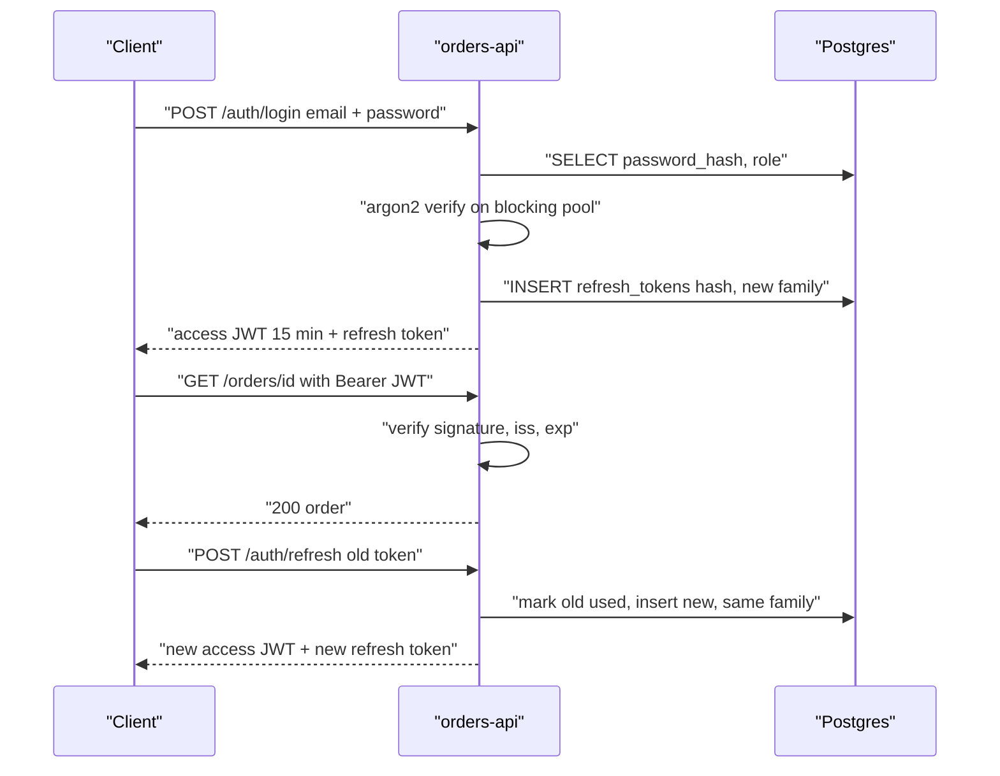
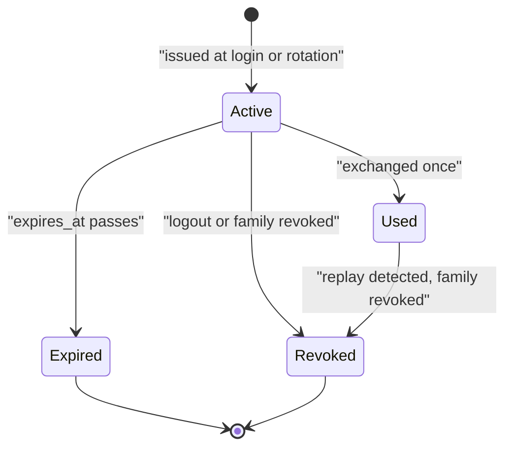
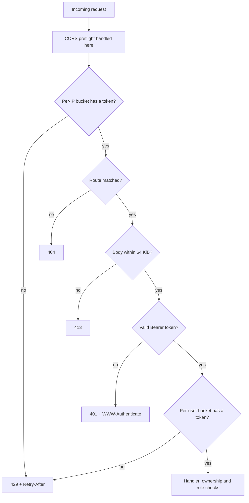

import Callout from '../../components/mdx/Callout.astro';

So far orders-api trusts everyone. Any caller can read any order, and nothing stops one client from sending a 50 MB body or ten thousand requests a second. This part fixes that. It is for engineers who can already build an axum service with a database behind it and now need to put real security and traffic controls in front of it. By the end you will be able to hash and verify passwords correctly without stalling the runtime, issue short-lived JWT access tokens with refresh-token rotation and reuse detection, write a custom `AuthUser` extractor, enforce ownership and role checks without leaking information, and assemble a tower middleware stack whose order you can actually explain.

<Callout variant="note" title="You should already know">
The axum basics from [Part 1](/blog/rust-backend-01-first-http-service) (router, extractors, `State`), the `AppError` type and tracing from [Part 2](/blog/rust-backend-02-errors-config-tracing), and SQLx transactions from [Part 3](/blog/rust-backend-03-postgres-sqlx). For the protocol-level background on sessions, JWTs and OAuth, read [Backend Engineering, Part 4: Authentication and Authorization](/blog/backend-04-authentication-authorization) first; this post focuses on the Rust implementation.
</Callout>

Everything below compiles against axum 0.8, tower 0.5, tower-http 0.6, SQLx 0.8, argon2 0.6 and jsonwebtoken 11 on Rust edition 2024. The crate layout adds an `auth` module and an `http` module to the service from earlier parts:

```text
orders-api/
├── migrations/
│   ├── 0001_init.sql
│   └── 0002_refresh_tokens.sql
└── src/
    ├── auth/
    │   ├── extractor.rs    AuthUser
    │   ├── handlers.rs     /auth/login, /auth/refresh, /auth/logout
    │   ├── jwt.rs          Claims, JwtKeys
    │   ├── password.rs     argon2 hashing
    │   └── refresh.rs      refresh-token rotation
    ├── http/
    │   ├── middleware.rs   require_auth, no_store
    │   ├── rate_limit.rs   token bucket
    │   ├── timing.rs       hand-written tower Service
    │   ├── orders.rs       handlers
    │   └── mod.rs          router and layer stack
    ├── error.rs            AppError
    ├── state.rs            AppState
    └── main.rs
```

```toml
[dependencies]
anyhow = "1"
argon2 = "0.6"
axum = "0.8"
base64 = "0.22"
jsonwebtoken = { version = "11", features = ["rust_crypto"] }
rand = "0.9"
serde = { version = "1", features = ["derive"] }
serde_json = "1"
sha2 = "0.10"
sqlx = { version = "0.8", default-features = false, features = ["runtime-tokio", "postgres", "uuid", "time", "macros", "migrate"] }
thiserror = "2"
time = { version = "0.3", features = ["serde"] }
tokio = { version = "1", features = ["full"] }
tower = { version = "0.5", features = ["util", "timeout", "limit"] }
tower-http = { version = "0.6", features = ["cors", "compression-gzip", "limit", "timeout", "trace", "request-id"] }
tracing = "0.1"
uuid = { version = "1", features = ["v4", "serde"] }
```

<Callout variant="warning" title="Crate versions move">
jsonwebtoken 10 and later make you pick a crypto backend (`rust_crypto` or `aws_lc_rs`); without one, encoding fails at runtime. argon2 0.6 generates the salt for you inside `hash_password`, while 0.5 code you will find online passes a `SaltString` explicitly. If you are on older versions, the shapes below still apply but the exact calls differ.
</Callout>

## Passwords: argon2 without blocking the runtime

### Why argon2id, and what the PHC string holds

A password hash has one job: make each guess expensive for an attacker who has stolen your `customers` table. Fast hashes like SHA-256 are the wrong tool; a GPU computes billions of them a second. Argon2id is memory-hard: every guess needs a configurable amount of RAM, which is what makes GPU and ASIC cracking expensive. It is the current OWASP first recommendation.

The output is a PHC string that carries everything needed to verify it later:

```text
$argon2id$v=19$m=19456,t=2,p=1$jB0829v170GazbHIRRd1FQ$9o9x/VtANfzAi05z4KL/4K6trqWmbk4A2EdmJqHN59A
 algorithm  ver  memory KiB, iterations, lanes   salt                    hash
```

Because the parameters live in the string, you can raise them later. New hashes use the new cost; old hashes still verify with their recorded cost, and you rehash on the next successful login. The defaults in the argon2 crate (19 MiB, 2 iterations, 1 lane) match the OWASP minimum. Tune them upward until a single hash takes a few hundred milliseconds on your production hardware, and measure rather than guess.

### The CPU problem

That cost is the point, and it is also a trap. A single hash at these settings takes tens of milliseconds of pure CPU. Tokio's worker threads are meant to return to the scheduler quickly, so running argon2 directly inside an async handler stalls every other task on that worker. Under a login burst, unrelated endpoints get slow. The fix is `spawn_blocking`, which moves the work to Tokio's separate blocking thread pool:

```rust
use argon2::{
    Argon2,
    password_hash::{PasswordHasher, PasswordVerifier, phc::PasswordHash},
};

use crate::error::AppError;

/// Hash a password into a PHC string: `$argon2id$v=19$m=19456,t=2,p=1$<salt>$<hash>`.
pub async fn hash_password(password: String) -> Result<String, AppError> {
    tokio::task::spawn_blocking(move || {
        let hash = Argon2::default()
            .hash_password(password.as_bytes())
            .map_err(|e| anyhow::anyhow!("hashing failed: {e}"))?;
        Ok(hash.to_string())
    })
    .await
    .map_err(|e| anyhow::anyhow!("hash task panicked: {e}"))?
}

/// Returns Ok(true) on match, Ok(false) on mismatch, Err on a corrupt stored hash.
pub async fn verify_password(password: String, phc: String) -> Result<bool, AppError> {
    tokio::task::spawn_blocking(move || {
        let parsed = PasswordHash::new(&phc)
            .map_err(|e| anyhow::anyhow!("stored hash is not a valid PHC string: {e}"))?;
        Ok(Argon2::default()
            .verify_password(password.as_bytes(), &parsed)
            .is_ok())
    })
    .await
    .map_err(|e| anyhow::anyhow!("verify task panicked: {e}"))?
}
```

A few deliberate choices here. The functions take owned `String`s because the closure passed to `spawn_blocking` must be `'static`; it can outlive the handler's stack frame. The `?` at the end flattens two layers: the outer `Result` from `JoinHandle` (did the task panic?) and the inner one from the closure. A mismatch is `Ok(false)`, not an error, because a wrong password is an expected outcome; a malformed stored hash is a genuine internal error. `verify_password` compares in constant time internally, so you don't need to add that yourself.

The blocking pool is large (512 threads by default), which is its own risk: a flood of login attempts can spawn hundreds of threads all burning CPU. The rate limiter later in this post is the real defense, and some teams also put a `tokio::sync::Semaphore` around hashing to cap concurrent hashes at roughly the number of cores.

## Access tokens with JWT

### Short-lived access, long-lived refresh

The design is the standard one. An access token is a signed JWT that lives for about 15 minutes. Every API call carries it, and the server checks only the signature and claims, with no database lookup. A refresh token is an opaque random string that lives for days or weeks, is stored (hashed) in Postgres, and can be exchanged exactly once for a new pair.

The split exists because you cannot revoke a stateless JWT before it expires. Keeping access tokens short bounds the damage of a leak to minutes, and keeping refresh tokens in the database gives you a revocation point.



### Claims and keys

The signing secret and token lifetimes join the layered configuration from [Part 2](/blog/rust-backend-02-errors-config-tracing) as a new `[auth]` section, so `Config` gains a `pub auth: AuthConfig` field and the secret arrives through `ORDERS_AUTH__JWT_SECRET`, wrapped in `SecretString` like the database URL:

```rust
use std::time::Duration;

use secrecy::SecretString;
use serde::Deserialize;

#[derive(Debug, Clone, Deserialize)]
pub struct AuthConfig {
    pub jwt_secret: SecretString,
    pub jwt_issuer: String,
    pub access_token_ttl_secs: u64,
    pub refresh_token_ttl_secs: u64,
}

impl AuthConfig {
    pub fn refresh_token_ttl(&self) -> Duration {
        Duration::from_secs(self.refresh_token_ttl_secs)
    }
}
```

```rust
use std::time::{SystemTime, UNIX_EPOCH};

use jsonwebtoken::{Algorithm, DecodingKey, EncodingKey, Header, Validation, decode, encode};
use secrecy::ExposeSecret;
use serde::{Deserialize, Serialize};
use uuid::Uuid;

use crate::{config::Config, error::AppError};

#[derive(Debug, Clone, Copy, PartialEq, Eq, Serialize, Deserialize, sqlx::Type)]
#[serde(rename_all = "lowercase")]
#[sqlx(type_name = "customer_role", rename_all = "lowercase")]
pub enum Role {
    Customer,
    Admin,
}

#[derive(Debug, Serialize, Deserialize)]
pub struct Claims {
    pub sub: Uuid,    // customer id
    pub role: Role,
    pub iss: String,
    pub iat: u64,
    pub exp: u64,
    pub jti: Uuid,    // unique token id, handy for logs and deny-lists
}

pub struct JwtKeys {
    encoding: EncodingKey,
    decoding: DecodingKey,
    validation: Validation,
    issuer: String,
    ttl_secs: u64,
}

impl JwtKeys {
    pub fn new(config: &Config) -> Self {
        let secret = config.auth.jwt_secret.expose_secret().as_bytes();
        let mut validation = Validation::new(Algorithm::HS256);
        validation.set_issuer(&[&config.auth.jwt_issuer]);
        validation.set_required_spec_claims(&["exp", "iss", "sub"]);
        validation.leeway = 30; // seconds of clock skew we tolerate
        Self {
            encoding: EncodingKey::from_secret(secret),
            decoding: DecodingKey::from_secret(secret),
            validation,
            issuer: config.auth.jwt_issuer.clone(),
            ttl_secs: config.auth.access_token_ttl_secs,
        }
    }

    pub fn issue(&self, customer_id: Uuid, role: Role) -> Result<String, AppError> {
        let now = SystemTime::now().duration_since(UNIX_EPOCH).unwrap().as_secs();
        let claims = Claims {
            sub: customer_id,
            role,
            iss: self.issuer.clone(),
            iat: now,
            exp: now + self.ttl_secs,
            jti: Uuid::new_v4(),
        };
        encode(&Header::new(Algorithm::HS256), &claims, &self.encoding)
            .map_err(|e| anyhow::anyhow!("jwt encode: {e}").into())
    }

    pub fn verify(&self, token: &str) -> Result<Claims, AppError> {
        decode::<Claims>(token, &self.decoding, &self.validation)
            .map(|data| data.claims)
            .map_err(|e| {
                tracing::debug!(error = %e, "rejected access token");
                AppError::Unauthorized
            })
    }
}
```

The important lines are in `JwtKeys::new`. `Validation::new(Algorithm::HS256)` pins the accepted algorithm, which is what defeats the classic `alg: none` and algorithm-confusion attacks: the token's header doesn't get to choose how it is verified. `set_issuer` rejects tokens minted by other services that happen to share a secret. `set_required_spec_claims` makes a token without `exp` invalid instead of silently immortal. The keys are built once and stored in `AppState`, because constructing a `DecodingKey` (especially from an RSA PEM) on every request is wasted work.

Every verification failure collapses to `AppError::Unauthorized`. The real reason (expired, bad signature, wrong issuer) goes to a debug log, never to the client. An attacker learns nothing by probing.

`AppState` gains one field alongside the ones from earlier parts:

```rust
#[derive(Clone)]
pub struct AppState {
    pub db: PgPool,
    pub config: Arc<Config>,
    pub jwt: Arc<JwtKeys>,
}

impl AppState {
    pub fn new(db: PgPool, config: Config) -> Self {
        let jwt = Arc::new(JwtKeys::new(&config));
        Self { db, config: Arc::new(config), jwt }
    }
}
```

### HS256 or asymmetric keys

HS256 uses one shared secret for signing and verifying. That is fine when orders-api is the only service that both issues and checks tokens. Once other services need to verify tokens, switch to an asymmetric algorithm (EdDSA or ES256): the issuer keeps the private key, everyone else gets the public key, usually from a JWKS endpoint, and a compromised downstream service cannot mint tokens. jsonwebtoken supports both; only `EncodingKey::from_ed_pem` / `DecodingKey::from_ed_pem` and the `Algorithm` change. Put a `kid` in the header from day one so you can rotate keys without a flag day.

## Refresh-token rotation with reuse detection

### The idea

Rotation means every refresh token works exactly once. Exchanging it marks it used and returns a new one in the same *family*. Reuse detection is what makes rotation worth having: if a token that was already used shows up again, two parties hold copies of it, the legitimate client and a thief. You can't tell which one is calling, so you revoke the whole family. Both copies die, and the real user logs in again.




### Schema

```sql
CREATE TABLE refresh_tokens (
    id           UUID PRIMARY KEY,
    customer_id  UUID NOT NULL REFERENCES customers(id) ON DELETE CASCADE,
    family_id    UUID NOT NULL,
    token_hash   BYTEA NOT NULL UNIQUE,
    expires_at   TIMESTAMPTZ NOT NULL,
    used_at      TIMESTAMPTZ,
    revoked_at   TIMESTAMPTZ,
    created_at   TIMESTAMPTZ NOT NULL DEFAULT now()
);

CREATE INDEX refresh_tokens_family_idx ON refresh_tokens (family_id);
```

The table stores a SHA-256 of the token, never the token itself. Refresh tokens are 32 random bytes, so unlike passwords they don't need a slow hash: there is nothing to brute-force. A fast hash is enough to make a database leak useless for replay, and it allows a direct indexed lookup.

### Issuing and rotating

```rust
use base64::{Engine, engine::general_purpose::URL_SAFE_NO_PAD};
use sha2::{Digest, Sha256};
use sqlx::{PgPool, Postgres, Transaction};
use time::OffsetDateTime;
use uuid::Uuid;

use crate::{auth::jwt::Role, error::AppError};

/// The opaque string the client stores. Only its SHA-256 lives in the database.
pub struct RefreshToken(pub String);

fn new_token() -> (RefreshToken, Vec<u8>) {
    let bytes: [u8; 32] = rand::random();
    let token = URL_SAFE_NO_PAD.encode(bytes);
    let hash = Sha256::digest(token.as_bytes()).to_vec();
    (RefreshToken(token), hash)
}

fn hash_of(token: &str) -> Vec<u8> {
    Sha256::digest(token.as_bytes()).to_vec()
}

/// Start a new token family at login.
pub async fn issue(
    tx: &mut Transaction<'_, Postgres>,
    customer_id: Uuid,
    ttl: std::time::Duration,
) -> Result<RefreshToken, AppError> {
    insert(tx, customer_id, Uuid::new_v4(), ttl).await
}

async fn insert(
    tx: &mut Transaction<'_, Postgres>,
    customer_id: Uuid,
    family_id: Uuid,
    ttl: std::time::Duration,
) -> Result<RefreshToken, AppError> {
    let (token, hash) = new_token();
    let expires_at = OffsetDateTime::now_utc() + ttl;
    sqlx::query(
        "INSERT INTO refresh_tokens (id, customer_id, family_id, token_hash, expires_at)
         VALUES ($1, $2, $3, $4, $5)",
    )
    .bind(Uuid::new_v4())
    .bind(customer_id)
    .bind(family_id)
    .bind(hash)
    .bind(expires_at)
    .execute(&mut **tx)
    .await?;
    Ok(token)
}
```

`rand::random` uses a cryptographically secure, OS-seeded generator in rand 0.9, which is what you want for a bearer secret. The rotation itself is where the concurrency subtlety lives:

```rust
pub struct Rotated {
    pub customer_id: Uuid,
    pub role: Role,
    pub refresh: RefreshToken,
}

/// Exchange a refresh token for a new one. Each token works exactly once.
pub async fn rotate(
    db: &PgPool,
    presented: &str,
    ttl: std::time::Duration,
) -> Result<Rotated, AppError> {
    let hash = hash_of(presented);
    let mut tx = db.begin().await?;

    // Atomically claim the token. Only one concurrent caller can win this UPDATE.
    let claimed: Option<(Uuid, Uuid, Role)> = sqlx::query_as(
        "UPDATE refresh_tokens rt
            SET used_at = now()
           FROM customers c
          WHERE rt.token_hash = $1
            AND rt.customer_id = c.id
            AND rt.used_at IS NULL
            AND rt.revoked_at IS NULL
            AND rt.expires_at > now()
      RETURNING rt.customer_id, rt.family_id, c.role",
    )
    .bind(&hash)
    .fetch_optional(&mut *tx)
    .await?;

    let Some((customer_id, family_id, role)) = claimed else {
        // Unknown, expired, or already used. If it was used before, someone is replaying it:
        // revoke the whole family so the thief's copy dies along with the victim's.
        let revoked = sqlx::query(
            "UPDATE refresh_tokens SET revoked_at = now()
              WHERE family_id = (SELECT family_id FROM refresh_tokens
                                  WHERE token_hash = $1 AND used_at IS NOT NULL)
                AND revoked_at IS NULL",
        )
        .bind(&hash)
        .execute(&mut *tx)
        .await?;
        if revoked.rows_affected() > 0 {
            tracing::warn!("refresh token reuse detected; token family revoked");
        }
        tx.commit().await?;
        return Err(AppError::Unauthorized);
    };

    let refresh = insert(&mut tx, customer_id, family_id, ttl).await?;
    tx.commit().await?;
    Ok(Rotated { customer_id, role, refresh })
}
```

The tempting version is `SELECT ... WHERE token_hash = $1`, check `used_at` in Rust, then `UPDATE`. That is a check-then-act race: two concurrent requests both read "unused" and both get new tokens. Folding the check into the `UPDATE ... WHERE used_at IS NULL` makes Postgres's row lock the arbiter. The second request blocks on the row, re-evaluates the `WHERE` after the first commits, matches zero rows, and falls into the reuse branch. `let ... else` keeps the happy path flat. Pulling `role` through the join means the new access token reflects the customer's current role, so a demoted admin loses admin rights at the next refresh rather than never.

The handler layer is thin:

```rust
#[derive(Serialize)]
pub struct TokenResponse {
    pub access_token: String,
    pub refresh_token: String,
    pub token_type: &'static str,
    pub expires_in: u64,
}

// A valid PHC string for a password nobody knows. Verifying against it when the
// email is unknown keeps the response time similar to the "wrong password" path.
const DUMMY_HASH: &str =
    "$argon2id$v=19$m=19456,t=2,p=1$jB0829v170GazbHIRRd1FQ$9o9x/VtANfzAi05z4KL/4K6trqWmbk4A2EdmJqHN59A";

pub async fn login(
    State(state): State<AppState>,
    Json(req): Json<LoginRequest>,
) -> Result<Json<TokenResponse>, AppError> {
    let row: Option<(Uuid, String, Role)> = sqlx::query_as(
        "SELECT id, password_hash, role FROM customers WHERE email = lower($1)",
    )
    .bind(&req.email)
    .fetch_optional(&state.db)
    .await?;

    let (stored_hash, who) = match row {
        Some((id, hash, role)) => (hash, Some((id, role))),
        None => (DUMMY_HASH.to_owned(), None),
    };
    let password_ok = password::verify_password(req.password, stored_hash).await?;

    // Same error for "no such user" and "wrong password".
    let (customer_id, role) = match (who, password_ok) {
        (Some(who), true) => who,
        _ => return Err(AppError::Unauthorized),
    };

    let mut tx = state.db.begin().await?;
    let refresh = refresh::issue(&mut tx, customer_id, state.config.auth.refresh_token_ttl()).await?;
    tx.commit().await?;

    Ok(Json(TokenResponse {
        access_token: state.jwt.issue(customer_id, role)?,
        refresh_token: refresh.0,
        token_type: "Bearer",
        expires_in: state.config.auth.access_token_ttl_secs,
    }))
}
```

The dummy hash matters. Without it, an unknown email returns in about a millisecond and a known email with a wrong password takes tens of milliseconds, and that timing difference tells an attacker which emails have accounts. Verifying against a dummy hash with the same parameters makes both paths cost the same. The `refresh_tokens` and `logout` handlers call `refresh::rotate` and a `revoke_family` function in the same style.

<Callout variant="tip" title="Concurrent refreshes from a real client">
A browser with two tabs, or a mobile app that retries a timed-out refresh, can legitimately present the same refresh token twice within a second. Strict reuse detection logs that user out. Common mitigations: serialize refreshes on the client, or allow a short grace window (a few seconds) during which a just-used token returns the *same* successor instead of revoking the family. Decide deliberately; both are defensible.
</Callout>

## The AuthUser extractor

### FromRequestParts in axum 0.8

The cleanest way to require authentication in axum is to make it a handler argument. If a handler takes `AuthUser`, it cannot run without one. axum 0.8 uses native `async fn` in traits, so no `#[async_trait]` attribute is needed:

```rust
use axum::{
    extract::{FromRef, FromRequestParts, OptionalFromRequestParts},
    http::{header, request::Parts},
};
use uuid::Uuid;

use crate::{auth::jwt::Role, error::AppError, state::AppState};

/// The authenticated caller. Adding this as a handler argument makes the route require auth.
#[derive(Debug, Clone)]
pub struct AuthUser {
    pub id: Uuid,
    pub role: Role,
}

impl AuthUser {
    pub fn is_admin(&self) -> bool {
        self.role == Role::Admin
    }

    pub fn require_admin(&self) -> Result<(), AppError> {
        if self.is_admin() { Ok(()) } else { Err(AppError::Forbidden) }
    }
}

impl<S> FromRequestParts<S> for AuthUser
where
    AppState: FromRef<S>,
    S: Send + Sync,
{
    type Rejection = AppError;

    async fn from_request_parts(parts: &mut Parts, state: &S) -> Result<Self, Self::Rejection> {
        // A middleware may already have authenticated this request.
        if let Some(user) = parts.extensions.get::<AuthUser>() {
            return Ok(user.clone());
        }

        let header_value = parts
            .headers
            .get(header::AUTHORIZATION)
            .and_then(|v| v.to_str().ok())
            .ok_or(AppError::Unauthorized)?;

        let token = header_value
            .strip_prefix("Bearer ")
            .ok_or(AppError::Unauthorized)?;

        let state = AppState::from_ref(state);
        let claims = state.jwt.verify(token)?;
        let user = AuthUser { id: claims.sub, role: claims.role };
        parts.extensions.insert(user.clone());
        Ok(user)
    }
}
```

Three details are worth noticing. It implements `FromRequestParts`, not `FromRequest`, because it only reads headers; that lets it appear anywhere in the argument list, before a body extractor like `Json`. The generic `S` with `AppState: FromRef<S>` means the extractor works with any router state from which an `AppState` can be derived, which keeps it reusable if you later nest sub-states. And `Rejection = AppError` means a missing token produces the same problem+json 401 (with `WWW-Authenticate: Bearer`) as every other error in the service, because `AppError` already implements `IntoResponse`.

The 401 mapping was added to `AppError::into_response` from Part 2:

```rust
if status == StatusCode::UNAUTHORIZED {
    res.headers_mut()
        .insert(header::WWW_AUTHENTICATE, HeaderValue::from_static("Bearer"));
}
```

### Optional authentication

Some endpoints behave differently for signed-in users but also work anonymously. In axum 0.8, `Option<T>` as an extractor requires `T: OptionalFromRequestParts`, which lets you define the semantics precisely: no header means `None`, but a header with a bad token is still a 401, not a silent downgrade to anonymous.

```rust
impl<S> OptionalFromRequestParts<S> for AuthUser
where
    AppState: FromRef<S>,
    S: Send + Sync,
{
    type Rejection = AppError;

    async fn from_request_parts(
        parts: &mut Parts,
        state: &S,
    ) -> Result<Option<Self>, Self::Rejection> {
        if !parts.headers.contains_key(header::AUTHORIZATION) {
            return Ok(None);
        }
        <AuthUser as FromRequestParts<S>>::from_request_parts(parts, state)
            .await
            .map(Some)
    }
}
```

The fully qualified call is needed because both traits define `from_request_parts`; a plain `Self::from_request_parts` would be ambiguous.

For comparison, the Spring Security equivalent is a filter chain plus `@AuthenticationPrincipal`:

```kotlin
@GetMapping("/orders/{id}")
fun getOrder(@AuthenticationPrincipal user: Jwt, @PathVariable id: UUID): OrderDto =
    orders.findForCustomer(id, UUID.fromString(user.subject)) ?: throw NotFoundException()
```

The ideas map one to one. The difference is that in Rust the "is this route protected" fact is visible in the handler's type signature, and forgetting it is a compile-time property of the function rather than a matcher pattern in a security config somewhere else.

## Authorization: who may do what

Authentication says who the caller is. Authorization decides what they may touch, and it is where most real breaches happen: Broken Object Level Authorization (an IDOR, where changing an id in the URL returns someone else's data) has topped the OWASP API Security Top 10 for years.

### Ownership in the query

The most robust ownership check is one you can't forget to call, because it is part of the query:

```rust
/// Ownership check folded into the query: other customers' orders simply do not exist.
pub async fn get_order(
    user: AuthUser,
    State(state): State<AppState>,
    Path(id): Path<Uuid>,
) -> Result<Json<OrderSummary>, AppError> {
    let order = sqlx::query_as::<_, OrderSummary>(
        "SELECT id, customer_id, status, total_cents
           FROM orders
          WHERE id = $1 AND (customer_id = $2 OR $3)",
    )
    .bind(id)
    .bind(user.id)
    .bind(user.is_admin())
    .fetch_optional(&state.db)
    .await?
    .ok_or_else(|| AppError::NotFound { entity: "order", id: id.to_string() })?;
    Ok(Json(order))
}
```

Notice it returns 404, not 403, when the order belongs to someone else. A 403 confirms that the id exists, which leaks information (order volume, valid ids to target). For resources the caller doesn't own, "not found" is the honest answer from their point of view. Use 403 when the resource's existence isn't secret but the action is forbidden, as with a role check.

### Role checks

```rust
/// Admin-only: role check first, then the business rule.
pub async fn admin_cancel_order(
    user: AuthUser,
    State(state): State<AppState>,
    Path(id): Path<Uuid>,
) -> Result<StatusCode, AppError> {
    user.require_admin()?;
    let updated = sqlx::query("UPDATE orders SET status = 'cancelled' WHERE id = $1 AND status = 'pending'")
        .bind(id)
        .execute(&state.db)
        .await?;
    if updated.rows_affected() == 0 {
        return Err(AppError::Conflict("order is not pending".into()));
    }
    Ok(StatusCode::NO_CONTENT)
}
```

For a service this size, a method on `AuthUser` is the right amount of machinery. If you want the compiler to enforce it, a separate `AdminUser` extractor that rejects non-admins with 403 makes "this handler is admin-only" part of the signature, the same way `AuthUser` made authentication visible. Reach for a policy engine (Cedar, OPA, or a Zanzibar-style service) only when permissions depend on relationships across many resource types; that's a later-stage problem.

## Middleware with tower

### The model

Everything in axum is a tower `Service`: something that takes a request and asynchronously returns a response. A `Layer` wraps one service in another. Middleware is just a service that does something before and after calling the inner one. That uniformity is why tower-http's CORS layer, tonic's gRPC server and your own code all compose.

There are three ways to write middleware, in increasing order of effort: `axum::middleware::from_fn` (an async function), a tower-http layer someone already wrote, or a hand-written `Service` + `Layer`. Use them in that order of preference.

### from_fn: authentication as a layer

The extractor authenticates per handler. Sometimes you want a whole group of routes protected regardless of what each handler takes. `from_fn_with_state` turns an async function into a layer:

```rust
use axum::{
    extract::{Request, State},
    http::{HeaderValue, header},
    middleware::Next,
    response::{IntoResponse, Response},
};

use crate::{auth::extractor::AuthUser, error::AppError, state::AppState};

/// Authenticate every request on a router once, up front.
/// Handlers can still take `AuthUser`; the extractor finds it in the extensions.
pub async fn require_auth(
    State(state): State<AppState>,
    mut req: Request,
    next: Next,
) -> Result<Response, AppError> {
    let token = req
        .headers()
        .get(header::AUTHORIZATION)
        .and_then(|v| v.to_str().ok())
        .and_then(|v| v.strip_prefix("Bearer "))
        .ok_or(AppError::Unauthorized)?;

    let claims = state.jwt.verify(token)?;
    req.extensions_mut().insert(AuthUser { id: claims.sub, role: claims.role });
    Ok(next.run(req).await)
}

/// Token responses must never be cached by browsers or proxies.
pub async fn no_store(req: Request, next: Next) -> impl IntoResponse {
    let mut res = next.run(req).await;
    res.headers_mut()
        .insert(header::CACHE_CONTROL, HeaderValue::from_static("no-store"));
    res
}
```

Request extensions are a type-keyed map attached to each request. The middleware inserts an `AuthUser`, and the extractor's first step checks for one, so a request is never verified twice. The `?` works because the function returns `Result<Response, AppError>` and both sides implement `IntoResponse`.

### A hand-written Service

`from_fn` covers most needs, but you should be able to write a real `Service`. You need it for middleware used outside axum (tonic, a hyper client), for generic layers in a shared library, or when you need control over `poll_ready`. Here is a layer that adds a `server-timing` header to every response:

```rust
use std::{
    future::Future,
    pin::Pin,
    task::{Context, Poll},
    time::Instant,
};

use axum::http::{HeaderValue, Request, Response};
use tower::{Layer, Service};

/// Adds `server-timing: app;dur=<ms>` to every response.
#[derive(Clone, Copy, Default)]
pub struct ServerTimingLayer;

impl<S> Layer<S> for ServerTimingLayer {
    type Service = ServerTiming<S>;

    fn layer(&self, inner: S) -> Self::Service {
        ServerTiming { inner }
    }
}

#[derive(Clone)]
pub struct ServerTiming<S> {
    inner: S,
}

impl<S, ReqBody, ResBody> Service<Request<ReqBody>> for ServerTiming<S>
where
    S: Service<Request<ReqBody>, Response = Response<ResBody>> + Clone + Send + 'static,
    S::Future: Send + 'static,
    ReqBody: Send + 'static,
{
    type Response = S::Response;
    type Error = S::Error;
    type Future = Pin<Box<dyn Future<Output = Result<Self::Response, Self::Error>> + Send>>;

    fn poll_ready(&mut self, cx: &mut Context<'_>) -> Poll<Result<(), Self::Error>> {
        self.inner.poll_ready(cx)
    }

    fn call(&mut self, req: Request<ReqBody>) -> Self::Future {
        // `self.inner` is the instance that was driven to readiness. Take it, and leave
        // a fresh clone behind for the next request.
        let clone = self.inner.clone();
        let mut inner = std::mem::replace(&mut self.inner, clone);

        let started = Instant::now();
        Box::pin(async move {
            let mut res = inner.call(req).await?;
            let ms = started.elapsed().as_secs_f64() * 1000.0;
            if let Ok(value) = HeaderValue::from_str(&format!("app;dur={ms:.1}")) {
                res.headers_mut().insert("server-timing", value);
            }
            Ok(res)
        })
    }
}
```

The generics look heavy but say something simple: wrap any service that takes `Request<ReqBody>` and returns `Response<ResBody>`, without caring about the body types. The `Pin<Box<dyn Future>>` costs one allocation per request; the zero-allocation alternative is a hand-written future struct using `pin-project-lite`, which is what tower-http does internally. For application code, the box is fine.

The `mem::replace` dance is the part people get wrong. tower's contract is that `call` may only be used on a service that `poll_ready` returned `Ready` for. The future returned by `call` needs to own a service (it outlives `&mut self`), so the naive move is `let mut inner = self.inner.clone()` and call the clone. But the clone has not been polled ready; for services with real backpressure such as `ConcurrencyLimit` or `Buffer`, calling an unready clone can panic or bypass the limit. Swapping keeps the ready instance for this request and leaves a fresh clone to be polled next time.

### Tower-http layers: CORS, compression, timeouts, body limits

Most of what you need already exists:

```rust
let cors = CorsLayer::new()
    .allow_origin(origins)                       // explicit list, never Any with credentials
    .allow_methods([Method::GET, Method::POST])
    .allow_headers([header::AUTHORIZATION, header::CONTENT_TYPE])
    .expose_headers([HeaderName::from_static("server-timing")])
    .max_age(Duration::from_secs(600));
```

- **CORS** is a browser policy, not a security boundary. It stops other origins' JavaScript from reading your responses; it does nothing against curl. Use an explicit origin list from config. `CorsLayer::permissive()` is for local development only.
- **Compression** (`CompressionLayer::new()`) negotiates on `Accept-Encoding`. It helps list endpoints with large JSON. If a CDN or ingress already compresses, don't do it twice.
- **Timeouts**: `TimeoutLayer::with_status_code(StatusCode::SERVICE_UNAVAILABLE, Duration::from_secs(10))`. tower-http 0.6.7 deprecated `TimeoutLayer::new`, which always answered 408; 408 means the *client* was too slow to send its request, which is misleading for a slow handler. 503 tells clients and load balancers "try again". When the timeout fires, the handler's future is dropped, so this is cancellation: everything from [Rust, Part 8](/blog/rust-08-async-rust) about cancellation safety applies to your handlers.
- **Body limits**: `RequestBodyLimitLayer::new(64 * 1024)` rejects oversized bodies with 413, early if `Content-Length` is already too big. axum's own `Json` extractor also applies a default 2 MB limit (`DefaultBodyLimit`); the effective limit is the smaller one.

### Rate limiting: a token bucket you can read

`tower_governor` (backed by the `governor` crate's GCRA algorithm) is a solid off-the-shelf choice, configured with `GovernorConfigBuilder::default().per_second(2).burst_size(5)` and keyed by peer IP. Writing a small token bucket yourself is still worth understanding, and it lets you key on things the library doesn't know, such as the authenticated user:

```rust
#[derive(Debug, Clone, Copy, PartialEq, Eq, Hash)]
pub enum ClientKey {
    User(uuid::Uuid),
    Ip(IpAddr),
}

struct Bucket {
    tokens: f64,
    last_refill: Instant,
}

/// A token bucket per client: `burst` tokens, refilled at `per_second`.
pub struct RateLimiter {
    burst: f64,
    per_second: f64,
    buckets: Mutex<HashMap<ClientKey, Bucket>>,
}

impl RateLimiter {
    pub fn new(burst: u32, per_second: u32) -> Self {
        Self {
            burst: f64::from(burst),
            per_second: f64::from(per_second),
            buckets: Mutex::new(HashMap::new()),
        }
    }

    /// Ok(()) if the request may proceed, Err(wait) with the time until the next token.
    pub fn check(&self, key: ClientKey, now: Instant) -> Result<(), Duration> {
        let mut buckets = self.buckets.lock().unwrap();
        let bucket = buckets
            .entry(key)
            .or_insert(Bucket { tokens: self.burst, last_refill: now });

        let elapsed = now.saturating_duration_since(bucket.last_refill).as_secs_f64();
        bucket.tokens = (bucket.tokens + elapsed * self.per_second).min(self.burst);
        bucket.last_refill = now;

        if bucket.tokens >= 1.0 {
            bucket.tokens -= 1.0;
            Ok(())
        } else {
            Err(Duration::from_secs_f64((1.0 - bucket.tokens) / self.per_second))
        }
    }

    /// Drop buckets that have been idle long enough to be full again.
    pub fn evict_idle(&self, now: Instant) {
        let full_after = Duration::from_secs_f64(self.burst / self.per_second);
        self.buckets
            .lock()
            .unwrap()
            .retain(|_, b| now.saturating_duration_since(b.last_refill) < full_after);
    }
}
```

Buckets refill lazily: there is no timer per client, just arithmetic on elapsed time when a request arrives. `check` takes `now` as a parameter instead of calling `Instant::now()` itself, which makes it deterministic to unit test (Part 5 leans on this). A `std::sync::Mutex` is correct here because the lock is never held across an `.await`. Without `evict_idle`, a scan from many IPs grows the map without bound; `main` runs it every minute from a spawned task. The middleware turns a refusal into a 429 with `Retry-After`:

```rust
pub async fn rate_limit(
    State(limiter): State<Arc<RateLimiter>>,
    req: Request,
    next: Next,
) -> Response {
    let key = match req.extensions().get::<AuthUser>() {
        Some(user) => ClientKey::User(user.id),
        None => match req.extensions().get::<ConnectInfo<SocketAddr>>() {
            Some(ConnectInfo(addr)) => ClientKey::Ip(addr.ip()),
            None => ClientKey::Ip(IpAddr::from([0, 0, 0, 0])),
        },
    };

    match limiter.check(key, Instant::now()) {
        Ok(()) => next.run(req).await,
        Err(wait) => {
            let secs = wait.as_secs().max(1);
            let mut res = (
                StatusCode::TOO_MANY_REQUESTS,
                Json(json!({ "type": "about:blank", "title": "Too Many Requests", "status": 429 })),
            )
                .into_response();
            res.headers_mut().insert(header::RETRY_AFTER, HeaderValue::from(secs));
            res.headers_mut().insert(
                header::CONTENT_TYPE,
                HeaderValue::from_static("application/problem+json"),
            );
            res
        }
    }
}
```

The peer address only exists if the server was started with `into_make_service_with_connect_info::<SocketAddr>()`. Behind a load balancer, the peer is the load balancer, so every client shares one bucket; you would then read `X-Forwarded-For`, but only the hop your own proxy appended, since clients can forge the rest. And an in-process limiter is per replica: with six pods, the effective limit is six times what you configured. For a hard global limit (billing, abuse) use a shared store such as Redis, or enforce it at the gateway.

## Putting the stack in order

### The rules

Layer order is not cosmetic. It decides which middleware sees which requests and which responses get which headers. Two rules cover axum:

1. With `ServiceBuilder`, layers listed **top to bottom run outermost to innermost** on the way in, and in reverse on the way out.
2. With repeated `Router::layer` (or `route_layer`) calls, each call wraps everything before it, so **the last call is the outermost**. This is the opposite of how it reads, which is why grouping layers into one `ServiceBuilder` is easier to review.


### The orders-api router

```rust
pub fn router(state: AppState, limits: RateLimits) -> Router {
    let protected = Router::new()
        .route("/orders", post(orders::create_order))
        .route("/orders/{id}", get(orders::get_order))
        .route("/admin/orders/{id}/cancel", post(orders::admin_cancel_order))
        // route_layer: runs only when a route matched, so unknown paths stay 404, not 401.
        // The last route_layer added is the outermost: auth runs first, then the
        // per-user limiter, which can now see the AuthUser in the extensions.
        .route_layer(from_fn_with_state(limits.per_user, rate_limit::rate_limit))
        .route_layer(from_fn_with_state(state.clone(), middleware::require_auth));

    let auth_routes = Router::new()
        .route("/auth/login", post(auth::login))
        .route("/auth/refresh", post(auth::refresh_tokens))
        .route("/auth/logout", post(auth::logout))
        .layer(from_fn(middleware::no_store));

    let origins: Vec<HeaderValue> = state
        .config
        .allowed_origins
        .iter()
        .filter_map(|o| o.parse().ok())
        .collect();
    let cors = CorsLayer::new()
        .allow_origin(origins)
        .allow_methods([Method::GET, Method::POST])
        .allow_headers([header::AUTHORIZATION, header::CONTENT_TYPE])
        .expose_headers([HeaderName::from_static("server-timing")])
        .max_age(Duration::from_secs(600));

    Router::new()
        .merge(protected)
        .merge(auth_routes)
        .route("/health", get(|| async { "ok" }))
        // Applied first, so it sits innermost (closest to the handlers).
        .layer(RequestBodyLimitLayer::new(64 * 1024))
        .layer(
            // Top to bottom = outermost to innermost.
            ServiceBuilder::new()
                .layer(ServerTimingLayer)
                .layer(cors)
                .layer(from_fn_with_state(limits.per_ip, rate_limit::rate_limit))
                .layer(CompressionLayer::new())
                .layer(TimeoutLayer::with_status_code(
                    StatusCode::SERVICE_UNAVAILABLE,
                    Duration::from_secs(10),
                )),
        )
        .with_state(state)
}
```

```rust
#[derive(Clone)]
pub struct RateLimits {
    /// Applied to every request at the edge, keyed by peer IP.
    pub per_ip: Arc<RateLimiter>,
    /// Applied after authentication, keyed by user id.
    pub per_user: Arc<RateLimiter>,
}
```

### Why this order

- **Timing outermost** so the number covers everything, including rejections.
- **CORS outside the limiter and timeout.** A 429 or 503 without `Access-Control-Allow-Origin` reaches browser JavaScript as an opaque CORS failure, so the frontend can't tell "slow down" from "blocked". CORS outside also answers preflight `OPTIONS` requests without spending rate-limit tokens.
- **Per-IP limit before anything expensive.** Rejecting a flood should cost a hash-map lookup, not a JWT verification or a body read.
- **Timeout around the router**, so it bounds handler time, but inside the limiter so a 429 never waits.
- **Auth as `route_layer`**, not `layer`. `route_layer` only runs when a route matched. With plain `layer`, a request for `/nope` without a token would get 401 instead of 404, which is wrong and also leaks nothing useful.
- **Per-user limit inside auth.** The first version of this code had a single limiter at the edge that tried to key by `AuthUser`. It always fell back to the IP, because at the edge, authentication hasn't run yet and the extension isn't there. Ordering bugs like that compile, pass a casual test, and quietly do the wrong thing, which is why Part 5 tests each of these behaviors.



### When the compiler refuses an order

Some orders don't compile at all. The first draft put `RequestBodyLimitLayer` at the bottom of the `ServiceBuilder`, under the `from_fn` rate limiter. The result:

```text
error[E0277]: the trait bound `FromFn<fn(State<_>, _, Next) -> _ {rate_limit}, _, _, _>: Service<_>` is not satisfied
   --> src/http/mod.rs:59:13
    |
 57 |           .layer(
    |            ----- required by a bound introduced by this call
 58 |               // Top to bottom = outermost to innermost.
 59 | /             ServiceBuilder::new()
 60 | |                 .layer(ServerTimingLayer)
 61 | |                 .layer(cors)
 62 | |                 .layer(from_fn_with_state(limiter, rate_limit::rate_limit))
```

`from_fn` middleware needs the service inside it to accept axum's `Request<Body>` and return something `IntoResponse`. `RequestBodyLimit` changes the body types on both sides, so the stack below `from_fn` no longer fits. Applying the body limit in its own `Router::layer` call first, as above, puts it next to the routes, where the types are already erased. When you hit a wall of `Service<_> is not satisfied`, the question to ask is which layer changed the request or response body type.

## Common mistakes

- **Hashing on the async worker.** Calling argon2 directly in a handler works in development and causes latency spikes across the service under load. Always use `spawn_blocking`, and rate-limit login.
- **Letting the token pick the algorithm.** Build `Validation::new(Algorithm::HS256)` (or your asymmetric algorithm) explicitly. Never construct validation from the token's own header.
- **Long-lived access tokens "to reduce refresh traffic".** A 24-hour JWT is a 24-hour credential you cannot revoke. Keep access tokens short and make refresh cheap.
- **Storing raw refresh tokens.** A database dump then becomes a set of working sessions. Store a hash.
- **Check-then-act on token rotation.** A `SELECT` followed by an `UPDATE` lets two concurrent refreshes both succeed. Do the conditional update in one statement.
- **Returning 403 for other people's resources.** It confirms the id exists. Return 404 and fold ownership into the query.
- **`layer` instead of `route_layer` for auth.** Unknown paths turn into 401s, and 404 monitoring goes quiet.
- **Reading `X-Forwarded-For` blindly** for rate limiting. Clients set it to anything; trust only what your own proxy appended.
- **Calling the clone in a hand-written `Service`.** Use the `mem::replace` pattern so the instance that was polled ready is the one that gets called.
- **`CorsLayer::very_permissive()` in production**, especially with credentials. Use an explicit origin list.

## Interview questions

<details>
<summary>Why argon2id instead of SHA-256 or bcrypt for passwords, and what does the PHC string give you operationally?</summary>

SHA-256 is designed to be fast, so an attacker with GPUs can test billions of guesses per second against a leaked table. Argon2id is deliberately slow and memory-hard, so each guess needs real RAM, which removes most of the GPU/ASIC advantage. bcrypt is still acceptable but has a fixed small memory footprint and truncates input at 72 bytes. The PHC string embeds the algorithm, version, cost parameters and salt, so you can raise the cost over time: new hashes use new parameters, old ones still verify, and you rehash transparently on the next successful login. A strong answer also mentions running the hash on a blocking thread pool in an async server.

</details>

<details>
<summary>How do refresh-token rotation and reuse detection work, and what race must the implementation handle?</summary>

Each refresh token can be exchanged once, for a new access token and a new refresh token in the same family. If an already-used token is presented again, two parties have a copy, so the server revokes the entire family, logging out both the thief and the legitimate user. The race is two concurrent requests with the same token: a read-then-update implementation lets both succeed. The fix is a single conditional `UPDATE ... WHERE used_at IS NULL RETURNING ...`, so the database row lock decides the winner and the loser sees zero rows. A senior answer also discusses the false positive from legitimate concurrent refreshes and the grace-window mitigation.

</details>

<details>
<summary>Why can't you revoke a JWT, and how do you design around it?</summary>

A JWT is verified purely from its signature and claims, with no server-side lookup, so it stays valid until `exp` no matter what you do. Designs: keep access tokens short (minutes), keep refresh tokens stateful and revocable, and for urgent cases maintain a small deny-list of `jti` values (or a per-user "tokens issued before X are invalid" timestamp) that is checked on each request, accepting that this adds a lookup. Switching to opaque tokens with introspection is the other end of the trade-off: instant revocation, a lookup on every call.

</details>

<details>
<summary>Should authentication be an extractor or a middleware in axum?</summary>

Both are valid and they compose. An extractor (`FromRequestParts`) makes the requirement visible in the handler's signature and gives the handler typed access to the user; it is hard to forget on a single route. A middleware (`from_fn_with_state` as a `route_layer`) protects a whole group of routes uniformly, including ones whose handlers don't need the user, and can run before other per-route layers such as a per-user rate limiter. orders-api does both: the middleware authenticates and stores `AuthUser` in request extensions, and the extractor reads it from there instead of verifying twice.

</details>

<details>
<summary>Explain the poll_ready / call contract in tower and the clone-and-swap pattern.</summary>

`poll_ready` lets a service signal backpressure: a caller must get `Ready` before calling `call`, and readiness may reserve capacity, such as a semaphore permit in `ConcurrencyLimit`. Middleware that returns a `'static` future must move a service into that future, so it needs an owned instance. Cloning the inner service and calling the clone is wrong because the clone was never polled ready. The pattern is to clone, `mem::replace` the clone into `self`, and call the original, which is the instance that was made ready.

</details>

<details>
<summary>Walk through the order of CORS, rate limiting, timeout and authentication layers and justify it.</summary>

CORS goes outermost (after any tracing/timing) so every response, including 429 and timeout errors, carries CORS headers, and so preflights are answered cheaply. A per-IP rate limit comes next so floods are rejected before expensive work such as JWT verification or reading bodies. The timeout wraps the router so it bounds handler time. Authentication is applied per route group as a `route_layer` so unmatched paths stay 404. A per-user limiter has to sit inside authentication, because only then does it know the user. In `ServiceBuilder`, top is outermost; with chained `.layer` calls, the last one is outermost.

</details>

<details>
<summary>Why return 404 rather than 403 when a customer requests another customer's order?</summary>

A 403 confirms the resource exists, which leaks information: valid ids, order volume, targets for further attacks. From the caller's perspective, an order they can't see doesn't exist. Folding the ownership condition into the SQL `WHERE` clause both produces the 404 naturally and makes the check impossible to forget, which matters because broken object-level authorization is the most common API vulnerability class. Use 403 when the resource's existence is not secret but the action is forbidden, for example a non-admin calling an admin endpoint.

</details>

<details>
<summary>What are the limits of an in-process rate limiter in a horizontally scaled service?</summary>

Each replica has its own buckets, so the effective limit is the configured limit times the number of replicas, and it changes when the autoscaler does. Keys based on peer IP collapse to the load balancer's address unless you correctly parse the forwarded header your own proxy sets. Memory grows with distinct keys unless you evict. It's still a good first line of defense against bursts and abuse per instance. For exact global quotas, use a shared store (Redis with an atomic script), or enforce limits at the API gateway, and keep the in-process limiter as a cheap local shield.

</details>

## Key takeaways

- Hash passwords with argon2id on `spawn_blocking`; the PHC string lets you raise the cost later without a migration.
- Short-lived JWT access tokens plus stateful, hashed, rotating refresh tokens give you stateless verification with a revocation point.
- Pin the JWT algorithm, require `exp`, check `iss`, and collapse every failure to a generic 401.
- Rotation must be one conditional `UPDATE`; reuse of a used token revokes the whole family.
- An `AuthUser` extractor makes authentication part of the handler's type; `OptionalFromRequestParts` gives precise optional-auth semantics.
- Fold ownership into queries and return 404 for resources the caller doesn't own.
- Prefer `from_fn`, then tower-http, then a hand-written `Service`, and when you write one, honor `poll_ready` with the clone-and-swap pattern.
- Layer order is behavior: CORS outside rejections, cheap limits before expensive work, auth as `route_layer`, per-user limits inside auth.

Previous: [Part 3: PostgreSQL with SQLx](/blog/rust-backend-03-postgres-sqlx) · Next: [Part 5: Testing a Rust Service](/blog/rust-backend-05-testing)
