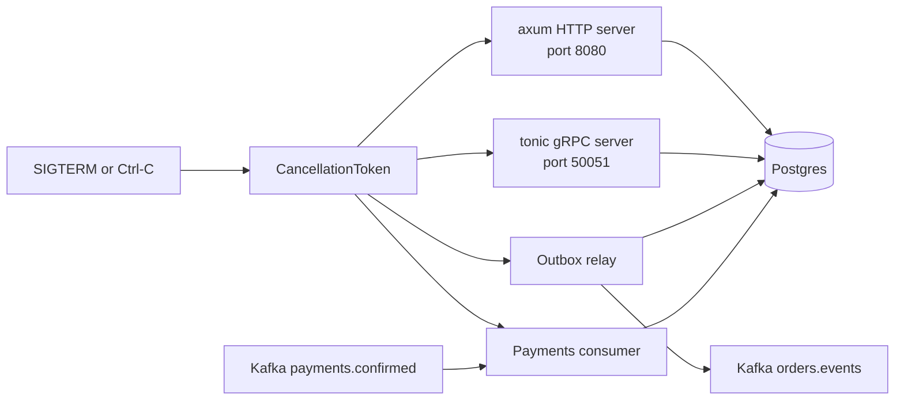
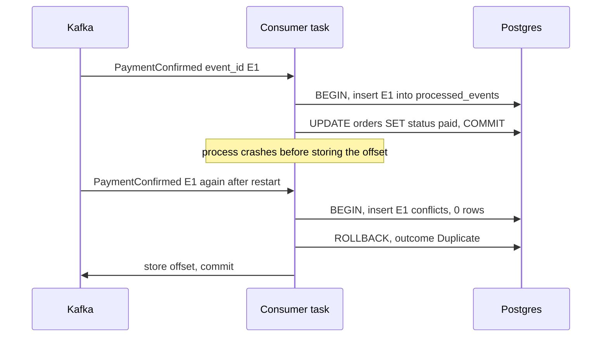
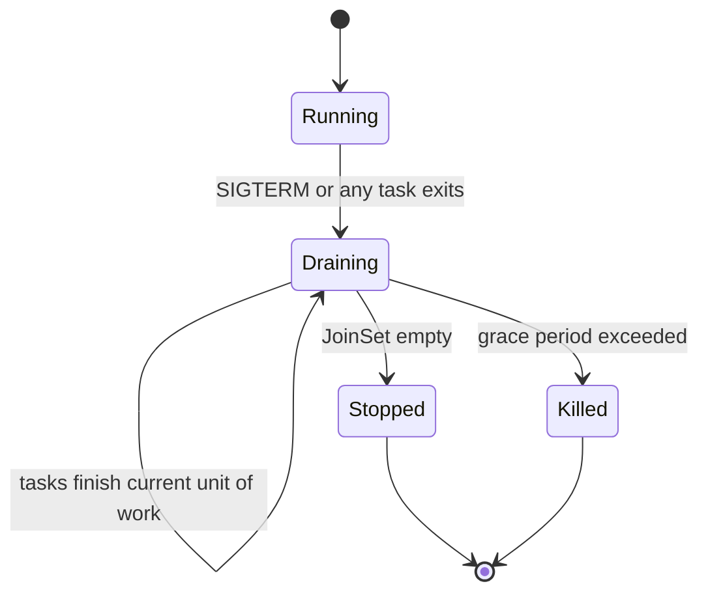

import Callout from '../../components/mdx/Callout.astro';

Until now, orders-api has done all of its work inside the request: a handler runs, talks to Postgres, and returns. Real services also do work nobody is waiting for. They publish events when an order is created, react to a payment provider telling them a charge went through, and answer other services over gRPC. Each of those is a long-running task inside the same process, and each has the same three questions attached: who owns it, how does it stop, and what happens to the data when it crashes halfway.

This part is for engineers who are comfortable with async Rust and axum and now need to run several things in one binary without losing events or applying them twice. By the end you will have an orders-api that runs an HTTP server, a gRPC server, an outbox relay, and a Kafka consumer side by side, shuts them all down cleanly on SIGTERM, and survives a crash at any line without corrupting an order.

<Callout variant="note" title="You should already know">
- The orders-api layout, `AppState`, and graceful shutdown from [Part 1](/blog/rust-backend-01-first-http-service)
- `AppError` and `tracing` spans from [Part 2](/blog/rust-backend-02-errors-config-tracing)
- SQLx transactions and the `orders` schema from [Part 3](/blog/rust-backend-03-postgres-sqlx)
- Tokio tasks, `select!`, and cancellation safety from [Rust, Part 8: Async Rust](/blog/rust-08-async-rust)
- Queues, acknowledgements, and dead-letter queues in general from [Backend Engineering, Part 6](/blog/backend-06-async-processing-queues)
</Callout>

## What runs inside orders-api now

Before writing any code, draw the process. One binary, one Tokio runtime, five long-lived tasks, and one shutdown signal that reaches all of them.



All five tasks share the same `AppState { db: PgPool, config: Arc<Config> }`. None of them is more important than the others: if the consumer dies with an error, the honest thing to do is stop the process and let the orchestrator restart it, rather than keep serving HTTP while payments silently pile up. That decision drives the structure of `main`, so let's start with task ownership.

## Owning background tasks

### `tokio::spawn` detaches, and needs `'static`

`tokio::spawn` hands a future to the runtime and returns a `JoinHandle`. Two facts about it cause most of the bugs:

1. **Dropping the `JoinHandle` does not cancel the task.** It detaches it. The task keeps running until it finishes or the runtime shuts down. If you expected Kotlin's structured concurrency, where a child coroutine dies with its scope, this is the opposite default.
2. **The future must be `'static`.** It can outlive the function that spawned it, so it cannot borrow anything from that function.

The second one shows up the first time you try to fire off work from a handler:

```rust
pub async fn send_receipt(state: &AppState, order_id: Uuid) {
    tokio::spawn(async {
        let _ = sqlx::query("SELECT 1").execute(&state.db).await;
        tracing::info!(%order_id, "receipt sent");
    });
}
```

```text
error[E0521]: borrowed data escapes outside of function
  --> src/tasks.rs:48:5
   |
47 |   pub async fn send_receipt(state: &crate::AppState, order_id: uuid::Uuid) {
   |                             -----  - let's call the lifetime of this reference `'1`
   |                             |
   |                             `state` is a reference that is only valid in the function body
48 | /     tokio::spawn(async {
...
   | |______`state` escapes the function body here
   |        argument requires that `'1` must outlive `'static`

error[E0373]: async block may outlive the current function, but it borrows `order_id`, which is owned by the current function
help: to force the async block to take ownership of `order_id` (and any other referenced variables), use the `move` keyword
```

The fix is to give the task its own handles. `PgPool` is a reference-counted handle internally, so cloning it is cheap and is the intended way to share it:

```rust
let db = state.db.clone();
tokio::spawn(async move {
    if let Err(e) = sqlx::query("SELECT 1").execute(&db).await {
        tracing::warn!(%order_id, error = %e, "receipt failed");
    }
});
```

That compiles, but it is still a fire-and-forget task: nothing waits for it at shutdown, and if it panics the panic is only visible in the `JoinHandle` you dropped. For anything that matters, the task needs an owner.

### `JoinSet` for the service's long-running tasks

`tokio::task::JoinSet` is a collection of spawned tasks that you can await in completion order. Two properties make it the right owner for a service's top-level tasks: `join_next()` yields each task's result as it finishes (including panics, as a `JoinError`), and **dropping a `JoinSet` aborts every task still in it**. That second property is the structured-concurrency guarantee that bare `spawn` lacks.

```rust
use tokio::task::JoinSet;
use tokio_util::sync::CancellationToken;

pub async fn run_workers(token: CancellationToken) -> anyhow::Result<()> {
    let mut set = JoinSet::new();

    for worker_id in 0..4 {
        let token = token.clone();
        set.spawn(async move {
            loop {
                tokio::select! {
                    _ = token.cancelled() => break,
                    _ = tokio::time::sleep(Duration::from_millis(500)) => {
                        tracing::debug!(worker_id, "tick");
                    }
                }
            }
            worker_id
        });
    }

    while let Some(res) = set.join_next().await {
        match res {
            Ok(id) => tracing::info!(id, "worker stopped"),
            Err(e) if e.is_panic() => {
                tracing::error!(error = %e, "worker panicked");
                token.cancel();
            }
            Err(e) => tracing::warn!(error = %e, "worker cancelled"),
        }
    }
    Ok(())
}
```

Note what `join_next` does not do: it does not stop the other tasks when one fails. That is a policy decision you write yourself, and here the policy is "a panic in any worker cancels the token, so all the others wind down too".

### `CancellationToken` for cooperative shutdown

`JoinSet::abort_all` exists, but aborting is blunt. An aborted task is dropped at whatever `.await` it is parked on. If that `.await` is in the middle of publishing a batch of events, you have no chance to finish the batch or log what happened.

`tokio_util::sync::CancellationToken` is the cooperative alternative. It is a cheaply clonable flag with an async `cancelled()` method. Every long-running loop selects on it at a point where stopping is safe:

```toml
[dependencies]
tokio = { version = "1", features = ["full"] }
tokio-util = { version = "0.7", features = ["rt"] }
```

Three API details are worth knowing:

- `token.cancelled()` borrows the token. `token.cancelled_owned()` consumes a clone and returns a `'static` future, which is exactly what `axum::serve(...).with_graceful_shutdown(...)` and tonic's `serve_with_shutdown(...)` want.
- `token.child_token()` creates a token that is cancelled when the parent is, but can also be cancelled on its own. Useful when one subsystem (say, the consumer) needs to stop independently during a rebalance or a config reload.
- Cancellation is a request, not a guarantee. A task that never reaches a `select!` on the token will not stop. That is why shutdown also needs a deadline, which Part 8 wires to the Kubernetes termination grace period.

### `TaskTracker` for fire-and-forget work you still want to drain

Some work really is per-request and short: sending a receipt email, warming a cache. You do not want a `JoinSet` for those (you would have to keep draining it), but you do want shutdown to wait for them. `tokio_util::task::TaskTracker` (behind the `rt` feature) is designed for this. It tracks spawned tasks without storing their outputs, and `wait()` resolves once it is closed and empty.

```rust
use tokio_util::task::TaskTracker;

pub fn send_receipt(state: &AppState, tracker: &TaskTracker, order_id: Uuid) {
    let db = state.db.clone(); // PgPool is an Arc inside: cheap to clone
    tracker.spawn(async move {
        if let Err(e) = sqlx::query("SELECT 1").execute(&db).await {
            tracing::warn!(%order_id, error = %e, "receipt failed");
        }
    });
}

pub async fn drain(tracker: TaskTracker) {
    tracker.close();
    if tokio::time::timeout(Duration::from_secs(20), tracker.wait()).await.is_err() {
        tracing::warn!(remaining = tracker.len(), "gave up waiting for background tasks");
    }
}
```

Put a `TaskTracker` in your state (it is cheap to clone) if handlers need it. Keep in mind that anything spawned this way is lost if the process is killed: if the receipt *must* be sent, it belongs in the outbox, not in a task.

### Cancellation safety, one more time

Every `select!` branch that loses is dropped. For the loops in this post that matters in two places:

- `consumer.recv()` in rdkafka's `StreamConsumer` is safe to drop: the message stays in librdkafka's internal queue and is returned by the next `recv()`. The rdkafka docs describe the stream as cancel safe; if you swap in another client, check its docs for the same promise.
- The *processing* of a message is not something you want dropped halfway. So the pattern below selects on cancellation only while waiting for the next message, never while handling one. Once a message is received, it is processed to completion (or to the retry limit) before the loop checks the token again.

## The transactional outbox

When an order is created, other services need to know: billing, the warehouse, analytics. The naive version publishes to Kafka from the handler right after the insert:

```rust
let order_id = insert_order(&mut tx, ...).await?;
tx.commit().await?;
producer.send(order_created_event(order_id), timeout).await?; // what if this fails?
```

That is a dual write. If the process dies or Kafka is unreachable between the commit and the send, the order exists and nobody hears about it. Reversing the order is worse: you announce an order that then fails to commit. There is no way to make a Postgres commit and a Kafka publish atomic, so you stop trying. Instead, you write the event to a table in the **same transaction** as the order, and a separate task moves rows from that table to Kafka. [Backend Engineering, Part 9](/blog/backend-09-event-driven-architecture) covers the pattern in general; here is the Rust implementation.


### Schema

Add a migration (Part 3 set up `sqlx migrate`):

```sql
-- migrations/20261107000001_outbox_and_inbox.sql
CREATE TABLE outbox (
    id            BIGSERIAL PRIMARY KEY,
    aggregate_id  UUID        NOT NULL,
    event_type    TEXT        NOT NULL,
    payload       JSONB       NOT NULL,
    created_at    TIMESTAMPTZ NOT NULL DEFAULT now(),
    published_at  TIMESTAMPTZ
);

CREATE INDEX outbox_unpublished ON outbox (id) WHERE published_at IS NULL;

CREATE TABLE processed_events (
    consumer      TEXT        NOT NULL,
    event_id      UUID        NOT NULL,
    processed_at  TIMESTAMPTZ NOT NULL DEFAULT now(),
    PRIMARY KEY (consumer, event_id)
);
```

The partial index keeps the relay's query cheap no matter how many published rows accumulate. `processed_events` is the consumer side's "inbox", used later in this post.

### Writing the event in the same transaction

The write side is a helper that takes the open transaction, so it is impossible to call it outside one:

```rust
use sqlx::{PgPool, Postgres, Transaction};
use uuid::Uuid;

pub async fn insert_outbox_event(
    tx: &mut Transaction<'_, Postgres>,
    aggregate_id: Uuid,
    event_type: &str,
    payload: &serde_json::Value,
) -> Result<(), AppError> {
    sqlx::query("INSERT INTO outbox (aggregate_id, event_type, payload) VALUES ($1, $2, $3)")
        .bind(aggregate_id)
        .bind(event_type)
        .bind(payload)
        .execute(&mut **tx)
        .await?;
    Ok(())
}

pub async fn create_order(db: &PgPool, customer_id: Uuid, total_cents: i64) -> Result<Uuid, AppError> {
    let mut tx = db.begin().await?;

    let order_id: Uuid = sqlx::query_scalar(
        "INSERT INTO orders (customer_id, status, total_cents, currency)
         VALUES ($1, 'pending', $2, 'EUR')
         RETURNING id",
    )
    .bind(customer_id)
    .bind(total_cents)
    .fetch_one(&mut *tx)
    .await?;

    let event = serde_json::json!({
        "order_id": order_id,
        "customer_id": customer_id,
        "total_cents": total_cents,
        "currency": "EUR",
    });
    insert_outbox_event(&mut tx, order_id, "order.created", &event).await?;

    tx.commit().await?;
    Ok(order_id)
}
```

The `&mut **tx` is the one awkward bit: `tx` is a `&mut Transaction`, the first `*` gets the `Transaction`, the second derefs to the underlying `PgConnection`, which is what implements `Executor`. I use the runtime-checked `sqlx::query` in this post so the snippets compile without a database; in the real service, the `query!` macros from Part 3 work the same way.

### The relay

The relay is a loop: lock a batch of unpublished rows, publish them, mark them published, commit. `FOR UPDATE SKIP LOCKED` lets you run several replicas of orders-api without two relays publishing the same row at the same time: each replica's transaction locks different rows and skips the ones another replica holds.

```toml
[dependencies]
rdkafka = "0.39"
```

```rust
use rdkafka::ClientConfig;
use rdkafka::producer::{FutureProducer, FutureRecord};
use rdkafka::util::Timeout;

const BATCH_SIZE: usize = 100;

#[derive(Debug, sqlx::FromRow)]
struct OutboxRow {
    id: i64,
    aggregate_id: Uuid,
    event_type: String,
    payload: serde_json::Value,
}

pub fn producer(config: &Config) -> anyhow::Result<FutureProducer> {
    let producer = ClientConfig::new()
        .set("bootstrap.servers", &config.kafka_brokers)
        .set("enable.idempotence", "true")
        .set("acks", "all")
        .set("message.timeout.ms", "30000")
        .create()?;
    Ok(producer)
}

#[tracing::instrument(skip_all, fields(published))]
async fn relay_batch(db: &PgPool, producer: &FutureProducer, topic: &str) -> anyhow::Result<usize> {
    let mut tx = db.begin().await?;

    let rows: Vec<OutboxRow> = sqlx::query_as(
        "SELECT id, aggregate_id, event_type, payload
         FROM outbox
         WHERE published_at IS NULL
         ORDER BY id
         LIMIT $1
         FOR UPDATE SKIP LOCKED",
    )
    .bind(BATCH_SIZE as i64)
    .fetch_all(&mut *tx)
    .await?;

    let mut sent_ids = Vec::with_capacity(rows.len());
    for row in &rows {
        let key = row.aggregate_id.to_string();
        let payload = serde_json::to_vec(&serde_json::json!({
            "event_id": row.id,
            "type": row.event_type,
            "data": row.payload,
        }))?;

        let record = FutureRecord::to(topic).key(&key).payload(&payload);
        match producer.send(record, Timeout::After(Duration::from_secs(10))).await {
            Ok(_delivery) => sent_ids.push(row.id),
            Err((e, _msg)) => {
                // Stop at the first failure so per-aggregate order is preserved.
                tracing::warn!(error = %e, outbox_id = row.id, "publish failed");
                break;
            }
        }
    }

    sqlx::query("UPDATE outbox SET published_at = now() WHERE id = ANY($1)")
        .bind(&sent_ids)
        .execute(&mut *tx)
        .await?;
    tx.commit().await?;

    tracing::Span::current().record("published", sent_ids.len());
    Ok(sent_ids.len())
}
```

A few decisions in there deserve a sentence each:

- **The Kafka key is the order id.** Kafka only orders messages within a partition, and the key decides the partition. Every event for one order lands on the same partition, so consumers see `order.created` before `order.paid` for the same order. There is no global order, and you should not need one.
- **`enable.idempotence=true` and `acks=all`.** These stop the producer's own internal retries from writing duplicates to the log. They do not help with the relay's duplicates (a crash after publish and before `UPDATE`), which is why consumers still deduplicate.
- **`break` on the first failure.** If event 5 fails and event 6 succeeds, the next batch republishes 5 after 6. For a single order that would reorder its events. Stopping at the first failure keeps the order, at the cost of a slower batch when Kafka is unhappy.
- **Awaiting each send serially is slow.** It is a round trip per message. The faster variant creates all the `send` futures, awaits them together with `futures::future::join_all`, and marks the longest successful prefix. With `enable.idempotence` the producer keeps per-partition order even with many in flight. Start with the simple loop, measure, then optimize.

The loop that drives `relay_batch` checks the token only between batches:

```rust
pub async fn run_relay(state: AppState, producer: FutureProducer, shutdown: CancellationToken) -> anyhow::Result<()> {
    let interval = state.config.outbox_poll_interval;
    loop {
        let published = match relay_batch(&state.db, &producer, &state.config.outbox_topic).await {
            Ok(n) => n,
            Err(e) => {
                tracing::error!(error = %e, "outbox relay batch failed");
                0
            }
        };

        // A full batch means there is probably more waiting: loop immediately.
        if published == BATCH_SIZE {
            continue;
        }

        tokio::select! {
            _ = shutdown.cancelled() => {
                tracing::info!("outbox relay stopping");
                return Ok(());
            }
            _ = tokio::time::sleep(interval) => {}
        }
    }
}
```

### Trade-offs you are signing up for

The relay holds a Postgres transaction (and row locks) open while it talks to Kafka. With a 10-second publish timeout and a broker outage, that is a connection held for up to 10 seconds per batch. That is acceptable for one relay task with one connection; it would not be if you ran a dozen. Two alternatives are worth knowing:

- **Claim, then publish.** Mark rows as claimed (`claimed_until = now() + interval '30 seconds'`) in a short transaction, publish without a transaction, then mark published. No long transaction, but more states to reason about.
- **Change data capture.** Debezium (or a similar tool) tails the Postgres WAL and publishes outbox inserts. Lower latency and no polling, but another piece of infrastructure to run. Many teams start with polling and move to CDC when latency or load demands it.

Polling every 500 ms adds up to half a second of latency to every event. If that matters, the relay can also `LISTEN` on a Postgres channel that the insert `NOTIFY`s, using SQLx's `PgListener`, and fall back to polling only as a safety net.

Finally, the outbox grows forever unless something deletes published rows. A daily `DELETE FROM outbox WHERE published_at < now() - interval '7 days'` (in batches, if the table is large) is enough.

## Consuming payment-confirmed events

The payment provider's webhook lands in a separate payments service, which publishes a `PaymentConfirmed` event to the `payments.confirmed` topic. orders-api consumes it and moves the order from `pending` to `paid`.

### Kafka with rdkafka, or NATS with async-nats

I am using Kafka through `rdkafka`, a wrapper around the C library librdkafka. It is the most widely used and battle-tested Kafka client in Rust, and that is mostly because librdkafka is. The cost is a native dependency: by default the crate builds librdkafka from source during `cargo build`, which needs a C toolchain and adds noticeably to clean build times. There are features to link a system librdkafka (`dynamic-linking`) or build with CMake (`cmake-build`). Plan for this in your Docker build (Part 8). Pure-Rust Kafka clients exist, but at the time of writing none has the feature coverage and production mileage of librdkafka, so evaluate carefully before choosing one.

If your organization runs NATS instead, `async-nats` is a pure-Rust client maintained by the NATS team. JetStream consumers give you the same at-least-once semantics with explicit acks (`message.ack().await`), and everything below about idempotency and retries applies unchanged. The mental model shifts from "store an offset per partition" to "ack each message", but the crash windows are the same.

### Consumer configuration

```rust
use rdkafka::consumer::{Consumer, StreamConsumer};

pub fn consumer(config: &Config) -> anyhow::Result<StreamConsumer> {
    let consumer: StreamConsumer = ClientConfig::new()
        .set("bootstrap.servers", &config.kafka_brokers)
        .set("group.id", &config.consumer_group)
        .set("enable.auto.commit", "true")
        .set("enable.auto.offset.store", "false")
        .set("auto.offset.reset", "earliest")
        .create()?;
    consumer.subscribe(&[config.payments_topic.as_str()])?;
    Ok(consumer)
}
```

The two `auto` settings together are the important part, and they are a common source of confusion. Kafka offsets go through two steps: the client *stores* an offset locally, and periodically *commits* stored offsets to the broker. With `enable.auto.offset.store=true` (the default), librdkafka stores the offset as soon as it hands you the message, before you have processed it. A crash after that can skip the message. Turning off auto-store and calling `store_offset_from_message` yourself, only after the database commit, gives you at-least-once without paying for a synchronous broker commit per message.

### An idempotent handler

At-least-once means you will see the same event twice: after a crash, after a rebalance, or because the payments service's own outbox relay republished it. The handler must make the second delivery a no-op. The approach that works for any side effect inside Postgres is an inbox table keyed by event id, written in the **same transaction** as the state change:

```rust
#[derive(Debug, Deserialize)]
pub struct PaymentConfirmed {
    pub event_id: Uuid,
    pub order_id: Uuid,
    pub amount_cents: i64,
    pub currency: String,
}

#[derive(Debug, PartialEq)]
pub enum Outcome {
    Applied,
    Duplicate,
    Ignored,
}

#[derive(Debug, thiserror::Error)]
pub enum HandleError {
    #[error("malformed message: {0}")]
    Malformed(#[from] serde_json::Error),
    #[error("amount mismatch for order {0}")]
    AmountMismatch(Uuid),
    #[error(transparent)]
    Database(#[from] sqlx::Error),
}

#[tracing::instrument(skip(db, payload), err)]
pub async fn handle_payment(db: &PgPool, payload: &[u8]) -> Result<Outcome, HandleError> {
    let event: PaymentConfirmed = serde_json::from_slice(payload)?;
    let mut tx = db.begin().await?;

    let inserted = sqlx::query(
        "INSERT INTO processed_events (consumer, event_id)
         VALUES ('payments', $1)
         ON CONFLICT DO NOTHING",
    )
    .bind(event.event_id)
    .execute(&mut *tx)
    .await?
    .rows_affected();

    if inserted == 0 {
        return Ok(Outcome::Duplicate); // tx rolls back on drop; nothing to undo
    }

    let total: Option<i64> = sqlx::query_scalar("SELECT total_cents FROM orders WHERE id = $1 FOR UPDATE")
        .bind(event.order_id)
        .fetch_optional(&mut *tx)
        .await?;

    let outcome = match total {
        None => Outcome::Ignored,
        Some(t) if t != event.amount_cents => {
            return Err(HandleError::AmountMismatch(event.order_id));
        }
        Some(_) => {
            sqlx::query(
                "UPDATE orders SET status = 'paid', version = version + 1, updated_at = now()
                 WHERE id = $1 AND status = 'pending'",
            )
            .bind(event.order_id)
            .execute(&mut *tx)
            .await?;
            Outcome::Applied
        }
    };

    tx.commit().await?;
    Ok(outcome)
}
```

Two layers of protection are at work. The `processed_events` primary key catches exact redeliveries of the same event. The `WHERE status = 'pending'` guard catches a different event id meaning the same thing (say, the payment provider sent two webhooks for one charge). Either alone has gaps; together they cover the realistic cases. [Case study 3](/blog/case-03-duplicate-payments-retries) is a long look at what happens when neither exists.

Notice also what the early returns do. Returning while `tx` is still open drops it, and SQLx rolls back a dropped transaction. So the `AmountMismatch` path also rolls back its `processed_events` insert, which means a fixed version of the handler can reprocess that event later.


### Retries with exponential backoff and jitter

Not every error deserves a retry. A malformed payload will be malformed on every attempt; a database connection reset probably will not. Classify first:

```rust
impl HandleError {
    fn is_retryable(&self) -> bool {
        match self {
            HandleError::Database(e) => !matches!(e, sqlx::Error::RowNotFound),
            HandleError::Malformed(_) | HandleError::AmountMismatch(_) => false,
        }
    }
}
```

That `Database` arm is deliberately coarse. In production you would also treat constraint violations and type errors as permanent, and only retry connection, pool-timeout, and serialization-failure errors. Then a small retry helper. Crates like `backon` do this well; writing one is 40 lines and makes the policy explicit:

```rust
use rand::Rng;

#[derive(Debug, Clone, Copy)]
pub struct Backoff {
    pub base: Duration,
    pub max: Duration,
    pub max_attempts: u32,
}

impl Backoff {
    /// Full jitter: sleep a random duration in [0, min(max, base * 2^attempt)].
    pub fn delay(&self, attempt: u32) -> Duration {
        let exp = self.base.saturating_mul(2u32.saturating_pow(attempt));
        let cap = exp.min(self.max);
        let millis = rand::rng().random_range(0..=cap.as_millis() as u64);
        Duration::from_millis(millis)
    }
}

pub enum Attempt<E> {
    Retry(E),
    Fatal(E),
}

pub async fn retry<T, E, F, Fut>(policy: Backoff, mut op: F) -> Result<T, E>
where
    F: FnMut(u32) -> Fut,
    Fut: Future<Output = Result<T, Attempt<E>>>,
    E: std::fmt::Display,
{
    let mut attempt = 0;
    loop {
        match op(attempt).await {
            Ok(value) => return Ok(value),
            Err(Attempt::Fatal(e)) => return Err(e),
            Err(Attempt::Retry(e)) if attempt + 1 >= policy.max_attempts => return Err(e),
            Err(Attempt::Retry(e)) => {
                let delay = policy.delay(attempt);
                tracing::warn!(attempt, ?delay, error = %e, "retrying");
                tokio::time::sleep(delay).await;
                attempt += 1;
            }
        }
    }
}
```

The saturating arithmetic is not decoration: `2u32.pow(40)` overflows and panics in debug builds. Full jitter (a random delay between zero and the cap) spreads retries out when many consumers fail at the same moment, which is exactly when the database is struggling. Without it, every instance retries in lockstep and turns a blip into a retry storm.

### Poison messages and the dead-letter topic

A Kafka partition is a queue with a head-of-line: while the consumer retries message 41, messages 42 onwards wait. That is what you want for a short database outage, and the opposite of what you want for a message that can never succeed. So after the retry budget, or immediately for a non-retryable error, the message goes to a dead-letter topic with the reason attached, and the consumer moves on.

```rust
async fn send_to_dlq(
    dlq: &FutureProducer,
    config: &Config,
    msg: &BorrowedMessage<'_>,
    error: &HandleError,
) -> anyhow::Result<()> {
    let topic = format!("{}.dlq", config.payments_topic);
    let reason = error.to_string();
    let headers = OwnedHeaders::new().insert(Header { key: "x-error", value: Some(reason.as_bytes()) });
    let mut record = FutureRecord::to(&topic)
        .payload(msg.payload().unwrap_or_default())
        .headers(headers);
    if let Some(key) = msg.key() {
        record = record.key(key);
    }
    dlq.send(record, Timeout::After(Duration::from_secs(10)))
        .await
        .map_err(|(e, _)| e)?;
    Ok(())
}
```

If even the DLQ publish fails, the function returns an error, the consumer task exits with it, and `main` brings the process down without storing the offset. On restart the message is redelivered. That is the correct outcome: you never want to store an offset for a message that was neither processed nor parked somewhere a human can see it.

A DLQ is only useful if someone looks at it. Alert on its size, and build the boring tool that replays a DLQ message onto the main topic once the bug is fixed.

### The consumer loop

```rust
pub async fn run_consumer(
    state: AppState,
    consumer: StreamConsumer,
    dlq: FutureProducer,
    shutdown: CancellationToken,
) -> anyhow::Result<()> {
    let policy = Backoff {
        base: Duration::from_millis(100),
        max: Duration::from_secs(10),
        max_attempts: 8,
    };

    loop {
        let msg = tokio::select! {
            _ = shutdown.cancelled() => break,
            msg = consumer.recv() => msg,
        };

        let msg = match msg {
            Ok(m) => m,
            Err(e) => {
                tracing::warn!(error = %e, "kafka receive error");
                continue;
            }
        };

        let payload = msg.payload().unwrap_or_default();
        let result = retry(policy, |_attempt| async {
            handle_payment(&state.db, payload).await.map_err(|e| {
                if e.is_retryable() { Attempt::Retry(e) } else { Attempt::Fatal(e) }
            })
        })
        .await;

        match result {
            Ok(outcome) => tracing::info!(?outcome, offset = msg.offset(), "payment handled"),
            Err(e) => {
                tracing::error!(error = %e, offset = msg.offset(), "sending to DLQ");
                send_to_dlq(&dlq, &state.config, &msg, &e).await?;
            }
        }

        // Only now is the offset eligible for the next auto-commit.
        consumer.store_offset_from_message(&msg)?;
    }

    // Flush what we've stored before leaving the group.
    consumer.commit_consumer_state(rdkafka::consumer::CommitMode::Sync)?;
    Ok(())
}
```

The sequence for one message, including a redelivery after a crash:



### Throughput: concurrency follows partitions

This loop handles one message at a time across all assigned partitions. For a payments topic that is often fine: a few hundred events per second with a 2 ms transaction each. When it is not, resist the temptation to `tokio::spawn` each message. That breaks per-order ordering, and it makes offset storage wrong: you would store offset 42 while 41 is still in flight, and a crash then skips 41.

The safe ways to scale are, in order of effort: run more replicas (up to the partition count), process one task per partition (rdkafka's `split_partition_queue` gives you a per-partition stream, though it needs care around rebalances), or batch several messages into one database transaction. Each preserves the rule that matters: within a partition, store offset N only after everything up to N is done.

## gRPC with tonic

orders-api has REST for the web and mobile clients. Internally, the fulfillment service needs to fetch orders, and the team wants a typed contract both sides can generate from. That is the classic case for gRPC.

### gRPC or REST?

| Consideration | REST + JSON | gRPC |
|---|---|---|
| Callers | Browsers, mobile, third parties | Internal services you control |
| Contract | OpenAPI, often written after the fact | `.proto` is the source; code is generated |
| Payload | Text, human-readable | Binary protobuf, smaller and faster to parse |
| Streaming | SSE or WebSockets, bolted on | Client, server, and bidirectional streams built in |
| Tooling | curl, any HTTP proxy, browser devtools | grpcurl, needs HTTP/2 end to end |
| Evolution | Add fields, version URLs | Add fields with new numbers, never reuse a number |

A reasonable default: REST at the edge, gRPC between services where both sides are yours and the call volume or the typed contract matters. Browsers cannot speak native gRPC without gRPC-Web and a proxy, which is reason enough to keep the public API on REST. [Backend Engineering, Part 2](/blog/backend-02-rest-api-design) covers the REST side.

### The contract

```proto
// proto/orders/v1/orders.proto
syntax = "proto3";

package orders.v1;

service OrderService {
  rpc GetOrder(GetOrderRequest) returns (Order);
  rpc ListCustomerOrders(ListCustomerOrdersRequest) returns (stream Order);
}

message GetOrderRequest {
  string order_id = 1;
}

message ListCustomerOrdersRequest {
  string customer_id = 1;
  uint32 limit = 2;
}

enum OrderStatus {
  ORDER_STATUS_UNSPECIFIED = 0;
  ORDER_STATUS_PENDING = 1;
  ORDER_STATUS_PAID = 2;
  ORDER_STATUS_CANCELLED = 3;
}

message Order {
  string id = 1;
  string customer_id = 2;
  OrderStatus status = 3;
  int64 total_cents = 4;
  string currency = 5;
}
```

The `v1` in the package is cheap insurance. The zero value of every enum is `UNSPECIFIED` because proto3 cannot tell "not set" from "set to the first value", and you never want "not set" to mean "paid".

### Code generation in `build.rs`

Since tonic 0.14, the prost integration lives in separate crates: `tonic-prost` at runtime and `tonic-prost-build` for codegen. Older tutorials use `tonic_build::compile_protos` and depend on `prost` directly in that position; if you are upgrading an existing service, expect to rename that dependency.

```toml
[dependencies]
tonic = "0.14"
tonic-prost = "0.14"
prost = "0.14"

[build-dependencies]
tonic-prost-build = "0.14"
protoc-bin-vendored = "3"   # optional, see below
```

```rust
// build.rs
fn main() -> Result<(), Box<dyn std::error::Error>> {
    // Only needed when protoc is not installed on the build machine.
    unsafe {
        std::env::set_var("PROTOC", protoc_bin_vendored::protoc_bin_path()?);
    }
    tonic_prost_build::configure()
        .build_server(true)
        .build_client(true)
        .compile_protos(&["proto/orders/v1/orders.proto"], &["proto"])?;
    Ok(())
}
```

prost-build shells out to `protoc`, the Protocol Buffers compiler. Either install it in your dev environment and CI image (`brew install protobuf`, `apt-get install protobuf-compiler`), or do what this `build.rs` does and use `protoc-bin-vendored`, which ships prebuilt binaries for common platforms. The `unsafe` around `set_var` is an edition 2024 change: mutating the environment is unsound if another thread reads it concurrently, so it now requires an `unsafe` block. A build script is single-threaded at that point, which is the invariant you are promising.

The generated code is included as a module:

```rust
pub mod pb {
    tonic::include_proto!("orders.v1");
}

use pb::order_service_server::{OrderService, OrderServiceServer};
use pb::{GetOrderRequest, ListCustomerOrdersRequest, Order, OrderStatus};
```

### The server

Implementing the service means implementing the generated trait. The generated code declares that trait with `#[async_trait]`, which boxes each method's future and makes it `Send`, so your impl block must use `#[tonic::async_trait]` as well. Native async fn in traits (stable since Rust 1.75) cannot yet express "the returned future is `Send`" without extra ceremony, which is why tonic has not switched.

First, map domain types to wire types and `AppError` to gRPC status codes. This is the gRPC equivalent of Part 2's `IntoResponse` for `AppError`, and the same rule applies: never leak internal error text.

```rust
impl From<OrderRow> for Order {
    fn from(row: OrderRow) -> Self {
        let status = match row.status.as_str() {
            "pending" => OrderStatus::Pending,
            "paid" => OrderStatus::Paid,
            "cancelled" => OrderStatus::Cancelled,
            _ => OrderStatus::Unspecified,
        };
        Order {
            id: row.id.to_string(),
            customer_id: row.customer_id.to_string(),
            status: status as i32,
            total_cents: row.total_cents,
            currency: row.currency,
        }
    }
}

impl From<AppError> for Status {
    fn from(err: AppError) -> Self {
        match err {
            err @ AppError::NotFound { .. } => Status::not_found(err.to_string()),
            AppError::Validation(errors) => Status::invalid_argument(
                errors
                    .iter()
                    .map(|e| format!("{}: {}", e.field, e.message))
                    .collect::<Vec<_>>()
                    .join("; "),
            ),
            AppError::BadRequest { detail, .. } => Status::invalid_argument(detail),
            AppError::Conflict(msg) => Status::failed_precondition(msg),
            other => {
                // Database, Internal: log the cause, never send it to the caller.
                tracing::error!(error = ?other, "internal error in gRPC handler");
                Status::internal("internal error")
            }
        }
    }
}

fn parse_uuid(field: &str, value: &str) -> Result<Uuid, AppError> {
    Uuid::parse_str(value).map_err(|_| AppError::Validation(vec![FieldError::new(field, "must be a UUID")]))
}
```

The variants are the ones `AppError` has accumulated since Part 2. The final arm is a deliberate catch-all for server-side failures; if you'd rather the compiler force a decision on every new variant, list them explicitly instead. Enums in prost are `i32` on the wire struct, which is why `status as i32` appears.

Then the service itself, including a server-streaming RPC:

```rust
pub struct OrdersGrpc {
    state: AppState,
}

impl OrdersGrpc {
    pub fn into_service(state: AppState) -> OrderServiceServer<Self> {
        OrderServiceServer::new(Self { state })
    }
}

type OrderStream = Pin<Box<dyn Stream<Item = Result<Order, Status>> + Send + 'static>>;

#[tonic::async_trait]
impl OrderService for OrdersGrpc {
    #[tracing::instrument(skip_all, fields(order_id = %request.get_ref().order_id))]
    async fn get_order(&self, request: Request<GetOrderRequest>) -> Result<Response<Order>, Status> {
        let id = parse_uuid("order_id", &request.get_ref().order_id)?;
        let row: OrderRow = sqlx::query_as(
            "SELECT id, customer_id, status, total_cents, currency FROM orders WHERE id = $1",
        )
        .bind(id)
        .fetch_optional(&self.state.db)
        .await
        .map_err(AppError::from)?
        .ok_or_else(|| AppError::NotFound { entity: "order", id: id.to_string() })?;

        Ok(Response::new(row.into()))
    }

    type ListCustomerOrdersStream = OrderStream;

    async fn list_customer_orders(
        &self,
        request: Request<ListCustomerOrdersRequest>,
    ) -> Result<Response<Self::ListCustomerOrdersStream>, Status> {
        let req = request.into_inner();
        let customer_id = parse_uuid("customer_id", &req.customer_id)?;
        let limit = req.limit.clamp(1, 1000) as i64;
        let db = self.state.db.clone();

        let stream = async_stream::try_stream! {
            let mut rows = sqlx::query_as::<_, OrderRow>(
                "SELECT id, customer_id, status, total_cents, currency
                 FROM orders WHERE customer_id = $1
                 ORDER BY created_at DESC LIMIT $2",
            )
            .bind(customer_id)
            .bind(limit)
            .fetch(&db)
            .map_err(|e| Status::from(AppError::from(e)));

            while let Some(row) = rows.try_next().await? {
                yield Order::from(row);
            }
        };

        Ok(Response::new(Box::pin(stream)))
    }
}
```

The `?` on `parse_uuid` works because of the `From<AppError> for Status` impl. The stream uses the `async-stream` crate's `try_stream!` macro, which turns a generator-style block into a `Stream`, and `futures-util`'s `TryStreamExt` for `map_err` and `try_next`. The stream owns a clone of the pool and is `'static`, so tonic can keep polling it after the method has returned. SQLx's `fetch` streams rows from Postgres as they arrive, and HTTP/2 flow control means a slow client slows the stream rather than the server buffering every row in memory.

One limitation to be honest about: this streaming RPC holds a database connection for as long as the client takes to read. For a bounded `LIMIT 1000` that is fine. For an unbounded export, page with keyset pagination (Part 3) inside the stream and release the connection between pages.

### Serving it next to axum

The server runs as one more task with the same token:

```rust
let grpc = grpc::OrdersGrpc::into_service(state.clone());
let token = shutdown.clone();
tasks.spawn(async move {
    tonic::transport::Server::builder()
        .add_service(grpc)
        .serve_with_shutdown("0.0.0.0:50051".parse()?, token.cancelled_owned())
        .await?;
    Ok(())
});
```

tonic is built on the same hyper and tower stack as axum, so it is also possible to serve both on one port and route by content type. Separate ports are simpler to reason about, easier to expose differently (gRPC internal only), and make per-protocol load balancer configuration straightforward. I keep them separate unless a platform constraint forces one port.

### A client with deadlines

```rust
pub async fn fetch_order(endpoint: String, order_id: &str) -> anyhow::Result<Order> {
    use pb::order_service_client::OrderServiceClient;

    let channel = tonic::transport::Endpoint::from_shared(endpoint)?
        .connect_timeout(Duration::from_secs(2))
        .timeout(Duration::from_secs(5))
        .connect()
        .await?;
    let mut client = OrderServiceClient::new(channel);

    let mut request = Request::new(GetOrderRequest { order_id: order_id.to_owned() });
    request.set_timeout(Duration::from_secs(3)); // sent to the server as `grpc-timeout`
    request.metadata_mut().insert("x-request-id", "a1b2c3".parse()?);

    match client.get_order(request).await {
        Ok(resp) => Ok(resp.into_inner()),
        Err(status) if status.code() == tonic::Code::NotFound => {
            anyhow::bail!("order {order_id} does not exist")
        }
        Err(status) => Err(status.into()),
    }
}
```

In a real service, create the `Channel` once at startup and store it in state: it is a cheap-to-clone handle over a multiplexed HTTP/2 connection, and reconnecting per call throws away the whole point of HTTP/2. Always set a deadline, and know that tonic has two different knobs. `Endpoint::timeout` is a client-side timer on every request through that channel; the server is never told about it. `Request::set_timeout` sets the `grpc-timeout` header, so the server learns the caller's deadline and can stop working when it has passed. Set the channel timeout as a backstop and the per-request one for the real budget. Metadata is gRPC's name for headers; in Part 7 the same mechanism carries trace context.

## Putting it together in `main`

```rust
#[tokio::main]
async fn main() -> anyhow::Result<()> {
    tracing_subscriber::fmt().init();

    let config = Arc::new(Config::load()?); // Part 2
    let db = db::connect(&config.database).await?; // Part 3
    let state = AppState { db, config: config.clone() };

    let shutdown = CancellationToken::new();
    let mut tasks: JoinSet<anyhow::Result<()>> = JoinSet::new();

    // 1. HTTP API
    let app = routes::router(state.clone()); // the axum Router from Parts 1-4
    let http_listener = tokio::net::TcpListener::bind("0.0.0.0:8080").await?;
    let token = shutdown.clone();
    tasks.spawn(async move {
        axum::serve(http_listener, app)
            .with_graceful_shutdown(token.cancelled_owned())
            .await?;
        Ok(())
    });

    // 2. gRPC API (shown above)

    // 3. Outbox relay
    let producer = outbox::producer(&config)?;
    tasks.spawn(outbox::run_relay(state.clone(), producer.clone(), shutdown.clone()));

    // 4. Payment consumer (reuses the producer for the DLQ)
    let consumer = payments::consumer(&config)?;
    tasks.spawn(payments::run_consumer(state.clone(), consumer, producer, shutdown.clone()));

    // 5. Signal listener
    let token = shutdown.clone();
    tasks.spawn(async move {
        shutdown_signal().await;
        tracing::info!("shutdown signal received");
        token.cancel();
        Ok(())
    });

    // If any task exits (cleanly or not), bring the whole process down.
    let mut first_error = None;
    while let Some(joined) = tasks.join_next().await {
        let result = joined.map_err(anyhow::Error::from).and_then(|r| r);
        if let Err(e) = result {
            tracing::error!(error = %e, "task failed");
            first_error.get_or_insert(e);
        }
        shutdown.cancel();
    }

    match first_error {
        Some(e) => Err(e),
        None => Ok(()),
    }
}
```

`shutdown_signal` is the same function from Part 1 that waits for Ctrl-C or SIGTERM. The loop at the bottom is the heart of it. The first task to finish, for any reason, cancels the token. Every other task sees the cancellation at its next safe point and returns. `join_next` keeps draining until the set is empty, so `main` only returns once everything has stopped. A panic in any task surfaces as a `JoinError`, becomes an error, and the process exits non-zero, which is what makes Kubernetes restart it.

The shutdown, as states:



The `Killed` path is the one you cannot handle in code. That is fine, because everything above was designed so that a kill at any point leaves the data consistent: the outbox row is still unpublished or will be republished, and the consumer offset was not stored, so the event comes back. Graceful shutdown makes restarts faster and quieter; it is not what keeps the data correct. [Graceful shutdown in microservices](/blog/graceful-shutdown-microservices) goes into the orchestrator side.

## Common mistakes

- **Dropping a `JoinHandle` and assuming the task stops.** It detaches. Use `JoinSet` (aborts on drop) or keep the handle and `abort()` it explicitly.
- **Publishing to Kafka inside the request after the commit.** That is the dual-write problem. The outbox costs one extra insert and removes a whole class of lost-event bugs.
- **Letting librdkafka store offsets automatically.** With the default `enable.auto.offset.store=true`, the offset is stored before you process the message, so a crash can skip it. Store it yourself after the database commit.
- **Dedup in a separate transaction.** Writing to `processed_events` and then, separately, updating the order reopens exactly the crash window it was meant to close. They must commit together.
- **Retrying everything, forever.** A malformed message retried forever blocks its partition forever. Classify errors, cap attempts, and dead-letter what cannot succeed.
- **Spawning a task per message for throughput.** It breaks per-key ordering and makes offset storage unsafe. Scale with partitions and replicas first.
- **Holding a `std::sync::Mutex` guard across `.await` in a background loop.** It blocks a runtime worker thread and the future is not `Send`, so `tokio::spawn` refuses it. Use `tokio::sync::Mutex` only when you really need to hold a lock across an await, or restructure to not.
- **No deadline on gRPC calls.** A missing timeout turns one slow dependency into a thread of hung requests. Set one on the channel and override per call when needed.
- **Reusing a protobuf field number after deleting a field.** Old clients will decode new data into the wrong field. Mark removed numbers `reserved`.

## Interview questions

<details>
<summary>What is the difference between `tokio::spawn`, `JoinSet`, and `TaskTracker`, and when would you use each?</summary>

`tokio::spawn` starts a detached task: dropping its `JoinHandle` does not cancel it, and nothing waits for it unless you keep and await the handle. `JoinSet` owns a group of tasks, yields their results in completion order (including panics as `JoinError`), and aborts all remaining tasks when dropped, which makes it the right owner for a service's top-level tasks. `TaskTracker` from tokio-util tracks tasks without storing their outputs and lets you `close()` and `wait()` for them, which fits short fire-and-forget work spawned from handlers that you still want to drain at shutdown. A strong answer adds that none of them stop a task cooperatively; that is what a `CancellationToken` is for.

</details>

<details>
<summary>Explain the transactional outbox. What guarantee does it give, and what does it not give?</summary>

The service writes the domain change and an event row to an outbox table in the same database transaction, and a separate relay publishes outbox rows to the broker and marks them published. It guarantees that an event is published if and only if the transaction committed, eventually, with at-least-once delivery. It does not give exactly-once: a crash after publishing but before marking the row published causes a republish, so consumers must be idempotent. It also adds latency equal to the relay's polling interval (or CDC lag), and the relay must preserve per-aggregate ordering, for example by keying messages by aggregate id and stopping a batch at the first failure.

</details>

<details>
<summary>How do you make a Kafka consumer idempotent when its side effect is a database update?</summary>

Give every event a stable unique id and record processed ids in a table with a primary key on (consumer, event_id). In the same transaction as the state change, insert the id with `ON CONFLICT DO NOTHING`; if zero rows were inserted, it is a duplicate and you skip the change. Store the Kafka offset only after the transaction commits. Then a crash before commit causes a clean retry, and a crash after commit but before the offset store causes a redelivery that becomes a no-op. Conditional updates like `WHERE status = 'pending'` add a second layer for semantically duplicate events with different ids. If the side effect is outside the database, you need the downstream system to accept an idempotency key instead.

</details>

<details>
<summary>Why separate `enable.auto.commit` from `enable.auto.offset.store` in librdkafka?</summary>

Committing offsets is two steps: storing the offset locally, and committing stored offsets to the broker. Auto-commit handles the periodic commit, which is efficient. Auto-store, the default, stores the offset as soon as the message is handed to the application, before processing, so a crash can lose a message. Disabling auto-store and calling `store_offset` after processing gives at-least-once semantics while keeping the cheap asynchronous commit. On shutdown, do a final synchronous commit so the last stored offsets are not lost.

</details>

<details>
<summary>A consumer is stuck retrying one message and lag is growing on that partition. What is wrong and how do you fix it?</summary>

It is a poison message: an error that will never succeed is being treated as retryable, and because a partition is processed in order, everything behind it waits. Fix the classification so permanent errors (deserialization failures, validation errors, constraint violations) are not retried, cap the retry attempts for transient ones, and route failures to a dead-letter topic with the error recorded in a header. Then alert on DLQ volume and provide a replay tool. Separately, check whether the "transient" error is actually a downstream outage, in which case blocking is correct and the fix is upstream.

</details>

<details>
<summary>When would you choose gRPC over REST for a service-to-service call?</summary>

When both ends are services you control, the contract should be the source of truth with generated clients, the call volume makes protobuf's smaller payloads and cheaper parsing worthwhile, or you need streaming in either direction. REST with JSON stays the better choice for browsers and third parties, for debugging with plain HTTP tools, and where intermediaries do not support HTTP/2 end to end. A senior answer mentions the operational costs too: you need grpcurl or similar for debugging, load balancers must balance per request rather than per connection because HTTP/2 multiplexes, and schema evolution rules (never reuse field numbers, keep zero enum values as unspecified) must be enforced, ideally with a breaking-change checker in CI.

</details>

<details>
<summary>How does shutdown work in a service with several long-running tasks, and what makes it safe to be killed anyway?</summary>

A signal listener cancels a shared `CancellationToken`. Each task selects on the token only at safe points, such as between messages or batches, finishes its current unit of work, and returns. The servers use `cancelled_owned()` as their graceful-shutdown future, so they stop accepting and drain in-flight requests. `main` drains the `JoinSet` and exits once everything has stopped, with a non-zero code if any task failed. What makes a hard kill safe is not this code but the data design: outbox rows are only marked published after a confirmed publish, and offsets are only stored after the database commit, so anything interrupted is redone and deduplicated.

</details>

## Key takeaways

- Every background task needs an owner and a stop signal. Use `JoinSet` for the service's top-level tasks, `CancellationToken` for cooperative shutdown, and `TaskTracker` for short work you want to drain.
- If any top-level task exits, stop the process. A half-running service is harder to notice than a restarting one.
- Never write to the database and the broker in the same request path. Write the event to an outbox table in the same transaction and relay it.
- At-least-once is the realistic guarantee. Make consumers idempotent with an inbox table written in the same transaction as the state change, and store offsets only after commit.
- Classify errors before retrying, use exponential backoff with full jitter, cap attempts, and dead-letter what cannot succeed.
- gRPC with tonic is a good fit for internal, typed, high-volume calls. Since tonic 0.14, codegen uses `tonic-prost-build`. Always set deadlines, and never leak internal errors into a `Status`.

Previous: [Part 5: Testing a Rust Service](/blog/rust-backend-05-testing) · Next: [Part 7: Observability and Performance](/blog/rust-backend-07-observability-performance)
