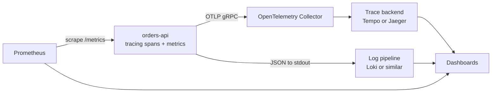
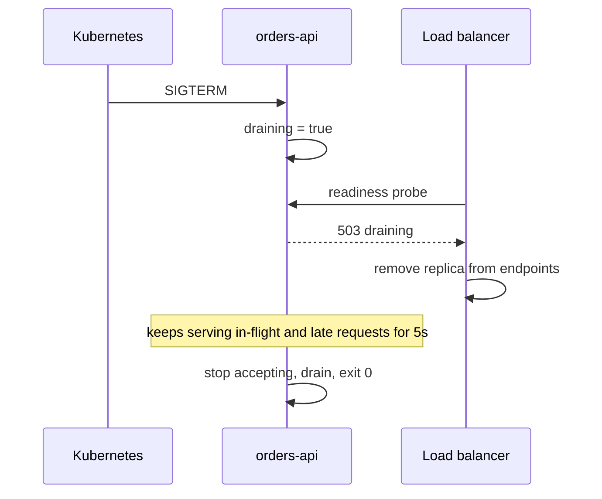
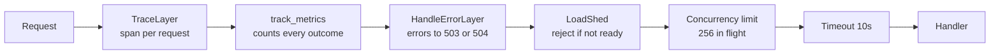

import Callout from '../../components/mdx/Callout.astro';

A Rust service that is fast on your laptop tells you very little. What matters is what it does at 3x normal traffic with one slow database replica and a downstream dependency timing out, and whether you can tell which of those is hurting you from a dashboard rather than from a guess. This part is about building that visibility into orders-api and then using it: finding where time goes, finding what blocks the runtime, measuring before changing anything, and making the service degrade on purpose instead of by accident.

It is written for engineers who own a service end to end, including the pager. By the end, orders-api will export distributed traces over OTLP, expose RED metrics for Prometheus, report readiness honestly during deploys, and shed load with a fast 503 instead of queueing until everything times out. You will also have a repeatable process for profiling and load testing it.

<Callout variant="note" title="You should already know">
- Structured logging with `tracing` and `TraceLayer` from [Part 2](/blog/rust-backend-02-errors-config-tracing)
- The SQLx pool from [Part 3](/blog/rust-backend-03-postgres-sqlx) and the tower middleware ordering from [Part 4](/blog/rust-backend-04-auth-middleware)
- The background tasks, outbox, and Kafka consumer from [Part 6](/blog/rust-backend-06-async-jobs-messaging-grpc)
- The general theory of SLOs, RED and USE metrics, and alerting from [Backend Engineering, Part 11](/blog/backend-11-reliability-observability)
</Callout>

## Three signals, one pipeline

Logs, metrics, and traces answer different questions, and the mistake is expecting one to do the job of another.

- **Metrics** answer "is something wrong, and how much?" They are cheap aggregates (counts, histograms) that you can keep for months and alert on.
- **Traces** answer "where did the time go in this request?" They follow one request across services and show each step with its duration.
- **Logs** answer "what exactly happened?" They hold the detail: the error message, the input that failed validation, the event id that went to the DLQ.

In orders-api they all come from the same place: the `tracing` spans and events you already write, plus a handful of explicit metric calls. Where they go is a deployment decision:



The service talks to a Collector, never directly to a vendor. That keeps vendor choice, sampling policy, and credentials out of the binary and lets the platform team change them without a redeploy.

## Distributed tracing with OpenTelemetry

### The moving parts

The Rust OpenTelemetry story is several crates that have to agree on versions:

```toml
[dependencies]
tracing = "0.1"
tracing-subscriber = { version = "0.3", features = ["env-filter", "json"] }
opentelemetry = "0.33"
opentelemetry_sdk = "0.33"
opentelemetry-otlp = { version = "0.33", features = ["grpc-tonic"] }
tracing-opentelemetry = "0.34"
```

- `opentelemetry` is the API (traits, context, propagation).
- `opentelemetry_sdk` is the implementation (tracer provider, batching, sampling).
- `opentelemetry-otlp` exports spans over OTLP to a Collector.
- `tracing-opentelemetry` is the bridge: a `tracing_subscriber::Layer` that turns your existing `tracing` spans into OpenTelemetry spans.

The OpenTelemetry Rust crates are pre-1.0 and their builder APIs have changed shape across releases, and `tracing-opentelemetry` versions are tied to specific `opentelemetry` versions. Upgrade them together, in one PR, and expect to touch the init code. The snippets below compile against the versions above.

### Initializing the pipeline

```rust
use opentelemetry::trace::TracerProvider as _;
use opentelemetry::{KeyValue, global};
use opentelemetry_otlp::WithExportConfig;
use opentelemetry_sdk::Resource;
use opentelemetry_sdk::propagation::TraceContextPropagator;
use opentelemetry_sdk::trace::{Sampler, SdkTracerProvider};
use tracing_subscriber::layer::SubscriberExt;
use tracing_subscriber::util::SubscriberInitExt;
use tracing_subscriber::{EnvFilter, fmt};

pub struct TelemetryGuard {
    provider: SdkTracerProvider,
}

impl Drop for TelemetryGuard {
    fn drop(&mut self) {
        if let Err(e) = self.provider.shutdown() {
            eprintln!("failed to flush spans: {e}");
        }
    }
}

pub fn init(service_version: &'static str) -> anyhow::Result<TelemetryGuard> {
    let exporter = opentelemetry_otlp::SpanExporter::builder()
        .with_tonic()
        .with_endpoint(
            std::env::var("OTEL_EXPORTER_OTLP_ENDPOINT")
                .unwrap_or_else(|_| "http://localhost:4317".into()),
        )
        .build()?;

    let resource = Resource::builder()
        .with_service_name("orders-api")
        .with_attribute(KeyValue::new("service.version", service_version))
        .build();

    let provider = SdkTracerProvider::builder()
        .with_batch_exporter(exporter)
        .with_sampler(Sampler::ParentBased(Box::new(Sampler::TraceIdRatioBased(0.10))))
        .with_resource(resource)
        .build();

    global::set_text_map_propagator(TraceContextPropagator::new());
    global::set_tracer_provider(provider.clone());
    let tracer = provider.tracer("orders-api");

    tracing_subscriber::registry()
        .with(EnvFilter::try_from_default_env().unwrap_or_else(|_| "info,orders_api=debug".into()))
        .with(fmt::layer().json().with_current_span(true))
        .with(tracing_opentelemetry::layer().with_tracer(tracer))
        .try_init()?;

    Ok(TelemetryGuard { provider })
}
```

Call it first thing in `main` and keep the guard alive until `main` returns: `let _telemetry = telemetry::init(env!("CARGO_PKG_VERSION"))?;`. Note the `_telemetry` name. A bare `_` drops the guard immediately, which shuts the provider down before the first span is exported. That bug produces no error, just an empty trace backend.

Decisions worth defending in review:

- **Batch exporter.** Spans are queued in memory and exported in the background. A simple (synchronous) exporter would add a network round trip to every span end. The batch queue is bounded and drops spans when full, which is the right failure mode: losing telemetry is better than slowing requests.
- **`ParentBased(TraceIdRatioBased(0.10))`.** If the caller already decided to sample (the incoming `traceparent` says so), follow that decision so traces are not broken in the middle. Otherwise sample 10% of new traces. That is *head* sampling: decided at the start, before you know whether the request will be slow or fail. If you need "keep every error and every slow trace", configure *tail* sampling in the Collector and send it more.
- **The flush in `Drop`.** The batch exporter holds up to several seconds of spans. Without an explicit shutdown, the spans for the requests that happened right before a deploy are lost, which are often the ones you want.
- **One `EnvFilter` for everything.** The filter applies to every layer, so `RUST_LOG=debug` also creates debug-level OpenTelemetry spans. Per-layer filters (`.with_filter(...)` on each layer) let you log at `debug` locally while exporting only `info` spans.

### Continuing a trace from an incoming request

Tracing is only distributed if the context crosses process boundaries. The caller sends a W3C `traceparent` header; orders-api must extract it and make its request span a child of it. Part 2 used `TraceLayer` with a custom span; extend that `make_span_with` function:

```rust
use axum::extract::{MatchedPath, Request};
use axum::http::HeaderMap;
use opentelemetry::propagation::Extractor;
use tracing_opentelemetry::OpenTelemetrySpanExt;

struct HeaderExtractor<'a>(&'a HeaderMap);

impl Extractor for HeaderExtractor<'_> {
    fn get(&self, key: &str) -> Option<&str> {
        self.0.get(key).and_then(|v| v.to_str().ok())
    }
    fn keys(&self) -> Vec<&str> {
        self.0.keys().map(|k| k.as_str()).collect()
    }
}

pub fn make_span(req: &Request) -> tracing::Span {
    let route = req
        .extensions()
        .get::<MatchedPath>()
        .map(|p| p.as_str())
        .unwrap_or("unmatched");

    let span = tracing::info_span!(
        "http.request",
        otel.name = %format!("{} {}", req.method(), route),
        http.request.method = %req.method(),
        http.route = route,
        http.response.status_code = tracing::field::Empty,
        otel.kind = "server",
    );

    let parent = opentelemetry::global::get_text_map_propagator(|p| {
        p.extract(&HeaderExtractor(req.headers()))
    });
    let _ = span.set_parent(parent);
    span
}
```

The `opentelemetry-http` crate ships a `HeaderExtractor` too; writing the eight lines yourself avoids one more crate whose version must match. `tracing-opentelemetry` treats fields named `otel.name`, `otel.kind`, and `otel.status_code` specially: they set the OpenTelemetry span's name, kind, and status instead of becoming attributes.

**The span name uses the route template, `/orders/{id}`, not the path.** A name per order id would make every span name unique, which breaks grouping in the trace backend and, for metrics, explodes cardinality. `MatchedPath` is in the request extensions when the layer is applied with `Router::layer`, because those layers run after routing.

### Spans inside the service

With the request span in place, every `#[tracing::instrument]` function becomes a child span automatically, as long as the work runs in the same task. Two practices keep traces useful:

```rust
#[tracing::instrument(skip_all, fields(order_id = %order_id, customer_id = tracing::field::Empty))]
pub async fn pay_order(state: &AppState, order_id: Uuid) -> Result<Order, AppError> {
    let order = load_order(&state.db, order_id).await?;
    tracing::Span::current().record("customer_id", tracing::field::display(order.customer_id));
    // ...
}
```

- `skip_all` and then list fields explicitly. The default records every argument with `Debug`, which drags whole `AppState` structs, request bodies, and occasionally secrets into your trace backend.
- Declare fields as `Empty` up front and `record` them when known. `tracing` cannot add a field to a span after creation; only fields declared at creation time can be recorded.

`tokio::spawn` does not carry the span across. If a handler spawns work that should appear in the trace, attach it explicitly with `tracing::Instrument`: `tokio::spawn(work.instrument(tracing::Span::current()))`.

### Across Kafka and gRPC

The outbox relay from Part 6 publishes events in a background task, long after the request span has closed. If you inject the *current* context in the relay, every event looks like it was caused by the relay's polling loop, which is useless. The context that matters is the request that created the order, so capture it at insert time:

1. Add a `trace_context TEXT` column to `outbox`.
2. In `insert_outbox_event`, inject the current span's context into a small map and store the `traceparent` string.
3. In the relay, copy that value into a Kafka header.

The Kafka side is an `Injector` over rdkafka headers:

```rust
use opentelemetry::propagation::Injector;
use rdkafka::message::{Header, OwnedHeaders};

pub struct KafkaHeaderInjector(pub OwnedHeaders);

impl Injector for KafkaHeaderInjector {
    fn set(&mut self, key: &str, value: String) {
        let headers = std::mem::replace(&mut self.0, OwnedHeaders::new());
        self.0 = headers.insert(Header { key, value: Some(value.as_bytes()) });
    }
}

pub fn current_trace_headers() -> OwnedHeaders {
    let cx = tracing::Span::current().context();
    let mut injector = KafkaHeaderInjector(OwnedHeaders::new());
    opentelemetry::global::get_text_map_propagator(|p| p.inject_context(&cx, &mut injector));
    injector.0
}
```

`OwnedHeaders::insert` takes `self` by value and returns a new value, hence the `mem::replace` dance. On the consumer side, the mirror image extracts from the message headers and sets the parent of the `handle_payment` span. For messaging, the OpenTelemetry semantic conventions suggest that a consumer span may *link* to the producer span rather than become its child, since one batch can contain messages from many traces. Either is defensible; pick one and be consistent.

For gRPC, the same idea applies to tonic metadata. On the client, a tonic interceptor injects into `request.metadata_mut()`; on the server, extract from `request.metadata()` in the handler or in a tower layer around the tonic service. tonic's `MetadataMap` is not a `HeaderMap`, so the extractor and injector need small adapters like the one above.


That figure is the kind of answer tracing gives you that nothing else does. The SQL is fast; the request spent most of its life waiting for a pool connection. To see that, you need a span around the acquire, which SQLx does not create for you. Wrap the acquire in your repository layer, or time it and record a metric, as shown later.

### Logs that link to traces

Part 2's JSON logs and the traces now come from the same spans, but the log lines do not automatically include the OpenTelemetry trace id. Without it, you cannot jump from a log line to its trace. The `tracing-opentelemetry` span extension gives you the id (`span.context().span().span_context().trace_id()`); the usual approach is to record it into a field on the request span right after setting the parent, so every log line under that span carries it via `with_current_span(true)`. Some teams write a small custom formatter instead. Either way, verify it in your log pipeline before you need it during an incident.

## RED metrics

Traces are sampled; metrics are not. Every request must be counted, so the alert on error rate sees the 1% of failures that 10% sampling might miss entirely.

RED means **R**ate (requests per second), **E**rrors (failed requests per second), and **D**uration (latency distribution). For an HTTP service, three series cover it.

### Facade and exporter

```toml
[dependencies]
metrics = "0.24"
metrics-exporter-prometheus = "0.18"
```

The `metrics` crate is a facade, like `log`: libraries and your code call `counter!`, `gauge!`, and `histogram!`, and one installed recorder decides where the numbers go. OpenTelemetry metrics are the other reasonable choice, and they make sense if you want one OTLP pipeline for everything. I use `metrics` with a Prometheus exporter here because Prometheus scraping is the most common setup and the facade has a small, stable API. Both are fine; mixing them in one service is not.

```rust
use metrics_exporter_prometheus::{Matcher, PrometheusBuilder, PrometheusHandle};

pub fn install_prometheus() -> anyhow::Result<PrometheusHandle> {
    let handle = PrometheusBuilder::new()
        .set_buckets_for_metric(
            Matcher::Full("http_server_request_duration_seconds".into()),
            &[0.005, 0.01, 0.025, 0.05, 0.1, 0.25, 0.5, 1.0, 2.5, 5.0],
        )?
        .install_recorder()?;
    Ok(handle)
}
```

The bucket configuration matters more than it looks. Without buckets, this exporter renders histograms as Prometheus *summaries*, with quantiles computed inside each process. Summaries cannot be aggregated across replicas: the p99 of three p99s is not a p99. Buckets produce real Prometheus histograms that `histogram_quantile` can aggregate correctly. Choose bucket edges around your SLO: if the target is "p99 under 250 ms", you want edges near 250 ms, not just at 100 ms and 1 s.

`install_recorder` installs the recorder and returns a handle without starting an HTTP server; you expose `handle.render()` on a route yourself. In production, serve that route on a separate internal port so `/metrics` is not reachable from the internet.

### The middleware

```rust
use std::time::Instant;
use axum::middleware::Next;
use axum::response::Response;

pub async fn track_metrics(req: Request, next: Next) -> Response {
    let start = Instant::now();
    let method = req.method().to_string();
    let route = req
        .extensions()
        .get::<MatchedPath>()
        .map(|p| p.as_str().to_owned())
        .unwrap_or_else(|| "unmatched".to_owned());

    metrics::gauge!("http_server_active_requests").increment(1.0);
    let response = next.run(req).await;
    metrics::gauge!("http_server_active_requests").decrement(1.0);

    let status = response.status().as_u16().to_string();
    let labels = [("method", method), ("route", route), ("status", status)];
    metrics::counter!("http_server_requests_total", &labels).increment(1);
    metrics::histogram!("http_server_request_duration_seconds", &labels)
        .record(start.elapsed().as_secs_f64());

    response
}
```

Labels are the expensive part of a metrics system: every unique combination of label values is a separate time series. `route` is the template, `status` is a code, and `method` is one of a handful, so the total is bounded. Never label with a user id, order id, raw path, or error message. If you want per-customer latency, that is a trace query, not a metric.

A subtle bug hides here: if a client disconnects mid-request, axum drops the handler future, and the code after `next.run(req).await` never runs. The active-requests gauge then drifts upward forever. A drop guard (a small struct whose `Drop` decrements the gauge) fixes it. The same applies to any "increment, await, decrement" pattern in async Rust.

### Queries that turn this into dashboards

```text
# Rate, per route
sum by (route) (rate(http_server_requests_total[5m]))

# Error ratio, per route
sum by (route) (rate(http_server_requests_total{status=~"5.."}[5m]))
  / sum by (route) (rate(http_server_requests_total[5m]))

# p99 latency, per route, aggregated correctly across replicas
histogram_quantile(0.99,
  sum by (le, route) (rate(http_server_request_duration_seconds_bucket[5m])))
```

Add the same three for the gRPC server (a tower layer around the tonic service works the same way) and for the Kafka consumer: messages handled per second by outcome (`applied`, `duplicate`, `dlq`), handling duration, and consumer lag. Lag is the single most useful consumer metric, because a consumer can be healthy, error-free, and still falling further behind every minute.

### Pool metrics

The trace above showed a request starved for a connection. To see that across all requests, sample the pool:

```rust
pub async fn sample_pool_metrics(db: sqlx::PgPool, shutdown: CancellationToken) {
    let mut tick = tokio::time::interval(Duration::from_secs(5));
    tick.set_missed_tick_behavior(tokio::time::MissedTickBehavior::Skip);
    loop {
        tokio::select! {
            _ = shutdown.cancelled() => return,
            _ = tick.tick() => {
                let size = db.size() as f64;
                let idle = db.num_idle() as f64;
                metrics::gauge!("db_pool_connections", "state" => "idle").set(idle);
                metrics::gauge!("db_pool_connections", "state" => "in_use").set(size - idle);
                metrics::gauge!("db_pool_max_connections").set(db.options().get_max_connections() as f64);
            }
        }
    }
}

pub async fn timed_acquire(db: &sqlx::PgPool) -> Result<sqlx::pool::PoolConnection<sqlx::Postgres>, sqlx::Error> {
    let start = Instant::now();
    let conn = db.acquire().await;
    metrics::histogram!("db_pool_acquire_seconds").record(start.elapsed().as_secs_f64());
    conn
}
```

"In use equals max, and acquire time is rising" is the signature of pool exhaustion. [Case study 1](/blog/case-01-connection-pool-exhaustion) walks through an incident that started exactly like this.

## Health and readiness

Kubernetes asks two different questions, and conflating them causes outages.

- **Liveness**: is this process wedged beyond recovery, so that restarting it would help? It should check almost nothing. If liveness checks the database and the database blips, Kubernetes restarts every replica at once, turning a database blip into a full outage.
- **Readiness**: should this replica receive traffic right now? It should fail when the replica cannot do useful work (the database is unreachable) and when it is shutting down.

```rust
use std::sync::Arc;
use std::sync::atomic::{AtomicBool, Ordering};
use axum::Extension;
use axum::extract::State;
use axum::http::StatusCode;
use axum::response::IntoResponse;

#[derive(Clone)]
pub struct Health {
    pub draining: Arc<AtomicBool>,
}

async fn live() -> StatusCode {
    StatusCode::OK
}

async fn ready(State(state): State<AppState>, Extension(health): Extension<Health>) -> Response {
    if health.draining.load(Ordering::Relaxed) {
        return (StatusCode::SERVICE_UNAVAILABLE, "draining").into_response();
    }
    let ping = tokio::time::timeout(
        Duration::from_millis(500),
        sqlx::query("SELECT 1").execute(&state.db),
    )
    .await;
    match ping {
        Ok(Ok(_)) => (StatusCode::OK, "ready").into_response(),
        Ok(Err(e)) => {
            tracing::warn!(error = %e, "readiness: database error");
            (StatusCode::SERVICE_UNAVAILABLE, "database unavailable").into_response()
        }
        Err(_) => (StatusCode::SERVICE_UNAVAILABLE, "database timeout").into_response(),
    }
}
```

The timeout on the ping is essential. Without it, a readiness probe during pool exhaustion waits for a connection for up to the pool's `acquire_timeout` (30 seconds by default in SQLx 0.8), and the probe itself times out. `Ordering::Relaxed` is enough for the flag: it is a single independent boolean, and nothing else is published through it.

The `draining` flag is what makes rolling deploys clean. On SIGTERM, flip it, keep serving for a few seconds while the load balancer notices the failing readiness, and only then stop accepting:

```rust
let drain_signal = {
    let shutdown = shutdown.clone();
    async move {
        shutdown.cancelled().await;
        // Fail readiness first so the load balancer stops sending traffic,
        // then give it time to notice before we stop accepting.
        health.draining.store(true, Ordering::Relaxed);
        tokio::time::sleep(Duration::from_secs(5)).await;
    }
};
axum::serve(listener, app).with_graceful_shutdown(drain_signal).await?;
```



In Kubernetes, endpoint removal also happens on its own when the pod enters Terminating, but propagation to every node and proxy is not instant, so the short sleep (or a `preStop` hook) covers that window. Part 8 sets the numbers so the sum stays below `terminationGracePeriodSeconds`.

## Finding blocking calls

### The symptom

Tokio's multi-threaded runtime has one worker thread per core by default. If a task does CPU-heavy or blocking work without yielding, it holds a worker. Hold enough of them and *every* request slows, including ones that do nothing expensive. The symptom on dashboards is a latency increase across all routes at once, while CPU is not saturated and the database looks idle.

In orders-api the obvious candidate is Part 4's password hashing. Argon2 is deliberately expensive, on the order of tens of milliseconds per hash with reasonable parameters. Called directly in an async handler, every login holds a worker for that long.

```rust
// verify_password_sync is Part 4's Argon2 check: fn(&str, &str) -> bool
pub async fn verify_password(password: String, hash: String) -> anyhow::Result<bool> {
    let ok = tokio::task::spawn_blocking(move || verify_password_sync(&password, &hash)).await?;
    Ok(ok)
}
```

The `?` on the `JoinHandle` surfaces a panic inside the closure as a `JoinError` instead of losing it.

`spawn_blocking` moves the work to a separate pool of threads meant for blocking (up to 512 by default), freeing the async workers. That pool is large because it is meant for blocking I/O; for CPU-bound work under heavy load, a dedicated `rayon` pool or a semaphore in front of `spawn_blocking` keeps you from running 512 Argon2 hashes at once on 8 cores. Other common offenders: `std::fs` calls, synchronous HTTP clients, `std::thread::sleep`, large `serde_json` serialization in a hot loop, and holding a `std::sync::Mutex` while doing something slow.

### tokio-console

`tokio-console` is a live view of the runtime's tasks: how long each was busy, how many times it was polled, how long it waited to be scheduled. It needs the runtime built with unstable instrumentation:

```toml
# .cargo/config.toml (a local or profiling build, not your default release build)
[build]
rustflags = ["--cfg", "tokio_unstable"]
```

```toml
[dependencies]
tokio = { version = "1", features = ["full", "tracing"] }
console-subscriber = "0.5"
```

```rust
let console_layer = console_subscriber::spawn();
tracing_subscriber::registry()
    .with(console_layer)
    .with(tracing_subscriber::fmt::layer())
    .init();
```

Then run `tokio-console` (installed with `cargo install tokio-console`) and it connects to the default port. The things to look for are tasks with a high busy time per poll (that is a task doing a lot between `.await`s, the blocking signature), tasks with a huge poll count that never complete (a hot loop), and the console's built-in warnings for tasks that have been busy for a long time without yielding. The instrumentation has overhead and `tokio_unstable` is, as the name says, not covered by Tokio's stability guarantees; most teams use it in development and load-test environments rather than in production builds.

For production, the cheaper signal is runtime metrics. Tokio exposes some stable runtime metrics (number of workers, alive tasks, global queue depth) through `Handle::metrics()`, with more behind `tokio_unstable`, and the `tokio-metrics` crate builds per-task and runtime-level summaries on top. A rising global queue depth with idle CPU is another blocking signature.

## Profiling with flamegraphs

When CPU *is* the bottleneck, profile before you optimize. A flamegraph shows sampled stack traces: width is time spent, height is call depth.

Release builds strip most debug info by default, which gives you flamegraphs full of addresses. Add a dedicated profile so you never ship debug info by accident:

```toml
[profile.profiling]
inherits = "release"
debug = "line-tables-only"
```

```bash
# Linux: perf-based, produces flamegraph.svg
cargo install flamegraph
cargo flamegraph --profile profiling --bin orders-api

# macOS or Linux: samply records and opens the Firefox Profiler UI
cargo install samply
cargo build --profile profiling
samply record ./target/profiling/orders-api
```

Run the profiler while a load test drives realistic traffic (next section), not while the service sits idle. Then read the flamegraph with async in mind. You will see Tokio worker frames at the bottom and your handlers' `poll` functions above them; the generated future types have long names like `orders_api::handlers::pay_order::{{closure}}`. What usually shows up in a Rust service's first real profile:

- JSON serialization and deserialization, especially of large or deeply nested payloads.
- TLS handshakes, if connections are not being reused.
- Allocation and deallocation (`malloc`, `free`, `memcpy`) spread across many frames.
- `tracing` itself, if a hot path logs at a level that is enabled and formats expensive fields.
- Password hashing, which is supposed to be expensive, in which case the fix is scheduling, not speed.

Wall-clock time spent *waiting* (on the database, on Kafka) does not show up in a CPU flamegraph at all. That is what traces are for. A service that is slow but whose flamegraph looks idle is waiting, not computing.

For services that run long enough, continuous profiling (Pyroscope, Parca, or a vendor equivalent) samples production constantly at low overhead, so you can compare this week's profile to last week's after a regression.

## Allocator choice

Rust uses the system allocator by default. Swapping it is two lines:

```toml
[target.'cfg(not(target_env = "msvc"))'.dependencies]
tikv-jemallocator = "0.7"
```

```rust
#[cfg(not(target_env = "msvc"))]
#[global_allocator]
static GLOBAL: tikv_jemallocator::Jemalloc = tikv_jemallocator::Jemalloc;
```

`mimalloc` is the other common choice and is used the same way. Why bother? Allocation-heavy multi-threaded services can suffer from contention and fragmentation in some system allocators, and the effect is largest with musl, whose default allocator is widely reported to be much slower than glibc's under multi-threaded load. If you build static musl images (Part 8), measure the allocator; it is a common reason "the Alpine build is slower".

The measurement caveats are the real content here:

- Measure **throughput, tail latency, and memory (RSS) together**. An allocator can improve p99 and increase steady-state memory, or the opposite. jemalloc in particular holds freed memory for a while before returning it to the OS, which looks like a leak on a dashboard that only shows RSS.
- Measure **with your workload**. Microbenchmarks of allocation speed say little about a service whose time is dominated by I/O.
- Measure **over time**. Fragmentation shows up after hours, not in a five-minute test.
- If the flamegraph shows little time in allocation, an allocator swap will show little benefit. Reducing allocations (fewer clones, `Bytes` instead of `Vec`, reusing buffers) is often the bigger win and works with any allocator.

## Load testing

### Tools

`oha` is a small Rust HTTP load generator that is pleasant for quick checks; `k6` is a scriptable tool for realistic scenarios. Both are fine; the method matters more than the tool.

```bash
# 60 seconds at a fixed 500 requests per second over 50 connections
oha -z 60s -c 50 -q 500 --latency-correction \
  -H "Authorization: Bearer $TOKEN" \
  http://localhost:8080/orders/0b7c5c1e-5d3a-4f7e-9c51-3c1f4b0f2a10
```

```js
// k6: constant arrival rate, a mix of reads and writes
import http from 'k6/http';
import { check } from 'k6';

export const options = {
  scenarios: {
    steady: {
      executor: 'constant-arrival-rate',
      rate: 400, timeUnit: '1s', duration: '5m',
      preAllocatedVUs: 100, maxVUs: 500,
    },
  },
  thresholds: { http_req_duration: ['p(99)<250'], http_req_failed: ['rate<0.01'] },
};

export default function () {
  const res = http.get(`${__ENV.BASE_URL}/orders/${__ENV.ORDER_ID}`, {
    headers: { Authorization: `Bearer ${__ENV.TOKEN}` },
  });
  check(res, { 'status is 200': (r) => r.status === 200 });
}
```

### Open versus closed load

The most common load-testing mistake is a **closed model**: N virtual users, each sending the next request only after the previous one returns. When the service slows down, the load generator slows down with it, so the test measures less traffic exactly when it should be measuring more, and the reported latency looks better than what users would see. That is coordinated omission.

Real traffic is an **open model**: users arrive at a rate regardless of how slow you are. Use a fixed arrival rate (`-q` in oha, `constant-arrival-rate` in k6). oha's `--latency-correction` adjusts for coordinated omission when a rate is set.

### A process that produces useful numbers

1. Test a production-like build (`--release`, same allocator, same container limits) against a production-like database with realistic data volume. An empty `orders` table makes every query fast.
2. Step the arrival rate up (for example, 100, 200, 400, 800 rps), holding each step for several minutes.
3. Watch the RED dashboard, pool metrics, and runtime metrics, not just the load generator's summary.
4. Find the **knee**: the rate where p99 starts rising sharply. Capacity is somewhat below the knee, not at the point where errors start.
5. Change one thing, repeat, compare.

Any numbers you get are for your hardware, data, and configuration. Treat published "Rust handles N requests per second" figures, including any you might be tempted to put in a slide, as anecdotes.

## Backpressure and load shedding with tower

### Why queues make overload worse

Little's law says the average number of requests in the system equals the arrival rate times the average time each spends in it. When arrivals exceed what the service can complete, the excess has to wait somewhere: in Tokio's task queue, in the pool's acquire queue, in the kernel's accept backlog. Every waiting request adds latency to every request behind it. Eventually requests time out on the client after the server has already done the work, and clients retry, which adds more load. That is how a 20% overload becomes a 100% outage.

The fix is to bound the work in flight and reject the excess immediately. A fast 503 with `Retry-After` is a better outcome for everyone than a 30-second timeout: the client can retry against another replica, and the requests you did accept stay fast.


### The layer stack

```rust
use axum::BoxError;
use axum::error_handling::HandleErrorLayer;
use tower::ServiceBuilder;
use tower::limit::GlobalConcurrencyLimitLayer;
use tower::load_shed::LoadShedLayer;
use tower::timeout::TimeoutLayer;
use tower_http::trace::TraceLayer;

async fn handle_overload(err: BoxError) -> Response {
    if err.is::<tower::load_shed::error::Overloaded>() {
        metrics::counter!("http_server_shed_total").increment(1);
        let mut res = (StatusCode::SERVICE_UNAVAILABLE, "overloaded").into_response();
        res.headers_mut().insert("retry-after", "1".parse().unwrap());
        res
    } else if err.is::<tower::timeout::error::Elapsed>() {
        (StatusCode::GATEWAY_TIMEOUT, "request timed out").into_response()
    } else {
        tracing::error!(error = %err, "unhandled middleware error");
        StatusCode::INTERNAL_SERVER_ERROR.into_response()
    }
}

pub fn router(app_state: AppState, health: Health, prom: PrometheusHandle, api: Router<AppState>) -> Router {
    // Outermost first: trace, then metrics, then overload protection.
    let middleware = ServiceBuilder::new()
        .layer(TraceLayer::new_for_http().make_span_with(make_span))
        .layer(axum::middleware::from_fn(track_metrics))
        .layer(HandleErrorLayer::new(handle_overload))
        .layer(LoadShedLayer::new())
        .layer(GlobalConcurrencyLimitLayer::new(256))
        .layer(TimeoutLayer::new(Duration::from_secs(10)));

    let api = api.layer(middleware).with_state(app_state.clone());

    let ops = Router::new()
        .route("/health/live", get(live))
        .route("/health/ready", get(ready))
        .route("/metrics", get(move || std::future::ready(prom.render())))
        .layer(Extension(health))
        .with_state(app_state);

    Router::new().merge(ops).merge(api)
}
```

Read the `ServiceBuilder` top to bottom as outside to inside:



- **`ConcurrencyLimit` and `LoadShed` work as a pair.** The concurrency limit's `poll_ready` returns `Pending` when all permits are taken, which on its own would make callers wait (a queue). `LoadShed` turns "not ready" into an immediate `Overloaded` error. Together: bounded in-flight work, no queue.
- **`HandleErrorLayer` is required** because axum routes must be infallible; tower's limit and timeout layers produce errors, and this converts them into responses.
- **Metrics sit outside the shedding**, so shed requests are counted as 503s in the RED metrics. Put `track_metrics` inside instead and your error-rate dashboard stays green while you reject a third of your traffic.
- **The ops routes are outside the limit.** Health checks and metrics scrapes must keep working precisely when the API is overloaded; a readiness probe rejected by the load shedder will get a healthy-but-busy replica pulled from rotation.
- **The timeout is a backstop**, not a latency target. It bounds how long a stuck request holds one of the 256 permits.

### Global, not per-route

Notice `GlobalConcurrencyLimitLayer`, not `ConcurrencyLimitLayer`. This is a real trap. `Router::layer` applies the layer to each route separately, and `ConcurrencyLimitLayer` creates a fresh semaphore every time it wraps a service. So with `ConcurrencyLimitLayer::new(256)` on a router with 10 routes, the service accepts up to 2,560 concurrent requests, and the limit that you load-tested is not the limit you deployed. `GlobalConcurrencyLimitLayer` creates its semaphore once in the layer and shares it with every service it wraps. The alternative is to wrap the whole `Router` as one service with `ServiceBuilder::service(router)`.

A test shows the behavior. With a limit of 2 and ten concurrent slow requests, exactly two succeed and eight are shed:

```rust
#[tokio::test]
async fn sheds_when_saturated() {
    let app: Router = Router::new()
        .route("/slow", get(|| async {
            tokio::time::sleep(Duration::from_millis(200)).await;
            "ok"
        }))
        .layer(
            ServiceBuilder::new()
                .layer(HandleErrorLayer::new(handle_overload))
                .layer(LoadShedLayer::new())
                .layer(GlobalConcurrencyLimitLayer::new(2)),
        );

    let mut handles = vec![];
    for _ in 0..10 {
        let app = app.clone();
        handles.push(tokio::spawn(async move {
            app.oneshot(axum::http::Request::get("/slow").body(Body::empty()).unwrap())
                .await
                .unwrap()
                .status()
        }));
    }
    let (mut ok, mut shed) = (0, 0);
    for h in handles {
        match h.await.unwrap() {
            StatusCode::OK => ok += 1,
            StatusCode::SERVICE_UNAVAILABLE => shed += 1,
            s => panic!("unexpected {s}"),
        }
    }
    assert!(shed > 0);
    assert!(ok >= 2);
}
```

### Choosing the limit

The number 256 is not magic. Start from Little's law: if a replica sustains 800 requests per second at an average of 40 ms, about 32 requests are in flight on average. A limit several times that average absorbs bursts without letting the queue grow unbounded. Then validate it with the step load test above: the right limit is the one where accepted p99 stays inside your SLO at overload. Adaptive limiters that adjust the limit from observed latency exist (the idea behind Netflix's concurrency-limits library), but a static limit you have measured is far better than none.

Also bound the work that does not come through HTTP. The Kafka consumer from Part 6 is naturally bounded (one message at a time per partition). The `TaskTracker` for fire-and-forget work is not, so put a `tokio::sync::Semaphore` in front of anything spawned per request.

## Connection pool tuning

The pool is where overload usually concentrates, because Postgres connections are the scarcest resource in the system.

```rust
use sqlx::postgres::PgPoolOptions;

let db = PgPoolOptions::new()
    .max_connections(20)
    .min_connections(2)
    .acquire_timeout(Duration::from_secs(2))
    .idle_timeout(Duration::from_secs(300))
    .max_lifetime(Duration::from_secs(1800))
    .connect(config.database.url.expose_secret())
    .await?;
```

How to choose the numbers:

- **`max_connections`** is bounded from above by the database: every replica's maximum, plus migrations, plus admin access, must fit under Postgres's `max_connections`, and Postgres performance degrades well before that limit because each connection is a backend process. With 10 replicas at 20 connections each, you already need 200 server-side connections. Beyond a few hundred, put PgBouncer (in transaction mode) in front, and remember that transaction pooling breaks session features like prepared statements unless configured for them.
- It is bounded from below by Little's law: connections in use is roughly the query rate times the time each request holds a connection. A request that holds a connection for 5 ms at 400 requests per second needs about 2 on average. If the pool is constantly full at modest load, the problem is usually not the pool size but something holding connections too long: a transaction kept open across an HTTP call, a stream that is read slowly, or Part 6's outbox relay holding a transaction during Kafka publishes.
- **`acquire_timeout`** should be short, much shorter than SQLx's 30-second default. A request that cannot get a connection within a second or two will miss its deadline anyway. Failing fast turns pool exhaustion into quick 503s instead of a pile of requests each holding a concurrency permit while waiting. This is load shedding at the pool.
- **`test_before_acquire`** is on by default and costs a round trip on each acquire. Turning it off saves latency, at the risk of handing out a dead connection after a database failover. Measure before changing it, and if you do, make sure your retry logic handles a connection error on first use.
- **`max_lifetime`** recycles connections, which helps when a load balancer or a failover silently invalidates them, and spreads load after the database scales.

Keep the pool and the concurrency limit consistent. If the API allows 256 requests in flight and the pool has 20 connections, up to 236 requests can be waiting in the pool's queue. That is fine when most requests do not touch the database or hold a connection briefly; it is a problem if every request needs one for 50 ms. The pool metrics tell you which world you are in.

## Common mistakes

- **Dropping the telemetry guard immediately** (`let _ = init()`), so the tracer provider shuts down before exporting anything.
- **Using the raw path as a span name or metric label.** It destroys trace grouping and creates one time series per order id.
- **Histograms without buckets in the Prometheus exporter**, which produces summaries that cannot be aggregated across replicas.
- **Checking the database in the liveness probe**, which restarts every replica when the database blips.
- **A readiness check with no timeout**, which hangs on an exhausted pool.
- **Calling Argon2, `std::fs`, or a synchronous client from async code** without `spawn_blocking`, and then debugging "random" latency on every route.
- **Load testing with a closed model** and reporting latency that excludes the time requests would have waited.
- **`ConcurrencyLimitLayer` via `Router::layer`**, which silently creates one limit per route. Use `GlobalConcurrencyLimitLayer` or wrap the whole router.
- **Counting metrics inside the load shedder**, so shed requests never appear in the error rate.
- **Swapping the allocator because a blog post said so**, without measuring tail latency and memory on your own workload.
- **Raising `max_connections` to fix pool exhaustion** when the real cause is a connection held across slow I/O.

## Interview questions

<details>
<summary>How does a trace started in an API gateway end up continuing inside your Rust service and then into a Kafka consumer?</summary>

The gateway sends a W3C `traceparent` header. In the Rust service, a `TraceLayer` creates the request span and uses the global text-map propagator with a header extractor to read that context, then calls `set_parent` on the span via `tracing-opentelemetry`, so the span and all its `#[instrument]` children belong to the same trace. Work moved to other tasks needs the span attached explicitly with `.instrument(...)`. For Kafka, the producer injects the context into message headers; with an outbox, the context should be captured when the outbox row is written, because the relay runs later in an unrelated task. The consumer extracts it from the headers and either parents or links its processing span to it. A strong answer mentions sampling decisions travel in the header too, so a `ParentBased` sampler keeps the trace whole.

</details>

<details>
<summary>What are RED metrics, and what mistakes make them misleading?</summary>

Rate, Errors, and Duration: requests per second, failed requests per second, and the latency distribution, usually per route. They become misleading through unbounded labels (raw paths, user ids), which explode cardinality; through quantiles computed per process (summaries), which cannot be aggregated across replicas, instead of histograms with sensible buckets; through placing the measuring middleware inside the load shedder or after auth, so rejected requests are never counted; and through gauges that are not decremented when a future is dropped on client disconnect. You also need equivalents for non-HTTP work, especially consumer lag for Kafka.

</details>

<details>
<summary>What is the difference between liveness and readiness probes, and what should each check?</summary>

Liveness asks whether the process should be restarted, so it should only fail when the process is truly stuck; it should not check dependencies, or a dependency outage restarts every replica at once. Readiness asks whether the replica should receive traffic, so it should fail when a critical dependency like the database is unreachable (with a short timeout on that check) and when the replica is draining during shutdown. Flipping readiness to failing on SIGTERM and continuing to serve for a few seconds lets load balancers remove the replica before it stops accepting connections.

</details>

<details>
<summary>Latency went up on every endpoint at once, CPU is at 40%, and the database looks idle. What do you suspect and how do you confirm it?</summary>

Blocked runtime worker threads: some task is doing blocking or CPU-heavy work without yielding, such as password hashing, synchronous file or network I/O, or a long computation between awaits. Because Tokio's workers are shared, every task scheduled on them waits. Confirm with runtime metrics (a growing scheduling queue with idle CPU on other cores), with tokio-console in a test environment (tasks with very long busy time per poll), and with a CPU profile under load. Fix by moving the work to `spawn_blocking` or a dedicated pool, with a semaphore if it is CPU-bound, or by breaking the computation up.

</details>

<details>
<summary>Explain load shedding with tower. Why is a concurrency limit alone not enough?</summary>

A concurrency limit bounds in-flight requests, but when it is full its `poll_ready` returns `Pending`, so callers wait for a permit: that is still a queue, and queues grow latency without bound under sustained overload. `LoadShedLayer` checks readiness and immediately fails the request with `Overloaded` if the inner service is not ready, which axum's `HandleErrorLayer` turns into a 503 with `Retry-After`. The result is that accepted requests keep normal latency and the excess is rejected quickly. Important details: in axum, use `GlobalConcurrencyLimitLayer` or wrap the whole router, because `Router::layer` applies layers per route; keep health and metrics routes outside the limit; and count shed requests in your metrics.

</details>

<details>
<summary>How would you size a SQLx connection pool for a service with 10 replicas?</summary>

Start from both ends. From the database side, the sum across replicas plus migrations and admin connections must fit well under Postgres's `max_connections`, and many connections hurt Postgres performance, so beyond a few hundred you add PgBouncer. From the service side, Little's law gives the average connections in use as request rate times the time each request holds a connection; size with headroom for bursts. Set a short `acquire_timeout` so exhaustion fails fast, and export pool size, idle count, and acquire latency. If the pool is constantly full, look for connections held across slow work before raising the limit, because a bigger pool just moves the queue into Postgres.

</details>

<details>
<summary>Someone proposes switching to jemalloc for a 20% speedup they saw in a benchmark. How do you evaluate it?</summary>

Ask what was measured. A microbenchmark of allocation speed does not predict a service's behavior if most time is I/O. Check the CPU profile first: if allocation is a small share, the upside is small. Then run the real service under a realistic open-model load test with both allocators, comparing throughput at the knee, p99 latency, and RSS over a long enough period to see fragmentation, since jemalloc may keep more memory resident. Consider the build target too: on musl the default allocator is a known weak spot, so the gain there can be real. Make the change only with numbers from your own workload, and keep the measurement setup so you can recheck after upgrades.

</details>

## Key takeaways

- Instrument once with `tracing`, then send spans to OpenTelemetry through `tracing-opentelemetry` and an OTLP exporter to a Collector. Keep the provider guard alive and flush on shutdown.
- Propagate trace context at every boundary: incoming HTTP headers, outgoing gRPC metadata, and Kafka headers, captured at outbox insert time.
- Count every request with RED metrics labeled by route template, status, and method, using real histograms. Add pool and consumer-lag metrics.
- Liveness checks almost nothing; readiness checks dependencies with a timeout and fails during draining.
- Uniform latency increases with spare CPU usually mean blocked runtime workers. Use `spawn_blocking`, runtime metrics, and tokio-console to find and fix them.
- Profile under realistic load with a profiling build, load test with a fixed arrival rate, and treat allocator changes as experiments.
- Bound work in flight with `GlobalConcurrencyLimitLayer` plus `LoadShedLayer`, return fast 503s, and keep the pool's `acquire_timeout` short so overload fails fast instead of queueing.

Previous: [Part 6: Async Jobs, Messaging, and gRPC](/blog/rust-backend-06-async-jobs-messaging-grpc) · Next: [Part 8: Shipping to Production](/blog/rust-backend-08-shipping-production)
