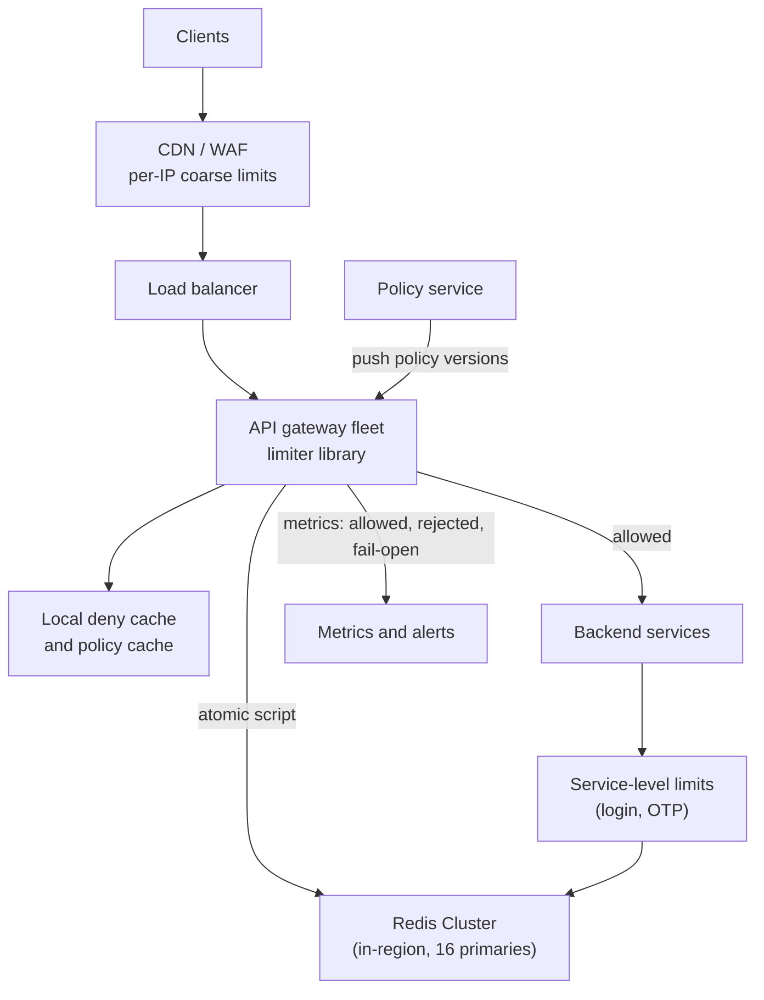
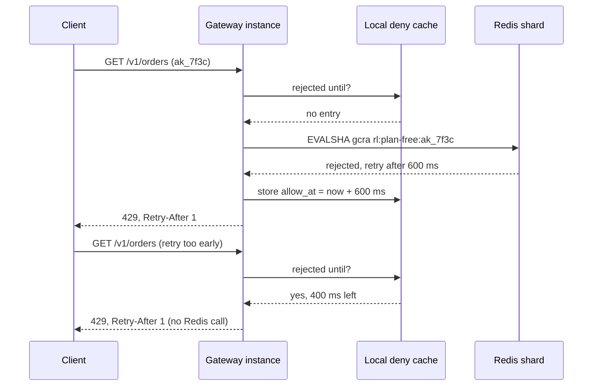
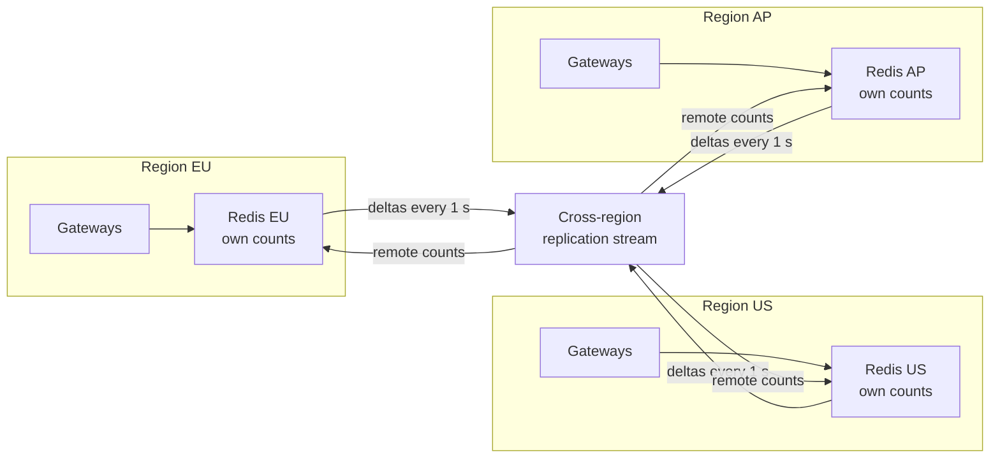
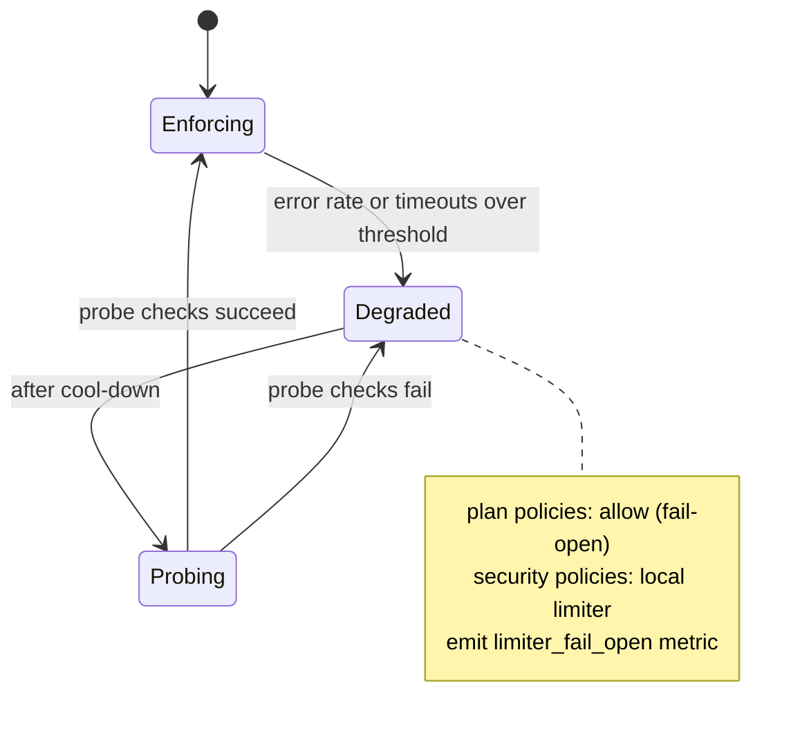

import Callout from '../../components/mdx/Callout.astro';

> "Design a rate limiter for our public API. Clients get a number of requests per minute depending on their plan. We run in several regions."

That is how the prompt usually arrives. It is a favourite for **mid-level** and early **senior** loops because it is small enough to finish in 45 minutes but touches everything that matters in distributed systems: atomic updates on shared state, the cost of a network hop on the hot path, what to do when a dependency is down, and how much inaccuracy you are willing to accept for speed. A senior or staff interviewer will use the same prompt and simply push harder on multi-region, hot keys and failure behaviour.

This is the first post in a series of case studies that apply the six-step framework from [Part 12: System Design Interviews](/blog/backend-12-system-design-interviews). We follow it exactly: requirements, estimates, API and data model, high-level design, deep dives, then bottlenecks and evolution.

<Callout variant="note" title="You should already know">
The rate limiting algorithms (fixed window, sliding log, sliding window counter, token bucket, leaky bucket) and a basic Redis token bucket script are covered in [Part 8: Scalability and Performance](/blog/backend-08-scalability-performance). Redis basics and TTLs come from [Part 5: Caching](/blog/backend-05-caching), `429` and `Retry-After` from [Part 2: REST API Design](/blog/backend-02-rest-api-design), and circuit breakers and load shedding from [Part 11: Reliability and Observability](/blog/backend-11-reliability-observability). This post does not re-teach the algorithms; it designs the system around them.
</Callout>

## Step 1: Requirements

The most common mistake with this prompt is to jump straight to "token bucket in Redis". Spend three or four minutes pinning down *who* is limited, *where*, and *what happens when it goes wrong*. The answers change the design.

Questions worth asking, with the answers we will assume:

- **What is the limiter protecting?** Two things: fairness between tenants (one customer cannot eat everyone's capacity) and plan enforcement (free versus paid tiers). Abuse protection on login is a related but separate concern; we will handle it with a different key.
- **What is the key?** Per API key for the public API. Per user and action for sensitive endpoints (login, OTP resend). Per IP at the edge for unauthenticated traffic.
- **What do the limits look like?** "100 requests per minute, bursts of 20 allowed" for free plans; up to "10,000 per minute" for enterprise; some endpoints are more expensive and should cost more than one unit.
- **Client-side or server-side?** Server-side. Client SDKs can self-throttle as a courtesy, but you cannot trust them.
- **How accurate must it be?** This is the important one. For plan enforcement, being a few percent over the limit for a few seconds is fine. For "5 login attempts per minute", it should be close to exact.
- **Multi-region?** Yes, three regions. A client may hit more than one of them.

### Functional requirements

1. For each request, decide **allow** or **reject** based on policies that match the request (API key, plan, endpoint, user, IP).
2. Policies are **configurable** without a deploy: limit, window, burst, cost per endpoint.
3. Rejected requests get **`429 Too Many Requests`** with a `Retry-After` header. All responses carry headers telling the client its quota and what remains.
4. Support **weighted costs**: a bulk export call may cost 10 units.

### Non-functional requirements

| Requirement | Target | Why it matters for the design |
|---|---|---|
| Added latency | p99 under 2 ms in-region | The limiter is on every request; it cannot cost more than a cache hit |
| Throughput | 300,000 requests/s at peak, each checking about 2 policies | Drives the size of the shared store |
| Accuracy | Within a few percent for plan limits; near exact for security limits | Decides whether we can use approximations and local caching |
| Availability | Limiter failure must not take the API down | Decides fail-open versus fail-closed |
| Consistency across regions | Bounded overshoot is acceptable for plan limits | Rules out synchronous cross-region coordination |

### Out of scope

Billing and monthly quotas (a metering pipeline, not a limiter), DDoS mitigation at the network layer (that is the CDN or cloud provider's job), and adaptive load shedding for overall capacity. Say this last one out loud: **a per-client rate limiter does not protect you from the sum of well-behaved clients**. That needs concurrency limits and load shedding, which we will mention but not design.

## Step 2: Estimates

The numbers here are assumptions for the interview, so state them as such and then use them to make decisions.

**Request rate.** 300,000 requests/s at peak through the gateway. Each request checks about two policies (per API key plus one per-endpoint or per-user rule):

```text
limiter operations = 300,000 req/s * 2 checks = 600,000 checks/s at peak
```

**Store throughput.** A single Redis primary commonly serves on the order of 100,000 simple commands per second on one core; a short Lua script is more expensive than a `GET`. For planning, assume 50,000 script executions per second per shard at a comfortable CPU level (an assumption you would replace with a benchmark of your own script):

```text
shards needed = 600,000 / 50,000 = 12 primaries
with ~30% headroom and room to grow: 16 primaries (each with a replica)
```

**Memory.** Keys only exist for identities active within the last window, because every key has a TTL. Assume in any given minute 5 million active users with 2 user-level policies each, plus 200,000 active API keys with 2 policies each:

```text
active keys ≈ 5,000,000 * 2 + 200,000 * 2 = 10.4 million keys
memory per key ≈ 100-150 bytes (key name, small value, expiry, Redis overhead)
total ≈ 10.4M * 150 B ≈ 1.6 GB across the cluster
```

That is tiny. **Memory is not the problem; operations per second and hot keys are.** This is the decision the estimate buys you: you will not spend interview time on storage tiering, and you will spend it on the hot path.

**Network.** Each check sends a key name and a few arguments and gets a few integers back, roughly 150 bytes round trip:

```text
600,000 * 150 B ≈ 90 MB/s across 16 shards ≈ 6 MB/s per shard
```

Negligible.

**Latency.** An in-region Redis round trip is typically a few hundred microseconds; a cross-region round trip is tens to a couple of hundred milliseconds. With a 2 ms budget, **the shared store must be in the same region as the caller**, and any cross-region coordination must be asynchronous. That single comparison drives the whole multi-region design.

## Step 3: API and data model

A rate limiter has two APIs: the one your services call, and the one clients see in HTTP responses.

### The internal check API

If the limiter is a library inside the gateway, this is a function call. If it is a separate service (the Envoy model, where the proxy calls an external rate limit service over gRPC), it looks like this:

```http
POST /v1/ratelimit/check
Content-Type: application/json

{
  "descriptors": [
    { "policy": "plan-free", "key": "apikey:ak_7f3c" },
    { "policy": "export-endpoint", "key": "apikey:ak_7f3c", "cost": 10 }
  ]
}
```

```json
{
  "allowed": false,
  "results": [
    { "policy": "plan-free", "allowed": true, "remaining": 41, "resetSeconds": 12 },
    { "policy": "export-endpoint", "allowed": false, "remaining": 0, "retryAfterSeconds": 6 }
  ]
}
```

The request is allowed only if **every** matching policy allows it. Note one subtlety: if the first policy consumes a token and the second rejects, the first token is wasted. Most systems accept this; a stricter design checks all policies in one script and only commits if all pass.

### What the client sees

`429` is defined in RFC 6585, and `Retry-After` (RFC 9110) takes either a number of seconds or an HTTP date. For quota information, many APIs still use the non-standard `X-RateLimit-Limit`, `X-RateLimit-Remaining` and `X-RateLimit-Reset` headers. The IETF HTTPAPI working group has been standardising this as `RateLimit-Policy` and `RateLimit` fields in the draft `draft-ietf-httpapi-ratelimit-headers`. Recent revisions use structured fields like this:

```http
HTTP/1.1 429 Too Many Requests
Retry-After: 6
RateLimit-Policy: "plan-free";q=100;w=60
RateLimit: "plan-free";r=0;t=6
Content-Type: application/problem+json

{
  "type": "https://api.example.com/problems/rate-limited",
  "title": "Too many requests",
  "status": 429,
  "detail": "Plan limit of 100 requests per 60 seconds exceeded."
}
```

Here `q` is the quota, `w` the window in seconds, `r` the remaining quota and `t` the seconds until it resets. The syntax has changed between draft revisions, so check the current one before you ship it. In the interview, it is enough to say: "429, `Retry-After`, plus quota headers so well-behaved clients can pace themselves instead of discovering the limit by hitting it."

### Policies

Policies are data, not code. A small config, versioned and pushed to every limiter instance:

```yaml
policies:
  - name: plan-free
    match: { plan: free }
    key: apikey
    limit: 100
    window: 60s
    burst: 20
  - name: plan-enterprise
    match: { plan: enterprise }
    key: apikey
    limit: 10000
    window: 60s
    burst: 1000
  - name: export-endpoint
    match: { route: "POST /v1/exports" }
    key: apikey
    limit: 30
    window: 60s
    cost: 10
  - name: login-attempts
    match: { route: "POST /v1/sessions" }
    key: [ip, username]
    limit: 5
    window: 60s
    onStoreFailure: closed
```

### Limiter state

For each `(policy, key)` pair the store holds very little. With GCRA (explained below) it is **one number**: the theoretical arrival time. With a token bucket it is two (tokens, last refill time); with a sliding window counter it is two counters. Key names are built from the policy and identity, for example `rl:plan-free:ak_7f3c`, and every key carries a TTL so idle identities disappear.

## Step 4: High-level design



The request path:

1. The **edge** (CDN or WAF) applies coarse per-IP limits. This is cheap, runs before any of your code, and soaks up floods.
2. The **gateway** resolves the API key, finds matching policies from its local policy cache, and checks the **local deny cache**: if this key was rejected recently and its `Retry-After` has not passed, reject immediately without touching Redis.
3. Otherwise it runs one **atomic script** against the in-region Redis Cluster, which updates the state and returns allow, remaining and retry-after.
4. Allowed requests go to the backend. Some services enforce their own business limits (login attempts) using the same library and store.
5. Policies are pushed from a **policy service**; gateways keep the last good version if the policy service is down.

Why a library in the gateway rather than a separate limiter service? A separate service adds a network hop and another thing to scale. A library talks to Redis directly, which keeps the hot path to one round trip. A separate service makes sense when many heterogeneous proxies need the same limits (that is why Envoy's global rate limiting calls an external gRPC service). Either is defensible; say which and why.


The layered picture is worth drawing in an interview because it shows you understand that one limiter cannot do every job. Each layer limits a different key and stops a different kind of overload.

## Step 5: Deep dives

### Deep dive 1: choosing the algorithm and making it atomic

Interviewers want to hear a choice, not a catalogue. Two candidates are worth discussing for this prompt:

- **Token bucket** or its single-number twin **GCRA** (generic cell rate algorithm): exact for its model, allows controlled bursts, and needs one or two values per key.
- **Sliding window counter**: two counters per key, smooths out the fixed-window boundary burst, and is approximate.


The sliding window counter is easy to explain and maps naturally to "100 per minute" in a pricing page. Its approximation assumes requests in the previous window were evenly spread, which is usually close enough. Its weakness is that it needs two keys (or two hash fields) and it does not express bursts directly.

For plan limits with an explicit burst, I would pick **GCRA**. It stores one timestamp per key, the **theoretical arrival time** (TAT): the time at which the bucket would be completely full again if no more requests arrived. Each allowed request pushes the TAT forward by one **emission interval** (window divided by limit). A request is allowed if pushing the TAT forward would not put it more than `burst` intervals ahead of now. It behaves exactly like a token bucket with capacity `burst` and refill rate `limit / window`, but with one stored value, and it gives you `Retry-After` for free.

**Why atomicity matters.** The naive version is read state, compute in the app, write state. Two gateway instances reading the same key concurrently will both see "one token left" and both allow. On a hot key at thousands of requests per second this is not an edge case; it is constant over-admission. The fixes are:

- Use a single atomic command where one exists. `INCR` is atomic, which is why fixed-window counters are easy. But `INCR` followed by `EXPIRE` is two commands: if the process dies between them, the key never expires and the client is locked out forever. Either set the TTL first with `SET key 0 EX 60 NX` and then `INCR`, or use a script.
- Use a **Lua script** (or a Redis Function in Redis 7 and later). Redis runs a script atomically: no other command executes in the middle of it.

Here is a GCRA script. It uses Redis's own clock (`TIME`) rather than the caller's, so clock skew between gateway instances does not matter:

```lua
-- KEYS[1] = limiter key, e.g. rl:plan-free:ak_7f3c
-- ARGV[1] = emission interval in ms (window_ms / limit), may be fractional
-- ARGV[2] = burst (how many requests may arrive at once)
-- ARGV[3] = cost of this request (usually 1)
local interval = tonumber(ARGV[1])
local burst    = tonumber(ARGV[2])
local cost     = tonumber(ARGV[3])

local t   = redis.call('TIME')                       -- seconds, microseconds
local now = tonumber(t[1]) * 1000 + math.floor(tonumber(t[2]) / 1000)

local tat = tonumber(redis.call('GET', KEYS[1])) or now
if tat < now then tat = now end

local tolerance = interval * burst
local new_tat   = tat + interval * cost
local allow_at  = new_tat - tolerance

if allow_at > now then
  -- rejected: allowed=0, remaining=0, retry_after_ms
  return {0, 0, math.ceil(allow_at - now)}
end

redis.call('SET', KEYS[1], new_tat, 'PX', math.ceil(new_tat - now))
local remaining = math.floor((tolerance - (new_tat - now)) / interval)
return {1, remaining, 0}
```

Walk the interviewer through one example. Plan: 100 per 60 s, burst 20. Emission interval is 600 ms, tolerance is 12,000 ms. A fresh key gets `tat = now`, so 20 requests at the same instant push the TAT to `now + 12,000 ms` and all pass; the 21st would push it to `now + 12,600 ms`, which is 600 ms beyond the tolerance, so it is rejected with `Retry-After` of 600 ms (rounded up to 1 second in the header). After that, one request is admitted every 600 ms, which is 100 per minute.

Two details show real experience:

- **Precision.** Redis's Lua converts numbers to strings with 14 significant digits when you pass them to `redis.call`. Epoch milliseconds (13 digits) are safe; epoch microseconds (16 digits) would silently lose precision and corrupt the stored TAT. That is why the script works in milliseconds.
- **Redis Cluster.** A script may only touch keys in one hash slot, and every key must be passed in `KEYS` so the client can route it. A single-key script like this one has no problem. A sliding window counter that uses two keys must put them in the same slot with a hash tag, such as `rl:{ak_7f3c}:cur` and `rl:{ak_7f3c}:prev`.

Calling it from Kotlin with Spring Data Redis:

```kotlin
data class Decision(val allowed: Boolean, val remaining: Long, val retryAfterMs: Long)

@Component
class GcraLimiter(private val redis: StringRedisTemplate) {

    private val script: RedisScript<List<*>> =
        RedisScript.of(ClassPathResource("gcra.lua"), List::class.java)

    fun check(key: String, limit: Int, windowMs: Long, burst: Int, cost: Int = 1): Decision {
        val intervalMs = windowMs.toDouble() / limit
        val result = redis.execute(
            script, listOf(key),
            intervalMs.toString(), burst.toString(), cost.toString(),
        ) ?: error("null reply from limiter script")
        val (allowed, remaining, retryAfter) = result.map { (it as Long) }
        return Decision(allowed == 1L, remaining, retryAfter)
    }
}
```

Spring Data Redis loads the script with `EVALSHA` and falls back to `EVAL` if the script is not cached on that node, so you do not send the script body on every call.

**The trade-off to state:** GCRA or token bucket is exact per key and cheap, but every check is a round trip to a shared store. That is what the next two dives are about.

### Deep dive 2: hot keys and keeping Redis off the hot path

The estimate said memory is irrelevant and operations per second are everything. The operations are also not evenly spread. One enterprise tenant sending 40,000 requests per second is 40,000 script executions per second **on one key, on one shard**, because a key lives in exactly one hash slot. That single customer can saturate a shard and add latency for every other key on it. Worse, a misbehaving client that is already over its limit keeps sending, and each rejected request still costs a Redis call.

Three techniques, in the order I would introduce them:

**1. Local deny cache.** When Redis says "rejected, retry after 600 ms", the gateway remembers `key -> allow_at` in a small in-process cache (Caffeine, a few hundred thousand entries). Until `allow_at`, it rejects locally. A client hammering at 50,000 requests per second after hitting its limit now costs Redis roughly one call per retry-after period per gateway instance instead of 50,000 per second. This is the single most effective optimisation and it does not change correctness: the gateway is only reusing an answer Redis already gave.

**2. Token leasing (local batching).** For very high limits, a gateway instance takes a batch of tokens at once by calling the script with `cost = 50`, then serves the next 50 requests from local memory. Redis load for that key drops by 50x. The cost is accuracy: tokens leased to an instance that then receives no traffic are wasted until the lease expires, and the effective burst grows by up to `lease size * number of instances`. Use it only for policies whose limit is large relative to the lease size (an enterprise plan with 10,000 per minute, not a login limit of 5).

**3. Splitting the key.** Store `N` sub-buckets (`rl:ak_7f3c:0` through `:7`), each with `limit / N`, and pick one at random per request. Load spreads across shards, at the price of rejecting a request when its random sub-bucket is empty while another still has capacity. With large limits the error is small; with small limits it is unacceptable.



**The trade-off to state:** every technique that removes Redis calls adds some local state and some inaccuracy. The deny cache is nearly free; leasing and splitting trade accuracy for throughput and should be enabled per policy, not globally.

### Deep dive 3: multi-region

Three regions, and a client's requests can land in any of them. With a 2 ms budget and cross-region round trips of 60 ms or more, a single global Redis is out. The options:

| Approach | How it works | Accuracy | Complexity |
|---|---|---|---|
| Split the limit | Each region enforces `limit / 3` independently | Under-admits a client whose traffic is concentrated in one region | Trivial |
| Home region | Route each API key to a home region (by DNS or the gateway forwarding) | Exact | Medium; adds latency for clients far from home |
| Local enforcement plus async sync | Each region enforces against `local count + last known remote counts`, synced every second or so | Bounded overshoot | Higher |
| Synchronous global store | Every check goes cross-region | Exact | Violates the latency budget |

For plan limits I would choose **local enforcement with asynchronous sync**. Each region keeps its own counter per key and periodically publishes its per-key consumption (only for keys that changed) to the other regions. A region's view of "used" is its own exact count plus the most recent counts it has received from the others. Because each region only ever adds to its own counter and others only read it, merging is simple: per-region counters that only grow are a classic conflict-free replicated data type (a grow-only counter).



**Quantify the overshoot**; this is what separates a good answer from a hand wave. In the worst case each region has not yet seen the last sync interval of traffic from the other two. With a limit of 1,000 per minute, a client sending at full speed in all three regions, and a sync delay of 1 second:

```text
each region can admit traffic it doesn't know the others admitted:
worst-case overshoot ≈ (regions - 1) * client_rate_per_region * sync_delay
```

If the client can send 100 requests per second into each region, that is about `2 * 100 * 1 = 200` extra requests, 20% over a 1,000-per-minute limit for that minute. In practice clients mostly hit one region (DNS-based routing sends them to the nearest), so the realistic overshoot is far smaller. If 20% is too much for a given policy, shorten the sync interval, or use home-region routing for that policy.

For **security limits** (login attempts), use the home-region approach or simply enforce per region with the full low limit: five attempts per minute per region is fifteen globally, which is still useless to an attacker guessing passwords, and is much simpler than coordinating.

**The trade-off to state:** you are choosing between latency, accuracy and complexity, and the right answer differs per policy. A design that lets each policy pick its consistency mode is better than one global answer.

### Deep dive 4: failure behaviour, fail-open versus fail-closed

What happens when Redis is slow, a shard is failing over, or the network partitions? The limiter is now a dependency of every request, so this is the most important operational question in the whole design.

- **Fail-open**: if the limiter cannot decide quickly, allow the request. The product stays up; for a while, limits are not enforced.
- **Fail-closed**: if the limiter cannot decide, reject. Limits are always enforced; a Redis outage becomes an API outage.

For plan limits, **fail open**. A Redis incident should not turn into a full outage of the product, and a few minutes without plan enforcement costs little. For security limits like login attempts, **fail closed or degrade**: a limiter outage is exactly when an attacker would like to brute-force passwords. A good middle ground is to fall back to a **local in-memory limiter** with a conservative share of the limit (for example `limit / number_of_instances`), so you keep approximate enforcement without the shared store.

Mechanics that make this work:

- A **tight timeout** on the limiter's Redis call, on the order of 5 to 20 ms. Without it, a slow Redis makes every request slow, which is worse than either option. Use a dedicated Redis client for the limiter so its timeout does not affect other Redis users.
- A **circuit breaker** around the limiter client so that, once Redis is clearly unhealthy, you stop paying even the timeout on each request.
- A **metric for every fail-open decision**, with an alert. Silent fail-open is how limits stop being enforced for weeks without anyone noticing.



A short Kotlin sketch of the decision, using the GCRA limiter above:

```kotlin
fun decide(policy: Policy, key: String): Decision =
    try {
        limiter.check(key, policy.limit, policy.windowMs, policy.burst, policy.cost)
    } catch (e: DataAccessException) {   // includes Redis command timeouts
        meter.counter("limiter_store_failure", "policy", policy.name).increment()
        when (policy.onStoreFailure) {
            FailureMode.OPEN   -> Decision(allowed = true, remaining = -1, retryAfterMs = 0)
            FailureMode.LOCAL  -> localFallback.check(key, policy)
            FailureMode.CLOSED -> Decision(allowed = false, remaining = 0, retryAfterMs = 1_000)
        }
    }
```

Also think about **Redis failover**. Redis replication is asynchronous, so when a replica is promoted it may be missing the last few writes. Some keys will appear to have a little more quota than they should. For rate limiting that is acceptable and worth saying so: you do not need a consensus-backed store to count requests, because a brief over-admission after a failover is harmless.

## Step 6: Bottlenecks, failures and evolution

**At 10x traffic (3 million requests per second, 6 million checks per second):** the naive approach needs about 120 Redis primaries. Before scaling the cluster, scale down the calls: the local deny cache removes most calls from abusive clients, and token leasing for high-limit policies removes most calls from large legitimate tenants. A realistic target is that most requests for big tenants never touch Redis. Then add shards; Redis Cluster rebalances slots online.

**Hot shard:** watch per-shard CPU and per-key call rates (sampling which keys are hottest). One shard at high CPU while the others idle means a hot key, not a capacity problem; enable leasing or splitting for that policy.

**Policy mistakes:** someone pushes `limit: 10` instead of `10000` for the enterprise plan and every large customer starts getting 429s. Treat policy changes like code: validation, a diff review, staged rollout (one region first), a "shadow mode" where a new policy only logs what it would have rejected, and one-click rollback to the previous version.

**Thundering retries:** if many clients get 429 with the same `Retry-After`, they all come back at the same moment. Add a little jitter to the value you send, and document that clients should back off with jitter (see the retry section of [Part 11](/blog/backend-11-reliability-observability)).

**Limiter latency creeping into the API:** track the limiter's own latency as a separate metric, with an SLO. If p99 of the limiter call rises, every API endpoint's p99 rises with it.

**Evolution:** the limiter you design today is likely to grow into a **quota and metering** system (monthly quotas, billing, usage dashboards). Keep those separate: rate limiting is a hot-path, in-memory, approximate decision; metering is an asynchronous, durable, exact record, usually a stream of usage events into an analytics store. Mixing them makes the hot path slow and the billing inaccurate.

## What separates levels

| Level | What the answer adds for this problem |
|---|---|
| Mid | Picks an algorithm and explains it correctly; puts state in Redis; knows why read-then-write is a race and fixes it with a Lua script; returns 429 with `Retry-After` |
| Senior | Separates policies by key and layer; handles hot keys (deny cache, leasing); chooses fail-open versus fail-closed per policy with timeouts and a circuit breaker; quantifies the latency budget |
| Staff | Designs multi-region with a stated, computed overshoot bound; per-policy consistency modes; safe policy rollout and shadow mode; distinguishes rate limiting from load shedding and metering |
| Principal | Frames limits as a product and cost decision (plans, fairness, abuse); defines SLIs for the limiter itself; plans the evolution to quotas and billing; argues when a managed gateway or edge product is the right buy instead of building |

## Common mistakes

- **Read, compute, write from the application.** Concurrent instances over-admit on exactly the keys that matter most. Use an atomic script or a single atomic command.
- **`INCR` then `EXPIRE` as two calls.** A crash between them leaves a key with no TTL and a client blocked forever.
- **Per-instance in-memory limits on a scaled fleet.** With 20 instances each allowing 100 per second, a client gets 2,000 per second, and the effective limit changes every time the autoscaler acts.
- **No timeout on the limiter call.** A slow Redis becomes a slow API. The limiter must fail fast.
- **Failing closed for everything.** A cache outage turns into a total outage.
- **Failing open silently.** Without a metric and an alert, nobody knows limits stopped working.
- **Using the caller's clock in the script** without thinking about skew. Prefer the store's clock, or accept and document the skew.
- **Treating a rate limiter as overload protection.** It limits individual clients, not the total. Launch-day traffic from many good clients still needs load shedding.
- **Ignoring rejected traffic cost.** Each rejected request that still hits Redis is load you are paying for on behalf of the abuser. Cache denials locally.

## Interviewer follow-ups

<details>
<summary>Why not just keep counters in each gateway's memory? It's much faster.</summary>

It is faster and it is the right choice for some limits, but it is only correct when traffic for a key always lands on the same instance. Behind a round-robin load balancer, a client spreading requests across 20 instances gets 20 times its limit. Dividing the limit by the fleet size (`limit / instances`) fixes the average but is wrong for clients that only reach a few instances, and the effective limit changes every time the fleet scales.

Local limits are good as a **first tier** (protect each instance from extreme bursts), as a **fallback** when the shared store is down, and as a **deny cache** that remembers decisions the shared store already made. Global per-client limits need shared state or sticky routing.

</details>

<details>
<summary>Token bucket or sliding window counter: which would you pick, and when would you switch?</summary>

For API plan limits I pick token bucket (implemented as GCRA): it expresses both the sustained rate and the allowed burst, needs one value per key, and gives an exact `Retry-After`. I would switch to a sliding window counter when the product defines the limit strictly as "N per rolling minute" with no burst concept and approximate accuracy is acceptable, or when I want the limit to read exactly like the pricing page.

For very low, security-sensitive limits (5 login attempts per minute), a sliding log (one timestamp per attempt in a sorted set) is affordable because the count is tiny, and it is exact.

</details>

<details>
<summary>How would you support a request that costs more than one unit, such as a bulk export?</summary>

Pass a `cost` to the script and consume `cost` units atomically: with GCRA, advance the TAT by `interval * cost`; with a token bucket, require `tokens >= cost`. Make sure `cost` can never exceed `burst`, otherwise the request can never succeed and the client loops forever on 429. Validate that when the policy is loaded.

An alternative is a separate policy for expensive endpoints, which is easier to explain to customers ("30 exports per minute") and keeps the main budget simple.

</details>

<details>
<summary>Redis fails over and the new primary is missing the last second of writes. What happens, and do you care?</summary>

Replication is asynchronous, so the promoted replica may have older TAT values or counters for some keys. Those clients get a little extra quota for one window. For plan limits, that is harmless and not worth paying for synchronous replication or a consensus store. For security limits it is still fine at this scale (an attacker gets maybe a handful of extra login attempts once per failover), and the edge and per-IP layers still apply.

What I do care about is the failover duration: during it, limiter calls time out, so the fail-open or fallback path must behave well and must be visible in metrics.

</details>

<details>
<summary>A customer complains they were rate limited while their dashboard shows they sent fewer requests than their limit. How do you investigate?</summary>

Likely causes, in order: their requests matched **more than one policy** and a different, stricter one rejected them (the response should name the policy, which is why the `RateLimit` headers and the problem body include it); they hit the **burst** limit rather than the per-minute limit (40 requests in one second against a burst of 20); their usage was measured over a **different window** than ours (calendar minute versus rolling); or multi-region **sync** double-counted after a replication glitch.

To make this answerable at all, log every rejection with policy name, key, TAT or counter state and region, sampled if necessary, and expose per-key usage in a support tool.

</details>

<details>
<summary>How do you roll out a new, stricter policy without breaking customers?</summary>

Run it in **shadow mode** first: evaluate it on every request, record what it would have rejected, but do not enforce. That tells you which customers would be affected and by how much. Notify those customers, then enforce gradually: one region, then a percentage of keys, then all. Keep the previous policy version one click away, and alert on a jump in the 429 rate per plan after the change.

</details>

<details>
<summary>What would you change for a gRPC or WebSocket API instead of REST?</summary>

For gRPC, the equivalent of 429 is the `RESOURCE_EXHAUSTED` status code, and retry hints go in trailing metadata or a structured error detail (`google.rpc.RetryInfo`). The limiter itself does not change.

For WebSockets, limiting the HTTP upgrade only limits connections. You also need per-connection message rate limits (a token bucket held in the connection's own memory works, since one connection lives on one server) and a limit on concurrent connections per user, which is a **concurrency** limit, not a rate limit: increment on connect, decrement on disconnect, with a TTL safety net for connections that die without a clean close.

</details>

<details>
<summary>Should you build this or use something off the shelf?</summary>

Often you should buy or reuse. API gateways, cloud load balancers and CDNs offer configurable rate limiting; Envoy has both a local rate limit filter and a global rate limit service; Spring Cloud Gateway ships a Redis-backed token bucket rate limiter; and on the JVM, Bucket4j implements token buckets with distributed backends. Build your own when you need policies those tools cannot express (complex per-tenant plans, weighted costs, per-policy consistency modes) or when the limiter is part of your product, as it is for an API platform. Even then, the edge layer should almost always be the provider's.

</details>

## Key takeaways

- Clarify the key, the layer and the accuracy requirement first: plan limits, security limits and per-IP limits are different policies with different trade-offs.
- The estimate shows memory is trivial; **operations per second, hot keys and the latency budget** are the real constraints.
- Shared state must be updated atomically: a Lua script or Redis Function, never read-compute-write from the application, and never `INCR` then `EXPIRE` as two calls.
- GCRA is a token bucket in one number and gives `Retry-After` directly; the sliding window counter is a good approximate alternative.
- Keep Redis off the hot path where you can: cache denials locally, lease tokens for high-limit tenants.
- Multi-region: enforce locally, sync asynchronously, and **compute the overshoot** you are accepting.
- Decide fail-open versus fail-closed per policy, with tight timeouts, a circuit breaker and a metric on every fail-open decision.
- Return 429 with `Retry-After` and quota headers so clients can pace themselves.

Framework: [Part 12: System Design Interviews](/blog/backend-12-system-design-interviews) · Next: [Design a Notification System](/blog/sd-02-notification-system)
