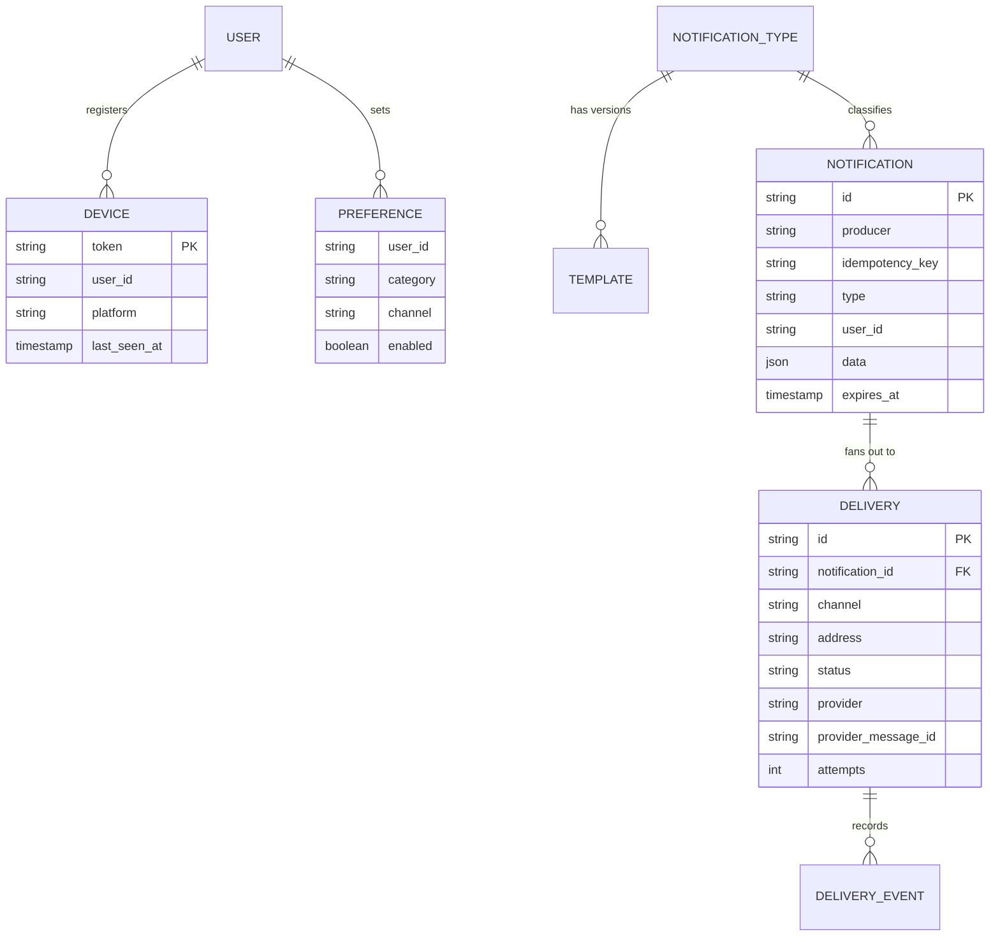
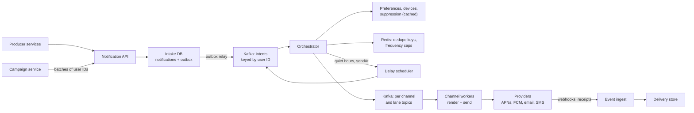
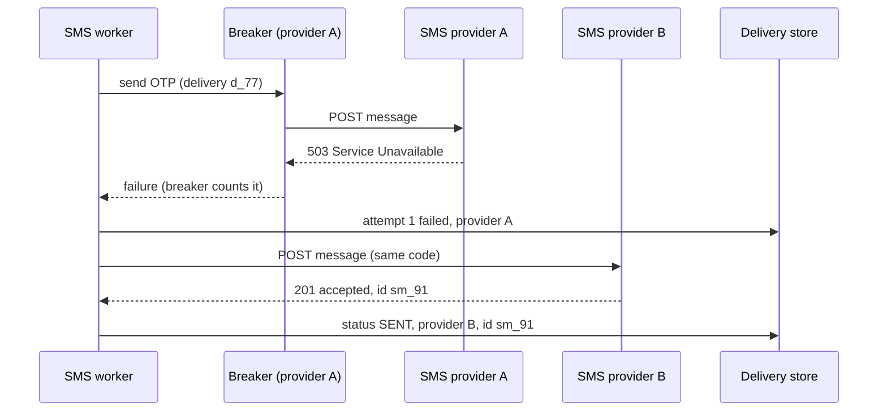
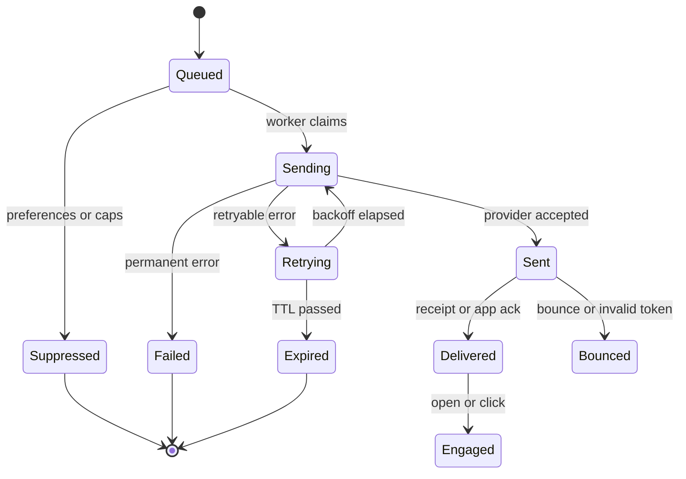

import Callout from '../../components/mdx/Callout.astro';

> "Design a notification system. Our services need to send push notifications, emails and SMS to users. Marketing also wants to send campaigns to millions of users at once."

This is a **senior-level** staple. The box diagram is easy: an API, a queue, some workers, some providers. What the interviewer is actually probing is everything that goes wrong between "a service wants to tell a user something" and "the user's phone buzzes exactly once": a campaign backlog delaying password-reset codes, a worker retry sending the same SMS twice, a provider outage, a user who said "no marketing emails", a bug that notifies 40 million people at 3 a.m. Good answers are about **isolation, idempotency and restraint** more than about throughput.

This post applies the six-step framework from [Part 12: System Design Interviews](/blog/backend-12-system-design-interviews), and builds on the previous case study, [Design a Distributed Rate Limiter](/blog/sd-01-rate-limiter), which we reuse for per-user frequency caps.

<Callout variant="note" title="You should already know">
Queues, acknowledgements, retries with backoff, dead-letter queues and idempotent consumers ([Part 6: Async Processing and Queues](/blog/backend-06-async-processing-queues)); Kafka partitions, consumer groups and the transactional outbox ([Part 9: Event-Driven Architecture](/blog/backend-09-event-driven-architecture)); Little's Law for sizing concurrency ([Part 8: Scalability and Performance](/blog/backend-08-scalability-performance)); and circuit breakers and timeouts ([Part 11: Reliability and Observability](/blog/backend-11-reliability-observability)).
</Callout>

## Step 1: Requirements

Clarifying questions, with the answers we will assume:

- **Who sends notifications?** Internal services (orders, payments, social, security) through an API, and a marketing team through campaigns targeting user segments.
- **Which channels?** Mobile push (iOS via APNs, Android via FCM), email, and SMS. Web push and in-app inbox are nice-to-haves.
- **What kinds of notifications?** Three classes with very different urgency: **critical** (one-time passcodes, security alerts), **transactional** (order shipped, someone replied to you) and **bulk** (marketing, weekly digests).
- **Do users control what they receive?** Yes: per category and per channel opt-in or opt-out, plus quiet hours in their own time zone. Marketing requires consent; security notifications cannot be turned off.
- **Do senders need to know the outcome?** Yes, a status per notification and per channel, and aggregate delivery and open rates per campaign.
- **Scale?** 50 million daily active users out of 120 million registered.

### Functional requirements

1. Accept a notification request (recipient, type, data) from a service; the platform picks channels, renders content and delivers it.
2. Respect user **preferences**, **quiet hours** and **legal suppression** (unsubscribes, hard bounces, SMS opt-outs).
3. **Templates** per notification type, channel and locale, versioned, with variables filled in at send time.
4. **Campaigns**: send one template to a user segment, scheduled or immediately.
5. **Per-user frequency caps** ("no more than 3 marketing pushes per day") and **deduplication** ("don't tell me my order shipped twice").
6. **Delivery tracking**: per-delivery status and per-campaign statistics.

### Non-functional requirements

| Requirement | Target | Design consequence |
|---|---|---|
| Critical latency | 95% handed to the provider within 5 s | Must never queue behind bulk traffic |
| Transactional latency | 95% within 60 s | Normal queueing is fine; minutes are not |
| Bulk throughput | 30 million recipients within 30 minutes | Large fan-out, shaped to provider quotas |
| Reliability | No accepted notification silently lost | Durable intake, at-least-once processing |
| Duplicates | Rare, and never for SMS OTPs within a short window | Dedupe at several layers |
| Availability | Intake API 99.95% | Intake must be decoupled from providers |

### Out of scope

The in-app inbox UI, building our own email delivery infrastructure (we use email service providers), audience segmentation itself (a data platform hands us a list of user IDs), and the A/B testing tool for campaign content. Say explicitly that **we do not build our own SMS gateway or email MTA**: provider integration is the job, not replacing providers.

## Step 2: Estimates

All numbers are assumptions for the interview; the point is to see which parts of the system are big.

**Volume of notification requests.** Assume each daily active user triggers about 8 notification requests a day across all services:

```text
intents per day = 50,000,000 DAU * 8 = 400,000,000 / day
average rate    = 400,000,000 / 86,400 s ≈ 4,630 intents/s
```

**Deliveries.** One intent can become several deliveries: push to two devices, or push plus email. After preferences filter some out, assume 1.3 deliveries per intent:

```text
deliveries per day = 400M * 1.3 = 520,000,000 / day
average            ≈ 6,020 deliveries/s
daytime peak (3x)  ≈ 18,000 deliveries/s
```

**Campaigns.** 30 million recipients in 30 minutes:

```text
30,000,000 / 1,800 s ≈ 16,700 deliveries/s on the bulk lane alone
```

So the system must handle roughly **35,000 deliveries per second** when a campaign runs during a daytime peak. That is not extreme for Kafka and stateless workers; the constraints will be provider quotas and our own downstream writes.

**Channel mix.** Assume 85% push, 14% email, 1% SMS:

```text
push  ≈ 0.85 * 520M ≈ 442M / day
email ≈ 0.14 * 520M ≈  73M / day
SMS   ≈ 0.01 * 520M ≈ 5.2M / day
```

SMS is priced per message segment and the price varies a lot by country, so take this only as an order of magnitude: even at one cent per segment, 5.2 million SMS is about 52,000 dollars a day. **SMS is a cost-controlled channel**: it should be used for OTPs and critical alerts, not as a default fallback for every failed push.

**Provider concurrency.** Suppose a push send takes about 100 ms end to end (HTTP/2 request to APNs or FCM and back). By Little's Law, the number of in-flight requests needed is rate times latency:

```text
in-flight = 30,000 push/s * 0.1 s = 3,000 concurrent requests
```

APNs and FCM both use HTTP/2, which multiplexes many concurrent streams over one connection, so this is a modest pool of long-lived connections per worker, not 3,000 TCP connections. It does mean the workers must be asynchronous or have large concurrency; a worker that sends one push at a time would need 3,000 threads.

**Storage.**

```text
device tokens:   120M users * ~1.5 devices * ~250 B ≈ 45 GB   (fits a relational DB)
delivery rows:   520M / day * ~300 B ≈ 156 GB / day
status events:   ~3 per delivery * 520M * ~100 B ≈ 156 GB / day
hot retention:   30 days * ~312 GB ≈ 9.4 TB
```

Device tokens and preferences are small and relational. The delivery log is large, append-heavy and time-ordered: a wide-column store (Cassandra or ScyllaDB) partitioned by user and day, or a time-partitioned table that drops old partitions, with long-term aggregates moved to an analytics store. **The decision the estimate buys: delivery tracking gets its own storage, separate from the transactional intake database.**

## Step 3: API and data model

### Sender API

```http
POST /v1/notifications
Idempotency-Key: 7c1d0e8a-3f4b-4a8e-9d55-2c1e6f0b9a41
Content-Type: application/json

{
  "type": "order_shipped",
  "recipient": { "userId": "u_48213" },
  "data": { "orderId": "982-114", "carrier": "DHL", "eta": "2026-11-07" },
  "dedupeKey": "order:982-114:shipped",
  "ttlSeconds": 86400
}
```

```http
HTTP/1.1 202 Accepted
Content-Type: application/json

{ "notificationId": "ntf_01JC8Z3K7Q", "status": "ACCEPTED" }
```

Points to call out:

- **`202 Accepted`**, not `200`. The API only promises the notification is durably recorded; delivery is asynchronous (the 202 pattern from [Part 6](/blog/backend-06-async-processing-queues)).
- **The sender does not pick channels or priority directly.** It names a `type`. The type's configuration (owned by the platform and the sending team together) decides the priority class, default channels, template and whether user preferences can suppress it. This stops every team from marking everything "critical".
- **`Idempotency-Key`** protects against the sender's own retries (same request sent twice). **`dedupeKey`** protects against *different* requests about the same business event (two services both reacting to "order shipped"). They are different layers and both are needed.
- **`ttlSeconds`**: a notification that cannot be delivered in time should expire rather than arrive late. An OTP that arrives after 10 minutes is worse than useless.

Other endpoints, briefly: `GET /v1/notifications/{id}` (status per delivery), `POST /v1/campaigns` (segment, template, schedule, send rate), `PUT /v1/users/{id}/preferences`, `POST /v1/users/{id}/devices` (register a push token), and inbound webhook endpoints for provider delivery events.

### Data model



- `NOTIFICATION` has a unique constraint on `(producer, idempotency_key)`.
- `DELIVERY` is one row per channel and destination: one notification to a user with two phones and email is three deliveries. Its `id` is deterministic, for example a hash of `(notification_id, channel, address)`, so re-running the fan-out cannot create a second delivery for the same destination.
- `PREFERENCE` stores only overrides; defaults come from the notification type. That keeps the table sparse.
- `NOTIFICATION_TYPE` holds the routing config: priority class, default channels, whether preferences apply, frequency cap category, TTL.

## Step 4: High-level design



Walk the path for one notification:

1. **Intake.** The API validates the request, looks up the type configuration, and in **one database transaction** inserts the notification row (deduplicated by idempotency key) and an outbox row. It returns 202. The outbox relay publishes to the `intents` topic, keyed by user ID. Using the outbox means a notification is never acknowledged to the sender and then lost because the Kafka publish failed (see [Part 9](/blog/backend-09-event-driven-architecture)).
2. **Orchestration.** The orchestrator consumes intents. Keying by user ID means all notifications for one user are processed in order by one consumer, which keeps per-user logic simple. For each intent it:
   - drops it if expired;
   - checks the **business dedupe key** in Redis (`SET dedupe:order:982-114:shipped 1 NX EX 86400`); if the key already exists, drops it as a duplicate;
   - loads **preferences**, **suppression lists** and **devices** (from a cache in front of the database);
   - applies **frequency caps** for the type's category, using the same atomic counter technique as the [rate limiter](/blog/sd-01-rate-limiter), keyed by user and category;
   - checks **quiet hours** in the user's time zone; if the notification can wait, hands it to the delay scheduler with a send time, otherwise (critical) sends now;
   - creates the `DELIVERY` rows and publishes one message per delivery to the right **channel and lane** topic, for example `push.transactional` or `sms.critical`.
3. **Channel workers** consume their topic, render the template for the channel and locale, call the provider, and record the outcome.
4. **Event ingest** receives provider webhooks (email delivered, bounced, complained; SMS delivery receipts) and app acknowledgements for push, and updates delivery status.

A sketch of the orchestrator's filter chain in Kotlin. Each step returns either a reason to drop or lets the intent continue, which makes every drop observable:

```kotlin
sealed interface Verdict {
    data object Continue : Verdict
    data class Drop(val reason: String) : Verdict
    data class Defer(val until: Instant) : Verdict
}

fun interface IntentFilter { fun apply(intent: Intent, ctx: UserContext): Verdict }

class Orchestrator(
    private val filters: List<IntentFilter>,   // expiry, dedupe, suppression, prefs, caps, quiet hours
    private val fanOut: FanOut,
    private val scheduler: DelayScheduler,
    private val meter: MeterRegistry,
) {
    fun handle(intent: Intent, ctx: UserContext) {
        for (filter in filters) {
            when (val v = filter.apply(intent, ctx)) {
                is Verdict.Continue -> continue
                is Verdict.Drop -> {
                    meter.counter("notification_dropped", "reason", v.reason, "type", intent.type).increment()
                    return
                }
                is Verdict.Defer -> { scheduler.schedule(intent, v.until); return }
            }
        }
        fanOut.publishDeliveries(intent, ctx)
    }
}
```

Two design choices worth defending:

- **Render late, in the channel worker**, not at intake. Rendering needs the locale, the channel and sometimes fresh data, and a template fix should apply to notifications still in the queue. The cost is that a broken template fails at send time, so templates need preview and validation before they are published.
- **Preferences are read on the hot path, so they are cached.** A preference change can take a few seconds to apply, which is acceptable for "no marketing". For "unsubscribe" the legal expectation is prompt, not instant, but invalidate the cache on change rather than waiting for a TTL.

## Step 5: Deep dives

### Deep dive 1: priority lanes and campaign fan-out

The failure everyone eventually hits: marketing launches a 30-million-recipient campaign, the queue fills, and a user who just requested a password reset waits 20 minutes for the code. A single queue with a `priority` field does not fix this, because Kafka partitions are processed in order, and even with a broker that supports message priority, the workers, the connection pools and the provider quota are still shared.

The fix is **isolation all the way down**: separate topics, separate consumer groups, separate worker pools and a separate share of each provider's quota for each priority class.


- **Critical** (OTP, security alerts): small volume, reserved worker capacity that is never scaled down below a floor, never throttled for other traffic. Alert on its lag in seconds.
- **Transactional**: autoscaled on consumer lag.
- **Bulk**: deliberately **rate-shaped**. The campaign defines a send rate; workers pace themselves with a token bucket so the campaign uses, say, at most 50% of each provider's quota. It can be paused instantly.

In Spring Kafka, each lane is simply its own listener with its own consumer group and concurrency, so they cannot steal threads from each other:

```kotlin
@Component
class PushWorkers(private val sender: PushSender) {

    @KafkaListener(topics = ["push.critical"], groupId = "push-critical", concurrency = "6")
    fun critical(delivery: DeliveryMessage) = sender.send(delivery)

    @KafkaListener(topics = ["push.transactional"], groupId = "push-transactional", concurrency = "12")
    fun transactional(delivery: DeliveryMessage) = sender.send(delivery)

    @KafkaListener(topics = ["push.bulk"], groupId = "push-bulk", concurrency = "12")
    fun bulk(delivery: DeliveryMessage) = sender.sendPaced(delivery)   // waits on a campaign token bucket
}
```

In production you would usually go further and run the critical lane as a separate deployment, so a memory leak or bad deploy in the bulk workers cannot take it down.

**Campaign fan-out.** A campaign is not 30 million API calls from marketing. The campaign service takes a segment (a list of user IDs from the data platform, stored as files), splits it into batches of, say, 1,000 users, and publishes **batch intents**. The orchestrator expands each batch into individual intents. That gives:

- **Resumability**: if expansion crashes halfway, it resumes from the last completed batch; deterministic delivery IDs mean re-expanding a batch does not create duplicates.
- **A kill switch** that works: pausing the campaign stops expansion, and bulk workers check the campaign's status before sending, so already-queued messages also stop.
- **Pacing**: batches are released at the campaign's configured rate rather than dumped all at once.

**The trade-off:** isolation costs capacity. The critical lane's reserved workers sit mostly idle. That idle capacity is the price of a 5-second OTP during a campaign, and it is cheap compared to the cost of users unable to log in.

### Deep dive 2: deduplication and idempotency

Duplicates come from several different places, and each needs its own defence:

| Source of duplicate | Example | Defence |
|---|---|---|
| Sender retries the API call | Timeout on `POST /v1/notifications`, sender retries | `Idempotency-Key`, unique on `(producer, key)` |
| Two events for one business fact | Order service and warehouse service both emit "shipped" | `dedupeKey` with a TTL window in Redis |
| Fan-out re-runs | Orchestrator crashes after publishing half the deliveries | Deterministic delivery IDs |
| Worker retries a send | Consumer crashes after the provider accepted | Delivery status claim, plus provider-level mitigation |

The first three are fully solvable inside our own system. Idempotent intake in SQL looks like this:

```sql
INSERT INTO notifications (id, producer, idempotency_key, type, user_id, data, expires_at)
VALUES (:id, :producer, :key, :type, :userId, CAST(:data AS jsonb), now() + :ttl * interval '1 second')
ON CONFLICT (producer, idempotency_key) DO NOTHING
RETURNING id;
```

If no row comes back, the request is a retry: read the existing row and return its ID with the same 202 response. The outbox row is inserted in the same transaction only when the notification row was new.

The fourth source is the hard one. A channel worker does: receive message, claim the delivery, call the provider, record SENT, acknowledge the message. Claiming is a conditional update so two workers cannot both send the same delivery, and a worker that sees `SENT` skips:

```sql
UPDATE deliveries
SET status = 'SENDING', attempts = attempts + 1, claimed_at = now()
WHERE id = :deliveryId
  AND (status IN ('QUEUED', 'RETRYING')
       OR (status = 'SENDING' AND claimed_at < now() - interval '2 minutes'))
RETURNING attempts;
```

The last condition lets a retry take over a delivery whose worker died mid-send. But that is exactly where duplicates come from:


If the worker crashes **after the provider accepted the message but before SENT is recorded**, the retry has no way to know the user already got it. The provider's accept and our database write are two systems with no shared transaction; this is the same "side effects outside your database" problem from [Part 6](/blog/backend-06-async-processing-queues). You cannot make it exactly-once; you can only make it rare and harmless:

- **Provider idempotency keys**, where the provider's API supports them. Check each provider; many messaging APIs do not offer one, so do not assume.
- **Collapse identifiers for push.** APNs accepts an `apns-collapse-id` header, and FCM has a `collapse_key` for Android: if two notifications with the same identifier arrive, the device shows only the latest. Use the delivery ID or the dedupe key as the collapse ID, and a duplicate push replaces the first instead of buzzing twice.
- **Keep the window short.** Do nothing slow between the provider call and the SENT write.
- **For OTPs, reuse the code.** If an OTP SMS is ever sent twice, both messages must contain the same code, so the duplicate is merely annoying, not confusing.

**The trade-off:** this is a deliberate choice of at-least-once over at-most-once. Losing an OTP or a security alert is worse than occasionally sending it twice. For bulk marketing you could argue the other way (better to miss one promo than send two), and a design that lets the type configuration choose is stronger than one global rule.

### Deep dive 3: providers, failover and channel specifics

Each channel has quirks that change the design, and interviewers at senior level like to hear that you know some of them.

**Push (APNs and FCM).**

- Both are HTTP/2 APIs. APNs accepts token-based authentication (a JWT signed with your `.p8` key), and Apple rejects provider tokens that are refreshed too often, so generate one and reuse it rather than signing per request. FCM uses the HTTP v1 API (`POST https://fcm.googleapis.com/v1/projects/{project-id}/messages:send`) with an OAuth 2.0 access token from a service account; the legacy FCM APIs were shut down in 2024.
- **Invalid tokens are a feedback loop you must close.** APNs returns `410` (reason `Unregistered`) for a token that is no longer valid; FCM returns `UNREGISTERED`. Delete or deactivate those tokens immediately, and periodically prune tokens whose device has not been seen for months. Otherwise a growing share of your push traffic goes to dead devices, and providers may treat you as a low-quality sender.
- **Priority and expiry are headers, use them.** APNs `apns-priority: 10` means deliver immediately, `5` means deliver at a power-friendly time; `apns-expiration` tells APNs how long to keep retrying an offline device. Map your TTL and priority class onto them.
- **Retryable versus permanent errors.** `429` or quota errors and `5xx` are retryable with backoff (honour `Retry-After` when present); malformed payloads and invalid tokens are permanent and go straight to FAILED.

**Email.** You send through one or more email service providers. Since 2024, Gmail and Yahoo require bulk senders to authenticate with SPF, DKIM and DMARC, to support one-click unsubscribe for marketing mail, and to keep spam complaint rates low. Hard bounces and spam complaints arrive as webhooks and must feed the **suppression list** so you never mail that address again for marketing. Failover between email providers is **not instant**: the backup must already have your domain's DKIM keys configured and a sending reputation, so a common approach is to keep the secondary warm by routing a small share of transactional mail through it all the time.

**SMS.** Messages are billed per segment. A message using only the GSM-7 character set fits 160 characters in one segment (153 per segment when concatenated); a single character outside it, such as an emoji, switches the encoding to UCS-2, which fits 70 (67 per segment concatenated). A template change that adds an emoji can double your SMS bill. Many countries regulate application-to-person SMS (in the US, for example, A2P 10DLC registration for long codes), and opt-out keywords such as STOP must be honoured. Delivery receipts come from carriers via the provider and are not equally reliable everywhere.

**Failover.** Wrap each provider in a **circuit breaker** keyed by provider and region, and route according to a per-channel policy:



The subtle part is **ambiguous failures**. A timeout from provider A does not mean A did not send; it means you do not know. Failing over on a timeout risks the user getting the message from both providers. For OTPs that is acceptable (same code, user gets two texts); for a marketing SMS it is not worth it, so bulk SMS should retry the same provider later or give up, not fail over. This is the "timeouts are ambiguous" lesson from [Part 10](/blog/backend-10-distributed-systems), applied.

**The trade-off:** multi-provider redundancy buys availability for critical channels at the cost of integration work, duplicate risk on ambiguous failures, and (for email) ongoing reputation management. Do it for SMS OTP and transactional email first, where an outage hurts most; push has effectively one provider per platform, so there you rely on retries and TTLs instead.

### Deep dive 4: delivery tracking you can trust

"Was it delivered?" has a different, and often disappointing, answer per channel:

- **SMS**: carriers report delivery receipts through the provider, with varying reliability.
- **Email**: the provider reports delivered (accepted by the recipient's mail server), bounced, or complained. "Delivered" means accepted by the mailbox provider, not that it reached the inbox rather than spam. Opens are measured with tracking pixels, which privacy features in mail clients now pre-fetch or block, so open rates are a noisy signal.
- **Push**: APNs and FCM confirm they **accepted** the message, not that the device displayed it. Firebase offers aggregate delivery statistics, but for per-message delivery confirmation the app itself has to report back. On iOS, a Notification Service Extension (which runs for notifications marked `mutable-content`) can call your API when the notification arrives; on Android the app's messaging service can do the same for data messages. Clicks are reported by the app when the user taps.

Model this honestly as a state machine with explicit meanings:



Implementation details that matter:

- **Events arrive out of order and more than once.** An email "opened" webhook can arrive before "delivered"; providers retry webhooks. So status updates must be **monotonic**: give each state a rank and only move forward (`UPDATE ... SET status = :new WHERE id = :id AND rank(status) < rank(:new)`), and deduplicate webhook events by the provider's event ID. Last-write-wins will show "delivered" for a message the user already clicked.
- **Match events to deliveries** using the `provider_message_id` stored when the provider accepted the send. Index it.
- **Separate the operational store from analytics.** The delivery store answers "what happened to this notification" for support and senders. Campaign statistics ("delivered rate by country") come from streaming the same events into an analytics store; do not run aggregation queries against the operational store.
- **Feed outcomes back**: invalid tokens to the device registry, hard bounces and complaints to suppression, persistent provider errors to the circuit breakers.

**The trade-off:** precise tracking costs writes (several events per delivery, about 1.5 billion events a day by our estimate) and app-side work for push. Decide per type: you need per-delivery status for OTPs and security alerts; aggregate rates are enough for marketing.

## Step 6: Bottlenecks, failures and evolution

**At 10x (5 billion deliveries a day, campaigns to 300 million users):**

- **Provider quotas** become the binding constraint before our own compute does. FCM enforces per-project send quotas and email providers have per-account sending rates. Campaigns must be scheduled against a quota budget, and you may need quota increases negotiated in advance.
- **The delivery event store** goes from about 6,000 to 60,000 writes per second on average, more at peak. Batch writes, keep only the latest status in the operational store, and send the full event history to analytics.
- **Orchestrator lookups** (preferences, devices, caps) multiply. Preferences and devices become a dedicated low-latency store or a heavily cached read model; per-user caps stay in Redis.

**Failure modes to name:**

- **A runaway producer.** A bug in the orders service sends "order shipped" in a loop. Defences: business dedupe keys, per-user frequency caps per category, and a **per-producer quota** at the API (a rate limiter keyed by producer, exactly the [previous design](/blog/sd-01-rate-limiter)). Alert on per-type volume anomalies.
- **The 3 a.m. mass send.** Someone launches a campaign to the wrong segment or ignores time zones. Defences: campaign approval and a preview of audience size, quiet hours enforced by the platform (not by each campaign author), staged sends (1% first, then the rest), and a **kill switch** per campaign and per notification type that stops sending within seconds.
- **Provider outage.** Critical lane fails over; transactional retries with backoff within its TTL; bulk pauses. Consumer lag on the bulk lane is fine and expected; lag on the critical lane pages someone.
- **Template bug.** A missing variable renders "Hello null". Validate templates against a schema of required variables at publish time, render test fixtures in CI, and fail closed (do not send) when a required variable is missing.
- **Kafka or orchestrator outage.** Intake keeps accepting because it only writes to its own database; the outbox drains when Kafka recovers. Expired intents are dropped rather than delivered late.

**SLIs** to define (see [Part 11](/blog/backend-11-reliability-observability)): intake availability; time from intake to provider acceptance per lane (p95 under 5 s for critical); failure rate per provider and channel; duplicate rate (sampled by checking delivery IDs against provider message IDs); and the suppression drop rate, whose sudden change usually means a bug.

**Evolution:** an in-app inbox (another channel whose "provider" is our own store and a WebSocket push, which the next case study, [Design a Chat System](/blog/sd-03-chat-system), covers), digesting ("5 people commented on your post" instead of 5 pushes, implemented as a delayed aggregation window keyed by user and type), and send-time optimisation. Each of these slots into the orchestrator as another filter or deferral step, which is the payoff of modelling it as a chain.

## What separates levels

| Level | What the answer adds for this problem |
|---|---|
| Mid | API plus queue plus workers; one worker per channel; retries with backoff; stores device tokens; mentions templates and preferences |
| Senior | Priority lanes with real isolation; idempotency key versus dedupe key; outbox for durable intake; per-user frequency caps; provider error handling and token cleanup; honest delivery semantics per channel |
| Staff | Explains the duplicate window and why exactly-once is impossible across a provider boundary; failover policy that treats timeouts as ambiguous; campaign fan-out with resumable batches, pacing and kill switch; quota budgeting across lanes; separate operational and analytics stores |
| Principal | Frames it as a platform with ownership rules (who may define a critical type), cost controls on SMS, legal and deliverability constraints (consent, unsubscribe, sender requirements), SLIs per lane, and an evolution path to inbox and digests |

## Common mistakes

- **One queue for everything.** A campaign backlog delays OTPs. A `priority` field on messages in one queue does not fix it.
- **Letting senders choose priority and channel freely.** Within a year, everything is "critical". Route by notification type, with platform-owned configuration.
- **Publishing to Kafka from the API without an outbox.** The API acknowledges, the publish fails, and the notification is silently lost.
- **Claiming exactly-once delivery.** Across a provider boundary you get at-least-once with deduplication, or at-most-once with possible loss. Pick per type and say which.
- **Failing over on timeouts for every channel.** That turns provider latency into duplicate messages.
- **Ignoring invalid token feedback.** Push success rates decay as dead tokens accumulate.
- **Rendering at intake.** A template fix cannot reach queued messages, and locale or channel decisions are made too early.
- **Treating "sent" as "delivered".** Push providers confirm acceptance, not display; email "delivered" does not mean inbox.
- **No kill switch.** The worst notification incidents are self-inflicted mass sends, and the only good mitigation is stopping them in seconds.

## Interviewer follow-ups

<details>
<summary>How do you enforce "at most 3 marketing pushes per user per day", given users are in different time zones?</summary>

Use a counter keyed by user, category and the user's **local** date, for example `cap:u_48213:marketing:2026-11-05`, incremented atomically in Redis with an expiry a little over a day. Compute the local date from the user's time zone in the orchestrator. Check and increment in one step (a Lua script or `INCR` on a key whose TTL was set when it was created), and only increment when the notification is actually going to be sent, after preferences and quiet hours have passed, so suppressed messages do not consume the cap.

If a capped notification is not urgent, you can defer it to the next day instead of dropping it, or fold it into a digest. Critical and transactional types are exempt by configuration.

</details>

<details>
<summary>A user has the app on three devices. How do you avoid all three buzzing, or should you?</summary>

By default, sending to all active devices is correct for most notifications: the user may be on any of them. Improvements: send only to devices seen recently (prune stale tokens); for notifications that become irrelevant once read on one device (a chat message), send a follow-up silent or background push to the other devices to remove it, or rely on the in-app sync to clear it. For security alerts, all devices should get it.

The data model supports this because each device is its own delivery with its own status.

</details>

<details>
<summary>How would you implement quiet hours and scheduled sends at scale?</summary>

The orchestrator computes the next allowed send time in the user's time zone and hands the intent to a **delay scheduler**. A simple and robust implementation is time-bucketed storage: write the intent into a bucket for its minute (a table partitioned by send time, or a sorted set per bucket in Redis), and a poller moves due buckets back onto the intents topic. Avoid per-message timers in memory; they do not survive restarts.

Two traps: many users share the same "8:00 local time" boundary, so releases spike at each hour boundary in each time zone (add jitter over a few minutes); and the TTL still applies, so a notification deferred past its expiry is dropped.

Later in this series, [Design a Distributed Job Scheduler](/blog/sd-05-distributed-job-scheduler) goes deep on this component.

</details>

<details>
<summary>Your push provider starts returning errors for 20% of requests. What does the system do automatically, and what does on-call do?</summary>

Automatically: retryable errors go to backoff with jitter within each delivery's TTL; the circuit breaker opens if errors pass its threshold, so workers stop hammering the provider and messages wait in the queue rather than burning retries; bulk lanes pause on breaker open; critical notifications that have an alternative channel (SMS for an OTP) fall back according to the type's policy.

On-call: check whether errors are global (provider status page, all regions) or ours (expired credentials, a payload change in the last deploy, a single region's network). A spike in 403 or authentication errors usually means our APNs key or FCM credentials, not the provider. Then decide whether to pause campaigns and communicate to senders.

</details>

<details>
<summary>How do you prevent a duplicate when the same OTP request is sent twice by the client within a second?</summary>

The OTP service, not the notification platform, should own idempotency of "send me a code": the second request within the resend window returns the existing code and does not create a new notification, or the OTP service rate-limits resends per user (for example one per 30 seconds). On the notification side, the OTP service passes a dedupe key like `otp:u_48213:session_abc`, so even if two notification requests arrive, the orchestrator drops the second. Defence in depth: the sender, the dedupe key and the per-user cap for the OTP category.

</details>

<details>
<summary>Where would you store the delivery log, and how would you query "all notifications sent to user X last week"?</summary>

A wide-column store partitioned by `(user_id, day)` with clustering by timestamp makes that query a handful of partition reads, one per day, and keeps partitions bounded even for heavy users. Writes are append-mostly and high-volume, which suits it. Status updates by provider message ID need a second lookup table keyed by `provider_message_id` (or a secondary index) because webhooks only carry the provider's ID.

The alternative is PostgreSQL with time-based partitioning (one partition per day, dropped after retention), which works at a smaller scale and makes support queries easier. Campaign analytics go to a columnar analytics store either way.

</details>

<details>
<summary>Should the notification platform call providers synchronously from the API, for lower latency on OTPs?</summary>

No, even for OTPs. The queue adds milliseconds when the critical lane is empty, which it should be by design, and it buys durability (the request is not lost if the provider call fails), retries, failover and rate shaping. A synchronous path would make the API's availability equal to the provider's and would need its own retry and dedupe logic. What you should do is keep the critical lane's end-to-end latency measured and alerted on, with reserved capacity so it stays near-empty.

</details>

<details>
<summary>How would you add a new channel, such as WhatsApp or an in-app inbox?</summary>

A channel is a provider adapter plus topics per lane plus a worker deployment, plus template support for the channel's format and the channel's address type in the user's profile (a WhatsApp opt-in, for example). Preferences gain a channel column value, and the notification type configuration lists the new channel as optional. The orchestrator logic does not change, which is the test of whether the abstraction was right. Channel-specific rules (WhatsApp's template approval process, for example) stay inside its adapter and template pipeline.

</details>

## Key takeaways

- The hard parts of a notification system are isolation, idempotency and restraint, not raw throughput.
- Route by notification **type**, with platform-owned config deciding priority, channels and whether preferences apply.
- Give each priority class its own topic, workers and provider quota share; a campaign must never delay an OTP.
- Make intake durable with a transactional outbox and return `202 Accepted`.
- Separate the idempotency key (sender retries) from the dedupe key (same business event), and use deterministic delivery IDs for fan-out.
- Exactly-once delivery across a provider boundary is impossible; shrink the duplicate window and use collapse IDs and same-code OTPs to make duplicates harmless.
- Treat provider timeouts as ambiguous; fail over only where a duplicate is acceptable.
- Model delivery status as a monotonic state machine and be honest about what "delivered" means per channel.
- Build kill switches, per-producer quotas and per-user caps: the worst notification incidents are self-inflicted.

Previous: [Design a Distributed Rate Limiter](/blog/sd-01-rate-limiter) · Next: [Design a Chat System](/blog/sd-03-chat-system)
