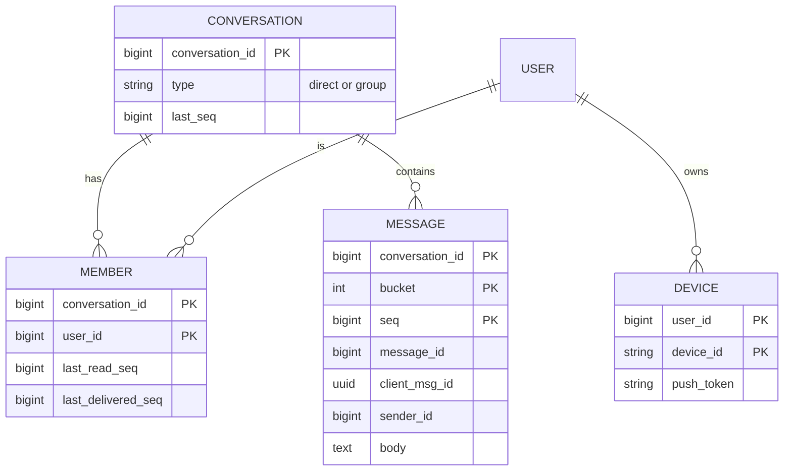
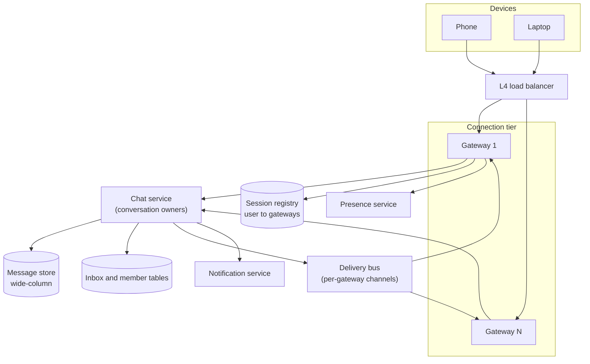
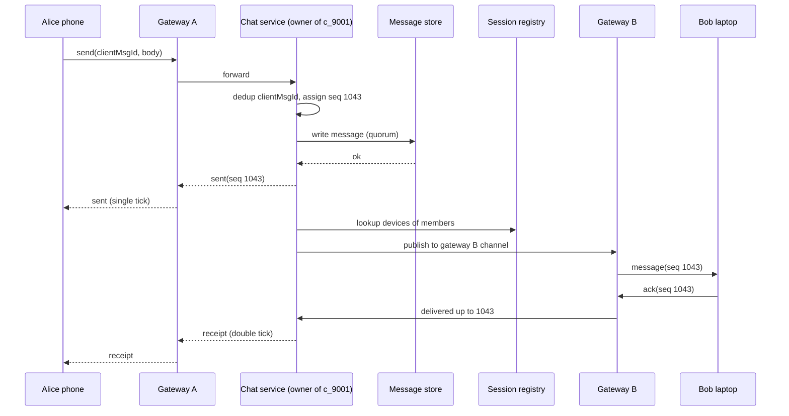
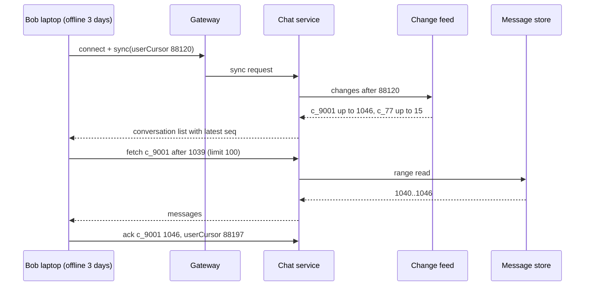
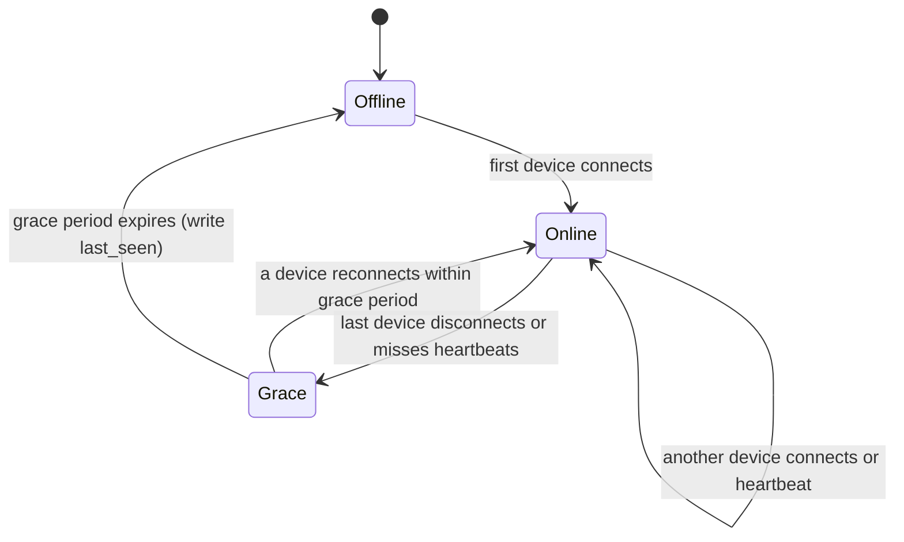

import Callout from '../../components/mdx/Callout.astro';

> "Design a chat application like WhatsApp or Messenger. Users can send one-to-one messages and chat in groups. Messages should arrive in real time when the recipient is online and be delivered later when they are not. Show online status and read receipts. A user can be logged in on a phone and a laptop at the same time."

This prompt is usually asked at **senior** level. A mid-level answer that draws "client, WebSocket server, database" gets partial credit; the interview is decided by three questions the prompt hides: **how is a message ordered**, **how does a message find a device that may be connected to any of hundreds of servers, or to none**, and **how does a device that was offline for a week catch up without missing or duplicating anything**. Everything else (presence, receipts, groups) is a variation on those three.

We use the six-step framework from [Part 12: System Design Interviews](/blog/backend-12-system-design-interviews). The news feed worked there is a close cousin of this problem (both fan out content to many readers), so where the answer is the same we will say so and move on, and spend the time on what is different: long-lived connections and strict per-conversation order.

<Callout variant="tip" title="You should already know">
- Request/response vs long-lived connections, TCP and TLS ([Part 1: How the Web Works](/blog/backend-01-how-the-web-works))
- Idempotency keys and cursor pagination ([Part 2: REST API Design](/blog/backend-02-rest-api-design))
- Partitioning, wide-column stores and replication ([Part 7: Database Internals and Scaling](/blog/backend-07-database-internals-scaling))
- Pub/sub, partitions and per-key ordering ([Part 9: Event-Driven Architecture](/blog/backend-09-event-driven-architecture))
- Clocks, ordering and leases ([Part 10: Distributed Systems](/blog/backend-10-distributed-systems))
</Callout>

## Step 1: Requirements

Ask before drawing. The answers that change the design most are: maximum group size, whether history must be stored server-side forever (or only until delivered), whether end-to-end encryption is required, and how many devices per user.

Assume the interviewer answers: groups up to 500 members, history stored server-side and synced to all of a user's devices (Slack/Telegram/Messenger style rather than store-and-forward-then-delete), up to 5 devices per user, encryption in transit (TLS) is enough for this round.

**Functional**

1. Send a text message to a 1:1 conversation or a group (up to 500 members). Media is uploaded separately; the message carries a reference.
2. Receive messages in real time on every connected device of every recipient.
3. Receive missed messages after being offline (any duration), on every device, in order.
4. See delivery and read state ("delivered", "read by Bob", "read by 12 of 40").
5. See whether contacts are online, or when they were last seen.

**Non-functional**

- **Ordering:** within one conversation, every participant sees messages in the **same order**. Across conversations, no ordering is promised.
- **No loss once acknowledged:** when the sender's client shows the single tick, the message is durable.
- **No duplicates visible to the user**, even though the network will cause retries.
- **Latency:** sender-to-online-recipient delivery p99 under 500 ms within a region (most of that is the last-mile network).
- **Availability:** sending and receiving 99.99%. Presence and read receipts may degrade first; they are cheaper to lose.
- **Scale:** 100 million daily active users (we will size from this).

**Out of scope:** end-to-end encryption (mention where it changes the design), voice and video calls, message search, bots, media transcoding, spam and abuse detection, the notification service internals (that is [Design a Notification System](/blog/sd-02-notification-system); we only hand off to it).

<Callout variant="note" title="Why ordering is the requirement to pin down">
"Same order for everyone in a conversation" is a much weaker and much cheaper promise than "global order", and much stronger than "roughly by timestamp". It tells you that the **conversation is the unit of ordering**, which in turn picks the partition key for storage, the routing key for writes and the cursor for sync. Getting the interviewer to agree to it in minute three saves you ten minutes later.
</Callout>

## Step 2: Estimates

Assumptions, stated out loud:

- 100 million DAU.
- Each user sends 40 messages per day.
- 30% of DAU are connected at the daily peak; each connected user has on average 1.3 connected devices.
- Average stored message (body plus IDs, timestamps and metadata) about 300 bytes.
- Peak-to-average ratio 3x (messaging has strong evening peaks and spikes on holidays).

**Message write rate**

- 100,000,000 x 40 = **4 billion messages/day**.
- 4,000,000,000 / 86,400 = **46,296 messages/s** average.
- Peak: 46,296 x 3 = about **139,000 messages/s**.

**Delivery rate.** Each message is delivered to every recipient device and to the sender's *other* devices. Assume 80% of messages are 1:1 and 20% go to groups averaging 20 members.

- Recipients per message: 0.8 x 1 + 0.2 x 19 = 0.8 + 3.8 = **4.6 recipients**.
- Plus about 0.3 extra sender devices (1.3 devices minus the one that sent), and recipients themselves average 1.3 devices if online: 4.6 x 1.3 + 0.3 = about **6.3 device deliveries per message** if everyone were online.
- Only about 30% are online at peak, so real-time pushes are roughly 139,000 x 6.3 x 0.3 = about **263,000 pushes/s** at peak. The rest become catch-up reads later (and push notifications).

**Concurrent connections**

- 100,000,000 x 0.30 x 1.3 = **39 million** concurrent WebSocket connections at peak.
- If one gateway node holds 100,000 connections (an assumption we must validate by load test; it depends on memory per connection, TLS and heartbeat cost), we need 390 nodes, so plan around **500 gateway nodes** with headroom for a node or zone failing.
- Memory sanity check: at an assumed 50 KB per connection (kernel socket buffers, TLS state, application session), 100,000 x 50 KB = 5 GB per node. Reasonable.

**Storage**

- 4,000,000,000 x 300 bytes = **1.2 TB/day** of raw message data.
- Replication factor 3: **3.6 TB/day**, about **1.3 PB/year** before compression.

**Presence traffic** (the estimate people forget)

- 39 million connections each sending a heartbeat every 30 s = 39,000,000 / 30 = **1.3 million heartbeats/s**.
- If every heartbeat were a database write, presence alone would dwarf the message rate by 10x.

What the estimates decide:

1. Message writes (139k/s peak) and storage (petabytes, append-mostly) point at a **horizontally partitioned, write-optimised store**: a wide-column database such as Cassandra or ScyllaDB, partitioned by conversation.
2. 39 million long-lived connections mean a **dedicated connection tier** (gateways) separate from the business logic, so deploying chat logic does not drop 39 million sockets.
3. Heartbeats must be absorbed **in gateway memory**; only presence *changes* leave the gateway.

## Step 3: API and data model

### The connection protocol

Clients hold one **WebSocket** (RFC 6455) per device. HTTP is still used for things that are not real-time: login, uploading media, fetching old history pages. Inside the socket we define a small framed protocol; JSON for readability here, Protobuf or similar in production.

```http
GET /v1/ws HTTP/1.1
Host: chat.example.com
Upgrade: websocket
Connection: Upgrade
Sec-WebSocket-Key: dGhlIHNhbXBsZSBub25jZQ==
Sec-WebSocket-Version: 13
Authorization: Bearer <access token>
```

Browsers cannot set an `Authorization` header on a WebSocket handshake, so web clients usually pass a short-lived token in the first frame (or a cookie) instead; native apps can use the header. Either way, authenticate before accepting any other frame.

Client to server:

```json
{ "type": "send", "conversationId": "c_9001", "clientMsgId": "6f1c2a7e-3b0d-4c55-9a1e-2d3f4b5c6d7e", "body": "Running 5 min late" }
{ "type": "ack", "conversationId": "c_9001", "seq": 1042 }
{ "type": "read", "conversationId": "c_9001", "seq": 1042 }
{ "type": "sync", "cursors": { "c_9001": 1037, "c_77": 12 } }
```

Server to client:

```json
{ "type": "sent", "clientMsgId": "6f1c2a7e-3b0d-4c55-9a1e-2d3f4b5c6d7e", "conversationId": "c_9001", "seq": 1043, "messageId": "7254890112345088" }
{ "type": "message", "conversationId": "c_9001", "seq": 1043, "senderId": "u_42", "body": "Running 5 min late", "sentAt": "2026-11-05T18:02:11Z" }
{ "type": "receipt", "conversationId": "c_9001", "userId": "u_7", "readUpTo": 1043 }
{ "type": "presence", "userId": "u_7", "status": "online" }
```

Three fields carry the whole design:

- **`clientMsgId`** is a UUID generated by the sending device before the first attempt. It is the idempotency key: a resend after a dropped connection carries the same value, and the server returns the original `seq` instead of storing a second copy.
- **`seq`** is a per-conversation, gap-free, increasing integer assigned by the server. It defines the order everyone sees, and gaps tell a client it missed something.
- **`messageId`** is a globally unique, roughly time-ordered 64-bit ID (Snowflake-style, see [Part 12](/blog/backend-12-system-design-interviews)) used for references such as replies and reactions. It is *not* used for ordering.

For history, a plain HTTP endpoint with cursor pagination:

```http
GET /v1/conversations/c_9001/messages?beforeSeq=1000&limit=50 HTTP/1.1
Authorization: Bearer <access token>
```

### Data model



Two access patterns dominate: **"append to conversation"** and **"read the latest N messages of a conversation, or the range after seq X"**. Both are served by one partition if the partition key is the conversation. The second index you need is **"which conversations is user U in, most recently active first"** (the inbox list), stored as its own table partitioned by user.

## Step 4: High-level design



**Gateways** terminate TLS and WebSockets and do almost nothing else: authenticate, keep the connection alive, forward client frames to the chat service, and push server frames down. They are the only stateful-by-connection tier, so keep them thin and rarely deployed. On connect, a gateway writes `(user, device) -> gateway id` into the **session registry** (Redis with a TTL refreshed periodically is typical).

**The chat service** owns the logic: membership checks, deduplication, sequence assignment, persistence, and fan-out. It is stateless *per request* but, as the deep dive shows, each conversation is routed to one owner instance at a time.

**The delivery bus** gets a message from the chat service to the gateways holding the recipients' connections. Each gateway subscribes to its own channel; the chat service looks up recipients in the session registry and publishes to the relevant gateway channels. Redis Pub/Sub, NATS, or direct gRPC streams between services all work here; the bus is fire-and-forget, because durability comes from the message store and the sync protocol, not from the bus.

**Walk one message through (both users online):**



The sender's tick comes **after the durable write**, never before. Fan-out happens after the ack, so a slow recipient never slows the sender.

**If Bob is offline**, the session registry has no live entry for him. The message is already durable, so nothing is lost; the chat service hands a notification request to the notification service (APNs for iOS, FCM for Android) and moves on. When Bob reconnects, his device syncs from its cursors (deep dive 3).

## Step 5: Deep dives

### Deep dive 1: connection gateways at 39 million sockets

Long-lived connections change the rules you know from stateless HTTP.

**Load balancing.** Use an L4 (TCP) or WebSocket-aware L7 balancer, and balance on *new connections*. Once established, a socket stays on its gateway for hours, so load drifts: a gateway that restarted is empty while its neighbours are full. Most balancers pick by least connections, which helps; you also want gateways to advertise a soft cap and refuse new connections (HTTP 503 during the handshake) above it, so clients retry elsewhere.

**Heartbeats.** NAT boxes and mobile carriers silently drop idle TCP flows, and a dead peer is not detected until you try to write. So both sides send heartbeats. WebSocket has ping and pong control frames, but the **browser WebSocket API does not let JavaScript send pings**, so web clients need an application-level heartbeat frame. 25 to 30 seconds is a common interval. The gateway tracks the last heartbeat per connection in memory and closes connections that miss two or three intervals.

**Deploys and drains.** Restarting a gateway disconnects 100,000 clients. Do it gently: stop accepting new connections, send a close frame with status **1001 (Going Away)**, and let clients reconnect elsewhere over a few minutes rather than in one burst. Roll gateways a few at a time.

**Reconnect storms.** If a zone fails, millions of clients reconnect at once and each reconnect also triggers a sync (a burst of reads). Clients must use **exponential backoff with full jitter** (see [Part 11](/blog/backend-11-reliability-observability)), and the server side should rate-limit handshakes per gateway ([Design a Distributed Rate Limiter](/blog/sd-01-rate-limiter)) and prioritise sync for the conversations the user opens first.

**Why a separate tier.** If the WebSocket handling lived inside the chat service, every deploy of business logic would drop sockets, and the memory profile (many idle connections) would fight with the CPU profile (message processing) for the same autoscaling signal. Split them, and the gateway becomes a small, boring, rarely changed program, which is exactly what you want for the component holding 39 million connections.

<Callout variant="note" title="HTTP/2 and HTTP/3">
WebSockets can also run over HTTP/2 (RFC 8441) and HTTP/3 (RFC 9220), multiplexed with other requests on one connection. Support across proxies and load balancers is uneven, so most chat backends still terminate classic HTTP/1.1 WebSocket upgrades at the edge. It is worth knowing the RFCs exist; it is rarely worth betting the design on them.
</Callout>

### Deep dive 2: ordering, sequence numbers and deduplication

Timestamps cannot order messages. Two devices' clocks disagree, and even server clocks drift by milliseconds, so two messages sent "at the same time" through different servers can be stored in an order that differs from the order different readers observed. Snowflake-style IDs are only *roughly* time-ordered across generators for the same reason. We need an order that is decided **in one place per conversation**.

**Option A: a single writer per conversation.** Route every send for conversation `c` to one chat-service instance, the conversation's **owner** (consistent hashing on `conversationId` across chat-service instances, or a lease in a coordination service). The owner processes that conversation's sends one at a time, assigns `seq = last + 1`, writes, then acks. Ordering and deduplication both become local problems.

**Option B: an atomic counter in a shared store.** Any instance handles any send and gets the next number from `INCR seq:c_9001` in Redis. Simple, but two catches. First, Redis replication is asynchronous, so after a failover the new primary may hand out numbers that were already used; you need a conflict check on insert. Second, two sends can get numbers 1043 and 1044 but be *written* in the opposite order, so a reader can briefly see 1044 without 1043. Clients must already tolerate gaps (they fetch the missing range), so this is survivable, but it makes "gap means loss" ambiguous.

**Option C: a lightweight transaction in the database.** Cassandra's `IF NOT EXISTS` / compare-and-set (Paxos-based) can make `seq` unique per conversation without another component, at the cost of several extra round trips per message on the hot path.

The standard senior answer is **Option A**, because it solves ordering and idempotency together:


```kotlin
class ConversationOwner(
    private val conversationId: Long,
    private val store: MessageStore,
    private val fanout: Fanout,
) {
    private val mutex = Mutex()
    private var lastSeq: Long = store.maxSeq(conversationId) // read once on takeover
    private val recent = object : LinkedHashMap<UUID, Long>(1_024, 0.75f, true) {
        override fun removeEldestEntry(eldest: MutableMap.MutableEntry<UUID, Long>?) = size > 10_000
    }

    suspend fun send(cmd: SendMessage): Sent = mutex.withLock {
        recent[cmd.clientMsgId]?.let { return@withLock Sent(cmd.clientMsgId, it) } // retry: same answer
        val seq = lastSeq + 1
        store.append(conversationId, seq, cmd)  // quorum write, throws on failure
        lastSeq = seq                           // only advance after durable write
        recent[cmd.clientMsgId] = seq
        Sent(cmd.clientMsgId, seq)
    }.also { fanout.publishAsync(conversationId, it) }
}
```

`Mutex` is `kotlinx.coroutines.sync.Mutex`. The in-memory dedup window covers fast retries; for a retry that arrives after an ownership change, the new owner can check the last few hundred rows of the partition for the same `client_msg_id` (cheap, since they are the newest rows and clustered descending), or keep the dedup map in Redis with a TTL of a day.

**Owner failover** is the hard part. If the owner dies, another instance takes over the conversation, reads the max `seq` from the store and continues. The danger is a **zombie owner**: the old one was only paused (GC pause, network partition) and resumes writing with its stale `lastSeq`. Two writers then produce two different messages with the same `seq`. Defend with the usual tools from [Part 10](/blog/backend-10-distributed-systems): ownership via a **lease** with a **fencing token** (an epoch number that increases on every takeover), and a write that the store rejects if the epoch is older than the one already recorded for the conversation. In Cassandra that conditional check is again a lightweight transaction, but only on the conversation's metadata row and only at takeover or at a coarse interval, not on every message. A simpler, weaker alternative is to make `seq` collisions *detectable* (`INSERT ... IF NOT EXISTS` on the message row) and have the losing writer step down.

**Per-conversation throughput.** One owner serialising one conversation sounds like a bottleneck, but humans type slowly: even a busy 500-member group produces a few messages per second. A single owner handles thousands of sends per second (bounded by store write latency if writes are sequential; pipelining writes while still acking in order raises it further). The single-writer limit only bites for "channels" with millions of members, which are a different product (broadcast) and out of scope here.

**Storage layout.** A conversation can live for years and accumulate millions of messages, so `conversation_id` alone would make unbounded partitions. Add a **bucket** to the partition key. Bucketing by sequence range (`bucket = seq / 10_000`) makes the bucket of any message computable from its `seq`, with no empty buckets for quiet conversations. Discord described a similar design publicly (partition by channel plus a time bucket, first on Cassandra and later on ScyllaDB); time buckets work too but force readers to probe empty windows in quiet conversations.

```sql
-- CQL (Cassandra / ScyllaDB)
CREATE TABLE messages (
    conversation_id bigint,
    bucket          int,
    seq             bigint,
    message_id      bigint,
    client_msg_id   uuid,
    sender_id       bigint,
    body            text,
    created_at      timestamp,
    PRIMARY KEY ((conversation_id, bucket), seq)
) WITH CLUSTERING ORDER BY (seq DESC);

-- latest page
SELECT * FROM messages
WHERE conversation_id = 9001 AND bucket = 0 LIMIT 50;

-- catch-up after seq 1037
SELECT * FROM messages
WHERE conversation_id = 9001 AND bucket = 0 AND seq > 1037;
```

Writes go at `LOCAL_QUORUM` with replication factor 3, so the ack means two of three replicas in the local data centre have it. Reads also at `LOCAL_QUORUM`, so a reader always sees an acknowledged message (2 + 2 is greater than 3).

Why wide-column rather than PostgreSQL? Nothing stops you from starting on sharded PostgreSQL with `PRIMARY KEY (conversation_id, seq)`; at a few thousand messages per second it is the simpler choice. At 139,000 writes/s and petabytes, an LSM-based store that spreads partitions over many nodes, absorbs writes sequentially and expands by adding nodes is the better fit. Its weaknesses also do not hurt this workload: we never join, never update rows in place (edits and deletes are new rows or tombstone flags), and every query is "one partition, a range of a clustering key." Do mention **tombstones**: deleting many messages creates tombstones that slow range reads until compaction removes them, so model deletes as a flag on the row rather than as CQL deletes where possible.

### Deep dive 3: offline delivery, sync and multi-device

The real-time push is an optimisation. The **correctness mechanism is sync**: every device keeps, per conversation, the highest `seq` it has received contiguously, and asks the server for everything after it.


**Gap detection.** Because `seq` is dense, a device that has 1043 and receives 1045 knows 1044 exists and fetches it. That turns the unreliable real-time path (fire-and-forget bus, dropped sockets, gateway restarts) into a reliable one without making the bus durable.

**Knowing which conversations changed.** A device that was offline for a week cannot ask every one of its 300 conversations "anything after X?" on reconnect. Two common designs:

1. **Per-user change feed.** Every time a conversation gets a message, append `(user_seq, conversation_id, latest_seq)` to each member's change feed, where `user_seq` is a per-user counter. A device keeps **one** cursor per user, asks "changes after user_seq N," gets a compact list of conversations with new messages, and then fetches messages per conversation. This is fan-out on write, with the same cost analysis as the [news feed](/blog/backend-12-system-design-interviews): for groups of 500 it is 500 small writes per message, which is acceptable at our group cap.
2. **Inbox table sorted by activity.** Keep `inbox(user_id, last_activity, conversation_id, last_seq)`; the device asks "conversations active since time T." Simpler, but relies on timestamps and on updating sort keys (which, in a wide-column store, is a delete plus an insert).

Choose the change feed for correctness; it is also what makes multi-device sync clean.

**Multi-device.** Each device is just another consumer with its own cursors. The sender's laptop learns about a message sent from the phone the same way Bob does: via the fan-out to all of Alice's devices, or via sync. Do not special-case "my own messages."

**Delivery acks.** A device acks the highest contiguous `seq` it has persisted locally. The server records `last_delivered_seq` per (conversation, user) as the maximum over that user's devices (or per device if the product shows per-device state). Acks are idempotent and monotonic, so retries are harmless: `UPDATE ... SET last_delivered_seq = max(current, new)`.

**Push notifications** go out only for devices without a live connection, and only for the first few unread messages per conversation; after that, collapse them (APNs and FCM both support collapsing or replacing notifications with the same identifier). The notification is a hint, not the delivery mechanism: tapping it opens the app, which syncs.



<Callout variant="warning" title="End-to-end encryption changes this deep dive">
With E2EE (for example the Signal protocol), the server stores ciphertext encrypted separately per recipient device and cannot read bodies, so server-side search and server-rendered previews disappear, adding a device means key distribution, and many E2EE designs delete messages from the server after delivery. Say this if the interviewer adds E2EE, and do not claim you can keep the "full history on server" requirement unchanged.
</Callout>

### Deep dive 4: read receipts and presence

Both are **high volume, low value per event**, and both are where naive designs melt.

**Read receipts as watermarks.** Never store "Bob read message 1043" per message. Store `last_read_seq` per (conversation, user): one integer that only moves forward. "Read by Bob" for any message with `seq` at or below the watermark is implied. A user scrolling through 200 unread messages produces one update, not 200; clients should also debounce read updates (send at most once per second or when the conversation is closed).

For 1:1 and small groups, push receipt updates to the other members in real time. For larger groups, **do not fan out every receipt**: 500 members each reading a message would be 500 x 500 = 250,000 pushes. Instead, store the watermarks and compute "read by 12 of 40" on demand when a user opens message info, or push an aggregated count at a low rate.

**Presence as transitions, not heartbeats.** The 1.3 million heartbeats/s from the estimates never leave the gateway. The gateway emits only **transitions**: online when the first device of a user connects, offline when the last device's connection is closed or times out. Debounce offline by 30 to 60 seconds so a phone switching from Wi-Fi to cellular does not flash offline and online to every contact. Store `last_seen` on transitions.

Then the fan-out question again: user X has 2,000 contacts; when X comes online, do we push to all 2,000? Mostly they are not looking. Use **subscribe on view**: a client subscribes to presence of the users currently visible on screen (the open conversation, the visible part of the chat list), and the presence service pushes changes only to subscribers. Presence fan-out is then proportional to attention, not to contact count. For large groups, show "N online" computed lazily, or nothing.



Presence is also the first thing to shed under load. If the presence service is overloaded, stop fanning out changes and let clients show "last seen" from cache; nobody's messages are affected.

## Step 6: Bottlenecks, failures and evolution

**What breaks at 10x (1 billion DAU, 1.4 million messages/s peak, 390 million connections):**

- **Gateways:** 3,900 nodes at 100k connections each. Fine horizontally, but the session registry becomes a large, hot Redis cluster (every connect, disconnect and lookup). Shard it by user, and cache "user to gateways" briefly in the chat service.
- **Group fan-out:** if the product raises the group cap to 100,000 (communities, channels), per-member change-feed writes and per-message lookups of every member's sessions stop working. Switch large groups to **fan-out on read**: members subscribe to the conversation's topic while it is open, and the change feed gets one entry per conversation rather than per member. That is the same push/pull hybrid as the news feed.
- **Storage growth:** 13 PB/year at 10x. Move old buckets to cheaper storage tiers or a separate cold cluster, and keep only recent buckets on fast nodes.
- **Multi-region:** users in different regions in one conversation. Keep a conversation's owner and its writes in one **home region** (chosen by where most members are), and route sends from other regions there; a cross-continent round trip of roughly 100 to 150 ms is acceptable for chat. Active-active writes to one conversation from two regions would need cross-region consensus on `seq` per message, which is much slower than routing to the home region.

**Failure modes and what users see:**

| Failure | User-visible effect | Mitigation |
|---|---|---|
| Gateway node crash | 100k devices disconnect | Jittered reconnect to other gateways, sync fills gaps |
| Chat-service owner crash | Sends to its conversations stall for seconds | Lease expiry, new owner reads max seq, clients retry with same `clientMsgId` |
| Delivery bus loses a message | Recipient does not see it until next message or reconnect | Gap detection by `seq`, periodic sync on foreground |
| Message store replica down | None at RF 3 and quorum | Repair and hinted handoff |
| Whole region down | Users homed there reconnect elsewhere | Message data replicated to another region (asynchronously, so the last seconds may be missing or delayed) |
| Presence service overloaded | Stale "online" status | Shed presence first, never block messaging |

**Observability:** SLIs that matter are send-ack latency (client-measured), end-to-end delivery latency (stamp server receive time, measure at recipient ack), sync gap rate (how often clients detect gaps: a rising rate means the real-time path is losing messages), connection count per gateway, and reconnect rate. Tie them to SLOs as in [Part 11](/blog/backend-11-reliability-observability).

## What separates levels

| Level | What the answer adds for this problem |
|---|---|
| Mid | WebSockets, a message table, "store then push", push notifications for offline users. Mentions a DB index on conversation and time. |
| Senior | Per-conversation `seq` and client idempotency key, dedicated gateway tier with session registry, wide-column partitioning with buckets, sync with cursors and gap detection, receipts as watermarks, presence as debounced transitions. |
| Staff | Owner failover with leases and fencing, reconnect storms and drain strategy, fan-out on read for large groups, multi-region home-region model, SLIs such as gap rate, what to shed first under load. |
| Principal | Frames the product decisions that drive cost (server-side history vs E2EE, group size cap, multi-device), proposes a phased evolution (PostgreSQL to wide-column, single region to home regions), and quantifies trade-offs for the business rather than only the architecture. |

## Common mistakes

- **Ordering by timestamp**, client or server. Clocks lie; use a per-conversation sequence assigned in one place.
- **Acking the sender before the durable write.** The single tick is a durability promise.
- **Treating the real-time push as the delivery guarantee.** Sockets drop. Sync with cursors is the guarantee; push is a latency optimisation.
- **Storing a receipt per message per reader.** Use monotonic watermarks.
- **Writing every heartbeat to Redis or the database.** Keep heartbeats in gateway memory and publish transitions.
- **Putting connection handling inside the business service.** Every deploy then disconnects everyone.
- **Partitioning messages by `conversation_id` alone.** Long-lived conversations make unbounded partitions; add a bucket.
- **Ignoring retries.** Without a client-generated `clientMsgId`, a resend after a timeout shows the message twice.
- **Fan-out of every presence change to every contact.** Subscribe on view.

## Interviewer follow-ups

<details>
<summary>Why not use Kafka as the message store and the delivery mechanism, partitioned by conversation?</summary>

Kafka gives per-partition order, durability and replay, so it is tempting. Two problems. First, conversations vastly outnumber partitions, so many conversations share one partition, and reading one conversation's history means scanning a partition that interleaves thousands of others; Kafka has no per-key range reads. Second, retention: chat history is kept for years and read randomly by conversation, which is a database access pattern, not a log access pattern.

Kafka is a good fit *behind* the chat service for asynchronous consumers: search indexing, analytics, notification hand-off, moderation. Keep the hot path as "owner assigns seq, writes to the message store, publishes to gateways".

</details>

<details>
<summary>A user sends a message, the connection drops before the "sent" frame arrives, and the app retries on reconnect. Walk me through why the recipient sees it once.</summary>

The client generated `clientMsgId` before the first attempt and persisted the pending message locally with it. The retry carries the same `clientMsgId`. The send routes to the same conversation owner, which finds the ID in its recent map (or, after an ownership change, in the newest rows of the partition or a Redis dedup key) and returns the original `seq` without writing again. The recipient therefore has exactly one stored message. If the recipient's device also received the real-time push twice (for example the bus delivered once, and sync fetched it again), it deduplicates by `(conversationId, seq)` in its local database. At-least-once delivery plus idempotent handling at both ends gives effectively-once display.

</details>

<details>
<summary>How do you show "typing..." indicators?</summary>

As ephemeral signals, never stored. The client sends a `typing` frame at most every few seconds while the user types; the chat service forwards it to currently connected members of the conversation (or only to those with the conversation open), and recipients expire the indicator after a few seconds without a refresh. No sequence number, no persistence, no retries, and it is the first thing to drop under load. For big groups, either suppress it or show "several people are typing".

</details>

<details>
<summary>The interviewer raises the group cap to 50,000 members. What changes?</summary>

Per-message work proportional to members stops being acceptable: 50,000 change-feed writes, 50,000 session lookups and potentially 65,000 device pushes per message. Switch these large groups to fan-out on read. Members with the conversation open subscribe to a per-conversation topic, and their gateways receive one publish per message. The change feed gets a single "conversation updated" entry that clients read when listing conversations, rather than one entry per member. Receipts become aggregate-only, presence becomes "N online" computed lazily, and push notifications are opt-in (mentions only) and batched. Ordering is unchanged: the owner still assigns `seq`, and a hot group is still well within one owner's capacity unless it becomes a broadcast channel with very high message rates, in which case you limit who can post.

</details>

<details>
<summary>How would you support editing and deleting messages?</summary>

As new events in the same ordered stream rather than in-place updates. An edit is a message of type `edit` with its own `seq`, referencing the original `messageId`; a delete is a `delete` event. Clients apply them when they sync, so every device converges, including ones that were offline. The stored original row can be updated (or flagged as deleted) for history pages, but the events are what propagate the change. Prefer a deleted flag plus clearing the body over a CQL `DELETE`, because many deletes create tombstones that slow reads of the partition until compaction.

</details>

<details>
<summary>How does a client know it has the full history after installing the app on a new device?</summary>

It does not need all of it immediately. On first login it fetches the conversation list (from the inbox or change feed snapshot, with each conversation's latest `seq`), then lazily loads the newest page of each conversation as the user opens it, paging backwards with `beforeSeq`. The cursor for each conversation starts at the latest `seq` it fetched; older history is loaded on demand. Because sequences are dense, the client always knows exactly which ranges it has and which it lacks.

</details>

<details>
<summary>What happens to messages for a conversation whose owner is in a region that just failed?</summary>

The conversation's home region is down, so sends cannot get a sequence number there. You choose between availability and the ordering guarantee. Option one: fail the sends (clients queue them locally and retry) until the region recovers or an operator fails the conversation over. Option two: fail over the home region automatically to a replica region. Because cross-region replication of the message store is asynchronous, the last few seconds of acked messages may not be there yet, so the new owner might reuse `seq` values; protect with the fencing epoch, and reconcile the old region's unreplicated tail when it comes back (renumbering or appending them as late messages). State the trade-off explicitly; for most chat products, automatic failover with a small window of possible reordering is preferred to an outage.

</details>

<details>
<summary>Your sync gap rate doubles after a deploy. What do you look at?</summary>

Gaps mean the real-time path is losing or reordering messages, so look at the path between owner and device: delivery bus publish errors or dropped subscriptions (a gateway that reconnected to the bus but did not resubscribe to its channel), gateways under memory pressure dropping outbound frames from full send buffers, a change in the owner that publishes before the durable write completes (recipients see 1045, then 1044 arrives late), or session registry entries pointing at the wrong gateway after a rolling restart. Users are not losing data, because sync fills the gaps, but latency and battery usage suffer, so treat it as an incident and roll back if the cause is not obvious.

</details>

## Key takeaways

- The **conversation is the unit of ordering**: a dense, server-assigned `seq` per conversation, assigned by a single owner, gives order, gap detection and cheap sync.
- A client-generated **`clientMsgId`** plus idempotent handling turns at-least-once networks into messages shown once.
- Ack the sender **after the durable write**; fan out afterwards.
- A dedicated **gateway tier** holds connections; a **session registry** maps users to gateways; the delivery bus can be fire-and-forget because **sync with cursors** is the correctness mechanism.
- Store messages in a **wide-column store partitioned by (conversation, bucket)** and clustered by `seq`.
- **Read receipts are watermarks**, **presence is debounced transitions** with subscribe-on-view, and both are shed before messaging under load.
- Large groups switch from fan-out on write to fan-out on read, just like celebrities in a news feed.
