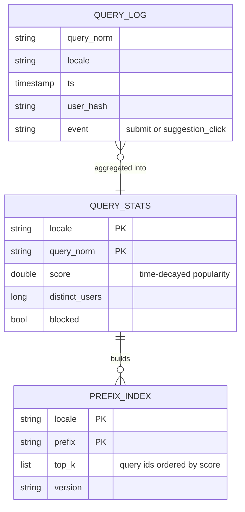
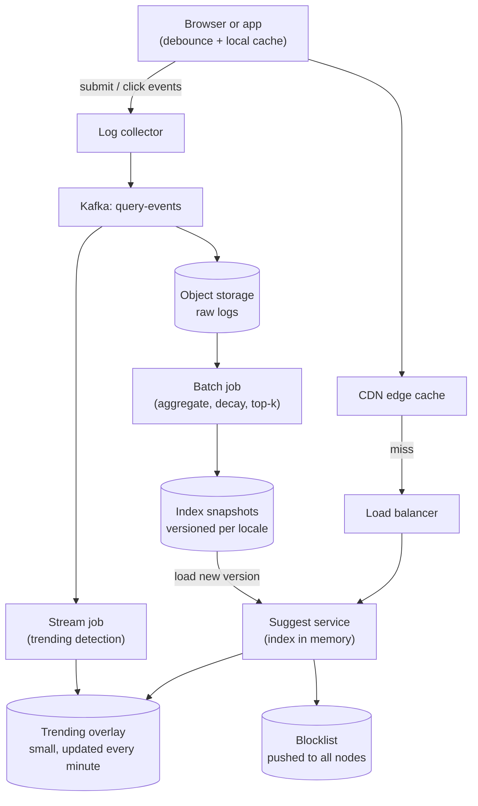
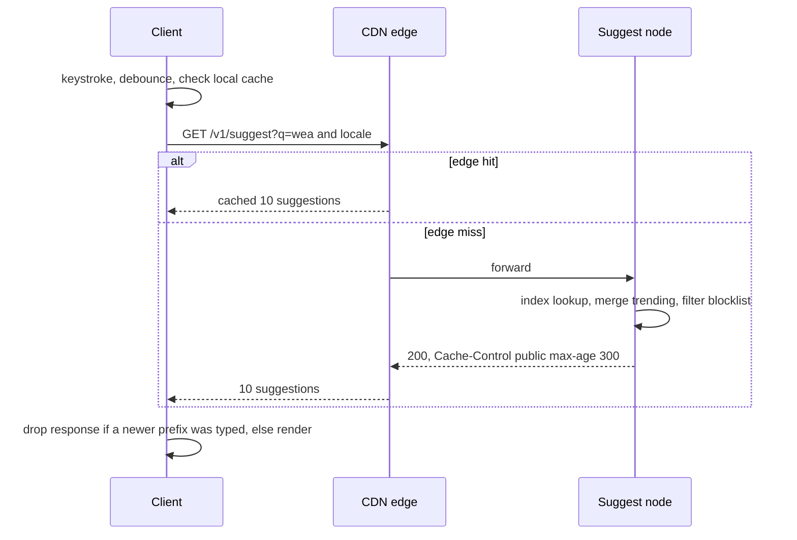
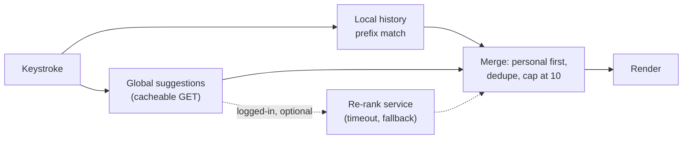

import Callout from '../../components/mdx/Callout.astro';

> "Design the autocomplete for a search box. As the user types, show the top 10 suggested queries for what they have typed so far. It needs to feel instant, and suggestions should reflect what is popular, including things that started trending in the last hour."

This is a **senior** question that looks like a data structures question. Candidates who spend 20 minutes implementing a trie on the whiteboard usually do worse than candidates who spend five minutes on the trie and the rest on the real problems: **the read path has a latency budget measured in tens of milliseconds, and the expensive work (counting and ranking) has to happen somewhere else, ahead of time**. The design is really two systems: an offline (and near-line) pipeline that turns query logs into a compact index, and a read path that serves that index from memory and from caches as close to the user as possible.

We use the six-step framework from [Part 12: System Design Interviews](/blog/backend-12-system-design-interviews).

<Callout variant="tip" title="You should already know">
- HTTP caching, `Cache-Control`, CDNs ([Part 5: Caching](/blog/backend-05-caching))
- Batch vs stream processing and queues ([Part 6: Async Processing and Queues](/blog/backend-06-async-processing-queues))
- Latency percentiles and the tail ([Part 8: Scalability and Performance](/blog/backend-08-scalability-performance))
- Kafka topics and consumers ([Part 9: Event-Driven Architecture](/blog/backend-09-event-driven-architecture))
</Callout>

## Step 1: Requirements

Questions worth asking, and the answers we will assume:

- *Suggest what?* Complete **queries** (strings people searched), not documents or products. (Product or entity suggestions are a variation; mention them at the end.)
- *Prefix match only, or also typos and infix matches?* Prefix match on normalized text; typo tolerance is a stretch goal.
- *How fresh?* Popular queries from the last day must be reflected within a day; **trending** queries within about 10 minutes.
- *Personalized?* Yes, lightly: a user's own recent searches should rank higher for them.
- *Languages?* Multiple locales; each locale gets its own suggestions.

**Functional**

1. Given a prefix and a locale, return up to 10 suggested queries, ranked.
2. Suggestions reflect query popularity, with recent popularity weighted more.
3. Trending queries appear within about 10 minutes.
4. A user's own recent queries are boosted for that user.
5. Operators can remove a suggestion (offensive, legal, safety) and it disappears within minutes, globally.

**Non-functional**

- **Latency:** the suggestion must appear within about **100 ms of the keystroke**, at p99 for users near a region. 0.1 s is the classic threshold for a response to feel instantaneous (Miller 1968, popularised by Jakob Nielsen). Server-side processing gets a small slice of that (see the budget in deep dive 3).
- **Availability:** high, but autocomplete is an enhancement. If it fails, the search box still works. That licenses aggressive degradation: serve stale data, serve global-only results, or serve nothing.
- **Consistency:** eventual, by minutes to hours. Nobody can tell if a count is an hour old.
- **Scale:** 100 million DAU (sized next).

**Out of scope:** the search results page itself, spelling correction as a separate feature, query understanding, ads in suggestions, and the ML ranking model internals (we define where it plugs in).

## Step 2: Estimates

Assumptions:

- 100 million DAU, **5 searches per user per day**.
- Average submitted query 20 characters.
- The client **debounces** keystrokes and skips requests already answered by its own cache, so a search produces on average **5 suggestion requests**, not 20.
- Peak-to-average 3x.

**Request rate**

- Searches: 100,000,000 x 5 = **500 million/day**.
- Suggestion requests: 500,000,000 x 5 = **2.5 billion/day**.
- 2,500,000,000 / 86,400 = **28,935 requests/s** average; peak 28,935 x 3 = about **87,000 requests/s**.

**Read bandwidth**

- Response: 10 suggestions at about 40 bytes each plus JSON framing, about 600 bytes uncompressed, call it 1 KB with headers.
- 87,000 x 1 KB = **87 MB/s**, about **700 Mbit/s** at peak, spread across the edge. Trivial for a CDN.

**Origin load.** Short prefixes ("a", "ap", "app") are requested by everyone and are extremely cacheable; long prefixes are mostly unique. Assume a 60% edge cache hit ratio (an assumption to measure, not a fact).

- Origin: 87,000 x 0.4 = about **35,000 requests/s** at peak.
- If one serving node handles 10,000 requests/s of in-memory lookups (conservative for a hash lookup plus JSON serialization; load-test it), that is 4 nodes. Deploy at least 3 per region in 3 regions for redundancy, so **capacity is not the hard part; latency and freshness are**.

**Log volume (input to the pipeline)**

- Log only *submitted* queries (and suggestion clicks), not keystrokes: 500 million records/day at about 150 bytes (query, locale, timestamp, user or session hash, region) = **75 GB/day**.

**Index size.** This is the estimate that picks the data structure.

- Candidate queries: of all distinct queries, keep those seen by at least a threshold of distinct users in the window, say **10 million** per large locale.
- Strings: 10,000,000 x 20 bytes = **200 MB**.
- Prefix entries if we precompute top 10 for **every** prefix of every query: upper bound 10,000,000 x 20 = **200 million** prefixes, each with 10 suggestion IDs at 4 bytes plus the key, roughly 60 bytes raw: 200,000,000 x 60 = **12 GB**. As JVM `HashMap` entries with `String` keys, multiply by several times.
- Real prefix count is far lower because prefixes are shared ("app" is a prefix of millions of queries but stored once), and long prefixes usually have fewer than 10 completions. **If a prefix has 10 or fewer completions, its top-10 list is just "all of them", so it need not be materialised**: store top-k only for prefixes with more than k completions and answer the rest by scanning a small sorted range.

What the estimates decide:

1. The index per locale is **a few GB at most with a compact encoding**, so it fits in RAM on every serving node. **Replicate the whole index** to each node rather than sharding it; sharding would add a network hop to a 10 ms budget for no reason.
2. Ranking must be **precomputed**; a request cannot count anything.
3. Edge caching cuts origin load by more than half, and is the single biggest latency win for short prefixes.

## Step 3: API and data model

```http
GET /v1/suggest?q=wea&locale=en-GB HTTP/1.1
Accept: application/json
```

```http
HTTP/1.1 200 OK
Content-Type: application/json
Cache-Control: public, max-age=300
Vary: Accept-Encoding

{
  "prefix": "wea",
  "indexVersion": "en-GB-2026-11-05T04",
  "suggestions": [
    { "text": "weather", "kind": "query" },
    { "text": "weather tomorrow", "kind": "query" },
    { "text": "wealth tax", "kind": "query" }
  ]
}
```

Design choices to say out loud:

- **`GET` with everything in the URL** so CDNs and browsers can cache it. The locale is a query parameter rather than read from `Accept-Language`, which would force `Vary: Accept-Language` and fragment the cache across thousands of header variants.
- **Normalize on both sides.** The client and server lowercase, trim, collapse whitespace and apply Unicode normalization (NFKC) before building the URL, so "Wea", "wea " and "wea" share one cache entry.
- **No personalization in this response.** Anything per user cannot be cached at a shared edge. Personal results are merged separately (deep dive 4).
- **`indexVersion`** helps debugging and lets clients discard responses from an older index after a rollout.

**Data model.** Three logical datasets:



`QUERY_LOG` lives in Kafka and object storage, `QUERY_STATS` in a batch table (Parquet or a warehouse), and `PREFIX_INDEX` is an **immutable, versioned snapshot file** per locale that serving nodes load into memory. There is no online database in the read path at all.

## Step 4: High-level design



**Read path.** The client waits for a short pause in typing, checks its own cache, then calls `/v1/suggest`. The CDN serves cached prefixes; misses go to a suggest node, which looks the prefix up in its in-memory index, merges the small trending overlay, filters through the blocklist, and returns. No network hop after the load balancer.

**Write path.** Submitted queries and suggestion clicks flow into Kafka. A **batch job** (Spark, or SQL in a warehouse) recomputes decayed popularity and builds the prefix index every few hours. A **stream job** (Flink, Kafka Streams) detects queries whose recent rate is far above their baseline and publishes a tiny trending overlay every minute. This split is the classic batch-plus-speed-layer shape: the batch side is accurate and cheap per record, the stream side is fast and small.

## Step 5: Deep dives

### Deep dive 1: trie vs precomputed prefix index

**The naive trie.** Each node is a character; a path from the root spells a prefix; nodes where a query ends hold its score. To answer a prefix, walk down (cost proportional to prefix length), then search the whole subtree for the 10 highest scores. The walk is cheap; the subtree search is not: the subtree under "a" contains a large fraction of all queries.

**Trie with cached top-k.** Store the top-k completions at every node, computed offline. A lookup is now "walk p characters, return the list": O(p) and independent of how many queries live below. This is the textbook answer and it is correct.


**Why production systems often skip the pointer trie.** A trie of millions of nodes with child maps and per-node lists is pointer-heavy: lots of small objects, poor cache locality, and on the JVM large GC pressure. The *idea* (top-k per prefix, precomputed) matters; the pointer structure does not. Equivalent layouts that are much more compact:

1. **Hash map from prefix to top-k list**, built offline and loaded as a flat, off-heap or memory-mapped structure. Simplest to explain, O(1) lookup after hashing the prefix.
2. **Sorted array of queries plus precomputed lists**: all candidate queries sorted lexicographically; the completions of a prefix form a contiguous range found by two binary searches; top-k for "big" prefixes is precomputed, and small ranges (10 or fewer entries) are just read directly.
3. **A finite state transducer (FST)**, which shares both prefixes and suffixes. This is how Lucene stores term dictionaries, and Elasticsearch's `completion` suggester is built on an in-memory FST.

**Off-the-shelf options and their limits.** For a product catalog or a few million entries, the Elasticsearch/OpenSearch `completion` field (fast prefix lookup with weights, optional fuzziness and context filters) or a `search_as_you_type` field (edge n-gram subfields, supports infix matching at the cost of a real query per request) is often the right answer and a strong thing to say. Redis sorted sets with `ZRANGE ... BYLEX` give prefix range scans, but they return entries in lexicographic order, not by popularity, so you would still precompute top-k. At hundreds of millions of daily searches with heavy precompute, a purpose-built in-memory index is the common choice.

The builder for option 1, short enough for the whiteboard:

```kotlin
data class Scored(val id: Int, val text: String, val score: Double)

fun buildPrefixIndex(
    queries: List<Scored>,
    k: Int = 10,
    maxPrefixLen: Int = 25,
): Map<String, List<Scored>> {
    val heaps = HashMap<String, java.util.PriorityQueue<Scored>>()
    for (q in queries) {
        val upTo = minOf(q.text.length, maxPrefixLen)
        for (len in 1..upTo) {
            val heap = heaps.getOrPut(q.text.substring(0, len)) {
                java.util.PriorityQueue(compareBy<Scored> { it.score }) // min-heap
            }
            heap.add(q)
            if (heap.size > k) heap.poll() // keep only the k best
        }
    }
    return heaps.mapValues { (_, h) -> h.sortedByDescending { it.score } }
}
```

That is O(total prefix characters x log k). It runs in a batch job, not on the serving node, and in a real pipeline it is a distributed `explode prefixes, group by prefix, take top k` aggregation. Note that `substring` on a JVM `String` cuts UTF-16 code units; for real multilingual data, cut at code point (or grapheme) boundaries so a prefix never ends in half a surrogate pair. Capping the prefix length (here 25) bounds the index: beyond that length, a user has typed most of the query, and falling back to a range scan or to no suggestions is fine.

### Deep dive 2: the aggregation pipeline, ranking and freshness

**Counting the right thing.** Raw query counts are easy to manipulate (one bot can submit "buy my product" a million times) and biased toward heavy users. Rank by **distinct users** (or sessions) per query per time window. Exact distinct counts are expensive at this scale; **HyperLogLog** sketches give about 1 to 2% error in a few KB per query and merge across partitions and days, which is exactly what a batch pipeline needs.

**Time decay.** "Popular" should mean "popular recently". A standard choice is exponential decay with a half-life:

```text
score(q) = sum over days d of distinct_users(q, d) x 2^(-age_in_days(d) / half_life)
```

With a half-life of 7 days, last week's searches count half as much as today's. The half-life is a product knob; seasonal queries ("tax return", "black friday") benefit from a shorter one. Then the batch job:

```mermaid
flowchart LR
    A["Raw logs<br/>(object storage)"] --> B["Normalize<br/>(case, NFKC, whitespace)"]
    B --> C["Filter<br/>(bots, PII patterns, blocklist)"]
    C --> D["Daily distinct users<br/>per query (HLL)"]
    D --> E["Decayed score<br/>over N days"]
    E --> F["Threshold<br/>(min distinct users)"]
    F --> G["Explode prefixes,<br/>top-k per prefix"]
    G --> H["Write snapshot<br/>per locale + version"]
    H --> I["Validate, then publish"]
```



Two steps matter more than they look:

- **The distinct-user threshold** is a privacy control, not just a size control. A query typed by one person may contain their name, address or medical condition; it must never be suggested to anyone else. Suggest only queries seen from many distinct users, and strip obvious PII patterns (emails, phone numbers) before counting.
- **Validate before publishing.** Compare the new snapshot against the previous one: size within a few percent, top prefixes mostly unchanged, a set of canary prefixes returning sane results. A broken pipeline that publishes an empty or garbage index will otherwise do so to every user at once. Keep the last good versions so rollback is a pointer change.

**Distribution.** Serving nodes poll (or are notified) for a new version, download the snapshot from object storage, load it into memory *alongside* the current one, then switch atomically and free the old one. Memory headroom for two copies is part of the node sizing. Never mutate the live index in place.

**Freshness: the trending overlay.** A daily or few-hourly batch cannot react to news. The stream job reads `query-events`, keeps per-query counts in short sliding windows (for example 5 minutes, sliding every minute), and compares them against the query's baseline rate from the batch stats. Queries whose current rate is many times their baseline and above an absolute floor of distinct users are **trending**. Only a few thousand queries qualify at any time, so the overlay is tiny: for each trending query, its prefixes and a boosted score, published every minute to all serving nodes.

At serve time, merge two short lists:

```kotlin
fun suggest(locale: String, prefix: String): List<Suggestion> {
    val base = index.current(locale).lookup(prefix)           // up to 10, precomputed
    val hot = trending.current(locale).lookup(prefix)         // usually empty, a few at most
    return (hot + base)
        .distinctBy { it.text }
        .filterNot { blocklist.contains(locale, it.text) }
        .sortedByDescending { it.score }
        .take(10)
}
```

Scores from the two sources must be on the same scale (or the overlay must use an explicit rank boost) so a trending query beats an evergreen one only when it should. Keep the full-data heavy-hitter problem in mind if the interviewer pushes on memory: algorithms such as Count-Min Sketch with a heap, or Space-Saving, find the most frequent items in a stream in bounded memory, at the cost of approximate counts.

<Callout variant="warning" title="Removals must not wait for the pipeline">
A harmful suggestion must disappear in minutes, but the index rebuilds every few hours and the CDN holds responses for up to `max-age`. So removals take a separate fast path: the blocklist is pushed to every serving node (and checked at serve time, as in the code above), the batch pipeline also excludes it so it does not return in the next version, and the edge is purged for the affected prefixes using the CDN's purge API (or the TTL is kept short enough that waiting is acceptable). State the worst-case removal time: blocklist propagation plus the edge TTL if you do not purge.
</Callout>

### Deep dive 3: the latency budget and caching layers

Work backwards from 100 ms between keystroke and rendered suggestions. Most of it is not the server.


The budget above is an illustration with typical ranges, not a measurement; measure your own with real-user monitoring. The lessons hold regardless of exact values:

- **The network dominates.** A suggest node that answers in 2 ms does not help a user on a 60 ms mobile round trip. So the biggest wins are (a) **not making the request** and (b) making it to something **close**.
- **Layer 1, the client.** Debounce (wait for a short pause, often somewhere around 50 to 150 ms, tuned by experiment), keep a small in-memory cache of prefix responses for the session, and **cancel stale requests** (in browsers, `AbortController`) so a slow response for "we" never overwrites a newer one for "wea". Also do not fire requests during IME composition for languages typed through input methods (listen for `compositionend`). Reuse one warm HTTP/2 or HTTP/3 connection; a new TLS handshake per keystroke would blow the budget by itself.
- **Layer 2, the edge.** Because the response depends only on `(locale, normalized prefix)`, a CDN can cache it. One- and two-character prefixes per locale are a few thousand keys and are hit constantly; set `Cache-Control: public, max-age=300` and accept that edge results can be up to 5 minutes staler than the origin. That staleness bounds trending freshness at the edge, so either live with "about 10 minutes" (overlay cadence plus edge TTL) or use a shorter TTL for short prefixes.
- **Layer 3, the origin.** In-memory lookup, no database, no remote cache. A remote Redis call would add a network round trip to the slice that was supposed to be 1 to 5 ms, for data that already fits in local RAM.
- **Tail latency.** At 35,000 requests/s, even rare GC pauses are visible at p99. Keep the index off-heap or in few large arrays, and size heap and GC (e.g. ZGC or G1 with modest pause targets) for low pause times. Since requests are idempotent and cheap, a **hedged request** (send a second request to another node if the first has not answered within the p95) is a legitimate tail-cutting tool here, as discussed in [Part 8](/blog/backend-08-scalability-performance).

The serving endpoint, with cache headers set explicitly:

```kotlin
@RestController
class SuggestController(private val suggester: Suggester) {

    @GetMapping("/v1/suggest")
    fun suggest(
        @RequestParam q: String,
        @RequestParam locale: String,
    ): ResponseEntity<SuggestResponse> {
        val prefix = Normalizer.normalize(q.trim().lowercase(), Normalizer.Form.NFKC)
        if (prefix.isEmpty() || prefix.length > 100) {
            return ResponseEntity.badRequest().build()
        }
        val result = suggester.suggest(locale, prefix)
        return ResponseEntity.ok()
            .cacheControl(CacheControl.maxAge(Duration.ofMinutes(5)).cachePublic())
            .body(SuggestResponse(prefix, suggester.version(locale), result))
    }
}
```

(`Normalizer` is `java.text.Normalizer`; `CacheControl` is Spring's `org.springframework.http.CacheControl`. Real code would use locale-aware lowercasing, such as Turkish dotless i, which is one more reason to keep locale explicit.)



### Deep dive 4: personalization without losing the cache

Personal suggestions ("you searched for *weather vienna* yesterday") cannot be served from a shared cache keyed by prefix, and putting the user ID in the URL would destroy the hit ratio. Three ways to get both:

1. **Client-side merge (preferred where possible).** The device already knows the user's recent searches (it submitted them). Keep the last few hundred locally, prefix-match them on the device, and merge them above the global results. Zero server cost, works offline, and the cacheable global request is unchanged. This covers most of the value of personalization.
2. **Separate personal call.** For cross-device history, fetch the user's recent queries (a small list, a few KB) once per session from a history service, then match locally. Still one request per session, not per keystroke.
3. **Server-side re-ranking.** For signals the client does not have (location, inferred interests), a personalized endpoint fetches a longer candidate list from the global index (say top 50) and re-ranks it with a lightweight model using the user's features. This endpoint is uncacheable at the edge and has a stricter latency budget, so it is usually reserved for logged-in users, cut short with a timeout, and falls back to the global list if it is late.



**Privacy rules to state:** personal history is visible only to its owner, users can clear it, incognito sessions do not record it, and nothing personal feeds the global index unless it passes the distinct-user threshold.

## Step 6: Bottlenecks, failures and evolution

**What breaks at 10x** (5 billion searches a day, about 870,000 suggestion requests/s at peak):

- **Serving** scales linearly by adding replicas; the index is read-only and replicated. The real limit is **index size**: with 10x more candidate queries or many more locales, a full copy per node might no longer fit. Then shard by locale first (natural, since requests carry a locale), and only if a single locale is too big, shard by prefix range with the router in front. Sharding by first character is skewed ("s" is much bigger than "x" in English), so split by measured ranges, not letters.
- **The batch pipeline** grows with log volume; more partitions and HLL merges keep it linear. Rebuild time becomes the freshness bottleneck: consider incremental builds (recompute only prefixes of queries whose score changed meaningfully).
- **Edge hit ratio** improves with more traffic (the same short prefixes are requested more), which helps.

**Failure modes:**

| Failure | Effect | Mitigation |
|---|---|---|
| Batch pipeline fails | Index gets older | Keep serving the last good version; alert on index age, not only on job failure |
| Pipeline publishes a bad index | Garbage or empty suggestions everywhere | Validation gates, canary nodes, instant rollback to previous version |
| Trending job down | No trending, base suggestions still work | Overlay expires to empty, not stale |
| Suggest nodes overloaded | Rising latency | Edge keeps serving cached prefixes; shed long prefixes first (low cache value, low user value) |
| Whole service down | No suggestions | Client hides the dropdown silently; search still works |
| Harmful suggestion goes viral | Trust and legal risk | Blocklist fast path plus edge purge, with an on-call runbook |

**SLIs:** client-measured time from keystroke to render (p50, p99), suggestion acceptance rate (clicks on a suggestion over searches), index age per locale, trending lag (time from a spike in events to its appearance), and blocklist propagation time.

**Evolution:** typo tolerance (fuzzy matching within an edit distance of 1 or 2 for longer prefixes, which an FST supports well), entity suggestions (products, people, places) mixed with queries, a learned ranking model over richer features, and A/B testing with acceptance rate and downstream search success as metrics.

## What separates levels

| Level | What the answer adds for this problem |
|---|---|
| Mid | A trie, top-k by count, a cache. Possibly computes top-k at request time, and puts a database in the read path. |
| Senior | Top-k precomputed per prefix, index replicated in memory, offline pipeline from logs with decay, edge caching with a normalized cacheable URL, debounce and request cancellation, trending as a separate fast layer, latency budget dominated by the network. |
| Staff | Index distribution with versioning, validation and rollback; distinct-user counting with HLL and abuse resistance; removal fast path and its worst-case time; personalization that preserves cacheability; sharding by locale and measured prefix ranges when the index outgrows a node. |
| Principal | Frames it as a product and trust problem as much as a systems one: privacy thresholds, harmful-suggestion policy and on-call ownership, which metrics define success (acceptance rate vs downstream search success), and when to buy (Elasticsearch completion suggester, a hosted search vendor) rather than build. |

## Common mistakes

- **Computing top-k at request time** by walking a subtree or querying a database.
- **Putting a remote cache or database in the read path** when the index fits in local memory.
- **Making responses uncacheable**: user IDs in the URL, `Vary: Cookie`, or locale read from headers.
- **No client-side debounce or cancellation**, so the server sees every keystroke and slow responses overwrite newer ones.
- **Ranking by raw counts**, which is trivially gamed and leaks rare (possibly private) queries.
- **Forgetting removals**, or assuming the next pipeline run is fast enough to remove a harmful suggestion.
- **Spending the interview implementing a trie** instead of designing the pipeline and the read path.
- **Mutating the live index in place** instead of loading a new immutable version and swapping.

## Interviewer follow-ups

<details>
<summary>Why not just use a database with LIKE 'wea%' and an index?</summary>

A B-tree index can serve a prefix `LIKE` (with the right collation or operator class, for example `text_pattern_ops` in PostgreSQL) and find matching rows quickly, but it returns them in key order, not by popularity. To get the top 10 by score you would have to read every matching row and sort, which for short prefixes means millions of rows per request at tens of thousands of requests per second. You can precompute a `(prefix, rank)` table instead, but then you have rebuilt the prefix index inside a database and added a network round trip. It is a fine answer for a small internal tool; for this scale, precompute and serve from memory.

</details>

<details>
<summary>How do you keep a single bot or a coordinated campaign from pushing a query into suggestions?</summary>

Count distinct users (or devices, or sessions with some trust signal) instead of raw submissions, using HyperLogLog per query per day; cap each user's contribution; exclude traffic flagged by bot detection and unauthenticated bursts from a single IP range; require a minimum number of distinct users before a query is eligible at all; and for trending specifically, require the spike to come from diverse regions or networks. Then add a human or classifier review step for new trending entries in sensitive categories. None of this is perfect, which is why the blocklist fast path exists.

</details>

<details>
<summary>The interviewer wants suggestions to update within 30 seconds of a breaking news event. What changes?</summary>

The trending overlay cadence (every minute) and the edge TTL (5 minutes) both exceed 30 seconds. Shorten the stream window and publish interval for the overlay (for example a 1-minute window sliding every 10 seconds), push overlay updates to nodes rather than polling, and reduce the edge TTL for short prefixes, for example to 30 seconds, possibly with `stale-while-revalidate` so the edge serves the old entry while refetching. Cost: more origin traffic (lower hit ratio) and noisier trending detection (smaller windows mean less evidence). Quantify it: halving the hit ratio from 60% to 30% raises origin load from 35,000 to about 61,000 requests/s at peak (87,000 x 0.7), which is still a handful of extra nodes.

</details>

<details>
<summary>How would you support typos, such as "wether" suggesting "weather"?</summary>

Fuzzy prefix matching: find indexed prefixes within an edit distance of 1 (or 2 for longer input) of what the user typed, and merge their suggestions with a penalty. Automata-based approaches (Levenshtein automata intersected with the FST, which is what Lucene does for fuzzy queries) do this efficiently; Elasticsearch's completion suggester exposes it as a `fuzzy` option. Only apply it after a few characters (with one or two characters, everything is within edit distance 1 of everything), and rank exact-prefix matches above fuzzy ones. A cheaper complement is mining query reformulations from logs ("wether" followed by "weather" in the same session) into a correction table.

</details>

<details>
<summary>How many suggestion requests does a user typing "weather tomorrow" generate, and how would you reduce it?</summary>

Without any client logic, 16 (one per character, including the space). With debounce, a fast typist triggers requests only when they pause, often two to five times. With a local prefix cache, backspacing and retyping cost nothing. Another trick: if the response for "weat" contains fewer than 10 suggestions, it already contains *every* indexed completion, so the client can filter it locally for "weath", "weathe" and so on without asking again; the server can signal this with a `complete: true` flag. Each of these cuts load and, more importantly, latency for the user.

</details>

<details>
<summary>How do you roll out a new index version safely across regions?</summary>

Treat it like a code deploy. The pipeline writes the snapshot with a version ID and validation report; a small canary set of nodes loads it first and you compare key metrics (latency, empty-result rate, acceptance rate) against nodes on the old version; then roll out region by region. Nodes keep the previous version in memory or on local disk until the new one is confirmed, so rollback is a pointer swap. Responses carry `indexVersion`, so you can correlate complaints and metrics with versions, and the edge cache naturally converges within its TTL.

</details>

<details>
<summary>Suggestions differ between the web app and the mobile app for the same prefix. How would you debug that?</summary>

Check the inputs first: normalization (one client might not apply NFKC or trims differently, producing a different cache key), the locale parameter (mobile might send `en` while web sends `en-GB`), and personalization merging on the client. Then check versions: the two requests may have hit different edges or nodes holding different index versions during a rollout (compare `indexVersion` in the responses), or one hit a stale edge entry. Finally the client merge logic for local history and dedupe. A shared client library or a server-side normalization that is authoritative (with the server returning the normalized prefix) prevents most of this.

</details>

## Key takeaways

- Autocomplete is **two systems**: an offline/near-line pipeline that counts and ranks, and an in-memory read path that only looks things up.
- **Precompute top-k per prefix**. A trie with cached top-k is the textbook form; compact equivalents (flat prefix maps, sorted arrays, FSTs) are what you ship.
- The index is a few GB with a compact encoding, so **replicate it into every node's memory** and load new immutable versions with validation and rollback.
- Rank by **time-decayed distinct users**, with a minimum-user threshold for privacy and abuse resistance.
- Get freshness from a **small trending overlay** computed by a stream job and merged at serve time, and removals from a **blocklist fast path** plus edge purge.
- The **network dominates the latency budget**: debounce, cancel stale requests, cache on the client and at the edge with a normalized, non-personal URL.
- Personalize by **merging on the client** or re-ranking candidates, never by making the shared response uncacheable.

Previous: [Design a Chat System](/blog/sd-03-chat-system) · Next: [Design a Distributed Job Scheduler](/blog/sd-05-distributed-job-scheduler)
