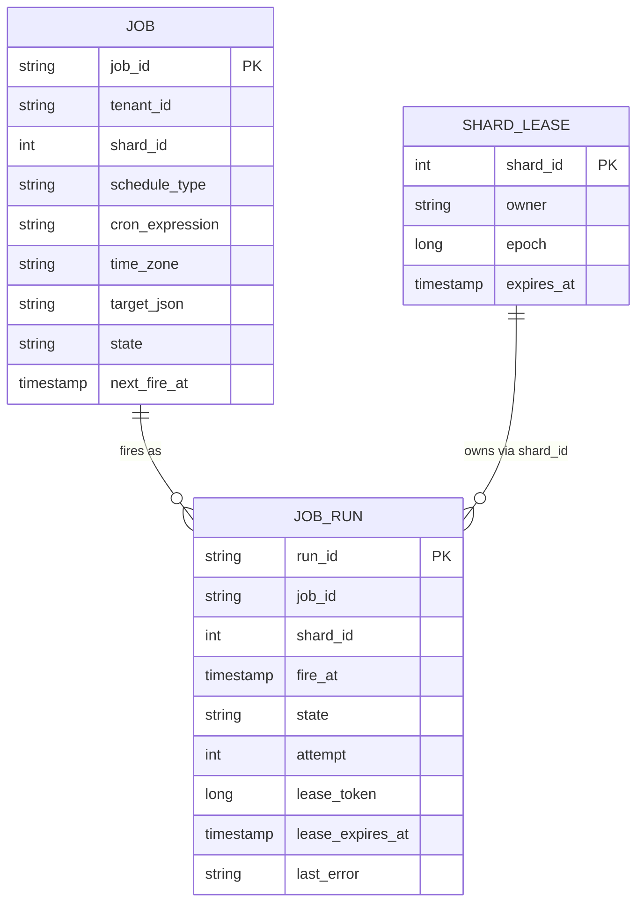
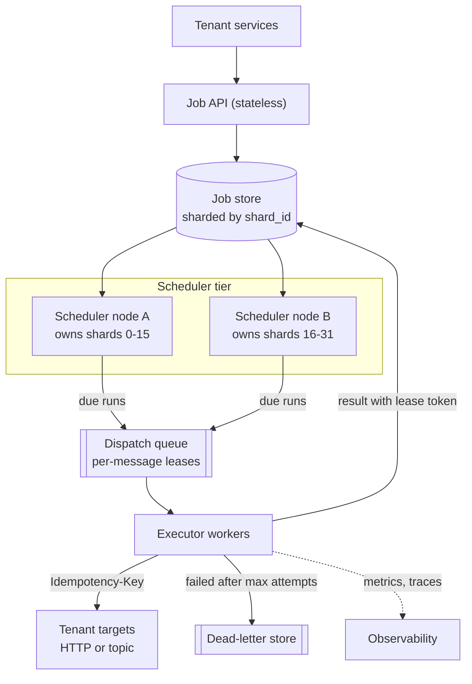
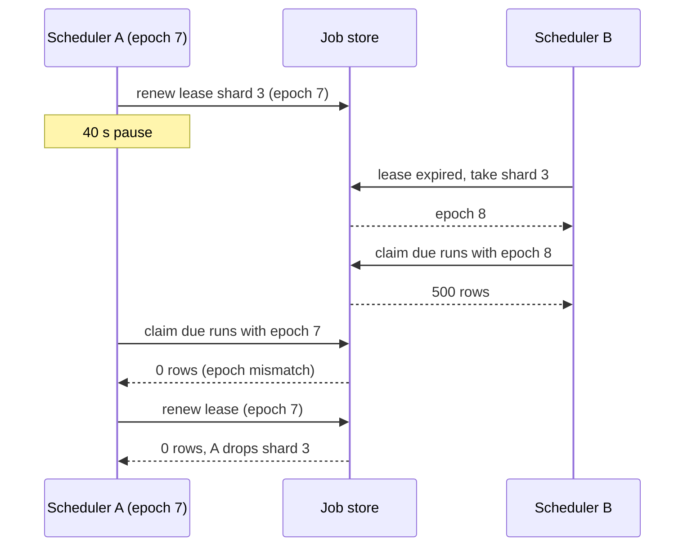
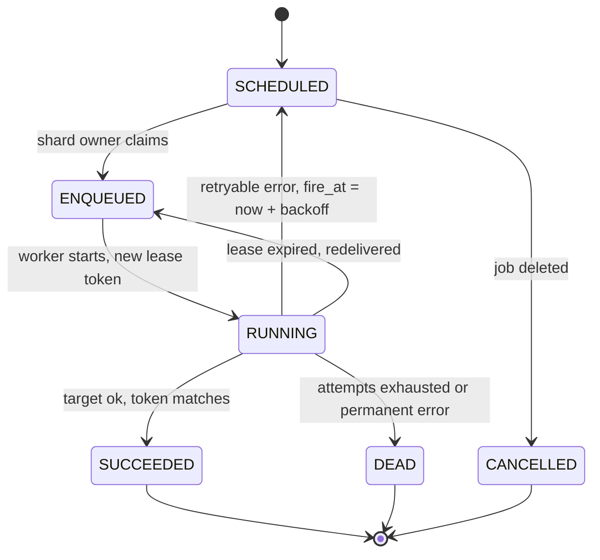

import Callout from '../../components/mdx/Callout.astro';

> "Design a service that lets other teams schedule work. Some jobs run once at a given time, like 'send this reminder in 3 days'. Others are recurring, like 'run this report every hour'. It has to handle hundreds of millions of jobs a day and it must not lose any."

This prompt shows up at **staff level** more than anywhere else, because the happy path is almost trivial (store a timestamp, wake up, run the thing) and every interesting part is a distributed-systems problem in disguise: who is allowed to fire a job, what happens when that node pauses for 40 seconds, what "run exactly once" can and cannot mean, and how you survive ten million cron schedules that all say `0 * * * *`.

A mid-level answer draws a database, a poller and some workers. A staff answer gets to the same boxes in ten minutes and spends the rest of the interview on ownership, fencing, delivery semantics and the thundering herd at the top of every hour.

<Callout variant="note" title="You should already know">
- The six-step interview framework from [Part 12: System Design Interviews](/blog/backend-12-system-design-interviews). This post follows it step by step.
- Queues, visibility timeouts, retries with backoff and dead-letter queues from [Part 6: Async Processing and Queues](/blog/backend-06-async-processing-queues).
- Indexes, `SELECT ... FOR UPDATE SKIP LOCKED` and sharding from [Part 7: Database Internals and Scaling](/blog/backend-07-database-internals-scaling).
- Leases, fencing tokens and why exactly-once delivery is impossible, from [Part 10: Distributed Systems Fundamentals](/blog/backend-10-distributed-systems).
- SLIs and alerting from [Part 11: Reliability and Observability](/blog/backend-11-reliability-observability).
</Callout>

---

## Step 1: Requirements

Start by asking who the users are. Here they are **internal teams and their services**, not end users clicking a UI. That one answer changes a lot: the API is the product, payloads are machine-generated, and a single misbehaving tenant can schedule 50 million jobs by accident with a for-loop.

### Functional

1. **Create a one-off job**: run at an absolute time (`runAt`) or after a delay.
2. **Create a recurring job**: a cron expression plus an IANA time zone (`Europe/Vienna`, not `+01:00`).
3. **Cancel or update** a job; pause and resume a recurring schedule.
4. **Execute** by calling a target: an HTTP endpoint or a message published to a topic the tenant owns.
5. **Retries** with a per-job policy, and a dead-letter state after the last attempt.
6. **Query** a job and its run history (status, attempts, last error).

### Non-functional (with numbers)

| Property | Target | Why this number |
|---|---|---|
| Scale | 200M one-off jobs/day, 20M active recurring schedules | Given by the interviewer, or proposed and confirmed |
| Fire precision | p99 of runs dispatched within **5 s** of their fire time; best effort within 60 s for jobs that opt into a flexible window | Sub-second precision across millions of jobs is expensive and almost nobody needs it |
| Durability | An acknowledged job is never lost | Losing "charge this subscription" is worse than running it late |
| Delivery | **At-least-once** execution, with a stable idempotency key per run | Exactly-once is not achievable across a network (see Step 5) |
| Availability | 99.9% for create/cancel API, 99.95% for the firing path | Firing is the part tenants depend on silently |
| Isolation | One tenant cannot delay another tenant's jobs | Multi-tenant systems die from noisy neighbours |

### Out of scope

- Workflow orchestration (DAGs, "run B after A succeeds"). That is a different product (Temporal, Airflow, Step Functions). Mention that it can be built on top.
- Running tenant code inside the scheduler. We call a target; we do not host the job's process.
- Sub-second scheduling ("run every 100 ms"). That belongs in the tenant's own process.

<Callout variant="tip" title="Push back on precision early">
The single most expensive requirement in this problem is fire precision. Ask: "Does anything actually need to start within one second of its scheduled time?" Usually the answer is "reminders and reports, no". Getting the interviewer to agree to 5 seconds, and to an opt-in flexible window for bulk jobs, is what makes the top-of-the-hour herd solvable later. AWS EventBridge Scheduler exposes exactly this as a "flexible time window", which is a good sign the trade-off is real.
</Callout>

---

## Step 2: Estimates

Every number below comes with its arithmetic and an explicit assumption, so you can redo it with the interviewer's numbers.

### Firing rate

- One-off jobs: 200,000,000 / 86,400 s = **2,315 runs/s** on average.
- Recurring: 20M schedules. Assume the average schedule fires 24 times a day (hourly), so 20M x 24 = 480M runs/day, and 480,000,000 / 86,400 = **5,556 runs/s**.
- Total: 680M runs/day, or **about 7,870 runs/s** average.

That average is misleading, and saying so is the first staff-level signal. Cron schedules cluster on round times. Assume a quarter of recurring schedules (5M) fire at minute 0 of every hour:

- If all 5M must start within 1 second: **5,000,000 runs/s** for that second, 635x the average.
- If they may start within 60 seconds: 5,000,000 / 60 = **83,333 runs/s**, plus the ~7,870/s background, so roughly **91,000 runs/s** for one minute per hour.

Decision: the system is sized for a burst of about **100k dispatches/s**, and only because the precision requirement allows smearing the herd over a minute. With a 1-second requirement this would be a different, much more expensive system.

### Concurrency at the workers

By Little's law, concurrent executions = arrival rate x time in system. Assume a typical HTTP callback takes 500 ms:

- Average: 7,870/s x 0.5 s = **about 3,900** in-flight calls.
- Herd: 91,000/s x 0.5 s = **about 45,500** in-flight calls.

Decision: workers must be asynchronous (non-blocking HTTP client or virtual threads), and the dispatch queue must be allowed to absorb the burst rather than sizing workers for the peak minute.

### Storage

- Pending one-off jobs, again by Little's law: 200M/day x average delay. Assume an average delay of 2 days, so about **400M pending jobs**. At ~1 KB each (definition plus small payload; larger payloads stored by reference), that is **about 400 GB**.
- Recurring definitions: 20M x 1 KB = **20 GB**.
- Run history: 680M runs/day x ~300 bytes = **about 204 GB/day**. Keeping 14 days is 204 x 14 = **about 2.9 TB**.

Decision: definitions and pending runs fit in a sharded relational or wide-column store; run history is append-heavy, time-partitioned and dropped by partition, never deleted row by row.

### Write rate on the store

Each run is touched about four times: created, enqueued, started, finished. 680M x 4 = 2.72B writes/day, or **about 31,500 writes/s** average, and up to 4 x 91,000 = **364,000 writes/s** during the herd minute if done row by row. Decision: state transitions are written **in batches** (hundreds of rows per statement), and the store is sharded from day one.

---

## Step 3: API and data model

### API

```http
POST /v1/jobs
Idempotency-Key: 3b1c0e2a-6f1d-4b8e-9b55-4d0c2c2f9a10
Content-Type: application/json

{
  "name": "nightly-invoice-report",
  "schedule": { "type": "cron", "expression": "0 2 * * *", "timeZone": "Europe/Vienna" },
  "target": { "type": "http", "url": "https://billing.internal/reports/run", "method": "POST" },
  "payload": { "reportType": "invoices" },
  "retryPolicy": { "maxAttempts": 5, "initialBackoff": "PT10S", "maxBackoff": "PT10M" },
  "timeout": "PT2M",
  "concurrencyPolicy": "FORBID",
  "misfirePolicy": "FIRE_ONCE"
}
```

```http
HTTP/1.1 201 Created
Location: /v1/jobs/job_7f3a9c

{ "id": "job_7f3a9c", "nextFireAt": "2026-11-06T01:00:00Z", "state": "ACTIVE" }
```

A one-off job uses `"schedule": { "type": "once", "runAt": "2026-11-08T09:30:00Z" }`. The other endpoints are what you would expect:

- `GET /v1/jobs/{id}`, `DELETE /v1/jobs/{id}`, `POST /v1/jobs/{id}:pause`, `POST /v1/jobs/{id}:resume`
- `GET /v1/jobs/{id}/runs?limit=50` for history

Two design choices worth saying out loud:

- **The create call is idempotent** via `Idempotency-Key`. A client that times out and retries must not create the job twice, or the tenant gets two reminders forever.
- **Every execution carries a stable idempotency key** to the target: `{jobId}:{fireTime}`, for example `job_7f3a9c:2026-11-06T01:00:00Z`. It is the same across retries and duplicate deliveries of the same run, and different for the next fire. For HTTP targets we send it as an `Idempotency-Key` request header.

### Data model



The important constraints:

- `shard_id = hash(job_id) mod 256`. Fixed at creation, so a job's runs always live on one shard.
- `UNIQUE (job_id, fire_at)` on `job_run`. This is what stops two scheduler nodes, or one node retrying after a crash, from materialising the same fire twice.
- An index on `(shard_id, state, fire_at)`, so "due runs on my shard" is a range scan, not a table scan.

The access pattern is the whole story: the hot query is **"give me runs on shard S with `fire_at <= now` that are still `SCHEDULED`, oldest first"**. Any store that can serve a range scan on `(shard, time)` cheaply works: sharded PostgreSQL, or a wide-column store with partition key `(shard_id, minute_bucket)` and clustering key `fire_at`.

---

## Step 4: High-level design



Walk one job through it:

1. **Create.** The API validates the cron expression and time zone, computes `next_fire_at`, and in one transaction inserts the `job` row and the first `job_run` row (state `SCHEDULED`).
2. **Fire.** The scheduler node that holds the lease for that shard scans for due runs every ~200 ms, moves a batch to `ENQUEUED` and publishes each to the dispatch queue. For recurring jobs, in the same transaction it inserts the **next** run, so exactly one future run per schedule exists at any time.
3. **Execute.** A worker receives the message, marks the run `RUNNING` with a fresh lease token, calls the target with the run's idempotency key, and writes the result. A failure schedules a retry as a **new future fire time** on the same run, so retries flow through the same time-bucket machinery instead of sleeping in a worker.
4. **Finish.** After `maxAttempts`, the run moves to `DEAD`, lands in the dead-letter store and the tenant is notified.

Why two tiers (scheduler and executor) instead of workers polling the database directly? Because the two scale on different axes. The scheduler's cost is proportional to **how many runs become due**; the executor's cost is proportional to **how long targets take**. A slow tenant endpoint should consume executor concurrency, not stall the scan of a shard. The queue between them is also the shock absorber for the hourly herd.

For smaller scale (say under 1,000 runs/s), a single PostgreSQL database with workers claiming rows using `FOR UPDATE SKIP LOCKED` is a perfectly good design, and saying so is a sign of judgement, not a lack of ambition. Several popular job libraries work exactly this way.

---

## Step 5: Deep dives

### Deep dive 1: finding due jobs without scanning everything

The naive approach is one global poller running `SELECT * FROM job_run WHERE fire_at <= now()`. It works on day one and fails in three ways: one node is a single point of failure, one index range becomes the hottest spot in the database, and the scan gets slower as overdue runs pile up during any incident, which is exactly when you need it to be fast.

The fix is to partition by **two dimensions**: by shard, so work can be split across nodes, and by time, so each scan only touches a small, recent slice.


Each scheduler node owns a set of shards. For each shard it repeatedly:

1. Reads due runs from the oldest non-empty bucket up to now, in batches (for example 500 rows).
2. Claims them atomically, so a second node that thinks it owns the shard cannot claim the same rows.
3. Publishes them to the dispatch queue and marks them `ENQUEUED`.

In PostgreSQL, step 2 is one statement. `FOR UPDATE SKIP LOCKED` (available since 9.5) lets concurrent claimers skip each other's rows instead of blocking, and the join against `shard_lease` is the fencing check we will need in deep dive 2:

```sql
UPDATE job_run r
SET    state = 'ENQUEUED', lease_token = l.epoch
FROM   shard_lease l
WHERE  l.shard_id = :shard
  AND  l.owner    = :owner
  AND  l.epoch    = :epoch          -- fencing: a stale owner matches zero rows
  AND  l.expires_at > now()
  AND  r.run_id IN (
         SELECT run_id FROM job_run
         WHERE  shard_id = :shard AND state = 'SCHEDULED' AND fire_at <= now()
         ORDER  BY fire_at
         LIMIT  500
         FOR UPDATE SKIP LOCKED)
RETURNING r.run_id, r.job_id, r.fire_at, r.attempt;
```

Note that it compares against `now()` evaluated **in the database**, not on the scheduler node. That removes clock skew between scheduler nodes from the correctness argument entirely; only the database's clock matters.

The scan loop in Kotlin with Spring Boot 4's `JdbcClient` is short:

```kotlin
@Component
class ShardScanner(
    private val jdbc: JdbcClient,
    private val dispatcher: DispatchPublisher,
) {
    // One UPDATE ... RETURNING statement: atomic on its own, no explicit transaction needed.
    fun claimDue(shard: Int, owner: String, epoch: Long): List<DueRun> =
        jdbc.sql(CLAIM_SQL)
            .param("shard", shard)
            .param("owner", owner)
            .param("epoch", epoch)
            .query(DueRun::class.java)
            .list()

    fun scanOnce(shard: Int, owner: String, epoch: Long) {
        val batch = claimDue(shard, owner, epoch)
        // Publish after commit. A crash here leaves rows ENQUEUED but unpublished;
        // a reaper re-publishes ENQUEUED rows older than 30 s. Duplicates are fine:
        // execution is at-least-once and keyed by (jobId, fireAt).
        batch.forEach(dispatcher::publish)
    }
}
```

Two alternatives you should be able to compare:

- **Redis sorted sets.** `ZADD due <epochMillis> <runId>` per shard, and a small Lua script that does `ZRANGEBYSCORE due -inf <now> LIMIT 0 500` followed by `ZREM` for the returned members, so the read-and-remove is atomic. Fast and simple, but Redis replication is asynchronous, so a failover can lose recently acknowledged entries. Use it as an **index in front of** the durable store (rebuildable from it), not as the store of record.
- **Timing wheels** (Varghese and Lauck, 1987). An in-memory structure with O(1) insert and expiry. Kafka uses a hierarchical timing wheel for its delayed operations, and Netty's `HashedWheelTimer` is a single-level hashed wheel. Great for the last stretch: each scheduler node can pre-load runs due in the next 30 seconds into a wheel and fire them on time, so precision does not depend on the polling interval. It is not durable, so it is a cache of the bucket store, never a replacement.

The trade-off: the bucket store is the source of truth and is optimised for "what is due"; the in-memory wheel buys precision; the queue buys elasticity. Each has one job.

### Deep dive 2: who owns a shard? Leases and fencing

Exactly one node should scan a given shard at a time. Two nodes scanning the same shard is not a correctness disaster (the claim is atomic and execution is idempotent anyway) but it doubles load and produces duplicates. Zero nodes scanning a shard is a disaster: those jobs silently stop firing.

So ownership must be **leased**: a node holds a shard for a bounded time and must renew it. If it dies, the lease expires and another node takes over. The options:

- **A coordination service**: etcd leases with keep-alives, ZooKeeper ephemeral nodes, or Kubernetes `Lease` objects (`coordination.k8s.io/v1`), which is what Kubernetes controllers use for leader election.
- **The job store itself**: the `shard_lease` table above, acquired with a conditional update.

The second option is underrated for this problem, because the database is also the resource being protected. Acquiring or stealing an expired lease bumps the epoch:

```sql
UPDATE shard_lease
SET    owner = :me, epoch = epoch + 1, expires_at = now() + interval '15 seconds'
WHERE  shard_id = :shard
  AND  (owner = :me OR expires_at < now())
RETURNING epoch;
```

Renewal is the same statement run every 5 seconds by the current owner. A node that fails to renew within its own deadline must **stop scanning immediately**, before the lease could expire, which is why the renewal interval is a third of the lease duration.

Now the failure every interviewer at this level will push on: the owner is not dead, it is **paused**. A long garbage-collection pause, a VM migration, a network partition. It wakes up still believing it owns the shard.




A lease alone cannot prevent this, because "my lease is still valid" is a belief based on a local clock that just stopped. What prevents damage is the **fencing token**: every write the owner makes carries its epoch, and the store rejects writes from an older epoch. Because the claim statement joins on `shard_lease.epoch = :epoch`, a stale owner's claim matches zero rows. The check and the write happen in the same database transaction, which is precisely why fencing is easy here and hard when the lock lives in one system and the data in another (see the Redlock discussion in [Part 10](/blog/backend-10-distributed-systems)).

The same pattern repeats one level down, for runs: the worker that starts a run gets a `lease_token`, and completing the run is a conditional update:

```sql
UPDATE job_run
SET    state = 'SUCCEEDED', finished_at = now()
WHERE  run_id = :runId AND lease_token = :token AND state = 'RUNNING';
-- 0 rows updated means another worker owns this run now: discard the result.
```

Lease length is a real trade-off. Shorter leases mean faster failover (jobs on a dead node's shards resume within one lease period), but more renewal traffic and more spurious takeovers during brief hiccups. For a 5-second precision target, a 15-second shard lease is reasonable; it means a crashed node's shards are late by at most about 15 seconds, which you state as an explicit exception to the precision SLO.

### Deep dive 3: exactly-once is a myth; build at-least-once plus idempotency

Interviewers love asking "can you guarantee each job runs exactly once?" The precise answer is: **no system can guarantee exactly-once execution of a side effect on another system across an unreliable network**, and a staff candidate explains why in one breath.

The worker calls the target. The call times out. Did the target run the job? There are three possibilities (it never arrived, it ran and the response was lost, it is still running) and the worker cannot tell them apart. It must either retry (risking a duplicate) or not retry (risking a lost job). Since the durability requirement says jobs must not be lost, we retry, and that makes execution **at-least-once**. The same ambiguity appears when a worker crashes after calling the target but before recording success.

What we can build is **effectively-once**: at-least-once delivery plus a target that deduplicates. That is why every run carries the stable key `{jobId}:{fireTime}`. The target stores processed keys with a unique constraint, in the same transaction as its side effect:

```kotlin
@Transactional
fun handle(idempotencyKey: String, command: RunReport) {
    val inserted = jdbc.sql(
        "INSERT INTO processed_runs (idempotency_key) VALUES (:k) ON CONFLICT DO NOTHING"
    ).param("k", idempotencyKey).update()
    if (inserted == 0) return // duplicate delivery: already done, do nothing
    reportService.generate(command)
}
```

The scheduler's side of the contract is delivery with **per-message leases**, usually called visibility timeouts:

- A worker receives a message; the queue hides it from other consumers for the visibility timeout.
- If the worker acknowledges (deletes) it in time, it is gone. If the worker crashes or stalls, the message becomes visible again and another worker gets it.
- Long jobs must **heartbeat**: extend the timeout while they run. In Amazon SQS this is `ChangeMessageVisibility`; the default visibility timeout is 30 seconds and the maximum is 12 hours. Set the initial timeout above the job's normal duration and extend it from a background heartbeat, rather than setting a huge timeout that delays recovery after a real crash.

Kafka on its own does not provide per-message leases (a consumer commits an offset for a whole partition), which is why it is a poor fit as the dispatch queue for independently retried jobs, unless you use Kafka's newer share groups (KIP-932), which add queue-style per-record acquisition with a lock timeout.

The run lifecycle ties it together:



Retry rules that interviewers probe:

- **Classify errors.** Timeouts, connection errors, HTTP 5xx and 429 are retryable (respect `Retry-After` when present). Other 4xx responses are permanent: retrying a 400 five times is just noise.
- **Exponential backoff with full jitter**, capped: wait a random value between 0 and `min(maxBackoff, initial x 2^attempt)`. Without jitter, every job that failed during an outage of one target retries at the same instant when the target recovers (the retry pattern from [Part 6](/blog/backend-06-async-processing-queues)).
- **Retries are new fire times**, not sleeps. A worker never holds a slot waiting for a backoff to elapse.
- **Per-target circuit breaking.** If one tenant's endpoint is down, its runs should back off as a group, not consume every worker slot timing out one by one.

<Callout variant="warning" title="The duplicate you create yourself">
The most common source of duplicates is not network ambiguity, it is a visibility timeout shorter than the job. A report that takes 90 seconds with a 30-second timeout will be delivered to a second worker while the first is still running, every single time. Monitor "runs redelivered while a previous attempt was still RUNNING" as its own metric.
</Callout>

### Deep dive 4: cron semantics, time zones and the hourly herd

Recurring jobs bring three problems that one-off jobs do not.

**Time zones and daylight saving time.** A tenant in Vienna schedules `30 2 * * *` (02:30 daily) in `Europe/Vienna`. On 29 March 2026 clocks jumped from 02:00 to 03:00, so 02:30 did not exist that day. On 25 October 2026 clocks went from 03:00 back to 02:00, so 02:30 happened twice. Your system must pick a documented behaviour for both: the common choice is "run once at the next valid instant" for the gap and "run once, at the first occurrence" for the overlap. Store schedules with the IANA zone name and compute every fire time in that zone, then persist the resulting instant in UTC. Storing a fixed offset breaks twice a year.

```kotlin
import org.springframework.scheduling.support.CronExpression
import java.time.ZoneId
import java.time.ZonedDateTime

// Spring's CronExpression uses six fields: second, minute, hour, day, month, weekday.
private val nightly = CronExpression.parse("0 30 2 * * *")

fun nextFire(after: ZonedDateTime, zone: ZoneId): ZonedDateTime? =
    nightly.next(after.withZoneSameInstant(zone))
```

Whatever library you use, write unit tests pinned to the two DST transition dates for the zones your tenants use; library behaviour in the gap and overlap differs, and this is the code path that runs twice a year at 2 a.m.

**Misfires and overlap.** What happens when a recurring job's fire time passes while it could not run (scheduler outage, job paused)? And what if the previous run is still going when the next one is due? Mature schedulers make both explicit. Kubernetes CronJobs, for example, have `concurrencyPolicy` (`Allow`, `Forbid`, `Replace`) and `startingDeadlineSeconds`; Quartz has per-trigger misfire instructions. Offer the same knobs:

- `misfirePolicy`: `FIRE_ONCE` (run one catch-up, then resume the schedule), `SKIP` (wait for the next regular fire), or `FIRE_ALL` (replay every missed fire, rarely what anyone wants after a 6-hour outage of an every-minute job).
- `concurrencyPolicy`: `ALLOW`, `FORBID` (skip this fire if the previous run is still `RUNNING`), or `REPLACE`.

**The herd.** Back to the estimate: 5M runs due at minute 0 of every hour. Three tools, used together:

1. **Spread within the allowed window.** For jobs that accepted a flexible window, add a deterministic offset at materialisation time, for example `hash(jobId) mod 60` seconds. Deterministic matters: the same job fires at the same offset each hour, which tenants can reason about.
2. **Look ahead.** Scheduler nodes start claiming runs due in the next few seconds and hold them in an in-memory timing wheel, so the database work for 10:00:00 is spread over 09:59:30 to 10:00:00.
3. **Per-tenant fairness.** Dispatch with per-tenant concurrency limits and weighted fair queueing, so one tenant's 2M hourly jobs cannot starve another tenant's 10 critical ones. This is the same machinery as a rate limiter (see [Design a Distributed Rate Limiter](/blog/sd-01-rate-limiter)).

---

## Step 6: Bottlenecks, failures and evolution

### What breaks at 10x

At 6.8 billion runs per day:

- **The herd minute** becomes 50M runs. Spreading over 60 seconds gives about 833k dispatches/s. The fix is mostly product, not engineering: make flexible windows the default for new schedules and price tight precision.
- **Hot shards.** `hash(job_id)` spreads jobs evenly, but one tenant with 30% of all runs still lands everywhere at once. Per-tenant quotas at the API (how many active jobs, how many runs per minute) become mandatory, not optional.
- **Run history** at 2 TB/day. Move it out of the operational store into a columnar or object-storage sink fed by change data capture, and keep only recent runs online.
- **Shard count.** 256 shards over, say, 16 scheduler nodes is 16 each. At 10x you want more nodes than 256 shards comfortably allows; because shards are logical, you can split each into two by re-hashing new jobs into 512 shards and draining the old ones, but plan the scheme before you need it.

### Failure modes and what users see

| Failure | Effect | Mitigation |
|---|---|---|
| Scheduler node crashes | Its shards stop firing until leases expire | 15 s lease, shards redistributed; jobs late by at most ~15 s |
| Scheduler node pauses, then wakes | Tries to claim with a stale epoch | Fencing in the claim statement; it claims nothing and drops the shard |
| Dispatch queue unavailable | Runs stay `SCHEDULED`/`ENQUEUED`; backlog grows | On recovery, drain oldest-first with a dispatch rate limit to avoid a self-inflicted herd |
| Job store primary failover | Claims and results fail for seconds | Scheduler and workers retry with backoff; results are idempotent updates keyed by token |
| Tenant target down for hours | Retries pile up | Per-target circuit breaker, backoff cap, `DEAD` after max attempts with tenant notification |
| Clock skew on nodes | None for correctness | All "now" comparisons and lease expiries use the database clock |
| Region loss | Firing stops for that region's tenants | Single home region per tenant with asynchronous replica and a tested promotion runbook; active-active would require cross-region fencing, which is rarely worth it here |

### Observability

The SLI that matters is **fire lag**: `dispatched_at - fire_at` for every run, as a histogram, with the SLO "99% of runs dispatched within 5 seconds", measured per shard and per tenant. Add:

- **Overdue count per shard**: runs with `fire_at < now() - 10s` still `SCHEDULED`. This is the alert that catches an unowned shard, which is otherwise silent.
- **Lease takeovers per hour**: a spike means nodes are pausing or the lease is too short.
- **Redeliveries while running**: visibility timeouts that are too short.
- **Retry rate and dead-letter rate per tenant**, surfaced to tenants, because most failures are on their side.
- **Trace context propagation**: store the creating request's W3C `traceparent` with the job and start a linked span at execution, so a tenant can follow "why did my 02:00 job not run" across systems ([Part 11](/blog/backend-11-reliability-observability)).

---

## What separates levels

| Level | What the answer adds for this problem |
|---|---|
| Mid | A database with a `run_at` index, a poller, workers, retries. Recognises that a single poller is a single point of failure. |
| Senior | Sharding by job, `SKIP LOCKED` claims, a queue with visibility timeouts, at-least-once plus idempotency keys, exponential backoff with jitter, a run state machine. |
| Staff | Two-tier scheduler and executor with different scaling axes; shard leases **with fencing tokens** and a clear story for paused nodes; database time instead of node clocks; the hourly herd found in the estimates and solved with flexible windows; DST and misfire semantics; fire-lag SLO and an overdue-per-shard alert. |
| Principal | Frames precision as a product and pricing decision; defines tenant quotas and fairness as part of the contract; plans the shard-split and multi-region story before it is needed; knows when to say "buy it" (a managed scheduler) or "use Postgres and SKIP LOCKED" because the scale does not justify a platform. |

---

## Common mistakes

- **Promising exactly-once execution.** Say at-least-once plus idempotency, and explain the timeout ambiguity in one sentence.
- **Designing for the average rate.** 7,870 runs/s is irrelevant if 5M runs land at the same second every hour.
- **Using node clocks for due-time and lease checks.** Compare against the database's `now()`; otherwise clock skew becomes a correctness bug.
- **Leases without fencing.** A paused owner that wakes up will act on a lease that expired 30 seconds ago.
- **Visibility timeout shorter than the job.** Guaranteed duplicates, with no failure anywhere to explain them.
- **Sleeping in workers for backoff.** Retries should be rescheduled fire times, not blocked threads.
- **Storing UTC offsets instead of IANA zones** for recurring jobs, then breaking every schedule at the DST transition.
- **Ignoring tenants.** Without quotas and fair dispatch, the largest tenant's batch job is everyone else's outage.
- **Building a platform for 50 jobs per second.** At small scale, one PostgreSQL table with `SKIP LOCKED` is the right answer.

---

## Interviewer follow-ups

<details>
<summary>A tenant says "my job ran twice yesterday". Walk me through how that can happen in your design and what you tell them.</summary>

There are three legitimate causes. First, the worker's call to their endpoint timed out after the endpoint had already done the work, so we retried; that is the at-least-once contract. Second, the visibility timeout expired while their job was still running (the job took longer than the configured timeout), so a second worker received it. Third, a scheduler crashed between publishing and marking a run `ENQUEUED`, and the reaper re-published it.

In all three cases both executions carried the same `Idempotency-Key` (`jobId:fireTime`), which is our contract with them: deduplicate on that key and the second call is a no-op. Then check our metrics: if "redelivered while running" shows their job, raise their timeout and tell them to heartbeat. If they cannot make the handler idempotent, the honest answer is that no scheduler can fix that for them.

</details>

<details>
<summary>Why not just use Redis sorted sets for the whole thing?</summary>

Redis sorted sets are a very good due-time index: `ZADD` with the fire time as score, and a Lua script that reads and removes due members atomically. The problem is durability. Redis replication is asynchronous, so if the primary fails, writes it acknowledged but had not yet replicated can be lost, and "an acknowledged job is never lost" is our core requirement. AOF with `appendfsync always` narrows the window on one node but not across failover.

So I would use Redis as an acceleration layer that can be rebuilt from the durable store, or not at all. At our scale, the durable store already supports the range query efficiently, so Redis would mostly add a second source of truth to keep consistent.

</details>

<details>
<summary>How do you handle a job scheduled one year in the future? And why not just use a delay queue?</summary>

A run one year out is just a row in a time bucket that nobody reads for a year. The bucket design makes delay length irrelevant: cost is per run fired, not per second of delay.

Delay queues have hard limits that make them unsuitable as the store: Amazon SQS caps per-message delay at 15 minutes and message retention at 14 days. They also make cancellation hard (you cannot easily delete a specific delayed message by job ID). A delay queue is fine for the last few seconds, as a precision tool, but the source of truth for future work must be a queryable, durable store.

</details>

<details>
<summary>You have 16 scheduler nodes. You add 4 more. How do shards move without double-firing or gaps?</summary>

Shards are logical (256) and leases are the only ownership mechanism, so rebalancing is just leases changing hands. A simple approach: each node computes its target shard set from the live membership list (for example rendezvous hashing over node IDs), voluntarily releases shards it should no longer own by letting the lease lapse or setting `expires_at = now()`, and acquires free ones.

During the handover a shard may be briefly unowned (a few seconds of lag for that shard, visible in fire lag) or, if two nodes race, the epoch bump ensures only the newest owner's claims succeed. Neither case loses or duplicates runs, because claims are atomic and fenced. I would rate-limit rebalancing to a few shards at a time so a deploy does not cause a fleet-wide lag spike.

</details>

<details>
<summary>The tenant deletes a recurring job while one of its runs is executing. What happens?</summary>

Deletion sets the job to `CANCELLED` and cancels any `SCHEDULED` future run in the same transaction. The `RUNNING` run is not interrupted by default, because we cannot reliably stop a remote side effect that is already in progress, and pretending we can is worse than being explicit. When that run finishes, the "materialise next run" step checks the job state and creates nothing.

If the tenant needs a hard stop, we can expose cancellation as a signal (we stop retrying and mark the run `CANCELLED` on its next state transition), but the API documentation must say that an in-flight call may still complete.

</details>

<details>
<summary>An every-minute job takes three minutes to run. What does your system do?</summary>

That is the overlap policy. With `ALLOW`, three runs execute concurrently, which is wrong for most jobs (reports, syncs) because they contend on the same data. With `FORBID`, when the next fire is materialised the scheduler checks for a `RUNNING` run of the same job and skips this fire, recording it as `SKIPPED` so the tenant can see it. With `REPLACE`, we would try to cancel the running one, which has the remote-cancellation problem above.

I would default new jobs to `FORBID`, and alert the tenant when a job consistently runs longer than its interval, since that usually means the schedule is wrong, not the scheduler.

</details>

<details>
<summary>Can you give me sub-second precision for one premium tenant without rebuilding everything?</summary>

Yes, by narrowing the hot path for that tenant rather than speeding up everything. Put their jobs on dedicated shards with a dedicated scheduler pool, keep a short look-ahead (claim runs due in the next 10 seconds into an in-memory timing wheel), and dispatch from the wheel at the exact instant to a dedicated, pre-warmed worker pool. Their precision then depends on the wheel tick and network latency, not on the polling interval.

The cost is that failover is no longer within precision: a crashed node's pre-loaded runs fire when the lease moves. That must be in the premium SLA. And I would ask what they need sub-second precision for, because often it is a symptom of using a scheduler to implement a real-time system.

</details>

<details>
<summary>How would you make this multi-region?</summary>

First, ask what "multi-region" should protect: disaster recovery or latency. Jobs are not latency-sensitive in the way user requests are, so the usual answer is **one home region per tenant** with asynchronous replication of the job store to a standby region and a tested promotion runbook. After promotion, runs whose state was not replicated may fire again, which at-least-once with idempotency keys already tolerates; runs created in the last seconds before the outage may be lost, which you state as the recovery point objective.

Active-active scheduling across regions would require globally fenced shard ownership (a cross-region consensus store) on every claim, adding tens to hundreds of milliseconds per claim batch and a new failure mode, to protect a workload that tolerates seconds of lag. I would not build it without a very specific requirement.

</details>

---

## Key takeaways

- A scheduler is two systems: **"what is due"** (scales with fire rate) and **"run it"** (scales with job duration). Separate them with a queue.
- Partition due runs by **shard and time bucket** so each scan is small, recent and owned by exactly one node.
- Ownership needs **leases plus fencing tokens**. A paused owner will wake up; the store must reject its stale epoch.
- Use **the database's clock** for due checks and lease expiry, and clock skew stops being a correctness concern.
- Execution is **at-least-once**. Deliver a stable `{jobId}:{fireTime}` idempotency key and make targets deduplicate. Exactly-once is a myth; effectively-once is a contract.
- Visibility timeouts must exceed job duration, and long jobs must heartbeat.
- The average rate is a lie. **The top-of-the-hour herd** sets your capacity, and a flexible fire window is the cheapest fix.
- Make cron semantics explicit: IANA time zones, DST gap and overlap behaviour, misfire and overlap policies.
- The SLI is **fire lag**; the alert that saves you is **overdue runs per shard**.
