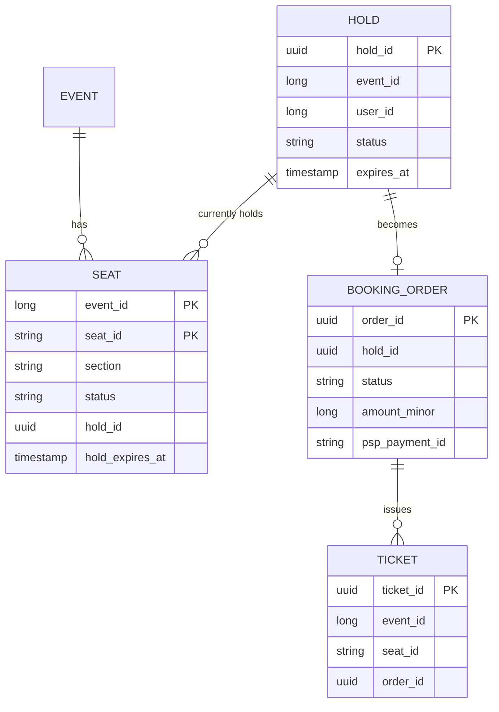
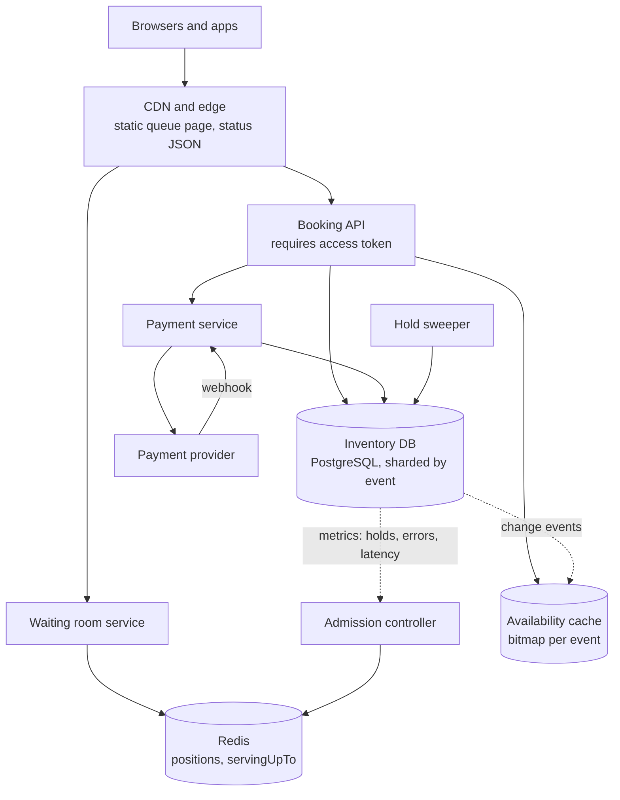
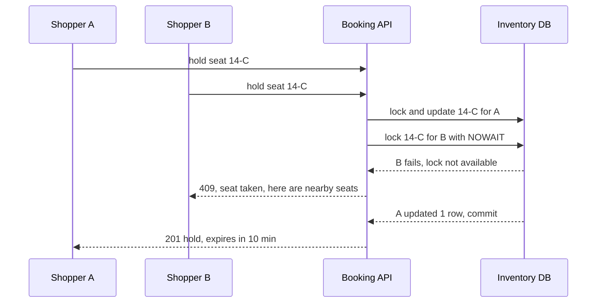
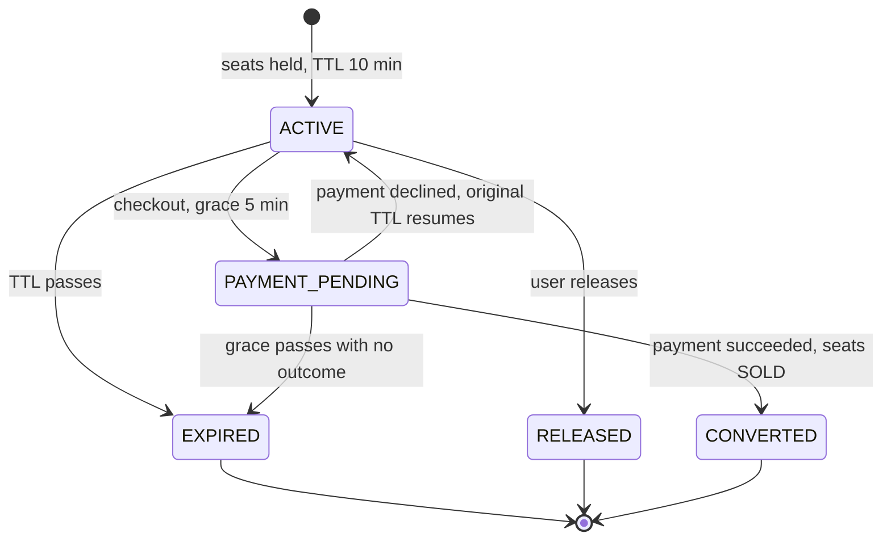
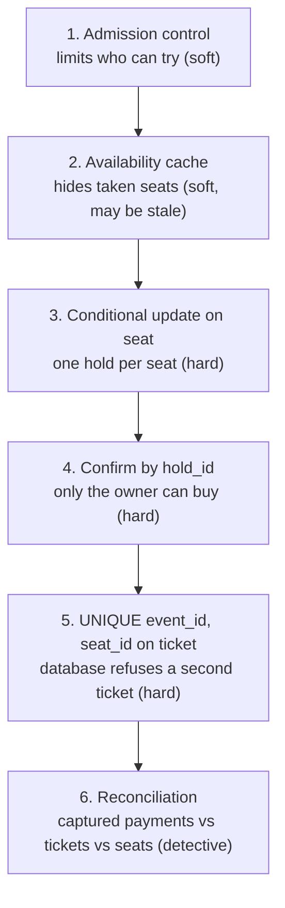

import Callout from '../../components/mdx/Callout.astro';

> "Design the booking system for a stadium concert. 50,000 reserved seats go on sale at 10:00. We expect around two million people to be trying to buy at that moment. Nobody can be sold a seat that someone else already has."

This is a **staff-level** favourite because it inverts the usual system design instinct. Most problems reward you for adding capacity. This one punishes it: the database is not the bottleneck, the **inventory** is. There are only 50,000 seats, and no amount of horizontal scaling creates a 50,001st. The hard parts are contention on a tiny, hot data set, fairness for people who will never get a ticket, and the uncomfortable moment where a seat hold expires at the same second a payment succeeds.

A senior answer gets the locking right. A staff answer notices in the estimates that 98% of the traffic will never buy anything, designs the system around that fact, and treats the payment race as a first-class state, not an edge case.

<Callout variant="note" title="You should already know">
- The six-step framework from [Part 12: System Design Interviews](/blog/backend-12-system-design-interviews).
- CDNs, cache TTLs and stampedes from [Part 5: Caching](/blog/backend-05-caching).
- Transactions, isolation levels, row locks and `SKIP LOCKED` from [Part 3](/blog/backend-03-databases-fundamentals) and [Part 7](/blog/backend-07-database-internals-scaling).
- Back-pressure and load shedding from [Part 8: Scalability and Performance](/blog/backend-08-scalability-performance).
- Idempotency and at-least-once delivery from [Part 10](/blog/backend-10-distributed-systems), and the previous case study, [Design a Distributed Job Scheduler](/blog/sd-05-distributed-job-scheduler), which we lean on for hold expiry.
</Callout>

---

## Step 1: Requirements

The first clarifying question decides half the design: **reserved seating or general admission?** Reserved means each seat is a distinct item with its own contention. General admission (GA) means one counter ("12,000 standing tickets left"), which concentrates all contention on a single value. We will design for reserved seating and handle a GA section as a deep-dive variant.

### Functional

1. **Join the sale**: users arriving before or at on-sale time enter a virtual waiting room and are admitted in a fair order.
2. **Browse availability**: admitted users see a seat map with near-live availability.
3. **Hold seats**: select up to 4 seats; they are held for that user for **10 minutes**.
4. **Pay and confirm**: pay for held seats; on success, tickets are issued.
5. **Release**: holds expire automatically; users can release them early.

### Non-functional (with numbers)

| Property | Target | Note |
|---|---|---|
| Correctness | **Zero oversell.** A seat is sold at most once | The hard requirement; everything else bends around it |
| Peak arrival | 2,000,000 users within the first minutes | Given by the interviewer |
| Hold latency | p99 under 500 ms for admitted users | Users are clicking a specific seat; slowness feels like losing |
| Seat map freshness | Within ~2 s | Stale availability causes failed holds, not oversell |
| Fairness | Earlier arrivals (after on-sale) are admitted first; pre-sale arrivals are randomised | Defined explicitly, because "fair" means different things |
| Purchase limit | 4 tickets per account per event | Anti-scalping and inventory spread |
| Availability | The waiting room must stay up even if booking is degraded | The queue page is what two million people see |

### Out of scope

- Event creation, pricing tiers and dynamic pricing.
- Resale marketplaces and ticket transfer.
- The payment system internals. We integrate with a payment service provider (PSP); designing the ledger is the next case study, [Design a Payment System](/blog/sd-07-payment-system-ledger).

<Callout variant="tip" title="Define fairness before you design for it">
"First come, first served" sounds fair but rewards people with the fastest network and anyone running scripts at 09:59:59.900. A common, defensible policy: everyone who arrives in the 15 to 30 minutes **before** the on-sale time gets a random position at 10:00, and arrivals **after** 10:00 queue in arrival order behind them. Saying this out loud is a staff signal: you turned a vague product word into a rule the system can enforce.
</Callout>

---

## Step 2: Estimates

The estimates here are less about storage (tiny) and more about **ratios**: how many people want a seat versus how many seats exist.

### Inventory and orders

- 50,000 seats, at most 4 per order. Assume an average of 2.5 seats per order: 50,000 / 2.5 = **20,000 orders** fill the stadium.
- Assume 60% of admitted shoppers complete a purchase (the rest find nothing they like, hit a failed hold, or abandon payment): 20,000 / 0.6 = **about 33,000 admissions** sell out the event.
- Two million people are waiting. 2,000,000 - 33,000 = **about 1.97 million people (98%) will not buy a ticket**, whatever we build.

Decision: the system has two very different populations. A tiny one (tens of thousands) needs strong consistency and low latency. A huge one (millions) needs a cheap, static, honest answer: "you are in line" and, soon, "sold out".

### Without a waiting room

If all 2M users load the seat map and click "hold" at 10:00:00:

- A seat-availability bitmap is 50,000 bits = 6,250 bytes. 2M loads x 6.25 KB = **12.5 GB** of responses in a few seconds, before any page assets.
- 2M hold attempts against 50,000 seats, heavily concentrated on the best sections. Almost all of them fail, and every failure is a database round trip that took a row lock or a conflict.

### With a waiting room

Size admission by what the booking flow can serve **well**, not by raw throughput. Assume a booking session (seat map, hold, payment) takes about 3 minutes and we want at most **5,000 concurrent shoppers**:

- Admission rate = 5,000 / 3 min = **1,667 users per minute**, about 28 per second.
- 33,000 admissions / 1,667 per minute = **about 20 minutes** to sell out.
- Hold writes: 5,000 shoppers making, say, 3 hold attempts each per 3-minute session: 5,000 x 3 / 180 s = **about 83 hold attempts per second**.

That last number is the point of the whole design. The waiting room converts a two-million-user spike into **under a hundred writes per second** against the inventory. A single PostgreSQL primary does that without noticing.

### Waiting room traffic

- 2M users polling their queue status every 10 seconds (a server-suggested interval) = **200,000 requests per second**.

Decision: that status must be served from the CDN, not computed per user at the origin. We will make it a single global, cacheable number (deep dive 1).

### Storage

Per event: 50,000 seat rows x ~200 bytes = **10 MB**. Orders and tickets are similar. Storage is irrelevant; one event's inventory fits comfortably in one database partition, which matters because it means we **do not shard a single event** across nodes. We shard *across* events.

---

## Step 3: API and data model

### API

```http
POST /v1/events/evt_42/queue
Authorization: Bearer <user session>

HTTP/1.1 201 Created
{ "queueToken": "eyJ...", "position": 412877, "pollAfterSeconds": 10 }
```

The `queueToken` is signed by the server (for example a JWT with an HMAC key) and contains the event ID, user ID, position and issue time. The client cannot change its position without breaking the signature.

```http
GET /v1/events/evt_42/queue/status
Cache-Control: public, max-age=2

{ "servingUpTo": 388210, "state": "OPEN" }
```

Every user polls the **same** URL. The client compares its own position with `servingUpTo` and shows "about N people ahead of you". When `servingUpTo >= position`:

```http
POST /v1/events/evt_42/admission
Content-Type: application/json

{ "queueToken": "eyJ..." }

HTTP/1.1 200 OK
{ "accessToken": "eyJ...", "expiresInSeconds": 900 }
```

Booking endpoints require the short-lived `accessToken`:

- `GET /v1/events/evt_42/availability`: availability bitmap plus section summaries.
- `POST /v1/events/evt_42/holds` with `{"seatIds": ["S114-C-14", "S114-C-15"]}` and an `Idempotency-Key` header. Returns `201` with `holdId` and `expiresAt`, or `409 Conflict` listing the seats that are no longer available.
- `POST /v1/holds/{holdId}/checkout`: starts payment; returns what the client needs to complete it with the PSP.
- `DELETE /v1/holds/{holdId}`: release early.
- `POST /v1/webhooks/psp`: payment outcome from the provider.

### Data model



The constraints that carry correctness:

- `seat` has primary key `(event_id, seat_id)`. Its `status` is `AVAILABLE`, `HELD` or `SOLD`, and `hold_id` says **whose** hold it is.
- `ticket` has `UNIQUE (event_id, seat_id)`. Even if every other layer has a bug, the database refuses to issue two tickets for the same seat. This is the last line of defence against oversell.
- `booking_order` has `UNIQUE (hold_id)`, so a double-clicked checkout cannot create two orders for one hold.
- The 4-ticket limit is checked inside the hold transaction: count the user's active holds and tickets for the event. Serialise this per user (for example `SELECT ... FOR UPDATE` on a per-user, per-event row) so two parallel requests from the same account cannot both pass the check.

---

## Step 4: High-level design



Walk the journey:

1. **Arrive.** The user hits a static waiting-room page from the CDN and calls `POST /queue`, which assigns a position (random for pre-sale arrivals, an atomic counter afterwards) and returns a signed token.
2. **Wait.** The client polls the cacheable status URL. The **admission controller** advances `servingUpTo` at a rate driven by feedback from the booking tier (deep dive 1).
3. **Admit.** When its turn comes, the client exchanges its queue token for a 15-minute access token. The booking API rejects requests without one, so the inventory never sees un-admitted traffic, even from clients that skip the waiting room page.
4. **Hold.** The booking API reads availability from the cache, then performs the hold as a conditional update in the inventory database (deep dive 2).
5. **Pay.** Checkout freezes the hold into a payment-pending state and authorises the payment with the PSP (deep dive 3).
6. **Confirm.** On a successful payment, a transaction marks the seats `SOLD` and inserts tickets. A notification is sent asynchronously.
7. **Expire.** Unpaid holds lapse after 10 minutes. The sweeper (a delayed job, exactly what the [job scheduler](/blog/sd-05-distributed-job-scheduler) provides) releases them and updates the availability cache.

The key architectural idea: **the waiting room and the booking system fail independently.** The waiting room is mostly static content and one counter. If booking degrades, the controller stops admitting and two million people keep seeing an accurate "you are in line" page instead of error pages.

---

## Step 5: Deep dives

### Deep dive 1: the virtual waiting room


The waiting room has one job: **turn an unbounded arrival rate into a bounded, fair admission rate.** It does that with two numbers.

- **Position.** Each user gets one, written into their signed token. For arrivals before on-sale time, positions are assigned by a random shuffle at 10:00. For later arrivals, Redis `INCR` on a per-event counter gives a strictly increasing number in one atomic operation.
- **`servingUpTo`.** A single per-event number. Everyone with `position <= servingUpTo` may request admission.

Because the per-user state lives in the token and the shared state is one number, the status endpoint is the same response for everyone. It can be cached at the CDN for 1 to 2 seconds, so 200,000 polls per second become roughly one origin request per edge location every couple of seconds. This is the same trick as protecting a hot key with a short TTL ([Part 5](/blog/backend-05-caching)): make the hot read identical for everyone, then cache it.

The **admission controller** decides how fast `servingUpTo` moves. A fixed rate is a start; a feedback loop is better:

- Keep **in-flight shoppers** (valid access tokens not yet used up) below a target, for example 5,000.
- Slow down if booking p99 latency or error rate rises; pause entirely if the inventory database fails over.
- Scale the target to **remaining inventory**. With 2,000 seats left (about 800 orders), admitting 5,000 more people only creates 4,200 disappointed shoppers holding nothing. A reasonable rule: in-flight shoppers at most k x remaining orders, with k around 1.5 to 2.
- When in-flight holds plus sold seats cover all inventory, flip the status to `SOLD_OUT` (or "all tickets currently held; some may be released") so the 1.97 million learn the truth as early as possible. Telling people quickly is part of the product.

Abuse is the other half. Each account gets **one** queue token per event (enforced at `POST /queue`), the token is bound to the session, and admission checks that the same account is redeeming it, so opening 50 tabs does not buy 50 positions. Add bot friction at the cheap, early point: a challenge at queue entry, account-age checks, or a pre-registration step where fans sign up days ahead and receive codes. Managed products such as Cloudflare Waiting Room and Queue-it exist because this layer is hard to get right, and "buy, don't build" is a legitimate staff answer for it.

### Deep dive 2: holding seats under contention

The invariant is simple: **a seat moves from available to held by exactly one hold.** There are three standard ways to enforce it.

| Approach | How | Good at | Bad at |
|---|---|---|---|
| Pessimistic | `SELECT ... FOR UPDATE` (optionally `NOWAIT`), then update | Multi-row invariants, clear semantics | Lock waits pile up on hot rows; deadlocks with multi-seat holds unless lock order is fixed |
| Optimistic, compare-and-set | One conditional `UPDATE ... WHERE status = 'AVAILABLE'`, check row count | Short transactions, no waiting on the happy path | High-conflict rows mean many failed attempts (fine here: a failure is a real "seat taken") |
| Optimistic, version column | Read with `version`, update `WHERE version = :v` (JPA `@Version`) | ORM-friendly | An extra read; same conflict behaviour as compare-and-set |

For seat holds, **compare-and-set** wins. A conflict is not a retryable glitch, it is the business outcome ("someone else got that seat"), so there is no point waiting on a lock just to discover it. The conditional update also handles **lazy expiry**: an expired hold counts as available without waiting for the sweeper.

```kotlin
@Service
class HoldService(private val jdbc: JdbcClient) {

    @Transactional
    fun hold(eventId: Long, userId: Long, seatIds: List<String>): Hold {
        require(seatIds.size in 1..4) { "A hold covers 1 to 4 seats" }
        val holdId = UUID.randomUUID()

        // Lock the requested rows in a fixed order and fail fast if another
        // transaction holds any of them. Fixed order prevents deadlocks between
        // overlapping multi-seat holds; NOWAIT turns a lock wait into an instant 409.
        jdbc.sql("""
            SELECT seat_id FROM seat
            WHERE event_id = :eventId AND seat_id IN (:seatIds)
            ORDER BY seat_id
            FOR UPDATE NOWAIT
        """).param("eventId", eventId).param("seatIds", seatIds)
            .query(String::class.java).list()

        val updated = jdbc.sql("""
            UPDATE seat
            SET status = 'HELD', hold_id = :holdId,
                hold_expires_at = now() + interval '10 minutes'
            WHERE event_id = :eventId
              AND seat_id IN (:seatIds)
              AND (status = 'AVAILABLE'
                   OR (status = 'HELD' AND hold_expires_at < now()))
        """).param("holdId", holdId).param("eventId", eventId).param("seatIds", seatIds)
            .update()

        if (updated != seatIds.size) {
            throw SeatsUnavailableException(seatIds) // rolls back the partial hold
        }
        return insertHold(holdId, eventId, userId) // also enforces the 4-ticket limit
    }
}
```

A few details that interviewers check:

- **All or nothing.** If the user asked for seats 14 and 15 and only 14 was free, the row count is 1, the exception rolls back the transaction, and seat 14 is not left half-held.
- **What happens under concurrency in PostgreSQL.** At the default `READ COMMITTED` level, if two transactions update the same seat row, the second waits for the first to commit and then **re-evaluates its `WHERE` clause against the new row version**. It sees `status = 'HELD'`, matches zero rows, and fails cleanly. No oversell, no explicit isolation upgrade needed. The `FOR UPDATE NOWAIT` step just makes that wait instant (PostgreSQL raises `lock_not_available`, SQLSTATE `55P03`, which we map to `409`).
- **Why not `SERIALIZABLE`?** It would also be correct, but under this level of contention it produces many serialization failures (SQLSTATE `40001`) that must be retried. The invariant is per-row, so a row-level compare-and-set is enough and cheaper.
- **"Best available" seats.** When the user asks for "any 2 seats in section 114", select candidates with `FOR UPDATE SKIP LOCKED` so concurrent shoppers skip rows others are mid-way through, instead of queueing on the same front-row seats. (Adjacency then needs care: pick a contiguous run from the unlocked rows, or retry.)



**Can Redis do this faster?** Yes: a Lua script can check and set several seat keys atomically, and Redis would handle far more than our 83 holds per second. But Redis replication is asynchronous, so a failover can lose acknowledged holds, and a lost hold for a seat that is then held again is exactly the double-booking we promised never to do. At under a hundred writes per second, the database is not the bottleneck, so putting Redis in the write path buys latency we do not need and risk we cannot accept. Redis belongs in front for **reads** (the availability bitmap via `SETBIT`/`GETBIT` or `BITFIELD`, updated from database change events) and for the waiting-room counters.

**The general admission variant.** A GA section is one counter: `UPDATE ga_inventory SET available = available - :n WHERE event_id = :e AND available >= :n`. Correct, but every buyer contends for the **same row**, so throughput is bounded by how long each transaction holds that row lock. If a transaction holds it for 2 ms (an assumption, including commit), the ceiling is 1 / 0.002 = 500 purchases per second, regardless of how many database CPUs you have. Two fixes:

- **Split the counter.** Store GA inventory as, say, 20 buckets of 600 tickets each. A buyer picks a random bucket and decrements it; if it is empty, try another. Contention drops by roughly the bucket count, and the total can never go negative because each bucket cannot.
- **Admission control again.** At our 83 holds per second we are far below the ceiling anyway; this is mainly a 10x concern.

### Deep dive 3: hold expiry, payment timeouts and the race between them

Holds must expire, or abandoned carts lock the stadium. Payments take time, and sometimes their outcome is unknown. Put those together and you get the most important edge case in this problem.


The naive design has one state, `HELD` with a TTL. The buyer starts paying at minute 7.5, the PSP is slow under flash-sale load, the hold expires at minute 10, someone else holds the seat at 10.2, and at minute 11 the first buyer's payment succeeds. Now you have money for a seat you have given to someone else.

The fix is to make "paying" an explicit state with its own, bounded timeout:



The rules that make it safe:

1. **Freeze before charging.** Checkout runs one transaction: if the hold is `ACTIVE` and not expired, set it to `PAYMENT_PENDING` and extend `hold_expires_at` on its seats by a fixed grace period (say 5 minutes). Only one extension per hold, so nobody can keep seats indefinitely by clicking "pay" repeatedly. Only then call the PSP.
2. **Authorise, then capture.** Ask the PSP to authorise the amount, not capture it. Capture only after the seats are confirmed `SOLD`. If anything goes wrong after authorisation, voiding an authorisation is cheaper and kinder than refunding a capture.
3. **Confirm by ownership, not by the clock.** On payment success, mark seats sold with `UPDATE seat SET status = 'SOLD' WHERE hold_id = :holdId AND status = 'HELD'` and check the row count. Note what it does **not** check: the expiry time. If the grace period lapsed but the seat has not yet been released or re-held, it still carries our `hold_id`, so the sale goes through. If the sweeper released it or another buyer took it, `hold_id` changed, zero rows match, and we void the authorisation.
4. **Unknown outcomes stay pending.** If the PSP call times out, the outcome is *unknown*, not failed (the three-outcome problem from [Part 10](/blog/backend-10-distributed-systems)). Keep the hold `PAYMENT_PENDING`, query the PSP for the payment status, and wait for the webhook. Every PSP request carries an idempotency key derived from the hold ID, so a retried authorisation cannot charge twice.
5. **Issue tickets through an outbox.** The transaction that marks seats `SOLD` also inserts the `ticket` rows (protected by `UNIQUE (event_id, seat_id)`) and an outbox event. A separate relay sends confirmation emails and triggers capture, so a crash after commit cannot lose the confirmation.

The sweeper is then a **display** concern, not a correctness one. Expiry is enforced lazily by the conditional update in deep dive 2; the sweeper just flips expired holds to `EXPIRED`, sets seats back to `AVAILABLE`, and pushes the change to the availability cache so other shoppers can see the seat again. If the sweeper stalls, seats look taken for longer than they are, which costs sales but never correctness.

<Callout variant="warning" title="The rare case still needs a human-grade answer">
Even with all of this, some payments will succeed for holds that were lost (a webhook arriving after the grace period, after the seat was resold). The system must detect it (payment success with zero rows updated), void or refund automatically, and tell the customer clearly and quickly, ideally with an offer of an equivalent seat if one is available. Interviewers at staff level want to hear that you planned the apology, not that you claimed it cannot happen.
</Callout>

### Deep dive 4: oversell prevention as defence in depth

"Zero oversell" is not one mechanism; it is a stack where only the bottom layers are trusted for correctness.



- Layers 1 and 2 are **performance and experience**. They reduce the number of failed attempts, but a bug in them must never cause oversell, only disappointment.
- Layers 3 to 5 are **correctness**, and all three live in the same transactional database. That is deliberate: one source of truth, enforced by constraints rather than by application code paths that someone might forget to call.
- Layer 6 is **detection**. After the sale (and continuously during it), a reconciliation job checks that every captured payment has tickets, every ticket has a captured payment, and every `SOLD` seat has exactly one ticket. Mismatches page a human. Correct systems still need reconciliation, because PSPs, webhooks and people are outside your transaction.

---

## Step 6: Bottlenecks, failures and evolution

### What breaks at 10x

Imagine a stadium tour: 40 shows go on sale at the same time, with 20 million people waiting.

- **The waiting room** scales almost linearly: it is static content, one counter per event and a CDN. The first thing to watch is the `POST /queue` burst at 10:00 (20M joins in a few minutes). Positions for pre-sale arrivals can be assigned in a batch shuffle, so the counter only serves late arrivals.
- **Inventory** scales by event. 40 events, each about 100 writes per second, spread across database shards keyed by `event_id`. One event never needs to span shards, which keeps all the hard constraints in one transaction.
- **The PSP** becomes the real bottleneck. Payment providers have their own rate limits and slow down under load, which stretches `PAYMENT_PENDING` time, which holds inventory longer, which makes more shoppers see "no seats". The admission controller must include payment latency in its feedback loop.
- **The availability cache** fan-out: 5,000 shoppers per event refreshing a 6 KB bitmap every 2 seconds is 2,500 requests per second per event; across 40 events, 100,000 requests per second. Fine for a cache tier, and the bitmap can also be served from the CDN with a 1 to 2 second TTL.

### Failure modes

| Failure | What users see | Response |
|---|---|---|
| Inventory DB primary fails over mid-sale | Holds fail for seconds | Controller pauses admission automatically on error rate; existing holds keep their TTL; extend all active holds by the outage duration |
| Redis (queue counters) fails | Status freezes | Positions live in signed tokens, so nobody loses their place; `servingUpTo` is persisted periodically and restored |
| PSP degraded | Payments slow or time out | Holds stay `PAYMENT_PENDING` with bounded grace; admission slows; unknown outcomes resolved by status queries and webhooks |
| Sweeper stalls | Seats look taken longer | Correctness unaffected (lazy expiry); alert on the age of the oldest expired-but-unreleased hold |
| Bot wave at queue entry | Queue inflates | Challenges at entry, one token per account, purchase limits enforced at hold time in the database |
| Availability cache stale | More `409`s on holds | Harmless to correctness; shows up as a rising hold-conflict rate, which is the alert |

### What to measure

- **Hold conflict rate** (failed / attempted holds): rising means the availability view is stale or admission is too aggressive.
- **In-flight shoppers vs remaining inventory**, the controller's input.
- **Time in `PAYMENT_PENDING`** (p50, p99) and the count of payments succeeding for lost holds.
- **Oversell invariant checks**: `SOLD` seats without exactly one ticket. The target is zero, and any non-zero value is a page.
- **Queue honesty**: the time between inventory being fully held or sold and the waiting room showing `SOLD_OUT`.

---

## What separates levels

| Level | What the answer adds for this problem |
|---|---|
| Mid | Seats table, a transaction to book, "use a lock". Usually forgets holds expire or that payment takes time. |
| Senior | Holds with TTL, conditional updates or `FOR UPDATE` with the row-count check, unique constraint on tickets, idempotent checkout, a cache for the seat map, some form of queue. |
| Staff | Finds in the estimates that 98% of users will not buy and designs a CDN-cached waiting room around it; admission driven by feedback and remaining inventory; explains PostgreSQL's re-check behaviour under `READ COMMITTED`; makes `PAYMENT_PENDING` an explicit state with authorise-then-capture and confirm-by-ownership; layered oversell defence with reconciliation. |
| Principal | Defines fairness as a policy and owns its consequences (randomised pre-queue, purchase limits, verified pre-registration); weighs buying a waiting-room product; plans PSP capacity with the provider; frames the "paid for a lost seat" path as a customer-experience process with an owner, not a bug. |

---

## Common mistakes

- **Scaling the database instead of controlling admission.** You cannot add seats. Two million concurrent writers against 50,000 rows is a design error, not a capacity problem.
- **Read-then-write without a condition.** `SELECT status` followed by `UPDATE ... SET status = 'HELD'` in two steps is the textbook race. The check and the write must be one atomic operation.
- **Putting holds only in Redis.** Fast, and a failover can silently double-book.
- **One `HELD` state with a TTL and nothing else.** The payment race is guaranteed to happen at flash-sale scale.
- **Capturing payment before confirming seats.** Authorise, confirm, then capture.
- **A per-user queue status endpoint at the origin.** 200,000 personalised requests per second for information that could be one cached number.
- **Ignoring the people who will not get tickets.** Leaving 1.97 million people in a queue for 40 minutes after the event sold out is an outage from their point of view.
- **Trusting the client.** Positions, prices, seat IDs and admission must be verified server-side; the waiting-room page is not a security boundary, the access token is.

---

## Interviewer follow-ups

<details>
<summary>Two users click the same seat in the same millisecond. Walk me through exactly what happens in your database.</summary>

Both requests run the hold transaction. Both try `SELECT ... FOR UPDATE NOWAIT` on the seat row. One acquires the row lock; the other immediately gets `lock_not_available` (SQLSTATE `55P03`), and we return `409` with nearby alternatives. The winner's conditional `UPDATE` matches one row, inserts the hold and commits.

Without the `NOWAIT` step, the loser's `UPDATE` would wait for the winner's commit and then PostgreSQL, at `READ COMMITTED`, re-evaluates the `WHERE` clause against the newly committed row version. It sees `status = 'HELD'` with a future expiry, matches zero rows, and the row-count check fails the request. Either way, exactly one hold succeeds; `NOWAIT` just makes the loser's answer faster.

</details>

<details>
<summary>A customer's payment succeeded, but their seat had already been sold to someone else. How did that happen, and what do you do?</summary>

It requires the payment outcome to arrive after the grace period and after another buyer took the seat: for example, the PSP timed out, our status query also failed, and the webhook came several minutes late. Our confirmation step updates seats `WHERE hold_id = :holdId AND status = 'HELD'`; it matches zero rows, so we know immediately.

Because we only authorised, we void the authorisation, so the customer is not charged (some banks show a pending amount for a few days, which support should be ready to explain). We email them right away, and if equivalent seats are available we offer a priority hold. We also count these events: a rising number means the grace period is too short for current PSP latency, or the admission controller is not reacting to payment slowness.

</details>

<details>
<summary>How do you prevent one person from opening 50 tabs or running a script to get a better queue position?</summary>

Positions belong to accounts, not browsers. `POST /queue` issues at most one token per account per event (a unique constraint or a Redis `SET NX` on `event:user`), and later calls return the same token. Tabs share it. Pre-sale arrivals are randomised, so arriving at 09:59:59.900 with a script gives no advantage over arriving at 09:45.

Scripts that create many accounts are the harder problem: challenge at queue entry, account age and history signals, payment instrument limits, and for high-demand events a pre-registration step where verification happens days in advance. The 4-ticket limit is enforced at hold time in the database, not in the UI, so even an admitted bot cannot buy more than four.

</details>

<details>
<summary>Your hold TTL is 10 minutes. Why that number, and what if the business wants 20?</summary>

It is a trade-off between conversion and inventory velocity. Longer holds help slow buyers but lock seats that abandoners will never pay for. With 5,000 shoppers and a 40% abandonment rate, a 20-minute TTL means abandoned holds keep seats away from the next shoppers twice as long, so the sale takes longer and more people in the queue see "no seats" while seats are actually just held.

I would measure the distribution of time from hold to checkout in past sales and set the TTL so the large majority of real buyers finish within it, then keep the separate payment grace period for the payment step. If the business wants 20 minutes, the answer is "yes, and the sale will take roughly this much longer, and the queue display must account for held-but-not-sold seats".

</details>

<details>
<summary>The section is general admission: 20,000 standing tickets, one number. What changes?</summary>

All contention lands on one row. The conditional decrement `UPDATE ... SET available = available - :n WHERE available >= :n` is still correct, but throughput is capped by the row lock hold time, roughly 1 / (time per transaction). I would split the inventory into N buckets, have buyers pick a random bucket and fall back to others when it is empty, which divides contention by N while keeping each bucket non-negative.

Holds for GA are counts, not seat IDs: a hold row records "3 tickets from bucket 7", and expiry adds them back to the same bucket. Admission control matters even more here, because with reserved seating contention is spread over many rows, whereas with GA it is concentrated by definition.

</details>

<details>
<summary>The inventory database primary fails over at minute 3 of the sale. What happens?</summary>

During the failover (typically seconds to tens of seconds for a managed PostgreSQL setup), hold and checkout requests fail. The admission controller sees the error rate and stops advancing `servingUpTo`, so we do not admit people into a broken system. Shoppers already admitted get retryable errors; clients retry with backoff and the `Idempotency-Key` on holds prevents duplicate holds.

Two correctness checks: with synchronous replication, no committed hold or sale is lost; with asynchronous replication, the last few commits may be lost, which is why for this workload I would run synchronous replication to at least one standby during on-sales, accepting slightly higher commit latency. After recovery, extend all active holds by the outage duration, because users should not lose seats to our outage.

</details>

<details>
<summary>How do you keep a live seat map for 5,000 shoppers without hammering the database?</summary>

The database emits seat changes (via logical replication or the outbox) to a small service that maintains a per-event availability bitmap in Redis: 50,000 bits is 6.25 KB, updated with `SETBIT`. Clients fetch it every 1 to 2 seconds, through a CDN with a matching TTL, or receive deltas over a WebSocket or server-sent events for the section they are viewing.

Staleness is acceptable because the map is advisory: the hold's conditional update is the real check. A stale map raises the hold-conflict rate, which we measure, and the `409` response includes current availability for the nearby seats so the client can refresh that section immediately.

</details>

<details>
<summary>Would you use a distributed lock (for example a Redis lock per seat) instead of database row locks?</summary>

No. A distributed lock in a separate system only protects the database write if the database can reject writes from a holder whose lock has expired, which needs fencing tokens checked by the database (see [Part 10](/blog/backend-10-distributed-systems)). At that point the database is doing the real work anyway. The conditional update gives atomic check-and-set inside the same system that stores the truth, with no extra network hop and no lease-expiry edge cases.

A distributed lock makes sense when the protected resource cannot enforce conditions itself. Our inventory can, so we use it.

</details>

---

## Key takeaways

- In a flash sale the bottleneck is **inventory, not infrastructure**. Design around the ratio of buyers to seats.
- The **virtual waiting room** turns millions of arrivals into a bounded admission rate. Keep per-user state in signed tokens and shared state in one CDN-cacheable number.
- Drive admission by **feedback**: in-flight shoppers, latency, errors and remaining inventory. Tell people "sold out" early.
- Hold seats with a **single atomic conditional update** and check the row count. In PostgreSQL at `READ COMMITTED`, concurrent updaters re-check the condition after waiting, so no isolation upgrade is needed.
- Lock multi-seat holds in a fixed order, and use `NOWAIT` or `SKIP LOCKED` to fail fast instead of queueing on hot rows.
- Make **payment pending** an explicit state with a bounded grace period. Authorise, confirm by `hold_id`, then capture.
- Oversell prevention is **layered**: soft layers for experience, hard layers in one transactional database (conditional updates, ownership checks, `UNIQUE (event_id, seat_id)`), and reconciliation to catch what crosses system boundaries.
