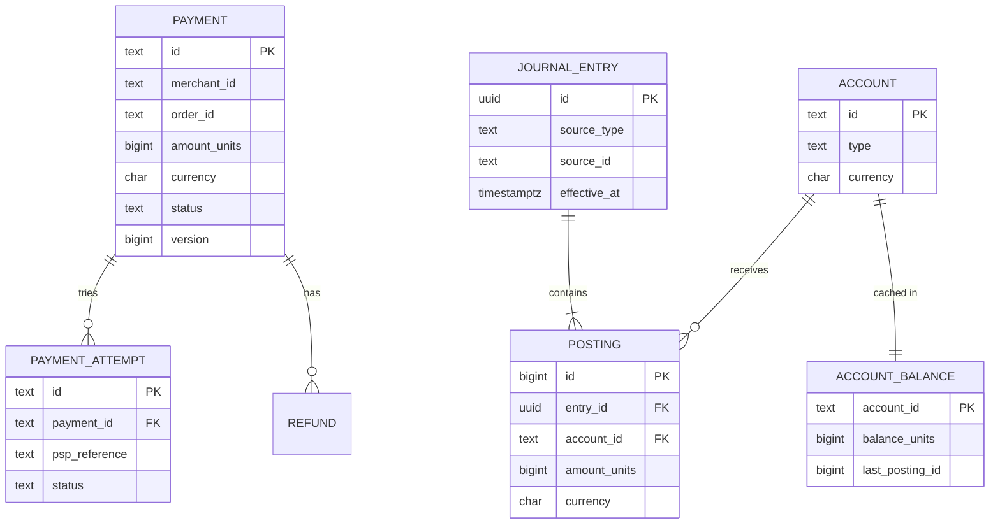
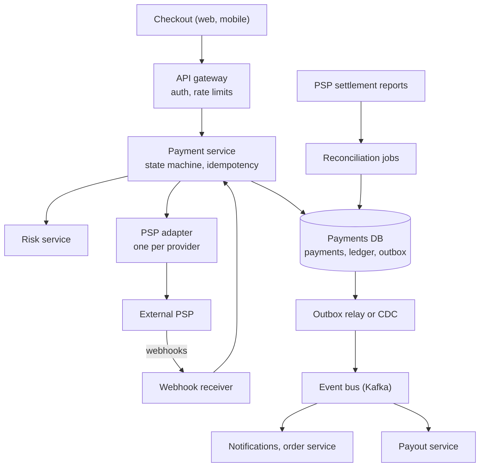
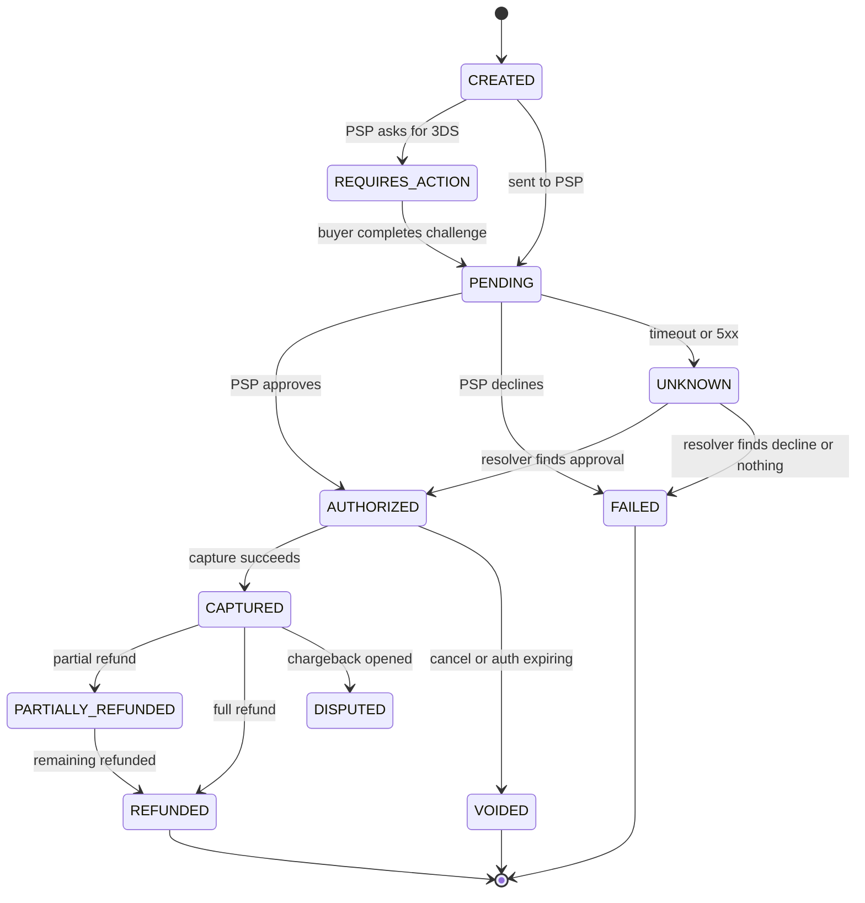
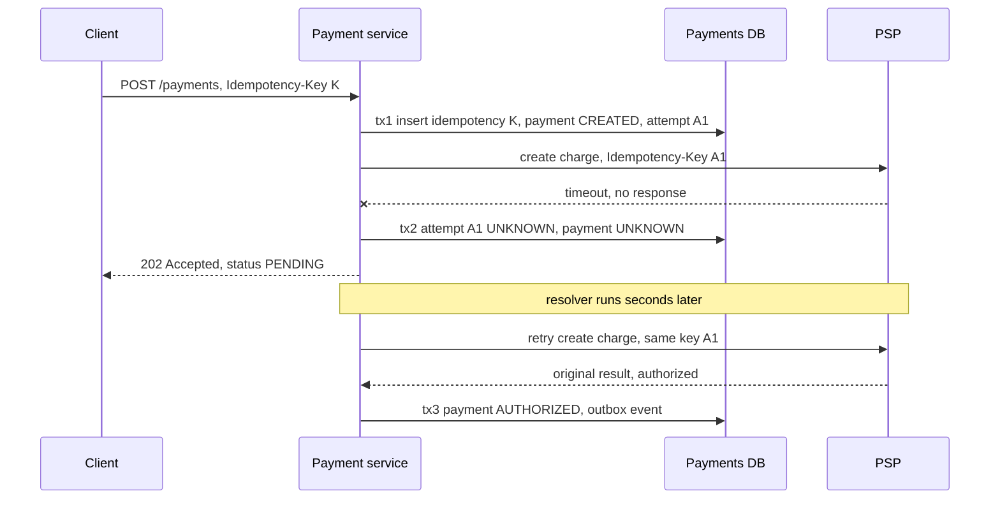

import Callout from '../../components/mdx/Callout.astro';

> "Design the payment system for a marketplace. Buyers pay with a card, we keep a fee, sellers get paid out. Assume we use an external payment provider like Stripe or Adyen for the card networks."

This prompt shows up at senior and staff level, and it is one of the few where the interviewer is not really testing scale. A very large payments system moves a few thousand transactions per second. What is being tested is **correctness under partial failure**: the provider timed out, the process crashed between two writes, a webhook arrived twice and out of order, a refund was requested while the capture was still in flight. Every one of those has to end with the money accounted for, to the cent, and with an audit trail that a finance team and a regulator can follow.

[Part 12](/blog/backend-12-system-design-interviews) ended with a short note on exactly this problem: the dominant requirement flips from availability to correctness. This post runs the full six-step framework on it.

<Callout variant="note" title="You should already know">
Transactions, isolation levels and row locks ([Part 3](/blog/backend-03-databases-fundamentals), [Part 7](/blog/backend-07-database-internals-scaling)), idempotent APIs ([Part 2](/blog/backend-02-rest-api-design)), at-least-once delivery and retries ([Part 6](/blog/backend-06-async-processing-queues)), the transactional outbox and inbox ([Part 9](/blog/backend-09-event-driven-architecture)), and why "exactly once" is a property you build, not one you are given ([Part 10](/blog/backend-10-distributed-systems)). The previous case study, [Design a Ticket Booking System for Flash Sales](/blog/sd-06-ticket-booking-flash-sale), ends with a payment timeout; this post picks up from there.
</Callout>

## Step 1: Requirements

Start by drawing the boundary. "We use a PSP" means we do **not** talk to Visa or Mastercard, we do not store card numbers, and we do not run a bank. We orchestrate payments, record what happened to the money, and pay sellers. Say that out loud; it removes half the problem.

### Functional

1. **Charge a buyer** for an order: authorize the card, then capture (immediately for digital goods, at shipment for physical goods).
2. **Record every money movement** in a ledger: what the buyer paid, the fee we keep, what we owe the seller, what the PSP charged us.
3. **Refund** fully or partially, and record chargebacks (disputes) when the PSP reports them.
4. **Pay out sellers** on a schedule from their available balance.
5. **Show balances and history** to sellers and to the internal finance team.

### Non-functional

| Requirement | Target | Why |
|---|---|---|
| Correctness | No money created or destroyed; every ledger entry balances to zero | This is the product |
| Idempotency | Any request can be retried safely; a buyer is never charged twice for one order | Networks fail; clients and gateways retry |
| Durability | An acknowledged payment is never lost (synchronous replication, RPO 0) | Losing a capture record means losing money or charging without delivering |
| Auditability | Ledger is append-only; every entry traces to a cause (payment, refund, payout, adjustment) | Finance close, audits, disputes |
| Availability | 99.95% for the charge API | Downtime loses sales, but a wrong answer is worse than a slow one |
| Latency | Charge API p99 under 2 s, dominated by the PSP | The card network round trip is the floor; our own work should add under 100 ms |
| Consistency | Strong for ledger writes and balance checks; eventual is fine for dashboards and analytics | Payout must not spend money twice |

### Out of scope

- Card data handling. We use the PSP's hosted fields or SDK so raw card numbers never touch our servers; that keeps us in the smallest PCI DSS scope.
- Fraud scoring internals (we call a risk service and treat it as a black box).
- Multi-currency FX conversion beyond storing the currency on every amount. Mention it as an extension.
- Tax calculation, invoicing, KYC/onboarding of sellers.

A staff-level move here is to ask **one question that changes the design**: "Do we capture at checkout or at shipment?" Separate auth and capture means a payment lives for days in an `AUTHORIZED` state, authorizations expire (for online card payments typically around 7 days, though it varies by network and PSP), and you need a job that captures or voids before that happens. Immediate capture is simpler. Assume both are needed.

## Step 2: Estimates

Pick a large but realistic marketplace: **50 million payments per day**.

- Average rate: 50,000,000 / 86,400 s ≈ **580 payments/s**.
- Peak: assume 5x average for evening and holiday spikes, so ≈ **2,900/s**. Round to **3,000/s**.

Each payment, over its lifecycle, produces roughly:

- 1 payment row plus 1 to 3 attempt rows (retries, a second card) at about 1 KB each with metadata.
- About 3 journal entries (capture, PSP fee, payout share) with 2 to 3 postings each. Call it **8 postings** at about 150 bytes, so 1.2 KB.
- 1 idempotency record and 2 to 4 outbox rows, both short-lived (deleted after days).

Durable ledger growth: 50,000,000 × 1.2 KB = **60 GB/day**, or about **22 TB/year** before indexes. Payments and attempts add a similar amount. Financial records are typically retained for several years (5 to 10 is common, depending on jurisdiction), so the ledger is a **tens to hundreds of terabytes** store over its life, with almost all reads hitting the last few weeks.

Row writes at peak: per payment roughly 1 payment insert + 2 status updates + 1 attempt + 8 postings + 3 entry headers + 2 to 3 balance updates + 3 outbox rows + 1 idempotency row, about **20 row writes**. At 3,000 payments/s that is about **60,000 row writes/s** at peak.

**So what?** Two conclusions fall out of this arithmetic:

1. The *throughput* is modest. A relational database with real transactions can carry it, but 60,000 writes/s at peak is too close to the comfortable limit of a single primary to plan around one forever. Design the schema so it can be **sharded by merchant (seller)** later, and keep every transaction within one shard.
2. Storage, not throughput, is the long-term problem: partition ledger tables by time and move old partitions to cheaper storage while keeping them queryable for audits.

What the estimate does *not* justify: a NoSQL store with eventual consistency, a cache in front of balances, or Kafka on the synchronous path. Nothing here needs them, and each would make correctness harder.

## Step 3: API and data model

### Money

Before any table: **money is an integer count of minor units plus a currency code.** Never a float, and preferably not a decimal at the API boundary either.

- `1999 USD` means $19.99. `1999 JPY` means ¥1,999, because the yen has zero minor units. `1999 KWD` means 1.999 dinars, because the Kuwaiti dinar has three. The exponent comes from ISO 4217; Java exposes it as `Currency.getDefaultFractionDigits()`.
- A 64-bit signed integer holds about 9.2 × 10^18 minor units. That is enough for any single amount and any realistic balance.
- Fee calculation (2.9% of 1999) produces fractions. Decide the rounding rule once (round half-even, or always in the platform's favour, as the contract says) and apply it in exactly one place, so the fee plus the seller share always sums to the original amount.

```kotlin
@JvmInline
value class Minor(val units: Long)

data class Money(val amount: Minor, val currency: Currency) {
    operator fun plus(other: Money): Money {
        require(currency == other.currency) { "currency mismatch" }
        return Money(Minor(Math.addExact(amount.units, other.amount.units)), currency)
    }
}

/** Split a gross amount into fee and remainder so that fee + net == gross, always. */
fun splitFee(gross: Money, basisPoints: Int): Pair<Money, Money> {
    val fee = BigDecimal(gross.amount.units)
        .multiply(BigDecimal(basisPoints))
        .divide(BigDecimal(10_000), 0, RoundingMode.HALF_EVEN)
        .longValueExact()
    return Money(Minor(fee), gross.currency) to Money(Minor(gross.amount.units - fee), gross.currency)
}
```

`Math.addExact` throws on overflow instead of silently wrapping, and computing `net` as `gross - fee` (rather than rounding both independently) is what guarantees the split balances.

### Public API

```http
POST /v1/payments HTTP/1.1
Idempotency-Key: 6f1c9a2e-8b7d-4f0e-a3c1-2d5e9b8f7a10
Content-Type: application/json

{
  "order_id": "ord_8812",
  "amount": { "units": 1999, "currency": "EUR" },
  "payment_method_token": "pm_tok_from_psp_sdk",
  "capture": "manual"
}
```

```http
HTTP/1.1 201 Created
Content-Type: application/json

{ "id": "pay_01J9...", "status": "AUTHORIZED", "amount": { "units": 1999, "currency": "EUR" } }
```

Other endpoints: `POST /v1/payments/{id}/capture`, `POST /v1/payments/{id}/refunds` (also idempotent, with its own key), `GET /v1/payments/{id}`, `GET /v1/accounts/{id}/balance`, `GET /v1/accounts/{id}/entries?cursor=...`. Inbound: `POST /webhooks/psp` for asynchronous provider events.

The `Idempotency-Key` header is the convention Stripe and Adyen use, and the IETF HTTP API working group has a draft standardizing it (`draft-ietf-httpapi-idempotency-key-header`). Note that it is still a draft; the behaviour, not the RFC number, is what you are designing.

A payment can also come back `202 Accepted` with `status: "PENDING"`. That is not an error. It is the honest answer when the provider's outcome is not yet known (Step 5 covers why).

### Data model



Three groups of tables with different rules:

- **Payments, attempts, refunds** are *workflow state*. They change status over time, guarded by a state machine and an optimistic `version` column.
- **Journal entries and postings** are the *ledger*. Insert only. Never updated, never deleted. A mistake is corrected by a new, reversing entry.
- **Account balances** are a *cache* of `SUM(postings)` per account, maintained in the same transaction as the postings so they are never stale on the write path, and verifiable against the postings at any time.

Plus two supporting tables: `idempotency_keys` and `outbox`.

## Step 4: High-level design



The important property of this picture is **where the synchronous path stops**. A charge request touches the payment service, the risk service, the PSP and one database. Everything else (notifying the order service, emails, analytics, payouts) hangs off the event bus, fed by the outbox, so none of it can make a charge fail or double.

Why the ledger lives in the **same database** as payments, at least at first: the capture status change, the ledger postings and the outbox row must commit atomically. Putting the ledger in a separate service would turn that into a distributed transaction or a saga, and a saga means a window where the payment says "captured" but the ledger does not know yet. That window can be acceptable at very large scale (Step 6), but it is a cost you should only pay when you must.

The **PSP adapter** isolates provider specifics: request formats, status mappings, error codes, webhook signature verification. It also makes a second provider (for failover or cheaper routing in some countries) a new adapter rather than a rewrite.

## Step 5: Deep dives

### Deep dive 1: the double-entry ledger

Double-entry bookkeeping is a 500-year-old answer to the question "how do I know nobody made a mistake?" Every movement of money is a **journal entry** made of two or more **postings**, and the postings of every entry sum to zero per currency. Money is never created; it moves from one account to another.


Use one signed convention and stick to it. In the figure, a positive amount is a debit and a negative amount is a credit, and each account has a type (asset, liability, revenue, expense) that determines which sign means "the balance grew". For a 100.00 EUR purchase with a 10% platform fee and a 1.50 EUR PSP fee:

1. **Capture.** `psp_receivable` (asset, money the PSP owes us) +10,000. `seller_payable:s42` (liability, money we owe the seller) −9,000. `platform_revenue` −1,000.
2. **PSP fee.** `psp_fees` (expense) +150. `psp_receivable` −150.
3. **Settlement** (the PSP pays our bank account). `bank_cash` +9,850. `psp_receivable` −9,850. Now `psp_receivable` is back to 0, which is a free reconciliation check.
4. **Payout to seller.** `seller_payable:s42` +9,000. `bank_cash` −9,000.
5. **Partial refund of 20.00**, if the policy is that the seller bears it and we return our fee proportionally: `seller_payable:s42` +1,800, `platform_revenue` +200, `psp_receivable` −2,000.

Every row sums to zero. That invariant is cheap to check and catches a whole class of bugs immediately. Enforce it in the database, not only in the application:

```sql
CREATE TABLE postings (
    id           bigint GENERATED ALWAYS AS IDENTITY PRIMARY KEY,
    entry_id     uuid   NOT NULL REFERENCES journal_entries(id),
    account_id   text   NOT NULL REFERENCES accounts(id),
    amount_units bigint NOT NULL CHECK (amount_units <> 0),
    currency     char(3) NOT NULL
);

CREATE FUNCTION check_entry_balanced() RETURNS trigger AS $$
BEGIN
    IF EXISTS (
        SELECT 1 FROM postings
        WHERE entry_id = NEW.entry_id
        GROUP BY currency
        HAVING SUM(amount_units) <> 0
    ) THEN
        RAISE EXCEPTION 'journal entry % does not balance', NEW.entry_id;
    END IF;
    RETURN NULL;
END;
$$ LANGUAGE plpgsql;

-- Deferred: runs at COMMIT, after all postings of the entry are inserted.
CREATE CONSTRAINT TRIGGER postings_balanced
    AFTER INSERT ON postings
    DEFERRABLE INITIALLY DEFERRED
    FOR EACH ROW EXECUTE FUNCTION check_entry_balanced();

-- Append-only: revoke the ability to change history from the application role.
REVOKE UPDATE, DELETE ON postings, journal_entries FROM payments_app;
```

A CHECK constraint cannot see other rows, which is why this is a deferred constraint trigger. It fires once per inserted row, which is fine for entries of two to five postings.

#### Balances and the "spend twice" problem

Reading a balance as `SUM(amount_units)` over all postings is correct but gets slower forever. Keep `account_balances` updated in the same transaction, and lock the row when the operation depends on the balance (a payout must not exceed what we owe the seller):

```sql
BEGIN;
SELECT balance_units FROM account_balances
WHERE account_id = 'seller_payable:s42'
FOR UPDATE;                      -- serializes concurrent payouts for this seller

-- application checks: payout amount <= -balance_units (liability, credit-normal)

INSERT INTO journal_entries (id, source_type, source_id, effective_at)
VALUES ('...', 'payout', 'po_771', now());
INSERT INTO postings (entry_id, account_id, amount_units, currency) VALUES
    ('...', 'seller_payable:s42',  9000, 'EUR'),
    ('...', 'bank_cash',          -9000, 'EUR');

UPDATE account_balances SET balance_units = balance_units + 9000, last_posting_id = ...
WHERE account_id = 'seller_payable:s42';
UPDATE account_balances SET balance_units = balance_units - 9000, last_posting_id = ...
WHERE account_id = 'bank_cash';
COMMIT;
```

To avoid deadlocks when one transaction touches several balance rows, always lock them in a fixed order (for example sorted by `account_id`).

#### Hot accounts

`platform_revenue` and `psp_receivable` receive a posting from **every** payment. At 3,000 payments/s, a single balance row locked `FOR UPDATE` 3,000 times a second becomes the bottleneck long before the database does. The usual fixes, in order of preference:

- **Do not maintain a locked balance for accounts nobody needs to check synchronously.** Nobody approves a payment based on the platform's revenue balance. Insert the postings, and compute that balance asynchronously (or in periodic roll-ups).
- **Split the account** into N sub-accounts (`platform_revenue:00` to `:63`) chosen by hash of the payment id; the real balance is the sum. Contention drops by N.
- **Batch**: accumulate postings for the hot account and write one aggregated entry every second. This changes the ledger's granularity, so finance must agree to it.

Staff candidates mention hot accounts unprompted; it is the scaling problem that is specific to ledgers.

### Deep dive 2: the payment state machine

A payment is not a boolean. Model it as an explicit state machine and refuse every transition that is not on the diagram.



Some notes on the details that interviewers probe:

- `REQUIRES_ACTION` exists because of Strong Customer Authentication (PSD2 in Europe): the issuer may demand a 3-D Secure challenge, and the payment waits for the buyer.
- `UNKNOWN` is a first-class state, not an error. It means "we sent the request and do not know what the PSP did." It is resolved only by asking the PSP, never by guessing (next dive).
- Capture and refund are separate sub-resources with their own status and their own idempotency key, because one payment can have several partial captures (where the PSP supports it) and several partial refunds.
- Ledger entries are written **only on transitions that move money**: `CAPTURED`, refund `SUCCEEDED`, dispute lost, settlement. Authorization moves no money; it is a hold on the buyer's card, so it gets no posting (some ledgers track it in a memo account; that is optional).

Transitions are guarded in SQL so two concurrent writers (the API and a webhook, say) cannot both win:

```sql
UPDATE payments
SET status = 'CAPTURED', version = version + 1
WHERE id = :id AND status = 'AUTHORIZED' AND version = :expected_version;
-- 0 rows updated means someone else moved it first: reload and re-decide.
```

Webhooks arrive at least once and in any order. A `charge.refunded` event may arrive before you have processed `charge.captured`. With the guarded transitions above, the handler's job becomes: verify the signature, record the event id in an inbox table (dedup), then apply the transition if it is valid from the current state, or fetch the latest object from the PSP and reconcile if it is not. Never apply a webhook blindly as "set status = X".

### Deep dive 3: idempotency and the unknown outcome

There are **two** idempotency boundaries, and candidates often design only the first.

1. **Client to us.** The checkout retries `POST /v1/payments` because the mobile network dropped the response. We must return the original result, not charge again.
2. **Us to the PSP.** Our call to the PSP times out. We must be able to retry it without the PSP charging again.



#### Client to us

Store the key with a fingerprint of the request, in its own row, inserted in the same transaction that creates the payment:

```sql
CREATE TABLE idempotency_keys (
    merchant_id   text        NOT NULL,
    key           text        NOT NULL,
    request_hash  bytea       NOT NULL,      -- SHA-256 of method, path, canonical body
    payment_id    text,
    response_code int,
    response_body jsonb,
    created_at    timestamptz NOT NULL DEFAULT now(),
    PRIMARY KEY (merchant_id, key)
);
```

On a request:

- `INSERT ... ON CONFLICT DO NOTHING`. If the row is new, proceed.
- If it already exists with a stored response, **return the stored response** (same status code, same body).
- If it exists but the hash differs, return `422`: the client reused a key for a different request, which is a client bug you want to surface, not paper over.
- If it exists with no response yet (the first request is still in flight), return `409 Conflict` and let the client retry later.

Scope the key per merchant (or per API client), and keep it at least as long as clients retry. Stripe, for example, documents that keys can be pruned after they are at least 24 hours old.

#### Us to the PSP

Generate **our own** key for each attempt (the attempt id is a natural choice), persist it **before** calling the PSP, and send it as the PSP's idempotency key. Then the rules are:

- **Never hold a database transaction open across the PSP call.** It can take seconds, and holding row locks for seconds at 3,000 requests/s exhausts the connection pool (Series B's [Connection Pool Exhaustion](/blog/case-01-connection-pool-exhaustion) is exactly that incident). The pattern is tx1 (record intent) → external call → tx2 (record result).
- **Timeouts, connection resets and 5xx mean UNKNOWN**, not FAILED. The PSP may have charged the card. Marking it failed and letting the buyer retry with a fresh attempt is how double charges happen.
- **Resolve UNKNOWN by asking**, with the same key: retry the identical create call (the PSP returns the original result for a key it has seen, within its retention window), or look the charge up by your reference. A resolver job picks up attempts that have been `UNKNOWN` for more than a few seconds and does this with exponential backoff. If the PSP has no record after a generous window, the charge never happened and the attempt is `FAILED`.
- **Declines (4xx with a decline code) are definitive.** Do not retry a "card declined" with the same key; it will just return the same decline. A new card is a new attempt with a new key.

The client sees `PENDING` while this happens, and the order page polls or listens for the result. That is a product decision as much as a technical one: "your payment is being confirmed" is a better experience than a double charge.

#### Crash safety and the outbox

What if the process dies after the PSP approved but before tx2? The attempt row is still `PENDING` with a key and a timestamp, the resolver finds it, asks the PSP, and moves on. No state is lost because the intent was durable before the side effect.

The same discipline applies to everything downstream. When a capture commits, the `CAPTURED` status, the ledger entry and an outbox row (`PaymentCaptured`) are written in **one** transaction:

```kotlin
@Service
class CaptureService(
    private val payments: PaymentRepository,
    private val ledger: LedgerWriter,
    private val outbox: OutboxRepository,
) {
    @Transactional
    fun recordCapture(paymentId: String, expectedVersion: Long, captured: Money, pspFee: Money) {
        val payment = payments.transition(paymentId, from = Status.AUTHORIZED, to = Status.CAPTURED, expectedVersion)
            ?: throw ConcurrentTransitionException(paymentId)

        val (platformFee, sellerShare) = splitFee(captured, payment.feeBasisPoints)
        ledger.post(
            source = LedgerSource("capture", paymentId),
            postings = listOf(
                Posting("psp_receivable", +captured),
                Posting("seller_payable:${payment.sellerId}", -sellerShare),
                Posting("platform_revenue", -platformFee),
            ),
        )
        ledger.post(
            source = LedgerSource("psp_fee", paymentId),
            postings = listOf(Posting("psp_fees", +pspFee), Posting("psp_receivable", -pspFee)),
        )
        outbox.add(PaymentCaptured(paymentId, payment.orderId, captured))
    }
}
```

(`+money` and `-money` are unary operators on `Money`; `ledger.post` rejects postings that do not sum to zero before the database trigger ever has to.) The outbox relay or a CDC connector then publishes `PaymentCaptured` at least once; consumers deduplicate by event id. Note that `journal_entries` should have a unique constraint on `(source_type, source_id)` so that even a buggy double call of `recordCapture` cannot post twice.

### Deep dive 4: reconciliation

Everything above reduces the chance of disagreement between us and the outside world. Reconciliation is how you find the disagreements that happen anyway: a webhook that never arrived, a PSP-side reversal, a bug, a manual adjustment someone made in the PSP dashboard.


Run it at three levels:

1. **Internal consistency, continuously.** Every journal entry sums to zero (enforced). Every `account_balances` row equals the sum of its postings (a nightly job checks this per account, using `last_posting_id` to compare at a consistent point). Every `CAPTURED` payment has exactly one capture entry.
2. **Ledger vs PSP, daily.** PSPs publish settlement reports listing every captured charge, refund, fee and dispute in a settlement batch. Match each line to our ledger by PSP reference. Categories of breaks: in PSP but not in our ledger (a missed webhook or an `UNKNOWN` that was really a success), in our ledger but not in PSP (we think we captured, they do not), and amount mismatches (fees, currency rounding, partial captures).
3. **PSP vs bank, per payout.** The net amount the PSP says it sent must arrive in our bank account. `psp_receivable` should drain to the in-flight amount after each settlement.

Breaks go into a queue with an owner and an age, not into a log file. Most are fixed automatically (fetch the charge from the PSP, apply the missing transition through the normal state machine so the ledger entry is created the normal way). The rest go to a finance operations team, and every manual fix is itself a journal entry with an `adjustment` source and an approver, never an edited row.

A staff-level framing: **reconciliation is not a safety net you add at the end; it is a component with an SLO** ("99.9% of PSP lines matched within 24 hours of the report"), because the business cannot close its books without it.

## Step 6: Bottlenecks, failures and evolution

### At 10x (30,000 payments/s at peak)

- **The single database primary is the first thing to go.** Shard by `merchant_id` (seller): payments, their attempts and the seller's ledger accounts live on the same shard, so the capture transaction stays local. Platform-wide accounts (`platform_revenue`, `psp_receivable`) are split into per-shard sub-accounts and rolled up asynchronously.
- **Cross-shard money movement** (a transfer between two sellers on different shards, or a buyer wallet on another shard) can no longer be one transaction. Use a two-step entry through a clearing account: debit on shard A with a transfer record, publish via outbox, credit on shard B idempotently, and reconcile that the clearing account nets to zero. This is a saga, and the clearing account is what makes its in-between state visible and auditable.
- **A dedicated ledger store** becomes worth considering. Purpose-built ledger databases exist (TigerBeetle is one open-source example designed around double-entry transfers), and some large companies run an internal ledger service. The cost is that the ledger and the payment status are no longer one atomic commit, so the outbox/saga pattern above becomes mandatory everywhere.

### Failure modes

| Failure | What users see | What the design does |
|---|---|---|
| PSP timeout or 5xx | "Payment is being confirmed" | Attempt goes `UNKNOWN`; resolver retries with the same key |
| PSP outage | Charges fail or queue | Circuit breaker on the adapter; optionally route new attempts to a second PSP. Never re-route an `UNKNOWN` attempt to another PSP; that is a guaranteed double charge if the first one succeeded |
| Duplicate or reordered webhooks | Nothing | Inbox dedup by event id; guarded transitions; fetch-and-reconcile when a transition is invalid |
| Our DB primary fails | Charges fail briefly | Synchronous replica promoted; RPO 0 because commits wait for the replica |
| Process crash mid-flow | Nothing, or a delayed result | Intent persisted before the external call; resolver and outbox relay pick up where it left off |
| Authorization about to expire | Nothing | Scheduled job captures or voids authorizations nearing expiry |
| Reconciliation break | Nothing (internal) | Break queue with owner, age and SLO |

### Evolution

The order a real team usually builds this in: single PSP, single database, ledger in the same DB, daily reconciliation. Then a second PSP behind the adapter (for resilience or cost). Then hot-account splitting. Then sharding by merchant. A separate ledger service comes last, if ever, because it trades away the one atomic commit that made everything else simple.

## What separates levels

| Level | What the answer adds for a payment system |
|---|---|
| Mid | A working flow: create payment, call PSP, store the result. Uses integers for money. Knows idempotency keys exist. |
| Senior | A state machine with explicit transitions. Idempotency on the client boundary with stored responses. Webhooks treated as at-least-once. The outbox for side effects. Does not hold transactions across the PSP call. |
| Staff | Double-entry ledger with the zero-sum invariant enforced in the database. `UNKNOWN` as a real state resolved by querying the PSP with the same key. Both idempotency boundaries. Hot accounts. Reconciliation as a component with an SLO. Sharding by merchant with cross-shard transfers through a clearing account. |
| Principal | Frames the build order and what not to build (no separate ledger service yet, and why). Talks about finance close, audit, regulatory retention and PCI scope as requirements that shape the architecture. Sets the operating model: who owns breaks, how manual adjustments are approved, what is tested with game days (PSP outage, webhook loss). |

## Common mistakes

1. **Floats or decimals with implicit scale for money.** `0.1 + 0.2` is not `0.3` in floating point, and "2 decimals" is wrong for JPY and KWD. Integer minor units plus a currency, always.
2. **Treating a timeout as a failure.** The single most common cause of double charges. A timeout is `UNKNOWN`.
3. **A balance column with no postings behind it.** `UPDATE accounts SET balance = balance - 100` with no journal entry cannot be audited, cannot be reconciled, and cannot be explained to a customer.
4. **Updating or deleting ledger rows to fix mistakes.** Corrections are reversing entries. The history is the product.
5. **Holding a database transaction (and its locks) open across the PSP call.** It works in testing and exhausts the pool at peak.
6. **Applying webhooks as "set status = X".** They arrive late, twice and out of order. Dedup, then apply only valid transitions.
7. **Putting the ledger write and the event publish in separate commits** ("save, then send to Kafka"). Use the outbox.
8. **Routing a retry of an unknown attempt to a different provider** for resilience. If the first one succeeded, you just charged twice through two systems that cannot deduplicate each other.
9. **Forgetting reconciliation**, or mentioning it as "a nightly job" with no owner, no matching rules and no SLO.

## Interviewer follow-ups

<details>
<summary>The PSP returned a timeout. The buyer is staring at a spinner. What exactly happens next, and what do they see?</summary>

The attempt is marked `UNKNOWN` in a short transaction, and the API returns `202` with `status: PENDING`. The checkout shows "confirming your payment" and polls `GET /payments/{id}` (or subscribes to a push channel). Meanwhile a resolver retries the PSP create call with the **same** idempotency key, or queries the charge by our reference, with backoff over seconds to minutes. If the PSP reports success, we move to `AUTHORIZED` and the page updates. If it reports a decline, `FAILED`, and the buyer can try another card (a new attempt, new key). If the PSP has no record after the retention-safe window, we mark it `FAILED` too.

What we must not do: let the buyer click "pay" again in a way that creates a new attempt with a new key while the first is unknown. The client-side idempotency key is per checkout, not per click, and the server refuses a second attempt while one is `UNKNOWN`.

</details>

<details>
<summary>Why not just store each account's balance and update it? Why double-entry?</summary>

A balance alone tells you *what* the number is, not *why*. Double-entry stores the why: every change is an entry with a cause (payment, refund, payout), and every entry balances to zero, so money cannot appear or vanish without a visible, matching counter-posting. That gives three things a balance column cannot: an audit trail, a cheap invariant that catches bugs at commit time, and the ability to reconcile each account against external records line by line.

We still keep a balance per account, but as a cache of the postings, updated in the same transaction and periodically verified against them. If they ever disagree, the postings win.

</details>

<details>
<summary>Two payout requests for the same seller arrive at the same moment. How do you make sure you do not pay out more than they have?</summary>

Both run in a transaction that takes `SELECT ... FOR UPDATE` on the seller's `account_balances` row. The second blocks until the first commits, then sees the reduced balance and either proceeds with what remains or rejects. Each payout request also carries an idempotency key, and `journal_entries` has a unique constraint on `(source_type, source_id)`, so the same payout cannot be posted twice even if it is retried.

Alternatives worth naming: `SERIALIZABLE` isolation (correct, but you must handle serialization failures with retries), or a conditional update (`UPDATE ... SET balance = balance + :amt WHERE account_id = :id AND -balance >= :amt`), which is a single statement with the check built in. For a seller payable account the contention is low, so the row lock is the simplest correct choice.

</details>

<details>
<summary>Every payment posts to platform_revenue. At peak, that row is the bottleneck. What do you do?</summary>

First question: does anything need that balance synchronously? No. Nobody approves a payment based on platform revenue. So stop maintaining a locked balance for it on the write path: insert the postings (inserts do not contend on one row) and compute the balance in a periodic roll-up.

If a hot account *does* need a synchronous balance (say a platform-funded promotions budget that must not go negative), split it into N sub-accounts selected by hash of the payment id. The total is the sum; contention drops by N. When the budget is close to zero, a single sub-account can run out while others have funds, so you either rebalance sub-accounts periodically or fall back to a slower, locked path near the limit. The third option, batching postings into one aggregate entry per second, changes the ledger's granularity and needs finance's agreement.

</details>

<details>
<summary>The webhook for "charge.refunded" arrives before the one for "charge.captured". How does your system handle it?</summary>

The webhook receiver verifies the signature (for example Stripe signs payloads in the `Stripe-Signature` header), records the event id in an inbox table to drop duplicates, and acknowledges quickly with a 2xx so the PSP stops retrying. Processing happens asynchronously.

The handler tries to apply the transition. "Refunded" is not valid from `AUTHORIZED`, so instead of forcing it, the handler fetches the current charge from the PSP API, which reflects both the capture and the refund, and walks the state machine forward through the valid transitions (`CAPTURED`, then `REFUNDED`), creating the normal ledger entries for each. When the late "captured" webhook arrives, the payment is already past that state; the guarded update matches zero rows and the event is recorded as processed. The webhook is a hint to go and look, not the source of truth.

</details>

<details>
<summary>How would you add a second PSP for failover?</summary>

Behind the adapter interface, add a second implementation with its own status mapping, webhook verification and settlement-report parser. A routing component chooses the PSP per **new attempt** based on health, cost, country and card type. The payment keeps a list of attempts, each pinned to one PSP.

The critical rule: failover applies to new attempts only. An attempt that is `UNKNOWN` at PSP A stays with PSP A until resolved. Re-sending it to PSP B could charge the buyer twice, and the two providers cannot deduplicate each other. Also, saved cards are usually tokenized per PSP, so failover for returning customers needs network tokens or a vault that can provision both, which is a commercial question as much as a technical one. Reconciliation runs per PSP.

</details>

<details>
<summary>A partial refund is requested while the capture is still in flight. What happens?</summary>

The refund endpoint checks the payment state. A refund is only valid from `CAPTURED` or `PARTIALLY_REFUNDED`, so if the payment is still `AUTHORIZED` with a capture pending, the API returns `409` and the caller retries later, or the product offers to reduce the capture amount instead (capture less than authorized and release the rest), which is cheaper than capture-then-refund because it avoids a second card network operation.

Once captured, the refund is its own sub-resource with its own idempotency key and state machine. The amount is checked against `captured - already_refunded` inside a transaction that locks the payment row, so two concurrent partial refunds cannot exceed the captured total. The ledger entry is written when the PSP confirms the refund, not when it is requested.

</details>

<details>
<summary>A finance analyst finds the ledger says we owe a seller 120.00 EUR, but the seller says it should be 100.00. How do you investigate and fix it?</summary>

Pull the seller payable account's postings for the period; every posting points to a journal entry with a source (capture, refund, payout, adjustment) and a source id. Sum them by source type and compare to the seller's orders. Common causes: a refund the PSP processed whose webhook was lost (so the refund entry is missing, which reconciliation against the settlement report should also have flagged), a fee rounding rule applied differently from the contract, or a capture posted twice (prevented by the unique constraint on `(source_type, source_id)`, so check whether it was bypassed).

The fix is never an edit. If a refund entry is missing, apply the refund through the normal state machine so the standard entry is created. If it is a pure accounting error, post an `adjustment` entry with an approver and a reference to the investigation ticket. Then add a reconciliation rule so this class of break is caught automatically next time.

</details>

## Key takeaways

- A payment system is a correctness problem, not a throughput problem. Thousands of transactions per second fit in a relational database with real transactions, and you should use them.
- Money is an integer number of minor units plus an ISO 4217 currency. Rounding is decided once, and splits are computed so they always sum to the original.
- The ledger is double-entry and append-only: every entry sums to zero per currency (enforce it in the database), corrections are reversing entries, and balances are a cache of postings.
- There are two idempotency boundaries: client to us (stored response plus request fingerprint) and us to the PSP (our attempt id as the PSP key, persisted before the call).
- Timeouts mean `UNKNOWN`. Resolve by asking the PSP with the same key, never by retrying under a new key or another provider.
- Status change, ledger entry and outbox event commit together. Everything downstream is at-least-once with dedup.
- Hot accounts are the ledger-specific scaling problem; split them or take them off the synchronous path.
- Reconciliation against PSP and bank records is a first-class component with owners and an SLO, because something will always slip through.
