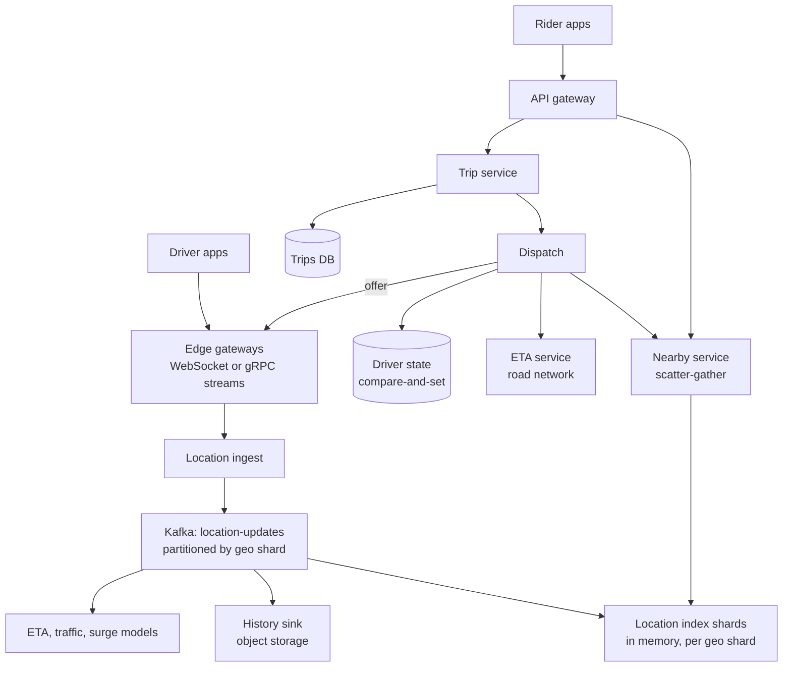
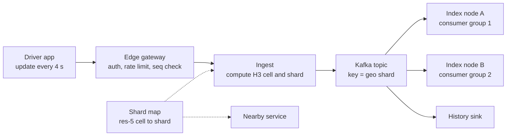
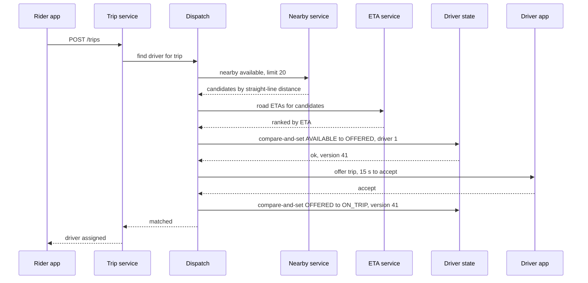
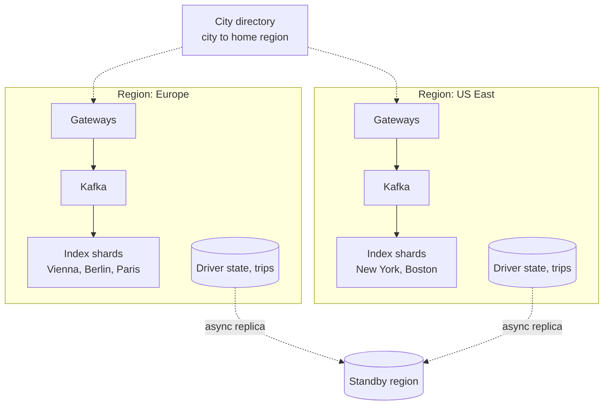

import Callout from '../../components/mdx/Callout.astro';

> "Design a proximity service. Given a user's location, return what is nearby."

That is the whole prompt, and its vagueness is the point. At senior level the interviewer expects you to pick "nearby restaurants" or "nearby drivers" and design it. At principal level the interviewer is watching **what you do with the ambiguity**: whether you notice that "nearby things that never move" and "nearby things that move every four seconds" are different systems with inverted read/write ratios, whether you pick one deliberately, and whether you can explain how the design should change as the business grows from one city to fifty countries.

This post does that. It spends Step 1 on the framing, designs the harder variant (a ride-hailing driver index with matching), and contrasts it with the places variant throughout. As in the rest of the series, it follows the six-step framework from [Part 12](/blog/backend-12-system-design-interviews).

<Callout variant="note" title="You should already know">
Indexes and why a B-tree cannot answer a 2D range query directly ([Part 3](/blog/backend-03-databases-fundamentals), [Part 7](/blog/backend-07-database-internals-scaling)), caching ([Part 5](/blog/backend-05-caching)), partitioning, hot keys and capacity math ([Part 7](/blog/backend-07-database-internals-scaling), [Part 8](/blog/backend-08-scalability-performance)), Kafka partitions and consumer groups ([Part 9](/blog/backend-09-event-driven-architecture)), consistency models and compare-and-set ([Part 10](/blog/backend-10-distributed-systems)), and SLOs ([Part 11](/blog/backend-11-reliability-observability)). The connection gateway pattern from [Design a Chat System](/blog/sd-03-chat-system) is reused for driver apps.
</Callout>

## Step 1: Requirements

### Framing first: which proximity service?

Before listing requirements, put the two readings side by side and let the interviewer choose (or choose yourself and say why):

| | Places ("restaurants near me") | Drivers ("cars near me", plus dispatch) |
|---|---|---|
| Objects | Hundreds of millions, almost static | Millions, moving constantly |
| Writes | A few per second (new places, edits) | Hundreds of thousands per second |
| Reads | Tens of thousands per second | Thousands per second, plus dispatch |
| Freshness | Hours is fine | Seconds, or the car on the map is wrong |
| Durability of the index | Must survive restarts | Can be rebuilt from the next round of updates |
| Hard part | Ranking, filtering, caching | Write throughput, hot spots, matching without double-booking |

The places problem is a read-optimized search index with a geo filter. The drivers problem is a write-optimized, in-memory, soft-state index feeding a strongly consistent assignment step. They share a cell library and almost nothing else. A principal candidate says this in the first three minutes and then asks: "Which one is the business problem? If it is both, I would build them as two services."

For the rest of this post: **the interviewer picks drivers**, for a ride-hailing company operating in many cities worldwide. Places come back in Deep dive 4 as a contrast.

### Functional

1. **Driver location updates.** Online drivers report position, heading and status every few seconds.
2. **Nearby query.** Given a rider's location, return the closest available drivers (for the map, and as dispatch candidates), within a radius, limited to k results.
3. **Match.** When a rider requests a trip, choose a driver, offer the trip, and assign it to exactly one driver.
4. **Trip tracking.** During a trip, the rider sees the driver's live position (a subscription to one driver, not a search).

### Non-functional

| Requirement | Target |
|---|---|
| Freshness | A driver's position in the index is at most about 5 s old (one update interval plus processing) |
| Nearby query latency | p99 under 100 ms server-side |
| Request to first offer | p99 under 2 s, including ETA computation |
| Correctness of assignment | A driver is never assigned two trips at once. A trip is never assigned to two drivers. |
| Availability | Matching 99.99% per city. Degradation is per city or per region, never global. |
| Durability | Trips and assignments: durable. Live positions: soft state, may be lost and rebuilt. Location history: durable but asynchronous (analytics, disputes, safety). |
| Data residency | Location data is personal data. Some markets require it to stay in the country or region. |

### Out of scope

Pricing and surge, the routing engine internals (we call an ETA service), payments (see [Design a Payment System](/blog/sd-07-payment-system-ledger)), fraud, and driver onboarding.

One question changes the design enough to ask it: **"Is the radius fixed?"** In a dense city, 20 drivers might be within 500 m. In a suburb, the nearest might be 8 km away. An index tuned for one radius does badly at the other. The answer here: the query asks for "the k nearest available within at most R", and the search expands until it finds k or hits R.

## Step 2: Estimates

Assume a large global operator:

- **3 million** drivers online at the global peak.
- Each sends an update every **4 seconds** while online.

Write rate: 3,000,000 / 4 s = **750,000 updates/s** at peak.

Payload: driver id, latitude, longitude, heading, speed, status, timestamp. About 50 bytes as protobuf; call it **200 bytes on the wire** with framing, TLS and transport overhead. Ingress: 750,000 × 200 B = **150 MB/s**, about 1.2 Gbit/s, spread across many gateway nodes.

Hot state: each driver's latest position plus index overhead, say **300 bytes** in a JVM or Redis data structure. 3,000,000 × 300 B = **900 MB**. The entire live index fits in the memory of one machine.

Reads: assume **25 million trips/day** and about **10 nearby queries per trip** (the rider opening the app and watching the map, the request itself, re-dispatch after a decline). 25,000,000 × 10 / 86,400 ≈ **2,900 queries/s** on average; at 3x for peak, about **9,000/s**.

History: 750,000 × 50 B × 86,400 s ≈ **3.2 TB/day** uncompressed protobuf. Fine for a log and object storage; wrong for the live index.

**So what?**

1. **Writes outnumber reads about 80 to 1** (750,000 vs 9,000). This is the opposite of most systems in this series, and it rules out any design where an update is expensive (rewriting a disk-based spatial index, invalidating caches).
2. **Memory is not the reason to shard; write throughput is.** 900 MB fits anywhere. 750,000 updates/s through one process, with no room for failure or growth, does not. If we budget, as an assumption to be validated by a load test, **50,000 updates/s per index node**, we need 15 nodes at peak, before replicas and headroom.
3. **Live positions do not need to be durable.** Every driver resends their position within 4 seconds. Losing the index costs at most a few seconds of degraded matching, which changes everything about how we replicate it (Step 5).
4. History is a separate, asynchronous pipeline. It must never be on the update's critical path.

For contrast, the places variant: 200 million places at about 1 KB each is **200 GB** of metadata, the geo index itself (id plus cell) is a few GB, writes are a handful per second, and at 100 million daily users with 5 searches each, reads are about 5,800/s average, 17,000/s at peak. Read-heavy, cache-friendly, durable. A different system.

## Step 3: API and data model

### Driver side

Driver apps hold a long-lived connection (WebSocket, or a gRPC bidirectional stream over HTTP/2) to an edge gateway, the same pattern as the chat system's connection gateways. Updates are small messages on that connection:

```json
{ "driver_id": "d_7712", "lat": 48.20821, "lng": 16.37383, "heading": 92,
  "speed_mps": 8.4, "status": "AVAILABLE", "ts": 1793901600123, "seq": 48211 }
```

The `seq` field is a per-driver sequence number so the server can drop an older update that arrives after a newer one (mobile networks reorder). Offers to the driver ("trip request, accept within 15 s?") travel down the same connection.

### Rider side

```http
GET /v1/drivers/nearby?lat=48.20821&lng=16.37383&radius_m=3000&limit=10&product=standard HTTP/1.1
```

```http
HTTP/1.1 200 OK
Content-Type: application/json

{ "drivers": [ { "id": "d_7712", "lat": 48.2079, "lng": 16.3751, "heading": 92, "distance_m": 140 } ],
  "as_of": "2026-11-05T18:00:00.123Z" }
```

For the map, positions can be coarsened and driver ids replaced by short-lived opaque tokens; riders do not need, and should not get, a stable identifier for every driver in the city.

```http
POST /v1/trips HTTP/1.1
Idempotency-Key: 0b5e4c1a-9d3f-4e1b-8a2c-7f6d5e4c3b2a
Content-Type: application/json

{ "pickup": { "lat": 48.20821, "lng": 16.37383 }, "dropoff": { "lat": 48.1987, "lng": 16.3695 }, "product": "standard" }
```

Returns `202 Accepted` with a trip id in `SEARCHING`; the rider app then listens for `MATCHED` on its own connection.

### Data model

Three stores with deliberately different guarantees:

- **Live location index** (in memory, sharded by geography): `driver_id → (lat, lng, heading, status, ts, seq, cell)` and `cell → set of driver_id`. Soft state.
- **Driver state** (durable, strongly consistent per driver, partitioned by `driver_id`): `driver_id, status (OFFLINE | AVAILABLE | OFFERED | ON_TRIP), current_trip_id, version`. This is the source of truth for "can this driver take a trip".
- **Trips** (durable, partitioned by city or trip id): `trip_id, rider_id, driver_id, status, pickup, dropoff, timestamps`.

Plus the **location history** log (Kafka, then object storage, partitioned by date and city).

The separation between the location index and driver state is the most important decision in this design, and Deep dive 3 explains why.

## Step 4: High-level design



Read it as three paths:

- **Write path:** apps → gateways → ingest → Kafka → index shards. History and models consume the same topic independently, so a slow analytics sink never slows the index.
- **Query path:** rider → nearby service → the one to three index shards covering the search area → merge, sort, return.
- **Match path:** trip service → dispatch → candidates from the index → ETAs → reserve a driver with compare-and-set in driver state → offer over the driver's connection → assign.

Everything is deployed **per region**, and each city is homed in exactly one region (Step 6). A query in Vienna never leaves the European region.

## Step 5: Deep dives

### Deep dive 1: choosing a spatial index

A B-tree indexes one dimension. "Latitude between A and B and longitude between C and D" with two B-tree indexes scans a long strip in one dimension and filters in the other. Every practical proximity system instead maps 2D positions to **cells**: discrete regions with integer or string ids that an ordinary hash map, sorted set or B-tree can store. The query becomes "which cells cover my search area?" followed by "which objects are in those cells?" followed by an exact distance filter. The four common schemes differ in the shape of the cells and how ids are ordered.


#### Geohash

Interleave the bits of longitude and latitude, then encode 5 bits per character in base32. Each extra character subdivides the cell into 32. At the equator, a 5-character cell is about 4.89 km × 4.89 km, 6 characters is about 1.22 km × 0.61 km, and 7 characters about 153 m × 153 m. Cells shrink east to west as you move away from the equator.

Its great strength is simplicity: a geohash is a string, a prefix means containment, and any key-value store or sorted index can hold it. Redis's GEO commands are built on it (each member's score in a sorted set is a 52-bit interleaved geohash), so for a single city this is enough:

```bash
GEOADD drivers:vienna 16.37383 48.20821 d_7712
GEOSEARCH drivers:vienna FROMLONLAT 16.37383 48.20821 BYRADIUS 2 km ASC COUNT 20 WITHDIST
```

Note the argument order: **longitude first**, in both commands. Its weakness is the cell edge:


Points a few metres apart can sit in different cells with a short common prefix, or (across the equator or the prime meridian) none at all. "Find all drivers with prefix `u2edk8`" misses the driver 45 m away. The standard fix is to search the cell **and its 8 neighbours**, then filter by true distance. Redis's `GEOSEARCH` does exactly that internally.

#### Quadtree

Recursively split a square into four children whenever a node holds more than N points. Dense downtown areas get small leaves; empty farmland stays one big leaf. That gives an **even number of objects per leaf**, which is attractive for places, where density varies by orders of magnitude and the data changes slowly. It is typically built in memory on each server from the database at startup.

For moving drivers it is a poor fit: every update can move a point between leaves and trigger splits and merges, and the tree's shape (and therefore any shard boundary drawn from it) changes all day.

#### H3

Uber's open-source hierarchical index tiles the globe with **hexagons** (plus 12 pentagons per resolution, an unavoidable consequence of tiling a sphere) at 16 resolutions, 0 to 15. Resolution 8 cells average about 0.74 km², resolution 9 about 0.11 km².

What makes hexagons attractive for movement and dispatch: all six neighbours are the same distance from the centre, so "rings" around a cell approximate circles well. A k-ring (`gridDisk(cell, k)` in the v4 API) contains 1 + 3k(k + 1) cells: 7 for k = 1, 19 for k = 2. The catch: hexagons cannot be perfectly subdivided into smaller hexagons, so a child cell is only approximately inside its parent. That is fine for sharding and aggregation, but you cannot rely on exact containment the way you can with geohash prefixes.

#### S2

Google's S2 library projects the six faces of a cube onto the sphere and orders cells on each face along a **Hilbert curve**, giving 64-bit cell ids over 31 levels (0 to 30) with exact parent-child nesting. Hilbert ordering keeps nearby cells close together in id space more often than Z-order does, so a range scan over cell ids touches fewer disjoint ranges. Its region coverer approximates arbitrary shapes (a city boundary, an airport geofence) with a small set of cells of mixed levels. MongoDB's `2dsphere` index is built on S2.

#### The decision

| Need | Best fit |
|---|---|
| One city, few thousand drivers, minimum engineering | Redis GEO (geohash) or PostGIS |
| Static places with very uneven density | Quadtree in memory, or a search engine's geo index |
| Moving objects, rings, aggregation (supply and demand per cell) | H3 |
| Arbitrary polygons, exact hierarchy, range scans over ids | S2 |

For the driver index, **choose H3 at resolution 8 for indexing, resolution 5 for sharding**, and say why: ring queries match the "expand until k found" requirement, equal-area-ish cells make supply/demand heatmaps for pricing comparable, and the same ids can be used by the ML and pricing pipelines that consume the same Kafka topic. A principal candidate adds: the choice is reversible, because the cell id is computed from raw latitude and longitude at ingest; nothing durable is keyed by it.

### Deep dive 2: ingesting 750,000 updates per second



#### Sharding by geography

Requests are local: a rider in Vienna only ever asks about drivers in Vienna. So shard by **where**, not by driver id. Map every H3 resolution-5 cell (about 250 km² each) to a **geo shard** through an explicit shard map, not a hash. An explicit map lets you move or split one hot area without touching the rest. A quiet country might be one shard; central London at rush hour might be several.

A query computes the res-8 cells it needs, takes each one's res-5 parent (`cellToParent`), looks up the shards, and fans out. Most queries hit one shard. Queries near a shard boundary hit two or three and merge results; that is the cost of geographic sharding, and it is small.

#### Kafka between ingest and the index

Putting Kafka on the write path costs a few milliseconds and buys three things:

- **Independent consumers.** The index, the history sink and the pricing models read the same stream at their own pace.
- **Replicas without a replication protocol.** Two index nodes for the same shard simply consume the same partitions in two different consumer groups. Both hold the full state. If one dies, the nearby service queries the other.
- **Fast recovery.** A restarted node does not need a snapshot. It seeks to "10 seconds ago" (Kafka consumers can look up offsets by timestamp with `offsetsForTimes`) and replays. Since every online driver sends a fresh update every 4 seconds, 10 seconds of replay rebuilds the full shard.

The alternative, gateways writing directly into index nodes and to Kafka asynchronously for history, gives slightly fresher data and one less hop. It also means building replication and recovery yourself. With a 5-second freshness budget, the Kafka hop is affordable.

When a driver crosses a shard boundary, their updates start landing on a different partition. Ordering across partitions is not guaranteed, so the old shard must expire the driver rather than wait for an explicit "left" event: each shard drops drivers whose last update is older than, say, 15 seconds, and the `seq` number resolves any overlap in favour of the newer update.

#### The index node

Each node keeps two maps: driver to latest position, and cell to set of drivers. An update that stays in the same cell only overwrites the position; one that changes cells moves the driver between two sets.

```kotlin
import com.uber.h3core.H3Core
import java.util.concurrent.ConcurrentHashMap

data class Position(
    val driverId: String, val lat: Double, val lng: Double,
    val status: DriverStatus, val tsMillis: Long, val seq: Long, val cell: Long,
)

class CellIndex(private val h3: H3Core = H3Core.newInstance(), private val res: Int = 8) {
    private val byDriver = ConcurrentHashMap<String, Position>()
    private val byCell = ConcurrentHashMap<Long, MutableSet<String>>()

    /** Called from the single consumer thread that owns this driver's partition. */
    fun update(driverId: String, lat: Double, lng: Double, status: DriverStatus, ts: Long, seq: Long) {
        val prev = byDriver[driverId]
        if (prev != null && prev.seq >= seq) return            // stale or duplicate update
        val cell = h3.latLngToCell(lat, lng, res)
        byDriver[driverId] = Position(driverId, lat, lng, status, ts, seq, cell)
        if (prev?.cell != cell) {
            prev?.let { byCell[it.cell]?.remove(driverId) }
            byCell.computeIfAbsent(cell) { ConcurrentHashMap.newKeySet() }.add(driverId)
        }
    }

    fun nearby(lat: Double, lng: Double, k: Int, limit: Int, maxAgeMillis: Long, now: Long): List<Pair<Position, Double>> =
        h3.gridDisk(h3.latLngToCell(lat, lng, res), k).asSequence()
            .flatMap { byCell[it].orEmpty().asSequence() }
            .mapNotNull { byDriver[it] }
            .filter { it.status == DriverStatus.AVAILABLE && now - it.tsMillis <= maxAgeMillis }
            .map { it to haversineMeters(lat, lng, it.lat, it.lng) }
            .sortedBy { it.second }
            .take(limit)
            .toList()
}
```

(`haversineMeters` is the standard great-circle formula.) Two details matter. Updates for a given driver are applied by one thread, the consumer that owns that partition, so the read-modify-write in `update` does not race with itself; queries run concurrently on other threads and tolerate seeing a driver briefly in two cells or none. And the query filters by **age**, so a driver whose app went silent (tunnel, crash, phone off) disappears from results after `maxAgeMillis` even before the eviction sweep runs.

The nearby service calls `nearby` with k = 1, and widens to k = 2, 3 and so on (or to coarser resolutions) until it has `limit` results or the ring exceeds the requested radius.

#### Reducing the write rate at the source

The cheapest update is the one never sent. The driver app can send less often when stationary or when not available, and more often when moving fast or approaching a pickup. Even a modest reduction across idle drivers takes a real fraction off the 750,000/s, which is why the update interval belongs in the requirements discussion, not just in the client code.

### Deep dive 3: matching on stale data, safely

The location index is eventually consistent by design: positions are up to 5 seconds old, and a driver shown as `AVAILABLE` may have accepted another trip a moment ago. If dispatch assigned trips directly from the index, two riders requesting at the same moment could both be given the same driver.

The rule is: **search on stale data, commit on fresh data.** The index generates candidates cheaply. A separate, strongly consistent driver state store decides who actually gets the trip.



Step by step, with the trade-offs:

- **Candidates by distance, ranking by ETA.** Straight-line distance is a filter, not a ranking: the closest car might be across a river. Dispatch asks a routing service (built on a road graph; OSRM is an open-source example of such an engine) for ETAs to the top 10 to 20 candidates and ranks by those.
- **Reserve before offering.** The compare-and-set from `AVAILABLE` to `OFFERED` succeeds for exactly one dispatcher. Any store with conditional writes works: a row with a version column in a relational database, a DynamoDB conditional write, or an etcd transaction. Partition it by `driver_id`; each driver's row is written a few times per trip, so contention is negligible.
- **Offers expire.** The `OFFERED` state carries a deadline. If the driver declines or the deadline passes, dispatch sets the driver back to `AVAILABLE` (again with compare-and-set) and moves to the next candidate. A background sweep releases offers whose dispatcher died mid-flow.
- **Idempotent assignment.** The trip's own state machine (`SEARCHING → MATCHED`) is also guarded, so a retried "accept" message from a flaky driver connection does not create a second assignment.

Sequential offers (one driver at a time) are simple, but each decline adds up to 15 seconds. Two refinements a principal candidate can mention, with their costs:

- **Batched matching.** Collect requests and available drivers in an area over a short window (a couple of seconds) and solve an assignment problem that minimizes total ETA, rather than greedily giving each rider their nearest car. Globally better matches, at the price of a small added wait and a more complex dispatcher.
- **Queue-based dispatch at hotspots.** Airports and stadiums often use a first-in, first-out driver queue in a geofenced waiting area instead of nearest-driver search, which is fairer to drivers and removes the hot spot from the index's critical path.

### Deep dive 4: the places variant, for contrast

If the interviewer had picked places, the same cell concepts apply but the design inverts:

- **The source of truth is a durable database.** PostGIS on PostgreSQL is a strong default: a `geography(Point)` column with a GiST index answers radius queries directly.

```sql
SELECT id, name,
       ST_Distance(location, ST_SetSRID(ST_MakePoint(16.37383, 48.20821), 4326)::geography) AS meters
FROM places
WHERE ST_DWithin(location, ST_SetSRID(ST_MakePoint(16.37383, 48.20821), 4326)::geography, 2000)
  AND category = 'restaurant'
ORDER BY meters
LIMIT 20;
```

(`ST_MakePoint` also takes longitude first.) At 17,000 queries/s at peak, read replicas plus caching carry the load; at larger scale, a search engine with geo support (Elasticsearch or OpenSearch `geo_point` fields with `geo_distance` queries) combines the geo filter with text search and ranking.

- **Caching works.** Places change rarely, so cache results by (cell, category, filters) at a coarse cell size. A request at a slightly different point in the same cell reuses the cached candidate set and re-sorts by exact distance.
- **Ranking is the real problem.** Distance is one signal among rating, open-now, price and personalization. The geo part is a candidate filter.

Places and drivers share the cell library and nothing else. That is the framing from Step 1 paying off.

## Step 6: Bottlenecks, failures and evolution

### Multi-region



Geography makes multi-region unusually clean: riders and drivers in a city only interact with each other, so **each city is homed in exactly one region**, and a city directory tells apps where to connect. There are no cross-region writes on the hot path and no global consensus.

Failure of a region is handled per city:

- **Live positions** need no replication at all. Fail the city over to a standby region, apps reconnect there, and the index is full again within one or two update intervals.
- **Driver state and trips** are replicated asynchronously to the standby (synchronous cross-region replication would put an ocean's round trip on every assignment). Failover can therefore lose the last few seconds of state changes. Trips in progress are recovered from the apps: both the rider and driver apps hold the current trip and resynchronize on reconnect, and the trip service reconciles. This is a deliberate choice of availability over strict consistency for a rare event, and it must be stated as such.
- **Data residency** may forbid failing over to another jurisdiction. Then the standby is a second deployment in the same country, or the market accepts a lower availability target. That is a business decision; the architect's job is to make the trade-off explicit.

### What breaks at 10x

At 30 million online drivers (7.5 million updates/s) or with much shorter update intervals:

- **Hot shards first.** Load follows people, not area. A New Year's Eve crowd in one square produces a cell with thousands of drivers and riders. The explicit shard map lets you split one res-5 area into res-6 children on separate nodes without rehashing the world. Automate it on per-shard update rate.
- **Kafka partition count** limits per-shard parallelism; plan partitions per shard with headroom, because increasing them later reshuffles keys.
- **Query fan-out** at shard boundaries grows as shards shrink. Keep shards coarse enough that most queries hit one.
- **Dispatch, not search, becomes the bottleneck** in dense areas: many simultaneous requests competing for the same drivers cause compare-and-set conflicts and repeated offers. That is the point where batched matching pays for its complexity.

### Failure modes

| Failure | Effect | Mitigation |
|---|---|---|
| One index node dies | Queries for that shard go to its replica | Two consumer groups per shard; replay from Kafka on restart |
| Kafka lag on a shard | Positions go stale; drivers vanish once older than the age filter | Alert on consumer lag in seconds, not messages; shed history consumers first |
| Gateway node dies | Its drivers stop updating until they reconnect | Clients reconnect with jittered backoff to avoid a reconnect storm |
| Driver state store unavailable | No new assignments in that city | Fail closed: matching without a reservation means double assignment |
| ETA service slow | Dispatch latency grows | Timeout, fall back to straight-line ranking with a road-factor, flag the match as degraded |
| GPS noise or spoofing | Drivers jump or appear where they are not | Discard physically impossible jumps (implied speed), snap to roads, fraud signals from history |

### Evolution: from one city to many regions

A principal answer does not jump to the final architecture. It says what to build first and **what evidence triggers the next step**:

| Stage | Scale | Design | Move on when |
|---|---|---|---|
| 1 | One city, about 5,000 drivers, about 1,250 updates/s | PostgreSQL + PostGIS for everything; positions in a table with a GiST index | Vacuum and index churn from constant updates to an indexed column hurt (these updates cannot be HOT updates), or update latency climbs |
| 2 | Tens of cities | Live positions move to Redis GEO (one key per city) or an in-memory cell index service; Postgres keeps driver state and trips | A single city's update rate approaches one Redis primary's comfortable limit, or you need replay and multiple consumers |
| 3 | Hundreds of thousands of updates/s | Kafka ingestion, H3-based geo shards with an explicit shard map, replicated in-memory index nodes, separate driver state store | Markets on several continents, latency to a single region, data residency |
| 4 | Global | Cities homed per region, per-city failover, batched matching in dense markets | |

Stage 1 is not a straw man: for one city it is the right design, and saying so is a stronger signal than drawing Stage 4 for a startup.

## What separates levels

| Level | What the answer adds for a proximity service |
|---|---|
| Mid | A working nearby query: geohash or Redis GEO, search the neighbouring cells, filter by distance. Knows a plain B-tree on lat and lng does not work well. |
| Senior | Compares geohash, quadtree and H3 with real trade-offs. Computes the write rate and notices it dominates. Keeps live positions in memory. Separates location history from the live index. |
| Staff | Geographic sharding with an explicit shard map and hot-spot splitting. Kafka for fan-out, replicas and replay-based recovery. "Search on stale data, commit on fresh data" with compare-and-set reservations and expiring offers. Failure modes with concrete mitigations. |
| Principal | Frames places and drivers as two different systems before designing. Treats live positions as soft state and derives the replication strategy from that. Homes cities in regions and makes the residency and failover trade-offs explicit. Lays out an evolution path with the metrics that trigger each stage, and argues for the simple design at small scale. |

## Common mistakes

1. **Designing one system for places and drivers.** Their read/write ratios differ by four or five orders of magnitude; one design is wrong for at least one of them.
2. **Querying only the rider's own cell.** Misses objects just across the edge. Always search neighbours, then filter by true distance.
3. **Persisting every location update to a disk-based database** at 750,000/s. The live index is soft state; history belongs in a log.
4. **Sharding by driver id.** Every nearby query then fans out to every shard. Shard by geography.
5. **Hashing cells to shards.** It spreads load evenly on paper and makes hot-spot splitting and locality impossible. Use an explicit, movable map.
6. **Assigning trips straight from the index.** The index is seconds stale; without a compare-and-set reservation, two riders get the same driver.
7. **Ranking by straight-line distance.** Rivers, highways and one-way streets make it a poor proxy for pickup time.
8. **Forgetting stale drivers.** An app that goes silent must age out of results, or riders are matched to phones in tunnels.
9. **Swapping latitude and longitude.** Redis GEO and PostGIS take longitude first; many APIs take latitude first. This bug appears in real systems and in interviews.

## Interviewer follow-ups

<details>
<summary>Why not just put latitude and longitude in two B-tree indexes in PostgreSQL?</summary>

A B-tree orders one dimension. With an index on latitude, `lat BETWEEN a AND b` selects a horizontal strip that spans the whole world's longitudes inside that band, and the longitude condition is then a filter on a large candidate set. PostgreSQL can combine two indexes with a bitmap AND, but each side still scans a strip. A spatial index (GiST over geometry or geography in PostGIS) or a cell-based key (geohash, H3, S2) indexes both dimensions together.

That said, at one-city scale PostGIS is a perfectly good answer for drivers too. The reason to leave it is the update rate on an indexed column, not the query.

</details>

<details>
<summary>A query near a geohash cell edge misses a driver 40 m away. Explain the cause and the fix.</summary>

Geohash cells are rectangles; two points can be on either side of a boundary, and points on either side of a high-level boundary (the equator, the prime meridian) share no prefix at all. Searching only the rider's own cell, or only a prefix, misses them.

The fix is to choose a cell size at least as large as the search radius, query the rider's cell plus its 8 neighbours, and filter candidates by exact great-circle distance. If fewer than k results are found, widen to a coarser precision or the next ring. With H3, the same idea is `gridDisk(cell, k)` with increasing k.

</details>

<details>
<summary>An index node restarts. How long until it serves correct results again, and what happens to queries meanwhile?</summary>

The nearby service routes that shard's queries to the replica in the other consumer group, so users see nothing. The restarted node seeks its partitions to the offset for "now minus about 10 seconds" and replays. Because every online driver reports every 4 seconds, 10 seconds of replay contains a fresh position for every driver; the node is fully warm in roughly the time it takes to consume that window, then it rejoins the pool.

If both replicas are down, the shard is empty until one recovers. Nearby queries for that area return few or no drivers and dispatch widens its search into neighbouring shards. That is a degraded experience in one area, not a global outage, which is the reason to shard by geography in the first place.

</details>

<details>
<summary>Two riders request a trip at the same moment and the same driver is the best candidate for both. Walk me through what happens.</summary>

Both dispatchers get the driver as a candidate from the index. Both attempt the compare-and-set from `AVAILABLE` to `OFFERED` on the driver's row in the driver state store. Exactly one succeeds; the other gets a version conflict and moves to its next candidate in well under a second. The winning offer carries a deadline; if the driver declines or it expires, the row goes back to `AVAILABLE` with another compare-and-set.

The losing rider pays a small latency cost. In very dense areas where this happens constantly, batched matching assigns all riders and drivers in a short window together, which removes most of these conflicts and improves the total ETA.

</details>

<details>
<summary>How would you handle an airport, where hundreds of drivers wait in one lot and riders appear in bursts when flights land?</summary>

Nearest-driver search breaks down: hundreds of drivers are effectively at the same point, so "nearest" is arbitrary and unfair, and every request hits the same cell. Use a geofence (an S2 or H3 covering of the waiting lot) and, inside it, a first-in, first-out queue of drivers in the order they entered. A request at the terminal takes the head of the queue. The queue is a small, strongly consistent structure per airport, separate from the location index. The index still tracks those drivers for the map and for drivers who leave the lot, at which point they lose their place in the queue.

</details>

<details>
<summary>The pricing team wants real-time supply and demand per neighbourhood. Does that change your design?</summary>

It fits it. The same Kafka topic that feeds the index feeds a stream processor that counts available drivers and open requests per H3 cell (for example resolution 7 or 8) over a sliding window of a minute or so. Hexagons with roughly equal areas make those counts comparable across the city, which is one of the reasons to pick H3 for this domain. The pricing consumer has its own consumer group, so it can lag or be redeployed without touching search or dispatch. The thing to avoid is computing these aggregates by querying the live index, which would add read load to the most write-heavy part of the system.

</details>

<details>
<summary>A market requires location data to stay in the country. What changes?</summary>

The city directory homes that market's cities in an in-country region, and every component that touches location data (gateways, Kafka, index, history storage, the ETA service's logs) runs there. The history sink writes to in-country object storage. Failover can only target another in-country deployment; if none exists, the honest answer is a lower availability target for that market, agreed with the business and legal. Aggregates that leave the country (for global dashboards) must be anonymized and coarse. The architecture already supports this because cities are independent units; a design with one global index would require a rewrite.

</details>

<details>
<summary>You are the principal engineer at a 20-person startup launching in one city. What do you actually build?</summary>

Stage 1: one PostgreSQL database with PostGIS for driver positions, driver state and trips, one backend service, and driver apps posting updates every 4 to 5 seconds. At a few thousand drivers that is about a thousand updates per second, which a well-provisioned PostgreSQL instance can absorb, and assignment can use a simple conditional `UPDATE ... WHERE status = 'AVAILABLE'` in the same database. I would design the code so the "nearby" and "reserve driver" operations are behind interfaces, write location updates to a separate table from driver state, and track update latency, autovacuum activity and dead tuples on the positions table. When those metrics or the city count say so, positions move to Redis GEO or an in-memory index, without touching trips or assignment. Building Stage 3 on day one would spend the team's first six months on infrastructure nobody needs yet.

</details>

## Key takeaways

- "Proximity service" is two problems. Places are read-heavy, durable and cacheable; drivers are write-heavy, soft-state and freshness-bound. Frame the choice before designing.
- Every practical approach maps positions to cells. Geohash is simplest, quadtrees adapt to density, H3 gives uniform hexagonal rings, S2 gives exact hierarchy and good polygon coverings. Always search neighbouring cells and filter by true distance.
- The driver problem is dominated by writes (750,000/s against about 9,000 queries/s in our numbers). Keep live positions in memory, shard by geography with an explicit shard map, and keep history on a separate, asynchronous pipeline.
- Live positions are soft state: replicas can be independent consumers, and recovery is a short replay, because every driver resends within seconds.
- Search on stale data, commit on fresh data. The index proposes candidates; a compare-and-set in a strongly consistent driver state store decides who gets the trip.
- Home each city in one region. It removes cross-region writes, makes failover a per-city decision, and makes data residency tractable.
- At principal level, the evolution path and its triggers matter as much as the final picture. For one city, PostGIS is the right answer.

This is the last post of the System Design Interview Case Studies series. The next series moves from whiteboards to production incidents, starting with a latency spike that turns out to be a connection pool running dry.

Continue with the next series: [Backend Case Study: Connection Pool Exhaustion](/blog/case-01-connection-pool-exhaustion)
